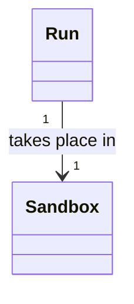
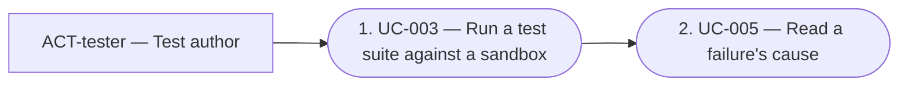

# software-analysis capability

Keep a written, checkable account of **what your software must do**, and keep it true as the software changes. The account covers who uses it (actors), what they're trying to achieve and how (use cases), the end-to-end paths across several use cases (journeys), what the words mean (glossary), and how the concepts relate (domain-model views). It also covers what binds many use cases at once: how well the system behaves, behaviour that holds across use cases, and limits on the solution (requirements).

Install it when your project is past the point where one person holds the whole picture. That's when newcomers and agents need to learn the system from something more reliable than the code alone, and when you want to know if a change makes the description false. The rule is in [software-analysis:DEC-001-software-analysis-discipline], the requirements' in [software-analysis:DEC-002-analysis-requirements], the diagrams' in [software-analysis:DEC-003-analysis-diagrams], and the domain model's in [software-analysis:DEC-004-domain-model-views].

## How it stays true

Each artefact declares what makes it true — its anchors — and when it was last revalidated, in the core friction block (COR-050). The core friction check flags it when an anchor changes. A **revalidation** then checks it, and ends as *holds*, *analysis was stale*, *code regressed* or *gap found*. A record is kept only when there's something to report. The full rule is in the decision.

- **Write** the analysis with the `analysis-author` skill, which walks each kind through its stamp, `pkit analysis new` ("Authoring" below).
- **Resolve** friction with the `analysis-resolver` agent: it proposes each flagged artefact's outcome with its evidence and the commands you run to record it, and asks you whenever it can't tell a stale analysis from regressed code ("The agent" below). It is also the fixer of your analysis: where you grant it, project-management's command that starts fixers may run it after a merge ("As the fixer of your analysis" below).

## How it meets your decisions

The analysis describes the requirements: what your system must do, and for whom. Your decisions and your architecture describe the solution: how the system is built to do it, and why. The two stay apart. The analysis points at the solution by anchors, and never the reverse (DEC-001 point 11):

- **A use case anchors the records it rests on, and the records that answer it,** with `--record` ("Stamping artefacts" below). They may be your own records, your architecture records, or records a component ships. A use case that runs on git anchors the decision to use git. One that must export a report as a file anchors the decision to write the report as CSV.
- **A use case anchors each architecture view that realises it,** where you keep one. Use `--path` on the view's file. Where a place holds the view, write an artefact anchor on it instead.
- **Nothing anchors the analysis back.** No record and no view anchors an analysis artefact. So no cycle runs between the two. No check finds such an anchor in general, so keep the rule when you write a record or a view.
- **What a record serves is computed.** A page that shows a record or a view may list what anchors it, such as "Serves: UC-003". It is worked out from the analysis's anchors, and never stored.
- **A changed use case flags none of the records that answer it,** since no anchor runs that way. Check them yourself when you change what a use case asks. The core lets a component declare a link whose source's change asks for a revisit of its targets (COR-050 point 16), and this capability declares none for a use case. It declares one for each kind of requirement, so a changed obligation asks for a revisit of what the requirement anchors ("The artefacts", below).
- **Architecture views stay outside the analysis.** A view, one kept as a documentation page included, names an analysis artefact only by its id, and states none of its facts. A context view names your actors that way, and does not describe them again.
- **What goes where.** A decision holds the choice and why it was made. A rule in a rule set says what must hold of an artefact. A requirement says what must hold of the system: a checkable obligation and, where it has them, its measure and what verifies it. So a decision names a requirement rather than restating its measure. The analysis artefact that states the requirement holds the measure.

## Adopting it

Install it with `pkit capabilities install software-analysis`. Then:

1. **Review the rule set install created.** `SAN`'s rules bind on your analysis only through a rule set of your own that inherits it. Installing creates one, `ANALYSIS`, where none of your sets inherits `SAN` already. The preview reads it too ("Where `SAN` binds: a set of your own", below).
2. **Choose each kind's parts,** which its template shows and the stamp writes. The shipped parts are a starting point you review, never a default you skip (DEC-001 point 1). For each kind:
   - review its shipped parts
   - fill a candidate with one of your own examples, and check it with `pkit analysis validate --preview`
   - keep the shipped parts, or change them in `project/structures.yaml` ("A project's own structures", below). You may relabel a part or replace its hint, and add parts of your own to an artefact kind.

   The `analysis-author` skill walks you through it, one kind at a time, in its `choose-templates.md`. A shipped part you find wrong is a change you propose to the capability.
3. **Build the analysis from its concepts up,** with the `analysis-author` skill, as its `build-analysis.md` walks it (DEC-001 point 12):
   1. the concepts and how they relate, in the glossary and the domain-model views, then the actors
   2. the requirements that bind the whole system
   3. the use cases, area by area, each area after the areas it builds on
   4. the journeys, last

   It holds for an area you add later too, and for the artefacts an agent derives on a brownfield project. `build-analysis.md` says what each artefact may use, when to go back, and when each step is done.

Steps 2 and 3 may interleave: choose a kind's parts before you write its first artefact, or its first record. A candidate that describes your project truly can be that first one. The analysis's location needs no step: it is recorded the first time you stamp an artefact ("Where things live", below).

## Where things live

Under the `analysis/` folder of your internal documentation root (COR-049) — `docs/analysis/` with the default root:

```
analysis/
├── glossary.md                      collection: one entry per term
├── domain-model/                    optional: one file per view
│   └── 010-<slug>.md                VIEW-<slug>, its number first
├── use-case-model/
│   ├── actors/
│   │   └── ACT-<slug>.md            one file per actor
│   ├── use-cases/
│   │   ├── UC-001-<slug>.md
│   │   └── <area>/UC-014-<slug>.md  optional grouping by functional area
│   └── journeys/
│       └── JRN-001-<slug>.md
├── requirements/                    the three kinds' folders
│   ├── quality/
│   │   ├── REQ-004-<slug>.md
│   │   └── <area>/REQ-009-<slug>.md optional grouping by functional area
│   ├── functional/
│   │   └── REQ-002-<slug>.md
│   └── constraints/
│       └── REQ-001-<slug>.md
└── revalidations/
    └── <date>-<subject>.md
```

A kind with many files gets a folder, and a kind with one file is a file. Folders appear only when something goes into them. These files belong to your project: uninstalling the capability leaves them in place.

### One analysis per component

A project whose system has several components may keep one analysis for each, and chooses which keep one (DEC-001 point 2). A component is a part of the system developed and versioned on its own, such as a methodology's core or one of its capabilities.

- **One analysis, as today.** A project that keeps one keeps it at the folder's top, as above, and lists nothing. It needs no change.
- **Several.** List them in the capability's settings file, `analyses` ("Configuration", below). Each lies in a folder named after its component, with the layout above:

  ```
  analysis/
  ├── core/
  │   ├── glossary.md
  │   ├── use-case-model/ …
  │   └── revalidations/
  └── billing/
      ├── glossary.md
      ├── use-case-model/ …
      ├── requirements/ …
      └── revalidations/
  ```

  A project that adds a second analysis moves the first into its own folder. Revalidate each artefact you move in the same change (COR-050 point 3).
- **Its own artefacts.** Each analysis has artefacts of every kind of its own, its own areas and its own revalidation records. Validation refuses a file that no analysis holds: one in a folder below the top while nothing is listed, and one at the top or in an unlisted folder while the analyses are listed.
- **Ids unique across them,** of every kind, with one numbering of each numbered kind, its history included (DEC-001 point 3). So an id read anywhere in the repository names one artefact. The stamp refuses an id another analysis holds, and the check refuses an id two analyses share.
- **Where it lives.** An analysis lives where its component is developed, and never ships with it. A component that moves to a repository of its own takes its analysis's folder with it, and leaves a withdrawn stub for each of its artefacts.
- **No dependency.** Keeping an analysis is the work of the repository that holds it, which installs this capability to do it, as it installs its test runner. The component itself takes no dependency on this capability, and a project that installs the component receives no analysis. Where a component moves, its new repository installs this capability to keep the analysis it takes along.

**What an analysis builds on.** An analysis builds only on the analyses of the components its component depends on (DEC-001 point 2).

- **The list.** Each entry of `analyses` names the analyses it builds on, in its `builds-on` ([Configuration](#configuration-projectconfigyaml), below).
- **The glossary's head** lists what the analysis takes from each one it builds on (the glossary's head, in [The artefacts](#the-artefacts), below).
- **An actor of another analysis** is named with that analysis, such as `core:ACT-developer`, where the head lists it. A use case, a journey and a requirement may name one this way. Each anchors the records behind it, never the actor.
- **Every other field** names artefacts of its own analysis alone, such as a journey's steps and a use case's requirements.

**Numbered areas,** such as `010-develop` (DEC-001 point 2). An area's folder name may open with a number and a hyphen. The number gives one valid order in which the areas build on each other, never their importance, and is no part of any id. So a use case keeps its `UC-NNN` whatever its area's number. The stamp's `--area` takes such a name. The order binds where a precondition's producers may lie (the check of `after`, in [Checking](#checking-pkit-analysis-validate), below).

**A domain model,** optional (DEC-004). An analysis may keep a few views of its concepts beside the glossary, in a folder `domain-model/`, one for each group of related concepts. A project with no such folder meets none of it. What a view holds is under "The artefacts", below.

**What the capability declares for you**, in its package metadata: the location `analysis`, a sub-path of the internal root, and the eight places inside it that hold anchored artefacts — the glossary, the domain model, the actors, the use cases, the journeys, and a folder for each kind of requirement (DEC-002 point 3, DEC-004 point 4). It declares the same eight one folder down too, such as `*/glossary.md` and `*/use-case-model/actors/**`, so the places match both layouts (DEC-001 point 2). The revalidation records describe an act rather than an anchored artefact, so their folder is not a place: the capability declares it, at the top and one folder down (`*/revalidations`), as a folder of **held documents** (`friction.held`; DEC-001 point 2, COR-050 point 1). The core lists each record with this capability as its owner, and no place reads one as an artefact — not your documentation root, not another capability's place — so a record is never an unanchored artefact in the friction measures, nor a document a documentation capability asks you to classify. The location is **recorded the first time you stamp an artefact**, in `.pkit/capabilities/software-analysis/project/docs-locations.yaml`, so changing the root later moves nothing already written. Each requirement place also declares a link (COR-050 point 16): a change to a requirement's `statement`, `measure` or `applies-to` asks for a revisit of every anchor but those its `actors` and `refines` list (DEC-002 point 4). The capability declares no surface: the code your analysis ought to cover is yours to declare, in the `friction.surface` key of `.pkit/project/config.yaml`.

**The types its places give.** Each place names a type from the capability's type registry, `friction.types` in its package metadata (DEC-001 point 2, COR-056). So a rule set's scope selects the analysis's artefacts by what they are, without naming the folder your analysis lies in.

| Place | Each artefact in it | Type |
|---|---|---|
| `glossary.md` | an entry | `software-analysis:term` |
| `domain-model/` | a file | `software-analysis:domain-model-view` |
| `use-case-model/actors/` | a file | `software-analysis:actor` |
| `use-case-model/use-cases/` | a file, one in an area's folder included | `software-analysis:use-case` |
| `use-case-model/journeys/` | a file | `software-analysis:journey` |
| `requirements/quality/` | a file, one in an area's folder included | `software-analysis:quality-requirement` |
| `requirements/functional/` | a file, one in an area's folder included | `software-analysis:functional-requirement` |
| `requirements/constraints/` | a file, one in an area's folder included | `software-analysis:constraint` |

- **One folder down,** each place gives the same type: a use case of any listed analysis is `software-analysis:use-case`.
- **A scope names a type in full**, as `software-analysis:use-case`. The alias `analysis` names no type.
- **No project place may give one.** None of the eight admits a project place, since the capability checks only the artefacts in its own places. `pkit validate` fails a place in `.pkit/project/config.yaml` that gives one. While the capability is installed, it also fails a bare type of your own that takes one of their names: `actor`, `use-case`, `journey`, `term`, `domain-model-view`, `quality-requirement`, `functional-requirement` or `constraint`. A bare `constraint` of your own is the likeliest to clash.
- **No kind field.** The check holds every file in a place to that place's kind, so each artefact takes the place's type without declaring anything.
- **`requirements/` is no place.** It holds the three kinds' folders. A requirement lies in the folder of its kind, and that folder gives its type (DEC-002 point 3).
- **A revalidation record has no type.** It is a held document, not an artefact.
- **Where to read it:** `pkit friction artefacts --json` gives each artefact its type and the place that gave it, and lists the registry under `types`.

## Stamping artefacts: `pkit analysis new`

Create artefacts with the stamp, never by copying a template by hand: it gives each one its id, puts it in its place and writes the anchors it must carry. `analysis` is this capability's alias; `pkit software-analysis new` is the same command.

| Command | Writes |
|---|---|
| `pkit analysis new actor <slug> [--name <text>] [--unanchored-because <text>]` | `use-case-model/actors/ACT-<slug>.md`, headed `# ACT-<slug> — <name>`, its needs in its front matter |
| `pkit analysis new term <slug> [--name <text>] [--unanchored-because <text>]` | the entry `TERM-<slug>` of `glossary.md`, with its section |
| `pkit analysis new view <slug> --number <digits> --explains <TERM-id> … [--title <text>]` | `domain-model/<number>-<slug>.md`, headed `# VIEW-<slug> — <title>`, each term it explains anchored with a section of its own, and each term's link to its section written in `glossary.md` |
| `pkit analysis new use-case <slug> --actor <ACT-id> [--other-actor <ACT-id>]… [--requirement <REQ-id>]… [--area <area>] [--title <text>]` | `use-case-model/use-cases/[<area>/]UC-NNN-<slug>.md`, its actor, each other actor and each requirement it must meet anchored |
| `pkit analysis new journey <slug> --actor <ACT-id> --step <UC-id> --step <UC-id> … [--relies-on <UC-id>]… [--requirement <REQ-id>]… [--title <text>]` | `use-case-model/journeys/JRN-NNN-<slug>.md`, its actor, its steps, the use cases it relies on and each requirement that binds its whole path anchored |
| `pkit analysis new quality-requirement <slug> [--actor <ACT-id>]… [--refines <REQ-id>]… [--area <area>] [--title <text>] [--unanchored-because <text>]` | `requirements/quality/[<area>/]REQ-NNN-<slug>.md`, headed `# REQ-NNN · Quality · <title>`, its actors and the requirements it refines anchored |
| `pkit analysis new functional-requirement <slug>`, with the same options | `requirements/functional/[<area>/]REQ-NNN-<slug>.md`, headed `# REQ-NNN · Functional · <title>` |
| `pkit analysis new constraint <slug>`, with the same options | `requirements/constraints/[<area>/]REQ-NNN-<slug>.md`, headed `# REQ-NNN · Constraint · <title>` |
| `pkit analysis new revalidation <slug> --change <ref> --trigger <trigger> --outcome <id>=<outcome> … --because <id>=<why> … [--reviewed-against "<title> @ <version> [@ <link>]"]… [--gap "<ids>: <gap> => <resolution>"]…` | a revalidation record, `revalidations/<date>-<slug>.md` — only one with something to say ("Revalidation records" below) |

Every artefact form also takes `--path <glob>` and `--record <id>`, each repeatable: the code that makes the artefact true and the decisions it relies on, written as its path and record anchors. A view takes `--record` alone (a view's anchors, in [The artefacts](#the-artefacts), below). For a use case, those decisions are each record it rests on and each record that answers it ("How it meets your decisions", above). For a requirement, the paths are the files that verify it, the narrow code that holds it and any architecture view that realises it. The records are each record it rests on or that answers it (DEC-002 points 5 and 6). Without them an actor or term is stamped unanchored, and so is a requirement with no actor and nothing it refines — the core reports that, and never fails on it. An actor, a term or a requirement nothing embodies takes `--unanchored-because <why>` instead: the reason is written as `unanchored-because` in its friction block — the core's key (COR-050 point 1), so the core's unanchored measure lists the artefact apart, with its reason, rather than counting it — and the stamp refuses it beside `--path` or `--record`, or beside a requirement's `--actor` or `--refines`.

**Several analyses.** Every form, the record's included, also takes `--analysis <component>`: the listed analysis to write in (DEC-001 point 2).

- **Where it writes.** What it writes goes in that analysis's folder, with the layout above, such as `billing/use-case-model/actors/ACT-clerk.md`.
- **When it is needed.** Name it where your settings list more than one analysis. Where they list one, the stamp writes in it. Where they list none, the stamp refuses `--analysis`, since the one analysis lies at the top.
- **What it names.** Each actor, use case and requirement it names is one of that analysis. An actor of an analysis it builds on is named with it, such as `--actor core:ACT-developer`, and the glossary's head of the analysis must list it. Nothing anchors that actor, so a use case or a journey names the records behind it with `--record`, and the stamp refuses one without.
- **Ids.** They are unique across the analyses ([One analysis per component](#one-analysis-per-component), above).

- **Ids.** A slug is a word: a lowercase letter, then lowercase letters, digits and hyphens. An actor is `ACT-<slug>` and a term `TERM-<slug>`; the stamp refuses an id already held, withdrawn or not, since an id is never used again. A use case, a journey or a requirement takes the **next free number**: one past the highest the working tree and the default branch hold, and past every number the default branch's history ever gave a file of its place — one deleted since included; when the history's number is the one it follows, the stamp says which file it was given to. Only your numbering setting frees a number ("Configuration" below): an id it frees is not counted, and the stamp says so, naming the commit, when it is the number it would have followed. A requirement's number is one numbering across the three kinds, so the stamp reads their three places as one: a number any of the three folders holds, or their history gave, is taken for all three, and a requirement moved to another kind keeps its number (DEC-002 point 2). A file's number is read from its front matter and from its name (`UC-007-<slug>.md`, as the stamp names it), so a file whose id can't be read still holds its number. The history counts the files the tree reading counts: one `git log` lists the paths ever added under the kind's place, and a path past the tree's highest number counts unless the core's reading at the commit that added it, the place then where it is now, held it as no file of the place — not a Markdown file there, or left out by `friction.exclude` — so a diagram named `UC-800-flow.svg`, or an excluded example, raises nothing, while a Markdown note named `UC-2026-notes.md` held its number while it was there and still does. A file never named after its number, and deleted since, is the one it can't count. In a shallow clone the history stops where the clone does, and the stamp says so; `git fetch --unshallow` reads it all. An actor's, term's or view's id is a slug a person chooses, not a number the stamp gives, and point 3 keeps a withdrawn one in its file or its glossary entry, where the stamp refuses it — so no history is read for one, and a slug deleted against the rule is not caught. A number has one spelling — three digits below 1000 (`UC-007`), no leading zero from 1000 on (`UC-1000`); the check refuses another (`UC-0007`), and both the stamp and the duplicate check read it as the number it spells, so it is never a second id. What the stamp numbers past is the default branch — `repository.default-branch` in the backbone configuration, `main` when undeclared, read as its upstream or `origin/<name>`, and as the local branch only in a clone with no remote (COR-054) — and, when you name one, the base `--base <ref>` names too; the stamp never reads `$PKIT_CHECK_BASE`, the base a pipeline sets for its checks, so a pipeline's base never moves where it numbers from (COR-054 point 3). When the default branch or the base names no commit here, the stamp refuses with the core's reason and fix — fetch it, declare the right one — rather than number from the working tree alone. A number another branch takes after yours is `pkit analysis check-numbers`' to report (below).
- **What it writes.** The artefact's own fields from its template, its title or name (the slug, capitalised, by default) — a use case's, journey's or requirement's title, and an actor's name, in its front matter and in its heading after the id — and the friction block with the anchors the decision asks for (DEC-001 point 4). A use case anchors to its actor and to each other actor who takes part, which `--other-actor` names and the stamp writes in its `other-actors`. A journey anchors to its actor, and to the use cases of its steps and of its `relies-on`: those outside the journey that a step relies on, which `--relies-on` names. A use case and a journey also anchor each requirement they must meet, which `--requirement` names and the stamp writes in their `requirements` (DEC-002 point 7). A requirement anchors to each actor whose need it meets and each requirement it refines, which `--actor` and `--refines` name and the stamp writes in its `actors` and `refines` (DEC-002 point 6). A view's `--explains` names the terms of its `explains`, and the stamp writes the anchors and the sections they ask for (a view's anchors and sections, in [The artefacts](#the-artefacts), below). Its heading shows its kind between its id and its title, `# REQ-004 · Quality · <title>`. Its body is rendered from its kind's structure, every part in its order, each holding its hint ("Templates and hints" below). Under a journey's *Steps* it writes one line for each of its `steps`, the use case's id and title, as the part's form asks.
- **What it leaves for you.** Each field you fill in the front matter holds its hint: an actor's needs, a term's definition, and a requirement's `statement`, `measure` and `applies-to`. So does each part of the body: a one-line comment `<!-- pkit:hint … -->` that says what goes there and gives an example. Write in its place what it asks for, and delete the hint. `pkit analysis validate` fails until you have deleted each hint, and written each `<…>` placeholder an artefact stamped earlier still holds.
- **The glossary, a collection file.** A new term is added to the file's front matter, and its section to the body, each where its id sorts among those already there; every other byte stays as it was — the file's last line ending and blank lines included, when the section goes last — and the stamp checks the result reads back as the file plus the new entry before writing. Kept sorted, two branches adding different entries touch different places of the file and merge without a conflict unless their ids are neighbours. The file is created the first time, with the heading and the opening the glossary's structure gives its head: its first sentence says what the file holds. Its line endings are kept too: a file whose every line ends CRLF — as a checkout with `core.autocrlf` writes it — is edited as LF and written back CRLF, the entry's and the section's lines included; a file with mixed line endings is refused, saying so, since which ending the new lines take cannot be told.
- **Written whole, or not at all.** Every file the stamp writes — the glossary included — goes to a temporary file beside it and is then moved over it, keeping its mode, so a failure halfway never leaves it half-written. The location is recorded only once the file is written, and only while it is not recorded yet: a write that fails leaves `docs-locations.yaml` untouched, a recording that fails puts the file back as it was, so a refused stamp writes nothing, and a stamp that needs no recording never runs it. A file or folder reached through a link is refused and the link left as it is: the core's discovery reads no link as a document, nor anything beneath a linked folder, so what the stamp wrote there would be no part of the analysis — and a file written whole would replace the link.
- **What it refuses**, writing nothing: an actor, an other actor, a step or a use case a journey relies on that is not in the analysis or is withdrawn — the check holds every use case and journey in force to the same; an other actor that is the use case's own actor, and a use case a journey relies on that is one of its steps; a journey with fewer than two steps; a journey with a step that is a use case of another actor, since a journey is one actor's path across use cases — the check holds every journey in force to the same; an actor a requirement names, or a requirement it refines, that is not in the analysis or is withdrawn — a refined one may be of any of the three kinds — and a requirement that refines itself (DEC-002 points 6 and 7); a requirement a use case or a journey lists that is not in the analysis or is withdrawn (DEC-002 point 7); a view with no `--explains`, or one naming a term twice, a term not in force in its own analysis, or a term a view in force explains already, and a `--number` that is not digits (DEC-004 points 4 and 5); a slug that is not a word, or an area that is not one after an optional number and a hyphen, such as `010-develop`; an id already held; a use case, journey or requirement while your numbering setting has an entry the stamp cannot honour ("Configuration" below); a file or folder reached through a link; a `--title`, `--name` or `--unanchored-because` still holding a placeholder the templates or the skill's commands shipped (`<Title>`, `<why>`), matched exactly — words of your own in angle brackets are yours to write.
- **Of what the stamp writes, only an actor, a term or a requirement is ever unanchored.** A use case always anchors to its actor, and a journey to its actor and its steps' use cases (DEC-001 point 4), so neither is ever without anchors, and the reason an unanchored artefact carries (point 9) never applies to them: `--unanchored-because` is an actor's, a term's and a requirement's alone. A requirement given the reason has no anchor at all: no actor, no requirement it refines and nothing in the solution, such as a requirement a stakeholder states (DEC-002 point 6).

The stamp reads the analysis through the core's reading command, `pkit friction artefacts` — the working tree's, and with `--at` the default branch's, at the commit `pkit repository base` resolves it to (COR-054 point 5) — and records the location through `pkit docs record-location` once the artefact is written; it never walks the folders itself. The value recorded is the one already in use, so running the stamp is the consent and nothing is asked (COR-049 point 5) — the `--yes` it passes is accepted and not needed — and it prints what the command says: what was recorded, the root it was derived from, and where to change it. For the default branch's history it asks git one question — every path ever added under the place the core's reading names, or a requirement's three, and the commit that added it — and the core's reading at that commit whether the path was a file of the place, only for a number past the tree's highest.

## The artefacts

Each anchored artefact's own fields sit beside the core friction block, which lives inside the `pkit:` container of its front matter (COR-050, COR-053) — the container of a document, or of each entry of a collection. Each kind's own fields have a companion schema in `schemas/`; unknown fields are refused, so a misspelt one is caught.

Each kind is shown below as its template renders it, filled. The template in `templates/` is the kind's structure rendered: every part in its order, each holding its hint ("Templates and hints" below). A part's hint is its one description, so this section describes no part. Write each part as its hint says.

**Use case** (`schemas/use-case.schema.json`, `templates/use-case.md`) — one actor's goal and how the system fulfils it:

```markdown
---
id: UC-003
title: Run a test suite against a sandbox
status: active                  # or: withdrawn (file kept, id never reused)
actor: ACT-tester
other-actors: []                # each other actor who takes part, by id
requirements: [REQ-004]         # each requirement it must meet, by id
pkit:
  friction:
    anchors:
      path:
        - src/cli/run.py
      record:
        - ADR-006
      artefact:
        - ACT-tester
        - REQ-004
---

# UC-003 — Run a test suite against a sandbox

**Goal:** Run my suite against a clean sandbox.

**Other actors:** None.

**Preconditions:** None.

**Assumptions:** None.

**Trigger:** The tester asks to run the suite.

**Main path:**

1. The tester starts a run with `--sandbox`.
2. The system builds a sandbox, runs the suite in it and shows the result.

**Variants:**

- **2a.** The sandbox cannot be built. The system says why and runs nothing, and the use case ends.

**Postconditions:** The tester holds the suite's result.

**Minimal guarantees:** A failed run leaves no sandbox behind (ADR-006).
```

- **`other-actors`** lists each other actor who takes part, by id, never the use case's own `actor`. Each is anchored as the use case's actor is, and the check requires each anchor. So a changed actor flags every use case it takes part in.
- **`requirements`** lists each requirement the use case must meet, by id, of any of the three kinds (DEC-002 point 7). The field is optional. A use case written before it needs a change only where it anchors a requirement by hand: list that requirement, or drop the anchor.
  - **Its anchors.** Each requirement listed is an artefact anchor, which the stamp writes. The check requires the requirement anchors to match the list exactly. So any change to a requirement's content flags every use case that lists it, a reworded reason included.
  - **In force.** A use case in force lists only requirements in force. So the change that withdraws a requirement also takes it off the list of each use case in force.
- **What it starts from** (DEC-001 point 1). Each line of *Preconditions* opens with its producers, the use cases in force of its analysis that make it true, any one enough, such as `**From UC-003:**` or `**From UC-059, or Environment:**`. A use case may name itself, as a release starts from the last release. What the environment gives alone is an assumption, written in *Assumptions* only. A use case that needs no other one reads `None.` there.
  - **`after`** lists the same producers as data, one entry for each line, in its order, such as `after: [[UC-003], [UC-059, environment]]`. It is optional. An entry never names `environment` alone, which the schema refuses. It draws no anchor, so a changed postcondition flags none of the use cases that follow from it. A reviewer of that change reads them.
  - **Its check** binds where `RS-SAN-009` binds, at its status ([Checking](#checking-pkit-analysis-validate), below). `pkit analysis diagram chain` draws it ([Diagrams](#diagrams-pkit-analysis-diagram), below).
- **The heading** is the id and the `title`, `# <id> — <title>`, and the check requires the two to agree. So whoever reads only the front matter sees the title the page shows. The title may change, and the id does not.
- **Steps and variants** are only ever added, since journeys and evidence cite them ("Steps and variants stay append-only", below).

**Journey** (`schemas/journey.schema.json`, `templates/journey.md`) — one actor's end-to-end path across several of its use cases, with the seams between them where the path can break. It is a summary-level path through the system, not a UX journey map:

```markdown
---
id: JRN-001
title: Run the suite and read why it failed
status: active
actor: ACT-tester
steps: [UC-003, UC-005]
relies-on: []                   # each use case outside it that a step relies on, by id
requirements: []                # each requirement that binds its whole path, by id
pkit:
  friction:
    anchors:
      path:
        - src/cli/log.py          # a seam: the run writes the log the next step reads
      artefact:
        - ACT-tester
        - UC-003
        - UC-005
---

# JRN-001 — Run the suite and read why it failed

**Goal:** Run my suite and read why a test failed.

**Steps:**

1. UC-003 — Run a test suite against a sandbox
2. UC-005 — Read a failure's cause
   - **Needs from step 1 (UC-003):** the run's log. A run cut short writes no log, so no cause can be read.

**Variants:**

- **1a.** Every test passes. The path ends after step 1.

**Postconditions:** The tester knows why each failed test failed.

**Minimal guarantees:** None.
```

It has a use case's `id`, `title`, `status`, `actor` and `requirements`, and its heading, plus `steps` and `relies-on`:

- **`steps`** are the use cases it passes through, in order, at least two, each a use case of its `actor`.
- **`relies-on`** lists each use case outside the journey that a step relies on, of any actor, and none of its steps.
- **`requirements`** lists only the requirements that bind the journey's whole path (DEC-002 point 7). A requirement that binds one of its steps is that step's use case's to list. Listed by the journey too, one change would flag both for one obligation. No check can tell the two apart, so whoever writes the journey decides.
- **Its anchors.** `steps` and `relies-on` are the source of its use-case anchors. The stamp writes their use cases into the artefact anchors, beside the journey's actor. The check requires the use-case anchors to match the two, and the actor anchor to be there. Its requirement anchors match `requirements` exactly, as a use case's do. Add the code at the seams as path anchors.

**Actor** (`schemas/actor.schema.json`, `templates/actor.md`) — a named role that uses the system, not a persona. It is a file of its own, `use-case-model/actors/ACT-<slug>.md`. Its needs sit in its front matter, a few lines above the description its body gives, so a tool reads them as data and never from the body (DEC-001 point 1):

```markdown
---
id: ACT-tester
name: Test author               # may change; the id does not
status: active
needs:
  - Run the suite against a clean sandbox
pkit:
  friction:
    anchors:
      path:
        - src/cli/**
---

# ACT-tester — Test author

Whoever writes and runs the project's tests.

**Occasions:** With every change.

**Context:** The suite, and a sandbox to run it in.
```

The heading is the id and the `name`, `# <id> — <name>`, and the check requires the two to agree, as it does a use case's title. The id is the slug the file is named by, and never changes.

**Glossary** (`schemas/term.schema.json`, `templates/glossary.md`) — one collection file, serving everything (DEC-001 point 2):

```markdown
---
TERM-sandbox:
  name: sandbox
  status: active
  definition: throwaway environment a suite runs in, built for one run and removed after it
  pkit:
    friction:
      anchors:
        path:
          - src/sandbox/**
---

# Glossary

The words of the domain and what each means. A term's id is stable, and its name may change. The names it replaces are kept.

## TERM-sandbox — sandbox

**Example:** the tester runs the suite in a sandbox, and the system removes it once the run ends.

**Distinctions:**

- **Workspace:** the tester's own checkout. The system builds a sandbox from it for one run, and leaves the workspace as it was.
```

- **Its front matter** maps each term's id to its entry. Each entry has a `name`, a `status` and a `definition`. The definition takes the form `definition` ("Each kind's structure", below). On a rename, the entry keeps the former names in `replaces`, newest first. The id never changes.
- **Its body** opens with the file's head, which the stamp writes once. Then it has one `## <id> — <name>` section per entry.

**The glossary's head.** In an analysis that builds on others, the head lists what it takes from each (DEC-001 point 2). Its front matter holds the data, `builds-on`, a list, so no reader takes it for a term. The opening below the heading shows it:

```markdown
---
builds-on:
  - analysis: core
    version: 1.149.0                # the version its links name
    terms:
      - {id: TERM-change, name: change}
    actors:
      - id: ACT-developer
        name: Developer
        needs: [Know which bills a change made stale.]
TERM-bill:
  …
---

# Glossary

The words of the domain and what each means. A term's id is stable, and its name may change. The names it replaces are kept.

- **From core at 1.149.0:** the area `change`.
  - **Term:** [change](https://example.org/v1.149.0/analysis/core/glossary.md#term-change--change)
  - **Actor:** [Developer](https://example.org/v1.149.0/analysis/core/use-case-model/actors/ACT-developer.md)
    - Know which bills a change made stale.
```

- **The data.** Each entry names the analysis by its component, the version its links name, each term and actor by its id there and its name, and the needs each actor brings to this analysis. No definition is copied. Its shape is checked always, as a kind's schema checks front matter.
- **The text.** One top-level item per entry, in order, opens `**From <analysis> at <version>:**`, then the area it builds on in words. Nested in it, one `**Term:**` item per term, then one `**Actor:**` item per actor, each its name as a link to its home in that analysis. Each actor's needs are nested under it, exactly. The check holds the text to the data where the format rule binds, as a part's form (`builds-on-matches-front-matter`). An item that does not open `**From ` is the writer's own.
- **What the check holds.** Only a listed analysis builds on another, and its head names only analyses its entry builds on. A term of its own never takes the name of a term its head lists. Where its component declares the lowest version it needs of the other, a link naming another version is warned of, and never failed. Which version a link names is your choice.
- **What reads it.** An actor named with another analysis, such as `core:ACT-developer`, resolves against the head's actors. The readers point gives each actor the needs every head states for it ("Connections", below).

**Domain-model view** (`schemas/domain-model-view.schema.json`, `templates/domain-model-view.md`) — a group of related concepts, each explained in a section of its own, and drawn as they relate (DEC-004). It is a file of its own, `domain-model/<number>-<slug>.md`:

````markdown
---
id: VIEW-runs-and-sandboxes
title: Runs and sandboxes
status: active
explains: [TERM-run, TERM-sandbox]   # the terms it explains, in the order of its sections
pkit:
  friction:
    anchors:
      record:
        - ADR-006
      artefact:
        - TERM-run
        - TERM-sandbox
---

# VIEW-runs-and-sandboxes — Runs and sandboxes

The concepts of running a suite, and the sandbox each run takes place in.



## Run

A run is one pass of a suite, from its start to its result.

**Attributes:** The suite it runs, and its result.

**Relations:** Each run takes place in one sandbox, built for it alone.

**States:** A run is running until its last test ends, then done.

**Always true:** A run that fails leaves no sandbox behind (ADR-006).

## Sandbox

A sandbox is where one run takes place, apart from the tester's workspace.

**Attributes:** None.

**Relations:** Each sandbox serves one run.

**States:** None.

**Always true:** None.
````

- **Its file's name** opens with a number and a hyphen, which give the view's place in the domain model's order, in the form you choose. Its id is `VIEW-` and the rest of the name, so a view given another number keeps its id (DEC-004 point 4).
- **`explains`** lists the terms whose concepts it explains, one at least, in the order of its sections. Each is a term of its own analysis, in force while the view is. No two views in force explain one term.
- **Its sections.** Each is headed by the name of the term `explains` lists in its place, in sentence case: its first letter capitalized, the rest as the name writes it (DEC-004 point 2). So the term `sandbox` heads its section `## Sandbox`. A name whose first word holds a capital already, such as `iPhone app`, stands as it is. A diagram labels each concept's box the same way, which no check reads. In the glossary and in prose, the name stays as running text writes it (DEC-001 point 1). No two headings give one slug, so a page anchored on one, such as `VIEW-runs-and-sandboxes#sandbox`, names one section.
- **Its anchors.** Each term `explains` lists is an artefact anchor, which the stamp writes, and the check requires them to match the list. A changed definition then flags the view that explains it. It also anchors the records its statements cite or apply, and no code. Nothing in the analysis anchors a view (DEC-004 point 5).
- **Its order.** A view names a concept that another view of its analysis explains only where that view's number is lower (`RS-SAN-011`).
- **Each term's link.** A term a view in force explains carries an unlabelled line under its heading in the glossary, before its first part, that links to its section. The stamp writes it, and the check holds it equal to the view, whatever any rule's status (DEC-004 point 7). A term no view explains carries none. For the view above:

  ```markdown
  ## TERM-sandbox — sandbox

  Explained in [VIEW-runs-and-sandboxes](domain-model/010-runs-and-sandboxes.md#sandbox).

  **Example:** …
  ```

  The link is part of the term's content, so a change to it flags whatever anchors the term. A view renumbered or renamed, a section added, moved or taken out, and a view withdrawn each change a link.
- **A section added by hand.** Add its term to `explains`, in the section's place. Then write the term anchor and the term's link that the check names: its message gives the anchors to write, and the line, word for word. Moving a section to another view moves its term between the two lists, their anchors and its link, in the same change.

An actor or a term nothing embodies carries `unanchored-because:` in its friction block instead of anchors — the reason onboarding accepts it unanchored (DEC-001 point 9). The key is the core's, not one of the artefact's own fields (COR-050 point 1): `pkit friction check --all` lists the artefact apart with its reason and never counts it as unanchored, and `pkit validate` refuses the reason beside anchors.

```yaml
id: ACT-sponsor
name: Sponsor
status: active
needs:
  - See what the project delivers for my funding
pkit:
  friction:
    unanchored-because: No code or decision embodies it. It funds the project.
```

**Requirements** — what binds many use cases at once, in three kinds (DEC-002 point 1). Each requirement is a file of its own in its kind's folder, `requirements/<kind's folder>/REQ-NNN-<slug>.md`. Each kind has a companion schema and a template named as its type:

- **A quality requirement** (`quality-requirement`) says how well the system must behave, such as how fast, how reliably or how safely.
- **A functional requirement** (`functional-requirement`) is behaviour that holds across use cases, such as a business rule of your domain. Behaviour that serves one actor's goal is a use case, not a functional requirement.
- **A constraint** (`constraint`) limits the solution. The design takes it as given.

Each is shown below as its template renders it, filled. A quality requirement:

```markdown
---
id: REQ-004
title: Show a run's result quickly
status: active                  # or: withdrawn (file kept, id never reused)
statement: The system shows a suite's result within two seconds of the run's end.
measure: 95 of every 100 runs show their result within two seconds.
applies-to: Every run of a suite.
actors: [ACT-tester]            # each actor whose need it meets, by id
refines: []                     # each requirement it refines, of any kind, by id
pkit:
  friction:
    anchors:
      path:
        - tests/test_timing.py  # the test that verifies it
      artefact:
        - ACT-tester
---

# REQ-004 · Quality · Show a run's result quickly

**Verified by:** A timing test runs the suite a hundred times and measures when each result shows.

**Rationale:** A tester waits on the result before the next change.
```

A functional requirement has the same fields and the same parts:

```markdown
---
id: REQ-002
title: Record who started each run
status: active
statement: Every run records the person or the pipeline that started it.
measure: None.
applies-to: Every run, whichever way it starts.
actors: [ACT-tester]
refines: []
pkit:
  friction:
    anchors:
      path:
        - src/run.py            # the narrow code that holds it
        - tests/test_run.py     # the test that verifies it
      artefact:
        - ACT-tester
---

# REQ-002 · Functional · Record who started each run

**Verified by:** A test starts a run from the command line and from the pipeline, and reads whom each run's record names.

**Rationale:** A tester who finds a failed run asks who started it.
```

A constraint has the same fields, and *Verified by* too. In the place of *Rationale*, its *Imposed by* says who or what imposes it:

```markdown
---
id: REQ-001
title: Run suites on the client's machines
status: active
statement: The system runs every suite on a machine the client owns.
measure: None.
applies-to: The whole system.
actors: []
refines: []
pkit:
  friction:
    anchors:
      record:
        - ADR-002
---

# REQ-001 · Constraint · Run suites on the client's machines

**Verified by:** None.

**Imposed by:** The client's contract keeps the client's test data on the client's own machines (ADR-002).
```

- **One numbering.** A requirement's id is `REQ-NNN`, one numbering across the three kinds, so a requirement moved to another kind keeps it. The kind shows beside the id, in the folder and in the heading, `# REQ-004 · Quality · <title>` (DEC-002 point 2).
- **Its fields.** `statement`, `measure` and `applies-to` state the obligation, so a tool reads them from the front matter (DEC-002 point 4). `measure` reads `None.` where there is none yet. `applies-to` never does. It names no use case or journey: those that must meet the requirement list it in their `requirements`, and `pkit analysis met-by` shows them ("What meets a requirement", below; DEC-002 point 7).
- **Its parts.** *Verified by* names each test, check or review by what it does, never by its path. The file of each test or check is a path anchor of the requirement (point 5). *Rationale* says why the requirement is needed. A constraint's *Imposed by* says who or what imposes it, and why the design cannot choose otherwise. Each may read `None.`.
- **Its anchors.** Each actor in `actors` and each requirement in `refines` is an artefact anchor. It also anchors the records it rests on or that answer it, the architecture views that realise it, the files that verify it and the narrow code that holds it (DEC-002 point 6). A requirement with no anchor at all may give the reason it has none in `unanchored-because`, as an actor or a term may.
- **A changed obligation revisits its anchors.** A change to `statement`, `measure` or `applies-to` asks for a revisit of every anchor outside the analysis: the records, the views, the files that verify it and the code that holds it (DEC-002 point 4). The anchors that `actors` and `refines` list stay out. In the same change, change each of them, or record on the requirement why it still stands or which open follow-up will revisit it:

  ```
  pkit friction revisit REQ-004 --target path:tests/test_timing.py --outcome unchanged --reason "The test checks two seconds, and the measure still asks for two."
  ```

  The core's change check reports each target that neither changed nor has such an entry, and fails it where the project enforces friction (COR-050 point 16). A change to a body part asks for no revisit. Nor does a change of kind or a withdrawal, so whoever makes one revisits what the requirement anchors.
- **No kind field and no classification.** The folder gives the kind. A project that wants a standard's quality characteristics adds them as a part of its own.

**Revalidation record** (`schemas/revalidation-record.schema.json`) — no friction block; stamped by `pkit analysis new revalidation` as `revalidations/<date>-<subject>.md` ("Revalidation records" below). Its template, `templates/revalidation-record.md`, shows a planned record whole. The stamp writes every part from its command line, with no hints. A record of drift reads:

```markdown
---
change: "#123"                  # the work item, pull request or range of commits on the default branch that carried it
trigger: drift                  # planned | drift | scheduled | close | onboarding
date: 2026-10-02                # the day in UTC, as a revalidation's `at` is
by: Alex                        # a person, or an agent
confirmed-by: Sam               # who confirmed an agent's outcomes, or decided stale
outcomes:                       # each artefact covered, withdrawn ones included
  UC-003: holds                 # holds | analysis-stale | code-regressed | gap-found
  JRN-001: analysis-stale
evidence:                       # optional: the executed results drawn on, each copied whole from the evidence point
  - id: UC-003@78981922613b2afb6025042ff6bd878ac1994e85#pytest-bridge.test-run.test-sandbox   # <artefact>@<commit>#<check>: its own three fields
    artefact: UC-003
    commit: "78981922613b2afb6025042ff6bd878ac1994e85"
    check: pytest-bridge.test-run.test-sandbox
    result: passed              # supports UC-003's `holds`
    ran: tests/test_run.py::test_sandbox
---

# 2026-10-02 — The run shows a failure's cause

## Outcomes

- **UC-003 — holds.** A run still builds its sandbox and shows the result, and the passing result the record copies supports it.
- **JRN-001 — analysis-stale.** The run now shows a failure's cause itself, as #123 meant, so step 2 is stale. Sam confirmed it.

## Gaps

None.
```

Evidence supports an outcome and never stands in for one: each artefact the record draws evidence for has its outcome. The record **copies** each entry of the evidence point it draws on, whole and in the point's shape (Connections, below), rather than naming it by id: a record is permanent history, while the point holds what its fillers report now, so an id alone would point at nothing once a filler stops reporting that commit. The copy is the evidence the record shows. A planned record also names the sources of the design it reviewed, in `reviewed-against` ("Revalidation records" below).

## Each kind's structure: `schemas/artefact-kinds.yaml`

Each kind's structure is declared once, as data, in `schemas/artefact-kinds.yaml` (DEC-001 point 1). It lists the parts of the kind's body in their order, and the forms and hints of the front-matter fields a writer fills. Its shape is `schemas/artefact-kinds.schema.json`, a strict superset of living-docs' `page-kinds.schema.json`.

- **The kinds:** `actor`, `use-case`, `journey` and `term`, the three kinds of requirement, `quality-requirement`, `functional-requirement` and `constraint`, and `domain-model-view`, keyed by the types their places give, and `revalidation-record`, which has no type.
- **A kind shown beside its id.** A requirement's kind names itself in `shown-as`, such as `Quality`, and its heading reads `# <id> · <shown-as> · <title>` (DEC-002 point 2). An actor, a use case and a journey show none, and are headed `# <id> — <title>`, an actor by its name. Your own structures relabel no `shown-as`.
- **Each element of a body** has an `id`, permanent once shipped, and a `type`. A part a kind retires is listed under its `retired` ids, never renamed, and its id is never given again. No kind has retired one yet. The types:
  - `heading`: a heading's `level` and, where the kind fixes it, its `text`
  - `label`: a bold label, such as `**Goal:**`, that opens a paragraph or a top-level list item
  - `opening`: the text before the first label, such as an actor's description
  - `repeated`: a section that repeats, once for each entry of a front-matter list, each headed at its `level` and holding the parts its own `sections` give. A view's section for each concept is one (DEC-004 point 2). Every heading of its level is one of its sections.
- **Every part is required.** A part with nothing to say reads `None.`, where its element sets `allows-none: true`. A front-matter field a writer fills may say the same: `allows-none: true` lets it read `None.`, as a requirement's `measure` may, and `false` refuses it, as a requirement's `applies-to` does. A field that says neither is judged by its form alone.
- **A hint and an example** go with each part and each front-matter field a writer fills, one line each. A hint says what goes there. A heading the stamp writes has an example and no hint.
- **Forms:** a part or a front-matter field may name a form, a check on its content from a closed list. A list form, such as `numbered-steps`, judges only the part's list items. The `sentence` form judges the whole part as one text, and refuses a list in it ("Each body against its structure", below).
- **The glossary, a collection:** the `term` kind declares each entry's section, and the file's `head`. The head is the file's heading and opening, which the stamp writes once, when it creates the file.

The parts each kind ships:

| Kind | Its body's parts, in order | May read `None.` | Front matter a writer fills |
|---|---|---|---|
| `actor` | the heading, an opening, *Occasions*, *Context* | *Occasions*, *Context* | `needs`, each of the form `sentence` |
| `use-case` | the heading, *Goal*, *Other actors*, *Preconditions*, *Assumptions*, *Trigger*, *Main path*, *Variants*, *Postconditions*, *Minimal guarantees* | *Other actors*, *Preconditions*, *Assumptions*, *Variants*, *Minimal guarantees* | none |
| `journey` | the heading, *Goal*, *Steps*, *Variants*, *Postconditions*, *Minimal guarantees* | *Variants*, *Minimal guarantees* | none |
| `term` | each entry's heading, *Example*, *Distinctions* | *Example*, *Distinctions* | `name`, `definition` of the form `definition`, and `replaces` |
| `domain-model-view` | the heading, an opening, then a section for each concept: its heading, an explanation, *Attributes*, *Relations*, *States*, *Always true* | *Attributes*, *Relations*, *States*, *Always true* | none |
| `revalidation-record` | the heading, `## Outcomes`, `## Gaps` | *Gaps* | `reviewed-against` |
| `quality-requirement` | the heading, *Verified by*, *Rationale* | *Verified by*, *Rationale*, and the field `measure` | `statement` of the form `sentence`, `measure`, `applies-to`, `actors` and `refines`. `statement` and `applies-to` never read `None.` |
| `functional-requirement` | the heading, *Verified by*, *Rationale* | *Verified by*, *Rationale*, and the field `measure` | the same as a quality requirement's |
| `constraint` | the heading, *Verified by*, *Imposed by* | *Verified by*, *Imposed by*, and the field `measure` | the same as a quality requirement's |

The forms, each described in the schema:

| Form | Where | What it holds |
|---|---|---|
| `sentence` | a use case's and a journey's *Goal*, each of an actor's `needs`, and a requirement's `statement` | one sentence, ending where the *How* of `RS-SAN-001` says |
| `numbered-steps` | a use case's *Main path* | items that each open with a number, no number twice |
| `variants` | a use case's and a journey's *Variants* | items that each open with a step's number and a letter, such as `2a.` |
| `steps-match-front-matter` | a journey's *Steps* | one line for each of its `steps`, in order, with each hand-over under the step that needs it |
| `outcomes-match-front-matter` | a record's *Outcomes* | one item for each of its `outcomes`, in order, opening `**<id> — <outcome>.**` |
| `gaps-match-outcomes` | a record's *Gaps* | one item for each gap, labelled with the ids it affects and holding its `**Resolution:**` |
| `definition` | a term's `definition` | a phrase with no article first, no full stop last, and no word of the term's name |
| `headings-match-front-matter` | a view's sections for its concepts | one section for each of its `explains`, in order, headed by that term's name in sentence case, no two headings giving one slug |

**What binds it.** An artefact kind's structure is the checkable part of the format rule, `RS-SAN-001`. It binds where that rule binds, through a rule set of your own, and at the rule's status, which is accepted ("The method rule set: `SAN`", below). The revalidation record's structure binds always. A record is a held document, which no rule binds on, so the capability checks it itself (DEC-001 point 1). A kind's companion schema still checks its front matter whatever the rule's status.

**What reads it.** The check, `pkit analysis validate`, holds each record's body to it always. It holds each artefact's body and front matter to it, every part and every form, where the format rule is accepted and binds, and previews it before ("Each body against its structure", below). The stamp renders each body from it, and each template's body is the same rendering (below). Both read it as your own file changes it ("A project's own structures", below). A test holds the file to its schema.

### Templates and hints

Each kind's template in `templates/` is its structure rendered, so it shows exactly the structure: every part, in its order. Nothing reads a structure out of a template (DEC-001 point 1).

- **The front matter** is written by hand, and a test holds it to the kind's schema.
- **The body** is rendered from the declaration, and a test holds the committed template equal to the rendering. The stamp renders each body the same way, and never copies a template's lines.
- **A part's hint is its placeholder.** Where you write a part, the stamp leaves its hint in its place: one line, a comment marked `pkit:hint`, with the part's example after it. Here is a use case's *Goal* as the stamp writes it, its hint and its example shortened to `…`. Their one home is the declaration. The template, rendered from it, shows them whole.

  ```markdown
  **Goal:** <!-- pkit:hint … Example: … -->
  ```

- **A front-matter field's hint is its placeholder too.** Where the stamp leaves a field for you to fill, it writes the field's hint as the field's text: the same marked comment, with the field's example after it. Those fields are an actor's `needs`, a term's `definition`, and a requirement's `statement`, `measure` and `applies-to`. A field that takes a list holds one item, its hint. A YAML parse reads the hint as text, so the front matter stays valid while you fill it. The template's front matter, written by hand, shows the same hints, and a test holds the two equal. An actor's `needs`, shortened in the same way:

  ```yaml
  needs:
    - '<!-- pkit:hint … Example: … -->'
  ```

- **A hint left in,** in a field or in the body, is refused by the placeholder check whatever the format rule's status, and the message repeats the hint. The mark is matched outside code spans and fenced code, so a text may quote it.
- **A hint is advice.** What binds is a part's presence, its order and its form. A hint names no style.
- **A collection file's head,** the glossary's heading and its opening, is written once, when the stamp creates the file. The opening's first sentence says what the file holds. After that it is yours to reword.
- **A revalidation record carries no hints,** since its stamp writes every part from its command line. Its template shows each part's example, as one planned record.
- **What the shipped hints and examples hold to:** short sentences, no semicolons, and no project's style. Each example is plain. So they suit any project's writing rules. A test holds every hint and example to that floor: no sentence over 25 words, and no semicolon.

## A project's own structures: `project/structures.yaml`

You change each kind's shipped structure in a file of your own, `.pkit/capabilities/software-analysis/project/structures.yaml` (DEC-001 point 1). The file is yours, and sync never touches it. Its shape is `schemas/structures.schema.json`, bound to it by its path (COR-023), so `pkit validate` checks it with your other data. Without the file, each kind's structure stands as it ships.

```yaml
pkit_schema: software-analysis:structures
schema_version: 1
kinds:                    # keyed by kind, never by file
  actor:
    relabel:              # no rule: a shipped part's label, hint and example, by its id
      occasions: {label: Comes, hint: "When the role comes to the system.", example: "Weekly."}
    front-matter:         # no rule: a shipped field's hint and example, by its name
      needs: {hint: "What the role needs, in one sentence.", example: "Export my report."}
    tighten:              # each group names the rule of yours that asks for it
      - rule: RS-LOC-001
        closed: true
        add:
          - {id: setup, label: The setup, after: opening, hint: "Where the role works.", example: "A lab."}
          - {id: notes, label: Notes, after: context, hint: "Anything else.", example: "None yet.", required: true}
```

**What you change with no rule.** Neither tightens anything, so each binds wherever the shipped structure binds.

- **A part's label, hint and example** (`relabel`, by the part's id). A label is a label's text, or the text of a heading the kind fixes, such as a record's `## Gaps`. The part keeps its id, its place, its form and whether it is required. A project that writes in another language gives its own labels this way.
- **A field's hint and example** (`front-matter`, by the field's name). The stamp writes your hint as the field's placeholder.

**What you tighten, naming your rule.** Each group under `tighten` names, in `rule`, a rule of your own rule sets. You tighten an artefact kind only. No rule binds on a revalidation record, so a tightening of the record's kind could never bind, and the file refuses one (below).

- **`add`:** a part, a label by default or a `heading` with its `level`, placed `after` an element. It has a hint and an example, and may take `allows-none` and a `form` from the shipped list. It is optional unless it sets `required: true`.
- **`require`:** a shipped optional part made required. Every part the capability ships is required today, so this changes nothing yet, and the check says so.
- **`closed: true`:** the kind's list of labels is closed. A bold run that ends in a colon and opens a line or a top-level list item, and that no part declares, is reported. A part with a form is not read for it. Every other part is, such as a term's *Distinctions*, whose items open with the word they set apart. So close a kind only where its parts hold no labels of their own.

**Where an addition goes.** Right after the element it names, before any shipped part that follows that element. Additions that name one element keep the file's order. An addition may name another addition, and comes right after it. So the sketch above puts *The setup* before the shipped *Occasions*.

**What is refused**, as errors on the file whatever any rule's status, since the file is yours to mend:

- a key the schema does not take, so no entry drops, loosens or reorders a shipped part, or invents a form
- a `tighten` under `revalidation-record`: a record is a held document, which no rule binds on, so the capability checks its structure itself. Relabel its parts instead. The record's kind takes no tightening until a rule set can reach a held document (DEC-001 point 1).
- a kind the capability does not ship, since a new kind needs a decision of its own (DEC-001 point 11)
- a part, a field or an `after` the kind does not hold, or one it retired (a kind's `retired` ids in `schemas/artefact-kinds.yaml`)
- an id or a label two parts take, a label holding `*`, and a cycle of additions
- a part placed between a title heading and the opening text below it, which would take the opening's lines: name `opening` instead
- a heading of any level but the one just below the kind's own heading: a shallower one would end the artefact's section, and a deeper one would read as the content of the part before it
- a heading in a domain-model view, of any level: its headings are its title and its concepts' sections (DEC-004 point 2). A label added after `opening` goes in its opening, and one after a part of a concept's section goes in each of its sections
- a label for a part with no text, and a hint for a heading the stamp writes
- a hint or an example holding `-->` or a line break

While any of these stands, none of the file applies: the check holds no body to a structure, and the stamp refuses.

**A group whose rule does not stand.** The rest of the file still applies, and the stamp leaves the group out.

- A group whose `rule` is no rule of your own rule sets binds nothing, and is an error.
- A group whose rule is superseded or withdrawn binds nothing, and is reported, with the rule that replaces it.

**When a tightening binds.** At the status of its rule's chain, and where the format rule binds, at its status (DEC-001 point 1). The chain is the rule and each rule whose extension point it fills, since a fill binds only while both are accepted (COR-051 point 7).

- **On an artefact:** the group binds on each artefact the rule binds on, as `pkit rule-sets reach` reads it, the backbone's one reading of where a rule binds. That reading judges the chain too. A rule that binds on none of the analysis's artefacts of the kind is reported, where the analysis holds one. The report names the causes: no scope selects one, a pin behind its set holds the rule back, a rule it fills does not bind there, or the sets that select one bring different fills for a point it fills.
- **A rule of the chain proposed:** the group binds nothing. A label it adds still ends the part before it, so a part that binds nothing never makes another fail.
- **The preview** (`--preview`) takes the format rule as accepted, and each group whose chain is proposed. It reads `pkit rule-sets reach --preview`, which says where a rule would bind if every proposed rule were accepted. The format rule is previewed there, and a group binds there too, and what it adds to what a body breaks where it binds only under the preview is a preview's report. A proposed rule that would bind on none of the kind's artefacts even then is a preview's report too. What binds without the preview still comes from the reading without it, so the check's own findings and its exit stay the normal check's.

**What reads it.**

- **The check** holds each body to the structure its kind ships, as your file relabels it, tightened by each group that binds on it. A message for a part a group adds or requires cites its rule beside `RS-SAN-001`.
- **The stamp** writes each body the same way, with every group whose rule is yours and is proposed or accepted. A new artefact is in no reading of where a rule binds yet, so the stamp writes each such part, its hint naming the rule. Delete an optional part you have nothing for. The stamp writes a revalidation record whole, with your relabels.
- **A record, and a withdrawn artefact,** may predate your changes. So a part you relabelled is found by its shipped label too. A withdrawn artefact is never failed by a closed list, or for a part you added that it lacks.
- **The committed templates** show the structure as it ships, never your changes.

## Checking: `pkit analysis validate`

`pkit validate` runs the check as its `software-analysis:artefacts` member, so it runs wherever your check gate runs `pkit validate`; `pkit analysis validate` runs it alone, and `--json` prints the findings document it reads. It is a query: read-only, offline, and `pkit sync` provisions its dependencies. It reads the working tree — and the evidence point, when a record copies evidence — so the same tree gets the same answer as long as the evidence fillers read the tree alone. A file your `friction.exclude` leaves out is no part of the analysis: the check reads nothing of it, and the stamp counts no number it holds — as friction neither counts such a file nor asks it for an answer (COR-050 point 7). The same goes for a revalidation record under an excluded path: the core still lists it as this capability's held document, marked as excluded, and the check neither counts nor checks it. It fails on:

- **a file in a place that is not its kind's shape** — a file without front matter, or whose front matter does not parse, a glossary that is not a collection, an actor, use-case, journey or requirement file holding entries. What such a file holds can't be read, its ids included, and an id is never used again, so it is never skipped: the number a use case's, journey's or requirement's name carries still counts as held;
- **a file under `requirements/` outside the three kinds' folders** — `requirements/` holds the three kinds' folders and is no place itself, so such a file is a requirement of no kind. The check holds it to none, and the stamp counts no number it holds (DEC-002 point 3). Move it into its kind's folder, or leave it out with `friction.exclude`. The check reads these files from `pkit friction artefacts`. An installed backbone too old to give them fails the check too, and the check says it could not look;
- **missing required parts** — an artefact's own fields against its schema, and a collection entry whose key is not its kind's id;
- **a placeholder left unfilled** — what the stamp leaves for you to write is no part of the analysis until you write it: an own field, or an actor's or term's `unanchored-because` in its friction block, still holding a placeholder the templates or the skill's commands ever shipped (`<Title>`, or an actor's `<what this actor needs …>` and a term's `<what the term means …>`, which the stamp wrote before each field held its hint), or a body — an actor's, a use case's or a journey's, or a term's section with its heading — still holding one of the templates'. Each is matched against those texts exactly, and the capability keeps every one it ever shipped, so a reworded template never hides an old placeholder, and words of your own in angle brackets — `maps <user id> to a session`, code a body quotes — are never taken for one;
- **a hint left in** — an own field, such as a requirement's `statement`, `measure` or `applies-to`, a body, or a term's section, still holding a hint, `<!-- pkit:hint … -->`, outside code spans and fenced code. The message names the field, or gives the body's line, and repeats the hint. Like a placeholder, it needs no rule;
- **an actor, a use case, a journey or a requirement whose heading is not its id and its title or name** — `# UC-003 — <title>`, the `title` its front matter gives, or an actor's `# ACT-tester — <name>`, its `name`. A requirement's heading shows its kind between the two, `# REQ-004 · Quality · <title>`, as its kind's `shown-as` names it, so a requirement moved to another kind's folder is headed by its new kind (DEC-002 point 2);
- **duplicate ids** — two artefacts holding one id, a number spelt with other zeros included: `REQ-0004` and `REQ-004` are one id, and the id check refuses the first. A requirement's number is one across the three kinds, so a quality requirement and a constraint never share one;
- **a use case, journey or requirement whose name carries a number its front matter doesn't give** — `UC-007-<slug>.md` with no `id`, or with `id: UC-008`: the stamp counts the number the name carries, so the front matter says the same — write the id, or name the file after it;
- **a requirement whose file's name carries no number** — its file is `REQ-NNN-<slug>.md`, named after its id, so its path shows its kind beside its id (DEC-002 point 2);
- **an actor whose file's name is not its id** — `ACT-tester.md` holding `id: ACT-other`: an actor's id names its file (DEC-001 point 3), so the two say the same — name the file after its id, or correct `id`;
- **a use case or journey naming what the stamp would refuse** — an actor, a use case's other actor, a journey's step or a use case it relies on, that is not in the analysis, or that is withdrawn while the use case or journey is in force. A withdrawn artefact may name withdrawn ones: it is history;
- **a use case's `other-actors` naming its own actor, or a journey's `relies-on` naming one of its steps** — each list names only what the use case or journey names nowhere else;
- **a journey with a step that is a use case of another actor** — a journey is one actor's path across use cases, so each step's use case has the journey's `actor` as its own. The message names the step and both actors. The stamp refuses the same. A withdrawn journey is history, so its steps are not compared;
- **a use case not anchored to each actor it involves**, its actor and each of its `other-actors`, or **a journey not anchored to its actor**, so a changed actor would not flag it;
- **a journey whose use-case anchors do not match its steps and its `relies-on`** — the message names the anchors to write;
- **a requirement naming what it may not** — an actor in its `actors`, or a requirement in its `refines`, that is not in the analysis, or that is withdrawn while the requirement is in force, and the requirement itself in its `refines`. A requirement it refines may be of any of the three kinds. A withdrawn requirement may name withdrawn ones: it is history (DEC-002 points 6 and 7);
- **a requirement whose anchors within the analysis do not match its `actors` and `refines`** — it anchors each actor and each requirement the two fields name, and no other actor, term, use case, journey or requirement. The message names the anchors to write. A circle of requirements that refine each other is then a cycle of anchors, which `pkit validate`'s `friction` member refuses (COR-050 point 5);
- **a use case or journey listing a requirement it may not** — an entry of its `requirements` that is no requirement of the analysis, of any of the three kinds, or that is withdrawn while the use case or journey is in force. A withdrawn one may list withdrawn ones: it is history (DEC-002 point 7);
- **a use case or journey whose requirement anchors do not match its `requirements`** — it anchors exactly the requirements it lists. A part anchor on a requirement, such as `REQ-004#`, names the requirement before its last `#` (COR-050 point 2), so it counts among them, and matches no entry of the list. The message names the anchors to write;
- **a domain-model view whose file's name opens with no number, or gives another id than its front matter's** — `010-orders.md` holding `id: VIEW-other`: its name opens with its number and a hyphen, and its id is `VIEW-` and the rest of the name (DEC-004 point 4);
- **a view's `explains` naming what it may not** — a term that is not in the analysis, one of another analysis, or a withdrawn one while the view is in force. A withdrawn view may name withdrawn ones: it is history (DEC-004 point 5);
- **a term two views in force explain** — the view whose path sorts first keeps it, and each other is named, at its `explains`;
- **a view whose term anchors do not match its `explains`**, or that carries a path anchor (a view's anchors, in [The artefacts](#the-artefacts), above). The message names the anchors to write;
- **a term's link that does not match the view that explains it** — missing, written otherwise, written twice, or left where no view in force explains the term. The message gives the line to write, word for word (DEC-004 point 7);
- **a revalidation record** whose front matter does not fit its schema, or whose outcomes cite an id that is no artefact of the analysis (withdrawn ones are fine);
- **a revalidation record copying evidence for an artefact it gives no outcome**: evidence supports an outcome and never replaces it, so the record is incomplete whatever the evidence says;
- **an evidence entry whose `id` is not its own `<artefact>@<commit>#<check>`** — the entry's `artefact`, `commit` and `check`: the id is the three parts the result is for, and whether the id or those fields are meant cannot be told, so nothing else is read from that entry;
- **a journey's evidence naming a step that is no use case of the analysis** — a journey's `steps` are the use cases its run passed through. Withdrawn ones are fine, and the journey's steps as they stand now are never compared: the record is history.

Where you keep several analyses, it also fails on (DEC-001 points 2 and 3):

- **a file no analysis holds** — one in a folder below the top while your settings list no analyses, and one at the top, or in a folder no entry lists, while they do. A revalidation record included;
- **an entry of `analyses` listed twice** — a component or a folder named by two entries, and an analysis that builds on itself or names one twice;
- **an analysis building on one its component does not depend on** (`builds-on`, in [Configuration](#configuration-projectconfigyaml), below);
- **an id two analyses share** ([One analysis per component](#one-analysis-per-component), above);
- **a field naming another analysis's artefact** — every field names its own analysis's artefacts, but for an actor named with an analysis it builds on, such as `core:ACT-developer`;
- **an actor named with another analysis that it may not name** — its analysis is not listed, does not build on that one, or its glossary's head does not list the actor from it;
- **a glossary's head data that breaks its shape, or names an analysis it may not** (the glossary's head, in [The artefacts](#the-artefacts), above);
- **a term whose name is that of a term its head lists** (the glossary's head, in [The artefacts](#the-artefacts), above).

Where `RS-SAN-009` binds, it holds each use case in force that writes `after` (DEC-001 points 1 and 12). Accepted, each departure is an error. Proposed, as the rule ships, `--preview` reports it where the rule would bind, and the normal check says it checked nothing. It fails on:

- **a producer that is no use case in force of its own analysis, nor `environment`** (what a use case starts from, in [The artefacts](#the-artefacts), above);
- **an `after` its words do not match** (what a use case starts from, in [The artefacts](#the-artefacts), above). A line of *Preconditions* that opens with no producer breaks it, and so does `None.` beside an `after`;
- **a precondition whose producers all lie in later areas** — where the use case's area carries a number, at least one producer lies in its own area or a lower-numbered one, and the environment counts as one before every area. A producer in an area without a number, or in none, is left to a reviewer.

The schema holds the shape of `after` whatever the rule's status. A use case that writes no `after` is not read, and nor is a withdrawn one.

It warns, and never fails, on:

- **a head whose links name another version than the floor its component declares** (the glossary's head, in [The artefacts](#the-artefacts), above);
- **a result at odds with its outcome** — a `failed` result copied for an artefact whose outcome is `holds`, or a `passed` one for `code-regressed`: a passing result supports *holds* and a failing one is a regression's proof, so the outcome or the evidence is likely wrong;
- **a copy that differs from what the evidence point now holds under its id**: the copy strayed from its source, or the result at that commit was reported again otherwise;
- **a capability's entry of the evidence point whose `check` opens with another name than the capability's** — a capability's checks open with its own name, so its results stand beside another filler's and only a real double claim collides. Your own entries are exempt: writing under a capability's check is how you replace that capability's entry (Connections, below);
- **an entry of the evidence point whose `id` is not its own `<artefact>@<commit>#<check>`**, whoever supplied it: a record that copies it is held to its own three fields;
- **no rule of `SAN` binding on any of the analysis**, once a rule of `SAN` is accepted: no set of yours that selects the analysis inherits it, or a pin behind its set holds it back ("Where `SAN` binds: a set of your own", below).

It says nothing of an id the point no longer holds, or of a point that does not resolve: the record's copy is the evidence, and a filler that stops reporting an old commit is ordinary. It reads the point, through `pkit connections resolve`, only when some record copies evidence — so a project with no such record sees neither warning on the point's own entries.

While no rule of `SAN` is accepted, it reports, and never fails on, **no rule of `SAN` binding on any of the analysis**, since none could bind yet.

It reports, and never fails on, **an open regression**: a record's `code-regressed` artefact that has not been revalidated since the record — its `at` falls on no later day (UTC) than the record's date. The defect the record names is still open, or its fix was never revalidated against the artefact. It is worked out from the records and the artefacts each time, never kept in a ledger.

A time written unquoted in a record's front matter, such as a source's `version` in `reviewed-against`, is read by YAML as a time and not as the text written. The check says so, and asks you to quote it.

Friction itself, dead anchors and the friction block's own shape are the core's checks (`pkit validate`'s `friction` member and `pkit friction check`), which report front matter that does not parse too; an unanchored artefact is the core's measure, never an error. So is `unanchored-because` beside anchors: the reason says why an actor, a term or a requirement has none, so one that has anchors says two things at once. The stamp refuses the pair, and a hand edit that writes it fails `pkit validate`'s `friction` member (`unanchored-beside-anchors`, COR-050 point 12).

### Each body against its structure

The check holds each body to the structure its kind declares ("Each kind's structure", above), as your own file changes it ("A project's own structures", above).

- **A revalidation record's body,** always, whatever any rule's status. A record is a held document, which no rule binds on, so the capability checks it itself, as it checks the record's front matter (DEC-001 point 1). A finding on it cites the decision, not the format rule.
- **An artefact's body:** each actor's, use case's, journey's, requirement's and domain-model view's, and each glossary entry's section, where the format rule, `RS-SAN-001`, is accepted and binds ("Where `SAN` binds: a set of your own", below). An artefact no set of yours makes the rule bind on is not checked, and the summary counts it.
- **The glossary's head,** where the format rule binds on a term of its file. The head belongs to no term, but it is part of the term kind's structure.

It fails on:

- **a declared part that is missing, out of order or empty;**
- **`None.` in a part or a front-matter field that may not read it**, such as a use case's *Trigger* or a requirement's `applies-to`, which always has something to say;
- **text of the `sentence` form that is not one sentence**, in a part such as a use case's *Goal*, or in each of an actor's `needs`. Where a sentence ends is the rule's *How*: at `.`, `?` or `!` followed by a space and a capital letter, and at the text's end. So "e.g. for" and "3. října" end none, while "Dr. Smith" ends one: reword such a text. A text in a script without capital letters, such as Chinese or Arabic, is never split. The *How* also says what counts as a space, and that code ends no sentence.
- **a part of the `sentence` form that holds a Markdown list**, at the list's first item: the part is one text, and holds no list, not even inside a block quote. A front-matter list, such as an actor's `needs`, is no part: each of its items is one text.
- **a part or a field that breaks another form its structure gives it:**
  - `numbered-steps`, a use case's *Main path*: no numbered step, a step that opens with no number, or a number used twice. A step's number is its list marker, `2.`, or the number its text opens with, `**2.**`. Numbers need not run in sequence, since steps are only ever added, as `pkit analysis check-numbers` checks ("Steps and variants stay append-only", below).
  - `variants`, a use case's or a journey's *Variants*: neither `None.` nor a list, or a variant that does not open with a step's number and a letter, `2a.` or `**2a.**`, or that names a step the use case's *Main path* or the journey's *Steps* does not number.
  - `steps-match-front-matter`, a journey's *Steps*: not one numbered item for each of its `steps`, in order and numbered from 1, each reading `<id> — <title>` with that use case's title exactly. Under a step, each hand-over opens a line with `**Needs from step 1 (UC-005):**`, an earlier step's number and id, or with `**Needs from UC-009 (outside this journey):**`, a use case the journey's `relies-on` lists and none of its steps, and text follows. Each use case in `relies-on` has a hand-over.
  - `outcomes-match-front-matter`, a record's *Outcomes*: not one item for each of its `outcomes`, in order, each opening `**<id> — <outcome>.**` exactly with its reason after it.
  - `gaps-match-outcomes`, a record's *Gaps*: neither `None.` nor one item for each gap, each opening with a bold label of the ids it affects, such as `**UC-001, JRN-001:**`, every id one of `outcomes`, and holding `**Resolution:**` with text after it. Each `code-regressed` or `gap-found` artefact is named by a gap, so *Gaps* reads `None.` only where none is.
  - `definition`, a term's `definition`: a phrase that opens with an article, `a`, `an` or `the`, ends with a full stop, or holds a whole word of the term's `name`, in any case.
  - `headings-match-front-matter`, a view's sections for its concepts: no `##` section, a heading that is not the name of the term its `explains` lists in its place, in sentence case, a section of no term, a term with no section, or two headings that give one slug. A message on a part of one of its sections names that section by its heading.
- **a label no part declares**, where a rule of yours closes the kind's list of labels and binds on the body.

Each message gives the part's hint and example. How the check reads a body:

- **What marks a part.** A heading, or a bold label such as `**Goal:**` that opens a line or a top-level list item. Only a label the kind declares marks a part, so a variant's `**2a.**` is content.
- **Where a part ends.** A label sits one level below the heading it follows. Its part runs to the next declared label, or to a heading of its level or above. So under a use case's `#` heading, a `##` section ends the part above it, and a `###` one stays inside it.
- **A part's list.** Items are read as Markdown reads a list, save that fenced code stays whole, up to its closing line, with the item it opens in. A wrapped line indented under an item's text stays in the item, even one that starts `2026.`. Not indented, a line that starts with a number and a full stop opens an item, as Markdown shows it. A line right below a label that starts `2.` continues the label's line, so start a list right below a label with `1.` or a bullet, or after a blank line. Under a label that opens a list item, such as `- **Steps:**`, the list nested in that item is the part's, and an item of your own beside it, such as `- **Note:**`, is not.
- **What you add passes.** A label or a section of your own is never reported. It is content of the part it falls in, though. So text you add inside a part of the `sentence` form, such as *Goal*, counts toward its one sentence, and a list you add there breaks the form. A list form judges only its items, so a lead line or a note of your own outside them passes.
- **Code and comments.** A label in fenced code or in an HTML comment marks nothing. A comment is no content, so a part that holds only a comment, such as its hint, is empty, and an opening that holds only its hint is missing. A `<!--` inside a code span that closes on its own line opens no comment.
- **A field still holding its hint** is not judged against its form: the hint left in is the placeholder check's, above.
- **A glossary entry** is read within the lines `pkit friction artefacts --json` gives as its section's `span`, the text friction compares as the entry. The glossary's head is its body above the first entry.
- **A withdrawn artefact** is never failed for a part it lacks, or for a form, since either may have come after its withdrawal. The parts it carries are still checked for order, for content, and for `None.` where it may not stand.
- **A revalidation record** is held to the structure declared now, the only one the capability has declared. Holding a record to the structure in force on its day comes with the first change to a structure (DEC-001's Implications). Your relabels may come after a record was written, so a part you relabelled is found by its shipped label too.
- **A missing heading** of an actor, a use case, a journey or a requirement is the heading check's, above, which reports it whatever the rule's status.

**The rule is accepted**, so where it binds, each finding above is an error, and `pkit validate` fails on it. While a rule is proposed, the check reports nothing of what it binds, and its summary says so (COR-051 point 4). A record's structure is checked all the same. `pkit analysis validate --preview` previews a proposed rule as if it were accepted, where `pkit rule-sets reach --preview` says it would bind: through a set of yours that inherits `SAN`. Each finding it would fail on is listed at the severity `report`, its message opening `preview:`, and the exit status stays the normal check's. With no such set, it previews nothing. `pkit validate` runs the normal check, with no preview. A superseded or withdrawn rule binds nothing, in a preview too.

## What meets a requirement: `pkit analysis met-by`

`pkit analysis met-by [<REQ-id>] [--json]` lists each requirement the analysis holds, or the one you name, with the use cases and journeys in force that list it in their `requirements` (DEC-002 point 7). It is worked out from their lists each time, and the requirement never stores it. So it never goes stale, as a list kept on the requirement would when a use case drops it. A page that shows a requirement may read it here, and list it under "Met by".

```
REQ-001 · Constraint · Run suites on the client's machines
  Met by: none
REQ-004 · Quality · Show a run's result quickly
  Met by:
    UC-003 — Run a test suite against a sandbox
```

- **What it lists.** Each requirement in the order of its number, headed by its id, its kind and its title, and marked `(withdrawn)` when it is. Under it come the use cases, then the journeys, that list it.
- **Only what is in force meets it.** A withdrawn use case or journey is history, and meets nothing. One in force that lists a withdrawn requirement is shown under it, and the check refuses it ("Checking", above).
- **Complete, or no answer.** A file among the use cases, the journeys or the requirements that holds no artefact of its kind gives no answer, such as one whose front matter does not parse. So does a requirement, or a use case or journey in force, that gives no id of its kind's shape, or a `requirements` that is no list. What such a file lists, or which requirement it is, cannot be told. So the command exits 1 and names the file, and `pkit analysis validate` says what is wrong with it. A requirement you name that the analysis does not hold gives no answer too.
- **`--json`** prints `{schema_version, requirements}`. Each requirement is `{id, kind, shown_as, title, status, path, met_by}`, and each entry of `met_by` is `{id, kind, title, path}`.

It is a query: read-only and offline. It reads the working tree through the core's reading command, `pkit friction artefacts`, as the check does.

## Diagrams: `pkit analysis diagram`

`pkit analysis diagram [<subject>] [--json]` prints the analysis's diagrams as Mermaid, drawn from its front matter each time ([software-analysis:DEC-003-analysis-diagrams]). Nothing is stored, so a diagram never goes stale. GitHub draws each fence it prints. Here is the flow of the journey above:



- **What it draws** (DEC-003 point 4):
  - **The use-case diagram:** the system's boundary, the use cases inside it and the actors around it. An arrow joins each use case to its `actor`, and a line joins it to each of its `other-actors`. An analysis with no use case in force has none.
  - **A journey's flow:** its actor, then its `steps` in order. The use cases of its `relies-on` stand in a group of their own, with no arrow, since which step relies on which is in its body.
  - **The requirement map:** each requirement, the use cases and journeys that list it in `requirements`, the requirements it `refines` and its `actors`.
  - **The chain of use cases** (DEC-003 point 5): which use case follows from which, drawn from each use case's `after`, where one in force writes it. Its use cases are grouped by area, the areas in the order of their numbers, and an arrow runs from each producer to its use case. The environment is one node. An arrow from a producer in a later area is dotted, as an alternative its use case's area does not build on. A solid arrow that other solid arrows imply, through a third node, is left out, the use cases of one loop of solid arrows counting as one node. A dotted arrow, an arrow from a use case to itself and an arrow within a loop are never left out. The picture shows one reading of the chain: it does not tell a precondition's alternatives from several preconditions, and the use cases are what `RS-SAN-009` judges.
- **The subject.** `use-cases`, `journeys`, `requirements` or `chain` names a diagram. A journey's id names its flow, and a requirement's id its map. With no subject, it prints every diagram the analysis has something to draw for.
- **One analysis each** (DEC-003 point 6). Where your settings list several analyses, `--analysis <component>` names the one it draws, and the command refuses to guess. Where they list one, it draws that one. An actor of another analysis, such as `core:ACT-developer`, is the one node drawn from beyond the analysis's edge, among the actors, by that id alone.
- **Front matter only.** No diagram draws a use case's main path or a journey's seams, which lie in the body (DEC-003 point 3).
- **Only what is in force.** A withdrawn artefact draws nothing. A reference to an artefact the analysis does not hold in force draws nothing either, and the check reports it. A journey's step keeps its place in the order, drawn by its id alone.
- **Its text alternative.** Each diagram opens with an `accTitle` that names it and an `accDescr` that says in words what it shows. It holds no styling, so it looks as GitHub, or your site, draws it.
- **The same bytes.** The same analysis prints the same text, its nodes sorted and its node ids stable.
- **Where a copy may go.** Never into an analysis artefact, and never into a view of the solution, such as an architecture page or a record (DEC-003 point 9). A copy on any other page is that page's diagram, and the page anchors each artefact it draws.
- **Complete, or no answer.** A file of a place a diagram reads that holds no artefact of its kind gives no answer. So does an artefact there with no id of its kind's shape, or one in force whose list a diagram reads that is no list of ids, or, for the chain, a use case in force whose `after` is no list of lists. The command exits 1 and names the file, and `pkit analysis validate` says what is wrong with it. A subject that names no diagram, and a journey or a requirement not in force, give no answer too.
- **`--json`** prints `{schema_version, diagrams}`. Each diagram is `{id, title, description, mermaid}`, its `mermaid` text without the fence.
- **What comes later:** a generated overview of the analysis's diagrams, kept fresh in a folder of its own (DEC-003 point 8).

It is a query: read-only and offline. It reads the working tree through the core's reading command, `pkit friction artefacts`, as the check does.

## The method rule set: `SAN`

`rule-sets/san.md` is this capability's method rule set (COR-051), cited `software-analysis:SAN`. It holds eleven rules. Each has DEC-001, DEC-002 or DEC-004 as its origin, save the source rule, which names who decided it and when.

- **Two accepted rules,** each of which a check enforces in part: the format rule (DEC-001 point 1), and the append-only rule (DEC-001 point 3).
- **Nine proposed judgement rules,** which declare no check but the rule of logical consequence. Its check holds what a script can read of `after`. They cover:
  - a use case's actors and its goal (DEC-001 points 1, 2 and 4)
  - what an artefact's anchors name (DEC-001 points 2, 4, 9 and 11, DEC-002 points 5 to 7, and DEC-004 point 5)
  - a requirement against the records it rests on (DEC-002 point 8)
  - the source of each goal, minimal guarantee and requirement
  - the domain concepts an artefact uses, which the glossary defines (DEC-001 point 12, and DEC-004 point 3)
  - what makes each precondition true, the rule of logical consequence (DEC-001 points 1, 2 and 12)
  - which other analyses an analysis names (DEC-001 point 2)
  - the order of a domain model's views (DEC-004 point 6)

| Rule | Status | Statement |
|---|---|---|
| `RS-SAN-001` | accepted | An analysis artefact carries its kind's declared structure. |
| `RS-SAN-002` | accepted | A use case's steps and variants keep their numbers and letters. |
| `RS-SAN-003` | proposed | A use case's actor is the one whose goal it is, and each other actor that takes part in it is one of its `other-actors`. |
| `RS-SAN-004` | proposed | A use case's goal is one of its actor's needs. |
| `RS-SAN-005` | proposed | An analysis artefact's anchors name what its statements rest on. A use case's or a requirement's anchors also name the decisions that answer it and the architecture views that realise it. |
| `RS-SAN-006` | proposed | A requirement never contradicts an accepted decision record it rests on. |
| `RS-SAN-007` | proposed | Each goal, minimal guarantee and requirement names its source. |
| `RS-SAN-008` | proposed | An analysis artefact uses a domain concept only where a term of the glossary defines it, and names the concept by that term's name. No two terms define one concept. |
| `RS-SAN-009` | proposed | A use case starts only from what is already true. Each of its preconditions names the use cases of its analysis that make it true. |
| `RS-SAN-010` | proposed | An analysis artefact names another analysis only where its component depends on that analysis's component, and names an optional one only as an option. |
| `RS-SAN-011` | proposed | A domain-model view names a concept that another view of its analysis explains only where that view's number is lower. |

- **What the format rule binds.** The presence and the order of every part an artefact kind ships, and the form of each part and front-matter field its structure gives one. It binds the glossary's head too, wherever it binds on a term of the glossary. A withdrawn artefact is held to no part or form that came after its withdrawal. A revalidation record is no artefact, so the rule does not cover it: the capability checks a record's structure itself, always. A hint binds nothing, so the voice a hint asks for is no part of the rule. For text of the `sentence` form, the rule's *How* says where a sentence ends, and that a part of that form holds no list.
- **What the append-only rule binds.** A use case's steps and variants keep their numbers and letters across a change, and a new one goes past them, as the rule's *How* says.
- **What the judgement rules ask.** Each judges an artefact in force, never a withdrawn one, as its *How* says.
  - A use case's actor is the one whose goal it is. Each other actor that takes part in it is one of its `other-actors` (`RS-SAN-003`).
  - A use case's goal states one of its actor's `needs`, whole (`RS-SAN-004`).
  - An artefact's anchors name the code and the decisions its statements rest on. For a use case, see also "How it meets your decisions", above, and for a requirement and a domain-model view, its anchors in [The artefacts](#the-artefacts), above (`RS-SAN-005`). A use case and a journey rest on the requirements they list too, and the check holds those anchors.
  - A requirement's `statement`, `measure` and `applies-to` never contradict an accepted record it rests on. The record wins until it is changed. A conflict between two requirements is no break of it, since a decision record holds that choice (`RS-SAN-006`).
  - Each goal, minimal guarantee and requirement names its source. A source takes one of four forms (`RS-SAN-007`):
    - an accepted record the artefact anchors that decides the item or was made to meet it
    - a filled *Rationale* or *Imposed by*
    - anchored code that already does it
    - a person's decision quoted in the artefact, with their name and the date
  - Each artefact uses a concept of your domain only where a term defines it, and names it by that term's name. A term's definition is judged too, and no two terms define one concept. A name a term replaces, or a word of the writer's own for a defined concept, breaks the rule. Its *How* says what uses no concept, such as an actor's name, quoted words and code. A Mermaid diagram's labels are statements, and are judged. A domain-model view's section explains its term's concept in the term's own sense. The rule holds what the build order leaves in the analysis ("Adopting it", above) (`RS-SAN-008`).
  - Each precondition of a use case names its producers, the use cases that make it true. In a numbered area, the order binds where they may lie (the check of `after`, in [Checking](#checking-pkit-analysis-validate), above). What the environment gives alone is an assumption, stated once. Its *How* says what a check of `after` can hold, and seven limits a reviewer judges. `SAN` declares the capability's check of `after` under its `checks`, so a reviewer leaves that part to it ("Checking", above) (`RS-SAN-009`).
  - An analysis names another only where its component depends on that one's, and an optional one only as an option. Across analyses, an artefact anchors the records behind what it takes, never another analysis's artefacts (`RS-SAN-010`, `RS-SAN-005`).
  - A domain-model view names a concept that another view of its analysis explains only where that view's number is lower. A change that adds a section to a view owns the break where a view numbered at or below it already names that concept (`RS-SAN-011`).
- **What judges them.** A reviewer judges each where it binds, such as the rule-set reviewer (COR-057), and leaves `RS-SAN-009`'s declared part to its check. While the rules are proposed, they bind nothing, and nothing judges them.
  - **What they leave out.** The stamp and the check refuse some things whatever any rule's status, such as a use case's actor the analysis does not hold. The *How* of `RS-SAN-003` and of `RS-SAN-005` names what each leaves to them.
  - **Why in their own words.** A check declared under `checks` enforces its part only where its rule binds (COR-051 point 2). These checks run whatever any rule's status, so the rules leave those parts out in their own words instead.
  - **A change to anchors alone.** It alters no artefact's content, so the rule-set reviewer judges nothing there (COR-057 point 1). The friction check asks for the artefact's revalidation instead (COR-050 point 6).
  - **A break that starts outside a use case.** A change that records a decision answering a use case, or adds a view that realises it, alters no use case. So the rule-set reviewer does not judge the use case's missing anchor there (COR-057 point 1). Add that anchor in the same change.
  - **A break that starts in the glossary.** A change that renames, withdraws or redefines a term alters only the term. So the rule-set reviewer judges none of the artefacts that still use its old name or meaning (COR-057 point 1). A rename the rule-set reviewer judges on the term itself, which breaks `RS-SAN-008` while an artefact in force uses a name it replaces. Find each use of the term's name, and of the names it replaces, and mend them in the same change.
  - **A break that starts outside a requirement.** A change that accepts or changes a record a requirement rests on alters no requirement. So the rule-set reviewer judges no contradiction there (COR-057 point 1). The friction check flags the requirement instead, so check it against the record when you revalidate it (COR-050).
  - **Moving your pin.** Accepting a judgement rule gives `SAN` a new major. The change that moves your set's pin to it brings every artefact the rule binds on under the rule. Each break the rule's text settles is then that change's, and withholds the rule-set reviewer's approval (COR-060 point 1). It weighs most for `RS-SAN-007`, since every goal, guarantee and requirement without a source breaks it, and for `RS-SAN-008`, since every concept of your domain, in the rule's sense, that the glossary does not define breaks it. Besides mending each in that change, COR-060 point 2 gives these ways out:
    - leave a file out of your set's scope until it is mended, such as one area at a time, in the order the analysis is built
    - propose a change to the rule, or do not inherit `SAN`
    - where a gate requires the reviewer, override a judgement held wrong, as that gate allows
- **What each gates.** The format rule gates the check of each artefact kind's structure, since that structure binds at the rule's status (DEC-001 point 1). The append-only rule gates the check that keeps a use case's steps and variants append-only. The format rule and the append-only rule are accepted, so each check fails on what it finds where its rule binds. While a rule is proposed, its check reports nothing (COR-051 point 4). `pkit analysis validate --preview` shows what the structure check would report ("Each body against its structure", above), and `pkit analysis check-numbers --preview` what the append-only check would ("Steps and variants stay append-only", below). A kind's schema checks the front matter of an artefact or a record whatever any rule's status.
- **What the checks settle.** `SAN` declares, under `checks`, what this capability's checks enforce of the format rule and the append-only rule (COR-051 point 2). Of the format rule, `software-analysis:validate` enforces what the rule binds, above, as far as it holds it ("Each body against its structure", above). That command is the one `pkit validate` runs as its `software-analysis:artefacts` member. Of the append-only rule, `software-analysis:check-numbers` enforces that no step or variant the base held is renumbered or removed ("Steps and variants stay append-only", below). `pkit validate` never runs that command, so run it in your check gate, or that part of the rule goes unchecked ("A number keeps its meaning", below). Whoever judges the rest of a rule leaves that part to the check, and `pkit rule-sets reach` lists the part wherever the rule binds.
- **Its name and scope.** `SAN` takes no scope, as no method rule set does (COR-051 point 2). You never edit it (COR-051 point 6). Its name is reserved in your project. A rule set of yours named `SAN` clashes with it, and `pkit validate` fails on the clash (COR-051 point 3).

### Where `SAN` binds: a set of your own

`SAN` takes no scope, so its rules bind only through a rule set of your own that inherits it (COR-051 point 7). Where that set's scope selects an artefact, the check holds the artefact to `SAN`'s accepted rules, as `pkit rule-sets reach` answers.

**Installing creates the set.** The capability declares one project rule set in its package metadata, `ANALYSIS` (COR-017; DEC-001, Implications). `pkit capabilities install software-analysis` creates it in the `rule-sets` folder under your internal documentation root (COR-049), `tech-docs/rule-sets/analysis.md` with that root at `tech-docs/`:

```markdown
---
rule-set: ANALYSIS
version: 1.0.0
inherits: [software-analysis:SAN@1]
scope:
  types: [software-analysis:actor, software-analysis:term, software-analysis:domain-model-view, software-analysis:use-case, software-analysis:journey, software-analysis:quality-requirement, software-analysis:functional-requirement, software-analysis:constraint]
rules: {}
---

# ANALYSIS — The project's rules for its analysis
```

- **Only where none inherits `SAN`.** A set of yours that inherits `SAN`, directly or through another set, is your choice already, and install creates nothing.
- **Never over your content.** Where a rule set of yours cannot be read, a set already takes the name `ANALYSIS`, or a file lies at the path, install creates nothing and says why. Write the set yourself then, in the shape above.
- **It is yours.** Edit it, add rules to it, or remove it. Nothing creates it again while the capability stays installed. Uninstalling refuses while it stands, since it inherits `SAN`.
- **An earlier install.** A project that installed the capability before 0.2.0 has no set from its install. The upgrade's migration creates it, on the same conditions. `pkit capabilities project-rule-set software-analysis` shows whether install would create it, and what it would write.
- **Its scope** selects the analysis by the capability's types, so it reaches the artefacts wherever they lie. A revalidation record has no type, and no scope selects one. The capability checks a record's structure itself.
- **A set created before the domain-model view** selects no `software-analysis:domain-model-view`. Add it to its scope, so `SAN` binds on your views. Until you do, the check counts each view among the artefacts no rule of `SAN` binds on.
- **A set created before the requirement kinds** selects the four types DEC-001 gives, and none of the three DEC-002 adds. It is yours, so nothing changes it. Add `software-analysis:quality-requirement`, `software-analysis:functional-requirement` and `software-analysis:constraint` to its scope, so `SAN` binds on your requirements. Until you do, the check counts each requirement among the artefacts no rule of `SAN` binds on.
- **Its pin,** `SAN@1`, decides when a new major of `SAN` starts binding. Accepting a rule of `SAN` gives `SAN` a new major. Your pin then falls behind, and no rule of `SAN` binds through it until you review the new major and update the pin (COR-051 point 7). `pkit rule-sets reach` lists each rule a pin behind its set holds back. `SAN` 1.0.0 accepted its format rule and its append-only rule, so a set pinned at `SAN@0` binds neither, and `pkit validate` fails on its pin, until you re-pin it.
- **A set you have already** that selects the analysis may inherit `SAN` instead, before you install, and install then creates none. Changing what a set inherits gives that set a new major.
- **Never silent.** The check's summary counts the artefacts no rule of `SAN` binds on. Where it binds on none of the analysis, the check says so, at the analysis's folder. It reports this while no rule of `SAN` is accepted, and warns once one is. Neither fails `pkit validate`. If you choose not to inherit `SAN`, you keep the warning.

## A number keeps its meaning: `pkit analysis check-numbers`

`pkit analysis check-numbers [--base <ref>] [--json] [--preview]` runs two checks. Both guard one promise: a number, once given, never changes meaning (DEC-001 point 3). The second fails on a use case's step or variant renumbered or removed ("Steps and variants stay append-only", below). The first fails on **a number two branches took**: a use case, journey or requirement numbered in your working tree — by its front matter or by its file's name, as the stamp counts a number — whose number the default branch took too since your branch left it, for an artefact of another line of work: its tip holds the number, or its history since gave it a file removed since. The first to reach the default branch keeps the number, and a number is never used again; renumber yours before merging (`pkit analysis new` gives the next free one). Once the default branch is merged in, a number both took is two files holding one id, which `pkit validate` reports as a duplicate.

Requirements share one numbering across the three kinds' folders (DEC-002 point 2). So a quality requirement your branch numbers `REQ-002` collides with a constraint the default branch numbered `REQ-002`. And a requirement moved to another kind's folder keeps its number, and collides with nothing.

Where you keep several analyses, one numbering runs across them ([One analysis per component](#one-analysis-per-component), above). So a use case your branch numbers `UC-007` in one analysis collides with a `UC-007` the default branch gave another.

It knows an artefact by its id, never by its path, and tells your own work landed from another line of work's by the default branch's file for the number — its bytes, then its name:

| Case | Outcome |
|---|---|
| a use case moved into an area, or a requirement moved to another kind's folder — on your branch, on the default branch, or both — that the default branch held when your branch left it | no collision: neither side took the number |
| the default branch took the number since your branch left it, in a file of another name | **a collision**, an error: renumber yours |
| the same, the default branch having removed its file since — deleted, or renumbered | a collision all the same: a number is never used again, and the stamp counts it held |
| the same, for a number your numbering setting frees ("Configuration" below) | no collision: the number is free again, as the stamp counts it |
| your branch stacked on a parent that was squash-merged (or rebased) onto the default branch, its file unchanged since | no collision: the default branch's file for the number is, byte for byte, a version your branch's history wrote — your own work, landed, which git merges as one file |
| the same, your branch having moved the file into an area since | no collision reported here; once the default branch is merged in, the id is in two files — git pairs no rename where the merge-base holds neither — and the duplicate check catches it there: keep one |
| the default branch's file for the number has the name a file of your branch has for it — in your working tree, or added by your branch's history — but other bytes: a parent edited after your branch left it, then squash-merged; an edit on the default branch after the squash; a conflict resolved in a rebase; a sibling merged into your branch; or two branches that stamped the same slug | **a warning**, never an error: possibly your own work landed — merge the default branch and keep one file; otherwise renumber yours. Only you know which it is; once merged, git asks which to keep where the two share a path, and the duplicate check names both where they do not |
| the same number for files two lines of work wrote to the very byte | no collision: git merges them as one file |

It reads the default branch — its tip, where your branch left it, and its history between, as the stamp reads a history — so it answers about your change rather than the tree, and it is not a member of `pkit validate`: run it as a line of its own in your check gate, beside `pkit friction check`, with the same base. The base is `--base <ref>`, else `$PKIT_CHECK_BASE`, else your project's default branch — `repository.default-branch`, resolved as the core resolves it for every reader (COR-054): a collision is judged at the merge at hand, so a pipeline's base for its checks applies here. The check reads the base — its tip and where your branch left it — in `pkit repository base --json`, and never resolves a base or computes a merge-base itself. Like the friction change check:

- it **fails when the base names no commit** here — a default branch whose remote holds no copy in your clone included — or shares no history with `HEAD`, rather than passing without comparing, with the core's reason and fix: fetch it, declare the right one, or name another. A working tree that numbers nothing has nothing to compare and says so; it reads no base, and reads the default branch only to check your numbering setting, when you have one;
- it **reports an outdated base** — one that moved on after your branch left it, which is when it can have taken a number since — and never fails on it, with the same `base` document `pkit friction check --json` gives.

**Where it answers.** It compares your branch with the default branch *before* they are merged, so run it where that is what it sees — locally, or in a pre-push hook, against the default branch. That is where the rules of the table run, own work landed told from another line of work's included. In CI:

- a **`pull_request` checkout is GitHub's test merge** of your branch into the default branch, which contains the base: `check-numbers` finds nothing to collide with there, and says so. The real CI gate for a number two branches took is `pkit validate`'s duplicate-id check on that merged tree;
- a **depth-1 clone** — the default of `actions/checkout` — holds no merge-base, and may hold no `origin/<default-branch>` at all, so this line fails, as the friction check does, rather than pass without comparing. Fetch the history back to where your branch left the default branch: `fetch-depth: 0` on `actions/checkout`, or `git fetch --unshallow origin` (`git fetch --deepen=<n>` until `git merge-base origin/<default-branch> HEAD` answers).

### Steps and variants stay append-only

Journeys and evidence cite a use case's step by its number, and a variant by its step's number and its letter, such as `2a`. Renumbering one points every citation at another step without a word, so steps and variants are only ever added. The second check compares each use case in your working tree with the same use case where your branch left the base. For each step or variant the base held there:

| What your change did to it | Outcome |
|---|---|
| its text stands under another number or letter, and no longer under its own | **renumbered**, an error naming the use case, the number or letter, and where it stands now |
| neither its number or letter is left, nor its text under another | **removed**, an error naming the use case and the number or letter |
| its number or letter holds other text, and its own text stands nowhere else | an edit, which passes: the check cannot tell a reworded step from another one |

- **What passes.** A step or a variant added passes, whatever new number or letter it takes. The rule gives a new step a number higher than every number of its use case, so one added between two takes such a number too, and the path keeps its order. The check leaves that number to judgement. A use case new in your change has nothing to compare, and passes. A step that no longer happens stays under its number, as the rule says.
- **It matches text alone.** So it misses a step renumbered and reworded at once whose old number still holds a step. And a new step that repeats, word for word, the old text of a step you reword reads as that step renumbered: word the new step apart.
- **What it reads.** A use case is known by its id, so one moved into an area is compared too. Its steps are the numbered items of its *Main path*, and its variants the lettered items of its *Variants*. Both are read as the structure check reads them, with your own structures' labels. A step's text is what follows its number, white space aside.
- **Which base.** The number check's base, read where your branch left it, as the friction change check reads a change. So what the default branch did since is not your change's. A clone that lacks the base, or where your branch left it, fails as above, rather than passing.
- **Where it binds.** Where the append-only rule, `RS-SAN-002`, binds, and at its status, as the structure check holds a body where the format rule binds ("Each body against its structure", above). Accepted, as the rule is, each finding is an error. While a rule is proposed, nothing is compared, and the summary says so. `--preview` compares where `pkit rule-sets reach --preview` says the rule would bind, and each finding is a report opening `preview:`, which never fails. The summary counts the use cases the rule does not bind on.
- **Not in `pkit validate`.** It reads the base, so it answers about your change rather than the tree (COR-055 point 2). `pkit analysis validate` never runs it.

`--json` prints `{schema_version, base, freed, summary, findings}`, the findings of both checks together: `base` is `{ref, tip, commit, outdated}` (`commit` is the merge-base), or `null` when nothing was compared; `freed` lists each file whose number your numbering setting frees, `{id, path, added_by, freed_by}`, and is empty without one. It is a query: read-only, offline, and `pkit sync` provisions its dependencies.

## Commits off the default branch: `pkit analysis check-pointers`

`pkit analysis check-pointers [--base <ref>] [--json]` checks where each commit a planned record names sits (DEC-001 point 6). A planned record names the design it reviewed in `reviewed-against` ("Revalidation records" below). A source in this repository names a commit, or `this change`. Whoever reads the record later returns to the design through that commit. A commit the default branch holds stays reachable after a squash merge. A commit of the design's branch does not.

It reads each source without a `url` whose `version` is a commit's full id, and places the commit on the default branch:

| The commit | Placed as | In a record your change adds | In a record the merge-base holds |
|---|---|---|---|
| on the default branch's history | held | passes | passes |
| off it, in a clone that holds all of that history: a branch's commit a squash merge left behind, or one missing from a full clone | not held | **an error**, naming the record and the source | reported, never an error |
| not reached, in a shallow clone whose history of the default branch stops short, whether the clone holds it or not | unknown | reported, never an error | reported, never an error |

- **What it skips.** A source naming `this change` is not placed, since its commit is found from the history. A source with a `url` lies outside this repository. A record of another trigger is not read.
- **The stamp places a commit the same way.** `pkit analysis new revalidation` warns, as it writes a planned record, of a commit the default branch does not hold ("Revalidation records" below).
- **Why only a record your change adds fails.** A record is history and is never rewritten. A history rewrite on the default branch, such as removing a secret, takes every older pointer off it, and failing on those would fail every change for good. The change that adds a record is the one place its pointer can still be fixed. Name the commit where the design landed on the default branch, or `this change` when the design lands with the record.
- **Why unknown never fails.** The pointers are provenance, not a gate (DEC-001 point 6). A shallow clone cannot tell where a commit beyond its history sits. `git fetch --unshallow` lets it tell.

**Where it looks.** It places every commit on the default branch alone, as the core resolves it for every reader (COR-054 point 5), and never on a run's base. The base says only which records your change adds:

- **The base** is `--base <ref>`, else `$PKIT_CHECK_BASE`, else the default branch, as for `check-numbers`.
- **A record your change adds** is one whose file the merge-base of that base does not hold at its path. So a record your change moves reads as added. The working tree is read, uncommitted changes included.
- **The default branch and the base** both come from `pkit repository base --json`. Git answers the rest from your clone's history, offline, and no remote is asked. A partial clone that lacks the merge-base's tree fails, rather than fetch it.
- **Nothing to place.** A tree with no planned record, or whose planned records name no commit of this repository, reads no base and says so. A source in this repository that names neither a commit's full id nor `this change` is counted and not placed: `pkit analysis validate` fails its form.
- **It fails** when no default branch resolves, or when the base names no commit or shares no history with `HEAD`. It says why: the core's reason and fixes, or git's own reason where git cannot read the branches (COR-054 point 4).

**Wiring it in.** It answers about a change and reads history beyond the working tree, so it is not a member of `pkit validate` (COR-055 points 1 and 2). Run it as a line of its own in your check gate, beside `pkit analysis check-numbers` and `pkit friction check`, with the same base. It binds only where you wire it in. In CI:

- a **`pull_request` checkout is GitHub's test merge** of your branch into the default branch. The records your branch adds are the ones the default branch lacks, so the line checks them there too.
- a **depth-1 clone**, the default of `actions/checkout`, holds no merge-base, and may hold no `origin/<default-branch>` at all. So this line fails, as `check-numbers` does, whenever it has a commit to place. Fetch the whole history with `fetch-depth: 0`. A clone deep enough to hold the merge-base but still shallow reports what it cannot place as unknown.

`--json` prints `{schema_version, default_branch, base, summary, findings, pointers}`:

- `default_branch` is `{name, ref, commit}`, and `base` is `{ref, tip, commit}`, where `commit` is the merge-base. Both are `null` when nothing was placed.
- `pointers` lists each source placed as `{record, source, title, commit, added, placement}`. `source` is the source's place in `reviewed-against`, and `added` says whether your change adds the record. `placement` is `held`, `not-held` or `unknown`.

It is a query: read-only, offline, and `pkit sync` provisions its dependencies.

## Configuration: `project/config.yaml`

The capability's project tier, `.pkit/capabilities/software-analysis/project/`, holds three files of yours, which sync never touches: the settings file, `config.yaml`, the recorded location, `docs-locations.yaml`, and your own structures, `structures.yaml` ("A project's own structures", above).

The settings of this capability you choose live in its settings file, `.pkit/capabilities/software-analysis/project/config.yaml`, beside the recorded location, `docs-locations.yaml`. The file is yours — sync never touches it — and has one shape, `schemas/config.schema.json`, which `pkit validate` checks it against with your other data (`pkit_schema: software-analysis:config`). Without the file, every setting is off. There are two settings:

```yaml
pkit_schema: software-analysis:config
schema_version: 1
analyses:
  - component: core
    folder: core
  - component: billing
    folder: billing
    builds-on:
      - analysis: core
      - analysis: reporting
        optional: true
numbering:
  freed-by:
    - commit: "78981922613b2afb6025042ff6bd878ac1994e85"   # a commit's full id, quoted
      ids: [UC-001, UC-002, JRN-001]
```

**`analyses`** lists the analyses you keep, one for each component that keeps one (DEC-001 point 2). Leave it out to keep one analysis, at the top of the analysis location.

- **`component`** names the component the analysis describes. `core` names a methodology's core, the backbone, and a capability goes by its own name.
- **`folder`** is the folder of the analysis location it lies in, one word, named after its component.
- **`builds-on`** lists the analyses it builds on, each by its component's name. Mark one `optional: true` where its component is an optional dependency.
  - **Where the component declares its dependencies,** as a capability does in its package metadata, the check holds this list to them. Each analysis it builds on is a dependency's, and optional where that one is. A capability's `requires_backbone` is a required dependency on the analysis whose component is `core`, the backbone's.
  - **Elsewhere,** the list is your own statement of the component's dependencies.
- **What it changes.** The stamp, the check and the diagrams then read each analysis in its folder. An artefact no listed analysis holds is refused ("Where things live", above).

**`numbering.freed-by`** lists ids you declare free again: the ids of artefacts that nothing cites, removed from the default branch — a pilot abandoned before anything cited it, say (DEC-001 point 3). Each entry names the commit that removed the artefacts and lists their ids: a use case's, a journey's or a requirement's. Only a listed id is freed; the tools never infer one. Name the commit by its full id: an abbreviation can come to name two commits as the history grows.

**Who writes an entry.** An entry is a person's declaration that nothing cites the ids it lists. Something cites an id when it names the artefact by that id and expects the analysis to answer for it. These, among others, cite:

- a friction anchor, in this repository or any other;
- a revalidation record;
- an evidence entry, which is keyed by the artefact's id;
- code or a test that names the id as this analysis's artefact;
- a documentation page anchored to the artefact;
- a work item's list of the use cases it serves — an issue's `## Use cases` section, open or closed;
- an open issue or pull request that refers to the artefact by its id.

These do not: history fixed at a commit, such as a commit message or a merged pull request's text; a link to a file at a named commit; a retired scratchpad note; and an illustrative example, such as a sample id in documentation or a test's fixture.

An agent may propose an entry, showing the ids, where it looked and what it found. It never writes one to make a check pass. The pull request that adds an entry records where the person looked and what they found, so the reviewer can judge the declaration. Where anything cites the ids, write no entry: restore the artefacts as withdrawn, and the analysis numbers past them.

**What a listed id does.** The stamp gives the id again, as though it was never given. When it is the number the stamp would otherwise have followed, the stamp says so and names the commit. `check-numbers` reports no collision for the id. It lists the ids each entry frees: one summary line per entry, and in `--json` each file, with the commit that added it and the commit that freed it. So a reviewer sees what the declaration does.

**Which ids a commit frees.** A listed id is freed when all three hold:

- **The commit deleted its file.** Git compares the commit with its first parent, rename detection on across the whole tree. A file the commit moved — into an area, or out of the analysis — is not deleted, and keeps its id. A file it moved and changed so much that git no longer pairs the two counts as deleted. A file it deleted that git pairs with a similar new file — a short use case and another file from the same template, say — counts as moved. To clear a pilot, delete it; don't move it.
- **The default branch lost the file by that commit, last.** Follow the default branch's own line of commits, first parent by first parent. The newest commit on that line that removed the file's path must be the named commit, or the merge that brought it onto the line. So a commit on a side branch, landed by a merge, frees what it removed. A merge that brought the default branch into another branch frees nothing the default branch had already lost. A file that a merge kept or brought back, and another commit removed later, keeps its id.
- **Every file the id was given is freed.** Before the commit, the history may have given the id to more than one file, and each must be one the setting frees. A use case moved between areas and then deleted keeps its id: the name it had before the move still counts. So does a requirement moved to another kind and then deleted: the name it had in its first kind's folder still counts. So does an id given to a file another commit removed. A path added more than once before the commit frees nothing, since which of those files the commit removed cannot be told.

A freed id is still taken while a file in the working tree or on the default branch holds it.

**When an entry cannot be honoured**, the stamp refuses to number a use case, a journey or a requirement, and `check-numbers` fails on every run, numbering anything or not. Both name the entry, or the listed id, and say why. That happens when:

- the commit is not a commit in your clone, or not on the default branch's history;
- the commit is the history's first, which removed nothing;
- the entry lists no id, or the file does not parse;
- a listed id is one the commit does not free (above). The entry may name the wrong commit: the parent of the right one, or a merge that brought the default branch in.

An id the commit would free that no entry lists stays taken. Both tools report it, and neither fails on it.

Two faults are your clone's or your git's, not the entry's, and both tools say so. A clone too shallow to hold the commit's parent cannot say what the commit removed: `git fetch --unshallow` fixes it. Git older than 2.31 cannot say where the default branch lost a file (`git log --diff-merges`): upgrade it.

**How far it is enforced.** The stamp and `check-numbers` enforce the setting, and read it from one home, so they never disagree on a number. `check-numbers` gates the numbers the default branch gave since your branch left it; the stamp counts the default branch's whole history. So a number written by hand, past the stamp, that the default branch gave before your branch left it is caught by neither.

## Authoring: the `analysis-author` skill

The capability's skills, deployed by `pkit sync` with the others (in Claude Code, under `.claude/skills/`):

| Skill | Paired with | Use it to |
|---|---|---|
| `analysis-author` — composite: `choose-templates`, `build-analysis`, `actor`, `term`, `view`, `use-case`, `journey`, `requirement`, `revalidation-record` ([`skills/analysis-author/`](skills/analysis-author/analysis-author.md)) | `pkit analysis new` | choose each kind's parts as you adopt the capability, and build the analysis in its order ("Adopting it", above). Write an actor, a term, a domain-model view, a use case, a journey, a requirement of each of the three kinds, or a revalidation record. Choose the slug, the area, the actor and the steps, a requirement's kind, and what the artefact anchors to, or why an actor, a term or a requirement stays unanchored. Fill each part as its hint says, then run `pkit analysis validate --preview` on what you wrote. |

The command owns each file's correctness — its id, its place, the anchors the rule asks for — and the skill the choices behind it.

- **Each kind's parts come first.** Before a kind's first artefact or record, `choose-templates` walks its shipped parts, a candidate of your own checked with the preview, and your choice. Each kind ends with its shipped parts kept, or with your relabels and additions in `project/structures.yaml`.
- **The skill lists no kind's parts.** You fill each part as its hint says, since the hint is the part's one description, in the kind's structure ("Templates and hints", above). The check's messages repeat it.
- **The skill runs the check with `--preview`.** Where the format rule would bind, the preview shows what you wrote against its kind's structure, even while the rule is proposed. Its `preview:` reports never fail, and the check's own findings and exit status stand ("Each body against its structure", above).
- **Sources.** The skill writes no item it cannot source. It asks the person who decides instead, and quotes the answer, as `RS-SAN-007` asks ("The method rule set: `SAN`", above).
- **Terms.** The skill stamps a missing term before it uses the concept, and writes each concept as `RS-SAN-008` asks ("The method rule set: `SAN`", above).
- **One choice matters to revalidation later:** **quote the code you describe** in backticks. What an artefact quotes from its anchored code is the first thing the agent reads when that code changes ("The agent" below).

## Revalidation: four outcomes, two answers

A revalidation ends, for each artefact, in one of four outcomes, and each is recorded on the artefact as one of the core's two answers (DEC-001 point 5; COR-050 point 3). Only the answer on the artefact clears friction. This is the one table of that mapping: the skill, the agent and its storyboard, and the record's template point here.

| Outcome | It means | The answer on the artefact |
|---|---|---|
| `holds` | the description still stands | `pkit friction revalidate <artefact> --outcome unchanged --because "<why it still holds against this change>"` — and where the code it rests on only moved, re-point the anchor first: an edit to the anchors alone changes no content, so it is still `unchanged` (`updated` with no content change is a bump, COR-050 point 5) |
| `analysis-stale` | the change was meant; the description is out of date | edit the artefact, then `pkit friction revalidate <artefact> --outcome updated` |
| `code-regressed` | the description is still what is wanted; the change broke it | report the defect, then `pkit friction revalidate <artefact> --outcome unchanged --because "The description stands: <why it is still wanted>; <commit> broke it — defect <the defect reference> reported."` — the artefact is never rewritten to match |
| `gap-found` | behaviour nothing describes, or a description with no behaviour | `--outcome updated` where the artefact changed; `--outcome unchanged --because "<the gap, and the artefact that fills it>"` where a new artefact closes it |

Friction you choose not to resolve yet is not an outcome but a deferral: `pkit friction defer <artefact> --anchor <kind:value> --reason "<why it can wait>"`, which keeps it in the debt listing. Whether the analysis was stale or the code regressed is a question of intent — was the change meant? — and where the change's context doesn't say, a person decides before anything is recorded. Words in angle brackets are for you to fill: the writers refuse a justification or reason that still holds one.

### Revalidation records

`pkit analysis new revalidation <slug> --change <ref> --trigger <trigger> --outcome <id>=<outcome> … --because <id>=<why> … [--reviewed-against "<title> @ <version> [@ <link>]"]… [--gap "<ids>: <gap> => <resolution>"]… [--by <who> | --by-agent <name>] [--confirmed-by <who>] [--title <text>]` writes `revalidations/<date>-<slug>.md` under the analysis location, **only when there is something to say**:

| The revalidation | A record? |
|---|---|
| was **planned** — a change proposed, checked before code | yes (DEC-001 point 6) |
| found a **regression** or a **gap** — `code-regressed` or `gap-found`, or a `--gap` | yes (point 6) |
| found an artefact **stale** where a person decided the change was meant — `analysis-stale`, with `--confirmed-by` naming them | yes: the decision point 5 leaves to a person is kept |
| found every artefact **holds**, or updated artefacts because the change was plainly meant | no: each artefact's own revalidation is its record (point 6) |

- **It writes** the front matter — the change that carried it (a work item, a pull request, or a range of commits on the default branch, as DEC-001 point 6 says), the trigger, a planned record's sources (below), the day in UTC (as a revalidation's `at` is), who performed it and who confirmed an agent's outcomes. Who performed it is git's user name unless `--by` names another person; an agent that performed it is `--by-agent <name>`, which needs `--confirmed-by`: an agent proposes, a person decides.
- **It writes every part of the body,** rendered from the record's structure with no hints: each outcome with its justification under *Outcomes*, and each gap under *Gaps*, or `None.`. A gap's line opens with the ids of the artefacts it affects as its bold label, then the gap, then its `**Resolution:**`, each ended with a full stop where you wrote none: `- **UC-007:** a read-only folder makes the export write nothing. **Resolution:** variant 2b written.`
- **Every word is the person's.** Each `--outcome` has its `--because`, and each gap is written as one with the artefacts it affects and what resolved it, `--gap "<ids>: <gap> => <resolution>"`, the ids separated by commas. So no justification is left as a placeholder, and no gap is matched with another's resolution. A text still holding a placeholder — words in angle brackets, as a command shown for you writes what you supply (`<the defect reference>`) — is refused, as the friction writers refuse one.
- **It refuses**, writing nothing:
  - a record with nothing to say, or a regression or gap that names no gap
  - a `--gap` that is not `<ids>: <gap> => <resolution>`, or whose text before the first colon is not ids alone
  - a `--title`, a `--because` or a `--gap` holding a line break, since the record writes each on one line
  - gaps the form `gaps-match-outcomes` refuses: a gap naming an artefact the record gives no outcome, or a regression or a gap no gap names
  - an outcome without its `--because`, or with two
  - an agent without the person who confirmed it
  - a placeholder left unfilled
  - no outcome, an outcome that is not one of the four, or two for one artefact
  - an artefact that is not in the analysis, though withdrawn ones are fine
  - a subject already recorded that day
  - a planned record without `--reviewed-against`, the flag on a record of any other trigger, and a source the record's schema refuses (below)

**What a planned record reviewed: `reviewed-against`.** A planned record names where the design it reviewed stood, one source at a time (DEC-001 point 6). The record's schema requires the field when `trigger` is `planned`, and refuses it on a record of any other trigger. `pkit analysis validate` applies that schema, so it checks the field's form whatever the format rule's status.

```yaml
trigger: planned
reviewed-against:
  - title: "#42's body"                         # what the source is, for the reader
    url: https://tracker.example/issues/42      # its link, outside this repository only
    version: "2026-01-05T10:00:00Z"             # the time its text was read
  - title: the redesign note
    version: "4c1d2e9a7b3f5d8e0c6a2b4f9e1d3c5a7b9f0e2d"   # a commit on the default branch
```

- **A source in this repository** has no `url`. Its `version` is a commit's full id, or `this change` when the design lands in the change that adds the record.
- **The commit behind `this change`** is the one that added the record. It is found from the history, as a revalidation's commit is found from its `at` (COR-050 point 3). So a record never has to name the commit it lands in.
- **A source outside this repository** has an absolute `url`, which names no tracker. Its `version` is the time its text was read, or a commit's full id in another repository.
- **A time** is a UTC timestamp, as a revalidation's `at` is. **A commit** is its full id, since an abbreviation can come to name two commits as the history grows. Quote both: YAML reads a time, or a commit id of digits alone, as something other than text.
- **Not a pointer** (DEC-001 point 6): a pull request's head, since a rebase loses a head reviewed mid-way. Nor is any commit the default branch does not hold, since a squash leaves a branch's commits off it.
- **Where a named commit is checked.** Validation checks a source's form alone. `pkit analysis check-pointers` places each commit a source in this repository names on the default branch. It fails a change that adds a record naming one the default branch does not hold ("Commits off the default branch" above).
- **The stamp takes each source with `--reviewed-against`,** once for each, and only on a planned record. A source in this repository is `"<title> @ <version>"`, and one outside it `"<title> @ <version> @ <link>"`. The last part is the link when it holds `://`, so a title may hold ` @ `. The stamp writes each as a mapping with `title`, `version` and, where given, `url`. It quotes a value YAML would read as something other than text, as it would a time. It refuses a source the record's schema refuses, saying how it read the value.

  ```sh
  pkit analysis new revalidation export-folder --change "#42" --trigger planned --outcome UC-007=gap-found --because "UC-007=The redesign lets the analyst choose the folder." --reviewed-against "#42's body @ 2026-01-05T10:00:00Z @ https://tracker.example/issues/42" --reviewed-against "the redesign note @ this change" --gap "UC-007: a read-only folder makes the export write nothing => variant 2b written"
  ```

- **A commit off the default branch is written with a warning.** The stamp places each commit a source in this repository names, as `check-pointers` places it. Where the default branch does not hold it, the stamp writes the record all the same, and warns that `check-pointers` will fail the change until the source names a commit the default branch holds, or `this change`. A branch's commit is the usual case: a squash merge leaves it off the default branch. Refusing would leave no way to write the record while the design's pull request is open. The stamp says nothing of a commit it cannot place, such as one beyond a shallow clone's history.

The record never clears friction itself: commit it in the same change as the answers on the artefacts it covers. `pkit analysis validate` holds it to its schema and to the artefacts it cites. It finds the records as the files the core says the held folder holds (`pkit friction artefacts --json`): every Markdown file beneath `revalidations/`, sub-folders included — a record there was once skipped, and is checked now — from the files git sees, so a draft you keep git-ignored in the folder is not checked. If the core skips the folder — another declaration overlapping it, say — the check's summary says the folder holds nothing, and `pkit validate` says why. A record carries no friction block: it is not an artefact, and `pkit validate` refuses one written into it.

## The agent: `analysis-resolver`

The checks say *that* an artefact may no longer be true. Deciding what the change means for it is the judgment of a revalidation (DEC-001 point 5), and the capability's agent performs it; it is not a reviewer. `pkit sync` deploys it with the other agents; in Claude Code it is `.claude/agents/analysis-resolver.md`.

| Agent | Use it when | It hands you |
|---|---|---|
| `analysis-resolver` ([`agents/analysis-resolver/`](agents/analysis-resolver/analysis-resolver.md)) | the change check of a pull request, or the whole-repository report, flags analysis artefacts | a proposal in the agent workspace, `.agent-workspace/analysis-resolver/<change>/proposal.md`: each artefact's outcome with its evidence and the commands you run to record it, or the question it needs you to answer |

For each flagged artefact, upstream first, it reads `pkit friction explain`, the commits behind the changed anchor and the change's context — the commit messages, the pull request or work item — and proposes an outcome with its evidence, each quote it read beside its source and whether it was found there.

- **It runs none of the commands.** The proposal lists, per artefact, what you do first — an edit, a defect to report — and the writer commands word for word: `pkit friction revalidate` for the outcome, `pkit friction defer` for what you would rather postpone, and `pkit analysis new revalidation` for a record when there is something to say. None carries `--yes`: the friction writers each ask you once, and the record stamp has no prompt and writes what its command line says. Where the words are yours alone — the defect's reference, your name — a placeholder stands, and the writers refuse it until you fill it. Whether an agent may run a friction writer is set out in the agents README, "Friction writers" (COR-050 point 3): this agent is given no tool for asking you, so it hands the commands over in every session. An agent making the change may run them for the answers its own change owes; the record stamp and the defect's reference stay yours. For an artefact recorded as `updated`, the proposal drafts the one sentence on what changed in it, which whoever records it gives with the change.
- **It never rewrites an artefact.** It has no edit tool and writes only in the agent workspace: an artefact's edit is a diff there, which you apply.
- **It asks where it can't tell stale from regressed.** That artefact, the artefacts downstream of it through the cascade and the record carry the question instead of commands — what disagrees, the commit, and the two readings; every other artefact gets its commands. Your answer is the quote it proposes from next.
- **Not for** another component's artefacts, writing new analysis (the skill's), reviewing a change, planned revalidations or onboarding, or running the software.

Its scripted flows — a drift resolved, the stop, a regression recorded with its gap, and a run a command started — are in [`agents/analysis-resolver/storyboard.md`](agents/analysis-resolver/storyboard.md).

### As the fixer of your analysis

Where you grant it, the agent can run on its own after a merge, on the analysis artefacts the merge left out of date, and it only proposes. That makes it the *fixer* of your analysis, declared for each artefact type in the work-tracking role's fixers point ("Connections" below). With project-management installed, that means:

- **Nothing starts until you grant it.** How you are asked, and how you grant or revoke a fixer, is in project-management's README, [8. (Optional) Grant the fixers your capabilities declare](../project-management/README.md#8-optional-grant-the-fixers-your-capabilities-declare). Only your answer, or your running the grant command, grants it ([project-management:DEC-056-drift-fixers] point 2).
- **What a run does.** project-management's drift command, `pkit pm fix-drift`, starts the fixers you granted, once your grant is on the default branch ([project-management:DEC-056-drift-fixers] point 3). It runs the agent on the default branch's stale analysis artefacts, confined and with nobody watching, as [its README, "Starting the fixers"](../project-management/README.md#starting-the-fixers--fix-drift) says. The agent runs the same judgment as above, on the artefacts the command names. You can still run the agent yourself, as above.
- **What it can't do in a run.** It can't ask you, and it can't reach a pull request or a work item. The command quotes in its brief the text of the pull request that carried each commit, and the agent takes it as evidence of intent, a quote from the pull request's URL that `pkit analysis propose` shows unverified. Where it would ask, the artefact waits with its question, and your answer goes with the artefact's next run. A call the run refuses that the judgment needs leaves the artefact unjudged, with the reason. Without `pkit analysis propose`, it judges nothing by reading alone, and each artefact carries that reason. A run cannot start it where its confinement cannot host the `uv` the command starts.
- **What it hands back.** Each answer it proposes is data, never a command: a file of its fields, the diff of any edit, and the evidence for you to read. It ends with one line for each artefact, in the forms of project-management's run contract: proposed, held with its question, or none with one of the contract's reasons, such as `not-mine` for an artefact that is not the analysis's. The agent's body says what a run takes and returns, under "When a command starts you".
- **Nothing is applied until you decide.** project-management brings the proposals to you together, and applies only what you accept. A regression's defect and a revalidation record stay yours to write.

### What the evidence decides: `pkit analysis propose`

`pkit analysis propose <artefact> [--contradicted <quote> --contradicted-from <source>] [--intended <quote> --intended-from <source>] [--unintended <quote> --unintended-from <source>] [--json]` is the part of the agent's judgment that needs no judgment, so what it leans on is a rule you can read. For one flagged artefact it reads `pkit friction explain`, and for each changed path anchor which code the artefact **quotes** — what it writes in backticks — the files the anchor stood on at its revalidation point held, which of that the files it stands on at HEAD no longer hold, and where it went. A quote is matched as a whole word, so a quoted `--out` is gone once only `--output` is left.

**An explanation of another version is refused.** `propose` reads `pkit friction explain` at `schema_version` 1. One that answers any other version is refused with exit 1, naming the version, and nothing is proposed from it; one without the key, from a backbone before it, reads as 1 (the CLI README, "Friction checks").

**An artefact the checks did not judge is refused.** One the explanation gives the state `unreachable` (a point beyond a shallow clone), `unresolved` (an anchor of it cannot be resolved), or a state `propose` does not know is refused with exit 1, and nothing is proposed: an outcome recorded then would answer for an anchor nobody read. Its anchors are held to the same rule (`not-judged` below).

**What the agent read goes in as quotes, each with its source**: a commit, a URL, or a person. A quote from a commit behind the changed anchors is checked against that commit's message (`git log --format=%B`, whitespace runs read as one space) and shown `verified` or not; any other source cannot be checked here and is shown unverified. The check is shown, never enforced: whether the change was meant is a person's decision, and the proposal puts the evidence beside it.

**Code that moved is not a disagreement.** When an anchored file was renamed, or the code the artefact quotes was carried into another file, the anchor is what went stale, not the description: one file outside the anchor, of the kind its files are (by extension), now holds every piece of lost quoted code and held none of it at the revalidation point — or, for an anchor the artefact quotes nothing from, git's rename detection says where the files it stood on at that point went. The anchor is re-pointed (or the new file anchored beside it, where some quoted code stayed), and the revalidation is recorded `unchanged`, because an edit to the anchors alone changes no content — `updated` with no content change is a bump (COR-050 point 5). A quote found only in a file of another kind, or in more than one new file, is not a move — nor is a file the anchor's glob covers that `friction.exclude` leaves out, since the anchor re-pointed there would stand on nothing.

The rules, in order (`scripts/_lib/resolve.py`):

| Rule | When | Comes to |
|---|---|---|
| `not-judged` | an anchor the checks did not judge: any state but `current` or a change — `unresolved-kind`, `no-answer`, `excluded`, one `propose` does not know | read, and nothing proposed: `pkit friction explain` says what clears it |
| `nothing-to-resolve` | the artefact is current or unanchored, and no anchor is dead | nothing |
| `ground-gone` | an anchored file is gone, code the artefact quotes is gone from it and went nowhere the reading can name, or the agent reads a contradiction (`--contradicted`, or evidence of one, `--unintended`) where code changed | `analysis-stale` with `--intended`; `code-regressed` with `--unintended`; **ambiguous** with neither, or both |
| `anchor-moved` | every changed anchor moved | `holds`, the anchor re-pointed, recorded `unchanged` |
| `deliberate-change` | a contradiction where only records or other artefacts changed | read, leaning to `analysis-stale` — a decision changes on purpose, but that alone does not say this artefact was meant to follow it; ambiguous against `--unintended` |
| `quoted-code-kept` | every changed anchor is a path whose files still hold everything the artefact quotes from them (or moved) | read, leaning to `holds` — that no quoted name vanished is all it shows: behaviour can change inside a name that stays, and a quote can survive in a call site, a comment or a test name |
| `nothing-decides` | otherwise — the artefact quotes nothing from the changed path, or a record or artefact changed with no contradiction read | read: the agent reads the change, and proposes `holds` or `gap-found`, or asks again with what contradicts |

It never proposes `gap-found`: behaviour nothing describes is found by reading. An ambiguous verdict carries the question for a person.

**The commands for the person.** For a verdict that comes to an outcome — a proposal, or a reading with its lean — it gives what the person does first (the edit, a defect to report) and the writer commands that record it, word for word and with no `--yes`: the friction writers each ask once, and the record stamp has no prompt and writes what its command line says. Where the words are the agent's to draft (`<why it still holds against this change>`, `<why it is still wanted>`) or the person's alone (`<the defect reference>` — the defect is theirs to report and name), a placeholder stands, and the writers refuse it until it is filled. An ambiguous verdict has no commands, only its question.

**What an anchor matches is the explanation's.** `propose` matches no anchor itself: the files each path anchor stands on at the revalidation point and at HEAD, the commits behind each finding with the paths behind them — for a dead anchor, where its files went — and the artefact's body (for a term, its own section) all come from `pkit friction explain --json`, so they never disagree with what the checks decide. Git only reads what those files hold. A file `friction.exclude` leaves out is none of them: a quote only such a file still holds is gone, not kept.

`--json` prints `{schema_version, artefact, location, state, head, revalidation_point, verdict, rule, reason, hint, question, anchors, read, answer}`: each changed anchor with its `shape` (`kept`, `moved`, `gone`, `deliberate`, `unread`), the commits behind it — each `{commit, change, paths}`, the paths behind the finding it touched, so `git show <commit> -- <paths>` is what changed under the anchor — what it `quoted`, what is `gone` and where it `moved_to`; each quote read with its `source`, `source_kind` (`commit` or `other`) and `verified` (`true`, `false`, or `null` when it cannot be checked); and the `answer`, `{outcome, first, commands}` or `null`. It reads HEAD, as the explanation does; exit `1` when the artefact cannot be explained (not committed, not found) or was not judged, `2` on a usage error such as a quote without its source. A query: read-only, offline, and `pkit sync` provisions its dependencies.

## Connections

Declared in the package metadata's `connections` block (COR-053), as the decision's points 7 and 8 ask. `pkit capabilities show software-analysis` prints them and what they connect to in your project; `pkit connections graph` draws them among the rest. `pkit::` is this distribution's publisher qualifier for the methodology's roles ([the lifecycle README, "The methodology's literals"](../../lifecycle/README.md#the-methodologys-literals)).

**Provides the `pkit::analysis` role.** Anything that connects to the analysis addresses the role, never this capability, so another provider of the role could take its place.

**Accepts `pkit::analysis:revalidation-evidence`** (version 1): executed results that confirm or refute an artefact at a commit — a test run against a use case, a trace through a journey. This capability runs nothing: a capability that runs such checks fills the point, or you do, in the point's [project file](../../lifecycle/README.md#where-a-project-filler-file-lives-the-address-to-path-mapping) — `docs/pkit/fillers/pkit/analysis/revalidation-evidence.yaml` with the default internal root:

```yaml
schema_version: 1
value:
  - id: UC-003@78981922613b2afb6025042ff6bd878ac1994e85#project.test-run.test-sandbox   # <artefact>@<commit>#<check>: the three parts the entry is for
    artefact: UC-003
    commit: "78981922613b2afb6025042ff6bd878ac1994e85"    # the version the result is true of, by its full name; quoted, as digits alone read as a number
    check: project.test-run.test-sandbox    # the executed check, as you name it: your own open with `project`
    result: passed                # passed | failed
    ran: tests/test_run.py::test_sandbox    # what was run, exactly, so it can be found and run again
    steps: ["1", "2", "2a"]       # optional: the steps and variants it went through
    where: https://ci.example/runs/42       # optional: where the result can be read
    by: the pipeline              # optional: who or what ran it
```

The entry's shape is `schemas/revalidation-evidence.schema.json`. It reads alone, since two providers of one point are compared by that file alone (COR-053 point 5), so it carries a copy of the id and check-name shapes whose one home is `schemas/analysis.schema.json`; a test holds the copy equal to its source. A commit is written by its **full name** — 40 hexadecimal digits, or 64 under SHA-256 — and a short name such as `7898192` is refused, so a commit has one spelling and a record's copy is compared with the entry it came from exactly. `steps` is a set: for a use case, the steps and variants the run went through, by number and letter; for a journey, the use cases it passed through, by id, each once; an actor, a term or a requirement has none.

An entry is one result, keyed by three parts: the artefact, the commit and the **check** — the name its filler gives one executed check, kept from commit to commit. It is lower-case words of letters, digits and hyphens joined by dots, the first beginning with a letter; underscores, slashes, colons and capitals are refused, so a filler slugs a test's name (`tests/test_run.py::test_sandbox` → `pytest-bridge.test-run.test-sandbox`) and keeps the exact name in `ran`. A capability's checks open with the capability's own name, and yours with `project`. So two fillers' results for one artefact at one commit — one capability running the tests and another tracing the journeys, say — stand side by side, and only two that claim one check collide. One filler never supplies an id twice — the whole filler is inert if it does — so a filler gives each result its own check.

The point is `union`: entries from every filler merge by id, and yours replaces a capability's with the same id — write it under that capability's check, and say who wrote it in `by` — or drops one with `remove` and a reason. The point advises, yet a collision is not an inert filler: two capabilities claiming one check for one artefact at one commit leave the point unresolved, and `pkit validate` fails on it until your filler gives that id or removes it — `fallback` gives no relief. A standing clash of names between two capabilities collides again at every commit both report, and an override is per id, so the lasting fix is theirs: each opens with its own name. The opening name is a convention, never refused: `pkit analysis validate` warns on a capability's entry whose `check` opens with another name, and never on yours (Checking, above). Nothing checks that an entry's commit still exists: after a squash merge or a rebase an entry may name a commit no history holds, and that is ordinary — a filler decides how long it keeps reporting a commit, and a record's copy stays whatever becomes of it. No default takes part, so while nothing fills it the point is unresolved — `pkit connections resolve pkit::analysis:revalidation-evidence --json` says `unfilled`, and nothing fails on it. Its inert policy is `fallback`: evidence advises, so a filler that cannot answer is warned, and the rest still count.

**Evidence informs a revalidation and never replaces it.** A revalidation record copies the entries it drew on under `evidence` (The artefacts, above): a passing result as support for *holds*, a failing one as a regression's proof. The record still gives each artefact its outcome — the check fails a record that copies evidence for an artefact without one — and only a revalidation or a deferral recorded on the artefact clears friction (COR-050). A routine revalidation that writes no record keeps no copy: its justification on the artefact says in its own words why the description holds, and naming a result is not a justification (DEC-001 point 7).

**Contributes to `pkit::documentation:readers`** (version 1), the documentation role's point for who reads the documentation: one reader per actor in force, through the `fill-readers` command.

| Actor | Reader |
|---|---|
| its id, `ACT-tester` | `act-tester` — the id in lower case: a word, as the point asks, under the `act-` prefix, beside whatever readers the documentation provider supplies (living-docs: `user`, `maintainer`). The prefix is kept rather than stripped: `ACT-user` read as `user` would silently replace a provider's default reader in the point's `union`. The mapping is stable, since pages persist a reader's id |
| its name and needs | the description: `Test author, the analysis' actor ACT-tester. Needs: Run the suite against a clean sandbox; Read a failure's cause.` |
| withdrawn | no reader: it is history. A page still naming it as its reader fails the documentation provider's check (living-docs' validator), while `pkit analysis validate` passes: withdrawing the actor is sound analysis, and the page is what must change |
| listed by another analysis | the needs that analysis states beside it, in its glossary's head, after its own (DEC-001 point 8). An actor a head lists whose own analysis this repository does not hold is a reader too, by the name and needs the heads give it |

A page names an actor as its reader by that id (`reader: act-tester`). `pkit analysis fill-readers` prints the readers for you, `--json` the envelope the backbone reads. The filler reads the analysis through the core's reading command, `pkit friction artefacts`, and never walks the folders.

- **Fail closed, whatever the point's policy** (COR-052 point 6). Any one actor file that cannot be read as an actor — its front matter does not parse, it has none, or it holds keyed entries — is no answer rather than fewer readers: the command exits 1, and under living-docs' `fail` policy the readers point is unresolved, its reason naming the file, until you fix it.
- **A file that reads is judged alone.** An actor file whose `id` is no actor id is not a reader: the filler skips it, and `pkit analysis validate` reports it.
- **Inert when no capability provides the documentation role**: the contribution is reported as having no active provider, its command never runs, and this capability never requires one.

An install plan predicts the wiring, not the data (COR-053 point 7): it shows this contribution connecting and never runs the filler, so installing software-analysis beside a documentation provider puts each actor file's readability on that provider's validation path — from then on, an actor file that does not parse leaves the readers point unresolved, which `pkit validate` reports as an error.

**Contributes to `pkit::work-tracking:use-cases`** (version 1), the work-tracking role's point for the use cases settled on the default branch, through the `fill-use-cases` command: one entry per use case the default branch holds.

| Use case | Entry |
|---|---|
| its id, `UC-007` | `id: UC-007` — as the analysis writes it, so citing the id cites the use case |
| its title | `title` |
| its status | `status: active`, or `status: withdrawn` — a withdrawn use case is kept: its id is never used again (The artefacts, above), so a citation of it stays a true reference |
| its file | `path`, relative to the repository |

`pkit analysis fill-use-cases` prints the entries for you, `--json` the envelope the backbone reads. What a provider of the role does with them is its own (project-management plans against them and warns on an issue body citing a use case they do not hold).

- **Settled state, never your working tree.** The command declares `reads: [settled]`: it reads the default branch at the commit the backbone resolves it to (`pkit repository base`, its `default_branch`) and what that commit holds (`pkit friction artefacts --at`), and asks git nothing itself. A use case on your branch is not in the value until it lands. Where the default branch cannot be read — a clone that has not fetched it — the backbone does not start the command, and the point's reason names the fetch.
- **Complete, or no answer** (COR-052 point 6). A reading that fails, a file among the default branch's use cases that cannot be read as one — its front matter does not parse, or it has none — a use case there without an id or a title, or two holding one id: the command exits 1 with nothing on standard output, never a shorter list. The point is `fallback`, so `pkit validate` warns, naming the file, and whatever reads the point says the use cases could not be read.
- **Empty is an answer.** A default branch nothing has been committed to, or one holding no use case yet, gives the empty list: there are none yet.
- **Inert when no capability provides the work-tracking role**: the contribution is reported as having no active provider, its command never runs, and this capability never requires one.

**Contributes to `pkit::work-tracking:fixers`** (version 1), the work-tracking role's point for which agent fixes the artefacts of each type. It names the `analysis-resolver` for each of this capability's eight types (DEC-001 points 5 and 8, DEC-004's Implications).

```yaml
- point: pkit::work-tracking:fixers
  schema_version: 1
  description: The analysis-resolver fixes the analysis's artefacts of every type.
  value:
    - id: software-analysis:actor
      agent: analysis-resolver
      description: your actors
    # … one entry each for use-case, journey, term, domain-model-view,
    # quality-requirement, functional-requirement and constraint
```

- **A static value.** It reads in the package metadata, and resolving it runs nothing. Each `description` says what the agent keeps true.
- **Not a grant.** The point says only which agent fixes which type ("As the fixer of your analysis", above).
- **Yours to replace.** Your own filler of the point may give a type to another deployed agent.
- **Inert when no capability provides the work-tracking role**: the contribution is reported as having no active provider, and this capability never requires one.

## The review contribution

Where the project-management capability is installed, this capability contributes the core `rule-set-reviewer` to its merge gate (DEC-001 point 10). The reviewer judges a change against the accepted rules that bind on what it alters or brings under a rule (COR-057). The contribution is `review-contributions.yaml`, with one rule:

```yaml
contributions:
  - floor: touches-ruled-artefact
    reviewer: rule-set-reviewer
```

When that floor requires the reviewer, and what it reads locally, is in [project-management's README](../project-management/README.md), "Documents the rules govern" ([project-management:DEC-032-conditional-reviewer-requirements] D1).

- **What it covers.** Every artefact on which an accepted rule binds, of the analysis or not, such as a page. living-docs contributes the same rule. With both installed, the reviewer is required once.
- **Opting out.** An opt-out under `review.agents.contributed_opt_out` in project-management's configuration withdraws one capability's contribution. The reviewer stays required through any other, so list each capability that contributes it.
- **The reviewer.** Core ships it, and `pkit sync` deploys it with the other agents. While it is not deployed, project-management refuses to resolve any pull request's reviewers.
- **Not a connection.** The contribution names project-management's gate, not a role, so it is none of the connections above.

## What's shipped now, what's next

Shipped: the decision; the method rule set `SAN`, its format rule and its append-only rule accepted, and its judgement rules proposed; each kind's declared structure, `schemas/artefact-kinds.yaml`, and a project's own changes to it, `project/structures.yaml`; the analysis location, its places and the types they give; a companion schema and a template for each artefact kind and for the revalidation record; the stamp, `pkit analysis new`, revalidation records included; the check, `pkit analysis validate`, a member of `pkit validate`, which holds each record's body to its structure always, and each artefact's where the format rule is accepted and binds through a set of the project's own, and previews it with `--preview` before; the number check, `pkit analysis check-numbers`, a check-gate line of its own, which also keeps a use case's steps and variants append-only; the numbering setting, `numbering.freed-by`; the `analysis-author` skill; the `analysis-resolver` agent with `pkit analysis propose`; and the connections above — the analysis role, the evidence point with its companion schema, the readers contribution with its filler, `pkit analysis fill-readers`, and the use-case contribution with its filler, `pkit analysis fill-use-cases`, and the fixers contribution, which declares the `analysis-resolver` the fixer of each of its types; and the contribution of the core rule-set reviewer to project-management's merge gate. Of the three kinds of requirement ([software-analysis:DEC-002-analysis-requirements]), shipped: each kind's declared structure, template, companion schema, place and type, the type in the set install creates, and a requirement's id in revalidation records and evidence. `SAN` holds proposed rules on what a requirement anchors and the records it never contradicts. The stamp writes a requirement of each kind, numbered as `REQ-NNN` across the three kinds. The check holds a requirement to its schema, its file's name and its heading to its id and its kind, what its `actors` and `refines` name and its anchors to the two, and its body to its structure where the format rule binds. It also fails a file under `requirements/` outside the three kinds' folders. Each kind's place declares the core's link, so a changed obligation asks for a revisit of its anchors outside the analysis. The number check, `pkit analysis check-numbers`, compares its number across the three kinds. A use case and a journey list the requirements they must meet in `requirements`, each anchored, which the stamp writes and the check holds. `pkit analysis met-by` lists what meets each requirement, computed from those lists. `pkit analysis diagram` prints the analysis's diagrams, drawn from its front matter, the chain of use cases among them ("Diagrams", above). A use case's optional `after`, numbered areas the stamp takes, and the check of `after` where `RS-SAN-009` binds are shipped ([The artefacts](#the-artefacts), above). One analysis per component is shipped: the places one folder down, the `analyses` setting, `--analysis` on the stamp and the diagrams, ids and numbers across the analyses, an actor of another analysis named with it, and each glossary's head checked against its data ([One analysis per component](#one-analysis-per-component), above). The domain model of [software-analysis:DEC-004-domain-model-views] is shipped: the view kind, its place and type, its declared structure with a section for each concept, its template, its schema, its stamp, `pkit analysis new view`, and its checks, each term's link to its section among them ([The artefacts](#the-artefacts), above). Named for later: planned-revalidation and onboarding lifecycles, executable use cases, and evidence kept on the artefact itself. Architecture views are no part of the analysis ("How it meets your decisions", above).

## Citing this capability's decisions

`[software-analysis:DEC-001-software-analysis-discipline]`, `[software-analysis:DEC-002-analysis-requirements]`, `[software-analysis:DEC-003-analysis-diagrams]` and `[software-analysis:DEC-004-domain-model-views]`.

## Dependencies

None required. It works without any work-tracking, documentation or testing capability, and each of them can enrich it.

project-management is an optional dependency, from its first release with the floor `touches-ruled-artefact` (DEC-001 point 10) and the fixers point (DEC-001 point 8). Install and upgrade hold an installed project-management to that range, so neither the review contribution nor the fixers contribution meets a release that does not know it (COR-030). Without project-management, nothing reads them.
