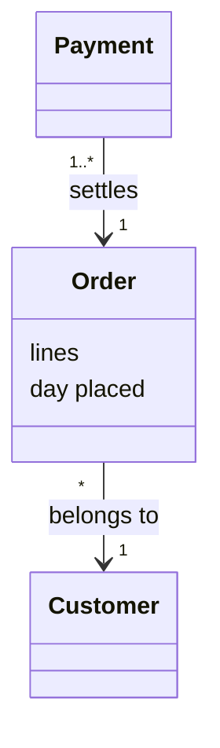
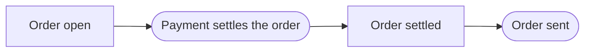

# Adding a domain-model view

A domain-model view explains a group of related concepts, one section for each, and draws how they relate and how they move together ([software-analysis:DEC-004-domain-model-views]). It explains purpose first: the problem its concepts solve, then what each is for, then what each is. It is a file of its own, `domain-model/<number>-<slug>.md`, beside the glossary. The glossary defines each concept, and the view explains it. A project keeps views only where it chooses: a term no view explains stays as it is.

## 1. Is it a view?

Write one for a group of concepts a reader takes in at once, such as those of ordering, or of payment. Which concepts form a group is your choice.

- **Each concept has its term first.** A view explains concepts the glossary defines, under their terms' names. Where a concept has no term, go back and stamp it (`term.md`).
- **Each term is explained by one view.** No two views in force explain one term, so each explanation has one home. The stamp refuses a term another view explains.
- **The domain, never the software.** A view describes what the concepts are and how they relate, and nothing of how the system is built.

## 2. Choose its number, its slug and its title

- **The number** opens its file's name, such as `010`. It gives one valid order of the views, in which each uses only the views before it: a view names a concept another view explains only where that view's number is lower. Its form, such as its width and its steps, is your project's. A project with a rule of its own on the form, as project-kit's `ANA` has, keeps to that rule. The number is no part of the id, so a view given another number keeps every citation true.
- **The slug** is its id for ever, `VIEW-<slug>`, and an id is never used again. Name the group as the domain says it: `orders-and-payments`.
- **The title** is how the heading reads it, `--title "Orders and payments"`.

## 3. Choose the terms it explains

Name each with `--explains <TERM-id>`, in the order of its sections.

- **Its own analysis's terms alone.** A term the glossary's head lists from another analysis is explained there.
- **In force.** A term withdrawn is explained nowhere.
- **A concept of a lower view** may be named in this view's sections and diagram, to state a relation. It is no term this view explains. A relation between two views' concepts is stated in the higher view.

## 4. Decide what it rests on

The stamp anchors each term it explains, from `explains`. Add as `--record` each record its statements cite or apply. Each fact a section states under *Always true* rests on the record that decides it. A view anchors no code, so the stamp takes no `--path`: the term anchors the code that embodies it.

- **Its reasons.** The view explains purpose first, so read the records its concepts rest on before you stamp it. Their Context and their Rationale say why the project has each concept. Anchor each record a reason comes from.
- **A reason no record gives** is no view's to state. The *Why* reads `None.` until a record gives it.

## 5. Stamp it

```
pkit analysis new view <slug> --number <number> --explains <TERM-id> [--explains <TERM-id>]... [--title "<Title>"] [--record <id>]...
```

The stamp writes the view, with one section for each term, headed by the term's name in sentence case. Each section opens with its link to its term's entry, `Defined in [<TERM-id>](../glossary.md#<anchor>).`. It also writes each term's link to its section, on a line under the term's heading in the glossary. The check holds both lines.

- **Sentence case** capitalizes the first letter alone, so the term `decision record` heads its section `## Decision record`. The rest keeps the name's case, so `pull request on GitHub` reads `Pull request on GitHub`.
- **A name whose first word holds a capital already,** such as a proper name like `iPhone app`, stands as it is.
- **In the glossary and in prose,** the name stays as running text writes it, in lower case unless it is a proper name.
- **The link** is unchanged by the capital, since a heading's slug is in lower case: `#decision-record`.

## 6. Fill it

Each part holds its hint, which says what goes there and gives an example. Fill each part as its hint says, and delete the hint.

- **The opening** states the problem the group's concepts solve together, as a record the view anchors gives it, then names the concepts as the parts of its answer. Where no record gives the problem, say what the group covers instead. Then it draws its class diagram. Draw the concepts, how they relate and the attributes that matter, in a Mermaid fence with an `accTitle`, an `accDescr` and no styling. Draw a concept of another view, or a term no view explains, by its name alone.
- **Each concept's box** is labelled as its section is headed, by its term's name in sentence case, such as `class Order` or ``class DecisionRecord["Decision record"]``. No check reads a diagram, so you keep to it.
- **Then its flow:** how the concepts move together, after the class diagram. Draw a Mermaid flowchart of the events and the state changes across the concepts, in a fence of the same form.
  - **What happens to things.** Name no actor and no use case. Who does what is behaviour, whose home is a use case or a journey.
  - **Only what the sections state.** Draw the states, the events and the relations the sections state, in the sequence they give. An event, or a sequence of events, the sections do not state goes into a section first, or stays out.
  - **Nothing to draw?** A group whose concepts never change has no flow. The hint asks for one, and no check does.
- **Each section's first part is its *Why*:** what the concept is for, the problem it answers, in one paragraph of plain words. Start it on the label's line. State its own part of the problem the opening states.
  - **Its ground.** Say again, in plain words, a reason the Context or the Rationale of a record the view anchors gives. Give none they do not give.
  - **No record gives one?** Write `None.`, never a reason of your own. Where your project wants the reason stated, record it first, then say it again here.
  - **No actor and no need.** The actors come after the views, so name no actor, and cite no actor's need. Name a role the domain holds by its term, such as a customer.
- **Then what it is.** Below the *Why*, after a blank line, explain the concept for a newcomer, with no label. A *Why* that runs into it, with no blank line, leaves the explanation missing. Text above the *Why* belongs to no part, so write none there.
- **Then its facts:** its *Attributes*, its *Relations*, its *States* and what is *Always true* of it. Where the concept has a life cycle, draw its states after the text of *States*.

An opening, filled, its flow beside its class diagram:

````markdown
A shop must know what each [customer](../glossary.md#term-customer--customer) asked for, and whether it is paid, before it sends anything. An [order](../glossary.md#term-order--order) holds what was asked for, and a [payment](../glossary.md#term-payment--payment) settles it.




````

A section, filled:

```markdown
## Order

Defined in [TERM-order](../glossary.md#term-order--order).

**Why:** A shop must know what a [customer](../glossary.md#term-customer--customer) asked for before it takes any money or sends any goods.

An order is what a customer asks the shop to send, before anything is paid or sent.

**Attributes:** Each order holds its lines, the customer who placed it and the day it was placed.
```
- **One home for each fact.** A diagram shows only what the sections state. What a section states fits exactly what the term's definition fits, never more and never less. An obligation the system must keep is a functional requirement, which names the concept by its term (`requirement.md`).
- **Its terms.** Write each concept by its term, a diagram's labels included (the shared framing's "Use the glossary's terms").

Leave each section's link to its term as the stamp wrote it.

## 7. Link it

Run `pkit analysis link`. The first view an analysis holds turns the links on for the whole analysis, so this run links the glossary too (DEC-004 point 7).

- **What it links.** The first mention of each term in each section, in the views and the glossary entries, to the term's entry. A term is never linked in its own section.
- **A wrong link** is a finding: the section uses a term's name in another sense, so reword it (`RS-SAN-008`). The escape `<!-- pkit:not-the-term -->` right before a mention serves last, such as for a word in a quotation.
- **Each later edit** of a view or an entry may move a link, so run the command again before the checks.

Then run the checks in the shared framing's "After stamping", `pkit analysis validate --preview` first. Where the format rule binds, the check holds each section's heading to the name of the term `explains` lists in its place, in sentence case. It holds each section's parts too: its *Why* first and filled, or `None.`, then its explanation below it. Whatever any rule's status, it holds the links.

## Later

- **A section added by hand.** Add its term to `explains`, in the section's place, and anchor the term. Write the term's link the check names, under the term's heading in the glossary, then run `pkit analysis link` for the section's link to its term. Moving a section to another view moves its term between the two lists, the two views' anchors and its link.
- **Renumbering or renaming its file** keeps its id where the slug stays. Each term it explains then links to the new file: write each link the check names.
- **Withdrawing** — set `status: withdrawn`, and remove each term's link to it. A withdrawn view explains nothing, so its terms may be explained by another view.
- **A term renamed** renames its section's heading, in sentence case, and its link's section. A page anchored on the section's old slug is then dead, and validation fails until the change mends it.
- **A record it anchors changed** flags the view. Read again each reason it takes from that record, in its opening and each *Why*.
- **Revalidating a term** reads the section that explains it too. A change of code reaches a view only through a term whose revalidation changes it.
