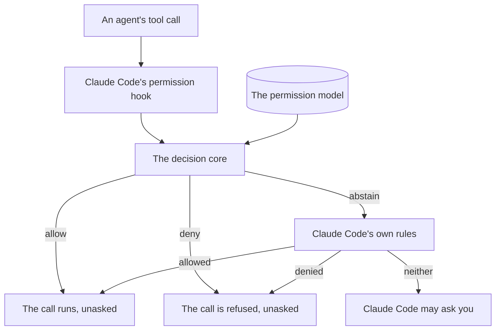

# The permission model

The permission model decides your agents' tool calls: which run without asking you, and which are refused ([COR-028](../decisions/core/COR-028-permission-model-realization.md)). This page explains what it does and how it decides a call. It then shows how to turn it on and do the common tasks, with the reference last.

## What it does for you

The permission model lets your agents do their regular work without asking you, and refuses the commands you deny them.

- **Regular work runs unasked.** Once you turn the model on, each call your grants allow runs with no prompt, such as an agent's `git` and `gh` commands.
- **What you deny is refused, where the model can tell.** A deny wins over every allow, so the commands it names are refused, and nobody is asked. It is a speed bump, not a security boundary. A command behind a wrapper, such as `uv run` or `find -exec`, can slip past it ("A deny holds against the forms of its command" below).
- **The guardrails hold for everyone.** Recursive deletion, `sudo` and rewriting published history are denied to every agent and to you, in each form the model can see. No grant lifts that deny.
- **The rest is Claude Code's.** A call the model does not decide goes to Claude Code, which decides it by its own rules and may ask you.
- **Unwatched runs keep your denies.** A command that starts agents with nobody watching may confine each run to rules of its own. The denies you set for every agent, or for that run's agent, hold there too.

## How a tool call is decided

Each tool call an agent makes goes through Claude Code's permission hook, which has the decision core decide it: allow, deny or abstain.



- **The hook.** Claude Code passes each tool call to the hook before the call runs, once you turn enforcement on ("Turning it on" below). The hook prints the verdict for Claude Code, and prints nothing for an abstain ([the adapter's README, "Live permission enforcement"](../adapters/claude-code/README.md#live-permission-enforcement-permission-hookpy)).
- **The decision core** reads the permission model at each call, and gives one verdict. The model holds:
  - the guardrails, the privileges the catalog flags `guardrail: true`, denied to every subject, `all`
  - the active profile's grants
  - your project's grants, in `.pkit/permissions/project/grants.yaml`
  - the grants and privileges of each installed capability ("Capability-contributed privilege *definitions*" below)
- **Allow** runs the call with no prompt. **Deny** refuses it, and Claude Code asks nobody. A deny wins over every allow, whatever the order of the grants.
- **Abstain** leaves the call to Claude Code's own rules, its native rules: the allows and denies in its settings, which it enforces itself. The adapter writes them from its baseline and from the model (COR-028 point 2). A call they neither allow nor deny goes to Claude Code's permission mode, which may ask you.
- **The posture.** Where no grant allows or denies a call, the core abstains under the default posture, `lenient`, and denies under `strict`. The `read-only` profile is strict.
- **A fault** while the hook decides gives an abstain, never a deny. Claude Code's native denies still refuse the forms of the guardrails' commands they name. That is the double lock ([the same section](../adapters/claude-code/README.md#live-permission-enforcement-permission-hookpy)).
- **When the hook asks.** The hook asks you rather than abstain in two cases:
  - a call that may hide a guardrail's form, outside auto and bypass mode ("A deny holds against the forms of its command" below)
  - an `Edit` or `Write` to an absolute path outside the session's repository, in every mode ([the same section](../adapters/claude-code/README.md#live-permission-enforcement-permission-hookpy))
- **The CLI decides alike.** The `pkit permissions` commands, such as `explain` and `diff`, build the model and decide through the same core. So they reach the hook's verdict.

## Turning it on

Two steps turn the model on: a profile supplies the grants, and registering the hook makes the core decide each call.

- **A profile** is a named set of grants and a posture. Three ship, each granting more than the one before: `read-only`, `non-destructive` and `autonomous`. `pkit permissions profile list` describes each.
- **Activating one** sets its posture, layers its grants under your own, and writes the native rules it can. It does not register the hook.
- **Per machine.** The active profile is your machine's own choice, kept in a file git ignores. Its posture goes into `.pkit/permissions/project/config.yaml`, which the project shares. So another clone takes the posture from that file, and the profile's grants only once it activates the profile too.
- **`enable`** registers the hook, and makes sure Claude Code's settings deny the guardrails natively.
- **`explain`** shows the posture, and who may or may not use each privilege.

```console
$ pkit permissions profile activate autonomous
profile 'autonomous' active — posture lenient; its grants are layered under your own (manual grants untouched).

4 profile-derived allow rule(s) realized in .claude/settings.local.json.
  model's session-wide allow rules: Bash(docker-compose:*), Bash(docker:*), Bash(gh:*), Bash(git:*), Bash(pkit:*), Glob, Grep, Read, WebFetch, WebSearch

out-of-harness gap (enforced elsewhere or not natively expressible):
  1 grant(s) enforced at runtime, not in settings (per-agent / scoped → the hook)
  1 grant(s) no native layer expresses (scoped / recognizer-shape — see ADR-004)
⚠ not natively enforceable (declare + enforce out-of-harness): network-egress

enforcement is OFF — run `pkit permissions enable` to make the model bite.
$ pkit permissions enable
live enforcement enabled: registered PreToolUse hook; native guardrail denies already present.
$ pkit permissions explain
Permission policy — who may (allow) or may not (deny) each privilege   (vocabulary: `pkit permissions overview`)

  posture: lenient · ownership: additive

all  (every agent and the operator)
  deny  destructive-fs                                                                 guardrail
  deny  privilege-escalation                                                           guardrail
  deny  vcs-history-rewrite                                                            guardrail
  allow vcs, issue-tracker, kit, repo-read, text-filter, workspace, docker, web-fetch

Legend
  allow / deny   the subject may / may not use the privilege
  guardrail      denied for everyone, always — can't be granted around
  posture        lenient = uncovered requests defer to Claude Code · strict = denied
  ownership      additive = only adds to settings.json · managed = owns the permissions region
  subjects       all = every agent + operator · operator = the human · agent:<name> = one subagent

Commands
  pkit permissions grant <subj> <priv> [--scope G] [--deny]   add a grant
  pkit permissions revoke <subj> <priv>                       remove a grant
  pkit permissions overview                                   privilege vocabulary + live status
```

Activation also reports the gap that Claude Code's settings leave (COR-028 point 3). The hook enforces the grants they cannot express. Intent that nothing in Claude Code enforces, such as network egress, needs a layer outside it, such as the operating system or the network.

`pkit permissions setup autonomy` takes both steps, sets up the OS sandbox too, and then proves the result. It stops where a session restart is needed. Run it again after the restart, and it declares the goal reached only once its probes pass.

```sh
pkit permissions setup autonomy
```

`pkit permissions disable` turns enforcement off again. It removes the hook's registration, and leaves the native guardrail denies in place.

## Common tasks

Each task shows its commands with their output. Each fence starts from a fresh project where pkit is installed and no profile is active, so a task grants what it shows.

Some tasks pass a call to the hook by hand, to show its verdict without a Claude Code session. Claude Code passes each call as a JSON document on the hook's standard input, with the tool in `tool_name` and its input in `tool_input`. The hook prints an allow or a deny, and nothing when it abstains.

### Find out why a call prompted

The diagnostic loop logs each call the hook abstains on, and its report says which prompts you can remove, and how. The hook logs only while enforcement is on ("Turning it on" above).

1. Arm the loop with `pkit permissions diagnose on`. It disarms itself after eight hours, or after the seconds `--ttl` gives.
2. Work in Claude Code as usual. Below, two calls stand in for a session's: `uv run pytest`, which no grant covers, and `gh pr list | jq .`, a compound.
3. Read the report with `pkit permissions diagnose report`.
4. Disarm the loop with `pkit permissions diagnose off`, which keeps the log.

```console
$ pkit permissions diagnose on
diagnostic session armed — capturing deferred (prompted) decisions for 8.0h (auto-expires).
  redaction: on (command tail dropped) · size cap: 2000 entries (drop-oldest)
  the log is local + git-ignored: .pkit/permissions/project/diagnose-log.jsonl
  run `pkit permissions diagnose report` to see the classified, ranked, recommend-only report · `diagnose off` to disarm.
$ echo '{"tool_name":"Bash","tool_input":{"command":"uv run pytest"}}' | .pkit/adapters/claude-code/permission-hook.py
$ echo '{"tool_name":"Bash","tool_input":{"command":"gh pr list | jq ."}}' | .pkit/adapters/claude-code/permission-hook.py
$ pkit permissions diagnose report
Permission-prompt diagnosis — captured deferred decisions, classified + ranked

  captured: 2 deferred decision(s) · session: ARMED
  note: the raw capture is a SUPERSET of real prompts (the hook sees its own deferral, not whether the harness prompted) — the axes below sharpen it.
  outcome: 2 real prompt(s) of 2 captured (0 auto-allowed by the live settings.json flat matcher — NOT prompts).
  of those real prompts: 1 allowlisted-but-compound (decompose / butter-verb — eliminate at source) · 1 genuinely-missing (a real allowlist gap).

RECOMMENDED — remediations pkit recommends (MVP applies NOTHING; recommend-only)   1 deferral(s) · 1 group(s)
  [1] allowlist-gap    1×   uv run pytest (1×)
      → recommend granting the matching catalog privilege (a NEW catalog privilege is never auto-fixable — operator task)

NEEDS YOUR JUDGEMENT — real trade-offs only you can settle   1 deferral(s) · 1 group(s)
  [2] shell-shape      1×   gh pr list | jq …[redacted] (1×)
      → narrow to single commands, or extract a named project command (COR-007) the matcher can vet
      ↳ of these: 1 allowlisted-but-compound (butter-verb / decompose — eliminate at source) · 0 genuinely-missing (real allowlist gap)

recommend-only: this report applies NOTHING — it ranks + recommends. Apply the remediations yourself.
  (auto-fix is deferred per PRJ-006; a new catalog privilege is never auto-fixable.)
$ pkit permissions diagnose off
diagnostic session disarmed — the hook stops capturing.
  the captured log is left in place; run `pkit permissions diagnose report` to read it, or delete it to clear.
```

The report's headline counts the real prompts: the logged calls for which the report finds no allow rule in Claude Code's settings.

- **`uv run pytest`** matches no allow rule, so the report counts it as genuinely missing, and recommends granting a privilege. The next task grants it.
- **`gh pr list | jq .`** matches allow rules part by part, but not as a whole. So the report counts it as allowlisted-but-compound, and recommends single commands or a named command of your project.
- **Nothing is applied.** You act on each recommendation yourself ("The permission-prompt diagnostic loop" below).

### Allow a command

Grant the privilege that recognizes the command. `pkit permissions catalog` lists the privileges, and `pkit permissions grant` writes the grant into `.pkit/permissions/project/grants.yaml`. Below, the grant is of `uv-run`, which no shipped profile grants:

```console
$ echo '{"tool_name":"Bash","tool_input":{"command":"uv run pytest"}}' | .pkit/adapters/claude-code/permission-hook.py
$ pkit permissions grant all uv-run
granted: all allow uv-run
$ echo '{"tool_name":"Bash","tool_input":{"command":"uv run pytest"}}' | .pkit/adapters/claude-code/permission-hook.py
{"hookSpecificOutput": {"hookEventName": "PreToolUse", "permissionDecision": "allow", "permissionDecisionReason": "allow grant for operator on ['uv-run']"}}
```

- **Who:** `all` grants it to every agent and to you. Name one agent as `agent:<name>`, or name yourself as `operator`. The verdict above names `operator`, since the call names no agent ("Deny something to one agent" below).
- **When:** the hook reads the model at each call, so the grant holds from the next call on.
- **Scope:** a privilege with a scope type, such as `docker` or `web-fetch`, takes `--scope` to narrow the grant ("Scope enforcement" below).
- **No privilege for the command:** where the catalog lists none, a capability can define one ("Ship a capability's own privilege" below).
- **Note:** `uv run` runs any program it is given, so this grant allows whatever that program does ("The read-only text filters and `uv run`" below).

### Deny something to one agent

Record a deny grant for that agent with `--deny`. A deny wins over every allow, so it holds where a grant to `all` allows the call. Below, every subject may use `gh`, but the agent `researcher` may not edit an issue with it:

```console
$ pkit permissions grant all issue-tracker
granted: all allow issue-tracker
$ pkit permissions grant agent:researcher issue-tracker-write --deny
granted: agent:researcher deny issue-tracker-write
$ echo '{"agent_type":"researcher","tool_name":"Bash","tool_input":{"command":"gh issue edit 7"}}' | .pkit/adapters/claude-code/permission-hook.py
{"hookSpecificOutput": {"hookEventName": "PreToolUse", "permissionDecision": "deny", "permissionDecisionReason": "deny grant for agent:researcher on ['issue-tracker-write']"}}
$ echo '{"tool_name":"Bash","tool_input":{"command":"gh issue edit 7"}}' | .pkit/adapters/claude-code/permission-hook.py
{"hookSpecificOutput": {"hookEventName": "PreToolUse", "permissionDecision": "allow", "permissionDecisionReason": "allow grant for operator on ['issue-tracker', 'issue-tracker-write']"}}
```

Claude Code names a subagent in the call's `agent_type`, and the hook decides the call for that agent ("Default-agent subject resolution" below). The last call names no agent, and this project sets no default agent. So the hook decides it for you, `operator`, and the grant to `all` allows it.

An allow's reason names every privilege the call matches, and a deny's names the privileges the deny reaches. `pkit permissions explain researcher` lists that agent's grants.

### Ship a capability's own privilege

A capability can define a privilege of its own and deny it to its agents, with no edit to the backbone catalog. `pkit permissions scaffold` stamps the two files such a capability ships, and the model reads them once the manifest registers the capability. Below, `grep` keeps the one line of `register`'s output that names the capability:

```console
$ pkit new capability my-cap
Stamped: .pkit/capabilities/my-cap/
$ pkit permissions scaffold my-cap
Stamped: .pkit/capabilities/my-cap/permissions/privilege-catalog.yaml
Stamped: .pkit/capabilities/my-cap/permissions/grants.yaml
Next: replace the illustrative entries with this capability's own privilege(s) and deny(ies) — keep fragment keys BARE and reference them with the scoped token `[privilege-catalog:my-cap:<name>]`. `pkit schemas validate` lints the grant tokens.
$ pkit capabilities register my-cap | grep Registered
  Registered incubated capability 'my-cap' v0.1.0 (in-repo) at .pkit/capabilities/my-cap/
$ pkit schemas validate
  Validated 8 schema(s) and 6 backbone file schema(s). All checks passed.
```

- **Edit the two files.** Replace their illustrative entries with your privilege and its deny. Write the privilege's key bare, and name it in a grant with the scoped token `[privilege-catalog:my-cap:<name>]` ("Authoring a fragment" below).
- **Check the tokens.** `pkit schemas validate`, run with no path, fails a grant token that names no privilege, in each capability the manifest registers. Run it again after each edit.
- **Note:** the `capability-author` skill walks you through these steps. The fragment is its step 6b, and registering the capability is its step 8.

## Reference

These sections say how each part of the model works, for looking up a rule.

### Default-agent subject resolution

The hook resolves the subject for every PreToolUse call, in this order:

1. **`agent_type` present in the payload** → `agent:<agent_type>`. Claude Code sets this for spawned Task subagents.
2. **`agent_type` absent, and `.claude/settings.json` has `agent: X`** → `agent:X`. The main session runs as that agent, so all of the agent's grants apply, allow and deny. A missing, unreadable or malformed `settings.json` silently falls back to rule 3.
3. **`agent_type` absent, and no `agent` key in `settings.json`** → `operator`.

**Implication:** in a session with a configured default agent, the operator's `!`-typed command is also bound to that agent's grants. That is consistent, because the session runs as the agent.

**A session started with `--agent`:** the runs of project-management's `review-pr` name their agent on the command line, through the agent runner ([the adapters README, "The agent runner"](../adapters/README.md#the-agent-runner)). That sets the session's agent without changing `.claude/settings.json`, the file rule 2 reads. So the hook may judge such a run as the project's default agent, or as `operator`, rather than as the agent it names. No grant for one agent counts in those runs until the adapter's probe shows which subject the hook judges ([the adapter's README, "The probe"](../adapters/claude-code/README.md#the-probe-probe-confined-runpy)).

**A confined run,** such as a fixer's, loads no project settings. So the hook is not registered there at all ("The rules of an agent run" below).

### Compound commands (segment splitting + leading-`cd` strip)

The decision core splits a compound Bash command into segments, and decides on what each segment matches. The command reaches the core as one string. The core splits it on `&&`, `||`, `|`, `;`, a background `&` and a newline, with a dumb regex splitter, which is no shell parser.

Within each segment the core reads the words as the shell does. It splits them at spaces and tabs, and removes quotes and backslashes by the standard library's POSIX quoting rules. So a grant or a deny matches `"--force"` as `--force`, and matches `git commit -m "fix: x"` as the command the shell runs. That reads words, never the shell's grammar, so it is no shell parser.

Two prefix-strips reduce false prompts over already-granted intent:

- **Env-prefix strip:** a leading `export` or `VAR=value` on a segment is dropped before matching, so `export GH_HOST=x && gh pr list` matches `gh pr list`. An assignment counts only where its name is written unquoted, as the shell reads it. A segment that only assigns, with an untrusted construct (below) in it, such as `X=$(./x.sh)`, is not dropped. The assigned value may run a command, so the segment stays, and no grant covers it.
- **Leading-`cd` strip.** When the first segment is a bare `cd <path>` followed by `&&` or `;`, the core drops that segment. The core decides on the remainder against the unchanged grant model, so `cd src && gh pr list` auto-approves exactly as `gh pr list` would. The strip is deliberately conservative, and fails closed:
  - **Never a new grant.** The strip reduces prompts over already-granted intent, since `cd` only changes the working directory, which the intent layer does not confine. The remainder is decided at the original working directory. So the strip can never grant a directory-scoped privilege that the un-stripped command lacked.
  - **Only a bare `cd` is stripped:** a single path argument, parted from `cd` by a space or a tab, with:
    - no quotes
    - no `$()`
    - no backtick
    - no flags
    - no redirection but one that writes no file (below)

    A `cd "/x; rm -rf ~" && …` is not a bare `cd`, so it is not stripped and falls through to the full-command path, where its deny still binds. Deny-wins is never weakened.
  - **No `cd` is stripped from a command holding any of these,** its `cd` included, each described below:
    - an untrusted construct
    - a word the core cannot read as the shell does
    - a leading assignment of the kinds that keep every grant from allowing

    Such a command is decided whole, so `cd {a,b} && git status` never hides what its `cd` word runs.
  - **The remainder is decided like any command.** An untrusted construct keeps every grant from allowing the remainder, as such a construct does anywhere in a command (below). So `cd /x && echo z > ~/f` and `cd /x && gh $(rm -rf ~)` prompt rather than slip through. So does a redirect into the agent workspace, as in `cd /x && cat > .agent-workspace/body.md <<'EOF'`, since the workspace grant covers the file tools only.
  - **A pipe is decided segment by segment.** The `cd` strip does not touch pipes, and `|` is not a `cd` separator. So `cd /x && gh … | sh` decides exactly as the bare `gh … | sh` does, and both abstain, since every segment needs its own allow (below).

The broader widening, to auto-approve any compound whose every segment is independently safe, is rejected as unsound, since a per-segment matcher is blind to composition. Any other widening is not built yet (COR-007). The widenings taken are the leading-`cd` strip and the removal of a redirection that writes no file (below).

**Every segment needs its own allow.** The core allows a compound only when an allow grant covers each segment the splitter yields. A segment that matches no privilege, or only privileges no allow grant of the subject reaches, makes the core abstain. The call then goes to the harness's own flow, and a strict posture denies it instead.

So where only `gh` is granted, `gh pr list | sh` and `gh pr list & python3 x.py` abstain, as does `python3 x.py` on the line after `gh pr list`. So does a pipe into a filter no grant covers, such as `gh pr list | jq .`. A compound whose every segment is granted, such as `git diff | git apply --check`, is allowed. That is not the widening rejected above: each segment needs a grant of its own, never a judgement that it is safe.

#### The read-only text filters and `uv run`

Two catalog privileges cover the programs a compound most often pipes into or runs. A compound of these programs and other granted ones is then allowed, each segment still needing a grant of its own:

- **`text-filter`** recognizes programs whose only effect is their standard output. They write no file, reach no network, run no other program and change no shell state. Every shipped profile grants it to `all`, and it carries no path scope.
  - **The programs:** `cat`, `head`, `tail`, `wc`, `cut`, `tr`, `grep`, `egrep`, `fgrep`, `ls`, `cmp`, `comm` and `paste`. The list goes on with `basename`, `dirname`, `realpath`, `pwd`, `true`, `false`, `seq`, `sleep`, `stat`, `du` and `which`.
  - **`sort`, `uniq` and `diff`,** each in a form that writes no file and runs no other program. The form holds no pathname pattern that could expand to such a form. The catalog's comments list the forms.
- **`uv-run`** recognizes `uv run`, which runs any program it is given in the project's environment and confines nothing. A grant allows whatever that program does. A deny reads the command as the wrapper `uv`, never as the program behind it, so no guardrail reaches `uv run rm -rf ~`. No shipped profile grants it, so a project that wants it grants it in its own `grants.yaml`.

Each recognizer of the two is a `pattern` or names a subcommand. So a grant of either writes no native allow rule, and only the hook realizes them.

Neither recognizes a program that writes a file or runs another, such as `sed`, `awk`, `find`, `xargs`, `tee` or `rg`. Nor does either recognize `echo`, the usual way to answer a confirmation from a pipe (`echo y | pkit …`), or `printf`, whose `-v` sets a shell variable. `jq` stays out too: its filters hold a `|`, and some of its options read files no check sees. So under a shipped profile, `grep x f | head` is allowed for every agent, and `grep x f | sed s/a/b/` abstains.

What a granted program reads from a pipe is within its own grant, as its arguments are. So leaving `echo` out does not keep a pipe from feeding `pkit`, as in `basename y | pkit …`. A `pkit` confirmation that guards a person's decision reads no answer from a pipe all the same ([the CLI README, "Standard flags"](../cli/README.md#standard-flags)).

Recognition goes by the program's name, as for every privilege. A shell alias or function under one of these names runs what it names, unasked. The privilege is sound only where its names reach the system's own programs.

#### What keeps a grant from allowing

Three things in a Bash command keep every grant from allowing it, each described below:

- an untrusted construct
- a word the core cannot read as the shell does
- a leading assignment that changes which program runs, or one written with a quote or a backslash

**An untrusted construct keeps every grant from allowing.** Where a Bash command holds a construct the dumb splitter cannot be trusted on, its segments may not be the commands the shell runs. Such a command, with or without a leading `cd`, makes the core abstain, and a strict posture denies it instead. The constructs are these, and the scan finds each inside quotes as well:

- a backtick
- a `<` / `>` redirection other than one that writes no file (below)
- a `(`, which opens every substitution:
  - `$(…)`
  - `<(…)` / `>(…)`
  - zsh's `=(…)`
  - zsh's glob qualifiers and parameter flags that run code
- a `$`, since it opens every expansion. The expansion's value is one the core never sees, and some forms, such as `${X@P}` and `$[…]`, evaluate it as code.

**So does a word the core cannot read as the shell does.** The command's words may not be the words the shell passes on:

- a quote or a backslash that does not close, as where the splitter cuts a quoted `;`
- whitespace other than a space, a tab or a newline, such as a no-break space, inside which the shell reads one word
- a word opening with `#`, a comment the shell drops
- a brace expansion, such as `{a,b}` or `{1..3}`, which the shell turns into several words
- a program name holding whitespace, such as `'make test/x'`, which a recognizer's `pattern` would read as two words

**And so does a leading assignment that changes which program runs, or one written with a quote or a backslash.** `PATH=/tmp/x gh pr list` runs whichever `gh` the new path finds first. Each such assignment is stripped for the denies, so `PATH=/tmp/x sudo id` is denied.

- **The variables that change which program runs.** The list names a family of variables, and is no boundary:
  - a search path, `PATH` or any other name ending in `PATH`, and the dynamic loader's `LD_*` and `DYLD_*`
  - the variables that name the startup files a shell reads first, such as `BASH_ENV`, `ENV` and `ZDOTDIR`
  - the options of Python, Perl, Ruby, Node and Java, which load code ahead of the program's own
  - zsh's `NULLCMD` and `READNULLCMD`, since they name the program a command of redirections alone runs
- **A program's own setting,** such as `GIT_PAGER=cat`, is stripped and allowed: what a granted program is told to run is the grant's breadth. A `git` grant already lets `git -c core.fsmonitor=…` run any program. A setting that changes which configuration the program reads may still keep a deny from telling (below).
- **An assignment written with a quote or a backslash** is never allowed by a grant. The core never matches an assignment's value, so removing its quotes would make no match more accurate. Only a quoted argument is matched as the shell passes it on.

A segment led by `export` runs no program. `export` takes each word after it as a name or an assignment, so `export git PATH=/tmp/x` sets `PATH` and runs no `git`. The segment's assignments are judged as above, and no grant on a program covers the segment. A segment led by `builtin export` or `command export` stays a program no grant covers.

Each word after `export` must be a plain name or assignment, since the shell expands any other first. So `export PAT?=bin` sets `PATH` where a file named `PATH=bin` lies in the directory. Such a word keeps every grant from allowing.

So where `gh` and `git` are granted, `gh pr list > ~/.bashrc`, `gh pr list $(python3 x.py)` and `PATH=/tmp/x gh pr list` abstain, and the harness's own flow decides each. A quoted argument alone is none of these: `git commit -m "fix: x"` is allowed, and `git push origin main "--force"` is denied as `--force` is.

For a grant, outside an `export`, a glob is read as written. A glob changes only arguments, from the names of files, never the program a grant names.

#### A redirection that writes no file

A redirection that writes no file is no untrusted construct. The core removes such a redirection before it splits the command, and decides the command as it would without the redirection:

- an fd duplicated onto stdout or stderr, or closed, such as `2>&1`, `1>&2`, `>&2` or `2>&-`
- output discarded to `/dev/null`: `>`, `>>`, `2>`, `2>>`, `&>` or `&>>`, with or without a space before `/dev/null`

So where `git` and `gh` are granted, `git status 2>&1 | gh pr list` and `cd /x && git log >/dev/null` are allowed. A deny binds on a program behind such a redirection, so `2>/dev/null rm -rf ~` is denied. The removal ignores quotes, as the scan for untrusted constructs does: inside quotes it changes only an argument's text.

Each form counts only where these hold:

- **A whole word.** Each form counts only as a whole word, with an fd number of one digit or none, and the target exactly `/dev/null`, unquoted.
- **A duplicated fd.** After `>&` or `<&` comes `1`, `2` or `-` alone, since another fd may be one the shell holds open on a file.
- **Last in its segment.** `&>` and `&>>` count only last in their segment, since dash reads their `&` as running the command in the background.

A segment left with redirections and assignments alone, or behind only a word such as `{` or `do`, keeps the command untrusted. The reason is that zsh runs such a command as the program `NULLCMD` names.

A lookalike stays untrusted:

- `2>&1t` writes a file `1t` in zsh
- `{fd}>/dev/null` sets the variable `fd`
- `>&word` writes to the file `word`

So does every other redirection, such as `> out.txt`, `< in.txt`, `>|`, `<>`, a here-string or a heredoc.

#### Denies, and what an abstain says

A deny on any segment still wins over every allow, and over an untrusted construct.

The abstain's reason names each uncovered segment's program where that is a bare word, and never its arguments. So the reason undoes none of the diagnostic log's redaction. The reason for an untrusted construct lists the kinds of construct, and none of the command's text.

### A deny holds against the forms of its command

A deny, a guardrail's included, matches its command in more forms than a grant does. A grant matches a command as it is written, and a deny also matches these forms of it, as programs read them:

- a short flag inside a bundle, such as `-f` in `git push -uf`
- a long flag cut to a prefix, such as `--force-w`, which git reads as `--force-with-lease`
- a long flag with its value after `=`, such as `--force-with-lease=main`, or behind one dash, such as `-force`
- a program named in one of these ways:
  - by its path, such as `/usr/bin/sudo`
  - by zsh's `=sudo`
  - in another case, such as `Git`, which macOS runs as `git`
- a subcommand behind the options before it, such as `push` in `git -C . push --force`

The core reads these forms from a structured recognizer's `cmd`, `subcommand` and `flag_any`. Each reading errs toward the deny, so a prefix several long flags share reads as each. So does an option that is itself a prefix of a denied one, such as `--proxy` of `--proxy-insecure`.

A recognizer's regex `pattern` is matched with a program's path cut to its name, and with the options before a subcommand left out. The core reads up to 64 places where the subcommand may stand behind an option's value, and past them it abstains. Otherwise the regex is matched as written, so it spells each form of the flags it names. An example is the shipped `destructive-fs` regex, which spells `--recursive` cut down to `--r`.

The `vcs-history-rewrite` guardrail also names `--mirror`, which force-updates every ref the remote holds. It names a refspec opening with `+`, as in `git push origin +main`, through the recognizer field `word_prefix_any`.

**Where a deny may bind on what the core cannot see, no grant allows the command.** The core then abstains, naming the deny, and a strict posture denies. Two things keep the core from seeing:

- **A pathname pattern,** such as `--forc[e]` or `*`, which the shell expands to the names of files. A glob character counts outside quotes alone, so `git push origin '[+]main'` is read as written.
  - **For a structured recognizer,** the core cannot tell where such a pattern stands for the program or subcommand, or may open with `-` or `+`.
  - **For a regex `pattern`,** the core cannot tell where such a pathname pattern stands anywhere in a segment of the program the regex opens with. Where the regex plainly opens with no program, that holds for a segment of any program.
- **An assignment that changes the program's configuration,** which may set a forced refspec or an alias. Such an assignment keeps a deny from telling on any segment of the program the deny names, so `HOME=/tmp/x git status` abstains.
  - **The variables:**
    - `HOME`
    - the XDG base directories
    - any name holding `CONFIG`, such as `GIT_CONFIG_GLOBAL`
    - git's repository directories
  - **Where such an assignment counts:** in front of a command, for that command, and in a segment that only assigns or exports, `builtin export` included, for the segments after it.

**Where Claude Code may allow what the core abstains on for a guardrail, the operator is asked, outside auto and bypass mode.** A harness's own rules may allow a command the core abstains on, as Claude Code's baseline allows `git push origin --forc[e]` by `Bash(git:*)`. So the core names each guardrail among the subject's denies that may bind on such a command in a form the core cannot see. An adapter may use those names to ask the operator rather than abstain.

[The Claude Code hook](../adapters/claude-code/README.md#live-permission-enforcement-permission-hookpy) asks the operator on such a command, except in auto and bypass mode, where the operator chose not to be asked. A project's own deny, such as the project manager's on raw `gh` mutations, is no guardrail, so the core names none for it. Where the core cannot tell such a deny, it abstains. The deny side stays a speed bump all the same, not a security boundary.

What the forms leave out stays unseen, and nothing asks about it. A git alias or refspec set in a configuration git already reads, or through `git -c` or a granted `git config`, is the grant's breadth. A program behind a wrapper, such as `env` or `command`, is read as the wrapper. No shipped grant covers one, so the core abstains, but a project's grant on a program runner, such as `xargs`, would allow what it runs.

An abstain for a construct the core cannot read, such as `git push origin $F`, names no guardrail either, so the harness's own rules decide the command. So does a wrapper the harness allows, as Claude Code's baseline allows `find`, and with it `find . -exec rm -rf {} +`, which no native deny's prefix matches.

### Scope enforcement

Grant scope globs constrain the reach of an allow grant. The dimension they are matched against depends on the privilege's `scope_type` in `.pkit/schemas/privilege-catalog.yaml`:

- **`directory` scope,** such as `docker`'s, and the default where a privilege declares no `scope_type`: grant scope globs are matched against the request's `cwd` with `fnmatch`. A request outside the listed paths is denied. The hook enforces this at decision time. This is no OS-level confinement boundary, since confining a shell by checking its working directory is no security boundary.
- **`domain` scope,** such as `web-fetch`'s: grant scope globs are matched against the hostname of the request's URL with `fnmatch`, with positive allowlist semantics. The grant permits only URLs whose host matches at least one glob. A request whose host matches none, or that carries no URL that parses, is denied.
- **No scope:** the grant is unconstrained, for any working directory and any host.

An example of a `domain` scope, in `.pkit/permissions/project/grants.yaml`:

```yaml
- subject: agent:researcher
  privilege: "[privilege-catalog:web-fetch]"
  scope: ["docs.python.org", "*.github.com"]
  effect: allow
```

This grant allows `researcher` to fetch from `docs.python.org` or any subdomain of `github.com`, and denies every other host.

A scope confines a privilege: a scoped allow denies the privilege outside its scope. The agent workspace needs the opposite, a privilege that exists only inside a folder and has no opinion elsewhere. So its folder is part of the privilege's recognizer (`recognize.path`), not a grant scope ("The agent workspace" below).

#### Deny/negation scopes are intentionally unsupported

A negation glob, such as `!*.ru`, in a grant's scope is rejected: each call the grant covers is denied, with a reason that says why. It is neither silently accepted nor partly enforced. A tool-layer denylist is a false boundary: an agent's raw `bash curl` bypasses it at the sandbox layer, which is agent-blind. Advertising negation enforcement would overstate fidelity, and violate COR-028's honesty discipline.

Only positive allowlists are supported, so to deny a host, remove it from the allowlist rather than add a negation glob.

### The agent workspace

Every checkout of a project has one agent workspace: `.agent-workspace/` at its root. Agents keep their intermediate files there, and nowhere else outside the repository, as the workspace rule in `.pkit/rules/core.md` says. The workspace's design is a path-scoped allow, recognized from a file tool's target path, with no exception for the shell. Every harness adapter meets this contract:

- **What it holds:** agents' intermediate files, such as pull-request and issue bodies, scripts, captured output and notes.
- **Per checkout, never committed:** `pkit init` and `pkit sync` create the folder, and exclude it through the repository's local exclude file in the common git directory:
  - each worktree has its own folder at its own root
  - one exclude entry covers all of them
  - nothing in them reaches a commit

  That entry covers the clone it was written in, and nothing in the folder is shared between clones. `init` recommends the same line for the project's committed `.gitignore`, which covers every clone and which pkit never writes ([the CLI README, `init`, step 4](../cli/README.md#init)).
- **Granted to every agent, for the file tools, and only there.** The catalog's `workspace` privilege is a path-scoped allow (`recognize.path`), recognized only where both of these hold, and never for the tool alone:
  - the tool is a file tool the privilege lists: `Read`, `Write`, `Edit`, `MultiEdit` or `NotebookEdit`
  - its target lies inside `.agent-workspace/` of the project root, or of another working tree of the same repository
- **Every shipped profile grants the privilege** to `all`, `read-only` included, since the folder holds nothing a commit can carry.
- **Prompts, not confinement:** the privilege reduces prompts on the allow side, keyed on the target path, and confines nothing. Shell reach is the OS sandbox's, and the file tools run outside the sandbox, so inside the folder the recognizer's precision is the gate. A grant of the privilege can therefore neither reach nor deny a file anywhere else. Outside the folder the privilege does not apply, and a request is decided exactly as before.
- **What lies inside:** a target whose path resolves inside the folder, symlinks resolved. A link out of the folder is outside.
  - **The folder counts only as the checkout itself holds it.** A symlinked `.agent-workspace` is never the workspace, and a catalog folder entry that is absolute or climbs out with `..` is never recognized. Another working tree counts only when git registered it for the same repository, and another repository's workspace never does.
  - **A repository or worktree nested inside the folder is not the folder.** When any directory from the folder down to the target holds a `.git` entry, the target is another checkout's.
  - **An existing file with more than one link is not inside either.** A hard link planted in the folder would carry a write to its other name.
- **No shell command is the workspace's.** A redirect, a here-document or an `rm` into the folder is judged like any other shell write, the leading-`cd` strip included ("Compound commands" above). A remainder with a redirect into the folder still abstains. Write intermediate files with the file tools.
- **Realized by the hook, never as a session-wide rule.** The projection reports a `workspace` grant as `runtime`, never as a native allow: a harness-wide `Write` or `Edit` rule would reach far beyond the folder. An adapter whose harness does not already approve the folder emits the narrowest path-scoped rule its harness offers, and one whose harness does emits nothing. [The Claude Code adapter's README, "The agent workspace"](../adapters/claude-code/README.md#the-agent-workspace), says which of the two Claude Code does. It also says that the adapter's enforcement declaration names the dimension `path-scoped-allow`.
- **A prompt there is a defect** ("A prompt for the agent workspace is a defect" below).

<a id="surgical-deny-blocking-raw-gh-mutations-for-project-manager"></a>

### Surgical denies for project-manager

Two privileges of the backbone catalog let a deny aim at the raw `gh` commands that the project-management capability's own scripts replace:

- **`issue-tracker-write`** recognizes the raw `gh` mutations that bypass the capability's validating scripts. They are `gh issue create`, `edit`, `comment`, `close` and `reopen`, and `gh pr create`, `edit`, `merge`, `close` and `reopen`. It matches only those mutations: no read, such as `gh issue view` or `gh pr view`, and not `gh api`.
- **`issue-tracker-read-raw`** recognizes the three raw read views that the capability's clean-output verbs replace: `gh issue view`, `gh pr view` and `gh pr diff`. It is deliberately narrow. It never matches `gh pr checks`, `gh run`, `gh api`, `gh issue list` or `gh pr list`, and never a mutation, which `issue-tracker-write` covers or leaves open.

The capability denies both to its `project-manager` agent, and routes the agent to `pkit project-management show-issue` and `show-pr` for reads ([its README, "Permissions"](../capabilities/project-management/README.md#permissions)). The harness rejects a denied call without prompting the operator, so the agent adapts to the clean verb.

<a id="where-the-deny-lives-adr-016"></a>

#### Where the deny lives

The deny is a grant that the project-management capability contributes, in `.pkit/capabilities/project-management/permissions/grants.yaml`. It is no manual grant in `.pkit/permissions/project/grants.yaml`, which stays empty for this policy. The model takes such grants from each capability that the manifest's `components:` list registers. A capability folder the manifest does not register contributes nothing (install-state-as-gate).

`pkit permissions overview` lists the deny under "CAPABILITY-CONTRIBUTED DENIES".

When `project-manager` calls `gh issue edit`, the request matches two privileges:

- **`issue-tracker`,** the broad `cmd: gh` recognizer, is allowed once the active profile grants it to the agent.
- **`issue-tracker-write`,** the mutation pattern, is denied by the capability's grant.

A deny wins over every allow, whatever the order of the grants. So the capability's deny holds even where the `autonomous` profile grants `issue-tracker` to `all`.

The capability scripts' own `gh` calls are unaffected. They run inside the `pkit` subprocess, below the hook: they are no Claude Code tool calls, so the hook does not enforce on them.

<a id="capability-contributed-privilege-definitions-adr-021"></a>

### Capability-contributed privilege *definitions*

A capability may define privileges of its own, beside the denies it ships ("Where the deny lives" above). An installed capability may ship a **privilege-catalog fragment** at `.pkit/capabilities/<cap>/permissions/privilege-catalog.yaml`, which the core merges into the central catalog. So a capability ships a privilege's definition and its deny together, self-contained. It needs no edit to the backbone catalog, which `pkit sync` would overwrite anyway.

- **One shape.** The fragment reuses the document shape of `.pkit/schemas/privilege-catalog.yaml`, with no new schema.
- **Installed capabilities only.** As for grants, only a capability the manifest registers contributes, and an orphan folder contributes nothing.
- **The merge rule:** additive only, rejecting collisions, and forbidding guardrails. Each fragment id is rewritten to a capability-scoped key, `<cap>:<name>`. So a fragment can extend the recognized vocabulary in its own namespace, but can never overwrite a backbone or peer privilege. Nor can it install a deny on every adopter, since a `guardrail: true` fragment entry is rejected.
- **Referencing one.** A grant references a scoped privilege with the COR-019 token whose id half carries the scope, `[privilege-catalog:<cap>:<name>]`, per COR-019's id-scope clarification.
- **Inert until granted.** A fragment privilege is inert until a grant references it. What narrows an agent's reach is the deny grant the capability also ships. A tool-call deny is a speed bump that shapes behaviour, not a security boundary.
- **Visible.** `pkit permissions overview` attributes each merged privilege to its contributing capability, and shows any rejected fragment.

#### Authoring a fragment (`pkit permissions scaffold <cap>`)

Run `pkit permissions scaffold <cap>` to stamp the skeleton of both fragment files, with the correct shapes and inline guidance on their footguns. The command stamps `privilege-catalog.yaml` and `grants.yaml` into the capability's `permissions/` folder. It refuses an unknown capability, and refuses to clobber an existing fragment. Both files are hand-authored.

The scaffold's guidance captures two footguns:

- **A fragment privilege key is authored bare.** The loader applies the `<cap>:` scope.
- **A grant references it with the scoped token,** `[privilege-catalog:<cap>:<name>]`. A bare grant token against a fragment privilege resolves to no merged privilege, so the deny silently does not bind: a fail-open hazard.

`pkit schemas validate`, run with no path, fails a grant token that resolves to no privilege in the merged catalog, in every installed capability's `grants.yaml`. It merges the catalog and reads tokens as the hook does. So a token it passes is a token the hook binds ([the CLI README, "schemas validate"](../cli/README.md#schemas-validate-path)).

**Note:** the command is paired with the `capability-author` skill, step 6b.

<a id="the-rules-of-an-agent-run-adr-066-point-5"></a>

### The rules of an agent run

A command that starts agents with nobody watching may confine each run to rules of its own. The capability that ships the command declares them, and the privileges they name, in `.pkit/capabilities/<cap>/permissions/runs.yaml`, beside its grants fragment. The file keys them by the command whose runs they bind, and its shape is `.pkit/schemas/permission-runs.schema.json`. project-management's `fix-drift` is the first such command ([its README, "The rules of a fixer's run"](../capabilities/project-management/README.md#the-rules-of-a-fixers-run)).

**In the model, a run's rules are denies,** for every subject, `all`. One rule denies every call that none of the privileges the run needs recognizes. The run's other rules are a floor of denies. A deny prevails over every allow, the shared baseline's included, so a run may do only what the first deny leaves open, whatever else allows.

**No session's model composes the file,** and no hook sees it. The backbone's run command, `pkit agents run`, reads the file at the commit the run is pinned to, and fills in the run's folders. It then projects the file through the shared decision core. The adapter realizes the result in that run's own settings, never in a settings file of the project's ([the adapters README, "The agent runner"](../adapters/README.md#the-agent-runner)).

**The run's privileges take the catalog's entry shape, with three forms of their own,** which only a run fills in. They live in the run's file and never in the session catalog:

- `args`: the words a command starts with after its `cmd`, where `{working-copy}` and `{workspace}` stand for the run's folders, as in `git -C {working-copy} log`. A path-scoped privilege names those folders too.
- `kit`: `reading`, the backbone's reading commands, or `queries`, each command another installed component declares a query, as `pkit <component or alias> <command>`. The backbone fills in both from the commit.
- `except`: a call the rest of the recognizer matches, or every call where it has no other key, that none of the named privileges recognizes.

**How the projection holds each deny.** The first deny becomes an allowlist: each privilege it leaves open, in a native rule's form. The other denies are the run's floor, and the session model's denies for every agent or for the run's agent. Each is held in one of two ways:

- **Held by the list:** a deny that reaches nothing the allowlist allows. Each part of it a native rule can name is also written as a native deny.
- **Written as native denies:** a deny that reaches something the allowlist allows. The native denies take it from the list, and where no native rule can name it, the run is refused.

Where the projection cannot tell that two recognizers never match the same call, it takes them to match the same call.

`pkit agents rules <capability>:<command>` shows the allowlist, the denies and how each is held ([the CLI README, "agents rules"](../cli/README.md#agents-rules-capabilitycommand---agent-agent---json)). `pkit permissions overview` and `explain` list each run's rules under "RULES OF AGENT RUNS", with the capability that contributed them.

<a id="the-permission-prompt-diagnostic-loop-prj-006"></a>

### The permission-prompt diagnostic loop

The diagnostic loop is opt-in and recommend-only. It turns the burden of confirmation prompts into a feedback loop you can measure and close. It has two halves, one in the hook and one in the CLI.

- **Capture, in the hook.** While the loop is off, the default, the hook does one cheap read of a marker and logs nothing. While it is armed, the hook appends each call it abstained on to a local log, after the decision is made. A fault in capture changes no decision and never breaks the hook's fail-open.
- **What the log holds.** The hook observes only its own abstain, not whether the harness then prompted. So the log holds a superset of real prompts. The report states its coverage, never a predicted fall in the number of prompts.
- **Arm, disarm and report, in the CLI:** `pkit permissions diagnose on`, `off`, `status` and `report`.
  - **The marker,** `.pkit/permissions/project/diagnose.yaml`, carries a time to live, so a session expires by itself and cannot stay silently on.
  - **The log,** `.pkit/permissions/project/diagnose-log.jsonl`, is capped in size and drops its oldest entries first. It redacts each command's tail by default.
  - **Both files are ignored by git,** through the `.pkit/.gitignore` that pkit owns and renders.
- **The report's groups.** The report groups the raw command text, to order and explain its recommendations. The groups are advisory for ranking only, and never authorize a change.
- **Nothing applied.** Automatic fixes are not built yet, and writing a new catalog privilege is never one of them.

<a id="two-sharpening-axes-on-the-report-issue-317"></a>

#### Two sharpening axes on the report

Since the log is a superset, the report adds two static axes that turn raw counts of abstains into counts you can act on. Both are computed over the logged command text, which is redacted, and both stay recommend-only.

- **Prompted vs auto-allowed.** Each logged record is an abstain of the hook's, to which the harness then applies its own allow patterns. Those are the `permissions.allow` patterns of the live `settings.json` and `settings.local.json`. The report matches each record against them, flat, and counts a record that matches none as a real prompt:
  - **A Bash command** matches where its leading words are exactly a `Bash(<prefix>:*)` pattern. A command of shell shape, such as one holding `&&`, `|`, `;` or `$(…)`, never matches one pattern, so it always counts as a real prompt.
  - **Another tool's call,** such as `Read` or `Edit`, matches where its tool is allowlisted.
  - **The headline** gives the real prompts apart from the auto-allowed rest: `outcome: N real prompt(s) of M captured (M−N auto-allowed by the live settings.json flat matcher — NOT prompts).`
- **Allowlisted-but-compound vs genuinely-missing.** Of the real prompts, the report splits each command on its shell operators. It tests every segment against the same matcher, except a bare `cd <path>`, which changes the working directory and is never an intent target.
  - **Allowlisted-but-compound:** a command of shell shape whose every segment matches alone. It is an allowlisted command defeated only by compounding. The report recommends eliminating it at its source, by a decomposition or a butter verb. A butter verb is one clean command for the job, as `pkit project-management show-issue` replaces a piped `gh issue view`.
  - **Genuinely-missing:** a real allowlist gap: an uncovered segment head, a bare uncovered command, or an un-allowed tool.
  - **The headline** carries the split, and the line of the shell-shape group is tagged with it.
- **Scope and honesty.** Both axes are static over redacted text, so a `Bash(<prefix>:*)` longer than the head the redaction keeps cannot match as a prefix. They leave `deny` patterns out of scope, since a logged record already abstained, so a guardrail's deny is decided upstream, not here. The numbers sharpen the superset's honesty, and promise no fall in live prompts.

#### A prompt for the agent workspace is a defect

Every agent is granted the agent workspace, so a file tool's prompt there is a defect, never an allowlist gap to tune around. Its cause is a missing active profile, or enforcement that is off: worth a report, not a new allow rule.

- **The tag.** Capture tags each abstain `workspace: true` or `false`. The tag says whether the decision core's own recognizer places a file tool's target in the workspace ("The agent workspace" above). The path itself is never logged.
- **The band.** The report puts each abstain tagged `true` in a `workspace` group, under a **DEFECTS** band of its own, ahead of every recommendation.
- **A shell command** that writes into the folder is not tagged. It is judged like any other shell write, so its prompt is an ordinary one.
