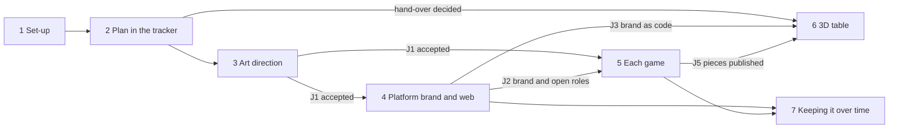

---
authors:
  - Aleš Kalfas <kalfas.ales@gmail.com>
started: 2026-11-14
---

# A board-game platform's brand, web and games

How far does pkit carry one adopter's case, a project that builds an online platform for board games, and what must pkit gain to carry the rest? This note is where the maintainer and the coordinator plan the case and discuss it, in one place. The Umbrella [#3166](https://github.com/aleskalfas/project-kit/issues/3166) tracks the work: each gap below becomes a Task or Feature under it, and each decision taken here goes into an issue or a record, never only into this note.

**How the note is kept.**
- The process and the deliverables below are the plan. A row changes as the work that carries it lands, or as the discussion changes the plan.
- The discussion is at the end, one dated entry for each turn, the newest last. An entry says what was asked, what was decided and where the decision went.
- A step's id (`P3.1`) and a deliverable's number (`1.8`) never change, so a link to one holds as the note grows.

## Purpose

How far pkit carries one adopter's case: a project that builds an online platform for board games. With pkit it sets up the work, sets an art direction, and builds the platform's brand, its web pages for several devices, and the games themselves. The games are played on a 3D table drawn with three.js, where cards and boards are flat textured pieces and figures are 3D models.

It tracks two views:
- **The process:** each step from an empty repository to delivered assets, what it waits on, and what runs alongside it.
- **The deliverables:** each thing the case needs, and its state on `main`.

A row moves as the work that carries it lands. Each gap pkit should close becomes a Task or Feature under the Umbrella [#3166](https://github.com/aleskalfas/project-kit/issues/3166), or the issue the row names.

**States:** ✅ works today (a command, skill or agent does it on `main`) · 🟡 partly · 📐 decided, not built (an accepted record decides it) · 🗓️ planned (an open issue carries it) · ❌ not covered · ⬜ outside (the records keep it out of pkit).

**Use cases:** whether the project's analysis describes the step, whatever pkit does today. ✅ a use case's main path or a variant describes it · 🟡 partly, and the cell says what is missing · ❌ none, a gap in the analysis · — outside pkit, so none is owed. Mapped on 2026-11-14 against the 97 use cases under `tech-docs/analysis/`.

Deliverables assessed at `main` d0e380510 on 2026-11-13; process mapped on 2026-11-14. The process map with its evidence, step by step, is in [The first process map, with its evidence](#the-first-process-map-with-its-evidence), below.

## The process

### Overview

| Phase | What it gives | Covered | Use cases | Starts after |
|---|---|---|---|---|
| [1. Set-up](#phase-1-set-up) | pkit and five capabilities installed, the tracker configured | ✅ 11 · ⬜ 1 | ✅ 9 · 🟡 2 · — 1 | — |
| [2. Plan the work in the tracker](#phase-2-plan-the-work-in-the-tracker) | EPICs, the foundation's records, Tasks in lanes | ✅ 5 · 📐 1 | ✅ 4 · 🟡 2 | 1 |
| [3. Art direction](#phase-3-art-direction) | the accepted art direction, a mood board, the brand's values | ✅ 3 · 🟡 3 · 🗓️ 1 · ⬜ 1 | ✅ 5 · 🟡 2 · — 1 | 2 |
| [4. The platform's brand and web](#phase-4-the-platforms-brand-and-web) | the released platform brand, its code, the web pages, the live platform | ✅ 7 | ✅ 6 · 🟡 1 | 3 |
| [5. Each game](#phase-5-each-game) | each game's brand, notation, pieces and print files | ✅ 3 · 🟡 4 · ⬜ 1 | ✅ 2 · 🟡 5 · — 1 | 3, and 4's brand |
| [6. The 3D table in three.js](#phase-6-the-3d-table-in-threejs) | the hand-over to three.js, textures, models, the scene | ✅ 4 · 🟡 5 · 🗓️ 1 · ❌ 2 · ⬜ 3 | ✅ 5 · 🟡 4 · ❌ 3 · — 3 | 2's plan, then 4 and 5 |
| [7. Keeping it over time](#phase-7-keeping-it-over-time) | releases, protected print runs, the next game | ✅ 6 · 🗓️ 3 | ✅ 6 · 🟡 2 · ❌ 1 | 4, 5 |
| **All 65 steps** | | **✅ 39 · 🟡 12 · 📐 1 · 🗓️ 5 · ❌ 2 · ⬜ 6** | **✅ 37 · 🟡 18 · ❌ 4 · — 6** | |

Then: [Where to start](#where-to-start) · [What runs in parallel](#what-runs-in-parallel) · [The deliverables](#the-deliverables) · [Gaps pkit should close](#gaps-pkit-should-close) · [Gaps in the use cases](#gaps-in-the-use-cases) · [Discussion](#discussion)

**Covered:** ✅ works today · 🟡 partly · 📐 decided, not built · 🗓️ planned · ❌ not covered · ⬜ outside pkit
**Who:** 🧑 a person · 🤖 an agent · ⌨️ a command · 📘 a skill · 🎨 made in other tools

### Phase 1. Set-up

| # | Step | Who | In | Out | Deliverables | Covered | Use cases | Needs |
|---|---|---|---|---|---|---|---|---|
| P1.1 | Make the repository on GitHub, and sign `gh` in | 🧑 | • a GitHub account | • the repository • `gh` signed in | — | ⬜ | — | — |
| P1.2 | Install pkit as a tool, at the `latest` tag | 🧑 | • `uv` | • `pkit` on the PATH | — | ✅ | ✅ • [UC-048 Put the system's CLI on my machine at a release](https://github.com/aleskalfas/project-kit/blob/main/tech-docs/analysis/core/use-case-model/use-cases/050-adopt/UC-048-install-cli.md) | — |
| P1.3 | `pkit init` at the repository's root | ⌨️ | • the repository | • `.pkit/` • the harness settings • `.agent-workspace/` | — | ✅ | ✅ • [UC-049 Install the system into my project with one command](https://github.com/aleskalfas/project-kit/blob/main/tech-docs/analysis/core/use-case-model/use-cases/050-adopt/UC-049-install-system.md) | • [P1.1 Make the repository on GitHub, and sign `gh` in](#p1-1) • [P1.2 Install pkit as a tool, at the `latest` tag](#p1-2) |
| P1.4 | Read how pkit is wired | ⌨️ `pkit status` | • `.pkit/` | • what is installed, deployed and pinned | — | ✅ | ✅ • [UC-049 Install the system into my project with one command](https://github.com/aleskalfas/project-kit/blob/main/tech-docs/analysis/core/use-case-model/use-cases/050-adopt/UC-049-install-system.md) • [UC-024 See what a capability would connect to before I install it](https://github.com/aleskalfas/project-kit/blob/main/tech-docs/analysis/core/use-case-model/use-cases/020-set-up/UC-024-see-capability-connections.md) | [P1.3 `pkit init` at the repository's root](#p1-3) |
| P1.5 | Install project-management | ⌨️ | • `.pkit/` | • the tracker's schemas • 🤖 `project-manager` • 📘 `pm` | — | ✅ | ✅ • [UC-023 Add or remove a capability, and be told of a name collision](https://github.com/aleskalfas/project-kit/blob/main/tech-docs/analysis/core/use-case-model/use-cases/020-set-up/UC-023-add-or-remove-capability.md) • [UC-024 See what a capability would connect to before I install it](https://github.com/aleskalfas/project-kit/blob/main/tech-docs/analysis/core/use-case-model/use-cases/020-set-up/UC-024-see-capability-connections.md) | [P1.3 `pkit init` at the repository's root](#p1-3) |
| P1.6 | Configure the tracker | • 🧑 • then ⌨️ `pkit pm bootstrap` | • the workstreams (platform, brand, web, game, table-3d) • a board | • `config.yaml` • `workstreams.yaml` • labels • a board with five states | — | ✅ | 🟡 • [UC-064 Define the Milestones and workstreams the work falls into, and roll a date-based Milestone forward](https://github.com/aleskalfas/project-kit/blob/main/tech-docs/analysis/project-management/use-case-model/use-cases/010-plan/UC-064-define-milestones-and-workstreams.md) Missing: [UC-064 Define the Milestones and workstreams the work falls into, and roll a date-based Milestone forward](https://github.com/aleskalfas/project-kit/blob/main/tech-docs/analysis/project-management/use-case-model/use-cases/010-plan/UC-064-define-milestones-and-workstreams.md) adds workstreams and declares Milestone categories, but no use case bootstraps the tracker: its config.yaml, its labels by pkit pm bootstrap, the board with five states and the pre-check. | [P1.5 Install project-management](#p1-5) |
| P1.7 | Install software-engineering, and name the conventions corpus | • ⌨️ • then 🧑 | • project-management installed | • 🤖 `software-engineer` • the code-review panel • the corpus's overlay line | — | ✅ | ✅ • [UC-023 Add or remove a capability, and be told of a name collision](https://github.com/aleskalfas/project-kit/blob/main/tech-docs/analysis/core/use-case-model/use-cases/020-set-up/UC-023-add-or-remove-capability.md) • [UC-022 Add my own operational rules, the harness's settings, grants and agent paths beside the methodology's](https://github.com/aleskalfas/project-kit/blob/main/tech-docs/analysis/core/use-case-model/use-cases/020-set-up/UC-022-add-own-additions.md) • [UC-001 Build my change under my project's conventions](https://github.com/aleskalfas/project-kit/blob/main/tech-docs/analysis/software-engineering/use-case-model/use-cases/010-build/UC-001-build-under-conventions.md) | [P1.5 Install project-management](#p1-5) |
| P1.8 | Install visual-communication | ⌨️ | • `.pkit/` | • the visual commands and renderers • 🤖 `graphic-designer` and `graphic-design-reviewer` • the rule sets • the designer's grant on `visual/` | — | ✅ | ✅ • [UC-023 Add or remove a capability, and be told of a name collision](https://github.com/aleskalfas/project-kit/blob/main/tech-docs/analysis/core/use-case-model/use-cases/020-set-up/UC-023-add-or-remove-capability.md) | [P1.3 `pkit init` at the repository's root](#p1-3) |
| P1.9 | Set up the visual work | • ⌨️ `pkit visual add` • then 🧑 | • a location • a browser | • `visual/libraries/` with the foundations and the starter • the browser line • a CI job that draws HTML pages, by hand | — | ✅ no CI file ships, [#2577 "The starter library's second wave, built ahead of need"](https://github.com/aleskalfas/project-kit/issues/2577) | 🟡 • [UC-093 Build a presentation from library components](https://github.com/aleskalfas/project-kit/blob/main/tech-docs/analysis/visual-communication/use-case-model/use-cases/010-make/UC-093-build-presentation.md) Missing: [UC-093 Build a presentation from library components](https://github.com/aleskalfas/project-kit/blob/main/tech-docs/analysis/visual-communication/use-case-model/use-cases/010-make/UC-093-build-presentation.md) variant 3b copies the shipped starter library into the project, but no use case records the visual location, sets the browser line or adds a CI job that draws the HTML pages. | [P1.8 Install visual-communication](#p1-8) |
| P1.10 | Install software-analysis | • ⌨️ • then 🧑 | • `.pkit/` | • the `ANALYSIS` rule set • 📘 `analysis-author` • 🤖 `analysis-resolver` | — | ✅ | ✅ • [UC-023 Add or remove a capability, and be told of a name collision](https://github.com/aleskalfas/project-kit/blob/main/tech-docs/analysis/core/use-case-model/use-cases/020-set-up/UC-023-add-or-remove-capability.md) • [UC-070 Choose the parts of each kind of analysis artefact as I adopt software-analysis](https://github.com/aleskalfas/project-kit/blob/main/tech-docs/analysis/software-analysis/use-case-model/use-cases/010-describe/UC-070-choose-parts.md) | [P1.3 `pkit init` at the repository's root](#p1-3) |
| P1.11 | Install living-docs | ⌨️ | • `.pkit/` | • documentation spaces • 🤖 `living-docs` | — | ✅ | ✅ • [UC-023 Add or remove a capability, and be told of a name collision](https://github.com/aleskalfas/project-kit/blob/main/tech-docs/analysis/core/use-case-model/use-cases/020-set-up/UC-023-add-or-remove-capability.md) • [UC-043 Set up a documentation space for one audience](https://github.com/aleskalfas/project-kit/blob/main/tech-docs/analysis/living-docs/use-case-model/use-cases/010-set-up/UC-043-set-up-space.md) | [P1.3 `pkit init` at the repository's root](#p1-3) |
| P1.12 | Commit the set-up, and add CI | 🧑 | • the files of [P1.6 Configure the tracker](#p1-6)–[P1.11 Install living-docs](#p1-11) | • a commit • CI running `pkit validate` and `pkit pm pre-check` | — | ✅ | ✅ • [UC-049 Install the system into my project with one command](https://github.com/aleskalfas/project-kit/blob/main/tech-docs/analysis/core/use-case-model/use-cases/050-adopt/UC-049-install-system.md) • [UC-006 Make my merges wait on the system's checks](https://github.com/aleskalfas/project-kit/blob/main/tech-docs/analysis/core/use-case-model/use-cases/020-set-up/UC-006-gate-merges.md) | [P1.6 Configure the tracker](#p1-6)–[P1.11 Install living-docs](#p1-11) |

### Phase 2. Plan the work in the tracker

| # | Step | Who | In | Out | Deliverables | Covered | Use cases | Needs |
|---|---|---|---|---|---|---|---|---|
| P2.1 | Write down the platform's behaviour and the games' terms | 🧑 or 🤖 with 📘 `analysis-author` | • the platform's idea • the games' rules | • actors • use cases • glossary terms | — | ✅ | 🟡 • [UC-071 Describe my existing project from its code, documents and decisions](https://github.com/aleskalfas/project-kit/blob/main/tech-docs/analysis/software-analysis/use-case-model/use-cases/010-describe/UC-071-describe-existing-project.md) • [UC-070 Choose the parts of each kind of analysis artefact as I adopt software-analysis](https://github.com/aleskalfas/project-kit/blob/main/tech-docs/analysis/software-analysis/use-case-model/use-cases/010-describe/UC-070-choose-parts.md) • [UC-072 Revise the analysis before a proposed change is built](https://github.com/aleskalfas/project-kit/blob/main/tech-docs/analysis/software-analysis/use-case-model/use-cases/020-revalidate/UC-072-revise-before-change.md) Missing: [UC-071 Describe my existing project from its code, documents and decisions](https://github.com/aleskalfas/project-kit/blob/main/tech-docs/analysis/software-analysis/use-case-model/use-cases/010-describe/UC-071-describe-existing-project.md) derives actors, use cases and terms from an existing project's code, documents and decisions, but no use case writes the analysis of a project not yet built, from its idea and the games' rules. | [P1.10 Install software-analysis](#p1-10) |
| P2.2 | File the EPICs | 🤖 `project-manager` | • the case's scope | • an EPIC for the platform • one EPIC for each game • one EPIC for the 3D table | — | ✅ | ✅ • [UC-063 Plan an intent into an EPIC and its work, filed once I approve the batch plan](https://github.com/aleskalfas/project-kit/blob/main/tech-docs/analysis/project-management/use-case-model/use-cases/010-plan/UC-063-plan-intent.md) | [P1.6 Configure the tracker](#p1-6) |
| P2.3 | Plan the foundation: the choices every lane shares, records first, then a walking skeleton | • 🤖 `project-manager`, `architect` • 🧑 accepts | • the EPICs • the use cases | • a foundation Feature • drafts of its records: art direction, brand axes and open roles, hand-over, three.js stack • a walking-skeleton Task | — | ✅ | ✅ • [UC-083 Plan an intent into Tasks that one agent can each finish](https://github.com/aleskalfas/project-kit/blob/main/tech-docs/analysis/project-management/use-case-model/use-cases/040-work-in-parallel/UC-083-plan-across-scopes.md) • [UC-063 Plan an intent into an EPIC and its work, filed once I approve the batch plan](https://github.com/aleskalfas/project-kit/blob/main/tech-docs/analysis/project-management/use-case-model/use-cases/010-plan/UC-063-plan-intent.md) • [UC-037 Record my decision beside the methodology's](https://github.com/aleskalfas/project-kit/blob/main/tech-docs/analysis/core/use-case-model/use-cases/030-change/UC-037-record-decision.md) • [UC-040 Have a drafted record or rule become binding only through my own review](https://github.com/aleskalfas/project-kit/blob/main/tech-docs/analysis/core/use-case-model/use-cases/030-change/UC-040-accept-through-review.md) | [P2.2 File the EPICs](#p2-2) |
| P2.4 | Slice each lane into Tasks | • 🤖 `project-manager` • 🧑 | • the accepted foundation | • Tasks with their dependencies • a Milestone for each lane, in a pool | — | ✅ | ✅ • [UC-083 Plan an intent into Tasks that one agent can each finish](https://github.com/aleskalfas/project-kit/blob/main/tech-docs/analysis/project-management/use-case-model/use-cases/040-work-in-parallel/UC-083-plan-across-scopes.md) • [UC-063 Plan an intent into an EPIC and its work, filed once I approve the batch plan](https://github.com/aleskalfas/project-kit/blob/main/tech-docs/analysis/project-management/use-case-model/use-cases/010-plan/UC-063-plan-intent.md) • [UC-064 Define the Milestones and workstreams the work falls into, and roll a date-based Milestone forward](https://github.com/aleskalfas/project-kit/blob/main/tech-docs/analysis/project-management/use-case-model/use-cases/010-plan/UC-064-define-milestones-and-workstreams.md) | [P2.3 Plan the foundation: the choices every lane shares, records first, then a walking skeleton](#p2-3) closed |
| P2.5 | Build each Task with a fresh builder | ⌨️ the build command | • a ready Task | • a branch • a pull request | — | 📐 builders started by hand today, [#2287 "A worker builds each Task through a fresh builder agent"](https://github.com/aleskalfas/project-kit/issues/2287), [#2288 "The foundation of a worker's builder"](https://github.com/aleskalfas/project-kit/issues/2288) | ✅ • [UC-084 Take my next ready Task, and build it up to its merge](https://github.com/aleskalfas/project-kit/blob/main/tech-docs/analysis/project-management/use-case-model/use-cases/040-work-in-parallel/UC-084-take-next-task.md) • [UC-001 Build my change under my project's conventions](https://github.com/aleskalfas/project-kit/blob/main/tech-docs/analysis/software-engineering/use-case-model/use-cases/010-build/UC-001-build-under-conventions.md) | [P2.4 Slice each lane into Tasks](#p2-4) |
| P2.6 | See where the work stands | ⌨️ `pkit pm show-tree` | • the tracker | • the tree of work • each item's state | — | ✅ | 🟡 • [UC-090 See which agent works on which issue, without visiting each agent](https://github.com/aleskalfas/project-kit/blob/main/tech-docs/analysis/project-management/use-case-model/use-cases/040-work-in-parallel/UC-090-see-who-works-on-what.md) Missing: [UC-090 See which agent works on which issue, without visiting each agent](https://github.com/aleskalfas/project-kit/blob/main/tech-docs/analysis/project-management/use-case-model/use-cases/040-work-in-parallel/UC-090-see-who-works-on-what.md) lists open issues by owner and the topology's seats, but no use case shows the tree of the work from Milestones down to Tasks and pull requests with each item's state, as pkit pm show-tree does. | [P2.2 File the EPICs](#p2-2) |

### Phase 3. Art direction

Made before any asset. pkit has no single home for it: its parts sit in a record, the brand, a rule set, a brief and a mood board, and none binds a later asset ([1.8 An art direction that later assets follow](#d1-8), [1.9 Pictures made elsewhere held to the brand and the art direction](#d1-9)).

| # | Step | Who | In | Out | Deliverables | Covered | Use cases | Needs |
|---|---|---|---|---|---|---|---|---|
| P3.1 | Decide the feel in words, and record it | • 🧑 • 🤖 `critic` • 📘 `decision-author` | • the games' themes • the audience • references | • a PRJ record: mood, palette and type in words, illustration style, the table's materials and light | [1.8 An art direction that later assets follow](#d1-8) | 🟡 • binds people and agents • nothing checks a picture against it | ✅ • [UC-037 Record my decision beside the methodology's](https://github.com/aleskalfas/project-kit/blob/main/tech-docs/analysis/core/use-case-model/use-cases/030-change/UC-037-record-decision.md) • [UC-042 Have my draft challenged and my diff checked against the conventions](https://github.com/aleskalfas/project-kit/blob/main/tech-docs/analysis/core/use-case-model/use-cases/030-change/UC-042-challenge-and-check.md) • [UC-040 Have a drafted record or rule become binding only through my own review](https://github.com/aleskalfas/project-kit/blob/main/tech-docs/analysis/core/use-case-model/use-cases/030-change/UC-040-accept-through-review.md) | [P2.3 Plan the foundation: the choices every lane shares, records first, then a walking skeleton](#p2-3) |
| P3.2 | Make concept art and gather references | 🎨 illustrator | • the record's draft | • concept art and reference pictures, PNG or JPEG | • [1.8 An art direction that later assets follow](#d1-8) • [1.9 Pictures made elsewhere held to the brand and the art direction](#d1-9) | ⬜ | — | [P3.1 Decide the feel in words, and record it](#p3-1) begun |
| P3.3 | Lay out a mood board | 🤖 `graphic-designer`, `graphic-design-reviewer` | • the references • the record | • a mood-board deck with its brief, as a PDF | [1.8 An art direction that later assets follow](#d1-8) | ✅ binds no later piece | 🟡 • [UC-111 Have a piece designed and judged by the principles of visual communication](https://github.com/aleskalfas/project-kit/blob/main/tech-docs/analysis/visual-communication/use-case-model/use-cases/010-make/UC-111-have-piece-designed-and-judged.md) • [UC-093 Build a presentation from library components](https://github.com/aleskalfas/project-kit/blob/main/tech-docs/analysis/visual-communication/use-case-model/use-cases/010-make/UC-093-build-presentation.md) • [UC-102 Hand out a piece as a PDF for each language](https://github.com/aleskalfas/project-kit/blob/main/tech-docs/analysis/visual-communication/use-case-model/use-cases/030-draw-and-hand-out/UC-102-hand-out-pdf.md) Missing: [UC-111 Have a piece designed and judged by the principles of visual communication](https://github.com/aleskalfas/project-kit/blob/main/tech-docs/analysis/visual-communication/use-case-model/use-cases/010-make/UC-111-have-piece-designed-and-judged.md) and [UC-093 Build a presentation from library components](https://github.com/aleskalfas/project-kit/blob/main/tech-docs/analysis/visual-communication/use-case-model/use-cases/010-make/UC-093-build-presentation.md) have a deck designed, judged and drawn and [UC-102 Hand out a piece as a PDF for each language](https://github.com/aleskalfas/project-kit/blob/main/tech-docs/analysis/visual-communication/use-case-model/use-cases/030-draw-and-hand-out/UC-102-hand-out-pdf.md) hands it out as a PDF, but no use case lays out pictures made elsewhere in a piece, which is what a mood board holds. | • [P1.9 Set up the visual work](#p1-9) • [P3.2 Make concept art and gather references](#p3-2) |
| P3.4 | Write the taste as rules | 🧑 | • the record | • a project rule set that inherits `GRAPHIC` | • [1.8 An art direction that later assets follow](#d1-8) • [1.9 Pictures made elsewhere held to the brand and the art direction](#d1-9) • [4.3 A designer and a reviewer that hold quality](#d4-3) | 🟡 • both design agents read it • it binds no piece yet, [#2416 "A YAML data file can be an artefact, so rules and anchors attach to it"](https://github.com/aleskalfas/project-kit/issues/2416), [#2676 "A required review of a piece's change at the merge"](https://github.com/aleskalfas/project-kit/issues/2676) | ✅ • [UC-038 Author and extend my project's own rule sets](https://github.com/aleskalfas/project-kit/blob/main/tech-docs/analysis/core/use-case-model/use-cases/030-change/UC-038-author-rule-sets.md) • [UC-111 Have a piece designed and judged by the principles of visual communication](https://github.com/aleskalfas/project-kit/blob/main/tech-docs/analysis/visual-communication/use-case-model/use-cases/010-make/UC-111-have-piece-designed-and-judged.md) | [P3.1 Decide the feel in words, and record it](#p3-1) |
| P3.5 | Fix the measurable half | • 🤖 `graphic-designer` • 🧑 | • the record • the concept art | • palette, type, spacing and logo as values, each with its reason | • [1.1 Colours, type and spacing](#d1-1) • [1.8 An art direction that later assets follow](#d1-8) | 🟡 a reason has only its token's description | 🟡 • [UC-105 Make a brand with modes on the axes it needs](https://github.com/aleskalfas/project-kit/blob/main/tech-docs/analysis/visual-communication/use-case-model/use-cases/020-build-libraries/UC-105-make-brand.md) Missing: [UC-105 Make a brand with modes on the axes it needs](https://github.com/aleskalfas/project-kit/blob/main/tech-docs/analysis/visual-communication/use-case-model/use-cases/020-build-libraries/UC-105-make-brand.md) gives a brand its colours, fonts, sizes, spacing and logo, but not the reason for each value. | [P3.1 Decide the feel in words, and record it](#p3-1) |
| P3.6 | Render the table's look in the brand | ⌨️ `pkit visual produce` | • the brand's values • a 3D scene | • a render that follows the brand | • [1.9 Pictures made elsewhere held to the brand and the art direction](#d1-9) • [3.11 3D pictures that follow the brand](#d3-11) | 🗓️ no producer ships, [#2575 "Pictures made by three.js: a lit 3D figure that follows the brand"](https://github.com/aleskalfas/project-kit/issues/2575) | ✅ • [UC-097 Put a picture that a program makes in a piece](https://github.com/aleskalfas/project-kit/blob/main/tech-docs/analysis/visual-communication/use-case-model/use-cases/010-make/UC-097-put-produced-picture.md) | [P3.5 Fix the measurable half](#p3-5) |
| P3.7 | Review and accept the art direction | • 🤖 `critic`, the reviewer • 🧑 accepts | • the record • the mood board • the rule set • the values | • the accepted art direction | • [1.8 An art direction that later assets follow](#d1-8) • [4.3 A designer and a reviewer that hold quality](#d4-3) | ✅ | ✅ • [UC-040 Have a drafted record or rule become binding only through my own review](https://github.com/aleskalfas/project-kit/blob/main/tech-docs/analysis/core/use-case-model/use-cases/030-change/UC-040-accept-through-review.md) • [UC-042 Have my draft challenged and my diff checked against the conventions](https://github.com/aleskalfas/project-kit/blob/main/tech-docs/analysis/core/use-case-model/use-cases/030-change/UC-042-challenge-and-check.md) • [UC-111 Have a piece designed and judged by the principles of visual communication](https://github.com/aleskalfas/project-kit/blob/main/tech-docs/analysis/visual-communication/use-case-model/use-cases/010-make/UC-111-have-piece-designed-and-judged.md) | • [P3.1 Decide the feel in words, and record it](#p3-1) • [P3.3 Lay out a mood board](#p3-3)–[P3.5 Fix the measurable half](#p3-5) |
| P3.8 | Explain it on one page | 🧑 with 📘 `docs-author` | • the accepted record | • an "Art direction" page anchored to the record and the brand | [1.8 An art direction that later assets follow](#d1-8) | ✅ | ✅ • [UC-044 Write a page for the reader it names](https://github.com/aleskalfas/project-kit/blob/main/tech-docs/analysis/living-docs/use-case-model/use-cases/020-write/UC-044-write-page.md) | • [P1.11 Install living-docs](#p1-11) • [P3.7 Review and accept the art direction](#p3-7) |

### Phase 4. The platform's brand and web

| # | Step | Who | In | Out | Deliverables | Covered | Use cases | Needs |
|---|---|---|---|---|---|---|---|---|
| P4.1 | Write the platform brand | • 🤖 `graphic-designer` • 🧑 adds fonts and logo | • the art direction • fonts and their licences • the logo as PNG | • a brand library: tokens, axes, sizes • a colour-blind mode • the roles games may restyle | • [1.1 Colours, type and spacing](#d1-1) • [1.2 Icons](#d1-2) • [1.3 Light and dark, high contrast](#d1-3) • [1.4 A colour-blind-safe palette](#d1-4) | ✅ no command stamps a brand, [#2574 "Modes on several axes, a size-changing axis included"](https://github.com/aleskalfas/project-kit/issues/2574) | ✅ • [UC-105 Make a brand with modes on the axes it needs](https://github.com/aleskalfas/project-kit/blob/main/tech-docs/analysis/visual-communication/use-case-model/use-cases/020-build-libraries/UC-105-make-brand.md) | [P3.7 Review and accept the art direction](#p3-7) |
| P4.2 | Check it | ⌨️ `pkit visual check` | • the brand | • contrast findings in every mode | • [1.3 Light and dark, high contrast](#d1-3) • [1.4 A colour-blind-safe palette](#d1-4) • [2.5 Accessible colour](#d2-5) | ✅ | 🟡 • [UC-105 Make a brand with modes on the axes it needs](https://github.com/aleskalfas/project-kit/blob/main/tech-docs/analysis/visual-communication/use-case-model/use-cases/020-build-libraries/UC-105-make-brand.md) • [UC-098 Give a piece another brand or another mode](https://github.com/aleskalfas/project-kit/blob/main/tech-docs/analysis/visual-communication/use-case-model/use-cases/030-draw-and-hand-out/UC-098-switch-brand-or-mode.md) Missing: [UC-105 Make a brand with modes on the axes it needs](https://github.com/aleskalfas/project-kit/blob/main/tech-docs/analysis/visual-communication/use-case-model/use-cases/020-build-libraries/UC-105-make-brand.md) step 7 checks only the brand's layouts and [UC-098 Give a piece another brand or another mode](https://github.com/aleskalfas/project-kit/blob/main/tech-docs/analysis/visual-communication/use-case-model/use-cases/030-draw-and-hand-out/UC-098-switch-brand-or-mode.md) variant 1c checks a piece in each combination of modes, but no use case checks the brand's contrast pairs in every combination of its modes. | [P4.1 Write the platform brand](#p4-1) |
| P4.3 | Release it | ⌨️ `pkit visual release` | • the checked brand | • a released version | [4.1 Released libraries](#d4-1) | ✅ | ✅ • [UC-103 Improve a library component without breaking a piece](https://github.com/aleskalfas/project-kit/blob/main/tech-docs/analysis/visual-communication/use-case-model/use-cases/020-build-libraries/UC-103-improve-library-component.md) • [UC-106 Build a brand on another brand](https://github.com/aleskalfas/project-kit/blob/main/tech-docs/analysis/visual-communication/use-case-model/use-cases/020-build-libraries/UC-106-build-brand-on-brand.md) • [UC-110 Add a library component and mark it stable](https://github.com/aleskalfas/project-kit/blob/main/tech-docs/analysis/visual-communication/use-case-model/use-cases/020-build-libraries/UC-110-add-library-component.md) | [P4.2 Check it](#p4-2) |
| P4.4 | Write it as code | ⌨️ `pkit visual write-code` | • the brand • a declaration under `code/` | • `brand.css` • the JSON of every value | [1.6 The brand handed to developers as code](#d1-6) | ✅ [#2570 "A brand written out as code, and the HTML renderer built on it"](https://github.com/aleskalfas/project-kit/issues/2570) | ✅ • [UC-107 Use a brand's values in code](https://github.com/aleskalfas/project-kit/blob/main/tech-docs/analysis/visual-communication/use-case-model/use-cases/020-build-libraries/UC-107-use-brand-in-code.md) | [P4.2 Check it](#p4-2) |
| P4.5 | Design the web pages | 🤖 `graphic-designer`, the reviewer | • the brand • the starter's web parts • content in two languages • a brief | • site pages at desktop, tablet and phone, looked at and reviewed | • [2.1 Pages for desktop, tablet and phone](#d2-1) • [2.3 More than one language](#d2-3) • [2.4 Readable by assistive tools](#d2-4) • [2.5 Accessible colour](#d2-5) • [2.7 Mock-ups of the platform's screens and states](#d2-7) | ✅ drafts until the web parts are released, [#2577 "The starter library's second wave, built ahead of need"](https://github.com/aleskalfas/project-kit/issues/2577), [#3129 "The starter library's second wave, with the talk's recurring kinds and a colour for each place"](https://github.com/aleskalfas/project-kit/issues/3129) | ✅ • [UC-111 Have a piece designed and judged by the principles of visual communication](https://github.com/aleskalfas/project-kit/blob/main/tech-docs/analysis/visual-communication/use-case-model/use-cases/010-make/UC-111-have-piece-designed-and-judged.md) • [UC-098 Give a piece another brand or another mode](https://github.com/aleskalfas/project-kit/blob/main/tech-docs/analysis/visual-communication/use-case-model/use-cases/030-draw-and-hand-out/UC-098-switch-brand-or-mode.md) • [UC-101 Give a piece in a second language](https://github.com/aleskalfas/project-kit/blob/main/tech-docs/analysis/visual-communication/use-case-model/use-cases/030-draw-and-hand-out/UC-101-give-second-language.md) • [UC-099 Draw a piece through another renderer](https://github.com/aleskalfas/project-kit/blob/main/tech-docs/analysis/visual-communication/use-case-model/use-cases/030-draw-and-hand-out/UC-099-draw-through-renderer.md) | • [P1.9 Set up the visual work](#p1-9) • [P4.1 Write the platform brand](#p4-1) |
| P4.6 | Build the live platform | 🤖 `software-engineer`, the code-review panel | • `brand.css` • the drawn pages • Tasks | • the platform's code, through pull requests | • [2.2 A live site that reflows for visitors](#d2-2) • [2.8 Where the capability stops](#d2-8) • [2.9 The platform itself: live board, lobby, screens](#d2-9) | ✅ through software-engineering | ✅ • [UC-001 Build my change under my project's conventions](https://github.com/aleskalfas/project-kit/blob/main/tech-docs/analysis/software-engineering/use-case-model/use-cases/010-build/UC-001-build-under-conventions.md) • [UC-112 Have a change's code reviewed for correctness and security](https://github.com/aleskalfas/project-kit/blob/main/tech-docs/analysis/software-engineering/use-case-model/use-cases/020-review/UC-112-review-code.md) • [UC-107 Use a brand's values in code](https://github.com/aleskalfas/project-kit/blob/main/tech-docs/analysis/visual-communication/use-case-model/use-cases/020-build-libraries/UC-107-use-brand-in-code.md) | • [P2.4 Slice each lane into Tasks](#p2-4) • [P4.4 Write it as code](#p4-4) • [P4.5 Design the web pages](#p4-5) |
| P4.7 | Hand out or publish the designs | ⌨️ `export`, `mark-final` | • the released brand • finished pages | • PDF, SVG and HTML exports • a final version | • [2.6 Printable pages](#d2-6) • [4.2 A finished game's art protected from later changes](#d4-2) | ✅ [#2572 "A piece's states and its lock: final, published, a pinned lock moved, outdated, upgrade and prune"](https://github.com/aleskalfas/project-kit/issues/2572) | ✅ • [UC-102 Hand out a piece as a PDF for each language](https://github.com/aleskalfas/project-kit/blob/main/tech-docs/analysis/visual-communication/use-case-model/use-cases/030-draw-and-hand-out/UC-102-hand-out-pdf.md) • [UC-094 Put a figure in a documentation page](https://github.com/aleskalfas/project-kit/blob/main/tech-docs/analysis/visual-communication/use-case-model/use-cases/010-make/UC-094-put-figure-in-page.md) | • [P4.3 Release it](#p4-3) • [P4.5 Design the web pages](#p4-5) |

### Phase 5. Each game

| # | Step | Who | In | Out | Deliverables | Covered | Use cases | Needs |
|---|---|---|---|---|---|---|---|---|
| P5.1 | Write the game's brand on the platform's | 🤖 `graphic-designer` | • the platform brand's open roles | • the game's brand library | • [1.1 Colours, type and spacing](#d1-1) • [1.4 A colour-blind-safe palette](#d1-4) | ✅ | ✅ • [UC-106 Build a brand on another brand](https://github.com/aleskalfas/project-kit/blob/main/tech-docs/analysis/visual-communication/use-case-model/use-cases/020-build-libraries/UC-106-build-brand-on-brand.md) | • [P4.1 Write the platform brand](#p4-1) • [P4.3 Release it](#p4-3) before a piece is published |
| P5.2 | Write the game's notation | 🤖 `graphic-designer` | • the game's concepts • the art direction | • `notation.yaml`: each concept to a colour family and an icon | • [1.2 Icons](#d1-2) • [1.5 The games' concepts given colours and signs](#d1-5) | ✅ six colour families at most, [#2576 "The starter library's first wave, with its legend and icons"](https://github.com/aleskalfas/project-kit/issues/2576) | 🟡 • [UC-095 Draw several views of one system from one model](https://github.com/aleskalfas/project-kit/blob/main/tech-docs/analysis/visual-communication/use-case-model/use-cases/010-make/UC-095-draw-views-of-system.md) Missing: [UC-095 Draw several views of one system from one model](https://github.com/aleskalfas/project-kit/blob/main/tech-docs/analysis/visual-communication/use-case-model/use-cases/010-make/UC-095-draw-views-of-system.md) variant 5b gives one kind of element a new look in a new version of the notation, but no use case writes a notation, mapping each concept to a colour family and an icon. | [P3.7 Review and accept the art direction](#p3-7) |
| P5.3 | Write the game's component library | 🤖 `graphic-designer` | • the art direction • the pieces' sizes | • tops: a 63 × 88 mm card with front and back • a board • a token • a tile • rulebook pages | • [3.1 Boards, large, at a physical size](#d3-1) • [3.2 A board on a square grid](#d3-2) • [3.3 A board or tiles on hexes](#d3-3) • [3.5 Fronts and backs at a standard card size](#d3-5) • [3.7 Tokens and tiles](#d3-7) | 🟡 no hexes, no polygons, no stamp | 🟡 • [UC-104 Add a kind of piece the capability does not ship](https://github.com/aleskalfas/project-kit/blob/main/tech-docs/analysis/visual-communication/use-case-model/use-cases/020-build-libraries/UC-104-add-kind-of-piece.md) • [UC-110 Add a library component and mark it stable](https://github.com/aleskalfas/project-kit/blob/main/tech-docs/analysis/visual-communication/use-case-model/use-cases/020-build-libraries/UC-110-add-library-component.md) Missing: [UC-104 Add a kind of piece the capability does not ship](https://github.com/aleskalfas/project-kit/blob/main/tech-docs/analysis/visual-communication/use-case-model/use-cases/020-build-libraries/UC-104-add-kind-of-piece.md) adds a kind of piece with its layouts and [UC-110 Add a library component and mark it stable](https://github.com/aleskalfas/project-kit/blob/main/tech-docs/analysis/visual-communication/use-case-model/use-cases/020-build-libraries/UC-110-add-library-component.md) adds a library component, but neither gives a top its physical size in millimetres, which a card, a board or a tile needs. | • [P1.9 Set up the visual work](#p1-9) • [P3.7 Review and accept the art direction](#p3-7) |
| P5.4 | Fill the cards' data | 🤖 `software-engineer` or 🧑 | • the designer's spreadsheet | • content YAML per language • the script that makes it | [3.4 Many cards from a table of data](#d3-4) | 🟡 no import from a table, [#2580 "Graphs arranged by a helper, and several views over one model file"](https://github.com/aleskalfas/project-kit/issues/2580) | 🟡 • [UC-104 Add a kind of piece the capability does not ship](https://github.com/aleskalfas/project-kit/blob/main/tech-docs/analysis/visual-communication/use-case-model/use-cases/020-build-libraries/UC-104-add-kind-of-piece.md) • [UC-096 Add a new kind of visual to a piece as data](https://github.com/aleskalfas/project-kit/blob/main/tech-docs/analysis/visual-communication/use-case-model/use-cases/010-make/UC-096-add-visual-as-data.md) Missing: [UC-104 Add a kind of piece the capability does not ship](https://github.com/aleskalfas/project-kit/blob/main/tech-docs/analysis/visual-communication/use-case-model/use-cases/020-build-libraries/UC-104-add-kind-of-piece.md) step 3 fills a piece's content slots by hand and [UC-096 Add a new kind of visual to a piece as data](https://github.com/aleskalfas/project-kit/blob/main/tech-docs/analysis/visual-communication/use-case-model/use-cases/010-make/UC-096-add-visual-as-data.md) variant 1a runs a helper script while a piece is prepared, but no use case fills many cards' content from a table of data such as a designer's spreadsheet. | [P5.3 Write the game's component library](#p5-3) |
| P5.5 | Make the illustrations | 🎨 illustrator | • the art direction • each frame's size | • PNG or JPEG pictures | • [1.9 Pictures made elsewhere held to the brand and the art direction](#d1-9) • [3.9 Box art and pictures](#d3-9) | ⬜ placing them works | — | • [P3.7 Review and accept the art direction](#p3-7) • [P5.3 Write the game's component library](#p5-3) |
| P5.6 | Make the pieces | 🤖 `graphic-designer`, the reviewer | • the brand • the notation • the components • the content • the pictures | • cards • a board • tokens • a rulebook in two languages • the box's faces | • [3.1 Boards, large, at a physical size](#d3-1) • [3.5 Fronts and backs at a standard card size](#d3-5) • [3.7 Tokens and tiles](#d3-7) • [3.8 Rulebooks of several pages in two languages](#d3-8) • [3.9 Box art and pictures](#d3-9) • [3.10 The box's dieline](#d3-10) | 🟡 the rulebook's text does not flow across pages | 🟡 • [UC-104 Add a kind of piece the capability does not ship](https://github.com/aleskalfas/project-kit/blob/main/tech-docs/analysis/visual-communication/use-case-model/use-cases/020-build-libraries/UC-104-add-kind-of-piece.md) • [UC-111 Have a piece designed and judged by the principles of visual communication](https://github.com/aleskalfas/project-kit/blob/main/tech-docs/analysis/visual-communication/use-case-model/use-cases/010-make/UC-111-have-piece-designed-and-judged.md) • [UC-101 Give a piece in a second language](https://github.com/aleskalfas/project-kit/blob/main/tech-docs/analysis/visual-communication/use-case-model/use-cases/030-draw-and-hand-out/UC-101-give-second-language.md) • [UC-098 Give a piece another brand or another mode](https://github.com/aleskalfas/project-kit/blob/main/tech-docs/analysis/visual-communication/use-case-model/use-cases/030-draw-and-hand-out/UC-098-switch-brand-or-mode.md) Missing: [UC-104 Add a kind of piece the capability does not ship](https://github.com/aleskalfas/project-kit/blob/main/tech-docs/analysis/visual-communication/use-case-model/use-cases/020-build-libraries/UC-104-add-kind-of-piece.md), [UC-111 Have a piece designed and judged by the principles of visual communication](https://github.com/aleskalfas/project-kit/blob/main/tech-docs/analysis/visual-communication/use-case-model/use-cases/010-make/UC-111-have-piece-designed-and-judged.md) and [UC-101 Give a piece in a second language](https://github.com/aleskalfas/project-kit/blob/main/tech-docs/analysis/visual-communication/use-case-model/use-cases/030-draw-and-hand-out/UC-101-give-second-language.md) make, judge and translate the pieces, but no use case places illustrations made elsewhere in their frames, which only [UC-098 Give a piece another brand or another mode](https://github.com/aleskalfas/project-kit/blob/main/tech-docs/analysis/visual-communication/use-case-model/use-cases/030-draw-and-hand-out/UC-098-switch-brand-or-mode.md) variant 3a mentions. | [P5.1 Write the game's brand on the platform's](#p5-1)–[P5.5 Make the illustrations](#p5-5) |
| P5.7 | Make the print files | ⌨️ `pkit visual export` | • the pieces | • a PDF per language and mode, at the trim size | • [3.6 Print sheets: several cards to a sheet, backs aligned, cut lines](#d3-6) • [3.13 A PDF at the trim size](#d3-13) • [3.14 Bleed](#d3-14) • [3.15 Crop marks](#d3-15) • [3.16 Colour for print: CMYK, output intent](#d3-16) • [3.17 Resolution for print](#d3-17) | 🟡 no bleed, crop marks or card sheets | 🟡 • [UC-102 Hand out a piece as a PDF for each language](https://github.com/aleskalfas/project-kit/blob/main/tech-docs/analysis/visual-communication/use-case-model/use-cases/030-draw-and-hand-out/UC-102-hand-out-pdf.md) • [UC-098 Give a piece another brand or another mode](https://github.com/aleskalfas/project-kit/blob/main/tech-docs/analysis/visual-communication/use-case-model/use-cases/030-draw-and-hand-out/UC-098-switch-brand-or-mode.md) Missing: [UC-102 Hand out a piece as a PDF for each language](https://github.com/aleskalfas/project-kit/blob/main/tech-docs/analysis/visual-communication/use-case-model/use-cases/030-draw-and-hand-out/UC-102-hand-out-pdf.md) writes a PDF for each language and [UC-098 Give a piece another brand or another mode](https://github.com/aleskalfas/project-kit/blob/main/tech-docs/analysis/visual-communication/use-case-model/use-cases/030-draw-and-hand-out/UC-098-switch-brand-or-mode.md) variant 1c holds each mode in the exports, but no use case makes a PDF for print, at the piece's trim size with the bleed, crop marks and sheets of cards the deliverables name. | [P5.6 Make the pieces](#p5-6) |
| P5.8 | Translate | 🤖 `graphic-designer` | • content in one language | • content in the other | • [2.3 More than one language](#d2-3) • [3.8 Rulebooks of several pages in two languages](#d3-8) | ✅ the translation workflow is planned, [#2582 "Translations: the layered glossary, anchored to the source"](https://github.com/aleskalfas/project-kit/issues/2582) | ✅ • [UC-101 Give a piece in a second language](https://github.com/aleskalfas/project-kit/blob/main/tech-docs/analysis/visual-communication/use-case-model/use-cases/030-draw-and-hand-out/UC-101-give-second-language.md) | [P5.6 Make the pieces](#p5-6) |

### Phase 6. The 3D table in three.js

The table draws itself while it runs, so pkit builds it as code, through software-engineering. The visual capability hands it what the brand and the pieces hold.

| # | Step | Who | In | Out | Deliverables | Covered | Use cases | Needs |
|---|---|---|---|---|---|---|---|---|
| P6.1 | Decide the hand-over | • 🧑 • 🤖 `architect` | • the foundation's plan • the art direction | • a record: pages to textures at which sizes, values to materials, sizes in mm, where the spaces lie | • [5.3 Faces of cards, board, tiles and tokens as textures at given pixel sizes](#d5-3) • [5.5 Sizes in millimetres for the meshes](#d5-5) • [5.6 Where the board's spaces lie](#d5-6) | ✅ as a record | ✅ • [UC-037 Record my decision beside the methodology's](https://github.com/aleskalfas/project-kit/blob/main/tech-docs/analysis/core/use-case-model/use-cases/030-change/UC-037-record-decision.md) • [UC-042 Have my draft challenged and my diff checked against the conventions](https://github.com/aleskalfas/project-kit/blob/main/tech-docs/analysis/core/use-case-model/use-cases/030-change/UC-042-challenge-and-check.md) | • [P2.3 Plan the foundation: the choices every lane shares, records first, then a walking skeleton](#p2-3) • [P3.7 Review and accept the art direction](#p3-7) |
| P6.2 | Build a walking skeleton | 🤖 `software-engineer`, `graphic-designer` | • the hand-over • one card's design | • one textured card on the table • the conventions it settles | • [5.3 Faces of cards, board, tiles and tokens as textures at given pixel sizes](#d5-3) • [5.12 The live 3D table](#d5-12) | ✅ | ✅ • [UC-001 Build my change under my project's conventions](https://github.com/aleskalfas/project-kit/blob/main/tech-docs/analysis/software-engineering/use-case-model/use-cases/010-build/UC-001-build-under-conventions.md) • [UC-083 Plan an intent into Tasks that one agent can each finish](https://github.com/aleskalfas/project-kit/blob/main/tech-docs/analysis/project-management/use-case-model/use-cases/040-work-in-parallel/UC-083-plan-across-scopes.md) | • [P6.1 Decide the hand-over](#p6-1) • [P5.1 Write the game's brand on the platform's](#p5-1) • [P5.3 Write the game's component library](#p5-3) |
| P6.3 | Colours and type as data | ⌨️ `pkit visual write-code` | • the brand | • JSON of every value, for materials and scene text | • [1.6 The brand handed to developers as code](#d1-6) • [5.1 Colours and type as data, for materials and scene text](#d5-1) | ✅ | ✅ • [UC-107 Use a brand's values in code](https://github.com/aleskalfas/project-kit/blob/main/tech-docs/analysis/visual-communication/use-case-model/use-cases/020-build-libraries/UC-107-use-brand-in-code.md) | [P4.2 Check it](#p4-2) or [P5.1 Write the game's brand on the platform's](#p5-1) |
| P6.4 | Material values | 🤖 `graphic-designer` | • the art direction | • felt, wood, roughness and metalness as values in the JSON | [5.2 Material values: felt, wood, roughness](#d5-2) | 🟡 as roles of a library of the project's own | 🟡 • [UC-107 Use a brand's values in code](https://github.com/aleskalfas/project-kit/blob/main/tech-docs/analysis/visual-communication/use-case-model/use-cases/020-build-libraries/UC-107-use-brand-in-code.md) • [UC-105 Make a brand with modes on the axes it needs](https://github.com/aleskalfas/project-kit/blob/main/tech-docs/analysis/visual-communication/use-case-model/use-cases/020-build-libraries/UC-105-make-brand.md) Missing: [UC-107 Use a brand's values in code](https://github.com/aleskalfas/project-kit/blob/main/tech-docs/analysis/visual-communication/use-case-model/use-cases/020-build-libraries/UC-107-use-brand-in-code.md) writes a brand's values as data for a runtime, but no use case gives the table's materials, such as felt, wood, roughness and metalness, as values. | • [P5.1 Write the game's brand on the platform's](#p5-1) • [P6.1 Decide the hand-over](#p6-1) |
| P6.5 | Faces as textures | • ⌨️ `pkit visual export` • the game's build | • published pieces | • SVG per page and mode • rasters, made by the game's build | • [3.12 Assets the platform draws, at given pixel sizes](#d3-12) • [5.3 Faces of cards, board, tiles and tokens as textures at given pixel sizes](#d5-3) | 🟡 no PNG or WebP at given pixel sizes | 🟡 • [UC-094 Put a figure in a documentation page](https://github.com/aleskalfas/project-kit/blob/main/tech-docs/analysis/visual-communication/use-case-model/use-cases/010-make/UC-094-put-figure-in-page.md) • [UC-102 Hand out a piece as a PDF for each language](https://github.com/aleskalfas/project-kit/blob/main/tech-docs/analysis/visual-communication/use-case-model/use-cases/030-draw-and-hand-out/UC-102-hand-out-pdf.md) Missing: [UC-094 Put a figure in a documentation page](https://github.com/aleskalfas/project-kit/blob/main/tech-docs/analysis/visual-communication/use-case-model/use-cases/010-make/UC-094-put-figure-in-page.md) keeps a published piece's current copy for a page and [UC-102 Hand out a piece as a PDF for each language](https://github.com/aleskalfas/project-kit/blob/main/tech-docs/analysis/visual-communication/use-case-model/use-cases/030-draw-and-hand-out/UC-102-hand-out-pdf.md) exports PDFs, but no use case hands a piece's faces to a runtime as textures at given pixel sizes. | [P5.6 Make the pieces](#p5-6) |
| P6.6 | Atlases and compressed textures | the game's build | • rasters | • atlases • KTX2 files | [5.4 Texture atlases and compressed textures (KTX2)](#d5-4) | ⬜ for now | — | [P6.5 Faces as textures](#p6-5) |
| P6.7 | Sizes in millimetres | 🧑 developer | • the tops' physical sizes | • mesh dimensions, by hand | [5.5 Sizes in millimetres for the meshes](#d5-5) | ❌ no writer writes a physical size | ❌ Missing: A use case would describe handing each top's physical size in millimetres to code, so the table's meshes take it. | [P5.3 Write the game's component library](#p5-3) |
| P6.8 | Where the board's spaces lie | 🧑 developer, a script | • the board's SVG | • each space's position | [5.6 Where the board's spaces lie](#d5-6) | 🟡 element ids only, no geometry as data | ❌ Missing: A use case would describe taking where each space of a drawn board lies as data the scene places its figures by. | [P5.6 Make the pieces](#p5-6) |
| P6.9 | Fonts for scene text | 🧑 developer | • the brand's font files | • fonts loaded in the scene | [5.7 Fonts for text in the scene](#d5-7) | 🟡 the JSON names families, not files | 🟡 • [UC-107 Use a brand's values in code](https://github.com/aleskalfas/project-kit/blob/main/tech-docs/analysis/visual-communication/use-case-model/use-cases/020-build-libraries/UC-107-use-brand-in-code.md) • [UC-105 Make a brand with modes on the axes it needs](https://github.com/aleskalfas/project-kit/blob/main/tech-docs/analysis/visual-communication/use-case-model/use-cases/020-build-libraries/UC-105-make-brand.md) Missing: [UC-107 Use a brand's values in code](https://github.com/aleskalfas/project-kit/blob/main/tech-docs/analysis/visual-communication/use-case-model/use-cases/020-build-libraries/UC-107-use-brand-in-code.md) writes the brand's font families as data and [UC-105 Make a brand with modes on the axes it needs](https://github.com/aleskalfas/project-kit/blob/main/tech-docs/analysis/visual-communication/use-case-model/use-cases/020-build-libraries/UC-105-make-brand.md) variant 2a names the fonts a renderer uses, but no use case hands the brand's font files to code. | [P4.1 Write the platform brand](#p4-1) |
| P6.10 | Icons in the scene | 🧑 developer | • `notation.yaml` | • icons in the scene, by hand | • [1.7 The games' concepts handed to developers as code](#d1-7) • [5.8 Icons in the scene](#d5-8) | ❌ no writer writes a notation | ❌ Missing: A use case would describe writing a notation's concepts, with their colours and icons, as code a runtime reads. | [P5.2 Write the game's notation](#p5-2) |
| P6.11 | 3D models of figures, dice, box | 🎨 3D artist | • the art direction | • glTF models | [5.9 3D models of figures, dice and box (glTF)](#d5-9) | ⬜ | — | [P3.7 Review and accept the art direction](#p3-7) |
| P6.12 | Renders of the models in the brand | ⌨️ `pkit visual produce` | • the models • the brand | • renders for the rulebook, the box and the store page | • [3.11 3D pictures that follow the brand](#d3-11) • [5.10 Renders of the models that follow the brand](#d5-10) | 🗓️ [#2575 "Pictures made by three.js: a lit 3D figure that follows the brand"](https://github.com/aleskalfas/project-kit/issues/2575) | ✅ • [UC-097 Put a picture that a program makes in a piece](https://github.com/aleskalfas/project-kit/blob/main/tech-docs/analysis/visual-communication/use-case-model/use-cases/010-make/UC-097-put-produced-picture.md) | [P6.11 3D models of figures, dice, box](#p6-11) |
| P6.13 | Material maps | 🎨 texture artist | • the art direction | • normal, roughness and other maps | [5.11 Normal and roughness maps](#d5-11) | ⬜ | — | [P3.7 Review and accept the art direction](#p3-7) |
| P6.14 | The scene | 🤖 `software-engineer`, the code-review panel | • the hand-over • the textures • the models | • the table's code: camera, lights, meshes and play over the network | [5.12 The live 3D table](#d5-12) | ✅ through software-engineering | ✅ • [UC-001 Build my change under my project's conventions](https://github.com/aleskalfas/project-kit/blob/main/tech-docs/analysis/software-engineering/use-case-model/use-cases/010-build/UC-001-build-under-conventions.md) • [UC-112 Have a change's code reviewed for correctness and security](https://github.com/aleskalfas/project-kit/blob/main/tech-docs/analysis/software-engineering/use-case-model/use-cases/020-review/UC-112-review-code.md) • [UC-107 Use a brand's values in code](https://github.com/aleskalfas/project-kit/blob/main/tech-docs/analysis/visual-communication/use-case-model/use-cases/020-build-libraries/UC-107-use-brand-in-code.md) | • [P6.1 Decide the hand-over](#p6-1) • then [P6.2 Build a walking skeleton](#p6-2) |
| P6.15 | Keep the hand-over fresh | ⌨️ `pkit validate` | • written code • current copies | • findings on stale or edited code | • [5.1 Colours and type as data, for materials and scene text](#d5-1) • [5.3 Faces of cards, board, tiles and tokens as textures at given pixel sizes](#d5-3) | 🟡 nothing checks the game build's rasters | 🟡 • [UC-094 Put a figure in a documentation page](https://github.com/aleskalfas/project-kit/blob/main/tech-docs/analysis/visual-communication/use-case-model/use-cases/010-make/UC-094-put-figure-in-page.md) • [UC-109 Take in a library another project shares](https://github.com/aleskalfas/project-kit/blob/main/tech-docs/analysis/visual-communication/use-case-model/use-cases/020-build-libraries/UC-109-take-in-shared-library.md) • [UC-107 Use a brand's values in code](https://github.com/aleskalfas/project-kit/blob/main/tech-docs/analysis/visual-communication/use-case-model/use-cases/020-build-libraries/UC-107-use-brand-in-code.md) Missing: [UC-094 Put a figure in a documentation page](https://github.com/aleskalfas/project-kit/blob/main/tech-docs/analysis/visual-communication/use-case-model/use-cases/010-make/UC-094-put-figure-in-page.md) variant 6a fails the check on a stale copy and [UC-109 Take in a library another project shares](https://github.com/aleskalfas/project-kit/blob/main/tech-docs/analysis/visual-communication/use-case-model/use-cases/020-build-libraries/UC-109-take-in-shared-library.md) variant 5a on an edited library copy, but no use case has the check flag written code that is stale against its brand or edited by hand. | • [P6.3 Colours and type as data](#p6-3) • [P6.5 Faces as textures](#p6-5) |

### Phase 7. Keeping it over time

| # | Step | Who | In | Out | Deliverables | Covered | Use cases | Needs |
|---|---|---|---|---|---|---|---|---|
| P7.1 | Release each library of the project's own | ⌨️ `pkit visual release` | • a library's version | • a released version | [4.1 Released libraries](#d4-1) | ✅ | ✅ • [UC-103 Improve a library component without breaking a piece](https://github.com/aleskalfas/project-kit/blob/main/tech-docs/analysis/visual-communication/use-case-model/use-cases/020-build-libraries/UC-103-improve-library-component.md) • [UC-110 Add a library component and mark it stable](https://github.com/aleskalfas/project-kit/blob/main/tech-docs/analysis/visual-communication/use-case-model/use-cases/020-build-libraries/UC-110-add-library-component.md) | [P4.2 Check it](#p4-2) |
| P7.2 | Hand out a print run, and protect it | ⌨️ `export`, `mark-final`, `take-up` | • the pieces • the print files | • a final piece • a reprint taken up | [4.2 A finished game's art protected from later changes](#d4-2) | ✅ [#2572 "A piece's states and its lock: final, published, a pinned lock moved, outdated, upgrade and prune"](https://github.com/aleskalfas/project-kit/issues/2572) | ✅ • [UC-102 Hand out a piece as a PDF for each language](https://github.com/aleskalfas/project-kit/blob/main/tech-docs/analysis/visual-communication/use-case-model/use-cases/030-draw-and-hand-out/UC-102-hand-out-pdf.md) • [UC-093 Build a presentation from library components](https://github.com/aleskalfas/project-kit/blob/main/tech-docs/analysis/visual-communication/use-case-model/use-cases/010-make/UC-093-build-presentation.md) | [P5.7 Make the print files](#p5-7) |
| P7.3 | Move locks on purpose | ⌨️ `outdated`, `before-after`, `upgrade` | • newer releases | • a moved lock, with its before and after | [4.2 A finished game's art protected from later changes](#d4-2) | ✅ | ✅ • [UC-103 Improve a library component without breaking a piece](https://github.com/aleskalfas/project-kit/blob/main/tech-docs/analysis/visual-communication/use-case-model/use-cases/020-build-libraries/UC-103-improve-library-component.md) • [UC-094 Put a figure in a documentation page](https://github.com/aleskalfas/project-kit/blob/main/tech-docs/analysis/visual-communication/use-case-model/use-cases/010-make/UC-094-put-figure-in-page.md) • [UC-109 Take in a library another project shares](https://github.com/aleskalfas/project-kit/blob/main/tech-docs/analysis/visual-communication/use-case-model/use-cases/020-build-libraries/UC-109-take-in-shared-library.md) | [P7.1 Release each library of the project's own](#p7-1) |
| P7.4 | Upgrade pkit and its capabilities | ⌨️ `pkit upgrade`, `pkit visual add` | • a new pkit release | • the project on it | — | ✅ | 🟡 • [UC-051 Upgrade the system like a dependency](https://github.com/aleskalfas/project-kit/blob/main/tech-docs/analysis/core/use-case-model/use-cases/050-adopt/UC-051-upgrade-system.md) • [UC-054 Upgrade one capability on its own](https://github.com/aleskalfas/project-kit/blob/main/tech-docs/analysis/core/use-case-model/use-cases/050-adopt/UC-054-upgrade-capability.md) • [UC-093 Build a presentation from library components](https://github.com/aleskalfas/project-kit/blob/main/tech-docs/analysis/visual-communication/use-case-model/use-cases/010-make/UC-093-build-presentation.md) Missing: [UC-051 Upgrade the system like a dependency](https://github.com/aleskalfas/project-kit/blob/main/tech-docs/analysis/core/use-case-model/use-cases/050-adopt/UC-051-upgrade-system.md) and [UC-054 Upgrade one capability on its own](https://github.com/aleskalfas/project-kit/blob/main/tech-docs/analysis/core/use-case-model/use-cases/050-adopt/UC-054-upgrade-capability.md) upgrade the system and one capability, but no use case brings the newer release of each shipped visual library into the project's location after the upgrade, as pkit visual add does. | Phase 1 |
| P7.5 | Start the next game | Phase 5 again | • the platform brand • the first game's libraries | • the next game's lane | [4.4 The next game reusing the first's, in one repository](#d4-4) | ✅ | ✅ • [UC-106 Build a brand on another brand](https://github.com/aleskalfas/project-kit/blob/main/tech-docs/analysis/visual-communication/use-case-model/use-cases/020-build-libraries/UC-106-build-brand-on-brand.md) • [UC-063 Plan an intent into an EPIC and its work, filed once I approve the batch plan](https://github.com/aleskalfas/project-kit/blob/main/tech-docs/analysis/project-management/use-case-model/use-cases/010-plan/UC-063-plan-intent.md) | [P4.3 Release it](#p4-3) |
| P7.6 | Share libraries between repositories | — | • released libraries | — | [4.5 Libraries shared between repositories](#d4-5) | 🗓️ [#2590 "A library another project shares, taken in whole at its release"](https://github.com/aleskalfas/project-kit/issues/2590) | ✅ • [UC-109 Take in a library another project shares](https://github.com/aleskalfas/project-kit/blob/main/tech-docs/analysis/visual-communication/use-case-model/use-cases/020-build-libraries/UC-109-take-in-shared-library.md) | [P7.1 Release each library of the project's own](#p7-1) |
| P7.7 | Keep the documents and the analysis true | • ⌨️ `pkit friction check` • 🤖 the fixers | • changed anchors | • stale pages and artefacts flagged • fixes proposed | — | ✅ | ✅ • [UC-007 Resolve what the default branch left out of date](https://github.com/aleskalfas/project-kit/blob/main/tech-docs/analysis/core/use-case-model/use-cases/030-change/UC-007-resolve-debt.md) • [UC-073 Revalidate the analysis after a change from an agent's proposed revalidation outcomes](https://github.com/aleskalfas/project-kit/blob/main/tech-docs/analysis/software-analysis/use-case-model/use-cases/020-revalidate/UC-073-revalidate-after-change.md) • [UC-045 Have the fix for a stale page proposed, and review it before it is applied](https://github.com/aleskalfas/project-kit/blob/main/tech-docs/analysis/living-docs/use-case-model/use-cases/030-keep-current/UC-045-propose-page-fix.md) • [UC-002 Answer what my change made stale](https://github.com/aleskalfas/project-kit/blob/main/tech-docs/analysis/core/use-case-model/use-cases/030-change/UC-002-answer-stale.md) • [UC-089 Land my Task while other agents land theirs](https://github.com/aleskalfas/project-kit/blob/main/tech-docs/analysis/project-management/use-case-model/use-cases/040-work-in-parallel/UC-089-land-alongside-others.md) | • [P1.10 Install software-analysis](#p1-10) • [P1.11 Install living-docs](#p1-11) |
| P7.8 | A visual manual of the libraries | — | • the libraries | — | [4.6 A visual manual of the libraries](#d4-6) | 🗓️ [#2581 "A library's visual manual, generated from the library"](https://github.com/aleskalfas/project-kit/issues/2581) | ❌ Missing: A use case would describe generating a visual manual of a library's components, values and modes for the team that uses it. | [P7.1 Release each library of the project's own](#p7-1) |
| P7.9 | A visual review that holds the merge | — | • a visual pull request | — | [4.3 A designer and a reviewer that hold quality](#d4-3) | 🗓️ [#2676 "A required review of a piece's change at the merge"](https://github.com/aleskalfas/project-kit/issues/2676) | 🟡 • [UC-062 Have the reviewers my change requires review my pull request, and land it](https://github.com/aleskalfas/project-kit/blob/main/tech-docs/analysis/project-management/use-case-model/use-cases/030-review-and-land/UC-062-review-and-land.md) • [UC-111 Have a piece designed and judged by the principles of visual communication](https://github.com/aleskalfas/project-kit/blob/main/tech-docs/analysis/visual-communication/use-case-model/use-cases/010-make/UC-111-have-piece-designed-and-judged.md) Missing: [UC-062 Have the reviewers my change requires review my pull request, and land it](https://github.com/aleskalfas/project-kit/blob/main/tech-docs/analysis/project-management/use-case-model/use-cases/030-review-and-land/UC-062-review-and-land.md) holds a merge on the required reviewers' verdicts and [UC-111 Have a piece designed and judged by the principles of visual communication](https://github.com/aleskalfas/project-kit/blob/main/tech-docs/analysis/visual-communication/use-case-model/use-cases/010-make/UC-111-have-piece-designed-and-judged.md) has a reviewer judge a piece's drawn pages, but no use case makes the visual review a required verdict that holds a piece's merge. | — |

### Where to start

1. **The tracker ([P1.2 Install pkit as a tool, at the `latest` tag](#p1-2)–[P1.6 Configure the tracker](#p1-6)).** The process lives there. Each later step becomes a Task with its dependencies, and `pkit pm next-task` serves the next ready one.
2. **The foundation's plan ([P2.3 Plan the foundation: the choices every lane shares, records first, then a walking skeleton](#p2-3)).** The art direction, the platform brand's axes and open roles, and the hand-over to the table are choices every lane builds on, so they are decided first, records first.
3. **The art direction ([P3.1 Decide the feel in words, and record it](#p3-1)–[P3.5 Fix the measurable half](#p3-5)),** once visual-communication is set up ([P1.8 Install visual-communication](#p1-8), [P1.9 Set up the visual work](#p1-9)). The brand is its measurable half, and every illustration, game brand and material rests on it.

### What runs in parallel

Once the art direction is accepted ([P3.7 Review and accept the art direction](#p3-7)), four lanes run at once:
- **A, the platform:** [P4.1 Write the platform brand](#p4-1) → [P4.2 Check it](#p4-2) → [P4.3 Release it](#p4-3) and [P4.4 Write it as code](#p4-4) → [P4.5 Design the web pages](#p4-5) → [P4.6 Build the live platform](#p4-6).
- **B, each game's art:** [P5.2 Write the game's notation](#p5-2) and [P5.3 Write the game's component library](#p5-3) at once, the illustrations ([P5.5 Make the illustrations](#p5-5)) beside them; [P5.1 Write the game's brand on the platform's](#p5-1) once the platform brand's open roles exist; then [P5.6 Make the pieces](#p5-6) and [P5.7 Make the print files](#p5-7). A second game is a lane of its own.
- **C, the 3D table's code:** [P6.14 The scene](#p6-14) on placeholder textures, once the hand-over is decided ([P6.1 Decide the hand-over](#p6-1)).
- **D, analysis and documentation:** [P2.1 Write down the platform's behaviour and the games' terms](#p2-1), [P3.8 Explain it on one page](#p3-8) and [P7.7 Keep the documents and the analysis true](#p7-7), beside every lane.

They join at:
- **J1, the art direction accepted ([P3.7 Review and accept the art direction](#p3-7)):** opens lanes A and B.
- **J2, the platform brand's axes and open roles ([P4.1 Write the platform brand](#p4-1)), then its release ([P4.3 Release it](#p4-3)):** each game's brand builds on them.
- **J3, the brand written as code ([P4.4 Write it as code](#p4-4), [P6.3 Colours and type as data](#p6-3)):** the web's code and the table's materials read it.
- **J4, the walking skeleton ([P6.2 Build a walking skeleton](#p6-2)):** the table's other slices wait for it.
- **J5, the game's pieces published ([P5.6 Make the pieces](#p5-6), [P6.5 Faces as textures](#p6-5)):** the table takes its real textures.

Each lane is a Milestone in a pool; each join is a `## Dependencies` line, so `next-task` holds a Task back until what it needs is done. Two Tasks that change the same file run one after the other.

## The deliverables

| # | Need | State | What is there, and what is missing | Issue | Steps |
|---|---|---|---|---|---|
| **1** | **The brand** | | | | |
| 1.1 | Colours, type and spacing | ✅ works today | A brand of the project's own, on the foundations with no base: tokens, committed fonts, contrast checked in every mode ([DEC-004 brands and notations](https://github.com/aleskalfas/project-kit/blob/main/.pkit/capabilities/visual-communication/decisions/DEC-004-brands-and-notations.md)). | — | • [P3.5 Fix the measurable half](#p3-5) • [P4.1 Write the platform brand](#p4-1) • [P5.1 Write the game's brand on the platform's](#p5-1) |
| 1.2 | Icons | 🟡 partly | • An icon draws only as a concept's sign, a one-colour outline • No free vector icon, no icon set ([DEC-036 concept signs](https://github.com/aleskalfas/project-kit/blob/main/.pkit/capabilities/visual-communication/decisions/DEC-036-concept-signs.md), [DEC-025 picture files](https://github.com/aleskalfas/project-kit/blob/main/.pkit/capabilities/visual-communication/decisions/DEC-025-picture-files.md)) | [#2576 "The starter library's first wave, with its legend and icons"](https://github.com/aleskalfas/project-kit/issues/2576) | • [P4.1 Write the platform brand](#p4-1) • [P5.2 Write the game's notation](#p5-2) |
| 1.3 | Light and dark, high contrast | ✅ works today | • Shared axes, checked in all four combinations • HTML follows the reader's settings ([DEC-018 copy follows reader mode](https://github.com/aleskalfas/project-kit/blob/main/.pkit/capabilities/visual-communication/decisions/DEC-018-copy-follows-reader-mode.md), [DEC-023 html page modes](https://github.com/aleskalfas/project-kit/blob/main/.pkit/capabilities/visual-communication/decisions/DEC-023-html-page-modes.md)) | — | • [P4.1 Write the platform brand](#p4-1) • [P4.2 Check it](#p4-2) |
| 1.4 | A colour-blind-safe palette | 🟡 partly | • A brand may add its own axis, such as `vision` • Missing: a check that concept colours stay apart for colour-blind readers • A game's brand built on the platform's cannot add such an axis ([DEC-004 brands and notations](https://github.com/aleskalfas/project-kit/blob/main/.pkit/capabilities/visual-communication/decisions/DEC-004-brands-and-notations.md) point 6) | [#2574 "Modes on several axes, a size-changing axis included"](https://github.com/aleskalfas/project-kit/issues/2574) | • [P4.1 Write the platform brand](#p4-1) • [P4.2 Check it](#p4-2) • [P5.1 Write the game's brand on the platform's](#p5-1) |
| 1.5 | The games' concepts given colours and signs | ✅ works today | A notation of the project's own: each concept a colour family and an icon, at most six families ([DEC-036 concept signs](https://github.com/aleskalfas/project-kit/blob/main/.pkit/capabilities/visual-communication/decisions/DEC-036-concept-signs.md)). | [#3129 "The starter library's second wave, with the talk's recurring kinds and a colour for each place"](https://github.com/aleskalfas/project-kit/issues/3129) | [P5.2 Write the game's notation](#p5-2) |
| 1.6 | The brand handed to developers as code | ✅ works today | • `pkit visual write-code`: CSS custom properties and JSON of every value • The check flags stale code ([DEC-005 engine and plugins](https://github.com/aleskalfas/project-kit/blob/main/.pkit/capabilities/visual-communication/decisions/DEC-005-engine-and-plugins.md)) | — | • [P4.4 Write it as code](#p4-4) • [P6.3 Colours and type as data](#p6-3) |
| 1.7 | The games' concepts handed to developers as code | ❌ not covered | The code writers write the brand only, never the notation. | — | [P6.10 Icons in the scene](#p6-10) |
| 1.8 | An art direction that later assets follow | ❌ not covered | Its parts can sit in a PRJ record, the brand's values, a project rule set, a piece's brief and a mood board. None binds a later asset ([DEC-029 piece brief](https://github.com/aleskalfas/project-kit/blob/main/.pkit/capabilities/visual-communication/decisions/DEC-029-piece-brief.md) point 1, [DEC-028 principles of visual communication](https://github.com/aleskalfas/project-kit/blob/main/.pkit/capabilities/visual-communication/decisions/DEC-028-principles-of-visual-communication.md) point 5). | — | • [P3.1 Decide the feel in words, and record it](#p3-1) • [P3.2 Make concept art and gather references](#p3-2) • [P3.3 Lay out a mood board](#p3-3) • [P3.4 Write the taste as rules](#p3-4) • [P3.5 Fix the measurable half](#p3-5) • [P3.7 Review and accept the art direction](#p3-7) • [P3.8 Explain it on one page](#p3-8) |
| 1.9 | Pictures made elsewhere held to the brand and the art direction | ❌ not covered | No check or review compares a picture file with them ([DEC-001 visual communication discipline](https://github.com/aleskalfas/project-kit/blob/main/.pkit/capabilities/visual-communication/decisions/DEC-001-visual-communication-discipline.md) point 3, [DEC-025 picture files](https://github.com/aleskalfas/project-kit/blob/main/.pkit/capabilities/visual-communication/decisions/DEC-025-picture-files.md) point 9). | — | • [P3.2 Make concept art and gather references](#p3-2) • [P3.4 Write the taste as rules](#p3-4) • [P3.6 Render the table's look in the brand](#p3-6) • [P5.5 Make the illustrations](#p5-5) |
| **2** | **The web, for several devices** | | | | |
| 2.1 | Pages for desktop, tablet and phone | ✅ works today | `foundations/site` and the starter's web parts, drawn at each size. Drafts only until the starter's web parts are released ([DEC-021 size and shape](https://github.com/aleskalfas/project-kit/blob/main/.pkit/capabilities/visual-communication/decisions/DEC-021-size-and-shape.md), [DEC-022 web site and parts](https://github.com/aleskalfas/project-kit/blob/main/.pkit/capabilities/visual-communication/decisions/DEC-022-web-site-and-parts.md)). | [#2577 "The starter library's second wave, built ahead of need"](https://github.com/aleskalfas/project-kit/issues/2577) | [P4.5 Design the web pages](#p4-5) |
| 2.2 | A live site that reflows for visitors | ⬜ outside | • A page is a drawn design • The project's web code builds the live site on the brand's CSS ([DEC-001 visual communication discipline](https://github.com/aleskalfas/project-kit/blob/main/.pkit/capabilities/visual-communication/decisions/DEC-001-visual-communication-discipline.md) point 9, [DEC-021 size and shape](https://github.com/aleskalfas/project-kit/blob/main/.pkit/capabilities/visual-communication/decisions/DEC-021-size-and-shape.md)) | — | [P4.6 Build the live platform](#p4-6) |
| 2.3 | More than one language | ✅ works today | • One content file per language, measured and broken per language • The translation workflow is planned | [#2582 "Translations: the layered glossary, anchored to the source"](https://github.com/aleskalfas/project-kit/issues/2582) | • [P4.5 Design the web pages](#p4-5) • [P5.8 Translate](#p5-8) |
| 2.4 | Readable by assistive tools | 📐 decided, not built | • [DEC-033 structure for readers](https://github.com/aleskalfas/project-kit/blob/main/.pkit/capabilities/visual-communication/decisions/DEC-033-structure-for-readers.md) fixes headings, lists, alternative text and reading order • No renderer carries them yet | • [#2570 "A brand written out as code, and the HTML renderer built on it"](https://github.com/aleskalfas/project-kit/issues/2570) • [#2740 "A record decides what a reader's side of the HTML page is"](https://github.com/aleskalfas/project-kit/issues/2740) | [P4.5 Design the web pages](#p4-5) |
| 2.5 | Accessible colour | ✅ works today | WCAG contrast in every combination, high contrast, forced colours drawn ([DEC-024 outside programs sandbox](https://github.com/aleskalfas/project-kit/blob/main/.pkit/capabilities/visual-communication/decisions/DEC-024-outside-programs-sandbox.md), [DEC-027 forced colours viewing](https://github.com/aleskalfas/project-kit/blob/main/.pkit/capabilities/visual-communication/decisions/DEC-027-forced-colours-viewing.md)). | — | • [P4.2 Check it](#p4-2) • [P4.5 Design the web pages](#p4-5) |
| 2.6 | Printable pages | ✅ works today | • The HTML page prints down the sheets • The PDF export prints too ([DEC-026 html page print](https://github.com/aleskalfas/project-kit/blob/main/.pkit/capabilities/visual-communication/decisions/DEC-026-html-page-print.md)) | — | [P4.7 Hand out or publish the designs](#p4-7) |
| 2.7 | Mock-ups of the platform's screens and states | 🟡 partly | • Forms at rest • A state shows only by colour • No hover, focus or folding menu ([DEC-022 web site and parts](https://github.com/aleskalfas/project-kit/blob/main/.pkit/capabilities/visual-communication/decisions/DEC-022-web-site-and-parts.md) point 6) | • [#3129 "The starter library's second wave, with the talk's recurring kinds and a colour for each place"](https://github.com/aleskalfas/project-kit/issues/3129) • [#2577 "The starter library's second wave, built ahead of need"](https://github.com/aleskalfas/project-kit/issues/2577) | [P4.5 Design the web pages](#p4-5) |
| 2.8 | Where the capability stops | ✅ works today | The records draw the line, and `write-code` is the bridge ([DEC-001 visual communication discipline](https://github.com/aleskalfas/project-kit/blob/main/.pkit/capabilities/visual-communication/decisions/DEC-001-visual-communication-discipline.md) point 9). | — | [P4.6 Build the live platform](#p4-6) |
| 2.9 | The platform itself: live board, lobby, screens | ⬜ outside | The platform's own code, reading the brand through written code. | — | [P4.6 Build the live platform](#p4-6) |
| **3** | **The games' printed and drawn pieces** | | | | |
| 3.1 | Boards, large, at a physical size | ✅ works today | • A top of the project's own with `physical-size` in mm • The PDF draws it at that size ([DEC-034 brand drawings](https://github.com/aleskalfas/project-kit/blob/main/.pkit/capabilities/visual-communication/decisions/DEC-034-brand-drawings.md)) | [#2573 "A brand's own form: the layouts it draws and the parts no shared component has"](https://github.com/aleskalfas/project-kit/issues/2573) | • [P5.3 Write the game's component library](#p5-3) • [P5.6 Make the pieces](#p5-6) |
| 3.2 | A board on a square grid | 🟡 partly | • No grid operator • Nested rows of cells, each square written in content | — | [P5.3 Write the game's component library](#p5-3) |
| 3.3 | A board or tiles on hexes | ❌ not covered | • No polygon primitive and no hex or offset layout • A project may add no engine tool ([DEC-001 visual communication discipline](https://github.com/aleskalfas/project-kit/blob/main/.pkit/capabilities/visual-communication/decisions/DEC-001-visual-communication-discipline.md) point 4) | — | [P5.3 Write the game's component library](#p5-3) |
| 3.4 | Many cards from a table of data | 🟡 partly | • Each card's fields in YAML • No import or merge from a table, no sorting by data ([DEC-005 engine and plugins](https://github.com/aleskalfas/project-kit/blob/main/.pkit/capabilities/visual-communication/decisions/DEC-005-engine-and-plugins.md) point 2) | [#2580 "Graphs arranged by a helper, and several views over one model file"](https://github.com/aleskalfas/project-kit/issues/2580) | [P5.4 Fill the cards' data](#p5-4) |
| 3.5 | Fronts and backs at a standard card size | ✅ works today | A card top with `front` and `back` layouts at 63 × 88 mm ([DEC-034 brand drawings](https://github.com/aleskalfas/project-kit/blob/main/.pkit/capabilities/visual-communication/decisions/DEC-034-brand-drawings.md)). | — | • [P5.3 Write the game's component library](#p5-3) • [P5.6 Make the pieces](#p5-6) |
| 3.6 | Print sheets: several cards to a sheet, backs aligned, cut lines | ❌ not covered | • No imposition • The PDF puts one card on each page | — | [P5.7 Make the print files](#p5-7) |
| 3.7 | Tokens and tiles | 🟡 partly | • Small tops with boxes, ellipses, signs and pictures • No polygon, no die-cut outline | — | • [P5.3 Write the game's component library](#p5-3) • [P5.6 Make the pieces](#p5-6) |
| 3.8 | Rulebooks of several pages in two languages | 🟡 partly | Pages per language with tables and asides. Missing: text that flows across pages, page numbers, a contents list, a tagged PDF. | • [#2570 "A brand written out as code, and the HTML renderer built on it"](https://github.com/aleskalfas/project-kit/issues/2570) • [#2582 "Translations: the layered glossary, anchored to the source"](https://github.com/aleskalfas/project-kit/issues/2582) | • [P5.6 Make the pieces](#p5-6) • [P5.8 Translate](#p5-8) |
| 3.9 | Box art and pictures | ✅ works today | • PNG or JPEG placed and embedded • The art is made in other tools ([DEC-025 picture files](https://github.com/aleskalfas/project-kit/blob/main/.pkit/capabilities/visual-communication/decisions/DEC-025-picture-files.md)) | — | • [P5.5 Make the illustrations](#p5-5) • [P5.6 Make the pieces](#p5-6) |
| 3.10 | The box's dieline | ⬜ outside | • The box maker's template • Each face can be drawn at its own size | — | [P5.6 Make the pieces](#p5-6) |
| 3.11 | 3D pictures that follow the brand | 🗓️ planned | • The `produce` contract is built • No producer ships | [#2575 "Pictures made by three.js: a lit 3D figure that follows the brand"](https://github.com/aleskalfas/project-kit/issues/2575) | • [P3.6 Render the table's look in the brand](#p3-6) • [P6.12 Renders of the models in the brand](#p6-12) |
| 3.12 | Assets the platform draws, at given pixel sizes | 🟡 partly | SVG per page and mode, and the brand's JSON. Missing: PNG or WebP at given sizes, @2x, sprite sheets. | — | [P6.5 Faces as textures](#p6-5) |
| 3.13 | A PDF at the trim size | ✅ works today | One PDF per language and mode, at the physical size, fonts embedded. | — | [P5.7 Make the print files](#p5-7) |
| 3.14 | Bleed | ❌ not covered | Left open by [DEC-034 brand drawings](https://github.com/aleskalfas/project-kit/blob/main/.pkit/capabilities/visual-communication/decisions/DEC-034-brand-drawings.md). | — | [P5.7 Make the print files](#p5-7) |
| 3.15 | Crop marks | ❌ not covered | The PDF page is the trim size. | — | [P5.7 Make the print files](#p5-7) |
| 3.16 | Colour for print: CMYK, output intent | ⬜ outside, for now | • Prepress work that depends on the print shop's press • The capability hands over sRGB • Revisit if many projects need PDF/X | — | [P5.7 Make the print files](#p5-7) |
| 3.17 | Resolution for print | ❌ not covered | Nothing checks a picture's pixels against its printed size. | — | [P5.7 Make the print files](#p5-7) |
| **4** | **Keeping it over time** | | | | |
| 4.1 | Released libraries | ✅ works today | `pkit visual release`, with a major for a break ([DEC-003 change over time](https://github.com/aleskalfas/project-kit/blob/main/.pkit/capabilities/visual-communication/decisions/DEC-003-change-over-time.md), [DEC-013 shipped library releases](https://github.com/aleskalfas/project-kit/blob/main/.pkit/capabilities/visual-communication/decisions/DEC-013-shipped-library-releases.md)). | — | • [P4.3 Release it](#p4-3) • [P7.1 Release each library of the project's own](#p7-1) |
| 4.2 | A finished game's art protected from later changes | ✅ works today | Locks, `mark-final`, `take-up` for a reprint, `upgrade` with a before-and-after ([DEC-017 final and published states](https://github.com/aleskalfas/project-kit/blob/main/.pkit/capabilities/visual-communication/decisions/DEC-017-final-and-published-states.md)). | [#2572 "A piece's states and its lock: final, published, a pinned lock moved, outdated, upgrade and prune"](https://github.com/aleskalfas/project-kit/issues/2572) | • [P4.7 Hand out or publish the designs](#p4-7) • [P7.2 Hand out a print run, and protect it](#p7-2) • [P7.3 Move locks on purpose](#p7-3) |
| 4.3 | A designer and a reviewer that hold quality | 🟡 partly | • Both agents deployed • The reviewer is advisory and binds no piece yet | • [#3148 "The designer works until its review grades every page at the project's bar"](https://github.com/aleskalfas/project-kit/issues/3148) • [#2676 "A required review of a piece's change at the merge"](https://github.com/aleskalfas/project-kit/issues/2676) | • [P3.4 Write the taste as rules](#p3-4) • [P3.7 Review and accept the art direction](#p3-7) • [P7.9 A visual review that holds the merge](#p7-9) |
| 4.4 | The next game reusing the first's, in one repository | ✅ works today | A game's brand built on the platform's, with the roles it opens ([DEC-004 brands and notations](https://github.com/aleskalfas/project-kit/blob/main/.pkit/capabilities/visual-communication/decisions/DEC-004-brands-and-notations.md) point 6). | — | [P7.5 Start the next game](#p7-5) |
| 4.5 | Libraries shared between repositories | 🗓️ planned | Today a person copies a version in by hand. | [#2590 "A library another project shares, taken in whole at its release"](https://github.com/aleskalfas/project-kit/issues/2590) | [P7.6 Share libraries between repositories](#p7-6) |
| 4.6 | A visual manual of the libraries | 🗓️ planned | None yet. | [#2581 "A library's visual manual, generated from the library"](https://github.com/aleskalfas/project-kit/issues/2581) | [P7.8 A visual manual of the libraries](#p7-8) |
| **5** | **The 3D table in three.js** | | | | |
| 5.1 | Colours and type as data, for materials and scene text | ✅ works today | The brand's JSON, form 2 (row 1.6). | — | • [P6.3 Colours and type as data](#p6-3) • [P6.15 Keep the hand-over fresh](#p6-15) |
| 5.2 | Material values: felt, wood, roughness | 🟡 partly | As roles of a component library of the project's own, written out with the brand. | — | [P6.4 Material values](#p6-4) |
| 5.3 | Faces of cards, board, tiles and tokens as textures at given pixel sizes | 🟡 partly | SVG per page and mode. Missing: PNG or WebP at power-of-two sizes (row 3.12). | — | • [P6.1 Decide the hand-over](#p6-1) • [P6.2 Build a walking skeleton](#p6-2) • [P6.5 Faces as textures](#p6-5) • [P6.15 Keep the hand-over fresh](#p6-15) |
| 5.4 | Texture atlases and compressed textures (KTX2) | ⬜ outside, for now | The game's build, chosen by the devices it targets. | — | [P6.6 Atlases and compressed textures](#p6-6) |
| 5.5 | Sizes in millimetres for the meshes | ❌ not covered | • A top holds its `physical-size` • No code writer writes it | — | • [P6.1 Decide the hand-over](#p6-1) • [P6.7 Sizes in millimetres](#p6-7) |
| 5.6 | Where the board's spaces lie | 🟡 partly | • The SVG's element ids, scaled by the physical size • No geometry as data | — | • [P6.1 Decide the hand-over](#p6-1) • [P6.8 Where the board's spaces lie](#p6-8) |
| 5.7 | Fonts for text in the scene | 🟡 partly | • The brand's font files are committed • The JSON names the families only | — | [P6.9 Fonts for scene text](#p6-9) |
| 5.8 | Icons in the scene | ❌ not covered | No code writer writes a notation (row 1.7). | — | [P6.10 Icons in the scene](#p6-10) |
| 5.9 | 3D models of figures, dice and box (glTF) | ⬜ outside | • Made in 3D tools ([DEC-001 visual communication discipline](https://github.com/aleskalfas/project-kit/blob/main/.pkit/capabilities/visual-communication/decisions/DEC-001-visual-communication-discipline.md) point 9) • `produce` keeps a PNG only | — | [P6.11 3D models of figures, dice, box](#p6-11) |
| 5.10 | Renders of the models that follow the brand | 🗓️ planned | Row 3.11. | [#2575 "Pictures made by three.js: a lit 3D figure that follows the brand"](https://github.com/aleskalfas/project-kit/issues/2575) | [P6.12 Renders of the models in the brand](#p6-12) |
| 5.11 | Normal and roughness maps | ⬜ outside | Texture art made elsewhere ([DEC-006 work outside the engine and outputs](https://github.com/aleskalfas/project-kit/blob/main/.pkit/capabilities/visual-communication/decisions/DEC-006-work-outside-the-engine-and-outputs.md) point 2). | — | [P6.13 Material maps](#p6-13) |
| 5.12 | The live 3D table | ⬜ outside the visual capability | Built as code through software-engineering ([DEC-001 visual communication discipline](https://github.com/aleskalfas/project-kit/blob/main/.pkit/capabilities/visual-communication/decisions/DEC-001-visual-communication-discipline.md) point 9). | — | • [P6.2 Build a walking skeleton](#p6-2) • [P6.14 The scene](#p6-14) |

## Gaps pkit should close

Each serves many projects, and a project cannot add it itself ([DEC-001 visual communication discipline](https://github.com/aleskalfas/project-kit/blob/main/.pkit/capabilities/visual-communication/decisions/DEC-001-visual-communication-discipline.md) point 4, [DEC-005 engine and plugins](https://github.com/aleskalfas/project-kit/blob/main/.pkit/capabilities/visual-communication/decisions/DEC-005-engine-and-plugins.md) point 12).

**In the visual capability:**
- [1.8 An art direction that later assets follow](#d1-8), for example a brief for a library that the designer reads and the reviewer cites;
- pictures made elsewhere held to the brand, the art direction and their printed size ([1.9 Pictures made elsewhere held to the brand and the art direction](#d1-9), [3.17 Resolution for print](#d3-17));
- a hand-off that lists the pictures a piece still needs, with the pixels each needs;
- a stamp and an order for a project's own libraries: the brand's axes and open roles first, then the notation, then the components;
- one hand-over to a runtime, locked and checked like written code: the notation, physical sizes, icons, font files, textures and board geometry ([1.7 The games' concepts handed to developers as code](#d1-7), [5.3 Faces of cards, board, tiles and tokens as textures at given pixel sizes](#d5-3), [5.5 Sizes in millimetres for the meshes](#d5-5), [5.6 Where the board's spaces lie](#d5-6), [5.7 Fonts for text in the scene](#d5-7), [5.8 Icons in the scene](#d5-8));
- raster export at given pixel sizes ([3.12 Assets the platform draws, at given pixel sizes](#d3-12), [5.3 Faces of cards, board, tiles and tokens as textures at given pixel sizes](#d5-3));
- a polygon primitive and a two-dimensional grid layout ([3.3 A board or tiles on hexes](#d3-3));
- sheets of small printed pieces with backs aligned and cut lines ([3.6 Print sheets: several cards to a sheet, backs aligned, cut lines](#d3-6));
- bleed and crop marks ([3.14 Bleed](#d3-14), [3.15 Crop marks](#d3-15));
- a pipeline file that draws HTML pages in CI.

**Elsewhere in pkit:**
- a builder chosen by the kind of Task, so a visual Task gets the designer ([project-management DEC-063 task builder](https://github.com/aleskalfas/project-kit/blob/main/.pkit/capabilities/project-management/decisions/DEC-063-task-builder.md) point 2);
- one concept named once across the glossary, the notation and the code ([DEC-001 visual communication discipline](https://github.com/aleskalfas/project-kit/blob/main/.pkit/capabilities/visual-communication/decisions/DEC-001-visual-communication-discipline.md) point 10).

## Gaps in the use cases

Where the analysis does not describe a step pkit takes part in, by theme. Each is a use case to write, or a variant of one, once the step's work is planned.

- **Setting up and reading the tracker.**
  - [P1.6 Configure the tracker](#p1-6): no use case runs the tracker's bootstrap, its configuration, its labels, the board's states or the pre-check.
  - [P2.6 See where the work stands](#p2-6): no use case shows the tree of work with each item's state.
- **Setting up the visual work, and keeping shipped libraries current.**
  - [P1.9 Set up the visual work](#p1-9): nothing records the visual location, sets the browser, or adds the build that draws the pages.
  - [P7.4 Upgrade pkit and its capabilities](#p7-4): nothing brings a shipped library's newer release into the project after an upgrade.
- **An analysis of a project not yet built.** [P2.1 Write down the platform's behaviour and the games' terms](#p2-1): the analysis use cases derive it from existing code, documents and decisions, never from an idea and a game's rules.
- **Pictures made elsewhere, placed in a piece.** [P3.3 Lay out a mood board](#p3-3), [P5.6 Make the pieces](#p5-6): no main path places a picture file in a piece.
- **A brand's reasons and checks.**
  - [P3.5 Fix the measurable half](#p3-5): no use case gives a reason with each value.
  - [P4.2 Check it](#p4-2): no use case checks the brand's pairs in every combination of modes.
- **A game's own libraries.**
  - [P5.2 Write the game's notation](#p5-2): nothing writes a notation.
  - [P5.3 Write the game's component library](#p5-3): no top has a physical size.
  - [P5.4 Fill the cards' data](#p5-4): nothing fills many cards from a table of data.
- **Print.** [P5.7 Make the print files](#p5-7): a PDF is handed out, but none is made for print, at the trim size, with bleed, crop marks or sheets of cards.
- **The hand-over to a runtime, the 3D table.**
  - [P6.4 Material values](#p6-4) and [P6.5 Faces as textures](#p6-5) are described in part.
  - [P6.7 Sizes in millimetres](#p6-7) has no use case, and neither has [P6.8 Where the board's spaces lie](#p6-8).
  - [P6.9 Fonts for scene text](#p6-9) is described in part.
  - [P6.10 Icons in the scene](#p6-10) has no use case.
  - [P6.15 Keep the hand-over fresh](#p6-15) is described in part.
- **Keeping visual quality over time.**
  - [P7.8 A visual manual of the libraries](#p7-8): no use case.
  - [P7.9 A visual review that holds the merge](#p7-9): merges hold on required reviewers, and the visual review only advises.

## Out of scope

The live platform and the live 3D table, which are the project's code ([2.2 A live site that reflows for visitors](#d2-2), [2.9 The platform itself: live board, lobby, screens](#d2-9), [5.12 The live 3D table](#d5-12)). Making the art: concept art, illustration, 3D models and material maps ([5.9 3D models of figures, dice and box (glTF)](#d5-9), [5.11 Normal and roughness maps](#d5-11)). Texture atlases and KTX2, for now ([5.4 Texture atlases and compressed textures (KTX2)](#d5-4)). The box's dieline ([3.10 The box's dieline](#d3-10)) and, for now, conversion to a press's CMYK ([3.16 Colour for print: CMYK, output intent](#d3-16)). Making the GitHub repository. The records also forbid, as they stand: sorting or filtering items by what they hold ([DEC-005 engine and plugins](https://github.com/aleskalfas/project-kit/blob/main/.pkit/capabilities/visual-communication/decisions/DEC-005-engine-and-plugins.md) point 2); pictures other than 8-bit PNG or JPEG ([DEC-025 picture files](https://github.com/aleskalfas/project-kit/blob/main/.pkit/capabilities/visual-communication/decisions/DEC-025-picture-files.md) point 5); a mode added by a brand built on another ([DEC-004 brands and notations](https://github.com/aleskalfas/project-kit/blob/main/.pkit/capabilities/visual-communication/decisions/DEC-004-brands-and-notations.md) point 6); more than one physical size per top ([DEC-034 brand drawings](https://github.com/aleskalfas/project-kit/blob/main/.pkit/capabilities/visual-communication/decisions/DEC-034-brand-drawings.md) point 3).

## The first process map, with its evidence

The map as first written, at `main` d0e380510, before the tables above took its steps in. It keeps what was run and what each step rests on. Where it and the tables differ, the tables hold.

For project-kit#3166. Read at `main`, commit `d0e380510`, read only. Nothing in the repository was changed.

**How to read it.**
- Steps are numbered by phase, `P1.1`, `P1.2` …, so they never clash with the deliverables' rows.
- "Row 1.1" means a row of the deliverables table in `assessment.md` and in [#3166](https://github.com/aleskalfas/project-kit/issues/3166)'s body. A step names the rows it produces.
- States are the issue's: *works today*, *partly*, *decided, not built*, *planned*, *not covered*, *outside*.
- A step is *works today* only where a command, skill or agent on `main` does it now.
- "Who" is a person, an agent by name, or a command.
- "In parallel with" names steps that can run at the same time, or in any order.

**What I ran, all read only:** `pkit capabilities list`; `pkit capabilities show visual-communication` and `software-engineering`; `pkit capabilities project-rule-set visual-communication`; `pkit visual --help` and `pkit visual new --help`; `pkit pm --help`, and the help of `next-task`, `show-tree` and `seats`; `pkit rule-sets --help`; `pkit new decision --help`. Issue states came from `gh issue view` and `gh issue list --search`.

**The phases.** The request's six phases are here as 1, 3, 4, 5, 6 and 7. Phase 2 is added: pkit keeps "where to start" and "what runs in parallel" in its tracker, and plans the choices that lanes share before the lanes (project-management DEC-060).

1. Set-up
2. Plan the process in the tracker (added)
3. Art direction, before any asset
4. The platform's brand, then its web pages
5. Each game
6. The 3D table in three.js
7. Keeping it over time

### Phase 1. Set-up

| # | Step | Who | What pkit offers | State | Needs | In parallel with | Issue |
|---|---|---|---|---|---|---|---|
| P1.1 | Make the repository on GitHub, and sign `gh` in to it (`gh auth login`). | person | pkit makes no repository. project-management keeps its work in GitHub issues, labels and pull requests, and needs both from its bootstrap on (project-management README, "Adopter setup"). | outside | — | P1.2 | — |
| P1.2 | Install pkit as a tool: `uv tool install git+https://github.com/aleskalfas/project-kit.git@latest`. | person | The install line, and why it names a tag (`.pkit/cli/README.md`, "Installing pkit on PATH"). | works today | — | P1.1 | — |
| P1.3 | Run `pkit init` at the repository's root. Then start a new session there. | command, run by a person | It writes `.pkit/`, merges the harness settings and makes `.agent-workspace/`. It names the target first, and refuses a second run. It warns where the session started in another folder (`.pkit/cli/README.md`, "`init`"). | works today | P1.1, P1.2 | — | — |
| P1.4 | Read how pkit is wired: `pkit status`. | command | What is installed, deployed and pinned. A core rule asks for it before assuming any state (core rule 11). | works today | P1.3 | — | — |
| P1.5 | Install project-management: `pkit capabilities install project-management`. `--plan` previews it. | command | The tracker: Milestones, EPICs, Features, Umbrellas and Tasks; the lifecycle; checks of each body; the `project-manager` agent and the `pm` skill; batch planning; ready work by dependency (project-management README, "What this capability ships"). | works today | P1.3 | P1.8, P1.10, P1.11 | — |
| P1.6 | Configure the tracker. By hand: `project/config.yaml`, `project/workstreams.yaml` (or `pkit pm add-workstream`), and `project/substrate-map.yaml` where an axis lives on a board. In GitHub: the Projects v2 board, with a Status option for each of the five states. By command: `pkit pm bootstrap` (labels; `--with-starter-epic`), `pkit pm pre-check`, and `pkit pm self-test` if wanted. | person, then commands | project-management README, steps 2 to 4b. Workstreams that fit the case: `platform`, `brand`, `web`, `game-<name>`, `table-3d`. | works today | P1.1, P1.5 | P1.7 to P1.11 | — |
| P1.7 | Install software-engineering: `pkit capabilities install software-engineering`. Then name the conventions corpus in the agents overlay, `project-conventions`. `pkit agents reconcile --write` appends a stub to fill in. | command, then person | The `software-engineer` producer, for the platform's code, the three.js table and helper scripts. The code-review panel in the merge gate: `code-reviewer`, `security-reviewer`, `docs-reviewer` (software-engineering README, "Installing it", "The conventions corpus"). | works today | P1.5, which it requires | P1.6, P1.8 to P1.11 | — |
| P1.8 | Install visual-communication: `pkit capabilities install visual-communication`, then `pkit sync`. | command | Brands, notations, components and pieces; the SVG, PDF and HTML renderers; the CSS and JSON code writers; its check in `pkit validate`; `graphic-designer` and `graphic-design-reviewer`; the `visual-author` skill; the rule sets `COMM` and `GRAPHIC`; the design knowledge (README, "What this capability ships"). Install writes the designer's grant, `visual-communication.work: ["visual/"]`, into `.pkit/agents/project/overlay.yaml` (README, "The designer"; DEC-030 point 5). | works today | P1.3 | P1.5 to P1.7, P1.10, P1.11 | — |
| P1.9 | Set up the visual work. By command: `pkit visual add foundations` records the location, `visual/` or `--location <path>`, and brings release 1.1.0, which holds the `site` top. `pkit visual add starter --being-built` brings the web parts, the signs and `legend`. By hand: a `browser:` line in `.pkit/capabilities/visual-communication/project/config.yaml`; the grant line widened to a helpers' folder, where the designer should write a data script; a CI job that draws each piece's HTML pages. | person runs the commands; `graphic-designer` asks and stops while no location is recorded | README, "Adopter setup", "Its grant"; files.md, "The location", "The browser". The capability ships no pipeline file (outputs.md, "A pipeline's drawings"). A look through a browser stops inside a session's sandbox. An agent then asks a person, or reads the pipeline's drawings (DEC-024 points 4 to 6). | works today | P1.8 | P1.6, P1.7, P1.10, P1.11 | [#2577](https://github.com/aleskalfas/project-kit/issues/2577) |
| P1.10 | Install software-analysis, where the platform's behaviour should be written down: `pkit capabilities install software-analysis`. Install creates the `ANALYSIS` rule set; a person chooses each kind's parts. | command, then person with the `analysis-author` skill | Actors, use cases, journeys, the glossary, domain-model views, requirements, and `analysis-resolver`. It fills the use cases that batch planning walks before it slices (software-analysis README, "Adopter setup"; project-management README, "Use cases in planning and in bodies"). | works today | P1.3 | P1.5 to P1.9, P1.11 | — |
| P1.11 | Install living-docs, where the players' and the developers' pages should stay true: `pkit capabilities install living-docs`, then `pkit living-docs new space` for each space. | command; person with the `docs-author` skill | Anchored pages with declared readers, and the `living-docs` agent, which proposes the fix of a stale page (living-docs README, "Installing it"). | works today | P1.3 | P1.5 to P1.10 | — |
| P1.12 | Commit the set-up. Add CI: `pkit validate` and `pkit pm pre-check` on each pull request. | person | `pkit validate` runs the visual check with the rest (checks.md, "In `pkit validate`"). Pre-check is the hard gate of every pm operation (project-management README, step 4). The CI file is the project's own. | works today | P1.6 to P1.11 | — | — |

**What a command decides, and what a person decides by hand.**
- **By command:** the `.pkit/` tree (`init`); each capability's files, skills and agents (`capabilities install`); the designer's grant (the install); the location and the foundations' copy (`pkit visual add`); the tracker's labels (`pkit pm bootstrap`); the `ANALYSIS` rule set (its install); each documentation space (`pkit living-docs new space`).
- **By hand:** the GitHub repository and its board; the tracker's `config.yaml`, `workstreams.yaml` and `substrate-map.yaml`; the conventions corpus and its overlay line; the browser line; a wider grant for helpers; the CI file; the topology of seats, where parallel clones run (P2.4); the project's rule set of taste (P3.4); the fonts and their licences (P4.1).
- **One order is fixed:** project-management before software-engineering, which requires it. The other installs run in any order.

### Phase 2. Plan the process in the tracker (added)

The maintainer asks where to start and what can run in parallel. pkit keeps both in the tracker. Dependencies order the Tasks. A Milestone for each lane, in a pool, lets clones work the lanes at once.

| # | Step | Who | What pkit offers | State | Needs | In parallel with | Issue |
|---|---|---|---|---|---|---|---|
| P2.1 | Write down the platform's behaviour and the games' words: actors such as a player and a host; use cases such as joining a table and playing a turn; terms such as a resource and a card kind. | person, or an agent with the `analysis-author` skill; `pkit analysis new` | Concepts first, journeys last (software-analysis README, "Adopter setup", step 3). | works today | P1.10 | P2.2 | — |
| P2.2 | File an EPIC for the platform, one for each game, and one for the 3D table. | `project-manager` agent; the `pm` skill's `create-issue.md` | project-management README, "Then use". | works today | P1.6 | P2.1 | — |
| P2.3 | Plan the foundation first. One Feature lists the choices that later Tasks share and nothing settles yet: the art direction, the platform brand's axes and open roles, the hand-over to the 3D table, and the three.js stack. Its Tasks form a chain: the records first, then a walking skeleton, one card from the brand to the table (P6.2). | `project-manager` (`batch-plan.md`), behind one approval gate; `architect` drafts the architecture records; a person accepts each record | Slices are planned only once the choices they share are settled (project-management DEC-060 points 1 to 3). A choice that later work builds on starts with its record (core rule 23). | works today | P2.2, and P2.1 where use cases are kept | — | — |
| P2.4 | Slice each lane into Tasks once the foundation closes. Each Task names what it waits on under `## Dependencies`. Each lane gets a Milestone, and a pool where parallel clones run. | `project-manager` (`batch-plan.md`); a person puts a Milestone into a pool | `pkit pm next-task` takes the next ready Task, so a Task waits while what it needs is open (DEC-059 point 7; DEC-061 points 1 to 5). Tasks that change the same file run one at a time (DEC-066 point 1). Seats: `project/topology.yaml` by hand, then `pkit pm create-seats`, `take-seat` and `seats`. | works today | P2.3, closed | — | — |
| P2.5 | Build each Task with a fresh builder agent, which the seat's build command starts. | the build command | Decided in project-management DEC-063 points 1 to 5. No build command ships yet. Today a coordinator dispatches the builder by hand: `software-engineer` or `graphic-designer`. | decided, not built | P2.4 | — | [#2287](https://github.com/aleskalfas/project-kit/issues/2287), [#2288](https://github.com/aleskalfas/project-kit/issues/2288) |
| P2.6 | See where the process stands. | commands | `pkit pm show-tree` walks Milestones, EPICs, Features, Tasks and pull requests. The board shows each state. An Umbrella, as [#3166](https://github.com/aleskalfas/project-kit/issues/3166) is, maps the deliverables to their issues. | works today | P2.2 | every step | [#3166](https://github.com/aleskalfas/project-kit/issues/3166) |

### Phase 3. Art direction, before any asset

**Does pkit have a home for an art direction that later assets must follow?** Not one. Its parts can be kept in five places, each with a limit:
- **A decision of the project's own (a PRJ record).** It binds every later change once a person accepts it (core rules 2 and 23). No check reads a picture against it.
- **The brand.** It holds the palette, the type, the spacing and the logo as values, and the check measures their contrast (DEC-004 points 1 and 8). It holds no illustration style, material or light. A reason for its choices belongs with it (DEC-029 point 2), but a library has no brief: a token's `$description` is the only place (files.md, "Token files").
- **A project rule set that inherits `GRAPHIC`.** Both design agents read it (DEC-030 point 6). It binds on no piece yet (DEC-028 point 5).
- **A piece's brief.** It speaks of its own piece alone, and never holds a requirement that binds more than one piece (DEC-029 points 1 and 2).
- **A mood-board piece.** It shows the references. Nothing ties a later piece to it.

The design knowledge is no home for it: it is the field's canon, never one project's taste (DEC-030 point 8).

**Can any check or review hold assets to it?**
- **The check: no.** A picture made elsewhere follows no brand (DEC-001 point 3). The check judges a picture's name, listing and encoding alone (DEC-025 point 9).
- **The reviewer: in part, as advice.** It reads the project's rule set and each piece's brief. Its findings hold no merge (DEC-030 point 6).
- **A produced picture is the one route held to the brand:** its inputs name roles only (DEC-006 point 2). No producer ships yet (#2575).

| # | Step | Who | What pkit offers | State | Needs | In parallel with | Issue |
|---|---|---|---|---|---|---|---|
| P3.1 | Decide the feel in words: the mood, the audience, the references, the palette and type in words, the illustration style, and the table's materials and light. Record it as the project's decision. | person (the art lead); `critic` before it is shown; the `decision-author` skill, with `pkit new decision project <slug>` | A PRJ record binds work once accepted, and nothing rests on it before (core rules 2 and 23). It binds people and agents. Nothing checks a picture against it. | partly | P2.3 | P3.2, P3.3 | — |
| P3.2 | Make concept art and gather references. | illustrator, concept artist; their own tools | Making the art is done in the tools made for it (DEC-001 point 9). What comes back is a PNG or a JPEG of 8 bits, in sRGB or with its own profile. CMYK and 16-bit files are refused (DEC-025 points 2 and 5). | outside | P3.1, begun | P3.1, P3.3 | — |
| P3.3 | Lay the references out as a mood board: a deck piece holding the pictures and their captions, with a brief whose goals say what the board must convey. `pkit visual new mood-board --top foundations/deck --brand neutral --language en --audience "…" --shown "…" --export pdf`. | `graphic-designer`, or a person with the `visual-author` skill; `graphic-design-reviewer` reads it | It works as a document to look at (README, "Drawing a piece"; files.md, "Picture files"). Its brief speaks of this piece alone (DEC-029 point 1), so no later piece is held to it. The reviewer judges its faults and its brief, as advice (DEC-030 point 6). | works today | P1.9, P3.2 | P3.1, P3.4 | — |
| P3.4 | Write the taste as rules: illustration style, line weight, how much texture, what a figure may look like. A project rule set that inherits `visual-communication:GRAPHIC@1`, written by hand in the project's `rule-sets/`. | person; read by `graphic-designer` and `graphic-design-reviewer` | A project's taste is the project's own rule set (DEC-028 point 1). Both agents read a project set that inherits a shipped one (DEC-030 point 6). Its rules bind on no piece until a piece's content is an artefact, so a break only informs (DEC-028 point 5). No command stamps the set, and visual-communication declares none to create (`pkit capabilities project-rule-set visual-communication`). | partly | P3.1 | P3.3, P3.5 | [#2416](https://github.com/aleskalfas/project-kit/issues/2416), [#2676](https://github.com/aleskalfas/project-kit/issues/2676) |
| P3.5 | Fix the measurable half: palette, type, spacing and logo. It becomes the platform brand in P4.1. Each value's reason goes in its token's `$description`. | `graphic-designer`; person | A brand holds every value, and the check measures each declared contrast pair (DEC-004 points 1 and 8). A library's reasons have no place but `$description` (DEC-029 point 2; files.md, "Token files"). | partly | P3.1 | P3.3, P3.4 | — |
| P3.6 | Show the table's look as a render that follows the brand. | `pkit visual produce`, with a three.js producer | No producer ships (outputs.md, "Produced pictures"). The first, a three.js figure lit and coloured from the brand, is planned. Meanwhile a render made elsewhere is placed as a picture, which follows no brand (DEC-001 point 3). | planned | P3.5 | P3.3, P3.4 | [#2575](https://github.com/aleskalfas/project-kit/issues/2575) |
| P3.7 | Review and accept the art direction. | `critic`; then a person accepts the record; `graphic-design-reviewer` reads the mood board | The acceptance gate (core rule 2). The reviewer's findings hold no merge (DEC-030 point 6). | works today | P3.1, P3.3 to P3.5 | — | — |
| P3.8 | Explain it on one page, anchored to the record and the brand's files: `pkit living-docs new page <file> --space technical --kind guide --reader <id> --title "Art direction" --record <PRJ-NNN> --path "visual/libraries/<brand>/**"`. | person with the `docs-author` skill | A changed anchor flags the page as stale (living-docs README, "Authoring"). | works today | P1.11, P3.7 | Phase 4 | — |

### Phase 4. The platform's brand, then its web pages

| # | Step | Who | What pkit offers | State | Needs | In parallel with | Issue |
|---|---|---|---|---|---|---|---|
| P4.1 | Write the platform brand: a brand library on the foundations with no base. Its axes: the two shared value axes, the device sizes, and an axis of its own, such as `vision`, for a palette safe for colour-blind players. Its logo: `picture.logo`, as a PNG. Under `open`, the roles the games may restyle, few at first. | `graphic-designer`; a person adds the fonts with their licences, and the logo file | The format and its check work (files.md, "Brands"). No command stamps a library, and the `visual-author` skill leaves brands out ("What this skill leaves out"). The neutral brand opens no role, so a real brand cannot build on it (files.md, "The neutral brand"). A game's brand adds no axis, so a colour-blind mode lives here (DEC-004 point 6). Opening a role later breaks nothing; closing one needs a major (DEC-004 point 5). A logo in SVG is refused (DEC-025 point 5, and "Left open"). Produces rows 1.1, 1.3 and 1.4. | works today | P3.7 | P5.2, P5.3, P6.1 | [#2574](https://github.com/aleskalfas/project-kit/issues/2574) |
| P4.2 | Check it: every contrast pair, in every combination of modes. | `pkit visual check`; `pkit validate` | DEC-004 point 8; checks.md, "Brands, tokens and contrast". | works today | P4.1 | — | — |
| P4.3 | Release the platform brand. | person: `pkit visual release platform` | It reads the version in full and compares it with the last release (README, "`pkit visual release`"). `pkit visual upgrade` moves a published piece's lock among released versions alone (files.md, "The lock"). Produces row 4.1. | works today | P4.2 | P4.4, P4.5 | — |
| P4.4 | Write the brand as code: a CSS declaration for the web, such as `out: web/brand.css`, and a JSON declaration, form 2, for the runtimes. | `graphic-designer` writes the declarations; a person runs `pkit visual write-code <name>` | outputs.md, "Written code". The CSS writes value axes only, and every size at its default: no rule follows the window's width. It leaves typography and pictures out, as losses. JSON form 2 holds every value. The check fails stale or edited code. Produces row 1.6. | works today | P4.2 | P4.3, P4.5 | [#2570](https://github.com/aleskalfas/project-kit/issues/2570) |
| P4.5 | Design the web pages: a `foundations/site` piece in two languages, at desktop, tablet and phone, with its brief. Render, check, look at every size and under forced colours, and have the reviewer read every page. | `graphic-designer`; `graphic-design-reviewer`; `pkit visual new`, `render`, `check`, `look --every-language --every-key --forced-colours` | DEC-021; DEC-022; the skill's `build-loop.md`. The pages stay drafts until the starter's web parts are released. A state shows only by colour: no hover and no focus (DEC-022 point 6). Produces rows 2.1, 2.3, 2.5, 2.6 and 2.7. Row 2.4, the structure assistive tools read, is decided, not built (#2570, [#2740](https://github.com/aleskalfas/project-kit/issues/2740)). | works today | P1.9, P4.1 | P4.4, Phase 5, P6.1 | [#2577](https://github.com/aleskalfas/project-kit/issues/2577), [#3129](https://github.com/aleskalfas/project-kit/issues/3129) |
| P4.6 | Build the live platform on the brand's CSS: the lobby, the accounts, pages that reflow. | `software-engineer`; the code-review panel; the merge gate | A live view stays outside the visual capability (DEC-001 point 9; DEC-021, Context). pkit carries it as code (software-engineering README). Rows 2.2 and 2.9. | works today | P2.4, P4.4, P4.5 | Phase 5, P6.14 | — |
| P4.7 | Hand out the designs, or publish them. | person: `pkit visual export`; `pkit visual mark-final` for a version handed out | README, "Commands"; DEC-017. | works today | P4.3, P4.5 | P4.6 | [#2572](https://github.com/aleskalfas/project-kit/issues/2572) |

### Phase 5. Each game

| # | Step | Who | What pkit offers | State | Needs | In parallel with | Issue |
|---|---|---|---|---|---|---|---|
| P5.1 | Write the game's brand on the platform's: the platform marked as its base, with values only for the roles it opens. | `graphic-designer` | A brand built on another changes only the open roles, and adds no axis or mode (DEC-004 point 6; files.md, "Open roles"). Row 4.4. | works today | P4.1; P4.3 before any piece is published or final | P5.2, P5.3 | — |
| P5.2 | Write the game's notation: each concept, such as a player's colour, a resource or a card kind, mapped to a colour family and to an icon or a shape. | `graphic-designer` | DEC-004 point 10; DEC-036 points 1 and 2. Six colour families at most. An icon is a one-colour outline, drawn only as a concept's sign. Rows 1.2 and 1.5. | works today | P3.7 | P4.1, P5.1, P5.3 | [#2576](https://github.com/aleskalfas/project-kit/issues/2576) |
| P5.3 | Write the game's component library: tops at a physical size, such as a card of 63 × 88 mm with `front` and `back` layouts, a board, a token, a tile and the rulebook's pages. | `graphic-designer` | A top declares `physical-size` in millimetres, and the PDF draws each page at it (DEC-034 point 3). A square grid is rows of cells; there is no hex and no polygon (DEC-005 point 2). No command stamps a library. Rows 3.1, 3.2, 3.3, 3.5 and 3.7. | partly | P1.9, P3.7 | P4.1, P5.1, P5.2 | — |
| P5.4 | Fill the cards' data: one content file per language. A script turns the designer's spreadsheet into that YAML. | `software-engineer` or a person writes the script; `graphic-designer` writes it only where its grant names the helpers' folder | A helper runs while a piece is prepared (DEC-001 point 8; DEC-030 point 5). No import from a table, and no sorting by data (DEC-005 point 2). Row 3.4. | partly | P5.3 | P5.5 | [#2580](https://github.com/aleskalfas/project-kit/issues/2580) |
| P5.5 | Make the illustrations for the cards, the board, the box and the rulebook. | illustrator; their own tools | Made outside, and placed as picture files (DEC-001 point 9; DEC-025 points 1 and 2). Nothing says how many pixels each frame needs, and nothing reports a picture printed below a resolution (row 3.17). Row 3.9: placing the finished files works today; making them is outside. | outside | P3.7; P5.3, for the frames | P5.4, Phase 4 | — |
| P5.6 | Make the pieces: the cards, the board, a sheet of tokens, the rulebook in two languages, the box's faces. Render, check, look, review. | `graphic-designer`; `graphic-design-reviewer`; the `visual-author` commands | DEC-030 points 2 and 6. The rulebook's text does not flow from page to page (row 3.8). Rows 3.1 to 3.9. | partly | P5.1 to P5.5 | another game's Phase 5; P6.14 | — |
| P5.7 | Make the print files. | person: `pkit visual export` | One PDF for each language and mode, at the trim size (row 3.13). No bleed, no crop marks, no sheets of cards (rows 3.6, 3.14, 3.15). Print colour stays with the print shop (row 3.16). | partly | P5.6 | P6.5 | — |
| P5.8 | Translate. | `graphic-designer` writes each language's content | The designer writes every content file, a translation included (DEC-030 point 1). The translation workflow is planned. Row 2.3. | works today | P5.6 | P5.7 | [#2582](https://github.com/aleskalfas/project-kit/issues/2582) |

### Phase 6. The 3D table in three.js

The table draws itself while it runs, so it is a live view, outside the visual capability (DEC-001 point 9). pkit builds it as code, through software-engineering. The visual capability hands the table what the pieces and the brand hold. Each step from P6.3 to P6.13 is one thing a three.js developer needs.

| # | Step | Who | What pkit offers | State | Needs | In parallel with | Issue |
|---|---|---|---|---|---|---|---|
| P6.1 | Decide the hand-over contract: which pages become which textures, at which pixel sizes, under which names, and where; which JSON keys feed which materials; the sizes in millimetres; how the board's spaces are found. | person; `architect` for the record; a Task of the foundation | A choice later work builds on starts with its record (core rule 23; DEC-060 point 2). | works today | P2.3, P3.7 | P4.1, P5.2, P5.3 | — |
| P6.2 | Build a walking skeleton: one card, from the game's brand to a textured card on the table. | `software-engineer` for the code; `graphic-designer` for the card | The skeleton's code settles the conventions the slices share, and they go into the conventions corpus (DEC-060 point 2; software-engineering README, "A foundation fills the corpus"). | works today | P6.1, P5.1, P5.3 | — | — |
| P6.3 | Colours and type as data, for the materials and for text in the scene. | `pkit visual write-code` with `writer: json`, `form: 2` | One JSON document of every resolved value, by token path and by key, with its schema `schemas/values-2.schema.json`. Stale or edited code fails the check (outputs.md, "The JSON code writer"). Row 1.6. | works today | P4.2 or P5.1 | P6.4 | — |
| P6.4 | Material values: the felt's colour, the wood's colour, roughness, metalness. | `graphic-designer` | A workaround the format allows. A component library of the project's own declares roles, such as `table.felt` of type `color` and `table.roughness` of type `number`. The brand names that library and gives the roles values. The JSON writer writes them with the brand (files.md, "`roles.yaml`", "A library's roles"; outputs.md, "The declaration"). | partly | P5.1, P6.1 | P6.3 | — |
| P6.5 | The faces of cards, board, tiles and tokens, as textures. | person runs `pkit visual export`; the game's build turns them into rasters | The SVG export: one file for each page, language and mode, fonts embedded, at the size the top asks (outputs.md, "The SVG renderer", "Exports"). A published piece that names `copy-place` writes unnumbered files into the game's asset folder, and the check fails a stale copy (outputs.md, "The current copy"; DEC-006 point 8). Missing: PNG or WebP at given pixel sizes, power-of-two canvases, @2x (row 3.12). | partly | P5.6 | P6.14 | — |
| P6.6 | Texture atlases and compressed textures (KTX2). | the game's build | Nothing. | not covered | P6.5 | P6.14 | — |
| P6.7 | Sizes in millimetres, for the meshes. | the developer, by hand, or a script of the project's | The size lies in the top's file, as `physical-size` (DEC-034 point 3). No code writer writes it: written code holds a brand's values, and no brand gives a physical size (outputs.md, "The declaration"). | not covered | P5.3 | P6.3 | — |
| P6.8 | Where each space of the board lies, to place the figures. | the developer, or a script of the project's | The SVG export marks every element with its trace id, `data-id`, and writes lengths to 1/100 px (outputs.md, "The SVG renderer"). The top's physical size scales them to millimetres. No export gives the scene's geometry as data. | partly | P5.6 | P6.7 | — |
| P6.9 | Fonts for text in the scene. | the developer points the runtime at the files | The brand's font files are committed in its version folder with their licences, or in the location's `fonts/` by their hash (DEC-004 point 9). The JSON names the families, not the files. | partly | P4.1 | P6.3 | — |
| P6.10 | Icons in the scene, such as a resource's symbol. | the developer | Each icon is an outline in `notation.yaml` (DEC-036 point 1). No code writer writes a notation (row 1.7). An SVG export of a `legend` page draws them. | not covered | P5.2 | P6.3 | — |
| P6.11 | 3D models of the figures, the dice and the box, in glTF. | 3D artist; their own tools | Modelling is done in the tools made for it (DEC-001 point 9). A model and its texture are art, whose colours follow no brand (DEC-006 point 2). A library may hold a model as a plain file (DEC-006 point 4). `produce` keeps only a PNG for each variant (outputs.md, "What a producer writes and returns"), and a project adds no producer (DEC-005 point 12). So no glTF comes through `produce`. | outside | P3.7 | Phase 5, P6.14 | — |
| P6.12 | Renders of the models that follow the brand, for the rulebook, the box and the store page. | `pkit visual produce` | The contract is built and tested; no producer ships. The first, by three.js, decides the format of a 3D scene file (DEC-006, Implications). Row 3.11. | planned | P6.11 | P5.6 | [#2575](https://github.com/aleskalfas/project-kit/issues/2575) |
| P6.13 | Normal maps, roughness maps and other textures of materials. | texture artist; their own tools | Art made elsewhere (DEC-006 point 2). Only the foundations declare picture roles, so a brand cannot give a felt texture as a value (DEC-025 point 4). | outside | P3.7 | P6.11 | — |
| P6.14 | The scene: camera, lights, meshes, drag and drop, play over the network. | `software-engineer`; the code-review panel | A live view, outside the visual capability (DEC-001 point 9). Built as code under the conventions corpus (software-engineering README). Row 2.9. | works today | P6.1; its slices after P6.2 | P4.6, Phase 5 | — |
| P6.15 | Keep the hand-over fresh. | `pkit validate` | Written code's record fails stale or edited code, and a published piece's stale current copy fails (DEC-006 point 8). Nothing in pkit checks the rasters the game's build makes. | partly | P6.3, P6.5 | — | — |

### Phase 7. Keeping it over time

| # | Step | Who | What pkit offers | State | Needs | In parallel with | Issue |
|---|---|---|---|---|---|---|---|
| P7.1 | Release each library of the project's own: brands, notations, component libraries. | person: `pkit visual release <library>` | A break needs a major (README, "`pkit visual release`"; DEC-003 point 6). Row 4.1. | works today | P4.2, Phase 5 | — | — |
| P7.2 | Hand out a print run, and protect it. | person: `pkit visual export`, `pkit visual mark-final <piece> <version>`; `take-up` for a reprint | After `mark-final` no command changes the piece, and the check fails a changed file (DEC-017). Row 4.2. | works today | P5.7 | — | [#2572](https://github.com/aleskalfas/project-kit/issues/2572) |
| P7.3 | Move locks on purpose. | `pkit visual outdated`, `before-after` and `upgrade`; a person moves a pinned draft's or written code's lock by hand | files.md, "The lock"; DEC-019. | works today | P7.1 | — | — |
| P7.4 | Upgrade pkit and its capabilities. | person: `pkit upgrade`, or `pkit pin`; then `pkit visual add <library>` for each shipped library | No upgrade writes in the location, so a shipped library changes only through `add` (README, "Adopter setup"). Install and upgrade stop where `sync` stops, so pin or upgrade the project first (CLI README, "Capabilities — two ways in"). | works today | Phase 1 | — | — |
| P7.5 | The next game. | Phase 5 again; `project-manager` files its EPIC | A game's brand builds on the platform's; components and notations are reused by lock; `take-up` copies a final piece (row 4.4). | works today | P4.3 | the first game's P7.2 | — |
| P7.6 | Share libraries between repositories, where a game lives in its own. | — | Today a person copies a version in by hand (row 4.5). | planned | P7.1 | — | [#2590](https://github.com/aleskalfas/project-kit/issues/2590) |
| P7.7 | Keep the documentation and the analysis true. | `pkit friction check`; `analysis-resolver`; the `living-docs` agent | The friction check flags an artefact whose anchor changed (software-analysis README, "How it stays true"; living-docs README). | works today | P1.10, P1.11 | every phase | — |
| P7.8 | A visual manual of the libraries, for the next team. | — | None yet (row 4.6). | planned | P7.1 | — | [#2581](https://github.com/aleskalfas/project-kit/issues/2581) |
| P7.9 | A review of a visual change that holds the merge. | — | The reviewer is advice today (DEC-030 point 6). | planned | — | — | [#2676](https://github.com/aleskalfas/project-kit/issues/2676) |

### Where to start

1. **P1.2 to P1.6: pkit, `pkit init`, project-management and the tracker.** The process the maintainer wants to track lives there. Each later step becomes a Task with its dependencies, and `pkit pm next-task` shows what is ready.
2. **P2.3: plan the foundation.** The art direction, the platform brand's axes and open roles, and the hand-over to the 3D table are choices every lane builds on. pkit plans such choices before the slices, records first (project-management DEC-060; core rule 23).
3. **P3.1 to P3.5: the art direction.** The brand is its measurable half. Every illustration, every game's brand and every material rests on it. Install and set up visual-communication (P1.8, P1.9) before the mood board (P3.3).

**Why this order.** The tracker comes first, since the next two steps are its first Tasks. The foundation's plan comes before the art, since it names what the art direction must settle. The art direction comes before the brand, since the brand's values carry it.

### What can run in parallel

Once the art direction is accepted (P3.7), four lanes run at once:
- **Lane A, the platform:** P4.1, P4.2, then P4.3 and P4.4, then P4.5, then P4.6.
- **Lane B, each game's art:** P5.2 and P5.3 start at once. The illustrations (P5.5) are made outside, beside them. P5.4 follows P5.3. P5.1 waits for the platform brand's open roles (P4.1). Then P5.6 and P5.7. A second game is a lane of its own.
- **Lane C, the 3D table's code:** P6.14 starts on placeholder textures once the contract is accepted (P6.1).
- **Lane D, analysis and documentation:** P2.1, P3.8 and P7.7, beside every lane.

What joins them:
- **J1, the art direction accepted (P3.7):** opens lanes A and B.
- **J2, the platform brand's axes and open roles (P4.1), then its release (P4.3):** each game's brand builds on them. A published or final piece waits for the release.
- **J3, the brand written as code (P4.4, P6.3):** the web's code (P4.6) and the table's materials read it.
- **J4, the walking skeleton (P6.2):** the first card on the table. The table's other slices wait for it.
- **J5, the game's pieces published (P5.6, P6.5):** the table takes its real textures.

**How pkit holds the lanes.** Each lane is a Milestone, in a pool where parallel clones run (DEC-061). Each join is a `## Dependencies` line, so `next-task` holds a Task back until what it needs is done (DEC-059 point 7). Two Tasks that change the same file, such as the platform brand's version, run one after the other (DEC-066 point 1).

### Gaps in the process

These are gaps in how the work flows, not in the deliverables.

#### In pkit

1. **No home for an art direction.** A brief serves one piece (DEC-029 point 1). DEC-029 point 2 sends a library's reasons to the library, but the library's format has no brief, only a token's `$description`. A project rule set binds on no piece yet (DEC-028 point 5). Every project whose pieces share an identity needs a direction decided before its assets. It belongs in visual-communication: for example, a brief for a library, which the designer reads before it designs under that library, and which the reviewer cites in each piece that locks it.
2. **Pictures made elsewhere are held to nothing.** No check or review compares a picture file with the brand, the art direction, or its printed size (DEC-001 point 3; DEC-025 point 9; row 3.17). Every project that commissions illustrations needs it. It belongs in visual-communication: the reviewer reading each picture against the art direction, and a finding on a picture printed below a set resolution.
3. **No hand-off to whoever makes the art.** The engine knows each picture's frame, and each top's physical size. Nothing lists the pictures a piece still needs, with the pixels each needs in each language. Every project that commissions art meets it. It belongs in visual-communication, as a query that reads as `pkit visual pages` does.
4. **No stamp, skill or order for a project's own libraries.** `pkit visual new` stamps pieces alone. The `visual-author` skill leaves brands out. The README's path starts from a piece on the neutral brand, which a real brand cannot build on. Nothing says to settle the axes and the open roles before any game's brand, or the notation before the pieces. A brand, a notation and a component library are the first steps of this case, and of any project with a brand of its own. It belongs in visual-communication: a stamp and a sub-procedure for each kind of library, in that order.
5. **One builder for every Task.** The point that names the builder takes one agent (project-management DEC-063 point 2), and visual-communication offers none. Under seats, `software-engineer` would build a visual Task. A builder's confined run reaches no browser and no pipeline's drawings (`build-loop.md`, "Where a look stops"), and starts no agent, so a designer there cannot dispatch the reviewer (DEC-063 point 4). Every project with code and visual work meets it. It belongs in project-management, as a builder chosen by the kind of Task, and in visual-communication, which would offer `graphic-designer`. The builder itself is not built yet (#2287).
6. **No visual review holds the merge.** The reviewer is advice, and the rules bind on no piece (DEC-030 point 6; DEC-028 point 5). A visual change can merge with no page looked at. Every project needs it. Planned: [#2676](https://github.com/aleskalfas/project-kit/issues/2676), [#2416](https://github.com/aleskalfas/project-kit/issues/2416).
7. **The hand-over to a runtime is scattered.** The brand's JSON reaches code. The notation, the physical sizes, the icons, the font files, the textures and the board's geometry do not (rows 1.7, 3.12; P6.5 to P6.10). One declaration under `code/` for a hand-over, locked and checked stale as written code is, would serve every project whose application or game draws what its pieces design. Only the capability can add it, since a project adds no plugin (DEC-005 point 12).
8. **A concept is named in three places.** The analysis's glossary, the notation and the game's code each name a resource or a card kind. Nothing ties them, so a rename in one stales none of the others. Every project whose diagrams and code share a domain meets it. It belongs to the contract between capabilities that DEC-001 point 10 leaves for later.
9. **No pipeline file for drawn pages.** An agent in a sandbox reads a pipeline's drawings in place of a look through a browser. The capability ships no pipeline file, so each project writes its own (outputs.md, "A pipeline's drawings"; DEC-024 point 5). A file the capability ships for common CI would spare every project with HTML pieces that step.

#### Outside pkit

- **Making the art:** concept art, illustration, 3D models, texture painting, normal and roughness maps (DEC-001 point 9; DEC-006 point 2).
- **The live platform and the live 3D table.** They are the project's code, which pkit builds through software-engineering and which reads the brand's written code (DEC-001 point 9).
- **Texture atlases and compressed textures (KTX2).** They belong to the game's build, since they depend on the devices it targets, as print colour depends on the press (row 3.16). No record decides it. Keep it outside unless many projects ask.
- **Making the GitHub repository and its board.**
- **Prepress and the box's dieline** (rows 3.10 and 3.16).

## Discussion

### 2026-11-14: the plan moves into this note

- **Asked:** the links between steps and deliverables did not work in the Umbrella's description, and the plan needs one place to be discussed.
- **Decided:** the process, the deliverables, the gaps and what is out of scope move here from [#3166](https://github.com/aleskalfas/project-kit/issues/3166)'s body, with the first process map as an appendix. The Umbrella keeps its purpose and points here ([#3186](https://github.com/aleskalfas/project-kit/issues/3186)).
- **Open:** whether the twelve gaps are filed as Tasks or Features under [#3166](https://github.com/aleskalfas/project-kit/issues/3166), and in what order.

### 2026-11-14: how far the use cases cover the steps

- **Asked:** a column in each step's table saying whether the project's use cases cover the step.
- **Decided:** the column "Use cases" stands beside "Covered", with the use cases that describe each step and, where they cover it in part or not at all, what is missing. Of the 65 steps, 37 are covered, 18 in part, 4 not at all, and 6 lie outside pkit. The gaps are grouped under "Gaps in the use cases".
- **Open:** which of the use-case gaps to write, and whether each is written with the work that closes its step or ahead of it.
