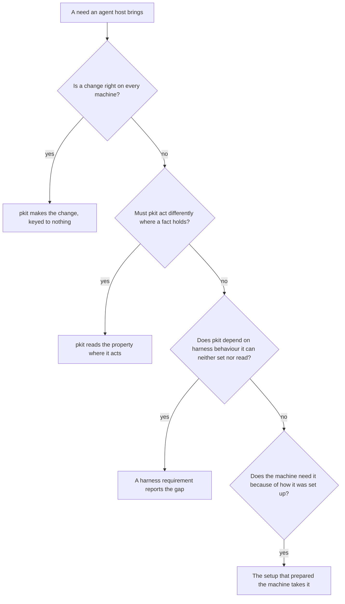

# Running pkit with nobody at the terminal

Software outside pkit may start Claude Code sessions for a person and drive those sessions' turns, from a chat, schedule, editor or pipeline. Such software is an *agent host*, and *host* below always means one. A person who runs Claude Code at a terminal of their own uses none.

This guide covers pkit's behaviour with nobody at the terminal, a host's setup, and the limits pkit accepts. DAM, which runs Claude Code in hosted machines, serves as its worked example. What pkit requires of Claude Code, and how far Claude Code meets each requirement, is in [the Claude Code adapter's reference, "Harness support"](../.pkit/adapters/claude-code/README.md#harness-support-harness-supportyaml).

## Contents

<!-- pkit:contents -->
- [Why it matters](#why-it-matters)
- [A question nobody is there to answer](#a-question-nobody-is-there-to-answer)
- [How pkit meets an agent host](#how-pkit-meets-an-agent-host)
- [Set up an agent host's machines](#set-up-an-agent-hosts-machines)
- [The limits pkit accepts](#the-limits-pkit-accepts)
<!-- /pkit:contents -->

## Why it matters

A session nobody watches differs from one at your terminal in three ways:

- **A question or an ask may reach nobody.** A capability's install asks its questions only where a person can answer at a terminal ([COR-061](../.pkit/decisions/core/COR-061-point-questions.md)). A host that drives Claude Code may answer Claude Code's prompts itself, in a turn nobody watches.
- **Software prepared the machine.** The host's setup chose the repository's place, the pkit installed and the clone's depth. pkit reaches a session through the project's files, so a session that loads none of them holds nothing of pkit.
- **Hosts differ, and change.** Each host starts its sessions its own way, such as through a protocol bridge rather than a terminal. Its owner may change that way without telling pkit.

## A question nobody is there to answer

With nobody at the terminal, pkit leaves a question for a person rather than answer it. Below, project-management's install runs with no terminal, and `grep` keeps the lines on its question:

```console
$ pkit capabilities install project-management | grep "not asked"
  1 question(s) the data points declare were not asked, and nothing was recorded: nobody can answer here, since standard input and standard output are not both terminals (COR-061). Run each at a terminal to answer it:
  not asked    pkit::work-tracking:fixers: pkit project-management ask-fixers
```

- **What it read.** Whether standard input and standard output are both terminals. That is a fact of the process, whoever started it.
- **What it did.** It asked nothing and recorded nothing. It printed the command that asks the question, for a person to run at a terminal ([the lifecycle reference, on questions](../.pkit/lifecycle/manifest.md#a-data-points-question)).
- **Where it holds.** pkit reads the same fact on a laptop, in a pipeline and under any host. A host that gives its session a terminal passes the check, since a terminal is no proof of a person (COR-061).

## How pkit meets an agent host

pkit ships nothing for any one host, and meets what hosts vary through facts it reads where it acts.

### Nothing pkit ships is keyed to a host

- **No adapter.** An adapter translates the methodology for one harness, the tool that runs the sessions ([COR-005](../.pkit/decisions/core/COR-005-bundle-pattern.md)). A host that runs Claude Code still runs Claude Code, so the Claude Code adapter serves its sessions.
- **No capability.** A capability is a discipline a project adopts ([COR-017](../.pkit/decisions/core/COR-017-capability-pattern.md)). Running under a host says where a session runs, not how the project works.
- **Nothing else keyed to one host.** pkit ships no area, no variant inside a capability and no deployed file that differs by host.
- **No test of which host it runs under.** pkit never tells one host from another, by a name, a variable, a path or a file. A host's owner may change these without telling pkit, and a test by name would miss the next host with the same property.
- **A host as an example only.** pkit's text may name a host as an example, as this page names DAM. No step pkit takes or requires depends on one.
- **A second host.** Once project-kit writes a second host's setup for pkit, or one is brought to project-kit's issue tracker, the two setups are compared. What both need, and a property or a requirement can state, moves into pkit.

### Where each need of a host goes

Each need a host brings is asked four questions in order, and the first that fits places it:



1. **Is there a change to pkit that is right on every machine?** Then pkit makes it, in the part that owns the behaviour, keyed to nothing. A project setting whose default serves every machine is such a change too.
2. **Must pkit act differently where some fact of the session or the machine holds?** Then pkit reads that fact, a *property*, where it acts, and never a host's name. A property is one of these:
   - what pkit's own process shows, such as whether a terminal is at hand, or whether the clone is shallow
   - what the harness reports, such as the session's permission mode
   - a setting pkit keeps for one machine, such as the sandbox

   *Must* is the test: a step pkit could take but need not, such as deepening a shallow clone, stays with the fourth question.
3. **Does pkit still depend on harness behaviour it can neither set nor read, such as an ask reaching a person?** Then the dependency is a harness requirement, which each adapter answers for its harness ([COR-047](../.pkit/decisions/core/COR-047-harness-requirement-declaration.md)). The requirement reports the gap and does not close it: the host, its setup or the harness must keep the behaviour. Its cost names what a session or a machine must keep, never a host.
4. **Is it a step a machine needs because of how it was set up?** Then the setup that prepared the machine takes it, which on a host's machines is the host's ("Set up an agent host's machines" below).

**A limit.** At any question, meeting a need may cost more than it is worth. pkit then accepts it as a limit, stated by its property with what meeting it would cost ("The limits pkit accepts" below).

### A worked example: DAM

DAM, which runs Claude Code in hosted machines, is the one host whose needs pkit has traced this way. Five of them, and where the questions placed each:

| A need found under DAM | Where it went |
| --- | --- |
| A session running as `project-manager` lost every tool its agent did not list, a connected server's tools among them | The first question. `project-manager` keeps the session's tools, less those it is withheld, on every machine ([project-management's DEC-068](../.pkit/capabilities/project-management/decisions/DEC-068-session-agent-tools.md)). |
| A shallow clone, whose history may fall short of what a check of pkit's reads | The second question. A check that finds the history short says so rather than answer. |
| Whether an ask reaches anyone in a turn a chat message started | The third question, since pkit cannot read it. The requirement waits on a trial on a live host. |
| The repository placed where DAM starts its sessions, and pkit installed where its machines find it | The fourth question. A DAM Starter Kit, DAM's own package of setup steps, would hold them, in a repository of its own. |
| Sessions that share one checkout | A limit ("The limits pkit accepts" below). |

## Set up an agent host's machines

A host's machines need some steps before a session runs pkit there, and those steps are the host's setup, not pkit's. pkit ships commands a setup may call, as any adopter calls them, and no host's setup.

### What the setup does

- **Put the repository where the host starts its sessions.** Claude Code loads the project's rules in a session started at the project's root ([the adapter's reference, "Harness support"](../.pkit/adapters/claude-code/README.md#harness-support-harness-supportyaml)). A session that loads none of the project's files holds nothing of pkit.
- **Install the pkit command where the machines find it,** at the release the project records. The CLI reference says how a pipeline does it, from the HTTPS address where the machine holds no SSH key ([the CLI reference, `sync`](../.pkit/cli/README.md#sync)).
- **Deepen a shallow clone** where the project's work reads its history. pkit deepens no clone itself: a check that finds the history short says so rather than answer.
- **Leave the sandbox off where the operating system provides none.** The sandbox is a setting pkit keeps for each machine, off on a fresh clone, so turning it on is that machine's own step.
- **Place a key to sign commits** only where the project's own rules require signed commits. pkit requires none.

### What the setup keeps to

- **It lives outside pkit,** in what the host offers for its own setup, or in the project's own files. pkit ships none of it, and keeps none on any adopter's behalf.
- **It uses pkit's public surface:** its commands and the files it documents, as any adopter uses them.
- **It writes only what belongs to its machine,** such as the pkit command's install, the clone's history, or a setting pkit keeps for the machine. It writes such a setting through pkit's own commands.
- **It writes no file the project commits.** A project setting the setup needs is the project's choice for every clone, which the setup may check and never sets.
- **Its maker keeps it working.** pkit declares the changes to its public surface, and migrates those that break.

### Check what the harness leaves unmet

`pkit harness report` lists each harness requirement with its result for the project's harness, from the adapter's support declaration ([the CLI reference, `harness report`](../.pkit/cli/README.md#harness-report---adapter-name---json)). Below, `jq` keeps each requirement's result and its words:

```console
$ pkit harness report --json | jq -r '.adapters[].requirements[] | .result + "  " + .title'
indeterminate  A delegated helper's full result reaches the agent that delegated to it
indeterminate  A process can start an agent unattended, confined for that one run
indeterminate  A process can start an agent unattended that edits and builds in a folder the process names
indeterminate  Every session holds every layer's loaded rules from its start to its end
indeterminate  A session's agent withheld named tools has none of them and keeps the rest
indeterminate  A helper withheld named tools has none of them
```

- **A result of `indeterminate`** is never counted as met (COR-047).
- **Each answer's cost** names what a session or a machine must keep, never a host. A confined run, for one, needs the sandbox the operating system provides. So a machine without one has no confined run, under any host ([the adapter's reference, "Harness support"](../.pkit/adapters/claude-code/README.md#harness-support-harness-supportyaml)).

## The limits pkit accepts

pkit accepts four limits with nobody at the terminal, each stated by the property behind it, never by a host's name. Meeting any of them would cost more than it is worth:

- **Sessions that share one checkout.** pkit's seats and worktrees take each clone to have one owner at a time. Meeting it would redesign how they own a clone, for a layout found on one host.
- **A nested run on a machine that suspends what the harness did not start.** A reviewer that project-management's review command starts through [the adapter's runner](../.pkit/adapters/claude-code/README.md#the-agent-runner-run-agentpy) is one, and it ends when the machine suspends. Meeting it would tie pkit to one host's own command, the one way found to keep such a run. A person or the host's setup may still use that command.
- **A project that keeps pkit's files out of version control,** as [`pkit visibility private`](../.pkit/adapters/claude-code/README.md#git-footprint-per-adr-009) does. Its fresh clone brings none of pkit's files. Meeting it would undo the project's own choice.
- **Tools whose names the project cannot know in advance, in sessions with nobody to grant a tool at its first denial.** Such a project keeps the lenient posture on every clone, since the posture is the project's ([the permission model's guide](permissions/README.md#how-a-tool-call-is-decided)). A grant that covered such tools would be that posture. Until a grant can cover a server's tools by a prefix, the tools of a server whose name is known in advance share this limit.
