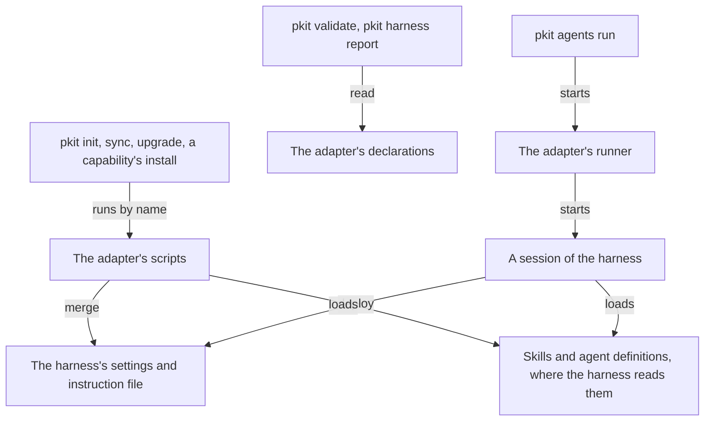

# Adapters

An adapter translates the methodology's content for one AI harness, such as Claude Code, the tool that runs your agents' sessions. This guide says why a harness's ties live in an adapter, and how an adapter reaches a session. Then it gives you the task of adapting the system to another harness. What an agent needs to work on an adapter, such as each script's contract, is in [the adapters reference](../../.pkit/adapters/README.md).

## Contents

<!-- pkit:contents -->
- [Why they exist](#why-they-exist)
- [How an adapter reaches a session](#how-an-adapter-reaches-a-session)
- [Adapt the system to another harness](#adapt-the-system-to-another-harness)
<!-- /pkit:contents -->

## Why they exist

You want the methodology to work in a harness that no adapter serves yet. That harness reads its own files in its own folders, and the methodology writes its content in no harness's form. Until something translates it, these things go wrong there:

- **Sessions start without the rules.** No session loads the operational rules: the methodology's, your capabilities' or your project's own. So an agent there keeps none of them, such as pausing before `git push --force`.
- **Skills and agent definitions reach no session.** They sit under `.pkit/`, and the harness reads its own folders. An agent there finds no reviewer to call, and no skill for its task.
- **Nobody can say what the harness falls short of.** The methodology relies on behaviour it cannot set, such as a delegated agent's result arriving whole. A harness that cuts such a result looks, from outside, like one that does not.
- **Nobody can say which permissions it leaves unenforced.** An operator who lets agents work without asking cannot learn which grants the harness holds, and which hold nowhere.
- **Each harness's folders would sit in every command.** Were `pkit sync` to write one harness's folders itself, a second harness would change init, sync, upgrade and each capability command that deploys.

### What adapters do instead

Adapters answer these problems with four claims. The commands after the list prove the first three, and the task the last claim links to proves it.

- **Your adapter needs no change to any command, since the lifecycle runs its scripts by their names.**
- **A script that fails stops the command and names the script, so a deploy cut short never reads as a whole one.**
- **A requirement your adapter does not answer reports `indeterminate`, never `satisfied`.**
- **`pkit validate` fails each agent definition your harness's terms cannot take, naming your adapter and the cause** ([Adapt the system to another harness](#adapt-the-system-to-another-harness)).

Each fence on this page starts from a fresh project where `pkit init` has run, and its files are committed. An adapter can be tried there, though not kept ([Adapt the system to another harness](#adapt-the-system-to-another-harness)).

Below, you stamp an adapter for a harness named Acme, and give it a script that deploys the skills. You sync, then make the script fail and sync again. Last, you ask what Acme meets:

```console
$ pkit new adapter acme
Stamped: .pkit/adapters/acme/
$ printf '#!/bin/sh\necho "  deployed     acme: skills"\n' > .pkit/adapters/acme/deploy-skills.sh && chmod +x .pkit/adapters/acme/deploy-skills.sh
$ pkit sync | grep acme
  deployed     acme: skills
$ printf '#!/bin/sh\necho "  error        acme: cannot reach the skills folder"\nexit 1\n' > .pkit/adapters/acme/deploy-skills.sh
$ pkit sync 2>&1 | tail -n 2
  error        acme: cannot reach the skills folder
Error: adapter primitive .pkit/adapters/acme/deploy-skills.sh exited with status 1. See the output above for details.
$ pkit harness report --adapter acme | grep -e "unmet of" -e delegated
Harness requirements — 6 unmet of 6   (what the project's harness leaves unmet, from its adapter's declaration)
  indeterminate  delegated-result-complete     —  no declaration: the adapter does not answer this requirement
$ pkit harness report --adapter acme > /dev/null; echo $?
1
```

What the output proves, claim by claim:

- **By their names.** The sync found `deploy-skills.sh` in the adapter's folder, and ran it with the methodology's own scripts. No command names Acme ([the reference, "Primitives the lifecycle calls"](../../.pkit/adapters/README.md#primitives-the-lifecycle-calls)).
- **Stopped, and named.** The failing script stopped the sync. The error names the script and its status, under the script's own line on what failed.
- **Silence is not support.** Acme declares nothing yet, so the report leaves every requirement `indeterminate`, and exits 1 while any is not satisfied ([the reference, "Harness requirements"](../../.pkit/adapters/README.md#harness-requirements)).

### Compared with setting up each project by hand

Without an adapter, you set up the harness in each project yourself:

- You point the harness's instruction file at the rules.
- You copy the skills and agent definitions where the harness reads them.
- You write the harness's settings.

Setting up the harness by hand takes no release, and works in your own project today. **An adapter's scripts run at every sync of every project, and its declarations record what the harness falls short of.** [The commands above](#what-adapters-do-instead) prove the first half, and [the task's commands](#adapt-the-system-to-another-harness) prove the second. Each project set up by hand, against an adapter:

| What you need | Each project set up by hand | An adapter |
| --- | --- | --- |
| The rules in every session | ❌ You add the include to each project, and keep it there | ✅ The merge keeps the include at each sync |
| Skills and agent definitions where the harness reads them | ❌ You copy them again after each update | ✅ Each sync deploys them, and drops those whose source is gone |
| An agent's tool access in the harness's terms | ❌ You translate each list by hand | ✅ The deploy translates it, and refuses a list the harness cannot hold |
| What the harness falls short of | ❌ Nothing records it | ✅ The support declaration, which `pkit harness report` reads |
| The permissions the harness cannot enforce | ❌ Nothing records them | ✅ The enforcement declaration names each |
| Where you write it | ✅ In your own project | ❌ In the methodology's source repository |
| When your projects get it | ✅ At once | ❌ With a release of the methodology, once a release may add an adapter |
| Setup | ✅ The harness's own | ❌ Scripts and declarations for the harness |

### When you do not need one

You do not need an adapter in these cases:

- **Your harness is Claude Code.** Its adapter ships, and every project installs it ([the reference, "Currently shipped"](../../.pkit/adapters/README.md#currently-shipped)).
- **Software starts Claude Code's sessions for you,** such as a chat or a pipeline. That software still runs Claude Code, so the Claude Code adapter serves its sessions ([Running pkit with nobody at the terminal](../010-nobody-at-the-terminal.md#nothing-pkit-ships-is-keyed-to-a-host)).
- **You want other harness settings in one project.** Add them on the project's side of the adapter's settings, which the merge keeps ([the Claude Code adapter's reference, "What the merge keeps under `permissions`"](../../.pkit/adapters/claude-code/README.md#what-the-merge-keeps-under-permissions)).
- **You want a rule or a skill in every session.** Write a rule or a skill of your project's own, which your adapter delivers ([the rules guide](../rules/README.md#add-your-own-rules) and [the skills guide](../skills/README.md#write-your-projects-own-skill)).

## How an adapter reaches a session

The lifecycle runs the adapter's scripts, which write what the harness reads. The backbone's commands read the adapter's declarations as data:



- **The scripts.** The lifecycle runs each of four deploy scripts the adapter holds, in a fixed order, whenever the harness's side needs deploying again. A fifth takes back the skills the adapter deployed for one capability ([the reference, "Primitives the lifecycle calls"](../../.pkit/adapters/README.md#primitives-the-lifecycle-calls)).
- **The rules.** The merge keeps the lines that load the operational rules in the harness's instruction file. The adapter's `package.yaml` declares the form of the line that loads the capabilities' rules index ([the reference, "How a capability's rules reach a session"](../../.pkit/adapters/README.md#how-a-capabilitys-rules-reach-a-session)).
- **Skills and agent definitions.** The deploys copy or link them where the harness reads them. For each agent's name, the deploy writes only the definition the agents area's picker names, so uninstalling a capability takes back the agents it shipped. An agent's tool access is written in the harness's keys ([the agents reference, "Deploy mechanics"](../../.pkit/agents/README.md#deploy-mechanics)).
- **The declarations.** Data files the backbone's commands read, running none of the adapter's code ([the reference, "What an adapter declares as data"](../../.pkit/adapters/README.md#what-an-adapter-declares-as-data)). They say these:
  - how far the harness meets each harness requirement
  - where the harness enforces each dimension of the permission model
  - the harness's terms for an agent's tool access
- **The runner.** Where the adapter registers one, `pkit agents run` starts the harness through it. A command that starts an agent nobody can answer during its run asks for such a run ([the reference, "The agent runner"](../../.pkit/adapters/README.md#the-agent-runner)).

## Adapt the system to another harness

Write the adapter in the methodology's source repository, through the `adapter-author` skill. Then check it with validation and the harness report. Before you start:

- **Have a clone of the methodology's source repository.** In a project, `.pkit/adapters/` is the methodology's, and sync manages it ([the reference, "Layout"](../../.pkit/adapters/README.md#layout)). A release that ships an adapter of your adapter's name copies over it there.
- **Have the harness installed where you try the adapter,** so that you can watch what the harness does. Your answers on what the harness meets rest on that ([COR-047](../../.pkit/decisions/core/COR-047-harness-requirement-declaration.md)).

> [!WARNING]
> A change that adds an adapter cannot pass the methodology's tests yet. A test holds the list of adapters a release ships. The hold lasts until a release can tell a project's own adapter from a shipped one of the same name. Until then, build and try your adapter in your clone.

The steps:

1. **Stamp it.** Have your agent run the `adapter-author` skill, which runs `pkit new adapter <name>`. The stamp writes `package.yaml`, `README.md` and `migrations/`, and registers the adapter. It writes no script and no settings, since those depend on the harness ([the CLI reference, `new adapter`](../../.pkit/cli/README.md#new-adapter-name)).
2. **Write the scripts your harness needs,** with the Claude Code adapter's as the worked example ([its reference, "What this adapter ships"](../../.pkit/adapters/claude-code/README.md#what-this-adapter-ships)). The lifecycle skips each of the four deploy scripts your adapter does not hold. Where your adapter deploys a capability's skills, write `undeploy-capability.sh` too, or a capability's uninstall warns that your harness may keep that capability's skills. What the lifecycle relies on, for each script ([the reference, "Primitives the lifecycle calls"](../../.pkit/adapters/README.md#primitives-the-lifecycle-calls)):
   - It runs as a program.
   - It changes nothing when run a second time.
   - It exits with a status other than 0 when it fails.
3. **Deliver the rules.** Declare `loaded_rules:` in `package.yaml`, and have your merge script keep the key's `line` and core's include in the instruction file. Without the key, validation warns that your harness's sessions load no capability's rules ([the reference, "How a capability's rules reach a session"](../../.pkit/adapters/README.md#how-a-capabilitys-rules-reach-a-session)).
4. **Declare your harness's terms for tool access,** where your adapter ships `deploy-agents.sh` or registers a runner (step 6). Start from the emptiest declaration, in `.pkit/schemas/tool-access.yaml`, and add the forms a tool's name takes. Admit a withheld entry only once you have measured that the harness withholds it. Validation fails the admission until step 5 answers `session-agent-withheld-tools` as `supported` or `at-cost` for some version ([the reference, "The declaration of tool access"](../../.pkit/adapters/README.md#the-declaration-of-tool-access)).
5. **Declare what the harness does.** In `harness-support.yaml`, answer each requirement you can, with your evidence and the versions you tested. Leave out one you cannot answer yet. In `permission-enforcement.yaml`, say where the harness enforces each dimension of the permission model ([the reference, "What an adapter declares as data"](../../.pkit/adapters/README.md#what-an-adapter-declares-as-data)).
6. **Register a runner,** where the harness can run an agent that nobody answers during its run. Register it under `run-agent` in `package.yaml`'s `commands:`. Commands that start such an agent then reach your harness ([the reference, "The agent runner"](../../.pkit/adapters/README.md#the-agent-runner)).
7. **Check it** with `pkit sync`, `pkit validate` and `pkit harness report --adapter <name>`, as below.
8. **Write its README.** Say what the adapter ships, and give its answers in prose. Then add it to the reference's "Currently shipped" list.

Below, Acme's adapter deploys agents. You declare Acme's terms with no form a tool's name takes, and validate. Then you add a form and validate again. Last, you answer two requirements:

```console
$ pkit new adapter acme
Stamped: .pkit/adapters/acme/
$ printf '#!/bin/sh\n' > .pkit/adapters/acme/deploy-agents.sh && chmod +x .pkit/adapters/acme/deploy-agents.sh
$ printf '{"schema_version": 1, "harness": "Acme", "keys": {"tools": "tools", "withheld": "withheld"}, "name_forms": [], "known_tools": [], "withheld_admits": []}\n' > .pkit/adapters/acme/tool-access.json
$ pkit validate | tail -n 1
  6 error(s) found.
$ pkit validate | grep -A1 "core/critic.md"
    error    .pkit/agents/core/critic.md
      → the acme adapter refuses its tool access, since Acme cannot enforce or translate it: `tools` names `Read`, a name in a form Acme does not take: its adapter declares no form a name takes. Its deploy and agent runner refuse the agent until it is mended (ADR-086 point 6).
$ printf '{"schema_version": 1, "harness": "Acme", "keys": {"tools": "tools", "withheld": "withheld"}, "name_forms": [{"pattern": "[A-Z][A-Za-z]*", "argument": false, "description": "a built-in tool, such as Read"}], "known_tools": [], "withheld_admits": []}\n' > .pkit/adapters/acme/tool-access.json
$ pkit validate | tail -n 1
  All checks passed.
$ pkit validate | grep -A1 "acme/package.yaml"
    warning  .pkit/adapters/acme/package.yaml  [loaded-rules-undeclared]
      → adapter acme declares no `loaded_rules:`, so it delivers no capability's rules, and its harness's sessions load none of them (capabilities that ship a loaded set: none ships one yet; COR-070 point 6). Nor is core's include checked for its harness (ADR-083 point 5).
$ printf 'schema_version: 1\nrequirements:\n  delegated-result-complete:\n    grade: not-achievable\n    harness_versions: unbounded\n    evidence: Measured on Acme 2.3, a helper result past 8000 characters arrived cut.\n  session-loads-rules:\n    grade: supported\n    harness_versions: [2.0.0, 2.3.0]\n    evidence: Tested on Acme 2.0 to 2.3, each session read the instruction file.\n' > .pkit/adapters/acme/harness-support.yaml
$ pkit harness report --adapter acme | grep -e delegated -e session-loads
  unsatisfied    delegated-result-complete     not-achievable  computed  the adapter declares it not achievable on this harness, whatever its configuration
  indeterminate  session-loads-rules           supported                 the answer holds for harness versions 2.0.0 to 2.3.0, and this pass does not read the harness's version
```

What the output proves:

- **Every definition, against every adapter.** With no form declared, Acme takes no tool's name. So validation fails all six definitions the methodology ships, `critic` among them, and passes them once the form is declared. A definition passes only where each registered adapter that deploys agents takes it ([the reference, "The declaration of tool access"](../../.pkit/adapters/README.md#the-declaration-of-tool-access)).
- **A warning on the rules.** Acme declares no `loaded_rules:` yet, so validation warns that its sessions load no capability's rules, and passes.
- **Unsatisfied, and computed.** An answer `not-achievable` for every version says no configuration helps. So the report needs nothing more to call the requirement unmet.
- **Indeterminate, with its grade.** An answer bounded to the versions you tested stays `indeterminate`, since the report does not read the harness's version. No answer reads as `satisfied` until a check can watch the harness ([the reference, "Harness requirements"](../../.pkit/adapters/README.md#harness-requirements)).
