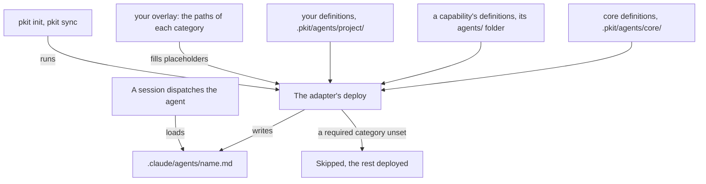

# Agent definitions

An agent definition gives an AI agent a standing role, with what it reads, which paths it owns and which tools it uses. The core ships six, among them the reviewers that challenge a draft and check a diff, and you write your own beside them. This guide says why the definitions exist and how they reach a session, and then gives your tasks with them. What an agent needs to work with them, such as each field of a definition, is in [the agents reference](../../.pkit/agents/README.md).

## Contents

<!-- pkit:contents -->
- [Why they exist](#why-they-exist)
- [How a definition reaches a session](#how-a-definition-reaches-a-session)
- [Get a delegated agent's result back whole](#get-a-delegated-agents-result-back-whole)
- [Have a draft challenged and a diff checked](#have-a-draft-challenged-and-a-diff-checked)
- [Write your own agent definition and its storyboard](#write-your-own-agent-definition-and-its-storyboard)
<!-- /pkit:contents -->

## Why they exist

An agent keeps nothing between sessions but what the repository holds. Without roles that the repository keeps and the harness loads, these things go wrong:

- **The agent that wrote a draft is the only one to judge it.** It brings you a decision record, and the session that wrote it finds no gap in its own reasoning. So you adopt the draft unchallenged.
- **Nothing checks a diff against the conventions before it is pushed.** A commit titled "fixed stuff" is pushed on a branch named `my-work`, and the pull request's review is the first to see either.
- **A reviewer that can edit changes what it judges.** It mends the draft it was asked to judge, and its verdict then vouches for its own edit.
- **Recurring work is briefed again in each session.** The third time you explain the same release check, you write the brief from memory, and it differs from the second.
- **A role written for one project's paths reads nothing in another.** A reviewer told to read `docs/architecture/` finds nothing in a project that keeps its architecture in `design/`.
- **A delegated agent's result comes back cut short, and reads as complete.** The session acts on half a review, with no sign that the rest is missing.

### What agent definitions do instead

Agent definitions answer the first five problems with the claims below, and [the first task](#get-a-delegated-agents-result-back-whole) answers the sixth:

- **Four reviewers ship ready to dispatch, each defined to change nothing it judges, and the architect advises beside them.** ([Have a draft challenged and a diff checked](#have-a-draft-challenged-and-a-diff-checked) proves it.)
- **A shared definition deploys with your project's paths in its front matter, and one whose required paths are unset is skipped.** (The fence below proves it.)
- **`pkit new agent` stamps your definition with its storyboard, each naming the other, so recurring work gets a role in one command.** ([Write your own](#write-your-own-agent-definition-and-its-storyboard) proves it.)

Each fence on this page starts from a fresh project where `pkit init` has run. Below, your project keeps its architecture in `design/`. You remove the architect's architecture folder from the overlay, and then name `design/` in its place:

```console
$ perl -0pi -e 's/architecture-docs:\n  - README.md\n//' .pkit/agents/project/overlay.yaml
$ pkit agents | grep "^  architect"
  architect                       core  SKIPPED     model inherit  effort inherit  architecture-docs
$ pkit sync | grep "skipped    architect"
  skipped    architect — architect: category <architecture-docs> referenced but not defined in overlay (<any>).
$ printf 'architecture-docs:\n  - design/\n' >> .pkit/agents/project/overlay.yaml
$ pkit sync | grep architect.md
  updated    .claude/agents/architect.md
$ grep -A2 "^owns:" .claude/agents/architect.md
owns:
  - design/
  - docs/architecture/decisions/
$ grep -o "The placeholders resolve via [^ ]*" .claude/agents/architect.md
The placeholders resolve via `.pkit/agents/project/overlay.yaml`
```

What the output proves:

- **Skipped while unset.** With no path for `architecture-docs`, `pkit agents` lists the architect as skipped, with the category it lacks. It lists each definition with the model and effort it runs at too. The sync skips the architect rather than deploy it with the placeholder.
- **Deployed with your paths.** Once the overlay names `design/`, the sync deploys the architect again to `.claude/agents/`, where Claude Code reads it. Its front matter there owns `design/` in place of `<architecture-docs>` ([the reference, "Adopter overlay"](../../.pkit/agents/README.md#adopter-overlay)).
- **The body sends it to the overlay.** The deploy fills the front matter alone, so the architect's body tells it where to find the paths behind its placeholders.

> [!WARNING]
> Only an agent's definition holds it to its role. Nothing at run time stops an agent from editing outside the paths it owns. A placeholder in the body stays as written, so a body that names `<architecture-docs>` must send the agent to the overlay, as the architect's does. To refuse an agent a command, deny it in the permission model ([the permissions guide, "Deny something to one agent"](../permissions/README.md#deny-something-to-one-agent)).

### Compared with subagent files you write by hand

Without agent definitions, you write Claude Code's subagent files in `.claude/agents/` yourself. That is better on setup, on how soon an edit reaches the harness, and on the paths an agent's instructions name. **Agent definitions add reviewers ready to dispatch, your paths apart from a shared role, and checks, as [the fence above](#what-agent-definitions-do-instead) and the tasks prove:**

| What you need | Subagent files written by hand | Agent definitions |
| --- | --- | --- |
| A role your sessions can dispatch | ✅ Claude Code loads each file | ✅ The same, from the deployed copy |
| Reviewers to challenge a draft and check a diff | ❌ You write each one | ✅ Four ship, and the architect beside them |
| A shared role with your project's paths | ❌ You edit the role's file in each project | ✅ The overlay names the paths, and the role stays as shipped |
| Your paths in the agent's instructions | ✅ The file holds them as you wrote them | ❌ The body keeps each placeholder, and sends the agent to the overlay |
| A role whose paths are missing | ❌ It runs with whatever paths its file names | ✅ The deploy skips it, and says how to set them |
| A body that cites only what its front matter declares | ❌ Nothing checks it | ✅ `pkit refs validate` fails the definition |
| A scripted dialogue designed before the role | ❌ Kept wherever you choose | ✅ A storyboard stamped beside the definition |
| Setup | ✅ None | ❌ `pkit init` |
| An edit reaching the harness | ✅ Your file is what Claude Code loads | ❌ Only once `pkit sync` deploys it again |

### When you do not need it

You do not need agent definitions, or one of your own, in these cases:

- **The work is one task's procedure.** Write a skill instead ([the skills guide](../skills/README.md)).
- **You need a helper once, for one question.** Ask your session for it directly. A definition earns its keep once the same work has come up two or three times (COR-007).
- **You only share agents across your projects.** A [Claude Code plugin](https://code.claude.com/docs/en/plugins) carries agents to each project that installs it, with no methodology around them.
- **Your harness is not Claude Code.** project-kit ships one adapter, Claude Code's, so nothing deploys a definition for another harness ([the adapters reference](../../.pkit/adapters/README.md#currently-shipped)).

## How a definition reaches a session

A definition is written once, in `.pkit/`, and deployed into the place where the harness reads it. The sync fills in your paths on the way. The parts, and what passes between them:



- **The sources.** The core's definitions are in `.pkit/agents/core/`, and an installed capability's are in its `agents/` folder. Each sync refreshes both. Yours are in `.pkit/agents/project/`, which no sync writes.
- **The core's six** are the four reviewers, the architect and the `process-author`. The `process-author` writes the checks behind a process definition, and owns nothing until you name its paths.
- **One definition for each name.** Where two sources ship one name, the deploy takes yours, then a capability's, then the core's ([the reference, "Deploy mechanics"](../../.pkit/agents/README.md#deploy-mechanics)).
- **The overlay,** `.pkit/agents/project/overlay.yaml`, names your paths for each category, such as `adr-records`. A definition's front matter names the category as `<adr-records>`, and the deploy writes the paths in its place. `pkit init` writes the overlay with a value for each category the core's definitions name.
- **The deployed copy,** `.claude/agents/<name>.md`, is what Claude Code loads. Each sync writes it again from its source, so you edit the source, never the copy. A file of yours there stays: the deploy leaves a file it did not write, and reports it skipped.
- **Skipped.** A definition whose required category the overlay leaves unset is skipped, and the others deploy. `pkit agents` lists each definition as deployable or skipped.
- **The session** dispatches an agent by its definition's name, such as "Use the critic agent on `docs/plan.md`". Claude Code gives the agent only the tools its `tools:` list names.
- **What the agent may run.** Where the permission model is turned on, the model decides each of the agent's calls under the grants you give that agent ([the permissions guide](../permissions/README.md#deny-something-to-one-agent)).

## Get a delegated agent's result back whole

Dispatch each agent without a teammate name, and its whole result comes back to the session. A teammate name is one a session gives a delegated agent while Claude Code's experimental agent teams are on, apart from the definition's name. Claude Code cuts a result short only where the session gave one, and the part that arrives reads as complete. What to do:

- **Leave agent teams off,** unless you need them. Every result then arrives whole.
- **With agent teams on,** tell your sessions to dispatch each agent without a teammate name. A rule of your own in `project.md` says it to every session ([the rules guide, "Add your own rules"](../rules/README.md#add-your-own-rules)).
- **What the adapter declares.** The Claude Code adapter declares the cost at which a result comes back whole, as the requirement `delegated-result-complete`. `pkit harness report` shows that cost, and marks the requirement `indeterminate`, since only an agent inside a session can see whether it holds.

Below, `grep` keeps the line of the report on whole results:

```console
$ pkit harness report | grep delegated-result-complete
  indeterminate  delegated-result-complete  at-cost  its truth is visible only to an agent inside a session of the harness (in-session); this pass reads only files, so nothing was read to confirm the declared grade · cost: Holds for every helper while the harness's experimental agent-teams feature is off. While it is on, it holds only for a helper dispatched without a name: a named helper's result arrives cut at 4064 characters, the rest reachable only through a messaging tool the delegating agent may not hold. The methodology dispatches its helpers without a name (project-management DEC-029).
```

> [!WARNING]
> Nothing in project-kit detects a cut result. The report reads only the adapter's declaration, so it never shows the requirement as met. A session that gives a teammate name while agent teams are on gets 4064 characters, and nothing tells it more were cut.

## Have a draft challenged and a diff checked

Dispatch the critic before you adopt a substantive draft. Dispatch the convention-compliance and rule-set reviewers before you commit or push. The architect and the methodology reviewer join where the draft calls for them. When to call each, in the order to call them:

| Reviewer | When | What it judges | What it may change |
| --- | --- | --- | --- |
| `critic` | Before you adopt a substantive draft: a decision record, a plan across components or an architectural rework. Skip it for trivia, such as a reply to a question or a small edit of one file. | The draft and its context. It returns red flags, gaps, weak reasoning, alternatives and agreements. | Nothing. |
| `architect` | After the critic, where the draft touches the big picture. Examples are a new abstraction, an edit to a foundational record, or a concern across components. | Boundaries, abstractions and where each concern sits. It flags where an authorisation is needed. | The architecture documents and decision records your overlay gives it, a draft among them. |
| `methodology-reviewer` | Once an artefact is written, such as a decision record, a skill or an agent definition. | The artefact, against the methodology's disciplines. | Nothing it judges. |
| `convention-compliance-reviewer` | Before you commit, or before you push what you committed. | The diff and the branch's commits. It checks each commit's form, the branch's name, edits of a synced copy, surface changes and cited records. | Nothing it judges. |
| `rule-set-reviewer` | Beside the convention-compliance reviewer, on the change. | What the change alters or brings under a rule, against the accepted rules that bind there. | Nothing it judges. |

How to dispatch each, what it returns, and what you do with it:

- **Dispatching one.** Ask your session, such as "Use the critic agent on the plan in `docs/plan.md`".
- **The critic and the architect advise.** Revise the draft, or answer each point you hold wrong, then adopt it. Neither refuses a draft.
- **The architect is the exception** to changing nothing: it may edit the documents and records your overlay gives it, a record it reviews among them. Review its edits as you review any change.
- **The methodology reviewer** returns blockers, suggestions and notes. Mend each blocker before you adopt the artefact.
- **The convention-compliance reviewer** reports each violation with the record it breaks and what to do. Mend each one and dispatch it again.
- **The rule-set reviewer** reads the rules from `pkit rule-sets altered`, and approves only where it found no settled break ([the reference, "The rule-set reviewer"](../../.pkit/agents/README.md#the-rule-set-reviewer)). A settled break is one the rule's own text settles. A passage that needs a person's judgement withholds no approval.
- **Its form is yours to name.** Name its verdict line and the marks of its findings when you dispatch it, such as `Verdict: APPROVED` and `[block]`. With none named, it states both in words.
- **Advisory, unless a gate requires one.** No core gate counts a reviewer's verdict, and a merge gate may require one.
- **Calling them each time.** A rule of your own in `project.md` tells every session when to dispatch each reviewer ([the rules guide, "Add your own rules"](../rules/README.md#add-your-own-rules)).

Below, `grep` shows the tools each reviewer is granted, and which reviewers are told what read-only means. It then shows what the architect owns in a fresh project:

```console
$ grep -H "^tools:" .claude/agents/critic.md .claude/agents/architect.md .claude/agents/methodology-reviewer.md .claude/agents/convention-compliance-reviewer.md .claude/agents/rule-set-reviewer.md
.claude/agents/critic.md:tools: [Read, Glob, Grep, WebFetch]
.claude/agents/architect.md:tools: [Read, Glob, Grep, WebFetch, Edit]
.claude/agents/methodology-reviewer.md:tools: [Read, Glob, Grep, Bash, WebFetch, Write]
.claude/agents/convention-compliance-reviewer.md:tools: [Read, Glob, Grep, Bash, Write]
.claude/agents/rule-set-reviewer.md:tools: [Read, Glob, Grep, Bash, Write]
$ grep -l "^Read-only is about what you judge" .claude/agents/*.md
.claude/agents/convention-compliance-reviewer.md
.claude/agents/methodology-reviewer.md
.claude/agents/rule-set-reviewer.md
$ grep -A2 "^owns:" .claude/agents/architect.md
owns:
  - README.md
  - docs/architecture/decisions/
```

What the output proves:

- **The critic only reads.** Its tools read files and pages, and none of them edits a file or runs a command.
- **Defined to change nothing it judges.** Each reviewer that runs commands holds the same section on what its read-only covers. The section tells it never to change the work under review, and to keep its working files in the agent workspace ([the reference, "Body conventions"](../../.pkit/agents/README.md#body-conventions)). Nothing at run time checks that it does.
- **The architect's paths are yours to set.** A fresh project's overlay gives it `README.md` and `docs/architecture/decisions/`. Name your own folders under `architecture-docs` and `adr-records` in the overlay, as the first fence on this page does.

## Write your own agent definition and its storyboard

Turn recurring work into a definition of your own, and design its dialogue as a storyboard first where it follows a script. The steps, each after what it needs:

1. **Choose an agent definition.** A standing role with its own boundaries is a definition, and a procedure for one kind of task is a skill (COR-006).
2. **Choose whether it needs a storyboard.** It does where you find yourself writing its dialogue in advance: its prompts, its gates and what each answer changes (COR-016). An agent that works from judgement needs none.
3. **Stamp it.** Run `pkit new agent project <name> --with-storyboard`, or `pkit new agent project <name>` without a storyboard. Or ask your session to, through the `agent-author` skill.
4. **Set its tools.** The stamp grants `Read`, `Glob`, `Grep` and `Bash`, and Claude Code gives the agent only those its `tools:` list names. Keep only the tools the role needs.
5. **Write the storyboard first,** through the `storyboard-author` skill. The storyboard gives the framing and the tone, and for each scenario its *Trigger*, *Preconditions*, *Walkthrough* and *Behind the scenes* ([the reference, "Storyboards"](../../.pkit/agents/storyboards.md)).
6. **Write the definition's body from it.** Say when to delegate to the agent, what it reads and which paths it owns, and declare each of them in the front matter too.
7. **Write your paths as they are.** The body keeps whatever it names. Name a path by a category, such as `<release-notes>`, only where another project or several agents share the definition's paths. Then name the category's paths in the overlay, and have the body send the agent there, as the architect's does.
8. **Deploy and check it.** Run `pkit sync`, then `pkit refs validate`.

Below, you stamp an agent that welcomes new contributors, with its storyboard. A line you add to its body then cites a file its front matter does not declare:

```console
$ pkit new agent project onboarding-guide --with-storyboard
Stamped: .pkit/agents/project/onboarding-guide/onboarding-guide.md
Stamped: .pkit/agents/project/onboarding-guide/storyboard.md
$ grep -A1 "^storyboards:" .pkit/agents/project/onboarding-guide/onboarding-guide.md
storyboards:
  - storyboard.md
$ grep -A3 "^consumers:" .pkit/agents/project/onboarding-guide/storyboard.md
consumers:
  - kind: agent
    name: onboarding-guide
    namespace: project
$ pkit sync | grep onboarding-guide
  created    .claude/agents/onboarding-guide.md
$ grep -A1 "^storyboards:" .claude/agents/onboarding-guide.md
storyboards:
  - .pkit/agents/project/onboarding-guide/storyboard.md
$ echo 'Read `docs/welcome.md` first.' >> .pkit/agents/project/onboarding-guide/onboarding-guide.md
$ pkit refs validate
Reference validation — bidirectional consistency + hook closure + exactly-one-owner

  1 issue(s) found:
    .pkit/agents/project/onboarding-guide/onboarding-guide.md
      → body cites path 'docs/welcome.md' but it is not declared in frontmatter `reads.paths` or `owns`.
$ pkit refs validate >/dev/null; echo $?
1
```

What the output proves:

- **Stamped together.** The definition lists its storyboard in `storyboards:`, and the storyboard names the definition in `consumers:`.
- **Read where you wrote it.** The deployed copy names the storyboard by its path in your project, so the agent reads the file you edit. The deploy copies no storyboard.
- **Checked against its front matter.** `pkit refs validate` fails the definition until `docs/welcome.md` is among its `reads.paths`, and exits 1. `pkit validate` reports the same finding as a warning, and passes ([the reference, "The reference graph"](../../.pkit/agents/README.md#the-reference-graph)). So run `pkit refs validate` in your checks to fail on it.

A storyboard you add later is not listed for you. Below, a definition stamped without one gets its storyboard. The stamp moves the definition into a folder of its own, and `pkit refs validate` fails until the definition lists the storyboard ([the reference, "Storyboards"](../../.pkit/agents/storyboards.md#authoring)):

```console
$ pkit new agent project release-checker
Stamped: .pkit/agents/project/release-checker.md
$ pkit new storyboard agent release-checker
Stamped: .pkit/agents/project/release-checker/storyboard.md
$ ls .pkit/agents/project/release-checker
release-checker.md
storyboard.md
$ pkit refs validate | grep "→"
      → storyboard declares consumer agent project/release-checker, but that agent's `storyboards:` does not include this path. Mutual declaration is required (per COR-016).
      → storyboard file exists but no agent declares it in `storyboards:`. Either delete the orphan, or add a `storyboards:` entry on the owning agent.
```

**A name already taken** is refused. `pkit new agent` writes nothing where a definition of yours, of a capability or of the core has the name ([the reference, "Authoring a definition"](../../.pkit/agents/README.md#authoring-a-definition)).
