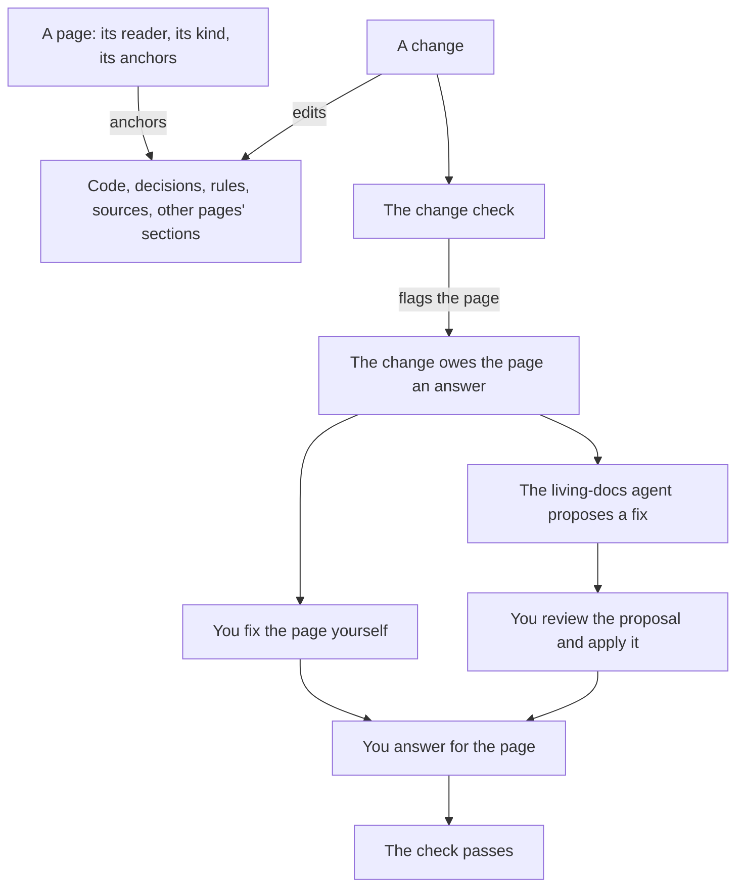

# living-docs

living-docs keeps your project's documentation true for the people who read it, even when agents write most of it. Each page names its reader and anchors what makes it true, and a change to anything it anchors flags the page. This guide says why living-docs exists and how it works, and then gives a page to each of its tasks. What an agent needs to use it, such as what each command writes and fails on, is in [the capability's reference](../../../.pkit/capabilities/living-docs/README.md#installing-it).

## Contents

<!-- pkit:contents -->
- [Why it exists](#why-it-exists)
- [How it works](#how-it-works)
- [Turning it on](#turning-it-on)
- [The tasks](#the-tasks)
<!-- /pkit:contents -->

## Why it exists

Documentation that nothing checks goes wrong in these ways, and more so when agents write most of it:

- **A change leaves a page wrong, and nothing says so.** A pull request renames a command, and the page that teaches it is not in the diff. The review never opens the page, and a reader's first try of the old name fails.
- **Fluent text rests on nothing you can check.** An agent writes a page that reads well in a minute. Which sentence it checked against the code, and which one it guessed, the page does not say.
- **One page serves two readers, and fails both.** A user who wants to run the tool reads past its internals. A maintainer who wants to know why a design was chosen finds only steps.
- **An agent that mends pages alone can mend them wrongly.** It may rewrite a page to match a bug in the code, and nobody sees the rewrite before it lands.
- **The documents you already have say nothing of what they rest on.** Nobody can tell which of them still hold, or whom each one is for.

### What living-docs does instead

living-docs answers the first four of these problems with four claims, and the commands after the list prove each one. The fifth, the documents you already have, is a task of its own ([Bring in your documents](020-bring-in-your-documents.md#why-a-plan-comes-first)):

- **Each page in your spaces is flagged when a change touches what it anchors, in that change's own check.** A page anchors what it rests on, such as code, decisions or another page's section.
- **Where a space's rules bind, validation reports what a page names without anchoring it: a file path, a record, a rule or a `pkit` command.**
- **Once a space has its definition, a page for a reader your project has not declared is refused.**
- **A fix is proposed as a diff for you to review, and the agent's definition forbids it to change a tracked file.** ([the reference, "What it never does"](../../../.pkit/capabilities/living-docs/agent.md#what-it-never-does))

Below, a page anchors the script `src/greet.py`, and a branch then changes the script. Each fence starts from a fresh project, so it first installs living-docs and creates the user space, their output dropped:

```console
$ pkit capabilities install living-docs >/dev/null
$ pkit living-docs new space user --yes >/dev/null 2>&1
$ mkdir -p src && echo 'print("Hello")' > src/greet.py
$ pkit living-docs new page docs/greet.md --space user --kind reference --reader user --title "Greeting" --path src/greet.py >/dev/null
$ git add -A && git commit -qm "Add the greeting and its page"
$ git checkout -qb say-hi
$ echo 'print("Hi")' > src/greet.py && git commit -qam "Say hi"
$ pkit friction check 2>/dev/null | head -11
Friction change check — 1 friction   (the blocks: pkit validate)

  Base: main at <any>   (merge-base with HEAD)
  Head: <any> (working tree clean)
  Mode: warning   (reports and passes)

FINDINGS — upstream first along the anchors between artefacts
  docs/greet.md
    friction  path src/greet.py  changed in this diff and carries no answer: revalidate the artefact, or defer the anchor

Result: passed   (warning mode: 1 friction reported, not failed)
$ pkit config set friction.mode enforcing --yes
set friction.mode = enforcing  (.pkit/project/config.yaml)
$ pkit friction check >/dev/null 2>&1; echo $?
1
```

Below, again from a fresh project, a page names the script without anchoring it. Another is written for a reader the project has not declared. Last, `grep` prints the line of the agent's definition that forbids it to change a tracked file:

```console
$ pkit capabilities install living-docs >/dev/null
$ pkit living-docs new space user --yes >/dev/null 2>&1
$ mkdir -p src && echo 'print("Hello")' > src/greet.py
$ pkit living-docs new page docs/usage.md --space user --kind reference --reader user --title "Usage" >/dev/null
$ echo 'Run `src/greet.py` to be greeted.' >> docs/usage.md
$ pkit living-docs validate | tail -3
mention(s) a page's anchors do not cover, each with an anchor that would cover it (1):
  docs/usage.md
    15: path `src/greet.py` → path: [src/greet.py]
$ pkit living-docs new page docs/ops.md --space user --kind reference --reader operator --title "Operations"
refused: writing docs/ops.md would bring validation errors the project did not have — docs/ops.md:/reader: docs/ops.md is for reader 'operator', which does not resolve: the readers point pkit::documentation:readers holds ['maintainer', 'user'] — name one of them, or add 'operator' to the point in the project's filler, tech-docs/pkit/fillers/pkit/documentation/readers.yaml (DEC-001 points 4 and 7). Nothing is written
$ grep -o "You never Edit or Write a tracked file[^.]*\." .claude/agents/living-docs.md
You never Edit or Write a tracked file, never move or delete one, never change a configuration file, and never run a friction writer.
```

What the output proves, claim by claim:

- **Flagged in the change.** The change check names `docs/greet.md`, since the branch changed what it anchors. Once friction is enforced, the check exits 1 until the page has an answer ([Fix a stale page](050-fix-a-stale-page.md#answer-for-the-page) shows how to give one). project-kit's friction checks do the flagging. living-docs makes each page in its spaces' documentation roots one they read, with no place to declare for it.
- **Reported when unanchored.** `docs/usage.md` names `src/greet.py` and anchors nothing, so validation lists the mention, with `path: [src/greet.py]` as the anchor that covers it.
- **Refused for an undeclared reader.** The stamp refuses `operator`, a reader nobody declared, and writes nothing. The readers it accepts are `user`, `maintainer`, and those your project or another capability adds. Whether the page then serves its reader is judged when the agent reads it as that reader ([Have a page read as its reader](040-have-a-page-read-as-its-reader.md#why-a-page-is-read-as-its-reader)).
- **Proposed, not applied.** The agent's definition forbids it to change a tracked file ([the reference, "What it never does"](../../../.pkit/capabilities/living-docs/agent.md#what-it-never-does)). So it writes each fix as a diff in the agent workspace, for you to apply.

> [!WARNING]
> Only its definition holds the agent to proposals. Nothing at run time stops its shell or its Write tool from changing a tracked file ([the reference, "What it never does"](../../../.pkit/capabilities/living-docs/agent.md#what-it-never-does)). So ask it for a proposal, never for a fix applied.

### Compared with the alternatives

Without living-docs, you keep documentation by hand, or anchor documents in places you declare and let project-kit's friction checks flag them. Both are better on setup and on freedom of form, and the friction checks alone already flag a document a change makes stale. **living-docs adds checks of what a page names and of whom it is for, as [the commands above](#what-living-docs-does-instead) prove.** It adds an agent that drafts each fix and reads a page as its reader, too:

| What you need | Kept by hand | Friction checks alone | living-docs |
| --- | --- | --- | --- |
| Know which pages a change affects | ❌ The reviewer has to remember them | ✅ The change check names each document whose anchors changed | ✅ The same, for each page in your spaces |
| Find text that names what it does not anchor | ❌ Nothing reads it | ❌ Nothing reads a document's text | ✅ Validation reports each such mention |
| Write a page for one reader | ❌ A convention nothing checks | ❌ A document names no reader | ✅ Each page names a reader your project declares |
| Have a stale page's fix drafted | ❌ You find what changed, and edit from memory | ❌ `pkit friction explain` names the commits, and you edit | ✅ The agent proposes a diff, citing the commits behind it |
| Have a page read as its reader | ❌ Nobody does | ❌ Nobody does | ✅ The agent reads it against the page's rules |
| Setup | ✅ None | ✅ A place declared, and anchors on each document | ❌ An install, two spaces, and anchors on each page |
| Cost of each change | ✅ Nothing more | ❌ Each document the change flags needs an answer | ❌ The same |
| Freedom of form | ✅ Any layout | ✅ Any layout | ❌ Each page follows its kind's format |

### When you do not need it

living-docs is meant for documentation that changes as the code changes, written for more than one kind of reader. You do not need it in these cases:

- **You only want documents flagged when what they rest on changes.** project-kit's friction checks do that alone. Declare where your documents lie, and anchor each one ([the entry README](../../../README.md#no-change-leaves-a-document-stale-without-saying-so)).
- **A tool builds your pages from the code.** A reference generated from docstrings is rebuilt with the code, so it needs no anchors.
- **Your documentation lives outside the repository.** The checks read the repository alone, so a wiki edited elsewhere is beyond their reach.

> [!WARNING]
> A page is flagged only when something it anchors changes, so a statement that rests on something else is never flagged. Whether each statement rests on the page's anchors is judged by people and reviewers, not checked. Unanchored mentions are found only for a record, a rule, a `pkit` command, and a file a link or a code span names ([the reference](../../../.pkit/capabilities/living-docs/validation.md#what-a-page-mentions-and-does-not-anchor)).

## How it works

Your documentation lives in spaces, one for each audience. A page in a space names its reader and its kind, and anchors what it rests on. project-kit's friction checks compare each page's anchors with each change. living-docs adds the spaces, the rules a page follows, their validation, and an agent that proposes each fix.



- **Spaces.** Every project has a user space, for the people who use the system, and a technical space, for those who build it. Each space has a documentation root, a folder of its own: `docs/` and `tech-docs/` once you set them apart.
- **Pages.** A page is a Markdown file of a space with `reader` and `kind` in its front matter, and its anchors in its friction block. The kind is the page's format, such as `signpost`, a page that points into a folder ([the reference, "A page's fields"](../../../.pkit/capabilities/living-docs/pages.md#a-pages-fields)).
- **The rules.** Each space has a definition, the rule set its pages follow. Every definition inherits the shared method, `LDOC`, whose six accepted rules ask that ([the reference, "The shared method"](../../../.pkit/capabilities/living-docs/spaces.md#the-shared-method-ldoc)):
  - a page's anchors ground what it says
  - each fact has one home
  - each page names its reader, and says only what that reader needs
  - pages of one kind follow one format
  - an index-like page signposts what its folder holds, and never summarises it
  - nothing is made before it is needed
- **The checks.** Validation checks a page's reader and its sections, and reports what it names without anchoring ([the reference, "What a page is checked for"](../../../.pkit/capabilities/living-docs/validation.md#what-a-page-is-checked-for)). The friction checks flag a page when an anchor changes.
- **The judgement.** The rest of each rule is judged by the agent's review, when you ask for one. Where project-management is installed, the rule-set reviewer also judges each change that alters a page ([the reference, "The review contribution"](../../../.pkit/capabilities/living-docs/agent.md#the-review-contribution)).
- **The agent,** `living-docs`, proposes the fix for a stale page, reads a page as its reader, and plans how your existing documents become pages. It writes each proposal in the agent workspace, and you apply what you accept ([the reference, "What it does"](../../../.pkit/capabilities/living-docs/agent.md#what-it-does)).
- **The answer** a flagged page carries is `updated` once the page is mended, `unchanged` with a reason, or a deferral with a reason. For a page your own change flagged, the agent building the change may write it, and a reviewer other than that agent checks it. You decide every other answer.

## Turning it on

Install the capability, then set up your spaces, as the first task below shows. The install copies living-docs into `.pkit/capabilities/living-docs/`, deploys its skill and its agent, and sets up its commands ([the reference, "Installing it"](../../../.pkit/capabilities/living-docs/README.md#installing-it)). Below, `grep` keeps the lines that name each:

```console
$ pkit capabilities install living-docs | grep -e Installed -e "docs-author/SKILL" -e "agents/living-docs"
  Installed capability 'living-docs' v<any> at .pkit/capabilities/living-docs/
  created    .claude/skills/docs-author/SKILL.md -> ../../../.pkit/capabilities/living-docs/skills/docs-author/docs-author.md
  created    .claude/agents/living-docs.md
```

- **What it writes.** Nothing of your configuration, apart from the answers you give to the questions it asks. With project-management installed, one asks whether the agent may propose fixes for your stale pages ([project-management's README, "Grant the fixers"](../../../.pkit/capabilities/project-management/README.md#8-optional-grant-the-fixers-your-capabilities-declare)).
- **What comes next.** Neither space has its definition yet, and both still share one documentation root. The first task, [Set up your spaces](010-set-up-your-spaces.md), mends both.
- **The skill.** The `docs-author` skill walks your agent through each stamp ([the reference, "Authoring"](../../../.pkit/capabilities/living-docs/README.md#authoring-the-docs-author-skill)). For a new page, those choices are its space, its kind, its reader and its anchors.
- **The agent.** In Claude Code, ask your session to use the `living-docs` agent, such as "Use the living-docs agent to propose the fix for docs/greet.md". Each task page shows what to ask.
- **Enforcing friction.** Set `friction.mode` to `enforcing`, as the first fence above does, and make `pkit friction check` a required check of your continuous integration. A change that leaves a page flagged and unanswered then fails there.

## The tasks

Each page below teaches one task. Set up your spaces first. Then bring in the documents you have, if any, before you write new pages:

- [Set up your spaces](010-set-up-your-spaces.md): create the user and technical spaces, and declare your pages, their readers and the code they cover.
- [Bring in your documents](020-bring-in-your-documents.md): have the agent plan how the documents you already have become pages, and review the plan.
- [Write a page](030-write-a-page.md): stamp a page for one reader, anchor what it rests on, and check it.
- [Have a page read as its reader](040-have-a-page-read-as-its-reader.md): learn what the page's reader would miss, or would not need.
- [Fix a stale page](050-fix-a-stale-page.md): find out why a page was flagged, have its fix proposed, and answer for the page.
