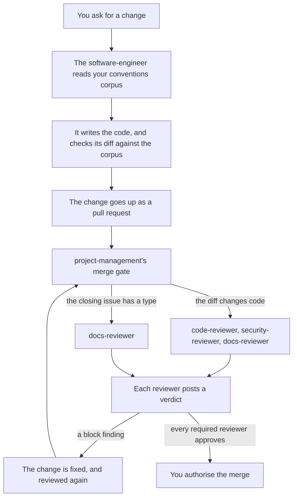

# software-engineering

software-engineering has an agent write your project's code to your project's own conventions. A panel of reviewer agents then judges each pull request's code, its security and its documentation before it merges. This guide says why the capability exists and how it works, and then gives its tasks. What an agent needs to use it, such as what each reviewer blocks on, is in [the capability's reference](../../../.pkit/capabilities/software-engineering/README.md#the-code-review-panel).

## Contents

<!-- pkit:contents -->
- [Why it exists](#why-it-exists)
- [How it works](#how-it-works)
- [Turning it on](#turning-it-on)
- [Build a change under your conventions](#build-a-change-under-your-conventions)
- [Decide the answers your change was not asked for](#decide-the-answers-your-change-was-not-asked-for)
- [Have the change reviewed, and land it](#have-the-change-reviewed-and-land-it)
<!-- /pkit:contents -->

## Why it exists

Code that agents write goes wrong in these ways when nothing holds it to your project's standards:

- **Each session writes code its own way.** An agent names things, lays out files and handles errors by its own habits, unless you explain your conventions again. Two sessions then solve one problem two ways. Even the conventions a first slice settles stay in its code, and each later slice settles them again.
- **Nothing reviews the code before it merges.** A merge gate that checks a pull request's labels and conventions lets one through that puts a token on a subprocess's command line. Every user of the machine can then read the token, such as through `ps`.
- **An agent answers what nobody asked.** It marks a document as still accurate, though the change never touched what the document rests on, and no person decided that answer.
- **Only the writer of an answer checks it.** A change says that a document it affects still holds, or leaves the document out of date until a follow-up. You then authorise the merge on the word of the agent that wrote the reason.

### What software-engineering does instead

software-engineering answers each of these problems with a claim, in the same order, and the commands after the list prove each one:

- **Each of its four agents is deployed to read your conventions from where you keep them, and deploys before you have any.**
- **In agent review mode, the default, it declares its three reviewers required on each pull request that changes code, whatever the issue it closes says.** project-management's merge gate reads the declaration ([the reference, "When each reviewer is required"](../../../.pkit/capabilities/software-engineering/README.md#when-each-reviewer-is-required)).
- **The software-engineer's definition leaves to you each answer your change was not asked for, and the change's own check flags each one.**
- **The `docs-reviewer`'s definition makes each answer the change wrote that does not hold a `[block]` finding, whatever your conventions say.**

Below, a fresh project installs project-management, which the capability needs, and then software-engineering. It names where its conventions live, and redeploys the agents:

```console
$ pkit capabilities install project-management >/dev/null 2>&1
$ pkit capabilities install software-engineering >/dev/null 2>&1
$ pkit agents | grep -e capability:software-engineering -e Optional
  code-reviewer                   capability:software-engineering  deployable  model inherit  effort inherit  project-conventions
  docs-reviewer                   capability:software-engineering  deployable  model inherit  effort inherit  project-conventions
  security-reviewer               capability:software-engineering  deployable  model inherit  effort inherit  project-conventions
  software-engineer               capability:software-engineering  deployable  model inherit  effort inherit  project-conventions
Optional: 1 categor(ies) undefined   (agents deploy without them)
  ⚠ Optional categor(ies) undefined (project-conventions): agents deploy without them; `pkit agents reconcile` to define and enrich.
$ printf 'project-conventions:\n  - docs/conventions.md\n' >> .pkit/agents/project/overlay.yaml
$ pkit sync | tail -n 1
Sync complete.
$ grep -A1 "^  patterns:" .claude/agents/code-reviewer.md .claude/agents/docs-reviewer.md .claude/agents/security-reviewer.md .claude/agents/software-engineer.md
.claude/agents/code-reviewer.md:  patterns:
.claude/agents/code-reviewer.md-    - docs/conventions.md
--
.claude/agents/docs-reviewer.md:  patterns:
.claude/agents/docs-reviewer.md-    - docs/conventions.md
--
.claude/agents/security-reviewer.md:  patterns:
.claude/agents/security-reviewer.md-    - docs/conventions.md
--
.claude/agents/software-engineer.md:  patterns:
.claude/agents/software-engineer.md-    - docs/conventions.md
$ grep -B1 reviewer: .pkit/capabilities/software-engineering/review-contributions.yaml | grep -v "#"
  - floor: touches-code
    reviewer: code-reviewer
--
  - floor: touches-code
    reviewer: security-reviewer
--
  - floor: touches-code
    reviewer: docs-reviewer
--
      type: "*"
    reviewer: docs-reviewer
```

Below, again from a fresh project, `grep` prints the lines of two agents' definitions that bear on answers. A document then rests on `app.py`, and a branch that never touches `app.py` answers for it anyway. The branch also adds a document that gives a reason for having no anchors:

```console
$ pkit capabilities install project-management >/dev/null 2>&1
$ pkit capabilities install software-engineering >/dev/null 2>&1
$ grep -o "Any other answer — [^:]*: name it in your hand-off[^,]*" .claude/agents/software-engineer.md
Any other answer — on an artefact your change did not flag, on a target your change asks no revisit of, or for a debt the whole-repository check reports — and any reason for having no anchors are not yours to write: name it in your hand-off for the person to decide
$ grep -o "An answer the change wrote that does not hold is always a block[^.]*" .claude/agents/docs-reviewer.md
An answer the change wrote that does not hold is always a block** — whatever the corpus state, on the failures "The answers a change wrote" below names, a revisit's included
$ mkdir -p .pkit/project && printf 'friction:\n  places: [docs/**]\n' >> .pkit/project/config.yaml
$ mkdir docs && printf -- '---\npkit:\n  friction:\n    anchors:\n      path: [app.py]\n---\n# Starting the app\n' > docs/start.md
$ echo 'print("hello")' > app.py && git add -A && git commit -qm "Add the app and its document"
$ git checkout -qb tidy && echo 'print("bye")' > other.py && git add other.py && git commit -qm "Add another script"
$ pkit friction revalidate docs/start.md --outcome unchanged --because "It starts the same way." --yes | tail -n 1
Wrote answers[docs/start.md].revalidated in .pkit/project/friction/answers/<any>.yaml.
$ printf -- '---\npkit:\n  friction:\n    unanchored-because: "It records one meeting."\n---\n# Notes\n' > docs/notes.md
$ pkit friction check 2>/dev/null | tail -n 3
Answers written in this change — these documents rely on something this change modifies, and each answer says whether the document is still true
  docs/notes.md — not tied to anything (new document) (not asked for by this change): "It records one meeting."
  docs/start.md — still accurate (not asked for by this change): "It starts the same way."
```

What the output proves, claim by claim:

- **Deployed to read your conventions.** Before the project names any conventions, `pkit agents` lists each of the four agents as deployable, and their conventions as optional. Once the overlay names `docs/conventions.md`, `pkit sync` writes that path into each agent's definition, as a file it reads.
- **Required on each pull request that changes code.** The capability's declaration requires `code-reviewer`, `security-reviewer` and `docs-reviewer` on the floor `touches-code`, which reads the diff alone. It also requires `docs-reviewer` for each issue `type`.
- **Left to you, and flagged.** The software-engineer's definition gives each answer the change was not asked for to the person it works for. The change check flags the branch's answer on `docs/start.md`, since the branch never touched `app.py`. It flags the reason `docs/notes.md` gives too.
- **A block, for an answer that does not hold.** The `docs-reviewer`'s definition holds that line, for each answer and revisit its section on answers names.

> [!WARNING]
> Only their definitions hold the agents to these rules. Nothing at run time stops the software-engineer from writing an answer it was not asked for, or from passing over your conventions. So before you authorise a merge, read the answers the change check flags "not asked for by this change", and the `docs-reviewer`'s findings.

### Compared with the alternatives

Without software-engineering, an agent you choose writes the code and people review it. Checks in your CI catch what they cover, and project-management's merge gate checks the pull requests alone. **software-engineering adds your conventions to each run of its agents, and two reviewers of the code, as [the commands above](#what-software-engineering-does-instead) prove.** It costs a second capability, and reviewer runs that take minutes:

| What you need | Your own agent, reviewed by hand | Linters and scanners in CI | project-management alone | software-engineering |
| --- | --- | --- | --- | --- |
| Your conventions in each run of an agent | ❌ You explain them again, or paste them into each prompt | ❌ They catch only what a rule encodes, after the code is written | ❌ Its reviewer judges project-management's conventions, never yours | ✅ Each agent reads your corpus |
| A skeleton's conventions written down | ❌ They stay in its code, unless you write them | ❌ No tool writes them | ❌ The same | ✅ The agent writes them, for you to accept |
| Code reviewed for correctness and security | ✅ Where a person reviews each pull request | ✅ The same answer on each run, for what they cover, such as a token a secret scanner finds | ❌ Nothing reviews the code | ✅ Two reviewers, required on each pull request that changes code |
| Answers checked by someone other than their writer | ✅ Where a person reads each reason | ❌ No tool reads them | ❌ Only their writer checks them | ✅ The `docs-reviewer` checks each one |
| Setup | ✅ None | ❌ A tool for each check | ✅ One capability | ❌ A second capability, and where your conventions live |
| Cost of each pull request | ✅ Nothing more | ✅ Seconds of CI | ✅ Its own reviewers alone | ❌ Up to three more reviewer runs each round, each of several minutes |

### When you do not need it

software-engineering is meant for projects where agents write code that reaches a pull request. You do not need it in these cases:

- **Agents write none of your code, and a person reviews each pull request.** Your reviewers already read the code with your conventions in mind.
- **Your pull requests are not on GitHub.** project-management runs the panel on GitHub pull requests, so elsewhere no reviewer of the panel runs.
- **You merge without pull requests.** The panel then never runs, though the software-engineer still writes to your conventions.
- **You want your existing code reviewed.** The panel judges what a change owns. A defect already in the code blocks nothing, unless the change claims to fix it.
- **You want a check that answers the same way each time.** The reviewers are model agents, and a verdict is a judgement that can miss. A linter, a type checker or a secret scanner in your CI catches what it covers on each run, so keep them beside the panel.

## How it works

You ask the software-engineer for a change, and project-management's merge gate requires the panel's reviewers on the pull request that carries it. Each reviewer posts a verdict, and the change merges once every required reviewer approves and you authorise it.



- **The conventions corpus.** Your project's coding standards, in files you keep where you choose. One setting names them for every agent of the capability: the `project-conventions` category of the agent overlay ([the reference, "The conventions corpus"](../../../.pkit/capabilities/software-engineering/README.md#the-conventions-corpus)).
- **The software-engineer.** It writes and edits code. It reads the corpus before it writes, applies it to each choice, and reads its diff again against the corpus. It carries no coding opinions of its own, so where your corpus speaks, the corpus decides.
- **The code-review panel.** Three reviewer agents, each with a remit of its own:
  - `code-reviewer`: correctness, the quality of the code and the design of its interfaces
  - `security-reviewer`: authentication, secrets on a command line, shell injection, cryptography and dependencies
  - `docs-reviewer`: whether the documentation keeps up with the code, and the answers the change wrote
- **When each is required.** In agent review mode, project-management's gate requires all three on a pull request whose diff changes code. It also requires `docs-reviewer` on each pull request whose closing issue has a `type`. The reference says which files count as code ([the reference, "When each reviewer is required"](../../../.pkit/capabilities/software-engineering/README.md#when-each-reviewer-is-required)). In human review mode, their verdicts only advise (project-management DEC-032).
- **The findings.** A reviewer withholds its approval only for an objective failure of the change in its remit, a `[block]` finding. A `[person]` finding goes to the person who authorises the merge, and an `[advisory]` one holds nothing ([the reference, "How a finding is tagged"](../../../.pkit/capabilities/software-engineering/README.md#how-a-finding-is-tagged)).
- **Its rule.** Wherever the capability is installed, every session also loads its rule on the tests a session runs while it builds, `software-engineering:RS-SWE-001`.

## Turning it on

Install project-management first, since software-engineering needs it, and then software-engineering. The install deploys the four agents and loads the rule ([the reference, "Installing it"](../../../.pkit/capabilities/software-engineering/README.md#installing-it)). Below, `grep` keeps the lines that name each:

```console
$ pkit capabilities install software-engineering 2>&1 | tail -n 2
    - 'project-management' (<any>) is not installed
Install or upgrade the required capabilities first.
$ pkit capabilities install project-management >/dev/null 2>&1
$ pkit capabilities install software-engineering | grep -e Installed -e binds -e "created .*agents/"
  Installed capability 'software-engineering' v<any> at .pkit/capabilities/software-engineering/
  Loaded rules — what this step newly binds (COR-070 point 3):
      binds    RS-SWE-001  While building, run the tests of what you changed
  created    .claude/agents/code-reviewer.md
  created    .claude/agents/docs-reviewer.md
  created    .claude/agents/security-reviewer.md
  created    .claude/agents/software-engineer.md
```

- **Name where your conventions live.** Add a `project-conventions` category to the agent overlay, listing the files that hold them ([the agents README, "Adopter overlay"](../../../.pkit/agents/README.md#adopter-overlay)). Then run `pkit sync`, as [the first fence above](#what-software-engineering-does-instead) shows.
- **Or start with no conventions yet.** Name a location your project owns that holds none yet, such as `docs/conventions.md`, and run `pkit sync`. Each agent then says when it finds no convention for a choice, and works by ordinary judgement. It reads each convention you add there later.
- **Let a walking skeleton write the first ones** there ([A walking skeleton](#a-walking-skeleton)). It writes none while no location is named.
- **Choose your reviewers.** Each of the three is required wherever its condition holds. To stop requiring one, opt out of it in project-management's configuration, with a reason ([project-management's README, "Opting out of a contributed reviewer"](../../../.pkit/capabilities/project-management/README.md#opting-out-of-a-contributed-reviewer-per-project-managementdec-032-conditional-reviewer-requirements)).
- **Use the agent.** In Claude Code, ask your session for it by name, such as "Use the software-engineer agent to build issue 12".

## Build a change under your conventions

Ask the `software-engineer` agent to make the change, such as the code an issue asks for. It works in this order ([the reference, "The producer"](../../../.pkit/capabilities/software-engineering/README.md#the-producer-software-engineer)):

1. It reads your conventions corpus, before it writes any code. Where the corpus says nothing on a choice, it says so, such as "no project conventions found for X; proceeding as a careful generalist".
2. It writes the code, and applies the corpus to each choice the change settles, such as naming, layout and error handling.
3. Where a design fork arises that the corpus does not settle, it names the fork and its trade-off, and you decide.
4. Where the change makes a document owe an answer, it writes the answers the change check asks of your change. Any other answer is yours to decide ([the next task](#decide-the-answers-your-change-was-not-asked-for)).
5. It reads its diff again against the corpus, and corrects what does not conform.
6. It hands the change back for review, and its hand-off says whether it wrote answers. It opens no pull request, invokes no reviewer, and merges nothing.

### A walking skeleton

A walking skeleton is the one thin slice a foundation builds end to end, before the slices after it are planned. project-management plans one when the Tasks of new work would share a choice that nothing settles yet (project-management DEC-060). Ask the agent to build the skeleton's Task, and it also writes down the conventions the skeleton settles ([the reference, "A foundation fills the corpus"](../../../.pkit/capabilities/software-engineering/README.md#a-foundation-fills-the-corpus)):

- **An entry for each convention.** It writes one for each convention that building the skeleton settles, such as the layout of the code and its tests. Each goes in the skeleton's change, where your corpus already keeps conventions, in the form the corpus gives them.
- **You accept the entries,** once, with that change, having read them. In a corpus that gives entries a status, such as a rule set, you set each proposed entry accepted. Otherwise you accept them in the pull request's description, where the agent lists them. Authorising the merge accepts none, so the change waits in review until you do.
- **No single location, no entries.** Where your corpus offers no single location your project owns, the agent writes none. Its hand-off lists each convention with the entry it would have written, so you can name a location before the slices are planned.

## Decide the answers your change was not asked for

Any answer the change check did not ask of your change is yours to decide, not the agent's ([the reference, "The answers it writes"](../../../.pkit/capabilities/software-engineering/README.md#the-answers-it-writes)). The check asks for an answer on each document whose anchors your change changed. It also asks for a revisit where a changed link asks for one. Any other answer is one of these:

- an answer on a document the check did not ask about, or for a debt the whole-repository check reports
- a revisit entry for a target your change asks no revisit of, or one whose outcome alone changed
- a reason for having no anchors

Decide each in these steps:

1. **Read the hand-off.** The agent writes none of these answers, and names each in its hand-off.
2. **Decide each answer.** Accept its words, change them, or decline the answer. A declined answer is never written, and the document stays as it was.
3. **Write each one you accept,** yourself or through an agent you direct. A revalidation is written with `pkit friction revalidate`, as [the second fence above](#what-software-engineering-does-instead) shows. The CLI reference gives the writers of a deferral ([“friction defer”](../../../.pkit/cli/README.md#friction-defer-artefact---anchor-anchor---reason-text---yes----dry-run)) and of a revisit entry ([“friction revisit”](../../../.pkit/cli/README.md#friction-revisit-artefact---target-anchor---outcome-unchangeddeferred---reason-text---yes----dry-run)). A reason for having no anchors goes in the document's own front matter, as the same fence shows.
4. **Say who decided each.** The `docs-reviewer` checks each such answer against what it answers, and blocks on one that does not hold. It cannot tell who decided one, so it names each in an `[advisory]` finding ([the reference](../../../.pkit/capabilities/software-engineering/README.md#the-reviewer-of-a-changes-answers)). Say in the pull request who decided it.

Your default branch's configuration may name a delegate, `friction.delegate`. That agent then decides in your place each such answer another agent drafted, where a reviewer checks these answers. It may refer any of them to you, and you are told afterwards what it decided (COR-064). Never name the `docs-reviewer`, which checks these answers.

## Have the change reviewed, and land it

Open the pull request as your project does, such as with project-management's `open-pr` ([project-management's README, "Opening and editing a PR"](../../../.pkit/capabilities/project-management/README.md#opening-and-editing-a-pr--open-pr--edit-pr)). Then have the reviewers its gate requires judge it, and land it once they approve.

In agent review mode, project-management runs each required reviewer and posts each verdict on the pull request. Its landing command, `land-work`, runs the same review as one of its steps ([project-management's README, "Landing a pull request in one command"](../../../.pkit/capabilities/project-management/README.md#landing-a-pull-request-in-one-command--land-work-1203)). Each command needs GitHub, and the reviews need Claude Code, so they are shown here without their output. Each takes the issue the pull request closes:

```sh
pkit project-management open-pr 12
pkit project-management review-pr 12
pkit project-management land-work 12
```

- **Fix what blocks.** The agent fixes each `[block]` finding, and the fix is reviewed again. It records each `[advisory]` one in the pull request, with how it was answered ([the reference, "The producer"](../../../.pkit/capabilities/software-engineering/README.md#the-producer-software-engineer)). A `[person]` finding waits for whoever authorises the merge.
- **What the `docs-reviewer` blocks on.** It reads the answers from the change check's own list, never from the author's account ([the reference](../../../.pkit/capabilities/software-engineering/README.md#the-reviewer-of-a-changes-answers)). Among its `[block]` findings are these:
  - a reason why a document is still accurate that does not hold against the change
  - a deferral whose reason does not hold, or that names no open follow-up issue
  - a document updated in the change with no sentence on what changed, or with one that does not match the diff
  - a revisit of a target that does not hold against what the change modified
- **Write the sentences.** The pull request's description holds one for each document the change updated, under `## What changed in each updated document`. Write each as an item of the form ``- `path`: sentence``, which the reviewer reads.
- **Land it.** The landing command shows you the answers, their sentences, and what is left out of date, as information. What it shows of them stops no merge ([project-management's README, "The answers a change wrote, in its pull request"](../../../.pkit/capabilities/project-management/README.md#the-answers-a-change-wrote-in-its-pull-request-project-managementdec-055-pr-lists-answers)). Without `--yes`, it stops on its `ready:` line, which names the command that merges the head you were shown ([project-management's README](../../../.pkit/capabilities/project-management/README.md#landing-a-pull-request-in-one-command--land-work-1203)).

In these cases, no reviewer's check of the answers holds the merge ([the reference](../../../.pkit/capabilities/software-engineering/README.md#the-reviewer-of-a-changes-answers)):

- **A pull request that changes only documents, and closes no issue with a `type`.** The gate requires no `docs-reviewer` for it. Have the pull request close an issue that has a `type` when the change wrote answers.
- **A project that opts out of the `docs-reviewer`,** and names no other reviewer of the answers.
- **Human review mode.** The `docs-reviewer`'s verdict only advises there, and the person who approves checks the answers only by reading them.
- **A bypass on record.** A person merges past the `docs-reviewer`, or past the whole gate, with a reason (project-management DEC-050).
- **A sentence edited after the verdict.** Editing the description makes no verdict stale, so nothing checks the new sentence.
- **A change committed straight to your default branch.** The reviewer works from a pull request, and checking such a change's answers before the commit is not built yet.
