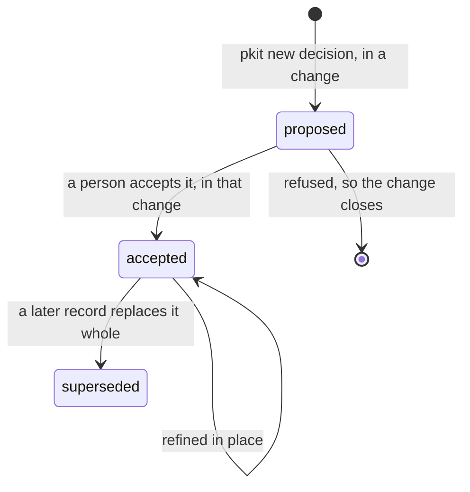

# Decision records

A decision record states one choice your project made, and why, in a file beside your code. This guide is for the developer who records a decision, and for the person who accepts it. It says why records exist, then how to record one, have it accepted and change it later. What an agent needs to work with records, such as their format and statuses, is in [the decisions reference](../../.pkit/decisions/README.md).

## Contents

<!-- pkit:contents -->
- [Why they exist](#why-they-exist)
- [How a record moves](#how-a-record-moves)
- [Record a decision](#record-a-decision)
- [Have a person accept it](#have-a-person-accept-it)
- [Refine a record, or supersede it](#refine-a-record-or-supersede-it)
<!-- /pkit:contents -->

## Why they exist

An agent keeps nothing between sessions but what your repository holds, so a choice made anywhere else is lost to it. Without records that live in the repository and that a person accepts, these things go wrong:

- **A choice made in a chat is gone.** Last week you agreed in a chat to squash-merge every pull request. Today an agent merges a branch with a merge commit, and nothing it can read says otherwise.
- **Your decisions and the methodology's get mixed up.** The methodology ships decisions of its own. Kept in one folder, your decision 7 and its decision 7 clash, and its next update overwrites yours.
- **An agent's draft becomes the decision unread.** An agent writes a choice into the same change as the code that rests on it. The change merges, and nobody read the choice itself.
- **Two decisions share a number.** Two branches each add decision 12, and both merge. A citation of decision 12 then names two files.
- **A cited point moves.** A document cites point 3 of a record. Someone inserts a point before it, and the citation now names the new point.
- **A record stops saying what was decided.** Each revision adds an amendment block or a dated note. Two years on, a reader replays the history to find the decision in force.

### What records do instead

Records answer these problems with the five claims below. The first claim answers the first two problems, and each later claim answers the next problem in turn. The commands after the list prove the first two claims, and the tasks the later claims link to prove those.

- **Your records sit in your repository, in a folder of their own beside the methodology's, and a sync never writes them.**
- **A record your agent stamps starts as `proposed`, and the methodology's rules tell agents to act only on accepted ones.**
- **Run against the default branch as it stands, the numbering check fails a change whose record takes a number already landed** ([Record a decision](#record-a-decision)).
- **Where your merges wait on it, the numbering check fails a renumbered point, so a citation keeps its point** ([Refine a record, or supersede it](#refine-a-record-or-supersede-it)).
- **Validation warns of a record that logs its own revisions** ([Refine a record, or supersede it](#refine-a-record-or-supersede-it), and [the reference, "Refining an accepted record"](../../.pkit/decisions/README.md#refining-an-accepted-record)).

Each fence on this page starts from a fresh project where `pkit init` has run, with no remote. So a command that reads the default branch warns that it reads the local branch ([the CLI reference, "Configuration file"](../../.pkit/cli/README.md#configuration-file)).

Below, your agent stamps a record on a branch, and you commit it. Then a core record and yours are both edited, and a sync runs:

```console
$ git switch -qc squash-merge
$ pkit new decision project squash-merge
warning: the default branch 'main' is read from the local branch 'main': this repository has no remote to read the shared one from, and a local branch can lag it or carry work nobody pushed (COR-054 point 2)
Stamped: .pkit/decisions/project/PRJ-001-squash-merge.md
$ ls .pkit/decisions && ls .pkit/decisions/core | head -n 1
README.md
core
project
COR-001-content-mechanisms.md
$ grep status: .pkit/decisions/project/PRJ-001-squash-merge.md
status: proposed
$ grep core.md CLAUDE.md && grep -o "Act only on accepted decisions and rules" .pkit/rules/core.md
@.pkit/rules/core.md
Act only on accepted decisions and rules
$ git add -A && git commit -qm "Propose PRJ-001"
$ echo "An edit." | tee -a .pkit/decisions/core/COR-001-content-mechanisms.md .pkit/decisions/project/PRJ-001-squash-merge.md
An edit.
$ pkit sync >/dev/null && git status --short
 M .pkit/decisions/project/PRJ-001-squash-merge.md
```

What the output proves, claim by claim:

- **A folder of their own.** The stamp wrote a `PRJ-` record in `project/`, beside the methodology's `COR-` records in `core/`. Your `PRJ-` and `ADR-` records never share a prefix with the methodology's, and your records never share its folder ([the reference, "Two namespaces, two prefixes"](../../.pkit/decisions/README.md#two-namespaces-two-prefixes)).
- **Never written by a sync.** The sync put the core record back as it ships, and left your record's edit in place. A sync refreshes the methodology's records, and never writes yours ([the reference, "The no-shared-files invariant"](../../.pkit/decisions/README.md#the-no-shared-files-invariant)).
- **Proposed first.** The stamp wrote `status: proposed`. `CLAUDE.md` includes `core.md`, the methodology's rules, which tell agents to act only on accepted decisions and rules ([the reference, "The acceptance gate"](../../.pkit/decisions/README.md#the-acceptance-gate)).

### Compared with records kept by hand

The alternative is to keep your decision records by hand: a folder of Markdown files, written from a template you choose. That costs no setup, and takes any template and any status. Your repository then holds your records alone. **project-kit's records add rules that tell agents to wait for acceptance, checks on numbers, and a warning on revision logs, as [this page's fences](#what-records-do-instead) prove:**

| What you need | Records kept by hand | project-kit's records |
| --- | --- | --- |
| A file for each decision, beside the code | ✅ A folder of Markdown files | ✅ The same, in a folder apart from the methodology's |
| An instruction to agents to act only on accepted records | ✅ One line you write in `CLAUDE.md` | ✅ Written for you, in the methodology's rules |
| A record number no other change took | ❌ Two branches can take one unseen | ✅ The numbering check fails the second, where it runs |
| A cited point that keeps its number | ❌ Nothing checks a renumbering | ✅ The numbering check fails one, where it runs |
| A record that states only the decision in force | ❌ Nothing warns of a revision log | ✅ Validation warns of one |
| Setup | ✅ None | ❌ `pkit init`, and the numbering check wired into your merges |
| Your own template | ✅ Any you choose | ❌ Four required sections and five required front-matter fields |
| A draft merged now and accepted later | ✅ Any status, at any time | ❌ A person accepts a record in the change that proposes it |
| What your repository holds | ✅ Your records alone | ❌ The methodology's records too |

### When you do not need one

A record is for a choice that later work will build on, such as a library or a convention ([COR-065](../../.pkit/decisions/core/COR-065-records-and-projection.md) point 3). You do not need one in these cases:

- **The choice binds nothing beyond its own change,** such as a name or an order inside one change.
- **The answer is not clear yet.** Think it through in a scratchpad note, which retires once a record or another document holds what it found ([the scratchpad guide](../scratchpad/README.md)).
- **It is only an instruction for each session's work,** such as running the tests before each commit. Write it as an operational rule ([the rules guide](../rules/README.md)). A convention later work builds on can take both: its record, and a rule that cites the record.
- **It describes what is built today,** such as the modules that carry a choice out. A record keeps the choice and its reasons, and a document holds that detail (COR-065 point 5).
- **You want drafts to land now and be accepted later.** Keep your records by hand, as the comparison above credits.
- **It is work to do,** such as a bug to fix. It belongs in your tracker.

## How a record moves

A record moves from `proposed` to `accepted` inside the change that proposes it. From then on it is refined in place, or superseded by a later record:



- **Proposed:** the record belongs only on the branch of the change that proposes it, and binds nothing ([COR-066](../../.pkit/decisions/core/COR-066-accepted-before-landing.md) point 1).
- **Accepted:** a person accepts the record in that change, before work in the change rests on it. So it reaches the default branch accepted. Nothing checks this yet ([the reference, "The acceptance gate"](../../.pkit/decisions/README.md#the-acceptance-gate), and "Have a person accept it" below).
- **Refined in place:** an accepted record is edited while its decision stands. It states what is true, with no log of its revisions ([the reference, "Refining an accepted record"](../../.pkit/decisions/README.md#refining-an-accepted-record)).
- **Superseded:** a later record replaces it whole. A record a later one overturns only in part stays accepted, and its top line says so.
- **What an accepted record governs:** where it decides, your code, documents and skills carry its decision out. Where they disagree with it, first ask whether they fall short of the record, and if they do, fix them. A change to what the record decides is a person's decision (COR-065 point 4).
- **Not built yet:** [COR-067](../../.pkit/decisions/core/COR-067-decision-debt.md) decides a command that lists each accepted point nothing in your project carries out. No command lists them yet.
- **Whose records are whose:** yours are the `PRJ-` and `ADR-` records, and the `DEC-` records of a capability you author. The methodology's `COR-` records and an installed capability's `DEC-` records are synced copies, which each sync refreshes ([the reference, "Two further id-spaces"](../../.pkit/decisions/README.md#two-further-id-spaces)).

## Record a decision

Record a decision when you make a choice that later work will build on. First pick its namespace, by what it decides ([COR-025](../../.pkit/decisions/core/COR-025-adr-decision-space.md)):

- **`project`:** how your project works, such as its workflow or its tooling. The record is `PRJ-NNN`, in `.pkit/decisions/project/`.
- **`adr`:** what your project builds and why, such as a technology or a boundary between parts. The record is `ADR-NNN`, in your architecture records' folder.
- **A capability's name:** a decision inside a capability your project authors. The record is `DEC-NNN`, in that capability's `decisions/`.
- **The methodology's own records** are written where the methodology is kept. To change one, propose the change there ([the reference, "Adding a record"](../../.pkit/decisions/README.md#adding-a-record)).

Then run `pkit new decision` on your change's branch, with the namespace and a slug, a few words that name the decision. It stamps the record, and prints its path:

```console
$ pkit new decision project squash-merge 2>/dev/null
Stamped: .pkit/decisions/project/PRJ-001-squash-merge.md
$ cat .pkit/decisions/project/PRJ-001-squash-merge.md
---
id: PRJ-001
title: <short imperative title>
status: proposed
date: <any>
author: Doc Examples <doc-examples@example.invalid>
---

## Context

## Decision

### 1. Point title

## Rationale

## Implications
```

- **Its number:** one past the highest that the namespace's folder holds, in the working tree or on the default branch ([the CLI reference, `new decision`](../../.pkit/cli/README.md#new-decision-namespace-slug---yes)).
- **Your architecture records' folder:** where your project names none, the first `pkit new decision adr` derives `architecture/decisions/` under your internal documentation root, and records it ([the CLI reference, `new decision`](../../.pkit/cli/README.md#new-decision-namespace-slug---yes)).
- **Its body:** write the title, then the context, the decision, the rationale and the implications. The title states the decision, and a short summary in plain words opens the record ([the reference, "Writing a record"](../../.pkit/decisions/README.md#writing-a-record)).
- **Its points:** give each part of the decision a heading of its own, `### 1. Title`, whose number it keeps for good. A decision of one part has no points, so delete the stamped heading before the record first lands ([the reference, "Adding a record"](../../.pkit/decisions/README.md#adding-a-record)).
- **With your agent:** ask it to "use the decision-author skill to record that we squash-merge every pull request". The skill picks the namespace with you, stamps the record and drafts its body.
- **How agents find it:** a record is cited, not loaded into each session. An agent reads it where a rule or a skill cites it, or where an anchor ties it to the files a change touches. Before a change, an agent runs `pkit refs records-for` on those files (core rule 22, and [the reference, "Finding the records a path leads to"](../../.pkit/decisions/README.md#finding-the-records-a-path-leads-to)).

Before you push, fetch the default branch:

```sh
git fetch origin
```

Then run `pkit decisions validate`, which checks each record's id and points ([the reference, "Checking a record's points"](../../.pkit/decisions/README.md#checking-a-records-points)). Then run `pkit decisions check-diff`, which compares your change with the default branch where your branch left it, and with what landed there since. Below, another change lands an accepted record on the default branch, under the number your branch took:

```console
$ git switch -qc squash-merge
$ pkit new decision project squash-merge 2>/dev/null
Stamped: .pkit/decisions/project/PRJ-001-squash-merge.md
$ git add -A && git commit -qm "Propose PRJ-001"
$ git switch -q main
$ pkit new decision project tag-releases >/dev/null 2>&1 && sed -i.bak 's/^status: proposed/status: accepted/' .pkit/decisions/project/PRJ-001-tag-releases.md && rm .pkit/decisions/project/*.bak
$ git add -A && git commit -qm "Record PRJ-001"
$ git switch -q squash-merge
$ pkit decisions check-diff
warning: the default branch 'main' is read from the local branch 'main': this repository has no remote to read the shared one from, and a local branch can lag it or carry work nobody pushed (COR-054 point 2)
  Compared 1 decision record(s) with main (<any>; this branch left it at <any>): 1 error(s) and 0 warning(s) in their numbering (COR-058 point 8).
    error    .pkit/decisions/project/PRJ-001-squash-merge.md
      → PRJ-001: another change took the record id `PRJ-001` on main since this branch left it, at `.pkit/decisions/project/PRJ-001-tag-releases.md`. The first to land keeps the number, so renumber this record to `PRJ-002` (COR-058 point 8).
Error: 1 error(s) in the change's numbering found.
```

- **The first to land keeps its number.** Move your record to the number the error names, in its file name and its `id`. Mend each citation of the old id in your change, and run the check again.
- **It reads the default branch as your clone holds it,** and fetches nothing. So a change that lands after the check ran is found only when the check runs again ([the reference, "Checking a change's numbering"](../../.pkit/decisions/README.md#checking-a-changes-numbering)).
- **Where it binds:** only where your project runs it. Make it a line of the checks your merges wait on ([the reference, "Checking a change's numbering"](../../.pkit/decisions/README.md#checking-a-changes-numbering)). Run them against the default branch as it stands when the merge happens, such as in a merge queue.
- **Two records that land with one number** anyway are found by `pkit decisions validate` on the default branch. Move the one that landed later to the next unused number, and mend its citations ([the reference, "Two further id-spaces"](../../.pkit/decisions/README.md#two-further-id-spaces)).

## Have a person accept it

A person accepts a record in the change that proposes it, before any work in the change rests on it (COR-066 point 1). Until then the record binds nothing. How that goes:

- **Who accepts it:** a person, never an agent. Usually it is the person who authorises the change's merge. An agent writes `accepted` only once a person has accepted the record.
- **What they read:** the record, each record it cites, and the edits to accepted records its Implications name. Check that each cited record is accepted, and accept one proposed in the same change first.
- **The records it changes:** once the record is accepted, the same change makes, in your own records, the edits its Implications name. Whoever authorises the merge is shown them beside the records the change makes accepted, and reads each before it lands ([the reference, "The acceptance gate"](../../.pkit/decisions/README.md#the-acceptance-gate)).
- **How it is written:** the record's `status` becomes `accepted` in a commit of its own, made by the person or by an agent on their word. Where the person accepts the record as first written, it may be added accepted. Either commit comes before the commits whose work rests on the record.
- **With your agent:** tell it "the squash-merge record is accepted", once you have read the record and the edits it names. Your agent sets the status and commits, and only then makes the edits to your own records and builds on the record.
- **Work that rests on the record:** that work follows in the same change, or in a change built on this one that lands no earlier.
- **Before the merge:** whoever authorises the merge sees each record the change makes accepted, whether it was added accepted or set to accepted. Where no tool shows that list, the change's author shows it. An edit made to such a record after its acceptance in the change is accepted only through that list (core rule 2).
- **Refused:** close the change, so the proposal never lands. Where its reasoning is worth keeping, a [scratchpad note](../scratchpad/README.md) keeps it, dropped with why the proposal was refused.
- **Working alone,** you commit straight to the default branch. Accept the record before that commit.
- **A proposed record already on the default branch,** from before this way of working: a person accepts it, or deletes it ([the reference, "Statuses"](../../.pkit/decisions/README.md#statuses)).

Below, a record is proposed, accepted, and then built on, each in a commit of its own:

```console
$ git switch -qc squash-merge
$ pkit new decision project squash-merge >/dev/null 2>&1 && git add -A && git commit -qm "Propose PRJ-001"
$ sed -i.bak 's/^status: proposed/status: accepted/' .pkit/decisions/project/PRJ-001-squash-merge.md && rm .pkit/decisions/project/*.bak
$ git commit -qam "Accept PRJ-001"
$ echo "Squash-merge every pull request." > CONTRIBUTING.md && git add CONTRIBUTING.md && git commit -qm "Ask contributors to squash-merge"
$ git log --format=%s
Ask contributors to squash-merge
Accept PRJ-001
Propose PRJ-001
Install project-kit
```

> [!WARNING]
> [COR-066](../../.pkit/decisions/core/COR-066-accepted-before-landing.md) binds only where a merge runs the landing check ([the reference, "Checking what a change lands"](../../.pkit/decisions/README.md#checking-what-a-change-lands)). `pkit decisions check-landing` lists the records a change makes accepted. With `decisions.refuse-proposals` on, it refuses a merge that lands a record still `proposed`. Elsewhere, before the merge, accept each such record in the change, and look again at any work that rested on it.

## Refine a record, or supersede it

Edit an accepted record in place while its decision stands, narrowed or completed. Supersede it when another record will decide otherwise, overturning it in whole or in part ([the reference, "Refining an accepted record"](../../.pkit/decisions/README.md#refining-an-accepted-record)):

- **Refine in place:** add a point that completes the decision, such as squash commits taking a conventional title, or correct a fact where the decision stands.
- **Supersede:** a decision overturned, such as moving from squash merges to rebase merges.

An edit in place may still change what the record decides. One test says who accepts it: does the edit change what the record decides, in either direction?

- **An edit that changes nothing decided,** such as a typo fixed or a citation updated after a rename. Make it in your change.
- **An edit that adds to the decision, narrows it or widens it,** such as a point added or rewritten. It is a decision of its own, which a person accepts (COR-064 point 6).
- **How the person sees it:** `pkit decisions check-diff` lists each edit to a record accepted before your change ([the reference, "Checking a change's numbering"](../../.pkit/decisions/README.md#checking-a-changes-numbering)). Whoever authorises the merge reads that list, and judges for each edit whether it changes what the record decides.
- **The record as it now stands:** fold each correction into the sentence it belongs to. Add no amendment heading, dated note or "previously" passage, since git history is the record's change log ([the reference, "Refining an accepted record"](../../.pkit/decisions/README.md#refining-an-accepted-record)).
- **A new point** takes the next unused number, wherever it sits, and no point is renumbered. So the numbers may read 4, 6, 5.
- **A point dropped, split or merged,** so that no point continues it, is retired. Its id goes into the record's `retired-points`, and a one-line stub stays where it stood ([the reference, "Schema"](../../.pkit/decisions/README.md#schema)).

Below, an accepted record with two points is committed, and a third point is added. The numbering check passes, and lists the edit:

```console
$ printf -- '---\nid: PRJ-001\ntitle: Squash-merge every pull request\nstatus: accepted\ndate: 2026-11-02\nauthor: Doc Examples <doc-examples@example.invalid>\n---\n\n## Context\n\nMerge commits clutter the history.\n\n## Decision\n\n### 1. One commit for each pull request\n\nEach pull request lands as one squash commit.\n\n### 2. The pull request title becomes the message\n\nThe commit takes the title of its pull request.\n\n## Rationale\n\nOne commit is one change to revert.\n\n## Implications\n\nContributors merge with the squash button.\n' > .pkit/decisions/project/PRJ-001-squash-merge.md
$ git add -A && git commit -qm "Record PRJ-001"
$ awk '/^## Rationale/ { print "### 3. Conventional titles\n\nEach title follows Conventional Commits.\n" } 1' .pkit/decisions/project/PRJ-001-squash-merge.md > new.md && mv new.md .pkit/decisions/project/PRJ-001-squash-merge.md
$ pkit decisions check-diff 2>/dev/null
  Compared 1 decision record(s) with main (this branch left it at <any>): 0 error(s) and 0 warning(s) in their numbering (COR-058 point 8).
  1 accepted record(s) the change alters or removes. Whether each edit changes what its record decides is for whoever accepts it to judge (the decisions README, "Refining an accepted record"):
    PRJ-001 (`.pkit/decisions/project/PRJ-001-squash-merge.md`): point 3 (Conventional titles) added
```

Below, the same record's point 2 is renumbered as 3 instead, and an amendment heading is added:

```console
$ printf -- '---\nid: PRJ-001\ntitle: Squash-merge every pull request\nstatus: accepted\ndate: 2026-11-02\nauthor: Doc Examples <doc-examples@example.invalid>\n---\n\n## Context\n\nMerge commits clutter the history.\n\n## Decision\n\n### 1. One commit for each pull request\n\nEach pull request lands as one squash commit.\n\n### 2. The pull request title becomes the message\n\nThe commit takes the title of its pull request.\n\n## Rationale\n\nOne commit is one change to revert.\n\n## Implications\n\nContributors merge with the squash button.\n' > .pkit/decisions/project/PRJ-001-squash-merge.md
$ git add -A && git commit -qm "Record PRJ-001"
$ sed -i.bak 's/^### 2\. The pull/### 3. The pull/' .pkit/decisions/project/PRJ-001-squash-merge.md && rm .pkit/decisions/project/*.bak
$ pkit decisions check-diff 2>/dev/null
  Compared 1 decision record(s) with main (this branch left it at <any>): 2 error(s) and 0 warning(s) in their numbering (COR-058 point 8).
    error    .pkit/decisions/project/PRJ-001-squash-merge.md#2
      → PRJ-001: the branch point holds `2`, and the head neither holds nor retires it. A dropped point keeps its id in `retired-points`, with the points that took its text, and a stub where it was (COR-058 points 4 and 8).
    error    .pkit/decisions/project/PRJ-001-squash-merge.md#2
      → PRJ-001: the text of point `2` at the branch point sits at the head only under `3`. That is a renumbering, or a retirement whose successor kept the claim. A point keeps its id wherever it sits (COR-058 points 3 and 8).
  1 accepted record(s) the change alters or removes. Whether each edit changes what its record decides is for whoever accepts it to judge (the decisions README, "Refining an accepted record"):
    PRJ-001 (`.pkit/decisions/project/PRJ-001-squash-merge.md`): point 2 (The pull request title becomes the message) removed and point 3 (The pull request title becomes the message) added
$ echo '## Amendment (2026-11-02)' >> .pkit/decisions/project/PRJ-001-squash-merge.md
$ pkit decisions validate
  Validated 1 decision record(s) and 24 rule(s). No id collisions found.
  1 warning(s) of revision narration, which do not fail the check (.pkit/decisions/README.md, "Refining an accepted record"):
    .pkit/decisions/project/PRJ-001-squash-merge.md:30
      → amendment heading "## Amendment (2026-11-02)" — a record states what is true; git history is its change log.
  0 error(s) and 1 warning(s) on records' points (COR-058 point 7):
    warning  .pkit/decisions/project/PRJ-001-squash-merge.md#2
      → the ids skip `2`: no point holds it, and `retired-points` does not retire it. A dropped point keeps its id in `retired-points`, with a stub where it was (COR-058 points 3 and 4).
```

- **The renumbering fails.** The check finds point 2 gone without being retired, and its text under 3.
- **The amendment is a warning.** Validation names its line, and the gap left at 2, and fails on neither ([the reference, "Refining an accepted record"](../../.pkit/decisions/README.md#refining-an-accepted-record)). State the fact in the record's own text instead.

To supersede a record, and to leave the methodology's alone ([the reference, "Refining an accepted record"](../../.pkit/decisions/README.md#refining-an-accepted-record)):

- **A record replaced whole:** the new record's `supersedes:` names the old one. In the old record, set `status: superseded`, and put a *Superseded by …* line at the top of its body. Leave the rest as it stood, and in an ADR also set `superseded_by:`.
- **A record overturned only in part** stays `accepted`, and its top line reads *Partially superseded by …*. The new record's `supersedes:` does not name it.
- **Naming and making these edits:** as [Have a person accept it](#have-a-person-accept-it) says.
- **Within one namespace:** a record supersedes only a record of its own namespace, so an ADR never supersedes a `PRJ-` record.
- **The methodology's records,** and an installed capability's: never edit one, since the next sync overwrites the edit ([COR-001](../../.pkit/decisions/core/COR-001-content-mechanisms.md)). Propose the change where the record is kept.
