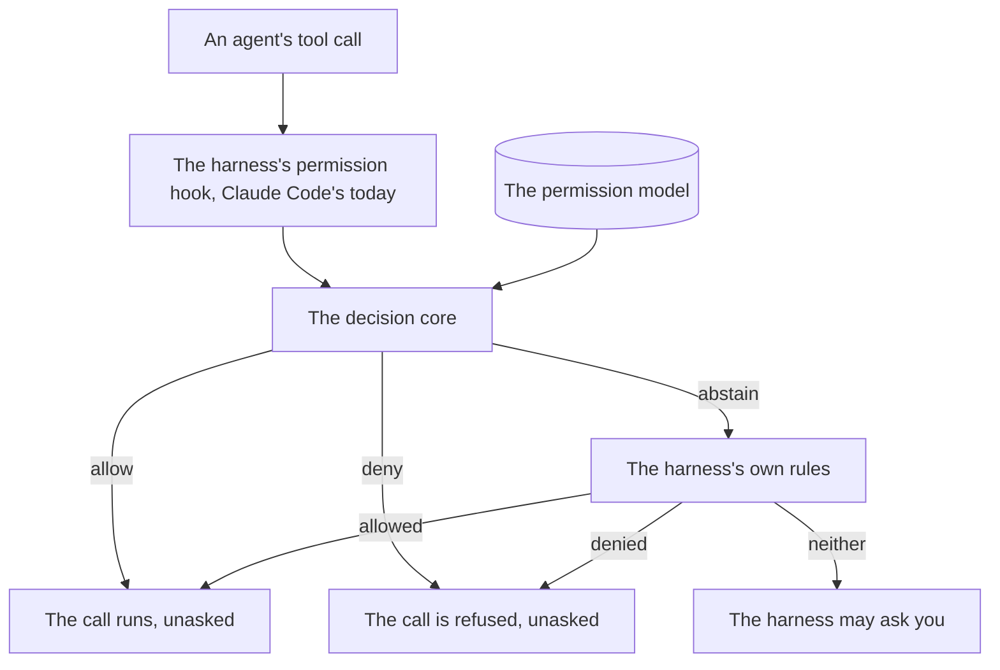

# The permission model

The permission model decides your agents' tool calls: which run without asking you, and which are refused ([COR-028](../../.pkit/decisions/core/COR-028-permission-model-realization.md)). This guide says why it exists and how it decides a call. It then shows how to turn it on and do the common tasks. The rules the model applies, for looking one up, are in [the permission model's reference](../../.pkit/permissions/README.md).

## Contents

<!-- pkit:contents -->
- [Why it exists](#why-it-exists)
- [How a tool call is decided](#how-a-tool-call-is-decided)
- [Turning it on](#turning-it-on)
- [Common tasks](#common-tasks)
<!-- /pkit:contents -->

## Why it exists

A harness's own permission settings make it hard to let agents work unasked, and to know which of their limits nothing enforces. Claude Code's settings, for one, apply to the whole session, and fall short in three ways ([the adapter's README, `settings/`](../../.pkit/adapters/claude-code/README.md#settings)):

- **One set of rules for every agent.** A rule on a command binds every agent in the session alike. An agent's own list of tools names only whole tools, such as `Bash`. So the settings cannot say that one agent may not edit an issue while another may.
- **No view of one agent.** What one agent may do is not in one place, in your own terms.
- **No place for a fault.** When a call is wrongly allowed or refused, you cannot tell which went wrong:
  - the rule itself
  - the place the rule sits in
  - the harness, which may not enforce the rule

So you either allow a command for every agent, or answer each call that no rule allows. That can mean dozens of prompts a session, approved unread, until a prompt no longer stops a dangerous command.

The model is designed for any harness, through an adapter that enforces what its harness can and reports the rest (COR-028 point 3, [COR-047](../../.pkit/decisions/core/COR-047-harness-requirement-declaration.md)). The hook, the settings and the modes this guide shows are those of Claude Code, the one adapter today ([the adapters README, "Currently shipped"](../../.pkit/adapters/README.md#currently-shipped)).

### What the model does instead

The model answers these problems with five claims, and the commands after the list prove each one:

- **Each agent has grants of its own, down to the command.** A grant names a subject, such as one agent, and a privilege: the commands the catalog recognizes, such as `gh issue edit`.
- **Each agent's denies hold in every mode, the harness's most permissive included.** The model's hook, which the harness runs before each tool call, reads the mode only to decide whether to ask.
- **The model's grants for every agent are in one place, in your terms.** `pkit permissions explain` lists them by privilege.
- **A wrong verdict can be traced to one of three layers:**
  - the model, which `explain` shows
  - its translation into the harness's rules, which `diff` and `probe` check
  - what the harness cannot enforce, which `diff` names
- **What the harness cannot enforce is reported, never dropped.** Nothing in Claude Code enforces network egress, for one, and the model says so (COR-028 point 3).

Below, every agent may use `gh`, and the agent `researcher` may not edit an issue with it. Each `echo` passes a call to the hook by hand, as Claude Code passes it ("Common tasks" below says how). The calls run in bypass mode, Claude Code's most permissive:

```console
$ pkit permissions grant all issue-tracker
granted: all allow issue-tracker
$ pkit permissions grant agent:researcher issue-tracker-write --deny
granted: agent:researcher deny issue-tracker-write
$ echo '{"permission_mode":"bypassPermissions","agent_type":"researcher","tool_name":"Bash","tool_input":{"command":"gh issue edit 7"}}' | .pkit/adapters/claude-code/permission-hook.py
{"hookSpecificOutput": {"hookEventName": "PreToolUse", "permissionDecision": "deny", "permissionDecisionReason": "deny grant for agent:researcher on ['issue-tracker-write']"}}
$ echo '{"permission_mode":"bypassPermissions","agent_type":"builder","tool_name":"Bash","tool_input":{"command":"gh issue edit 7"}}' | .pkit/adapters/claude-code/permission-hook.py
{"hookSpecificOutput": {"hookEventName": "PreToolUse", "permissionDecision": "allow", "permissionDecisionReason": "allow grant for agent:builder on ['issue-tracker', 'issue-tracker-write']"}}
$ pkit permissions explain | head -12
Permission policy — who may (allow) or may not (deny) each privilege   (vocabulary: `pkit permissions overview`)

  posture: lenient · ownership: additive

all  (every agent and the operator)
  deny  destructive-fs        guardrail
  deny  privilege-escalation  guardrail
  deny  vcs-history-rewrite   guardrail
  allow issue-tracker

agent:researcher  (the researcher subagent)
  deny  issue-tracker-write
$ pkit permissions diff | tail -5
model → settings projection (expected session-wide allow rules):
  applied: 1/1 expected rule(s) present live
⚠ not natively enforceable (declare + enforce out-of-harness): network-egress

note: reports rule presence + attribution, not invocation form; the command boundary is session-wide, not per-agent.
$ pkit permissions probe --subject agent:researcher | grep "decision probe"
19 decision probe(s): all behave as the model declares.
```

What the output proves, claim by claim:

- **Per agent.** The hook denies `gh issue edit 7` to `researcher`, and allows the same call to `builder`, with no prompt for either. The hook takes the agent from the call's `agent_type` ([the reference, "Default-agent subject resolution"](../../.pkit/permissions/README.md#default-agent-subject-resolution)).
- **In every mode.** Both calls ran in bypass mode. The core never reads the mode, so its verdicts are the same in every mode ([the adapter's README, "Live permission enforcement"](../../.pkit/adapters/claude-code/README.md#live-permission-enforcement-permission-hookpy)). Once enforcement is on, Claude Code runs the hook before every tool call, and the hook's deny prevents the call ([its hooks reference](https://code.claude.com/docs/en/hooks)).
- **In one place.** `explain` lists the grants of every subject by privilege, the guardrails first.
- **Three layers.** Each command checks one kind of fault:
  - **A wrong grant:** `explain` shows each grant as you wrote it.
  - **A grant applied in the wrong place:** `diff` checks that the settings hold the rules the model projects into them. `probe` has the decision core judge a fixed suite of calls, and checks each verdict against the model.
  - **Intent the harness cannot enforce:** `diff` names it.
- **Reported gaps.** `diff` names network egress, which nothing in Claude Code enforces.
- **Note:** `tail` keeps the end of the report of `diff`. Its head, left out here, lists each allow rule in the settings that the model does not justify, the baseline's own included.

### Compared with the harness's own settings

Claude Code's own settings, used alone, are better on setup and on the cost of a call. The settings and the model both hold a deny in every mode. **The model is better on the other four points, as [the commands above](#what-the-model-does-instead) prove.** The cost is the hook, which runs for every call ([the adapter's README, "Live permission enforcement"](../../.pkit/adapters/claude-code/README.md#live-permission-enforcement-permission-hookpy)):

| What you need | Claude Code's settings alone | The permission model |
| --- | --- | --- |
| Allows and denies for one agent | ❌ Whole tools only, since a rule on a command binds every agent | ✅ A grant for one agent, down to the command |
| A deny in the most permissive mode | ✅ A deny rule blocks in every mode, bypass mode included | ✅ So does each agent's deny, through the hook |
| One view of what an agent may do | ❌ Rules by tool and command, for the whole session | ✅ `pkit permissions explain`, by subject and privilege |
| Where a wrong verdict comes from | ❌ No way to tell a wrong rule from one the harness cannot enforce | ✅ `explain`, `probe` and `diff` check the three layers between them |
| What the harness cannot enforce | ❌ Nothing reports it | ✅ Reported, such as network egress |
| Setup | ✅ None, since the settings are built in | ❌ Grants or a profile, then `pkit permissions enable` |
| Cost of a call | ✅ No extra process | ❌ The hook starts `python3` for every call |

### When you do not need it

The model is meant for agents that work with nobody watching each call. You do not need it in these cases:

- **You work alone, and few calls prompt you.** In a session you drive yourself, Claude Code's own prompts and deny rules are enough, with no setup.
- **Every agent may do the same.** A rule in the harness's settings says it once, for the whole session.
- **Your harness has no adapter yet.** Without an adapter, no hook brings the model's verdicts to the harness.

> [!WARNING]
> A deny is a speed bump, not a security boundary ([the reference, "A deny holds against the forms of its command"](../../.pkit/permissions/README.md#a-deny-holds-against-the-forms-of-its-command)). It refuses only the forms of a command the model can tell, so a command given to `ssh` or `python3 -c` can slip past it. In auto and bypass mode, the hook does not ask about what the model cannot tell ("When the hook asks" below). To confine a shell, use the OS sandbox, which `pkit permissions setup autonomy` sets up except on macOS ("Turning it on" below).

## How a tool call is decided

Each tool call an agent makes goes through the harness's permission hook, which has the decision core decide it: allow, deny or abstain. The model, its privilege catalog and its decision core are harness-neutral, and `pkit permissions explain` reads the model alone.



- **The hook.** The harness passes each tool call to the hook before the call runs, once you turn enforcement on ("Turning it on" below). The hook gives the harness the verdict, and nothing for an abstain. Claude Code's hook prints the verdict as JSON ([the adapter's README, "Live permission enforcement"](../../.pkit/adapters/claude-code/README.md#live-permission-enforcement-permission-hookpy)).
- **The decision core** reads the permission model at each call, and gives one verdict. The model holds the guardrails, and the grants of the active profile, of your project and of each installed capability ([the reference, "Grants and verdicts"](../../.pkit/permissions/README.md#grants-and-verdicts)). The guardrails deny recursive deletion, `sudo` and rewriting published history to every agent and to you ([the reference, "Privileges and how they are recognized"](../../.pkit/permissions/README.md#privileges-and-how-they-are-recognized)).
- **Allow** runs the call with no prompt. **Deny** refuses it, and the harness asks nobody. A deny wins over every allow, whatever the order of the grants.
- **Abstain** leaves the call to the harness's native rules, its native rules: the allows and denies in its settings, which it enforces itself. The adapter writes them from its baseline and from the model (COR-028 point 2). A call they neither allow nor deny goes to the harness's permission mode, which may ask you.
- **What else decides.** Where no grant covers a call, the posture decides: the default, `lenient`, abstains, and `strict` denies. A fault in the hook gives an abstain. The harness's native denies still refuse the forms of the guardrails' commands they name ([the reference, "Grants and verdicts"](../../.pkit/permissions/README.md#grants-and-verdicts)).
- **The CLI reads the same model** as the hook, so `explain` shows what the hook decides on ([the same section](../../.pkit/permissions/README.md#grants-and-verdicts)).
- **When the hook asks.** Claude Code's hook asks you rather than abstain in two cases:
  - a call that may hide a guardrail, outside auto and bypass mode ([the reference, "A deny holds against the forms of its command"](../../.pkit/permissions/README.md#a-deny-holds-against-the-forms-of-its-command))
  - an `Edit` or `Write` to an absolute path outside the session's repository, in every mode ([the adapter's README, "Live permission enforcement"](../../.pkit/adapters/claude-code/README.md#live-permission-enforcement-permission-hookpy))

## Turning it on

Two steps turn the model on: a profile supplies the grants, and registering the hook makes the core decide each call. The [CLI reference, "Surface"](../../.pkit/cli/README.md#surface), says what each command does.

- **A profile** is a named set of grants and a posture. Three ship, each granting more than the one before: `read-only`, `non-destructive` and `autonomous`. `pkit permissions profile list` describes each.
- **Activating one** sets its posture, layers its grants under your own, and writes the native rules it can. It does not register the hook.
- **Per machine.** Each machine activates a profile of its own, and the project shares the posture ([the reference, "Profiles"](../../.pkit/permissions/README.md#profiles)).
- **`enable`** registers the hook, and makes sure Claude Code's settings deny the guardrails natively.
- **`explain`** shows the posture, and who may or may not use each privilege.

```console
$ pkit permissions profile activate autonomous
profile 'autonomous' active — posture lenient; its grants are layered under your own (manual grants untouched).

4 profile-derived allow rule(s) realized in .claude/settings.local.json.
  model's session-wide allow rules: Bash(docker-compose:*), Bash(docker:*), Bash(gh:*), Bash(git:*), Bash(pkit:*), Glob, Grep, Read, WebFetch, WebSearch

out-of-harness gap (enforced elsewhere or not natively expressible):
  1 grant(s) enforced at runtime, not in settings (per-agent / scoped → the hook)
  1 grant(s) no native layer expresses (scoped / recognizer-shape — see ADR-004)
⚠ not natively enforceable (declare + enforce out-of-harness): network-egress

enforcement is OFF — run `pkit permissions enable` to make the model bite.
$ pkit permissions enable
live enforcement enabled: registered PreToolUse hook; native guardrail denies already present.
$ pkit permissions explain
Permission policy — who may (allow) or may not (deny) each privilege   (vocabulary: `pkit permissions overview`)

  posture: lenient · ownership: additive

all  (every agent and the operator)
  deny  destructive-fs                                                                 guardrail
  deny  privilege-escalation                                                           guardrail
  deny  vcs-history-rewrite                                                            guardrail
  allow vcs, issue-tracker, kit, repo-read, text-filter, workspace, docker, web-fetch

Legend
  allow / deny   the subject may / may not use the privilege
  guardrail      denied for everyone, always — can't be granted around
  posture        lenient = uncovered requests defer to Claude Code · strict = denied
  ownership      additive = only adds to settings.json · managed = owns the permissions region
  subjects       all = every agent + operator · operator = the human · agent:<name> = one subagent

Commands
  pkit permissions grant <subj> <priv> [--scope G] [--deny]   add a grant
  pkit permissions revoke <subj> <priv>                       remove a grant
  pkit permissions overview                                   privilege vocabulary + live status
```

Activation also reports the gap that Claude Code's settings leave (COR-028 point 3). The hook enforces the grants they cannot express. Intent that nothing in Claude Code enforces, such as network egress, needs a layer outside it, such as the operating system or the network.

`pkit permissions setup autonomy` is the route for agents that work with nobody watching each call. It takes both steps, sets up the OS sandbox too, except on macOS, and then proves the result. It stops where a session restart is needed. Run it again after the restart, and it declares the goal reached only once its probes pass.

```sh
pkit permissions setup autonomy
```

`pkit permissions disable` turns enforcement off again. It removes the hook's registration, and leaves the native guardrail denies in place.

## Common tasks

Each task shows its commands with their output. Each fence starts from a fresh project where pkit is installed and no profile is active, so a task grants what it shows.

Some tasks pass a call to the hook by hand, to show its verdict without a Claude Code session. Claude Code passes each call to the hook's standard input as a JSON document. The document holds the tool in `tool_name`, its input in `tool_input` and the session's mode in `permission_mode`. The hook prints an allow or a deny, and nothing when it abstains.

### Find out why a call prompted

The diagnostic loop logs each call the hook abstains on, and its report says which prompts you can remove, and how. Claude Code runs the hook, and so the log fills, only while enforcement is on ("Turning it on" above).

1. Arm the loop with `pkit permissions diagnose on`. It disarms itself once its time to live runs out, which `--ttl` sets in seconds.
2. Work in Claude Code as usual. Below, two calls stand in for a session's: `uv run pytest`, which no grant covers, and `gh pr list | jq .`, a compound.
3. Read the report with `pkit permissions diagnose report`.
4. Disarm the loop with `pkit permissions diagnose off`, which keeps the log.

```console
$ pkit permissions diagnose on
diagnostic session armed — capturing deferred (prompted) decisions for 8.0h (auto-expires).
  redaction: on (command tail dropped) · size cap: 2000 entries (drop-oldest)
  the log is local + git-ignored: .pkit/permissions/project/diagnose-log.jsonl
  run `pkit permissions diagnose report` to see the classified, ranked, recommend-only report · `diagnose off` to disarm.
$ echo '{"tool_name":"Bash","tool_input":{"command":"uv run pytest"}}' | .pkit/adapters/claude-code/permission-hook.py
$ echo '{"tool_name":"Bash","tool_input":{"command":"gh pr list | jq ."}}' | .pkit/adapters/claude-code/permission-hook.py
$ pkit permissions diagnose report
Permission-prompt diagnosis — captured deferred decisions, classified + ranked

  captured: 2 deferred decision(s) · session: ARMED
  note: the raw capture is a SUPERSET of real prompts (the hook sees its own deferral, not whether the harness prompted) — the axes below sharpen it.
  outcome: 2 real prompt(s) of 2 captured (0 auto-allowed by the live settings.json flat matcher — NOT prompts).
  of those real prompts: 1 allowlisted-but-compound (decompose / butter-verb — eliminate at source) · 1 genuinely-missing (a real allowlist gap).

RECOMMENDED — remediations pkit recommends (MVP applies NOTHING; recommend-only)   1 deferral(s) · 1 group(s)
  [1] allowlist-gap    1×   uv run pytest (1×)
      → recommend granting the matching catalog privilege (a NEW catalog privilege is never auto-fixable — operator task)

NEEDS YOUR JUDGEMENT — real trade-offs only you can settle   1 deferral(s) · 1 group(s)
  [2] shell-shape      1×   gh pr list | jq …[redacted] (1×)
      → narrow to single commands, or extract a named project command (COR-007) the matcher can vet
      ↳ of these: 1 allowlisted-but-compound (butter-verb / decompose — eliminate at source) · 0 genuinely-missing (real allowlist gap)

recommend-only: this report applies NOTHING — it ranks + recommends. Apply the remediations yourself.
  (auto-fix is deferred per PRJ-006; a new catalog privilege is never auto-fixable.)
$ pkit permissions diagnose off
diagnostic session disarmed — the hook stops capturing.
  the captured log is left in place; run `pkit permissions diagnose report` to read it, or delete it to clear.
```

The report's headline counts the real prompts: the logged calls for which the report finds no allow rule in Claude Code's settings.

- **`uv run pytest`** matches no allow rule, so the report counts it as genuinely missing, and recommends granting a privilege. The next task grants it.
- **`gh pr list | jq .`** matches allow rules part by part, but not as a whole. So the report counts it as allowlisted-but-compound, and recommends single commands or a named command of your project.
- **Nothing is applied.** You act on each recommendation yourself ([the reference, "The permission-prompt diagnostic loop"](../../.pkit/permissions/README.md#the-permission-prompt-diagnostic-loop)).

### Allow a command

Grant the privilege that recognizes the command. `pkit permissions catalog` lists the privileges, and `pkit permissions grant` writes the grant into `.pkit/permissions/project/grants.yaml`. Below, the grant is of `uv-run`, which no shipped profile grants:

```console
$ echo '{"tool_name":"Bash","tool_input":{"command":"uv run pytest"}}' | .pkit/adapters/claude-code/permission-hook.py
$ pkit permissions grant all uv-run
granted: all allow uv-run
$ echo '{"tool_name":"Bash","tool_input":{"command":"uv run pytest"}}' | .pkit/adapters/claude-code/permission-hook.py
{"hookSpecificOutput": {"hookEventName": "PreToolUse", "permissionDecision": "allow", "permissionDecisionReason": "allow grant for operator on ['uv-run']"}}
```

- **Who:** `all` grants it to every agent and to you. Name one agent as `agent:<name>`, or name yourself as `operator`. The verdict above names `operator`, since the call names no agent ("Deny something to one agent" below).
- **When:** the hook reads the model at each call, so the grant holds from the next call on.
- **Scope:** a privilege with a scope type, such as `docker` or `web-fetch`, takes `--scope` to narrow the grant ([the reference, "Scope enforcement"](../../.pkit/permissions/README.md#scope-enforcement)).
- **No privilege for the command:** where the catalog lists none, two routes allow the command.
  - **A privilege, the durable route.** A capability can define one, and a grant of it then works as above ("Ship a capability's own privilege" below).
  - **The harness's own allow rule, the quick route.** With Claude Code, add a rule such as `Bash(make test:*)` under `permissions.allow` in `.pkit/adapters/claude-code/settings/project/settings.json` ([the adapter's README, `settings/`](../../.pkit/adapters/claude-code/README.md#settings)). The next `pkit sync` merges it into `.claude/settings.json`, where it binds every agent alike. The model does not see the rule, so `explain` does not show it, and `diff` lists it as one no privilege recognizes. Under a strict posture, the hook denies the command all the same.
- **Note:** `uv run` runs any program it is given, so this grant allows whatever that program does ([the reference, "The read-only text filters and `uv run`"](../../.pkit/permissions/README.md#the-read-only-text-filters-and-uv-run)).

### Deny something to one agent

Record a deny grant for that agent with `--deny`. A deny wins over every allow, so it holds where a grant to `all` allows the call. Below, every subject may use `gh`, but the agent `researcher` may not edit an issue with it:

```console
$ pkit permissions grant all issue-tracker
granted: all allow issue-tracker
$ pkit permissions grant agent:researcher issue-tracker-write --deny
granted: agent:researcher deny issue-tracker-write
$ echo '{"agent_type":"researcher","tool_name":"Bash","tool_input":{"command":"gh issue edit 7"}}' | .pkit/adapters/claude-code/permission-hook.py
{"hookSpecificOutput": {"hookEventName": "PreToolUse", "permissionDecision": "deny", "permissionDecisionReason": "deny grant for agent:researcher on ['issue-tracker-write']"}}
$ echo '{"tool_name":"Bash","tool_input":{"command":"gh issue edit 7"}}' | .pkit/adapters/claude-code/permission-hook.py
{"hookSpecificOutput": {"hookEventName": "PreToolUse", "permissionDecision": "allow", "permissionDecisionReason": "allow grant for operator on ['issue-tracker', 'issue-tracker-write']"}}
```

Claude Code names a subagent in the call's `agent_type`, and the hook decides the call for that agent ([the reference, "Default-agent subject resolution"](../../.pkit/permissions/README.md#default-agent-subject-resolution)). The last call names no agent, and this project sets no default agent. So the hook decides it for you, `operator`, and the grant to `all` allows it.

`pkit permissions explain researcher` lists that agent's grants.

### Ship a capability's own privilege

A capability can define a privilege of its own and deny it to its agents, with no edit to the backbone catalog. The reference has the rules ([its "Capability-contributed privilege *definitions*"](../../.pkit/permissions/README.md#capability-contributed-privilege-definitions)). `pkit permissions scaffold` stamps the two files such a capability ships, and the model reads them once the manifest registers the capability. Below, `grep` keeps the one line of `register`'s output that names the capability:

```console
$ pkit new capability my-cap
Stamped: .pkit/capabilities/my-cap/
$ pkit permissions scaffold my-cap
Stamped: .pkit/capabilities/my-cap/permissions/privilege-catalog.yaml
Stamped: .pkit/capabilities/my-cap/permissions/grants.yaml
Next: replace the illustrative entries with this capability's own privilege(s) and deny(ies) — keep fragment keys BARE and reference them with the scoped token `[privilege-catalog:my-cap:<name>]`. `pkit schemas validate` lints the grant tokens.
$ pkit capabilities register my-cap | grep Registered
  Registered incubated capability 'my-cap' v0.1.0 (in-repo) at .pkit/capabilities/my-cap/
$ pkit schemas validate
  Validated 8 schema(s) and 6 backbone file schema(s). All checks passed.
```

- **Edit the two files.** Replace their illustrative entries with your privilege and its deny. Write the privilege's key bare, and name it in a grant with the scoped token `[privilege-catalog:my-cap:<name>]` ([the reference, "Authoring a fragment"](../../.pkit/permissions/README.md#authoring-a-fragment-pkit-permissions-scaffold-cap)).
- **Check the tokens.** `pkit schemas validate`, run with no path, fails a grant token that names no privilege, in each capability the manifest registers. Run it again after each edit.
- **Note:** the `capability-author` skill walks you through these steps. The fragment is its step 6b, and registering the capability is its step 8.
