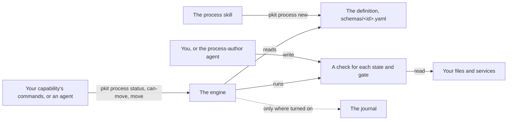

# Processes

A process is a staged, gated journey that your capability defines over its own subjects, such as a page going from draft to published. The backbone's engine runs it: it reads where each subject stands, and checks each gated move. This guide, for a capability's author, says why a capability takes a process, and how to author one, connect it and write its checks. What an agent needs, such as each field of a definition, is in [the process reference](../../.pkit/process/README.md).

## Contents

<!-- pkit:contents -->
- [Why they exist](#why-they-exist)
- [How a process runs](#how-a-process-runs)
- [Give your capability a process](#give-your-capability-a-process)
- [Connect it to another process](#connect-it-to-another-process)
- [Write the checks behind it](#write-the-checks-behind-it)
<!-- /pkit:contents -->

## Why they exist

You want other components to use what your capability does without naming it, and the engine to run and check its processes. Without a shared engine, these things go wrong:

- **You write a state machine around your checks.** Your capability tracks a page from draft to published. Beside the checks of where a page stands, you write the code that picks one position, lists the moves allowed and explains a refusal. The next capability with a staged journey writes it all again.
- **A move goes through that nobody checked.** You declare that publishing needs a review, and the script that checks it is never written. Or the agent that publishes the page also signs its review. Either way the page is published with no review.
- **A process that waits on yours names your capability.** Another capability's announcement waits for your page, and declares so by naming `doc-review`. Replace `doc-review` with a capability that does the same job, and that declaration names a capability that is gone.

### What processes do instead

Processes answer these problems with four claims. The first answers the first problem, the next two the second, and the last the third. The commands after the list prove the first claim, and the tasks the later claims link to prove those.

- **One command writes your process's definition, which validation passes, and the engine then answers where a subject is and which moves it may make.**
- **A check not written yet fails, and the engine refuses each move that rests on it** ([Write the checks behind it](#write-the-checks-behind-it)).
- **A sign-off gate refuses the actor who signed, where your command asks the engine first and names the actor** ([Write the checks behind it](#write-the-checks-behind-it)).
- **A process that waits on yours can name your role, so its definition and package name no capability** ([Connect it to another process](#connect-it-to-another-process)).

Each fence on this page starts from a fresh project where `pkit init` has run, and its files are committed.

Below, you make a capability of your own, and give it a process with two states and a gate. Then you validate it, and ask the engine where the page is and whether it may move:

```console
$ pkit new capability doc-review
Stamped: .pkit/capabilities/doc-review/
$ pkit capabilities register doc-review | grep Registered
  Registered incubated capability 'doc-review' v0.1.0 (in-repo) at .pkit/capabilities/doc-review/
$ pkit process new doc-review:publish --state draft="The page is not published yet." --state published="The page is on the site." --entry draft --terminal published --transition draft:published:publish --gate draft:published:publish:authorisation-artifact
Stamped: .pkit/capabilities/doc-review/schemas/publish.yaml
  stub: publish-detect-draft -> scripts/publish_detect_draft.py  (detection — is the subject at 'draft'?)
  stub: publish-detect-published -> scripts/publish_detect_published.py  (detection — is the subject at 'published'?)
  stub: publish-gate-draft-published-publish -> scripts/publish_gate_draft_published_publish.py  (authorisation-artifact gate — may the subject move 'draft' -> 'published' on 'publish'?)
Next: implement each predicate stub (the process-author agent's territory), then `pkit process status doc-review:publish`.
$ pkit validate | tail -n 1
  All checks passed.
$ pkit process status doc-review:publish
Process doc-review:publish  (subject '_', definition v1)

  Where: indeterminate
    couldn't evaluate 'draft': couldn't evaluate detection predicate 'publish-detect-draft': it exited 1
    couldn't evaluate 'published': couldn't evaluate detection predicate 'publish-detect-published': it exited 1

  How it got here:
    (journal logging is not enabled for this project)

  Legal moves (live precheck):
    (none)
$ pkit process can-move doc-review:publish --to published
  ✗ position is indeterminate — a detection predicate could not be evaluated; refusing to move (fail-closed)
    'draft': couldn't evaluate detection predicate 'publish-detect-draft': it exited 1
    'published': couldn't evaluate detection predicate 'publish-detect-published': it exited 1
```

What the output proves:

- **One command.** The stamp wrote the definition, and one check for each state and for the gate, each a script registered in the capability's package. Validation passes, and `pkit process status` answers where the page is and which moves it may make ([the reference, "Binding a process"](../../.pkit/process/README.md#binding-a-process-how-a-capability-uses-this)).
- **Refused while unwritten.** Every check the stamp wrote fails until someone writes it. So the engine cannot tell where the page is, lists no legal move, and refuses the move ([the engine page, "The predicate runner"](../../.pkit/process/engine.md#the-predicate-runner-engine-contract)). [Write the checks behind it](#write-the-checks-behind-it) shows a gate's own check still unwritten.

### Compared with a state machine in your own scripts

The alternative is your capability's own code: a status kept in a file, and a script that checks each move. That costs no setup, and runs each check as a function call. It can also react to an event the moment it happens. **project-kit's processes add checks that fail closed, sign-off gates that check who signed, and connections by role, as [this page's fences](#what-processes-do-instead) prove:**

| What you need | Your own scripts | project-kit's processes |
| --- | --- | --- |
| Where each subject stands | ❌ A status you store and keep in step | ✅ Read from your files on each call |
| A check not written yet | ❌ Whatever your code does without it | ✅ It fails, and the engine refuses each move resting on it |
| A gate that needs someone else's sign-off | ❌ Your code checks who signed, or does not | ✅ The engine refuses the actor who signed |
| Why a subject is where it is, and what it may do next | ❌ A view you write | ✅ `pkit process status`, as text or as JSON |
| Another process that waits on yours | ❌ It names your code | ✅ It can name your role, and the wiring graph draws the link |
| Setup | ✅ None beyond your code | ❌ A capability of your own, registered, and a script for each check |
| The cost of a check | ✅ A function call | ❌ A program the engine starts on each call, [bounded at 30 seconds](../../.pkit/process/engine.md#the-predicate-runner-engine-contract) |
| Reacting to a change the moment it happens | ✅ Your code can listen for it | ❌ The engine reads only when asked |
| A change someone makes by hand | ✅ Your stored status ignores it until your code moves it | ❌ It moves the subject, past any gate |

### When you do not need one

You do not need a process in these cases:

- **The work has one step.** A command or a skill does it.
- **You must react the moment something changes.** The engine reads only when asked, and fires no event.
- **The tool that holds the subject already enforces its workflow,** such as your tracker's own workflow, and you check nothing beyond it.
- **No script can read the subject's state,** such as a judgment held only in someone's head, or a service with no interface.

### What it does not do

A process checks less than its declarations may suggest:

- **Who may make a move is your command's to enforce.** A transition names who may make it, and the engine checks only its gate ([the engine page, "The operations"](../../.pkit/process/engine.md#the-operations)).
- **An invariant reports, and holds no move.** The status view shows a violation, and no move waits on it ([the shape page, "Invariants"](../../.pkit/process/shape.md#invariants--position-independent-always-checks-core)).
- **No command writes an embedded process, a fold over many, or an open region yet.** The engine runs all three ([the reference, "The authoring layer"](../../.pkit/process/README.md#the-authoring-layer)).

> [!WARNING]
> A gate checks only moves made through the engine. A change made by hand to what the checks read moves the subject past every gate. A sign-off gate compares the signer its check reports with the actor your command names, and trusts both. It holds only where the sign-off is a trace the actor cannot write, such as an approving review ([the reference, "Gate-checkability"](../../.pkit/process/README.md#gate-checkability-the-load-bearing-rule)).

## How a process runs

You declare a process as data in your capability, and write a check for each question it asks. The engine runs both whenever it is asked about a subject:



- **The definition** is data in your capability: its states, the moves between them, and the check behind each question ([the shape page, "The fields"](../../.pkit/process/shape.md#the-fields)).
- **The checks** are scripts your capability registers. The engine runs each with the subject's id, and reads one JSON answer. A check that fails or gives no answer is never a pass ([the engine page, "The predicate runner"](../../.pkit/process/engine.md#the-predicate-runner-engine-contract)).
- **The engine** asks the state checks where the subject is on every call, and keeps no position between calls. Then it asks each gate out of that state whether its move may happen ([the engine page, "The operations"](../../.pkit/process/engine.md#the-operations)).
- **Your capability's commands** ask the engine whether a move may happen before they make the change it stands for, such as publishing the page. Then they record the move. The reference's seam-ordering contract sets that order ([the engine page, "Seam-ordering contract"](../../.pkit/process/engine.md#seam-ordering-contract-journal-as-intent-log)).
- **The journal** records each move where your project turns it on. It is off by default, and nothing the engine decides reads it ([the engine page, "The journal"](../../.pkit/process/engine.md#the-journal--optional-audit-cor-033-point-7)).

## Give your capability a process

Give your capability a process by having your agent run the `process` skill. It asks what you track, and stamps the answers with `pkit process new`, as [the first fence](#what-processes-do-instead) shows ([COR-044](../../.pkit/decisions/core/COR-044-process-authoring-layer.md)). Before you start:

- **Have a capability of your own, registered with your project.** Make one through the `capability-author` skill, and register it with `pkit capabilities register` ([COR-031](../../.pkit/decisions/core/COR-031-capability-origin.md)). The stamp refuses a capability your project does not register, and names the command.
- **Not a capability you receive from elsewhere.** The stamp refuses one whose files your project receives as copies, such as one the methodology ships, and writes nothing. A sync would overwrite what it wrote there.

What the skill asks, and what each answer stamps:

- **What is the subject?** One journey, or many, such as one for each issue. Many is `--cardinality keyed`, and every command on the process then takes the subject's id as `--subject` ([the shape page, "Subject cardinality"](../../.pkit/process/shape.md#subject-cardinality-core)).
- **What does each state mean?** Each `--state` takes an id and a meaning, which `pkit process status` shows. Where two states' checks can both hold, the state declared first is where the subject is ([the shape page, "Position: the precedence rule"](../../.pkit/process/shape.md#position-the-precedence-rule)).
- **Which moves exist?** Each `--transition` names its states, its trigger and who may make it, `user` unless you name another.
- **Which moves need a gate?** Each `--gate` adds a check that must pass before that move. A sign-off is the kind `authorisation-artifact`, and any other check is `deterministic`. A move with no gate has no check at all.
- **Does a subject wait on something, or must something always hold?** `--blocked` declares a wait, and `--invariant` a check that must hold wherever the subject is.

Each check the stamp declares gets a script that fails until it is written ([Write the checks behind it](#write-the-checks-behind-it)). The stamp writes a process only once. It refuses an id the capability already has, and changing a definition's states later is not a command yet ([the reference, "The authoring layer"](../../.pkit/process/README.md#the-authoring-layer)).

## Connect it to another process

Let other capabilities' processes declare that they wait on yours by role, so that none of them names your capability ([COR-053](../../.pkit/decisions/core/COR-053-connection-points.md)). Three steps:

1. **Provide a role, and offer the process under it.** In your capability's `package.yaml`, list the role under `connections.roles`, and the process under `connections.extension-points.offers`. A role is named `<publisher>::<role>`, with your own name as the publisher.
2. **Couple the waiting process to the role.** In the capability that waits, have the `process` skill run `pkit process couple`, with `--upstream` naming the role's process ([COR-038](../../.pkit/decisions/core/COR-038-process-connections.md)).
3. **Refresh the waiting capability's package.** `pkit capabilities refresh` copies the connections into its package, and validation fails until you run it ([the connections page, "The generated `depends-on` list"](../../.pkit/process/connections.md#the-generated-depends-on-list)).

Below, `doc-review` provides the role `acme::review`, and offers its process there, in a `connections` block its new package lacks. A second capability, `site`, couples its announcement to that role, adds a contract that the hand-off happens, and checks the contract:

```console
$ pkit new capability doc-review >/dev/null && pkit capabilities register doc-review >/dev/null
$ pkit process new doc-review:publish --state draft="The page is not published yet." --state published="The page is on the site." --entry draft --terminal published --transition draft:published:publish >/dev/null
$ printf 'connections:\n  roles: [acme::review]\n  extension-points:\n    offers:\n      acme::review:publish:\n        kind: process\n        schema_version: 1\n        process: publish\n        description: A page from draft to published.\n' >> .pkit/capabilities/doc-review/package.yaml
$ pkit new capability site >/dev/null && pkit capabilities register site >/dev/null
$ pkit process new site:announce --state waiting="The announcement waits for the page." --state sent="The announcement is sent." --entry waiting --terminal sent --transition waiting:sent:send >/dev/null
$ pkit process couple site:announce --state waiting --upstream acme::review:publish --relation informational --mode pull --why "The announcement links the published page."
Coupled: site:announce state 'waiting' -> acme::review:publish (informational, pull) in .pkit/capabilities/site/schemas/announce.yaml (definition version unchanged).
Next: `pkit capabilities refresh site` — the generated `depends-on` list in the capability's package.yaml is stale against its process definitions, and `pkit validate` fails until it is regenerated (COR-053 point 4).
$ pkit capabilities refresh site

  Refreshed `connections.extensions.depends-on` in .pkit/capabilities/site/package.yaml: 1 entry(ies) generated from the process definitions' `depends_on`.
    - 'acme::review:publish'
$ pkit validate | tail -n 1
  All checks passed.
$ grep -r "doc-review" .pkit/capabilities/site/schemas .pkit/capabilities/site/package.yaml || echo "site's definition and package name no doc-review"
site's definition and package name no doc-review
$ pkit connections graph
Wiring graph  (configured topology)

  acme::review:publish
    ◇ offered by doc-review:publish  [offers · active]
    ← gated by site:announce  [informational · pull] @waiting

  doc-review:publish
    ◇ offers acme::review:publish  [offers · active]

  site:announce
    → depends on acme::review:publish  [informational · pull] @waiting
$ pkit process hand-off site:announce --upstream acme::review:publish --trigger published --candidates announce-candidates --resolve announce-resolve
Contract declared: acme::review:publish -> site:announce @published in .pkit/capabilities/site/schemas/announce.yaml (version unchanged).
  stub: announce-candidates -> scripts/announce_candidates.py  (implement before relying on the check — it fails closed until then)
  stub: announce-resolve -> scripts/announce_resolve.py  (implement before relying on the check — it fails closed until then)
Next: pkit process health --interpretation-only --process site:announce
$ pkit process health --interpretation-only --process site:announce
Process interpretability  (authoring check — indeterminates only; misses are not counted)

  acme::review:publish → site:announce   @published
    ? contract indeterminate: couldn't evaluate candidates predicate 'announce-candidates': it exited 1; broken-empty is never read as 'nothing missed'
    ? contract indeterminate: the candidates seam 'announce-candidates' is still the scaffolded stub — it fails closed on every subject, so the contract cannot yet tell the truth (implement it and delete the pkit:predicate-stub-unimplemented line)
    ? contract indeterminate: the resolve seam 'announce-resolve' is still the scaffolded stub — it fails closed on every subject, so the contract cannot yet tell the truth (implement it and delete the pkit:predicate-stub-unimplemented line)

  3 indeterminate (misses not counted)
```

- **The role, not the capability.** Neither the announcement's definition nor `site`'s package names `doc-review`. The wiring graph shows the connection reaching `doc-review`'s process through the role, as its active provider.
- **Whichever capability provides the role.** A connection by role reaches the process that the role's active provider offers at that point ([the connections page, "Addressing an upstream by role"](../../.pkit/process/connections.md#addressing-an-upstream-by-role)).
- **The connection makes nothing wait.** The engine never reads it, and it moves no subject. A gate of the announcement's own, with a check you write, makes it wait for the page. The connection's relation is then `gates-on-readiness` ([the connections page, "The relations"](../../.pkit/process/connections.md#the-relations)).
- **Mark a connection mandatory** with `--mandatory <reason>`, where the upstream must exist. Installing or upgrading the waiting capability is then refused while it is missing ([the connections page, "The mandatory mark"](../../.pkit/process/connections.md#the-mandatory-mark)).
- **A hand-off contract** asks whether each upstream subject at its trigger has a counterpart downstream ([COR-042](../../.pkit/decisions/core/COR-042-process-health.md)). It adds two checks to write. Until they are written, the health check reports the contract indeterminate, as the fence shows, and `pkit process health` reports each hand-off missed.
- **Embedding and folding are by name.** A process that embeds another runs it by its capability's name, and so does a fold over many ([COR-036](../../.pkit/decisions/core/COR-036-process-composition.md), [COR-037](../../.pkit/decisions/core/COR-037-process-cascade.md)). Only a connection may name a role.

## Write the checks behind it

Write each check as a short script that reads your files and prints one JSON answer. Your agent writes them as the `process-author` agent, once you grant it the files ([COR-044](../../.pkit/decisions/core/COR-044-process-authoring-layer.md)):

- **Grant the files.** List your definition and its scripts under `process-authoring-targets` in your agents' overlay. Your next `pkit sync` deploys the agent with them ([the agents reference, "Write-carrying categories"](../../.pkit/agents/README.md#write-carrying-categories)).
- **Until you grant them,** the list ships empty, and the agent only says what it would write, for you to write. An overlay from before the list has no such key, so no `process-author` agent is deployed until `pkit agents reconcile --write` adds the empty list.
- **What a check answers.** A state's check prints `{"result": true}` when the subject is in that state, and `false` when not. A sign-off gate prints whether the sign-off exists, and who produced it. Each adds a `reason`.
- **What a check never does:** write anything. `pkit process status` runs your checks live on each call.
- **Answer with JSON's `true` and `false`.** The engine reads any other value by its truth, so the string `"false"` reads as true ([the engine page, "The predicate runner"](../../.pkit/process/engine.md#the-predicate-runner-engine-contract)).

Below, you write the checks of the first fence by hand, the states' first. The page is published once `public/plan.md` exists, and `review.txt` holds the login of whoever signed the review:

```console
$ pkit new capability doc-review >/dev/null && pkit capabilities register doc-review >/dev/null
$ pkit process new doc-review:publish --state draft="The page is not published yet." --state published="The page is on the site." --entry draft --terminal published --transition draft:published:publish --gate draft:published:publish:authorisation-artifact >/dev/null
$ cd .pkit/capabilities/doc-review/scripts
$ printf '#!/usr/bin/env python3\nimport json, os\nhere = os.path.exists("public/plan.md")\nprint(json.dumps({"result": not here, "reason": "public/plan.md exists" if here else "public/plan.md is absent"}))\n' > publish_detect_draft.py
$ printf '#!/usr/bin/env python3\nimport json, os\nhere = os.path.exists("public/plan.md")\nprint(json.dumps({"result": here, "reason": "public/plan.md exists" if here else "public/plan.md is absent"}))\n' > publish_detect_published.py
$ cd ../../../..
$ pkit process status doc-review:publish
Process doc-review:publish  (subject '_', definition v1)

  Where: draft — The page is not published yet.

  How it got here:
    (journal logging is not enabled for this project)

  Legal moves (live precheck):
    ? published  [publish]
        couldn't evaluate gate predicate 'publish-gate-draft-published-publish': it exited 1
$ pkit process can-move doc-review:publish --to published
  ✗ gate refused: couldn't evaluate gate predicate 'publish-gate-draft-published-publish': it exited 1
$ printf '#!/usr/bin/env python3\nimport json, os\nsigned = os.path.exists("review.txt")\nprint(json.dumps({"exists": signed, "produced_by": open("review.txt").read().strip() if signed else None, "reason": "review.txt"}))\n' > .pkit/capabilities/doc-review/scripts/publish_gate_draft_published_publish.py
$ echo ana > review.txt
$ pkit process can-move doc-review:publish --to published --actor ana
  ✗ gate refused: authorisation artifact was produced by the actor being gated ('ana'); cross-authority requires a different authority
$ pkit process can-move doc-review:publish --to published --actor bob
  ✓ move to 'published' permitted: authorised by 'ana' (cross-authority)
$ mkdir public && echo "# Plan" > public/plan.md
$ pkit process status doc-review:publish
Process doc-review:publish  (subject '_', definition v1)

  Where: published — The page is on the site.
    (terminal state)

  How it got here:
    (journal logging is not enabled for this project)

  Legal moves (live precheck):
    (none)
```

What the output proves:

- **An unwritten gate refuses its move.** With the state checks written, the engine placed the page at `draft`. It refused the move to `published`, whose gate check still failed.
- **A sign-off refuses its signer.** With `ana`'s sign-off in place, the gate refused `ana`, and permitted the move to `bob`.
- **The file shows the rule, not a guarantee.** Any actor can write `review.txt`. A real gate reads a sign-off its actor cannot write, such as an approving review on the pull request.
- **The engine reads your files.** Once `public/plan.md` existed, the engine placed the page at `published`, with no move made through it, as the warning above says.

Check your work as you go:

- **`pkit validate`** passes the definition whether or not its checks are written, as the first fence shows. `pkit process status` and `pkit process can-move` show whether they answer.
- **An unwritten gate refuses only its own move.** The subject's other moves stay open, each on its own gate, or on none.
- **Name the actor on every call.** `pkit process status` and `pkit process can-move` check gates as `operator` unless given `--actor`, and `pkit process move` as your `gh` login. Name one actor on each, or they can disagree ([the engine page, "The operations"](../../.pkit/process/engine.md#the-operations)).
