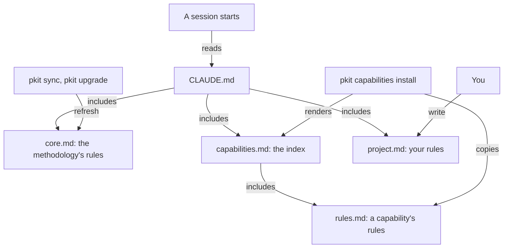

# Operational rules

Operational rules are the instructions an agent session reads at its start, through your `CLAUDE.md`: the methodology's, each installed capability's, and your own. This guide says why they exist and how they reach a session, and then gives your tasks with them. What an agent needs to work with them, such as where each file is kept, is in [the rules reference](../../.pkit/rules/README.md).

## Contents

<!-- pkit:contents -->
- [Why they exist](#why-they-exist)
- [How the rules reach a session](#how-the-rules-reach-a-session)
- [Start every session with the rules loaded](#start-every-session-with-the-rules-loaded)
- [Add your own rules](#add-your-own-rules)
- [Have a capability's rules reach each session](#have-a-capabilitys-rules-reach-each-session)
- [Keep each rules file within its budget](#keep-each-rules-file-within-its-budget)
<!-- /pkit:contents -->

## Why they exist

An agent keeps nothing between sessions but what the repository holds. Without rule files that every session reads, and that update without touching yours, these things go wrong:

- **Each session starts without your conventions.** A convention you gave an agent yesterday, such as running the tests before each commit, is not in today's session. So today's agent commits untested.
- **An update of rules shared across projects overwrites your own.** You add a rule to the shared file, and the next update replaces the file with its newer version. So you stop taking updates, or add your rules again after each one.
- **A discipline's rules are copied in and out by hand.** A work tracker's rule, such as naming each issue a pull request closes, is written again in each project that uses the tracker. A project that drops the tracker keeps the rule until someone deletes it.

### What the rules do instead

The operational rules answer these problems with the first three claims below, and the fourth adds a count of what each session reads. Each fence on this page starts from a fresh project where `pkit init` has run, so try them in a scratch project: they overwrite `project.md`.

- **Your `CLAUDE.md` includes the methodology's rules, each installed capability's and yours, through three lines `pkit init` writes there.**
- **An upgrade brings the methodology's newer rules, and never writes yours.**
- **A capability's rules arrive with its install, which names each rule it newly binds, and your `CLAUDE.md` stays as it was.**
- **`pkit validate` counts the words of each rules file, and fails yours once it passes the budget you set.** The last task proves it ([Keep each rules file within its budget](#keep-each-rules-file-within-its-budget)).

Below, you install project-management, a capability that ships rules:

```console
$ grep @.pkit CLAUDE.md
@.pkit/rules/core.md
@.pkit/rules/capabilities.md
@.pkit/rules/project.md
$ pkit capabilities install project-management | grep -e "first delivered" -e RS-PM-001 -e rules/capabilities
    project-management:PM <any> (first delivered):
      binds    RS-PM-001  A pull request names each issue it closes
  rendered     .pkit/rules/capabilities.md (1 capability file(s): project-management)
$ cat .pkit/rules/capabilities.md
<!-- pkit: the capabilities' rules index, rendered by the backbone from the installed capabilities' loaded rule sets at each install, sync and upgrade. Do not edit it. -->
@../capabilities/project-management/rules.md
$ git diff --quiet CLAUDE.md && echo "CLAUDE.md unchanged"
CLAUDE.md unchanged
```

Below, `uvx`, which comes with uv, fetches release 1.134.0 from GitHub and sets up a project with it. You write a rule of your own, and then upgrade:

```console
$ git init -q older-project && cd older-project
$ uvx -q --from git+https://github.com/aleskalfas/project-kit.git@v1.134.0 pkit init >/dev/null 2>&1
$ printf '## Tests\n\n1. **Run `make test` before each commit.**\n' > .pkit/rules/project.md
$ pkit upgrade | grep -e "^Upgrading" -e "refreshed    .pkit/rules/core.md" -e "backbone:OPS" -e RS-OPS-001 -e "^Pinned"
Upgrading backbone: 1.134.0 -> <VERSION>
  refreshed    .pkit/rules/core.md
    backbone:OPS <any> (first delivered):
      binds    RS-OPS-001  The no-shared-files invariant
Pinned project-kit to <VERSION> (.pkit/version-pin).
$ tail -n 1 .pkit/rules/project.md
1. **Run `make test` before each commit.**
```

What the output proves, claim by claim:

- **Included.** `CLAUDE.md`'s three lines include the methodology's rules, the index of the installed capabilities' rules, and yours. Claude Code reads the files a `CLAUDE.md` includes when a session starts, and the files those include ([its memory docs](https://code.claude.com/docs/en/memory)).
- **Upgraded, yours kept.** The upgrade copies the newer `core.md`, and names each rule it newly binds. `project.md` holds your rule as you wrote it, since no sync or upgrade writes `project.md` ([the reference, "Layout"](../../.pkit/rules/README.md#layout)).
- **With the install.** The install names the rule it newly binds, and adds the capability's file to the index. `CLAUDE.md` already includes the index, so it needs no edit. Uninstalling takes the file out of the index again ([the third task](#have-a-capabilitys-rules-reach-each-session)).

> [!WARNING]
> A rule binds only on a session that reads its file, and nothing checks that a session did. Some kinds of session read none of them, such as Claude Code's built-in Explore and Plan agents. Nobody has yet seen a session hold a capability's rules read through the index ([the adapter's README, "Harness support"](../../.pkit/adapters/claude-code/README.md#harness-support-harness-supportyaml)).

### Compared with rules kept by hand

Without the operational rules, you keep your agents' rules in `CLAUDE.md` by hand, and Claude Code reads them all the same. That is better on setup, on freedom of form and on what each session reads. **The operational rules add updates that keep your own rules, a discipline's rules with the discipline, and a word count, as this page's fences prove:**

| What you need | Rules kept in `CLAUDE.md` by hand | The operational rules |
| --- | --- | --- |
| Rules in each session that reads `CLAUDE.md` | ✅ Claude Code reads `CLAUDE.md` | ✅ The same, through three include lines |
| A newer version of the methodology's rules, with yours kept | ❌ You merge the new text with your edits by hand | ✅ An upgrade copies the newer `core.md`, and never writes `project.md` |
| A discipline's rules with the discipline | ❌ Copied in, and deleted, by hand | ✅ Installed and uninstalled with the capability |
| What an update newly binds | ❌ You compare the texts yourself | ✅ Install, sync and upgrade list each rule |
| A citation of a methodology rule that is gone | ❌ Nothing checks it | ✅ `pkit validate` warns of it |
| The words each session reads | ❌ Nothing counts them | ✅ `pkit validate` counts each file against its budget |
| Setup | ✅ None | ❌ `pkit init` |
| Freedom of form | ✅ Any rule, in any form | ❌ The methodology's rules are fixed: you add to them, never loosen them |
| What each session reads | ✅ Your rules alone | ❌ The methodology's rules too, within their budget |

### When you do not need it

Each session of a project that installs project-kit reads the methodology's rules. You do not need the operational rules, or a rule of your own, in these cases:

- **You want each session to read your instructions alone.** project-kit's sessions read the methodology's rules too. Keep your rules in `CLAUDE.md` by hand, as the comparison above credits.
- **The rule is about your files, not about what a session does.** Keep it in a rule set, which binds only on the files its scope selects ([the reference, "Which file a rule goes in"](../../.pkit/rules/README.md#which-file-a-rule-goes-in)).
- **What you write is context, not a rule, such as what the project is and how to build it.** Write it in `CLAUDE.md`'s own text, which a sync keeps as you wrote it.
- **It is a procedure for one task.** Every session reads each rule whole, and a task's procedure belongs in a skill ([COR-006](../../.pkit/decisions/core/COR-006-artifact-roles.md)).

## How the rules reach a session

`CLAUDE.md` includes three files of `.pkit/rules/`, one for each layer of rules, and Claude Code reads them when a session starts. Each layer's file has its own owner, and only yours is written by you:



- **The methodology's rules,** `core.md`. Each sync refreshes it to the version your project records, and an upgrade moves it to a newer one. It is generated from the methodology's rule set, where each rule has an id for good. Core rule 19 is `backbone:RS-OPS-019` ([the reference, "Where the rules are kept"](../../.pkit/rules/README.md#where-the-rules-are-kept)).
- **A capability's rules,** `rules.md` in its folder under `.pkit/capabilities/`, where it ships any. They arrive with its install, and are cited by id with the capability's name, such as `project-management:RS-PM-001` ([the reference, "A capability's rules"](../../.pkit/rules/README.md#a-capabilitys-rules)).
- **The index,** `capabilities.md`. It includes each installed capability's file, and each install, sync, upgrade and uninstall renders it again. Nobody edits it ([the reference, "The capabilities' rules index"](../../.pkit/rules/README.md#the-capabilities-rules-index)).
- **Your rules,** `project.md`. `pkit init` does not create it, and Claude Code skips the include of a missing file. Once you write it, no sync or upgrade writes it ([the reference, "Layout"](../../.pkit/rules/README.md#layout)).
- **`CLAUDE.md`** includes the three, in that order. A sync puts back a line that is missing, as the first task shows.
- **How the layers stand.** Every layer's rules bind at once, and a capability's and yours add to the methodology's, never loosening them. Where two cannot both be kept, the upper layer's binds: the methodology's above a capability's, and both above yours. Where two capabilities' rules clash, the session stops the step and reports it ([COR-070](../../.pkit/decisions/core/COR-070-capability-loaded-rules.md) point 4).

## Start every session with the rules loaded

Run `pkit sync` in each clone after you pull a change. It puts in place what the clone's sessions read: `core.md` at the version your project records, the index, and `CLAUDE.md`'s lines. What it does, and what you keep yourself:

- **What it adds to `CLAUDE.md`.** It puts back a missing line of the methodology's rules or of the index, and removes nothing. Your own rules' line comes back only with the methodology's. Without a `CLAUDE.md`, the sync creates one with a heading and the three lines ([the adapter's README, `merge-claude-md.sh`](../../.pkit/adapters/claude-code/README.md#merge-claude-mdsh)).
- **When it adds nothing.** Where the methodology's line stands only in a code fence or a code span, the sync inserts nothing and reports it. Move the line out of the code.
- **What it says.** It names each rule it newly binds, changes or retires. That is information, and stops nothing ([the lifecycle reference, "What a step newly binds"](../../.pkit/lifecycle/README.md#what-a-step-newly-binds)).
- **When it stops.** Where your `pkit` is at another version than your project records, sync stops before it writes, and names the remedy ([the CLI reference, `sync`](../../.pkit/cli/README.md#sync)).
- **What you keep.** Keep `CLAUDE.md` and the index out of Claude Code's `claudeMdExcludes`, and approve the imports where a session starts below the project's root. Otherwise those sessions read no rules ([the adapter's README, "Harness support"](../../.pkit/adapters/claude-code/README.md#harness-support-harness-supportyaml)).

Below, a hand edit has taken the index's line out of `CLAUDE.md`. `pkit validate` reports that sessions read no capability's rules. `pkit sync --dry-run` names the script that merges `CLAUDE.md`, and the sync puts the line back:

```console
$ grep -v capabilities.md CLAUDE.md > CLAUDE.new && mv CLAUDE.new CLAUDE.md
$ pkit validate | grep -A1 loaded-rules-undelivered
    error    CLAUDE.md  [loaded-rules-undelivered]
      → CLAUDE.md does not hold the line `@.pkit/rules/capabilities.md` that reaches .pkit/rules/capabilities.md, so a session loads no capability's rules (claude-code; COR-070 point 6). The next `pkit sync` inserts it.
$ pkit sync --dry-run | grep merge-claude-md
  would run    .pkit/adapters/claude-code/merge-claude-md.sh
$ pkit sync | grep CLAUDE.md
  insert     CLAUDE.md (@.pkit/rules/capabilities.md added after @.pkit/rules/core.md)
$ grep @.pkit CLAUDE.md
@.pkit/rules/core.md
@.pkit/rules/capabilities.md
@.pkit/rules/project.md
```

> [!WARNING]
> `pkit validate` checks only the index's line, so a `CLAUDE.md` without the methodology's line passes it. The next sync then adds all three lines again, and the index's line and yours stand twice. Delete the second copies by hand.

## Add your own rules

Write your project's own rules in `project.md`, in `.pkit/rules/`. `CLAUDE.md` already includes it after the methodology's rules and the index, so nothing else needs to change. What a rule there holds, and may do:

- **Its form.** Start its sections at the second level, with no first-level heading, since `CLAUDE.md` holds the heading they sit under (core rule 13). Keep each rule to what it requires, and point to where its reason is. Write no bare `@name` outside code, since Claude Code may read it as an include. Nothing checks a plain `project.md` for one ([the reference, "Which file a rule goes in"](../../.pkit/rules/README.md#which-file-a-rule-goes-in)).
- **What a rule may not do.** A rule of yours never loosens one of the methodology's or of a capability's. Where yours cannot be kept with theirs, theirs binds. To get less, propose the change where their rule is kept, or uninstall the capability.
- **Citing a rule.** Cite one of the methodology's as "core rule 19" or `backbone:RS-OPS-019`, and `pkit validate` warns where none of that number is in force. Cite one of yours as "project rule 4", which nothing checks while `project.md` is a plain file ([COR-068](../../.pkit/decisions/core/COR-068-loaded-rule-sets.md) point 7).
- **Rules already in `CLAUDE.md`** may move into `project.md`, where `pkit rule-sets loaded` lists them and a budget can bound them.
- **Note:** you may later turn `project.md` into a loaded rule set of your own, with an id and an origin for each rule. The reference says how ([its "Converting `project.md` into a loaded set"](../../.pkit/rules/README.md#converting-projectmd-into-a-loaded-set)).

Below, your rule cites a core rule that does not exist. `pkit rule-sets loaded` lists your file beside the methodology's, and validation warns of the citation:

```console
$ printf '## Tests\n\n1. **Run `make test` before each commit, as core rule 99 asks.**\n' > .pkit/rules/project.md
$ pkit rule-sets loaded
Loaded files — 2   (every layer's, in the order a session reads them)

  backbone  backbone  .pkit/rules/core.md     backbone:OPS (.pkit/rule-sets/ops.md)
  project   project   .pkit/rules/project.md  a plain file
$ pkit validate | grep -B1 "core rule 99"
    warning  .pkit/rules/project.md:3
      → 'core rule 99' cites core rule 99, which backbone:OPS (.pkit/rule-sets/ops.md) does not hold: a citation by layer and number names the rule of that id, backbone:RS-OPS-099 (COR-068 point 6).
```

## Have a capability's rules reach each session

Install the capability, and its rules reach every session that reads `CLAUDE.md` from then on, with no edit of yours. Installing it is your consent to its rules, so nothing asks you to accept them again ([COR-070](../../.pkit/decisions/core/COR-070-capability-loaded-rules.md) point 3):

- **The install** copies the capability with its rules file, and renders the index again. It names each rule it newly binds, as the first fence on this page shows. Neither its dry run nor `pkit capabilities show` lists the rules yet.
- **A later version.** An upgrade of the capability names each of its rules that it newly binds, changes or retires.
- **No opt-out.** While the capability is installed, no setting of project-kit's keeps its rules away.
- **A rule you kept yourself.** Where a capability you install ships a rule your `project.md` held, you may delete or shorten yours, keeping what holds only in your project.
- **The uninstall** renders the index again without the capability's file. Today it refuses while the capability's own deployed agents cite its records, so the fence below shows the refusal, then passes `--force`. `--force` also skips the checks of what depends on the capability ([the lifecycle reference, "Uninstall"](../../.pkit/lifecycle/README.md#uninstall-origin-aware-removal-cor-031-d4)).

Below, `pkit rule-sets loaded` lists the files a session reads, in their order, before and after the uninstall:

```console
$ pkit capabilities install project-management >/dev/null 2>&1
$ pkit rule-sets loaded
Loaded files — 2   (every layer's, in the order a session reads them)

  backbone    backbone            .pkit/rules/core.md                             backbone:OPS (.pkit/rule-sets/ops.md)
  capability  project-management  .pkit/capabilities/project-management/rules.md  project-management:PM (.pkit/capabilities/project-management/rule-sets/pm.md)
$ pkit capabilities uninstall project-management 2>&1 | grep Refusing
  Refusing to uninstall 'project-management': <any> reference(s) found:
$ pkit capabilities uninstall project-management --force | grep -e Removed -e rules/capabilities
  Removed capability 'project-management' from .pkit/capabilities/project-management
  rendered     .pkit/rules/capabilities.md (0 capability file(s))
$ pkit rule-sets loaded
Loaded files — 1   (every layer's, in the order a session reads them)

  backbone  backbone  .pkit/rules/core.md  backbone:OPS (.pkit/rule-sets/ops.md)
```

## Keep each rules file within its budget

Each rules file may have a budget, the most words it may hold, and `pkit validate` reports each file's count against it. Every session reads each rules file whole, so each word in one is paid for in every session. Who keeps each budget, and what it asks of you:

- **The methodology's file and each capability's** have budgets their authors keep. You see their counts, and are never failed for them.
- **Yours** takes its budget from `rule-sets.plain-file-budget` in your project's configuration, while `project.md` is a plain file. Without the key it has none, and nothing fails. No install or upgrade sets it.
- **Past its budget,** your file fails `pkit validate`, which says to trim the file or bring the raise to the person who authorises the change.
- **A raise is yours to make.** Your agents trim the file rather than raise its budget, and bring a raise to you. `pkit rule-sets altered` lists a raised budget, so whoever reviews the change sees it ([the CLI reference, `rule-sets altered`](../../.pkit/cli/README.md#rule-sets-altered---base-ref---head-rev---json)).
- **Lowering it** is any change's to make. A budget is a ceiling, not a target ([the reference, "Each rules file's budget"](../../.pkit/rules/README.md#each-rules-files-budget)).

Below, your file holds nine words beside the methodology's. A budget of five fails validation, which exits 1:

```console
$ printf '## Tests\n\n1. **Run `make test` before each commit.**\n' > .pkit/rules/project.md
$ pkit validate | grep "rules file"
    rules file .pkit/rules/core.md: <any> word(s), budget <any>, <any> to spare.
    rules file .pkit/rules/project.md: 9 word(s), no budget.
$ pkit config set rule-sets.plain-file-budget 5 --yes
set rule-sets.plain-file-budget = 5  (.pkit/project/config.yaml)
$ pkit validate | grep -e "project.md:" -e "error " -e "→ the rules"
    rules file .pkit/rules/project.md: 9 word(s), budget 5, 4 over.
    error    .pkit/rules/project.md
      → the rules file holds 9 words, 4 past its budget of 5, set as `rule-sets.plain-file-budget` in .pkit/project/config.yaml. Every session loads the file whole, and raising a budget is a person's decision (COR-069 point 4): trim the file, or bring the raise to the person who authorises the change.
$ pkit validate >/dev/null; echo $?
1
```

How a word is counted is the CLI reference's ([`validate`](../../.pkit/cli/README.md#validate)).
