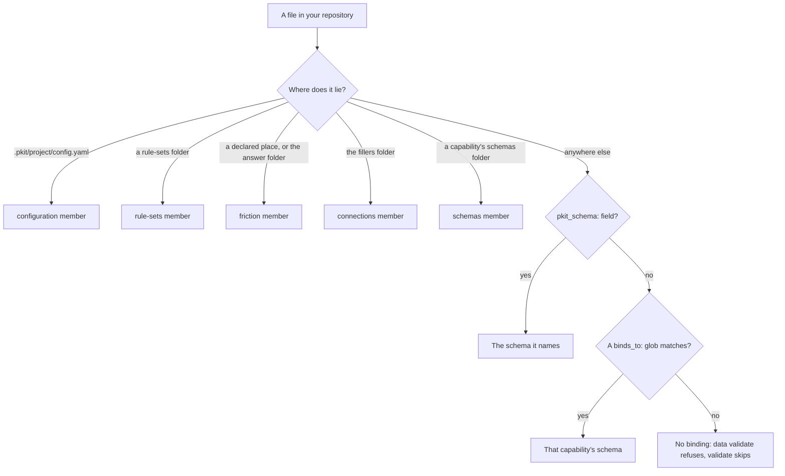

# Schemas

A schema is a YAML file paired with a JSON Schema file, its companion, that says what the YAML may hold. project-kit checks your configuration, your rule sets and your capability's data against their schemas. This guide is for the adopter who sets up a project, the developer who writes its rule sets, and the author of a capability. It says why schemas exist, then how to do each task with them.

What an agent needs to work with schemas, such as their conventions and every key of each file, is in [the schemas reference](../../.pkit/schemas/README.md).

## Contents

<!-- pkit:contents -->
- [Why they exist](#why-they-exist)
- [Which check reads a file](#which-check-reads-a-file)
- [Declare your backbone configuration](#declare-your-backbone-configuration)
- [Write a rule set of your own](#write-a-rule-set-of-your-own)
- [Give your capability's data a schema](#give-your-capabilitys-data-a-schema)
<!-- /pkit:contents -->

## Why they exist

Configuration and data written by hand are read by code that cannot ask what you meant. Without a schema that says what each file may hold, these things go wrong:

- **A misspelt key in your configuration is read as nothing.** You write `doc:` for `docs:` to move your documentation root. Every command keeps the default root, and nothing tells you.
- **A value no command can use gets written.** You set `friction.mode` to `loud`. The file holds it until a command reads it and fails, or falls back to a default.
- **A misspelt key in your own rule set drops what it said.** You write `scpoe:` for `scope:`. The set's rules then reach no file, and nothing tells you.
- **Your capability's rules live in its scripts' code.** Each change to a rule is a change to code. A file a user of your capability writes is checked only where your code thinks to check it.

### What schemas do instead

Schemas answer these problems with the four claims below. The first fence proves the first three, and the last task's fence proves the fourth.

- **`pkit config set` refuses a value your configuration's schema refuses, and writes nothing.**
- **When `pkit config set` creates your configuration file, it writes the line that editors which read JSON Schema use to check the file as you type.**
- **`pkit validate` fails a misspelt key in your configuration or your rule set, and names the key you meant.**
- **`pkit data validate` checks a file your capability's users write against your capability's schema** ([Give your capability's data a schema](#give-your-capabilitys-data-a-schema)).

Each fence on this page starts from a fresh project where `pkit init` has run.

Below, you set the friction mode to a value its schema refuses, then to one it takes. Then you add a misspelt key by hand:

```console
$ pkit config set friction.mode loud
Error: refusing to write .pkit/project/config.yaml: the result would not validate against the backbone configuration schema. Nothing was written.
  /friction/mode: 'loud' is not one of ['warning', 'enforcing']
$ test -e .pkit/project/config.yaml || echo "no file written"
no file written
$ pkit config set friction.mode enforcing --yes
set friction.mode = enforcing  (.pkit/project/config.yaml)
$ head -n 1 .pkit/project/config.yaml
# yaml-language-server: $schema=../schemas/backbone/config.schema.json
$ printf 'doc:\n  internal: handbook/\n' >> .pkit/project/config.yaml
$ pkit validate | grep -A1 config.yaml:/doc
    error    .pkit/project/config.yaml:/doc
      → unknown key 'doc'; did you mean 'docs'?
```

What the output proves, claim by claim:

- **Refused, nothing written.** The command judged the whole result against the configuration's schema before it asked anything, and wrote no file ([the CLI reference, "config set"](../../.pkit/cli/README.md#config-set-key-value---yes)).
- **The editor's line.** The first line of the file it created names the schema. The YAML Language Server, which editors such as VS Code use, reads a line of that form ([the reference, "Tooling expectations"](../../.pkit/schemas/README.md#tooling-expectations)).
- **Named.** Validation fails on the unknown key, and names the nearest known one. Every file the backbone checks gets the same message, your rule sets included ([the reference's page on backbone files](../../.pkit/schemas/backbone-files.md#what-holds-for-every-backbone-file-schema)).

### Compared with YAML your code reads unchecked

Your configuration and your rule sets always have their schemas, so this comparison is for the author of a capability. The alternative is a plain YAML file that your capability's scripts read, with no companion. That needs no setup, and keeps one file where a schema keeps two. **A schema adds a check of every key and value, and of the data your users write, as [this page's fences](#what-schemas-do-instead) prove:**

| What you need | YAML your code reads unchecked | A schema pair |
| --- | --- | --- |
| A misspelt key caught | ❌ Read as missing, so a default applies silently | ✅ Validation fails, and names the key you meant |
| A value of the wrong type caught | ❌ Found when your code fails on it, if it does | ✅ Validation fails, naming the field |
| A user's data file checked | ❌ Only where your code checks it | ✅ `pkit data validate` checks it against your schema |
| Setup | ✅ None | ❌ A companion to write, and `pkit new schema` to stamp the pair |
| Files to keep | ✅ One | ❌ Two, the data and its companion |
| Adding a field | ✅ Edit the YAML and your code | ❌ Edit the companion too |

### When you do not need one

You do not need a schema of your own in these cases:

- **The content is a principle, a reason or a judgement,** such as when a rule applies. It belongs in prose, such as a decision record ([the decision records' guide](../decisions/README.md)).
- **No code reads it.** A schema is worth what a check or a script makes of it. A file only people read gains a second file to keep.
- **One script reads it, and you want to change the two together.** Keep the YAML unchecked, as the comparison above credits.

## Which check reads a file

Each file the backbone checks finds its schema by where it lies, and one member of `pkit validate` reads it. A data file your capability's users write is different: it names its schema, or a glob in the schema names it.



- **Backbone files.** Each has a schema the backbone ships: your configuration, your rule sets, and the friction block in a document's front matter. So do your answer files and your filler files. Where the file lies binds it, and no field in it does ([the reference's page on backbone files](../../.pkit/schemas/backbone-files.md#what-holds-for-every-backbone-file-schema)).
- **A capability's own schemas.** Each is a pair in the capability's `schemas/` folder, the YAML and its companion. `pkit schemas validate` checks every pair, and so does `pkit validate`'s `schemas` member ([the reference, "The schema is a pair"](../../.pkit/schemas/README.md#the-schema-is-a-pair)).
- **Data files.** A file's `pkit_schema:` field wins. Without it, a `binds_to:` glob in an installed capability's schema may claim the file ([the reference's page on binding, "Resolution order"](../../.pkit/schemas/data-binding.md#resolution-order)).
- **No binding.** Named to `pkit data validate`, a file nothing binds is refused. `pkit validate`'s `data` member skips it, since it is no data of a capability ([the CLI reference, "data validate"](../../.pkit/cli/README.md#data-validate-path)).

## Declare your backbone configuration

Your project's backbone configuration is one file, `.pkit/project/config.yaml`, which you write and no sync touches. It holds such settings as your default branch, your documentation roots and where your documents lie. The CLI reference lists every key ([its "Configuration file"](../../.pkit/cli/README.md#configuration-file)). How you write each kind of key, and how it is checked:

- **A key that holds one value:** set it with `pkit config set`. The command checks the whole result against the schema first, then asks before it writes. Off a terminal it needs `--yes`.
- **A key that holds a list,** such as your places, `friction.places`: write it in the file by hand. `pkit config set` refuses it, and names the file.
- **The check:** `pkit validate` reads the whole file in its `configuration` member. It fails on an unknown key or a value the schema refuses, and warns of a place that matches nothing.
- **No file:** without the file, every key takes its default, and validation passes.

Below, you make friction enforcing and declare your documents' folder as a place. Validation warns until the folder holds a file:

```console
$ pkit config set friction.mode enforcing --yes
set friction.mode = enforcing  (.pkit/project/config.yaml)
$ pkit config set friction.places docs --yes
Error: key 'friction.places' holds a list, not a single value; `config set` sets scalars only. Edit the file directly (.pkit/project/config.yaml).
$ printf '  places: [docs/**]\n' >> .pkit/project/config.yaml
$ cat .pkit/project/config.yaml
# yaml-language-server: $schema=../schemas/backbone/config.schema.json
friction:
  mode: enforcing
  places: [docs/**]
$ pkit validate | grep -A2 "config.yaml: "
    .pkit/project/config.yaml: 1 warning.
    warning  .pkit/project/config.yaml:/friction/places/0
      → friction pattern 'docs/**' matches nothing in the repository; a dead pattern keeps silence looking like health (COR-050 point 12).
$ mkdir docs && printf '# Start\n' > docs/start.md
$ pkit validate | grep "config.yaml: "
    .pkit/project/config.yaml: valid.
```

## Write a rule set of your own

A rule set is a Markdown file of rules, each with an id, that binds on the files its scope selects. You write your own in `rule-sets/` under your internal documentation root, `docs/rule-sets/` unless you set `docs.internal` ([the first task](#declare-your-backbone-configuration)). This task covers the file's schema. What a rule set is, and how its rules bind, are in [the reference, "Rule-set files"](../../.pkit/schemas/README.md#rule-set-files).

- **Where it lies decides it.** A Markdown file in that folder is a rule set, and nothing in the file says so. A sync never reads or writes it.
- **Its front matter** holds the set's name, its own version, its scope and each rule's fields, such as its status and its origin. The reference's page on backbone files gives every key ([its "Rule-set files"](../../.pkit/schemas/backbone-files.md#rule-set-files)).
- **Its body** holds one section for each rule, headed by the rule's id and title, such as `## RS-STYLE-001 — Answer first`.
- **The check:** `pkit validate` reads every rule set in its `rule-sets` member. It fails on an unknown key, naming the nearest known one. It also fails an accepted rule with no origin, and a rule with no section.

Below, you write a rule set with `scope` misspelt. Validation names the fix, and passes once it is made:

```console
$ mkdir -p docs/rule-sets
$ printf '%s\n' --- 'rule-set: STYLE' 'version: 1.0.0' 'scpoe: [docs/**]' 'rules:' '  RS-STYLE-001:' '    status: accepted' '    origin: {date: 2026-11-03, by: A. Person, why: "Readers skim."}' --- '' '## RS-STYLE-001 — Answer first' '' 'Open each page with its answer.' > docs/rule-sets/style.md
$ pkit validate | grep -A1 style.md
    error    docs/rule-sets/style.md:/scpoe
      → unknown key 'scpoe'; did you mean 'scope'?
$ sed 's/scpoe/scope/' docs/rule-sets/style.md > style.md && mv style.md docs/rule-sets/style.md
$ pkit validate | grep "rule set(s)"
    2 rule set(s), <any> rule(s) (<any> accepted); 0 error(s), 0 report(s).
```

## Give your capability's data a schema

A capability's rules and data, such as the states a process moves through, live in schemas in its `schemas/` folder. Its scripts read them at runtime ([COR-018](../../.pkit/decisions/core/COR-018-capability-schemas.md)). So a change to a rule is a change to data, and `pkit schemas validate` checks it.

Where your capability's users write files of their own, the same schema checks theirs. The steps:

- **Stamp the pair:** `pkit new schema <capability> <name>` writes `<name>.yaml` and its companion, `<name>.schema.json`. With `--no-namespace` it stamps the schema of one document, and without it a collection of entries with ids ([the CLI reference, "new schema"](../../.pkit/cli/README.md#new-schema-owner-name---collection-form-form---collection-name-key---no-namespace)).
- **Declare the fields** in the companion's `properties`. Declare `pkit_schema` there too, where your users' files carry that field.
- **Check the pair:** `pkit schemas validate` checks every pair against its companion, and every reference between them ([the CLI reference, "schemas validate"](../../.pkit/cli/README.md#schemas-validate-path)).
- **Bind your users' files:** a user's file names your schema in its `pkit_schema:` field. Or your schema's YAML lists globs of the files it judges, under `binds_to:` ([the reference's page on binding](../../.pkit/schemas/data-binding.md#2-per-schema-binds_to-fallback)). A glob binds only once the capability is installed or registered.
- **Check their files:** `pkit data validate <path>` checks each file under the path against its bound schema ([the reference's page on binding](../../.pkit/schemas/data-binding.md#pkit-data-validate-path)).

Below, a trip-planning capability gets a schema for a trip. A user's trip file, with one key misspelt, is checked against it:

```console
$ pkit new capability trip-planning
Stamped: .pkit/capabilities/trip-planning/
$ pkit new schema trip-planning trip --no-namespace
Stamped: .pkit/capabilities/trip-planning/schemas/trip.yaml
Stamped: .pkit/capabilities/trip-planning/schemas/trip.schema.json
Next: declare the document's top-level fields in the companion's `properties`, then fill the YAML body accordingly.
$ printf '%s\n' '{"$schema": "https://json-schema.org/draft/2020-12/schema", "$id": "trip.schema.json", "type": "object", "required": ["schema_version"], "additionalProperties": false, "properties": {"schema_version": {"const": 1}, "pkit_schema": {"type": "string"}, "title": {"type": "string"}, "nights": {"type": "integer"}}}' > .pkit/capabilities/trip-planning/schemas/trip.schema.json
$ pkit schemas validate
  Validated <any> schema(s) and <any> backbone file schema(s). All checks passed.
$ mkdir -p trips/japan && printf 'pkit_schema: trip-planning:trip\nschema_version: 1\ntitle: Japan\nnigths: 9\n' > trips/japan/trip.yaml
$ pkit data validate trips
  1 error(s), 0 warning(s) across 1 data file(s):
    [error] trips/japan/trip.yaml/nigths
      → unknown key 'nigths'; did you mean 'nights'?
Error: 1 data-validation error(s) found.
```

The capability's own `trip.yaml` passes, and the user's file fails on its misspelt key. A capability you have not installed or registered binds only through the field, as here.
