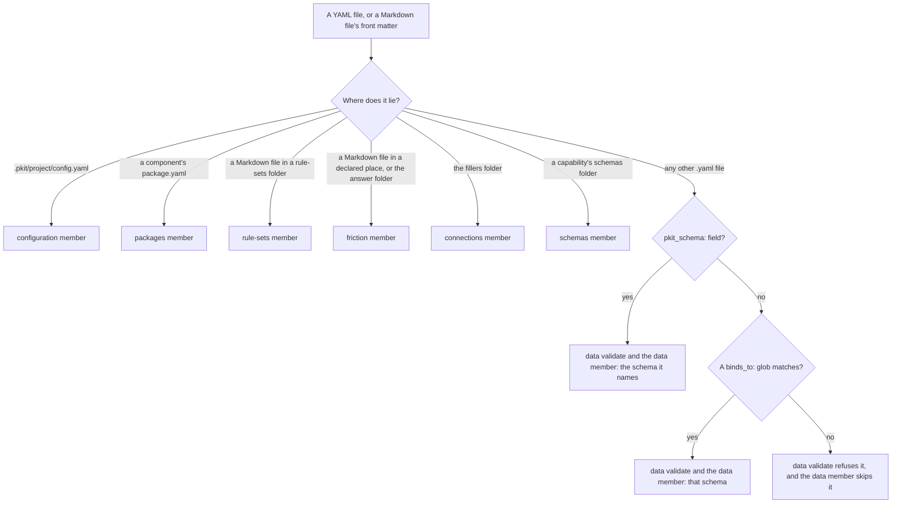

# Schemas

A schema says, in JSON Schema, what a file may hold, and project-kit checks your configuration, your rule sets and your capability's data against theirs. This guide is for the adopter who sets up a project, the developer who writes its rule sets, and the author of a capability. It says why schemas exist, then how to do each task with them. What an agent needs to work with schemas, such as their conventions and every key of each file, is in [the schemas reference](../../.pkit/schemas/README.md).

## Contents

<!-- pkit:contents -->
- [Why they exist](#why-they-exist)
- [Which check judges a file](#which-check-judges-a-file)
- [Declare your backbone configuration](#declare-your-backbone-configuration)
- [Write a rule set of your own](#write-a-rule-set-of-your-own)
- [Give your capability's data a schema](#give-your-capabilitys-data-a-schema)
<!-- /pkit:contents -->

## Why they exist

Configuration and data written by hand are read by code that cannot ask what you meant. Without a schema that says what each file may hold, these things go wrong:

- **A misspelt key in your configuration is read as nothing.** You write `doc:` for `docs:` to move your documentation root. Every command keeps the default root, and nothing tells you.
- **A value no command can use gets written.** You set `friction.mode` to `loud`. The file holds it until a command reads it and fails, or falls back to a default.
- **A misspelt key in your own rule set drops what it said.** You write `scpoe:` for `scope:`. The set's rules then reach no file, and nothing tells you.
- **A discipline you package keeps its rules in its scripts' code.** Each change to a rule is a change to code. A file a user of your capability writes is checked only where your code thinks to check it.

### What schemas do instead

Schemas answer these problems with the four claims below. The first block of commands below proves the first three, for your configuration. The third and fourth claims link the tasks whose blocks prove the rest.

- **`pkit config set` refuses a value your configuration's schema refuses, and writes nothing.**
- **When `pkit config set` creates your configuration file, it writes the line the YAML Language Server reads to find the file's schema.**
- **`pkit validate` fails on a misspelt key in your configuration or rule set, naming the key you meant** ([Write a rule set of your own](#write-a-rule-set-of-your-own)).
- **`pkit schemas validate` checks your capability's own data, and `pkit data validate` checks your users' `.yaml` files, each against your capability's schema** ([Give your capability's data a schema](#give-your-capabilitys-data-a-schema)).

Each block of commands on this page, with what each command prints, starts from a fresh project where `pkit init` has run.

Below, you set the friction mode to a value its schema refuses. Then you set the project's name, and add a misspelt key by hand:

```console
$ pkit config set friction.mode loud
Error: refusing to write .pkit/project/config.yaml: the result would not validate against the backbone configuration schema. Nothing was written.
  /friction/mode: 'loud' is not one of ['warning', 'enforcing']
$ test -e .pkit/project/config.yaml || echo "no file written"
no file written
$ pkit config set name trips --yes
set name = trips  (.pkit/project/config.yaml)
$ head -n 1 .pkit/project/config.yaml
# yaml-language-server: $schema=../schemas/backbone/config.schema.json
$ printf 'doc:\n  internal: handbook/\n' >> .pkit/project/config.yaml
$ pkit validate | grep -A1 config.yaml:/doc
    error    .pkit/project/config.yaml:/doc
      → unknown key 'doc'; did you mean 'docs'?
$ pkit validate >/dev/null; echo $?
1
```

What the output proves, claim by claim:

- **Refused, nothing written.** The command judged the whole result against the configuration's schema before it asked anything, and wrote no file ([the CLI reference, "config set"](../../.pkit/cli/README.md#config-set-key-value---yes)).
- **The editor's line.** The first line of the file it created names the schema. An editor that runs [the YAML Language Server](https://github.com/redhat-developer/yaml-language-server) reads a line of that form. It then checks the file against the schema as you type ([the reference, "Tooling expectations"](../../.pkit/schemas/README.md#tooling-expectations)).
- **Failed, and named.** Validation fails on the unknown key, exits 1, and names the nearest known key. The check of each backbone file schema gives the same message, your rule sets' included ([the reference's page on backbone files](../../.pkit/schemas/backbone-files.md#what-holds-for-every-backbone-file-schema)).

### Compared with checks in your scripts' code

Your configuration and your rule sets always have their schemas, so this comparison is for the author of a capability. A capability keeps each of its schemas as a pair: a YAML file of data, and its companion. The companion is the JSON Schema file that says what the data may hold.

The alternative is to keep your rules in your scripts, and check your users' files in code. An example is a typed model that refuses unknown keys.

The alternative keeps one language and no second file, and can check any rule across fields. **A schema pair adds a check of your users' files that runs none of your scripts, naming a misspelt key, as [the last task](#give-your-capabilitys-data-a-schema) proves:**

| What you need | Checks in your scripts' code | A schema pair |
| --- | --- | --- |
| A user's file checked without running your scripts | ❌ Checked only when a script reads it | ✅ `pkit data validate`, and `pkit validate` |
| A misspelt key named, with the key you meant | ❌ Refused at best, with no key suggested | ✅ Validation names the key you meant |
| A rule changed without changing code | ❌ Each rule is code | ✅ The rule is data, and `pkit schemas validate` checks it |
| A check in the editor | ❌ None | ✅ Where a file names its schema in the editor's line |
| One language for your checks | ✅ Your code's | ❌ JSON Schema beside your code |
| A rule across several fields | ✅ Any logic you write | ❌ Only what JSON Schema expresses |
| Files to keep | ✅ None beside your code | ❌ A companion beside each schema's data |
| What each user's file carries | ✅ Nothing extra | ❌ `schema_version`, and `pkit_schema:` or a path a glob matches |
| Which files are checked | ✅ Any file your code reads | ❌ `.yaml` files, in a folder or in `pkit validate`, and another file only when named |

### When you do not need one

As the author of a capability, you do not need a schema of your own in these cases:

- **The content is a principle, a reason or a judgement,** such as when a rule applies. It belongs in prose, such as a decision record ([the decision records' guide](../decisions/README.md)).
- **No code reads it.** A schema is worth what a check or a script makes of it. A file only people read gains a second file to keep.
- **Your users' files are not `.yaml`,** such as `.yml`, JSON or Markdown front matter. `pkit validate`'s check of data, and `pkit data validate` given a folder, read `.yaml` files alone. Markdown does not read as YAML. Check them in your code.
- **One script reads it, and you want to change the two together.** Keep the check in your code, which can hold any rule you write.

## Which check judges a file

`pkit validate` runs a set of checks, each a member of it, such as `configuration`. Each file the backbone checks finds its schema by where it lies, and one member checks it against that schema. A data file your capability's users write is different: it names its schema, or a glob in the schema names it.



- **Backbone files.** The backbone ships a schema for each kind of file it checks, and where the file lies binds it, never a field in it. The kinds are your configuration, each component's `package.yaml`, your rule sets, and the friction block in a document's front matter. So are your answer files, where a change keeps its answers to friction, and your filler files, which answer a capability's data points. The reference's page on backbone files says which member checks each ([its "The schemas that ship"](../../.pkit/schemas/backbone-files.md#the-schemas-that-ship)).
- **A capability's own schemas.** Each is a pair in the capability's `schemas/` folder: its YAML data and its JSON Schema companion. `pkit schemas validate` checks every pair, and so does `pkit validate`'s `schemas` member ([the reference, "The schema is a pair"](../../.pkit/schemas/README.md#the-schema-is-a-pair)).
- **Data files.** A file's `pkit_schema:` field wins. Without it, a `binds_to:` glob may claim the file. The glob lies in the schema of a capability the project installed or registered ([the reference's page on binding, "Resolution order"](../../.pkit/schemas/data-binding.md#resolution-order)).
- **No binding.** Named to `pkit data validate`, a file nothing binds is refused. `pkit validate`'s `data` member skips it, since it is no data of a capability. That member reads no file in a dot-folder, nor in `.pkit/` outside its `project/` folders ([the CLI reference, "data validate"](../../.pkit/cli/README.md#data-validate-path)).

## Declare your backbone configuration

Your project's backbone configuration is one file, `.pkit/project/config.yaml` <!-- unanchored: names the file the step reads or writes, not its content -->, which you write and no sync touches. It holds such settings as your default branch, your documentation roots and your places. The CLI reference lists every key ([its "Configuration file"](../../.pkit/cli/README.md#configuration-file)). How you write each kind of key, and how it is checked:

- **A key that holds one value:** set it with `pkit config set`. The command checks the whole result against the schema first, then asks before it writes. Off a terminal it needs `--yes`.
- **A key that holds a list,** such as your places, `friction.places`: write it in the file by hand. `pkit config set` refuses it, and names the file.
- **The check:** `pkit validate` reads the whole file in its `configuration` member. It fails on an unknown key or a value the schema refuses, and warns of a place that matches nothing.
- **No file:** without the file, every key takes its default, and validation passes.
- **Your internal root and your rule sets:** your own rule sets lie under the internal documentation root, `docs.internal` ([the next task](#write-a-rule-set-of-your-own)). Set it with `pkit config set`, which keeps the sets in the root's old folder found. A root edited by hand leaves them behind, and validation fails on each ([the reference, "When the internal root changes"](../../.pkit/schemas/README.md#when-the-internal-root-changes)).

Below, you set your default branch, and declare your documents' folder as a place. Validation warns until the folder holds a file:

```console
$ pkit config set repository.default-branch trunk --yes
set repository.default-branch = trunk  (.pkit/project/config.yaml)
$ pkit config set friction.places docs --yes
Error: key 'friction.places' holds a list, not a single value; `config set` sets scalars only. Edit the file directly (.pkit/project/config.yaml).
$ printf 'friction:\n  places: [docs/**]\n' >> .pkit/project/config.yaml
$ cat .pkit/project/config.yaml
# yaml-language-server: $schema=../schemas/backbone/config.schema.json
repository:
  default-branch: trunk
friction:
  places: [docs/**]
$ pkit validate | grep -A2 "config.yaml: "
    .pkit/project/config.yaml: 1 warning.
    warning  .pkit/project/config.yaml:/friction/places/0
      → friction pattern 'docs/**' matches nothing in the repository; a dead pattern keeps silence looking like health (COR-050 point 12).
$ mkdir docs && printf '# Start\n' > docs/start.md
$ pkit validate | grep "config.yaml: "
    .pkit/project/config.yaml: valid.
```

## Write a rule set of your own

A rule set is a Markdown file of rules, each with an id. Its rules bind on the documents its scope selects, among those your places hold ([the first task](#declare-your-backbone-configuration)).

You write your own in `rule-sets/` under your internal documentation root, `docs/rule-sets/` unless you set `docs.internal`. This task covers the file's schema. What a rule set is, and how its rules bind, are in [the reference, "Rule-set files"](../../.pkit/schemas/README.md#rule-set-files).

- **Where it lies decides it.** Each Markdown file in that folder but its `README.md` is a rule set, and nothing in the file makes it one. A sync never reads or writes it.
- **Its front matter** holds the set's name, its own version, its scope and each rule's fields, such as its origin. The reference's page on backbone files gives every key ([its "Rule-set files"](../../.pkit/schemas/backbone-files.md#rule-set-files)).
- **Its body** holds one section for each rule, headed by the rule's id and title, such as `## RS-STYLE-001 — Answer first`.
- **A shipped rule set extended:** name it in `inherits`, pinned to its major, such as `living-docs:LDOC@1`, and never edit it.
- **A new rule** takes no status, so it is proposed, and binds nothing. A person accepts it in the change that adds it, and the rule then reads `status: accepted`, with an origin ([the reference, "Statuses"](../../.pkit/schemas/README.md#statuses)).
- **The check:** `pkit validate` reads every rule set in its `rule-sets` member. It fails on an unknown key, naming the nearest known one. It also fails on an accepted rule with no origin, and on a rule with no section.

Below, you write a rule set with `scope` misspelt. Validation fails and names the fix, and passes once the fix is made. Its count holds the backbone's own set beside yours:

```console
$ mkdir -p docs/rule-sets
$ printf '%s\n' --- 'rule-set: STYLE' 'version: 1.0.0' 'scpoe: [docs/**]' 'rules:' '  RS-STYLE-001:' '    origin: {date: 2026-11-03, by: A. Person, why: "Readers skim."}' --- '' '## RS-STYLE-001 — Answer first' '' 'Open each page with its answer.' > docs/rule-sets/style.md
$ pkit validate | grep -A1 style.md
    error    docs/rule-sets/style.md:/scpoe
      → unknown key 'scpoe'; did you mean 'scope'?
$ pkit validate >/dev/null; echo $?
1
$ sed 's/scpoe/scope/' docs/rule-sets/style.md > style.md && mv style.md docs/rule-sets/style.md
$ pkit validate | grep "rule set(s)"
    2 rule set(s), <any> rule(s) (<any> accepted); 0 error(s), 0 report(s).
```

## Give your capability's data a schema

A capability's rules and data, such as the states a process moves through, live in schemas in its `schemas/` folder. Its scripts read them at runtime ([COR-018](../../.pkit/decisions/core/COR-018-capability-schemas.md)). So a change to a rule is a change to data, and `pkit schemas validate` checks it.

Where your capability's users write files of their own, the same schema checks theirs. The steps:

- **Stamp the pair:** `pkit new schema <capability> <name>` writes `<name>.yaml` and its companion, `<name>.schema.json` ([the CLI reference, "new schema"](../../.pkit/cli/README.md#new-schema-owner-name---collection-form-form---collection-name-key---no-namespace)). With `--no-namespace` it stamps the schema of one document. Without it, it stamps a collection of entries, each with an id.
- **Declare the fields** in the companion's `properties`. Declare `pkit_schema` there too, where your users' files carry that field, and `binds_to`, where your schema's YAML lists globs. The stamped companion refuses any key it does not declare.
- **Check the pair:** `pkit schemas validate` checks every pair against its companion, and every reference between them ([the CLI reference, "schemas validate"](../../.pkit/cli/README.md#schemas-validate-path)).
- **Bind your users' files:** a user's file names your schema in its `pkit_schema:` field ([the reference's page on binding](../../.pkit/schemas/data-binding.md#1-the-pkit_schema-field-recommended-authoritative)). Or your schema's YAML lists globs of the files it judges, under `binds_to:`. A glob binds only once the project has installed or registered the capability ([the same page](../../.pkit/schemas/data-binding.md#2-per-schema-binds_to-fallback)).
- **What each user's file carries:** `schema_version`, at your schema's version. A file at another version is refused, with a hint to migrate it ([the same page](../../.pkit/schemas/data-binding.md#schema-version-cross-check)). The editor's line is recommended too. Whoever writes the file writes the line: the user, or a command your capability ships.
- **Check their files:** `pkit data validate <path>` checks each `.yaml` file under the path against its bound schema ([the same page](../../.pkit/schemas/data-binding.md#pkit-data-validate-path)).

Below, a trip-planning capability gets a schema for a trip. A wrong type in the capability's own data fails `pkit schemas validate`. Then a user's trip file, with one key misspelt, fails `pkit data validate`:

```console
$ pkit new capability trip-planning
Stamped: .pkit/capabilities/trip-planning/
$ pkit new schema trip-planning trip --no-namespace
Stamped: .pkit/capabilities/trip-planning/schemas/trip.yaml
Stamped: .pkit/capabilities/trip-planning/schemas/trip.schema.json
Next: declare the document's top-level fields in the companion's `properties`, then fill the YAML body accordingly.
$ printf '%s\n' '{"$schema": "https://json-schema.org/draft/2020-12/schema", "$id": "trip.schema.json", "type": "object", "required": ["schema_version"], "additionalProperties": false, "properties": {"schema_version": {"const": 1}, "pkit_schema": {"type": "string"}, "title": {"type": "string"}, "nights": {"type": "integer"}}}' > .pkit/capabilities/trip-planning/schemas/trip.schema.json
$ printf 'title: Template\nnights: seven\n' >> .pkit/capabilities/trip-planning/schemas/trip.yaml
$ pkit schemas validate
  1 issue(s) found across <any> schema(s) and <any> backbone file schema(s):
    .pkit/capabilities/trip-planning/schemas/trip.yaml/nights
      → 'seven' is not of type 'integer'
Error: 1 schema validation issue(s) found.
$ sed 's/seven/7/' .pkit/capabilities/trip-planning/schemas/trip.yaml > trip.yaml && mv trip.yaml .pkit/capabilities/trip-planning/schemas/trip.yaml
$ pkit schemas validate
  Validated <any> schema(s) and <any> backbone file schema(s). All checks passed.
$ mkdir -p trips/japan && printf 'pkit_schema: trip-planning:trip\nschema_version: 1\ntitle: Japan\nnigths: 9\n' > trips/japan/trip.yaml
$ pkit data validate trips; echo $?
  1 error(s), 0 warning(s) across 1 data file(s):
    [error] trips/japan/trip.yaml/nigths
      → unknown key 'nigths'; did you mean 'nights'?
Error: 1 data-validation error(s) found.
1
```

The capability is not registered, so the user's file binds only through its field, as here. Once the project registers it, with `pkit capabilities register trip-planning`, a `binds_to:` glob can bind files that carry no field.
