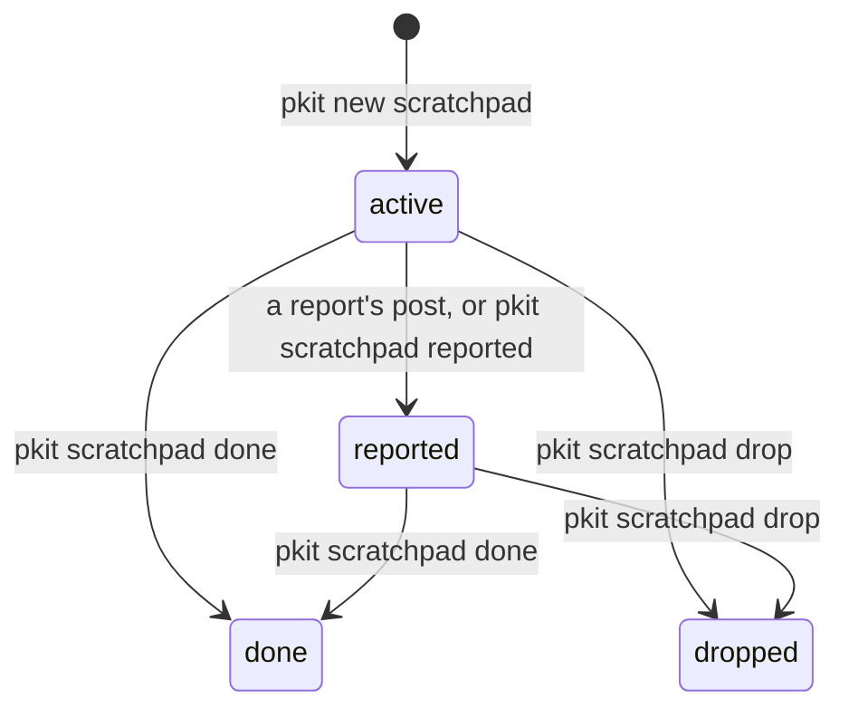

# Scratchpad notes

A scratchpad note is a working draft in your repository, where you think a question through before a decision record states its answer. It binds nothing, and it retires once other documents hold what it found, or once its line of thought fails ([COR-012](../../.pkit/decisions/core/COR-012-scratchpad-notes.md)). This guide says why notes exist, and how you start one, work in it, send it upstream and retire it. What each command writes, and each state's front matter, are in [the scratchpad reference](../../.pkit/scratchpad/README.md).

## Contents

<!-- pkit:contents -->
- [Why it exists](#why-it-exists)
- [How a note moves](#how-a-note-moves)
- [Start a note](#start-a-note)
- [Work the question through](#work-the-question-through)
- [Send a note upstream](#send-a-note-upstream)
- [Retire a note](#retire-a-note)
<!-- /pkit:contents -->

## Why it exists

Some questions are too large to decide at once. Their options are not all known yet, and neither is what pulls between them. Without a place to think such a question through, this goes wrong:

- **A decision record comes too early.** A record states one choice. Written before the options are mapped, it states the first one you thought of, and its review argues about the rest.
- **The thinking scatters, or is skipped.** One person keeps a draft at the repository's root. Another keeps one in a chat, and a third keeps none. Nobody can list the questions still open.
- **A dead end leaves no trace.** The draft of a line of thought that failed is deleted. The next person to meet the question tries the same line again.
- **Nobody can tell what a draft produced.** A year on, nothing says which decision records or documents came out of which exploration.
- **A draft sent upstream loses its track.** You paste it into an issue for the methodology's maintainers. Nothing then records any of these:
  - which issue it became
  - whether that issue is closed
  - whether your copy still matches what you sent

### What a note does instead

A note gives such a question a place to be thought through before any record states an answer, which meets the first problem. Four claims answer the other four, and the commands after the list prove each one ([COR-043](../../.pkit/decisions/core/COR-043-scratchpad-reported-state.md) decides the fourth):

- **A note's folder is its state, so one listing tells the open questions from the settled ones.**
- **A note whose line of thought failed is kept, apart from the open ones.**
- **Retiring a note writes into it when it retired, and what it produced.**
- **A note you record as sent upstream names the issue it became, and its listing flags an edit made after.**

Below, four notes are started, and three of them then move:

- one is retired as done
- one is dropped
- one is recorded as sent upstream, then edited

```console
$ pkit new scratchpad cache-layer
Stamped: .pkit/scratchpad/active/<any>-cache-layer.md
$ pkit new scratchpad retry-policy >/dev/null
$ pkit new scratchpad sync-protocol >/dev/null
$ pkit new scratchpad naming-scheme >/dev/null
$ pkit scratchpad done cache-layer --produced PRJ-012 --produced docs/cache.md
Moved: .pkit/scratchpad/active/<any>-cache-layer.md -> .pkit/scratchpad/done/<any>-cache-layer.md
$ sed -n '4,8p' .pkit/scratchpad/done/*-cache-layer.md
started: <any>
retired: <any>
produced:
  - PRJ-012
  - docs/cache.md
$ pkit scratchpad drop retry-policy
Moved: .pkit/scratchpad/active/<any>-retry-policy.md -> .pkit/scratchpad/dropped/<any>-retry-policy.md
$ pkit scratchpad reported sync-protocol aleskalfas/project-kit#9999
Moved: .pkit/scratchpad/active/<any>-sync-protocol.md -> .pkit/scratchpad/reported/<any>-sync-protocol.md
Recorded: aleskalfas/project-kit#9999
$ echo "One more thought, after the send." | tee -a .pkit/scratchpad/reported/*-sync-protocol.md
One more thought, after the send.
$ pkit scratchpad list
active/
  <any>-naming-scheme.md
reported/
  <any>-sync-protocol.md  -> aleskalfas/project-kit#9999 (state unknown)  [modified since reported]
done/
  <any>-cache-layer.md
dropped/
  <any>-retry-policy.md
```

What the output proves, claim by claim:

- **Folder as state.** `pkit scratchpad list` groups the notes by folder ([the CLI reference, `scratchpad list`](../../.pkit/cli/README.md#scratchpad-list)). The open questions lie in `active/`, and in `reported/` once sent upstream ([the reference, "States"](../../.pkit/scratchpad/README.md#states)).
- **Dropped, and kept.** `retry-policy` lies in `dropped/`. Before you drop a note, you end it with why its line of thought stopped ([the reference, "Body"](../../.pkit/scratchpad/README.md#body)).
- **Retired with what it produced.** `done` moved `cache-layer` to `done/`. It added `retired`, today's date, and `produced`, the two values given, to the note's front matter.
- **Tracked upstream.** `pkit scratchpad reported` recorded the issue, and the listing marks the note `[modified since reported]` after the edit. Here the listing cannot read the issue, so it shows its state as unknown. Where `gh` can read it, the listing shows it open or closed, with its title.

### Compared with the alternatives

Without scratchpad notes, you think a question through in a file of your own in the repository, or in an issue in your tracker. A file of your own is the quickest to start. An issue is better for a discussion among many people, and an edit to it costs no commit. **A note keeps its state, its dead ends and what it produced in the repository, as [the commands above](#what-a-note-does-instead) prove:**

| What you need | A file of your own | An issue | A scratchpad note |
| --- | --- | --- | --- |
| Tell the open questions from the settled ones | ❌ Nothing marks a draft as finished | ✅ Open issues are listed apart from closed ones | ✅ Each state is a folder |
| Keep a dead end, with why it stopped | ❌ It is deleted, or left looking open | ✅ It is closed, and you say why in a comment | ✅ It moves to `dropped/`, and you say why in it ([the reference, "Body"](../../.pkit/scratchpad/README.md#body)) |
| Know what the exploration produced | ❌ Nothing records it | ✅ Pull requests that name it are listed on it | ✅ `produced` names what you list |
| Read it beside the code, at any commit | ✅ It is a file in the repository | ❌ It lives in the tracker | ✅ It is a file in the repository |
| Discuss it among many people | ❌ Only in pull-request reviews | ✅ Comments, and a notice to each person who follows it | ❌ Only in pull-request reviews |
| Start one | ✅ Create a file, and write | ✅ Open an issue, and write | ❌ A command, and a slug it accepts ([the CLI reference, `new scratchpad`](../../.pkit/cli/README.md#new-scratchpad-slug)) |
| Cost of each edit | ❌ A commit | ✅ None | ❌ A commit |

### When you do not need it

Scratchpad notes are meant for a question whose answer is not yet clear, and whose exploration belongs beside the code. You do not need one in these cases:

- **You already know the answer.** Write the decision record, or make the change, straight away. A note is for a question that may end in several documents, or in none.
- **The question is a bug or a task.** It belongs in your tracker, where someone takes it and closes it.
- **You need many people's views more than a place to think.** An issue or a discussion gathers comments, and tells each person who follows it.
- **The text is an agent's working file.** Keep it in the agent workspace, `.agent-workspace/`, which no commit carries ([the permissions reference, "The agent workspace"](../../.pkit/permissions/README.md#the-agent-workspace)). A note is committed, and kept once it retires.

## How a note moves

A note moves between folders under `.pkit/scratchpad/`, and the folder it lies in is its state. Each move is one command, which also writes the note's front matter. Only reopening a retired note has no command yet:



- **Open:** `pkit new scratchpad` stamps a note into `active/`. A note sent upstream as a report moves to `reported/`, and is still open there ([the reference, "States"](../../.pkit/scratchpad/README.md#states)).
- **Retired:** `pkit scratchpad done` moves a note to `done/` once other documents hold what it found. `pkit scratchpad drop` moves it to `dropped/` when its line of thought fails. Either retires a note from `active/` or from `reported/`.
- **The front matter** records who writes in the note, and the day the note started. Once the note retires, the front matter records the day it retired, and what it produced. A reported note also records the issue it became, and a hash of what was sent ([the reference, "Front matter"](../../.pkit/scratchpad/README.md#front-matter)).
- **What the commands leave to you:** each moves the file on disk, and stages nothing in git ([the CLI reference, "Scratchpad commands"](../../.pkit/cli/README.md#scratchpad-commands)). Commit the move. Where the note changed little, git shows it as a rename ([the reference, "States"](../../.pkit/scratchpad/README.md#states)).
- **Who owns the notes:** your project. Installing project-kit creates the folders, and a sync updates only the area's README. A sync never reads or writes a note ([the reference, "Layout"](../../.pkit/scratchpad/README.md#layout)).
- **A note binds nothing.** No work rests on it. What it found binds once a decision record states it, and a person accepts that record ([the decisions README, "The acceptance gate"](../../.pkit/decisions/README.md#the-acceptance-gate)).

## Start a note

Run `pkit new scratchpad` with a slug, two to four words that name the question. It stamps the note in `active/`, and prints its path:

```console
$ pkit new scratchpad cache-layer
Stamped: .pkit/scratchpad/active/<any>-cache-layer.md
$ cat .pkit/scratchpad/active/*-cache-layer.md
---
authors:
  - Doc Examples <doc-examples@example.invalid>
started: <any>
---

# Cache layer
```

- **Its name:** the day it started, then the slug. The slug takes lower-case letters and digits, joined by hyphens. Where another note's name ends with the slug already, the command mostly refuses and writes nothing ([the CLI reference, `new scratchpad`](../../.pkit/cli/README.md#new-scratchpad-slug), says when).
- **Its front matter:** you as its author, from your git configuration, and the day it started ([the reference, "Front matter"](../../.pkit/scratchpad/README.md#front-matter)).
- **Its title:** drawn from the slug ([the reference, "Body"](../../.pkit/scratchpad/README.md#body)). Change it to the question the note explores.
- **With your agent:** ask it to start one, such as "Use the scratchpad-author skill to start a note on how we cache build results". The skill agrees the slug with you, keeps the note to one question and drafts its opening.

## Work the question through

Write in the note's body whatever the question needs, since no section is required ([the reference, "Body"](../../.pkit/scratchpad/README.md#body)). The skill opens a note with these parts:

- the question
- what pulls the answer each way
- what is known
- the candidate answers
- what is still open

Then, as you work:

- **Commit as you go,** so others can read the note and add to it. Add each person who writes in it to its `authors`.
- **One question to a note.** Where you find two, start a second note, and link the two notes from each other's body.
- **Where your notes stand:** `pkit scratchpad list` lists them by folder, as the first fence above shows.
- **Once the answer is clear,** write the decision record or the change it calls for. Then retire the note ("Retire a note" below).

## Send a note upstream

A note may describe something the methodology's maintainers should hear, such as a gap you met. `pkit report feedback` files a report to project-kit, as its siblings `bug` and `change-request` do, and `--scratchpad` attaches the note to it as you send it. It asks before it posts, so run it at a terminal, with `gh` signed in ([the CLI reference, "report"](../../.pkit/cli/README.md#report-bug--report-feedback--report-change-request)):

```sh
pkit report feedback --title "Caching build results" --body "The attached note maps the options we found." --scratchpad cache-layer
```

> [!WARNING]
> The report is a public issue on project-kit's repository, and it holds the whole note, front matter included. So it shows each author's name and e-mail address. The check before the post looks only for paths into your home folder ([the CLI reference, "report"](../../.pkit/cli/README.md#report-bug--report-feedback--report-change-request)).

- **After a post that succeeds,** the note moves to `reported/`. Its front matter records the issue, the date, and a hash of the note as sent ([the reference, "Front matter"](../../.pkit/scratchpad/README.md#front-matter)).
- **With your agent:** ask it to use the `report-author` skill, which composes the report with you. The agent stages the report, and posts nothing. The staging's first line names the command that posts the report, and you run that command at a terminal ([the CLI reference, "report submit"](../../.pkit/cli/README.md#report-submit-id)):

```sh
pkit report submit 20261101-151200-feedback
```

- **Filed in a browser instead,** the report command's last line names the command that records the issue ([the CLI reference, "report"](../../.pkit/cli/README.md#report-bug--report-feedback--report-change-request)). Run it with the issue the note became:

```console
$ pkit new scratchpad cache-layer >/dev/null
$ pkit scratchpad reported cache-layer aleskalfas/project-kit#9999
Moved: .pkit/scratchpad/active/<any>-cache-layer.md -> .pkit/scratchpad/reported/<any>-cache-layer.md
Recorded: aleskalfas/project-kit#9999
```

- **Then leave the note as you sent it.** Write further thinking in a new note that links it.
- **Its issue's state:** `pkit scratchpad list` reads each issue's state each time you run it, so the state it shows is never stored. Once every issue of a note is closed, the listing prints the command that retires the note. It never retires one itself.

> [!WARNING]
> Nothing stops an edit to a reported note. The listing, and composing a report, only warn of one, and a later send of the note ends the listing's warning ([the reference, "Front matter"](../../.pkit/scratchpad/README.md#front-matter)). The issue keeps the text you sent.

## Retire a note

Retire a note as done once other documents hold what it found, such as a decision record, a guide or a skill. Name each with `--produced`: a record's id, a file's path or a web address ([the reference, "Front matter"](../../.pkit/scratchpad/README.md#front-matter)). Then commit the move:

```console
$ pkit new scratchpad cache-layer >/dev/null && git add .pkit/scratchpad && git commit -qm "Start a note on caching"
$ pkit scratchpad done cache-layer --produced PRJ-012 --produced docs/cache.md
Moved: .pkit/scratchpad/active/<any>-cache-layer.md -> .pkit/scratchpad/done/<any>-cache-layer.md
$ git add -A .pkit/scratchpad && git status --short
R  .pkit/scratchpad/active/<any>-cache-layer.md -> .pkit/scratchpad/done/<any>-cache-layer.md
```

When the line of thought failed, end the note with why, then drop it ([the reference, "Body"](../../.pkit/scratchpad/README.md#body)):

```console
$ pkit new scratchpad retry-policy >/dev/null
$ echo "Dropped: every client retries already, so a policy of ours adds nothing." | tee -a .pkit/scratchpad/active/*-retry-policy.md
Dropped: every client retries already, so a policy of ours adds nothing.
$ pkit scratchpad drop retry-policy
Moved: .pkit/scratchpad/active/<any>-retry-policy.md -> .pkit/scratchpad/dropped/<any>-retry-policy.md
```

- **What each writes:** both add `retired`, today's date, to the front matter. `done` also adds `produced`, where you name anything ([the reference, "Front matter"](../../.pkit/scratchpad/README.md#front-matter)).
- **From `reported/`:** the same commands retire a reported note. Name its issue among what it produced. The folder `reported/` goes once it is empty.
- **Reopening one:** no command does it yet. Move the file back to `active/` by hand. Then remove each front-matter field an active note does not hold, and a dropped note's closing paragraph ([the reference, "Commands"](../../.pkit/scratchpad/README.md#commands)).
