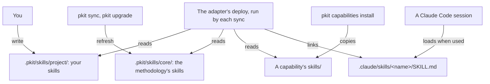

# Skills

A skill is a procedure that an AI agent loads when its task comes up, such as writing your release notes. This guide says why you turn recurring work into a skill, and how a skill reaches your agents. It then gives your tasks with skills. What an agent needs to work with them, such as each field of a skill's front matter, is in [the skills reference](../../.pkit/skills/README.md).

## Contents

<!-- pkit:contents -->
- [Why they exist](#why-they-exist)
- [How a skill reaches a session](#how-a-skill-reaches-a-session)
- [Choose a skill or an agent definition](#choose-a-skill-or-an-agent-definition)
- [Write your project's own skill](#write-your-projects-own-skill)
- [Pair a skill with the command that writes its file](#pair-a-skill-with-the-command-that-writes-its-file)
<!-- /pkit:contents -->

## Why they exist

An agent keeps nothing between sessions but what the repository holds. Without skills that sessions load for their task, recurring work goes wrong in these ways:

- **You explain the same task again in each session.** You told an agent yesterday how to write your release notes, and today's agent does not know it. So you type the steps again, or each session writes the notes its own way.
- **A procedure kept in `CLAUDE.md` loads into every session, whatever its task.** A session that fixes one test reads your release steps too. Kept in a document instead, a procedure reaches no session that nobody points to it.
- **An agent that writes a file by hand gets its mechanical parts wrong.** One of the methodology's early decision records was written by hand, and took the wrong number ([COR-005](../../.pkit/decisions/core/COR-005-bundle-pattern.md)).
- **An update of procedures you share with other projects overwrites your changes.** You adjust a shared skill to your project, and the next update replaces it. So you stop taking updates, or make your change again after each one.

### What skills do instead

Skills answer these problems with three claims, and the commands after the list prove each one:

- **A skill you write in `.pkit/skills/project/` reaches Claude Code at your next `pkit sync`, and no sync writes over it.**
- **Each of the methodology's authoring skills names the command that writes its file, and the command numbers and places the file.**
- **`pkit validate` warns where a skill's body cites a record that its front matter does not declare.**

Each fence on this page starts from a fresh project where `pkit init` has run, so the methodology's skills are already deployed.

Below, you write a skill for your release notes and change one of the methodology's skills. Then you sync:

```console
$ printf -- '---\nname: release-notes\ndescription: Write the release notes from the pull requests merged since the last tag. Use when cutting a release.\n---\n\n# Release notes\n\n1. List the pull requests merged since the last tag.\n' > .pkit/skills/project/release-notes.md
$ echo "Skip the review." >> .pkit/skills/core/decision-author.md
$ pkit sync | grep -e "skills/core" -e release-notes
  refreshed    .pkit/skills/core/
  created    .claude/skills/release-notes/SKILL.md -> ../../../.pkit/skills/project/release-notes.md
$ git status --short .pkit/skills
?? .pkit/skills/project/release-notes.md
```

Below, you look for the skill that pairs with `pkit new decision`, and run the command twice. `2>/dev/null` drops its warning that the project has no remote:

```console
$ grep -rl "wraps_command: pkit new decision" .pkit/skills
.pkit/skills/core/decision-author.md
$ pkit new decision project use-postgres 2>/dev/null
Stamped: .pkit/decisions/project/PRJ-001-use-postgres.md
$ pkit new decision project use-redis 2>/dev/null
Stamped: .pkit/decisions/project/PRJ-002-use-redis.md
```

Below, your skill cites a record of the methodology's, COR-008, and its front matter does not declare it:

```console
$ printf -- '---\nname: release-notes\ndescription: Write the release notes. Use when cutting a release.\n---\n\n1. Title each note as COR-008 asks of a commit.\n' > .pkit/skills/project/release-notes.md
$ pkit validate | grep -A1 release-notes
    warning  .pkit/skills/project/release-notes.md
      → body cites record 'COR-008' but it is not declared in frontmatter `reads.records` or `gates`.
```

What the output proves, claim by claim:

- **Deployed, and kept.** The sync links your skill where Claude Code reads skills. It puts back the methodology's skill you changed, and leaves yours untracked, as you wrote it ([the reference, "Deployment"](../../.pkit/skills/README.md#deployment)).
- **Paired.** `decision-author` names `pkit new decision`, and the command gives each record the next number and the project's folder. So an agent that follows the skill takes neither from memory ([the reference, "Pairing a skill with a command"](../../.pkit/skills/README.md#pairing-a-skill-with-a-command)).
- **Checked.** `pkit validate` names the record your skill cites and does not declare. A skill cites what its procedure rests on rather than copy it, so it reads the record's current text ([the reference, "Front matter"](../../.pkit/skills/README.md#front-matter)).

### Compared with procedures kept by hand

Without project-kit's skills, you keep your procedures in `CLAUDE.md`, or as skills in Claude Code's own folder, `.claude/skills/`. Both are better on setup, and Claude Code's own skills load as these do. **project-kit adds the methodology's skills kept up to date beside yours, checked citations, and commands that write each file, as [the commands above](#what-skills-do-instead) prove:**

| What you need | Kept in `CLAUDE.md` | Kept in `.claude/skills/` by hand | project-kit's skills |
| --- | --- | --- | --- |
| A procedure loaded only for its task | ❌ Every session loads it whole | ✅ Claude Code loads a skill's body when it is used | ✅ The same, through the link the sync makes |
| The methodology's procedures, kept up to date | ❌ You copy them in, and merge each update | ❌ The same | ✅ A sync puts them back, and never writes yours |
| A file's number and place from a command | ❌ The agent works them out | ❌ You write the command yourself | ✅ Each authoring skill names the command that writes its file |
| A cited record checked | ❌ Nothing reads the citation | ❌ The same | ✅ `pkit validate` warns of one the front matter misses |
| Setup | ✅ None | ✅ None | ❌ `pkit init`, then a sync after each new skill |
| Where you edit a skill | ✅ The file a session reads | ✅ The same | ❌ The source in `.pkit/skills/`, never the link |

### When you do not need one

You do not need a skill in these cases:

- **The work has come up once.** Ask the agent in the session. Give work tooling of its own once it recurs, two or three times ([COR-007](../../.pkit/decisions/core/COR-007-pattern-extraction.md)).
- **The work is a standing remit, not a procedure,** such as reviewing each change against your conventions. Give it an agent definition ([Choose a skill or an agent definition](#choose-a-skill-or-an-agent-definition)).
- **Every session must keep it, whatever its task,** such as running the tests before each commit. Make it an operational rule ([the rules reference](../../.pkit/rules/README.md)).
- **It is a fact to look up, not steps to follow,** such as the format of your release notes. Write it in a document, and have the skill cite it.
- **You keep your procedures for Claude Code alone, with no methodology.** Keep them in `.claude/skills/` by hand, as the comparison credits.

> [!WARNING]
> A skill of yours that takes the name of one of the methodology's replaces it in Claude Code, and nothing tells you. Give your skills names the methodology does not ship ([the reference, "Deployment"](../../.pkit/skills/README.md#deployment)).

## How a skill reaches a session

A skill's source sits under `.pkit/`, and each sync links it where Claude Code reads skills. Who writes each source, and how the link reaches a session:



- **Your skills,** in `.pkit/skills/project/`. No sync writes them, so a skill there stays as you wrote it ([COR-001](../../.pkit/decisions/core/COR-001-content-mechanisms.md)).
- **The methodology's skills,** in `.pkit/skills/core/`. Each sync puts them back at the version your project records, and an upgrade brings newer ones ([the CLI reference, `upgrade`](../../.pkit/cli/README.md#upgrade)).
- **A capability's skills,** in its own `skills/` folder. They arrive with its install.
- **The deploy.** Each sync runs the adapter's deploy, which links each skill under `.claude/skills/`. Where two places ship one name, yours is linked ([the reference, "Deployment"](../../.pkit/skills/README.md#deployment)).
- **Claude Code** lists each skill's description in a session, and loads a skill's body only when it is used. You can also run one yourself as `/<name>`. Claude Code sees a change to a skill's file within the session ([its skills docs](https://code.claude.com/docs/en/skills)).

## Choose a skill or an agent definition

Give recurring work a skill when it is a procedure for one kind of task. Give it an agent definition when it is a standing remit with boundaries ([COR-006](../../.pkit/decisions/core/COR-006-artifact-roles.md)). Each kind of content has one carrier:

| The content | Its carrier | An instance |
| --- | --- | --- |
| A procedure for one kind of task: steps an agent follows, and then it is done | A skill | Writing the release notes |
| A standing remit: a perspective to hand work to, with what it owns and never does | An agent definition | Reviewing each change against your conventions |
| A rule every session keeps, whatever its task | An operational rule | Running the tests before each commit |
| A choice among alternatives, and why | A decision record | Choosing the database |
| What is, such as a format or a contract | A document | The format of your release notes |

- **Cite, never copy.** A skill cites the decision, rule or document its procedure rests on, and never copies its text. An agent definition cites its skills and documents the same way. So each reads the current text ([COR-006](../../.pkit/decisions/core/COR-006-artifact-roles.md)).
- **An agent definition** is written as the agents reference says ([the agents reference](../../.pkit/agents/README.md)).

## Write your project's own skill

Write the skill as a file in `.pkit/skills/project/`, and run `pkit sync`. No command stamps a skill, so you write the file whole. What it holds:

- **Its name.** Name the file `<name>.md`, with a name in lowercase words joined by hyphens, and give the same name as `name` in its front matter. Take a name the methodology's skills do not use.
- **Its description,** in `description`. Say what the skill does, and when to use it. Claude Code matches a task against it to choose the skill.
- **Its procedure,** the body. Write numbered steps the agent runs, and cite the records and files they rest on.
- **What it cites,** declared in its front matter: a record under `reads.records`, and a file under `reads.paths`. A record the skill needs accepted before it runs goes under `gates` ([the reference, "Front matter"](../../.pkit/skills/README.md#front-matter)).
- **Its helpers.** A skill that needs a template or a script beside it becomes a folder, `<name>/<name>.md` with the helpers beside it ([COR-015](../../.pkit/decisions/core/COR-015-artifact-file-layout.md)).

Below, you write the skill, then sync, check where it is deployed, and validate:

```console
$ printf -- '---\nname: release-notes\ndescription: Write the release notes from the pull requests merged since the last tag. Use when cutting a release.\nreads:\n  records: [COR-008]\n---\n\n# Release notes\n\n1. List the pull requests merged since the last tag.\n2. Title each note as COR-008 asks of a commit.\n' > .pkit/skills/project/release-notes.md
$ pkit sync | grep release-notes
  created    .claude/skills/release-notes/SKILL.md -> ../../../.pkit/skills/project/release-notes.md
$ pkit status | grep -A1 "project namespace"
                       1 deployed from the project namespace:
                         release-notes -> ../../../.pkit/skills/project/release-notes.md
$ pkit validate | grep "artifact(s)"
    <any> artifact(s), 0 hook provider(s) checked; 0 error(s), 0 warning(s).
```

- **Edit the source, never the link.** The link leads to your file, so an edit there reaches the next use of the skill with no new sync.
- **When the sync stops.** Where your `pkit` is at another version than your project records, the sync stops before it writes, and names the remedy ([the CLI reference, `sync`](../../.pkit/cli/README.md#sync)).
- **A family of tasks.** Several operations that share their framing, such as writing, extending and renaming one kind of file, become one composite skill ([the reference, "A composite skill"](../../.pkit/skills/README.md#a-composite-skill)).

## Pair a skill with the command that writes its file

Where your skill's task writes a file whose name, number or front matter a program can work out, let a command write the file. The skill then carries the judgement ([COR-005](../../.pkit/decisions/core/COR-005-bundle-pattern.md)). Each does its part:

- **The command** writes what it can work out, the same way each time. It may be a script of your project.
- **The skill** runs the command, and never writes the file itself. It does what the command cannot, such as choosing the slug and writing the body.
- **The pairing** is named in the skill's front matter, under `metadata.wraps_command`. Nothing checks it, but it lets a person or an agent find a command's skill ([the reference, "Pairing a skill with a command"](../../.pkit/skills/README.md#pairing-a-skill-with-a-command)).
- **One change** brings a new command and its skill together.

Below, your project's script writes each runbook under the next number:

```console
$ mkdir -p scripts docs/runbooks
$ printf '#!/bin/sh\nn=$(ls docs/runbooks | wc -l)\nf=docs/runbooks/$((n + 1))-$1.md\necho "# $1" > "$f"\necho "Stamped: $f"\n' > scripts/new-runbook.sh && chmod +x scripts/new-runbook.sh
$ scripts/new-runbook.sh restart-the-queue
Stamped: docs/runbooks/1-restart-the-queue.md
$ scripts/new-runbook.sh rotate-the-keys
Stamped: docs/runbooks/2-rotate-the-keys.md
```

The skill that pairs with it names the script in its front matter, and runs it in its steps:

```markdown
---
name: runbook-author
description: Write a runbook for an operational task. Use when a fix should be kept for the next incident.
metadata:
  wraps_command: scripts/new-runbook.sh
reads:
  paths: [scripts/new-runbook.sh]
---

# Runbook author

1. Choose the runbook's slug: the task, in a few words, such as `restart-the-queue`.
2. Run `scripts/new-runbook.sh` with the slug, and never write the file yourself.
3. Write the steps under the heading the script wrote.
```

The methodology's own rules ask your agents to write each of its files through the paired skill in the same way (core rule 3).
