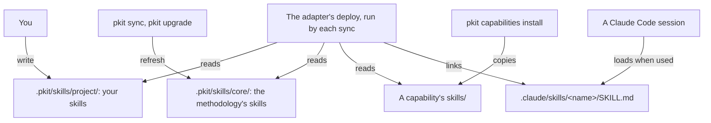

# Skills

A skill is a procedure that an AI agent loads when its task comes up, such as writing your release notes. This guide says why you turn recurring work into a skill, and how a skill reaches your agents. It then gives your tasks with skills. What an agent needs to work with them, such as each field of a skill's front matter, is in [the skills reference](../../.pkit/skills/README.md).

## Contents

<!-- pkit:contents -->
- [Why they exist](#why-they-exist)
- [How a skill reaches a session](#how-a-skill-reaches-a-session)
- [Choose a skill or an agent definition](#choose-a-skill-or-an-agent-definition)
- [Write your project's own skill](#write-your-projects-own-skill)
- [Pair a skill with the command that writes its file](#pair-a-skill-with-the-command-that-writes-its-file)
<!-- /pkit:contents -->

## Why they exist

Beyond what the repository holds, an agent keeps little between sessions, and nothing your team shares. Without skills that sessions load for their task, recurring work goes wrong in these ways:

- **You explain the same task again in each session.** You told an agent yesterday how to write your release notes, and today's agent does not know it. So you type the steps again, or each session writes the notes its own way.
- **A procedure kept in `CLAUDE.md` loads into every session, whatever its task.** A session that fixes one test reads your release steps too. Kept in a document instead, it reaches only a session that someone points to it.
- **An agent that writes a file by hand gets its mechanical parts wrong.** One of the methodology's early decision records was written by hand, and took the wrong number ([COR-005](../../.pkit/decisions/core/COR-005-bundle-pattern.md)).
- **Your own procedures sit among shared ones, and an update overwrites them.** You keep your release steps beside the skills your projects share, and the next update of those skills replaces the folder. So you stop taking updates, or write your steps again after each one.

### What skills do instead

Skills answer these problems with two claims, and the commands after the list prove each one. Claude Code answers the second problem itself, by loading a skill only for its task ("How a skill reaches a session" below).

- **A skill you write in `.pkit/skills/project/` reaches Claude Code at your next `pkit sync`, and no sync writes over it.**
- **Each of the methodology's authoring skills names a command that fills in what a program can work out, such as a decision record's number.**

Each fence on this page starts from a fresh project where `pkit init` has run, and its files are committed. So the methodology's skills are already deployed.

Below, you write a skill for your release notes and change one of the methodology's skills. Then you sync:

```console
$ printf -- '---\nname: release-notes\ndescription: Write the release notes from the pull requests merged since the last tag. Use when cutting a release.\n---\n\n# Release notes\n\n1. List the pull requests merged since the last tag.\n' > .pkit/skills/project/release-notes.md
$ echo "Skip the review." >> .pkit/skills/core/decision-author.md
$ pkit sync | grep -e "skills/core" -e release-notes
  refreshed    .pkit/skills/core/
  created    .claude/skills/release-notes/SKILL.md -> ../../../.pkit/skills/project/release-notes.md
$ git status --short .pkit/skills
?? .pkit/skills/project/release-notes.md
$ tail -n 1 .pkit/skills/project/release-notes.md
1. List the pull requests merged since the last tag.
```

Below, you list the commands the methodology's skills pair with, and run `pkit new decision` twice. `2>/dev/null` drops its warning that the project has no remote ([the CLI reference, `new decision`](../../.pkit/cli/README.md#new-decision-namespace-slug---yes)):

```console
$ grep -rE "wraps_commands?:" .pkit/skills/core | sort
.pkit/skills/core/adapter-author.md:  wraps_command: pkit new adapter
.pkit/skills/core/agent-author.md:  wraps_command: pkit new agent
.pkit/skills/core/area-author.md:  wraps_command: pkit new area
.pkit/skills/core/capability-author.md:  wraps_command: pkit new capability
.pkit/skills/core/decision-author.md:  wraps_command: pkit new decision
.pkit/skills/core/migration-author.md:  wraps_command: pkit new migration
.pkit/skills/core/process/process.md:  wraps_commands:
.pkit/skills/core/report-author.md:  wraps_command: pkit report
.pkit/skills/core/schema/schema.md:  wraps_commands:
.pkit/skills/core/scratchpad-author.md:  wraps_command: pkit new scratchpad
.pkit/skills/core/storyboard-author.md:  wraps_command: pkit new storyboard
$ pkit new decision project use-postgres 2>/dev/null
Stamped: .pkit/decisions/project/PRJ-001-use-postgres.md
$ pkit new decision project use-redis 2>/dev/null
Stamped: .pkit/decisions/project/PRJ-002-use-redis.md
```

What the output proves, claim by claim:

- **Deployed, and kept.** The sync links your skill where Claude Code reads skills. It puts back the methodology's skill you changed, and leaves yours as you wrote it ([the reference, "Deployment"](../../.pkit/skills/README.md#deployment)).
- **Paired.** Each of the eleven skills names its command. The two composite skills, `process` and `schema`, list theirs under `wraps_commands`. `pkit new decision` gives each record the next number and the project's folder. So an agent that follows `decision-author` takes neither from memory ([the reference, "Pairing a skill with a command"](../../.pkit/skills/README.md#pairing-a-skill-with-a-command)).
- **Not every command numbers.** Commands for other kinds of file fill in their place and their front matter, and some number nothing ([the CLI reference, "Authoring commands"](../../.pkit/cli/README.md#authoring-commands)).

### Compared with procedures kept by hand

Without project-kit's skills, you keep your procedures in `CLAUDE.md`, or as skills in Claude Code's own folder, `.claude/skills/`. Both are better on setup and on changing a shared procedure. Claude Code's own skills also list less in each session, and load as these do. **project-kit adds authoring skills that run their commands, and keeps your skills through each sync of the methodology's, as [the commands above](#what-skills-do-instead) prove:**

| What you need | Kept in `CLAUDE.md` | Kept in `.claude/skills/` by hand | project-kit's skills |
| --- | --- | --- | --- |
| A procedure loaded only for its task | ❌ Every session loads it whole | ✅ Claude Code loads a skill's body when it is used | ✅ The same |
| Authoring procedures that run a command to write their file | ❌ You write both | ❌ The same | ✅ One for each kind of file a `pkit new` command stamps |
| Shared procedures updated, with yours kept | ❌ You merge each update by hand | ❌ You copy each update in by hand | ✅ An upgrade brings the methodology's, and writes none of yours without asking |
| Changing a shared procedure | ✅ You edit it | ✅ The same | ❌ Your copy under its name replaces it, and takes no more updates |
| What each session lists | ❌ Every procedure, in full | ✅ Your skills' descriptions alone | ❌ The descriptions of the methodology's skills too |
| Setup | ✅ None | ✅ None | ❌ `pkit init` |
| A new procedure, with no command to run | ✅ Nothing to run | ✅ Claude Code sees a skill as you save it | ❌ A new skill waits for your next `pkit sync` |

### When you do not need one

You do not need a skill in these cases:

- **The work has come up once.** Ask the agent in the session. Give work tooling of its own once it recurs, two or three times ([COR-007](../../.pkit/decisions/core/COR-007-pattern-extraction.md)).
- **The work is a standing remit, not a procedure,** such as reviewing each change against your conventions. Give it an agent definition ([Choose a skill or an agent definition](#choose-a-skill-or-an-agent-definition)).
- **Every session must keep it, whatever its task,** such as running the tests before each commit. Make it an operational rule ([the rules guide, "Add your own rules"](../rules/README.md#add-your-own-rules)).
- **It is a fact to look up, not steps to follow,** such as the format of your release notes. Write it in a document, and have the skill cite it.
- **You want one skill in many projects, with no methodology.** A Claude Code plugin gives it to your other projects and your teammates ([Claude Code's plugins docs](https://code.claude.com/docs/en/plugins)).

## How a skill reaches a session

A skill's source sits under `.pkit/`, and each sync links it where Claude Code reads skills. Who writes each source, and how the link reaches a session:



- **Your skills,** in `.pkit/skills/project/`. No sync writes them, as the first claim's fence shows ([What skills do instead](#what-skills-do-instead)).
- **The methodology's skills,** in `.pkit/skills/core/`. Each sync puts them back at the version your project records, and an upgrade brings newer ones ([the CLI reference, `upgrade`](../../.pkit/cli/README.md#upgrade)).
- **A capability's skills,** in its own `skills/` folder. They arrive with its install.
- **The deploy.** Each sync runs the adapter's deploy, which links each skill under `.claude/skills/`. Where two places ship one name, yours is linked ([the reference, "Deployment"](../../.pkit/skills/README.md#deployment)).
- **Claude Code** lists each skill's description in a session, and loads a skill's body only when it is used. You can also run one yourself as `/<name>`. It picks up a skill that the sync adds within the session ([its skills docs](https://code.claude.com/docs/en/skills)).

## Choose a skill or an agent definition

Give recurring work a skill when it is a procedure for one kind of task. Give it an agent definition when it is a standing remit with boundaries ([COR-006](../../.pkit/decisions/core/COR-006-artifact-roles.md)). Each kind of content has one carrier, the operational rules by [COR-068](../../.pkit/decisions/core/COR-068-loaded-rule-sets.md) and the rest by COR-006:

| The content | Its carrier | An instance |
| --- | --- | --- |
| A procedure for one kind of task: steps an agent follows, and then it is done | A skill | Writing the release notes |
| A standing remit: a perspective to hand work to, with what it owns and never does | An agent definition | Reviewing each change against your conventions |
| A rule every session keeps, whatever its task | An operational rule | Running the tests before each commit |
| A choice among alternatives, and why | A decision record | Choosing the database |
| What is, such as a format or a contract | A document | The format of your release notes |

- **Cite, never copy.** A skill cites the decision, rule or document its procedure rests on, and never copies its text. An agent definition cites its skills and documents the same way. So each reads the current text ([COR-006](../../.pkit/decisions/core/COR-006-artifact-roles.md)).
- **An agent definition** is written through the `agent-author` skill, as the agents reference says ([its "Authoring a definition"](../../.pkit/agents/README.md#authoring-a-definition)). Where its dialogue with a person follows a script, you write a storyboard for it first ([the storyboards reference](../../.pkit/agents/storyboards.md)).

## Write your project's own skill

Write the skill as a file in `.pkit/skills/project/`, and run `pkit sync`. No command stamps a skill, so you write the file whole, as the reference's steps say ([its "Adding a skill"](../../.pkit/skills/README.md#adding-a-skill)). What it holds:

- **Its name,** as its file's name, `<name>.md`, and as `name` in its front matter. `pkit status` lists the skills deployed, so you can take a name none of them uses ([the CLI reference, `status`](../../.pkit/cli/README.md#status)).
- **Its description,** in `description`. Say what the skill does, and when to use it. Claude Code matches a task against it to choose the skill.
- **Its procedure,** the body: the steps the agent runs, citing the records and documents they rest on ([the reference, "The body"](../../.pkit/skills/README.md#the-body)).
- **What it cites,** declared in its front matter: a document under `reads.paths`, a record under `reads.records`. A record whose acceptance the procedure rests on goes under `gates`. Nothing checks a gate when the skill runs, so the body's first step checks it ([the reference, "The acceptance gate a skill declares"](../../.pkit/skills/README.md#the-acceptance-gate-a-skill-declares)).
- **Its helpers.** A skill that needs a template or a script beside it becomes a folder, `<name>/<name>.md`, with the helpers beside it ([COR-015](../../.pkit/decisions/core/COR-015-artifact-file-layout.md)).

> [!WARNING]
> A skill of yours with the name of a skill the methodology or a capability ships replaces it in Claude Code. Only a capability's install and its upgrade ask you first, each about a skill it brings that has your skill's name. Updates of the replaced skill then reach no session ([the reference, "Deployment"](../../.pkit/skills/README.md#deployment)).

Below, you write a skill that cites the document holding your notes' format. Then you sync, check where the skill is deployed, and validate:

```console
$ printf -- '---\nname: release-notes\ndescription: Write the release notes from the pull requests merged since the last tag. Use when cutting a release.\nreads:\n  paths: [docs/release-notes.md]\n---\n\n# Release notes\n\n1. List the pull requests merged since the last tag.\n2. Write each note in the format `docs/release-notes.md` gives.\n' > .pkit/skills/project/release-notes.md
$ pkit sync | grep release-notes
  created    .claude/skills/release-notes/SKILL.md -> ../../../.pkit/skills/project/release-notes.md
$ pkit status | grep -A1 "project namespace"
                       1 deployed from the project namespace:
                         release-notes -> ../../../.pkit/skills/project/release-notes.md
$ pkit validate | grep "artifact(s)"
    <any> artifact(s), 0 hook provider(s) checked; 0 error(s), 0 warning(s).
$ git status --short .claude/skills .pkit/skills
?? .claude/skills/release-notes/
?? .pkit/skills/project/release-notes.md
```

- **Commit both** your skill's file and the link the sync made under `.claude/skills/`, so a fresh clone has the skill. Where you keep project-kit private, git ignores both, and the skill stays in your clone ([the adapter's README, "Git footprint"](../../.pkit/adapters/claude-code/README.md#git-footprint-per-adr-009)).
- **Edit the file in `.pkit/skills/project/`.** The link leads to it, so an edit needs no new sync ([the reference, "Deployment"](../../.pkit/skills/README.md#deployment)).
- **What validation reads.** `pkit validate` warns where the body cites a record or a file that the front matter does not declare. It also warns where the front matter declares a record or a file the body never cites ([the reference, "Front matter"](../../.pkit/skills/README.md#front-matter)).
- **When the sync stops.** Where your `pkit` is at another version than your project records, the sync stops before it writes, and names the remedy ([the CLI reference, `sync`](../../.pkit/cli/README.md#sync)).
- **A family of tasks.** Several operations that share their framing, such as writing, extending and renaming one kind of file, become one composite skill ([the reference, "A composite skill"](../../.pkit/skills/README.md#a-composite-skill)).
- **A skill you keep in `.claude/skills/<name>/` already.** Move its `SKILL.md` to `.pkit/skills/project/<name>.md`. Where files sit beside it, move the folder to `.pkit/skills/project/<name>/` instead, and rename `SKILL.md` to `<name>.md`. Then delete what is left under `.claude/skills/<name>/`, and sync. The deploy leaves a file it did not make in place, and validation reads only the skills under `.pkit/` ([the reference, "Deployment"](../../.pkit/skills/README.md#deployment)).
- **A skill of a discipline.** Package it with the discipline's records and agent definitions in a capability of your own, through the `capability-author` skill. The capability keeps its skills in its own `skills/` folder ([the reference, "Layout"](../../.pkit/skills/README.md#layout)).

## Pair a skill with the command that writes its file

Where your skill's task writes a file whose name, number or front matter a program can work out, let a command write the file. The skill then carries the judgement ([COR-005](../../.pkit/decisions/core/COR-005-bundle-pattern.md)). Each does its part:

- **The command** writes what it can work out, the same way each time. It may be a script of your project.
- **The skill** runs the command, and never creates the file itself. It does what the command cannot, such as choosing the slug and writing the body.
- **The pairing** is named in the skill's front matter, under `metadata.wraps_command`. Nothing checks it, but it lets a person or an agent find a command's skill ([the reference, "Pairing a skill with a command"](../../.pkit/skills/README.md#pairing-a-skill-with-a-command)).
- **A rule of yours** has your agents use the skill, such as "Write each runbook through the `runbook-author` skill". Without one, an agent may run the script alone, and skip the skill's steps ([the rules guide, "Add your own rules"](../rules/README.md#add-your-own-rules)).
- **One change** can bring a new command and its skill together, as each authoring command of the methodology lands with its skill.

Below, your project's script writes each runbook under the number after the highest one:

```console
$ mkdir -p scripts docs/runbooks
$ printf '#!/bin/sh\nset -eC\nn=$(ls docs/runbooks | sed "s/-.*//" | sort -n | tail -n 1)\nf=docs/runbooks/$((${n:-0} + 1))-$1.md\necho "# $1" > "$f"\necho "Stamped: $f"\n' > scripts/new-runbook.sh && chmod +x scripts/new-runbook.sh
$ scripts/new-runbook.sh restart-the-queue
Stamped: docs/runbooks/1-restart-the-queue.md
$ scripts/new-runbook.sh rotate-the-keys
Stamped: docs/runbooks/2-rotate-the-keys.md
```

The skill that pairs with it names the script in its front matter, and runs it in its steps:

```markdown
---
name: runbook-author
description: Write a runbook for an operational task. Use when a fix should be kept for the next incident.
metadata:
  wraps_command: scripts/new-runbook.sh
reads:
  paths: [scripts/new-runbook.sh]
---

# Runbook author

1. Choose the runbook's slug: the task, in a few words, such as `restart-the-queue`.
2. Run `scripts/new-runbook.sh` with the slug, and never write the file yourself.
3. Write the steps under the heading the script wrote.
```

**Note:** the methodology's own artefacts that a `pkit new` command stamps, such as a decision record, follow its rules instead. Your agents write each through its paired skill or the command, and never stamp one by hand (core rule 3).
