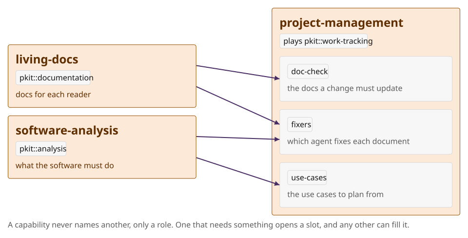

# Host test of #2700

Temporary test page: how each form of a figure's copy shows on GitHub. It is removed from the branch by the next commit, so read it by this commit's hash.

## A: one file, ``

## B: a file for each mode, a fragment on each

## C: a file for each mode, `<picture>`

<picture>
  <source media="(prefers-color-scheme: dark)" srcset="files/sockets.en.colour-scheme.dark.svg">
  <source media="(prefers-color-scheme: light)" srcset="files/sockets.en.default.svg">
  
</picture>

## D: contrast probe

