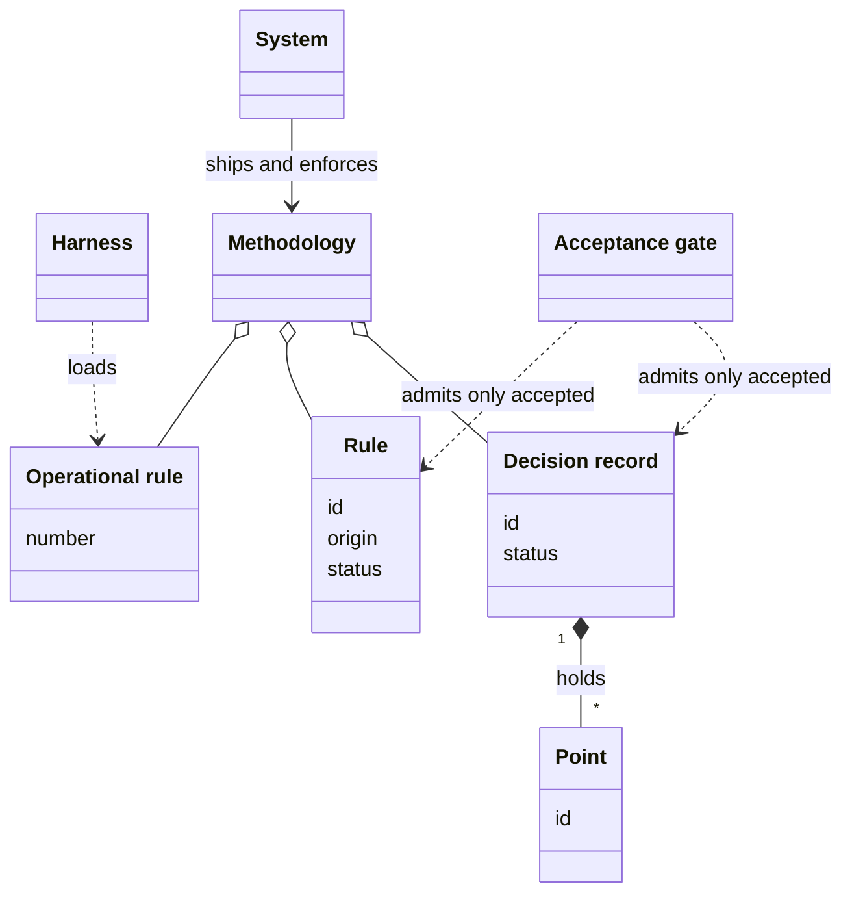
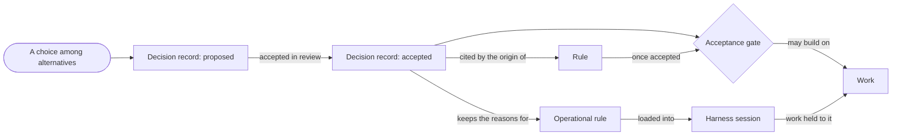
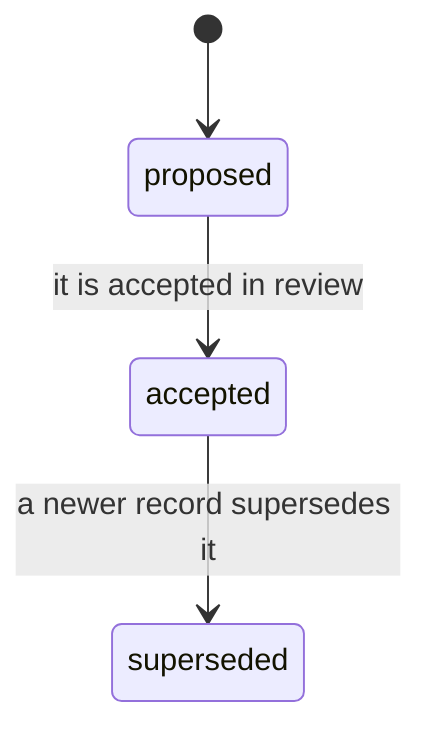
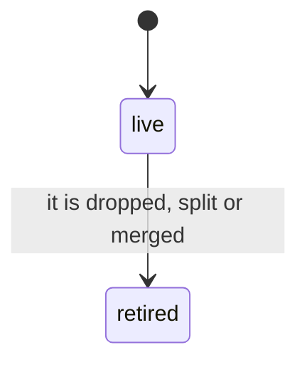
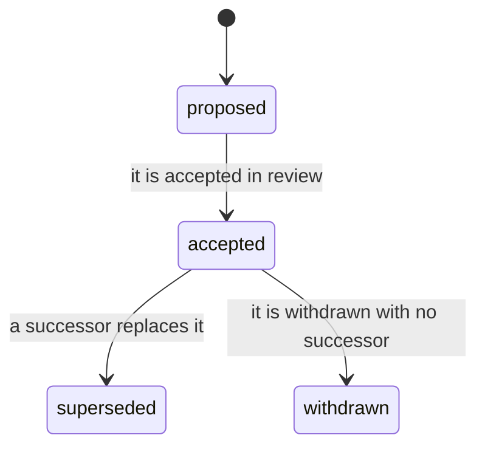

# VIEW-the-system-and-its-methodology — The system and its methodology

A way of working that only a few people know cannot be handed on, and one written as loose prose cannot be trusted (COR-007, COR-051). Each choice needs its reasons recorded, and each part that others cite needs a name that never moves (COR-025, COR-051, COR-058). Nothing should bind before a review accepts it (COR-051). The [methodology](../glossary.md#term-methodology--methodology) also works inside sessions that another tool hosts, and relies on behaviour it cannot set (COR-047).

The methodology is that way of working, written down as [decision records](../glossary.md#term-decision-record--decision-record), rules, [operational rules](../glossary.md#term-operational-rule--operational-rule) and conventions. Decision records keep the reasons, and their points, like rules, keep names that never move. The [acceptance gate](../glossary.md#term-acceptance-gate--acceptance-gate) lets work build only on decision records and rules already accepted. Operational rules hold the instructions every session loads, and conventions are agreed ways of working.

The [system](../glossary.md#term-system--system) is the software that ships the methodology and enforces it. A [harness](../glossary.md#term-harness--harness) hosts the sessions where the methodology is used.

## System

Defined in [TERM-system](../glossary.md#term-system--system).

**Why:** A way of working passes between people and repositories, and grows, only once tooling carries it (COR-007). Without such tooling, it stays the folklore of those who began it (COR-007).

The system is the software this analysis describes: the one you set up on a machine, run and extend.

**Attributes:** None.

**Relations:**

- It ships the [methodology](../glossary.md#term-methodology--methodology), and enforces it.
- Other software it meets, such as a [harness](../glossary.md#term-harness--harness) or the hosting service, is no part of it. The analysis names each for what it is.

**States:** None.

**Always true:** None.

**Note:** The analysis calls this software *the system*, and keeps the product's name, pkit, for prose about the product and for commands.

## Harness

Defined in [TERM-harness](../glossary.md#term-harness--harness).

**Why:** The [methodology](../glossary.md#term-methodology--methodology) works inside sessions that another tool hosts, and relies on behaviour it cannot set itself (COR-047). Left unnamed, that reliance stays hidden, and its failure can look like a correct result (COR-047).

A harness is an external tool that hosts working sessions and runs the tool calls made in them. Claude Code is one. The methodology depends on how the harness behaves, which the methodology cannot set.

**Attributes:**

- its include: the line in its instruction file that pulls another file into each session, as `@.pkit/rules/core.md` does

**Relations:**

- Its include loads the [operational rules](../glossary.md#term-operational-rule--operational-rule) into each session it hosts.
- It is no part of the [system](../glossary.md#term-system--system).

**States:** None.

**Always true:**

- What the methodology needs of a harness is stated as behaviour one can observe, never in any harness's own vocabulary (COR-047 [point](../glossary.md#term-point--point) 1).
- A need that no declaration covers for the harness in use is unknown, never met (COR-047 point 3).

## Decision record

Defined in [TERM-decision-record](../glossary.md#term-decision-record--decision-record).

**Why:** A choice made with no record of its reasons, or of what else was weighed, leaves later readers unable to rebuild them (COR-025). Kept apart from the steps that carry it out, the choice stays stable while those steps evolve (COR-006).

A decision record is a document that states one choice among alternatives, with the context that called for it and the reasons for it. It binds only once it is accepted, so work builds on it only from then.

**Attributes:**

- an id: its namespace's prefix and a number, such as COR-050
- a status: `proposed`, `accepted` or `superseded`
- its sections: the context, the decision, the reasons and what follows from it

**Relations:**

- It belongs to one namespace, which numbers its records on its own. COR, the namespace of the core records, is one.
- Its decision may hold points (COR-058 [point](../glossary.md#term-point--point) 1).
- A [rule](../glossary.md#term-rule--rule)'s origin may cite it. The record says what was chosen and why, and the rule says what must hold (COR-051 point 1).

**States:** A record is `proposed` until it is accepted in review, and `accepted` until a newer record supersedes it. It never moves back, and a superseded record is kept.

**Always true:**

- It says why a choice was made, and holds no procedure (COR-006).

## Point

Defined in [TERM-point](../glossary.md#term-point--point).

**Why:** A [decision record](../glossary.md#term-decision-record--decision-record) often decides several things at once, and other records, rules and documents cite each one by its number (COR-058). A number that moves sends every such citation to another part, and nothing says so (COR-058). A permanent id keeps each citation on the part it names (COR-058).

A point is one numbered or labelled part of a decision record's Decision. Once the record writes it as a heading, its id names it for good, so a citation such as COR-050 point 3 stays true. A record that writes its points as a numbered list still works, but its numbers may move until it is converted (COR-058 point 9).

**Attributes:**

- an id: a number, such as `3`, or a label, such as `D1`
- a title of a few words, and its text, which runs to the next heading of the same or a higher level (COR-058 point 1)

**Relations:**

- It belongs to one decision record, inside that record's Decision (COR-058 point 1).
- A retired point names the points that took its text, where any did (COR-058 points 4 and 5).

**States:** A point written as a heading is live until it is retired, by being dropped, split or merged. A stub then stays where it stood, and its id stays in the record's front matter (COR-058 point 4).

**Always true:**

- In a record whose points are headings, no point is renumbered, and no id is used again, a retired one included (COR-058 point 3).
- In such a record, a new point takes the next unused number (COR-058 point 3).

## Rule

Defined in [TERM-rule](../glossary.md#term-rule--rule).

**Why:** A standard that work is held to must be written down, and loose prose is not enough to trust it (COR-051). Each rule needs a lasting name to cite, a record of its origin and a visible way to retire it (COR-051). A [decision record](../glossary.md#term-decision-record--decision-record) gives all three, at a weight too great for a statement of one sentence (COR-051).

A rule is a statement that every document or collection entry it binds on must satisfy, once it is accepted. It has a permanent id, such as RS-WRITE-005, and a recorded origin that says when, by whom and why it was decided.

**Attributes:**

- an id, such as `RS-WRITE-005` (COR-051 [point](../glossary.md#term-point--point) 3)
- its statement
- an origin: when, by whom and why it was decided, or the decision record it cites (COR-051 point 5)
- a status: proposed, accepted, superseded or withdrawn (COR-051 point 4)

**Relations:**

- Its origin may cite a decision record, which must be accepted whenever the rule is (COR-051 point 5).
- A superseded rule names the rule that succeeds it (COR-051 point 4).

**States:** A rule is proposed until it is accepted in review. Where a person takes part, that person's review accepts it. An accepted rule may be superseded, naming its successor, or withdrawn, naming none. Either way it stays where it is, under its id (COR-051 point 4).

**Always true:**

- Only an accepted rule binds. A proposed, superseded or withdrawn one binds nothing (COR-051 point 4).
- Its id is never renumbered, and a retired id is never used again (COR-051 point 3).
- An accepted rule has a complete origin (COR-051 point 5).

## Acceptance gate

Defined in [TERM-acceptance-gate](../glossary.md#term-acceptance-gate--acceptance-gate).

**Why:** If a [decision record](../glossary.md#term-decision-record--decision-record) or a [rule](../glossary.md#term-rule--rule) bound as soon as it was written, any draft would take effect before anyone reviewed it (COR-051).

The acceptance gate is the condition that work builds only on what is already accepted. A decision record or a rule that is still proposed is a draft. Work that would rest on it waits, or has it accepted first.

**Attributes:** None.

**Relations:**

- It holds for decision records and for rules alike, a repository's own as well as the [methodology](../glossary.md#term-methodology--methodology)'s.

**States:** None.

**Always true:**

- An accepted rule whose origin cites a decision record cites an accepted one (COR-051 [point](../glossary.md#term-point--point) 5).

## Operational rule

Defined in [TERM-operational-rule](../glossary.md#term-operational-rule--operational-rule).

**Why:** An instruction shipped to every repository must fit any of them, since one that fits a single repository cannot apply elsewhere (COR-014). So a repository keeps its own instructions in a file of its own (COR-014).

An operational rule is an instruction that every session loads through the [harness](../glossary.md#term-harness--harness)'s include. It is cited by its number in its file, such as core rule 8, and carries no id, origin or status.

**Attributes:**

- its number in its file
- its statement, mostly with a pointer to where its reasons are

**Relations:**

- The harness's include loads it into each session.
- It shares only the word with a [rule](../glossary.md#term-rule--rule): it has none of a rule's id, origin or status (COR-051 [point](../glossary.md#term-point--point) 1).

**States:** None.

**Always true:**

- An operational rule that fits any repository is in the file the [system](../glossary.md#term-system--system) ships. One that fits only one repository is in that repository's own file (COR-014).

## Methodology

Defined in [TERM-methodology](../glossary.md#term-methodology--methodology).

**Why:** The work of starting and running development practices recurs across repositories (COR-007). The methodology captures what is known about doing that work well, as one accumulated discipline (COR-007).

The methodology is the body of [decision records](../glossary.md#term-decision-record--decision-record), rules, [operational rules](../glossary.md#term-operational-rule--operational-rule) and conventions that the [system](../glossary.md#term-system--system) ships and enforces. Its conventions are agreed ways of working, such as how a commit's message is written. A repository keeps its own records, rules and operational rules beside the methodology's. They are no part of it, yet the [acceptance gate](../glossary.md#term-acceptance-gate--acceptance-gate) holds for them too.

**Attributes:** None.

**Relations:**

- It is made of decision records, rules, operational rules and conventions.
- The system ships it and enforces it.

**States:** None.

**Always true:** None.
