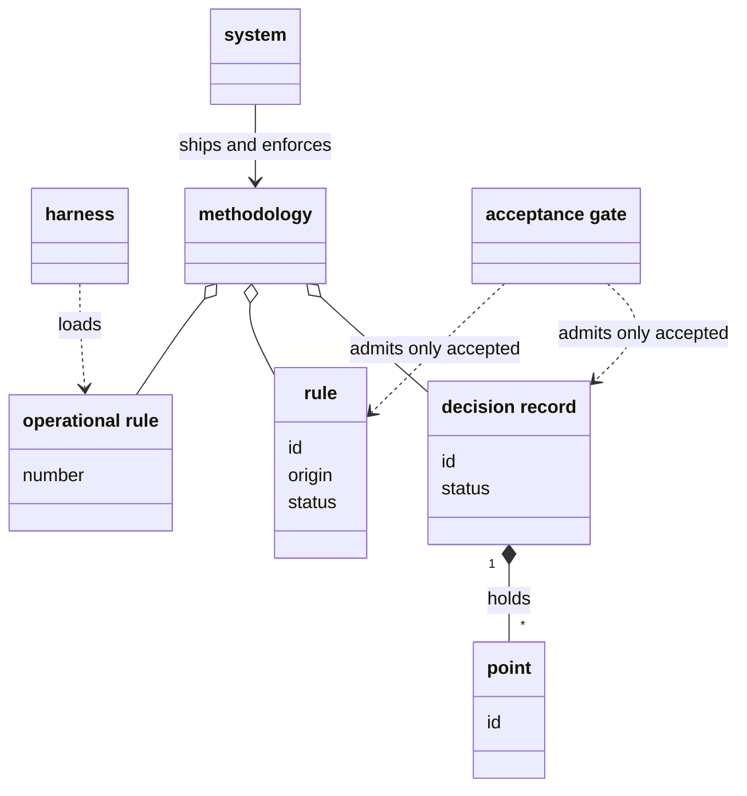
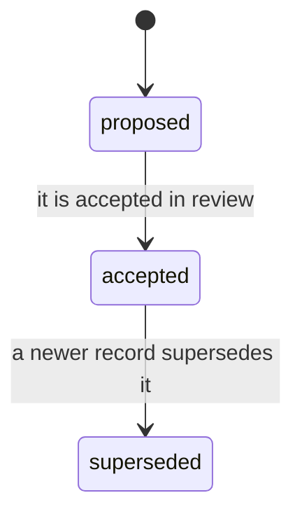
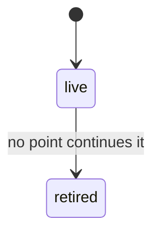
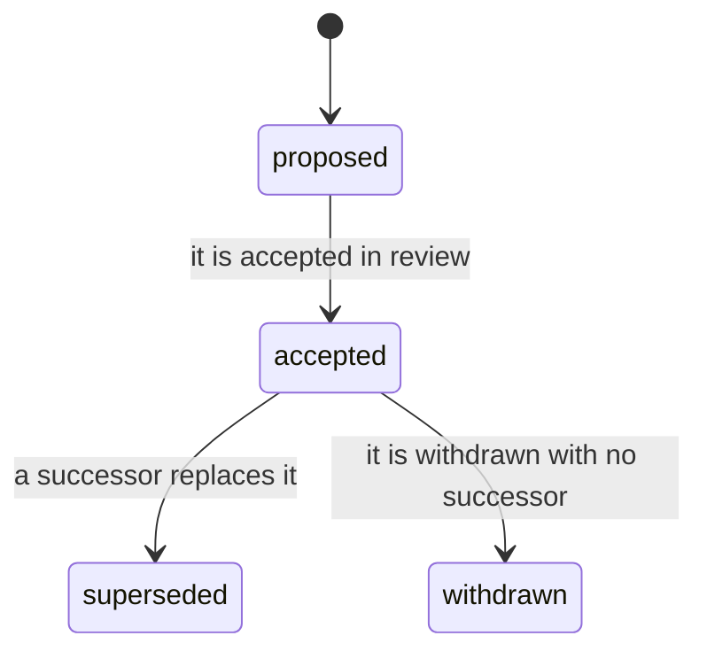

# VIEW-the-system-and-its-methodology — The system and its methodology

What the system is, the harness it works in, and the methodology it ships and enforces. The methodology is made of decision records with their points, rules, operational rules and conventions. The acceptance gate says which of them work may build on.

## system

The system is the software this analysis describes: the one you install, run and extend. The analysis calls it *the system*, and keeps the product's name, pkit, for prose about the product and for commands.

**Attributes:** None.

**Relations:**

- It ships the methodology, and enforces it.
- Other software it meets, such as a harness or the hosting service, is no part of it. The analysis names each for what it is.

**States:** None.

**Always true:** None.

## harness

A harness is an external tool that hosts working sessions and runs the tool calls made in them. Claude Code is one. The methodology works in whichever harness is in use, and sets none of that harness's own properties.

**Attributes:** None.

**Relations:**

- Its include loads the operational rules into each session it hosts.
- It is no part of the system.

**States:** None.

**Always true:**

- What the methodology needs of a harness is stated as behaviour one can observe, never in any harness's own vocabulary (COR-047 point 1).
- A need that nothing declares a harness meets is unknown for that harness, never met (COR-047 point 3).

## decision record

A decision record is a document that states one choice among alternatives, with the context that called for it and the reasons for it. It binds only once it is accepted, so work builds on it only from then.

**Attributes:**

- an id: its namespace's prefix and a number, such as COR-050
- a status: `proposed`, `accepted` or `superseded`
- its sections: the context, the decision, the reasons and what follows from it

**Relations:**

- It belongs to one namespace, which numbers its records on its own (COR-025). COR is the namespace of the records the system ships.
- Its decision may hold points, each under an id of its own (COR-058 point 1).
- A rule's origin may cite it. The record then says what was chosen and why, and the rule says what must hold (COR-051 point 5).

**States:** A record is `proposed` until it is accepted in review, and `accepted` until a newer record supersedes it. It never moves back, and a superseded record is kept.

**Always true:**

- It says why a choice was made, and holds no procedure (COR-006).

## point

A point is one numbered or labelled part of a decision record's Decision. Once the record writes it as a heading, its id names it for good, so a citation such as COR-050 point 3 stays true.

**Attributes:**

- an id: a number, such as `3`, or a label, such as `D1`
- a title of a few words, and its text, which runs to the next heading of its level (COR-058 point 1)

**Relations:**

- It belongs to one decision record, inside that record's Decision (COR-058 point 1).
- A retired point names the points of the same record that continue it, where any do (COR-058 points 4 and 5).

**States:** A point is live until no point continues what it says. It is then retired: a stub stays where it stood, and its id stays in the record's front matter (COR-058 point 4).

**Always true:**

- No point is renumbered, and no id is used again, a retired one included (COR-058 point 3).
- A new point takes the next unused number (COR-058 point 3).

## rule

A rule is a statement that every document or collection entry it binds on must satisfy, once it is accepted. It has a permanent id, such as RS-WRITE-005, and a recorded origin that says when, by whom and why it was decided.

**Attributes:**

- an id, such as `RS-WRITE-005` (COR-051 point 3)
- its statement
- an origin: when, by whom and why it was decided, or the decision record it cites (COR-051 point 5)
- a status: proposed, accepted, superseded or withdrawn (COR-051 point 4)

**Relations:**

- Its origin may cite a decision record, which must be accepted whenever the rule is (COR-051 point 5).
- A superseded rule names the rule that succeeds it (COR-051 point 4).

**States:** A rule is proposed until it is accepted in review. An accepted rule may be superseded, naming its successor, or withdrawn, naming none. Either way it stays where it is, under its id (COR-051 point 4).

**Always true:**

- Only an accepted rule binds. A proposed, superseded or withdrawn one binds nothing (COR-051 point 4).
- Its id is never renumbered, and a retired id is never used again (COR-051 point 3).
- An accepted rule has a complete origin (COR-051 point 5).

## acceptance gate

The acceptance gate is the condition that work builds only on what is already accepted. A decision record or a rule that is still proposed is a draft. Work that would rest on it waits, or has it accepted first.

**Attributes:** None.

**Relations:**

- It reads the status of decision records and of rules.

**States:** None.

**Always true:**

- A rule is accepted only in review. Where a person takes part, that person's review accepts it (COR-051 point 4).

## operational rule

An operational rule is a short instruction that every session loads through the harness's include. It is cited by its number in its file, such as core rule 8, and carries no id, origin or status.

**Attributes:**

- its number in its file
- its statement, and a pointer to the record or document that holds its reasons

**Relations:**

- The harness's include loads it into each session.
- It shares only the word with a rule: it has none of a rule's id, origin or status (COR-051 point 1).

**States:** None.

**Always true:**

- An operational rule that fits any repository is in the file the system ships. One that fits only one repository is in that repository's own file (COR-014).

## methodology

The methodology is the body of decision records, rules, operational rules and conventions that the system ships and enforces. It is the content the system carries, as against the software itself.

**Attributes:** None.

**Relations:**

- It is made of decision records, rules, operational rules and conventions.
- The system ships it and enforces it.

**States:** None.

**Always true:** None.
