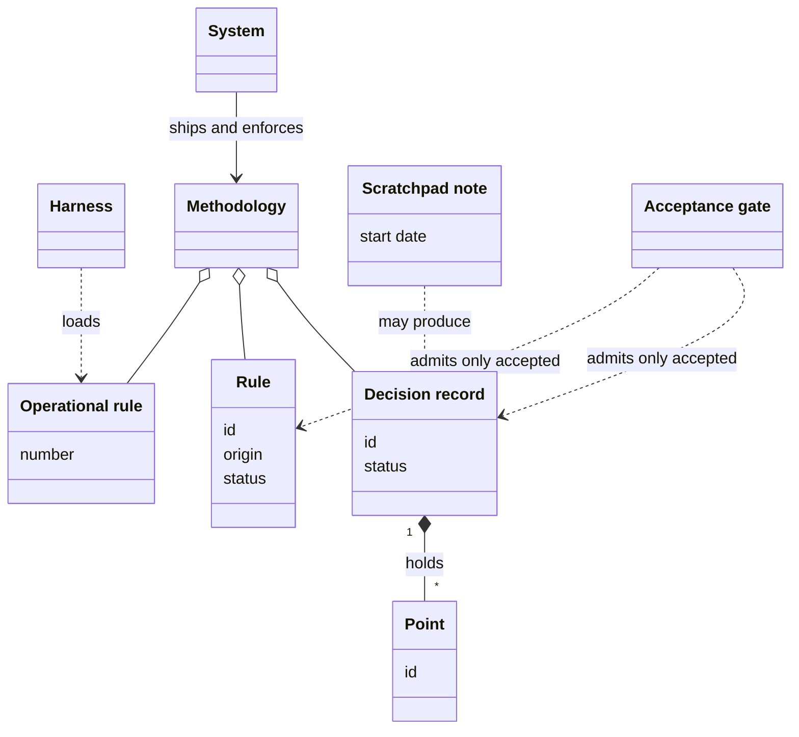
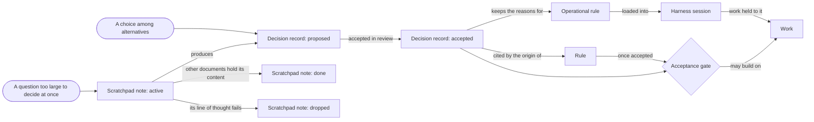
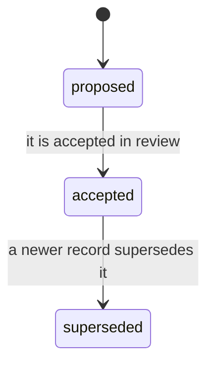
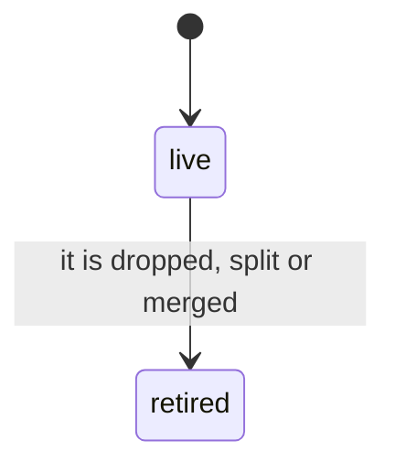
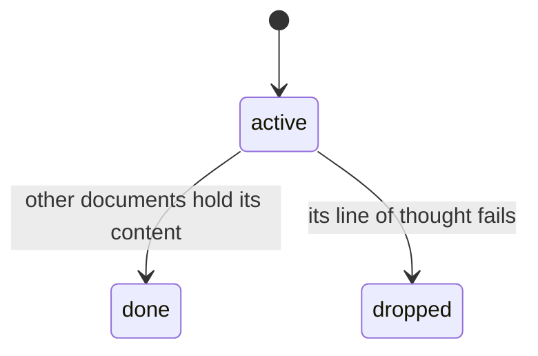
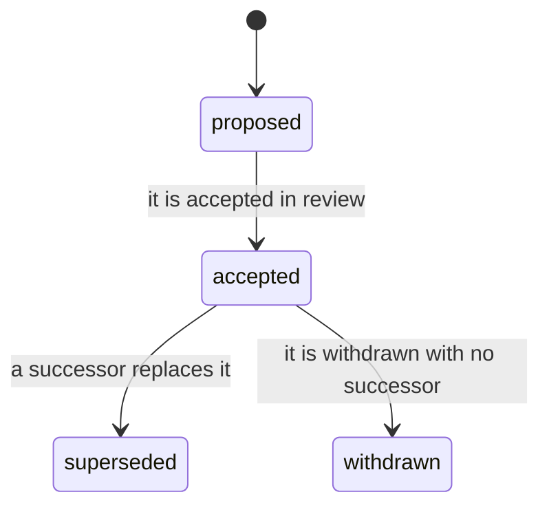

# VIEW-the-system-and-its-methodology — The system and its methodology

A way of working that only a few people know cannot be handed on, and one written as loose prose cannot be trusted (COR-007, COR-051). Each choice needs its reasons recorded, and each part that others cite needs a name that never moves (COR-025, COR-051, COR-058). Nothing should bind before a review accepts it (COR-051). The [methodology](../glossary.md#term-methodology--methodology) also works inside sessions that another tool hosts, and relies on behaviour it cannot set (COR-047).

The methodology is that way of working, written down as [decision records](../glossary.md#term-decision-record--decision-record), rules, [operational rules](../glossary.md#term-operational-rule--operational-rule) and conventions. Decision records keep the reasons, and their points, like rules, keep names that never move. The [acceptance gate](../glossary.md#term-acceptance-gate--acceptance-gate) lets work build only on decision records and rules already accepted. Operational rules hold the instructions every session loads, and conventions are agreed ways of working.

The [system](../glossary.md#term-system--system) is the software that ships the methodology and enforces it. A [harness](../glossary.md#term-harness--harness) hosts the sessions where the methodology is used.

Some questions are too large for a decision record at first, and the work that maps them needs a home of its own (COR-012). A [scratchpad note](../glossary.md#term-scratchpad-note--scratchpad-note) holds that work, binding nothing, until it produces decision records or other documents, or is dropped.

## System

Defined in [TERM-system](../glossary.md#term-system--system).

**Why:** A way of working passes between people and repositories, and grows, only once tooling carries it (COR-007). Without such tooling, it stays the folklore of those who began it (COR-007).

The system is the software this analysis describes: the one you set up on a machine, run and extend.

**Attributes:** None.

**Relations:**

- It ships the [methodology](../glossary.md#term-methodology--methodology), and enforces it.
- Other software it meets, such as a [harness](../glossary.md#term-harness--harness) or the hosting service, is no part of it. The analysis names each for what it is.

**States:** None.

**Always true:** None.

**Note:** The analysis calls this software *the system*, and keeps the product's name, pkit, for prose about the product and for commands.

## Harness

Defined in [TERM-harness](../glossary.md#term-harness--harness).

**Why:** The [methodology](../glossary.md#term-methodology--methodology) works inside sessions that another tool hosts, and relies on behaviour it cannot set itself (COR-047). Left unnamed, that reliance stays hidden, and its failure can look like a correct result (COR-047).

A harness is an external tool that hosts working sessions and runs the tool calls made in them. Claude Code is one. The methodology depends on how the harness behaves, which the methodology cannot set.

**Attributes:**

- its include: the line in its instruction file that pulls another file into each session, as `@.pkit/rules/core.md` does

**Relations:**

- Its include loads the [operational rules](../glossary.md#term-operational-rule--operational-rule) into each session it hosts.
- It is no part of the [system](../glossary.md#term-system--system).

**States:** None.

**Always true:**

- What the methodology needs of a harness is stated as behaviour one can observe, never in any harness's own vocabulary (COR-047 [point](../glossary.md#term-point--point) 1).
- A need that no declaration covers for the harness in use is unknown, never met (COR-047 point 3).

## Decision record

Defined in [TERM-decision-record](../glossary.md#term-decision-record--decision-record).

**Why:** A choice made with no record of its reasons, or of what else was weighed, leaves later readers unable to rebuild them (COR-025). Kept apart from the steps that carry it out, the choice stays stable while those steps evolve (COR-006).

A decision record is a document that states one choice among alternatives, with the context that called for it and the reasons for it. It binds only once it is accepted, so work builds on it only from then.

**Attributes:**

- an id: its namespace's prefix and a number, such as COR-050
- a status: `proposed`, `accepted` or `superseded`
- its sections: the context, the decision, the reasons and what follows from it

**Relations:**

- It belongs to one namespace, which numbers its records on its own. COR, the namespace of the core records, is one.
- Its decision may hold points (COR-058 [point](../glossary.md#term-point--point) 1).
- A [rule](../glossary.md#term-rule--rule)'s origin may cite it. The record says what was chosen and why, and the rule says what must hold (COR-051 point 1).

**States:** A record is `proposed` until it is accepted in review, and `accepted` until a newer record supersedes it. It never moves back, and a superseded record is kept.

**Always true:**

- It says why a choice was made, and holds no procedure (COR-006).

## Point

Defined in [TERM-point](../glossary.md#term-point--point).

**Why:** A [decision record](../glossary.md#term-decision-record--decision-record) often decides several things at once, and other records, rules and documents cite each one by its number (COR-058). A number that moves sends every such citation to another part, and nothing says so (COR-058). A permanent id keeps each citation on the part it names (COR-058).

A point is one numbered or labelled part of a decision record's Decision. Once the record writes it as a heading, its id names it for good, so a citation such as COR-050 point 3 stays true. A record that writes its points as a numbered list still works, but its numbers may move until it is converted (COR-058 point 9).

**Attributes:**

- an id: a number, such as `3`, or a label, such as `D1`
- a title of a few words, and its text, which runs to the next heading of the same or a higher level (COR-058 point 1)

**Relations:**

- It belongs to one decision record, inside that record's Decision (COR-058 point 1).
- A retired point names the points that took its text, where any did (COR-058 points 4 and 5).

**States:** A point written as a heading is live until it is retired, by being dropped, split or merged. A stub then stays where it stood, and its id stays in the record's front matter (COR-058 point 4).

**Always true:**

- In a record whose points are headings, no point is renumbered, and no id is used again, a retired one included (COR-058 point 3).
- In such a record, a new point takes the next unused number (COR-058 point 3).

## Scratchpad note

Defined in [TERM-scratchpad-note](../glossary.md#term-scratchpad-note--scratchpad-note).

**Why:** Some questions are too large to settle in a [decision record](../glossary.md#term-decision-record--decision-record) on a first pass, since their alternatives are not mapped yet (COR-012). With no home, that exploration scatters, or is skipped, and a record comes too early (COR-012).

A scratchpad note is a working draft that explores one such question, and binds nothing. Once decision records or other documents hold its content, it retires. When its line of thought fails, it is dropped. Either way, it is kept.

**Attributes:**

- its file's name: the day it started and a short slug, such as `2026-05-04-inventory.md` (COR-012)
- who works on it and since when, and once it retires, when and what it produced, in its front matter (COR-012)

**Relations:**

- It may produce decision records, which it names once it retires (COR-012).

**States:** A note is active while it is filled or referenced. It retires as done once other documents hold its content, or as dropped when its line of thought fails. The folder it lies in is its state (COR-012).

**Always true:**

- A scratchpad note binds nothing (COR-012).
- Its state is the folder it lies in, never a field of its own (COR-012).

## Rule

Defined in [TERM-rule](../glossary.md#term-rule--rule).

**Why:** A standard that work is held to must be written down, and loose prose is not enough to trust it (COR-051). Each rule needs a lasting name to cite, a record of its origin and a visible way to retire it (COR-051). A [decision record](../glossary.md#term-decision-record--decision-record) gives all three, at a weight too great for a statement of one sentence (COR-051).

A rule is a statement that every document or collection entry it binds on must satisfy, once it is accepted. It has a permanent id, such as RS-WRITE-005, and a recorded origin that says when, by whom and why it was decided.

**Attributes:**

- an id, such as `RS-WRITE-005` (COR-051 [point](../glossary.md#term-point--point) 3)
- its statement
- an origin: when, by whom and why it was decided, or the decision record it cites (COR-051 point 5)
- a status: proposed, accepted, superseded or withdrawn (COR-051 point 4)

**Relations:**

- Its origin may cite a decision record, which must be accepted whenever the rule is (COR-051 point 5).
- A superseded rule names the rule that succeeds it (COR-051 point 4).

**States:** A rule is proposed until it is accepted in review. Where a person takes part, that person's review accepts it. An accepted rule may be superseded, naming its successor, or withdrawn, naming none. Either way it stays where it is, under its id (COR-051 point 4).

**Always true:**

- Only an accepted rule binds. A proposed, superseded or withdrawn one binds nothing (COR-051 point 4).
- Its id is never renumbered, and a retired id is never used again (COR-051 point 3).
- An accepted rule has a complete origin (COR-051 point 5).

## Acceptance gate

Defined in [TERM-acceptance-gate](../glossary.md#term-acceptance-gate--acceptance-gate).

**Why:** If a [decision record](../glossary.md#term-decision-record--decision-record) or a [rule](../glossary.md#term-rule--rule) bound as soon as it was written, any draft would take effect before anyone reviewed it (COR-051).

The acceptance gate is the condition that work builds only on what is already accepted. A decision record or a rule that is still proposed is a draft. Work that would rest on it waits, or has it accepted first.

**Attributes:** None.

**Relations:**

- It holds for decision records and for rules alike, a repository's own as well as the [methodology](../glossary.md#term-methodology--methodology)'s.

**States:** None.

**Always true:**

- An accepted rule whose origin cites a decision record cites an accepted one (COR-051 [point](../glossary.md#term-point--point) 5).

## Operational rule

Defined in [TERM-operational-rule](../glossary.md#term-operational-rule--operational-rule).

**Why:** An instruction shipped to every repository must fit any of them, since one that fits a single repository cannot apply elsewhere (COR-014). So a repository keeps its own instructions in a file of its own (COR-014).

An operational rule is an instruction that every session loads through the [harness](../glossary.md#term-harness--harness)'s include. It is cited by its number in its file, such as core rule 8, and carries no id, origin or status.

**Attributes:**

- its number in its file
- its statement, mostly with a pointer to where its reasons are

**Relations:**

- The harness's include loads it into each session.
- It shares only the word with a [rule](../glossary.md#term-rule--rule): it has none of a rule's id, origin or status (COR-051 [point](../glossary.md#term-point--point) 1).

**States:** None.

**Always true:**

- An operational rule that fits any repository is in the file the [system](../glossary.md#term-system--system) ships. One that fits only one repository is in that repository's own file (COR-014).

## Methodology

Defined in [TERM-methodology](../glossary.md#term-methodology--methodology).

**Why:** The work of starting and running development practices recurs across repositories (COR-007). The methodology captures what is known about doing that work well, as one accumulated discipline (COR-007).

The methodology is the body of [decision records](../glossary.md#term-decision-record--decision-record), rules, [operational rules](../glossary.md#term-operational-rule--operational-rule) and conventions that the [system](../glossary.md#term-system--system) ships and enforces. Its conventions are agreed ways of working, such as how a commit's message is written. A repository keeps its own records, rules and operational rules beside the methodology's. They are no part of it, yet the [acceptance gate](../glossary.md#term-acceptance-gate--acceptance-gate) holds for them too.

**Attributes:** None.

**Relations:**

- It is made of decision records, rules, operational rules and conventions.
- The system ships it and enforces it.

**States:** None.

**Always true:** None.

## What is built on these concepts

**System:**

- [UC-002 — Answer what my change made stale](../use-case-model/use-cases/030-change/UC-002-answer-stale.md)
- [UC-003 — Declare what my change means for the next release](../use-case-model/use-cases/030-change/UC-003-declare-changeset.md)
- [UC-004 — Know before I push that my change passes my project's checks](../use-case-model/use-cases/030-change/UC-004-check-before-push.md)
- [UC-005 — Say what my document rests on](../use-case-model/use-cases/030-change/UC-005-anchor-document.md)
- [UC-006 — Make my merges wait on the system's checks](../use-case-model/use-cases/030-change/UC-006-gate-merges.md)
- [UC-008 — Release the backbone so adopters can upgrade and pin to it](../use-case-model/use-cases/040-release/UC-008-release-backbone.md)
- [UC-009 — Release my component on its own version](../use-case-model/use-cases/040-release/UC-009-release-component.md)
- [UC-010 — Never ship a backbone change that breaks installed projects without the migration that carries them across](../use-case-model/use-cases/030-change/UC-010-migrate-backbone-change.md)
- [UC-011 — Carry the projects that installed my component across a breaking change of it](../use-case-model/use-cases/030-change/UC-011-migrate-component-change.md)
- [UC-012 — Report a problem with the system, and follow the report](../use-case-model/use-cases/050-adopt/UC-012-report-problem.md)
- [UC-013 — Receive adopters' reports, and link each to its fix](../use-case-model/use-cases/050-adopt/UC-013-link-reports.md)
- [UC-014 — Develop the methodology in its source repository](../use-case-model/use-cases/010-develop/UC-014-develop-methodology.md)
- [UC-015 — Package a recurring discipline as a capability](../use-case-model/use-cases/010-develop/UC-015-package-capability.md)
- [UC-016 — Keep a capability I wrote in my own repository](../use-case-model/use-cases/010-develop/UC-016-keep-capability.md)
- [UC-017 — Give my capability roles, data points and processes others connect to](../use-case-model/use-cases/010-develop/UC-017-connect-capability.md)
- [UC-018 — Know my capability is ready to share](../use-case-model/use-cases/010-develop/UC-018-check-shareable.md)
- [UC-019 — Adapt the system to another harness](../use-case-model/use-cases/010-develop/UC-019-adapt-harness.md)
- [UC-020 — Turn recurring work into my project's own skill or agent definition](../use-case-model/use-cases/010-develop/UC-020-own-skill-or-agent.md)
- [UC-021 — Declare my project's backbone configuration once, and have it validated](../use-case-model/use-cases/020-set-up/UC-021-declare-backbone-configuration.md)
- [UC-022 — Add my own operational rules, the harness's settings, grants and agent paths beside the methodology's](../use-case-model/use-cases/020-set-up/UC-022-add-own-additions.md)
- [UC-023 — Add or remove a capability, and be told of a name collision](../use-case-model/use-cases/020-set-up/UC-023-add-or-remove-capability.md)
- [UC-024 — See what a capability would connect to before I install it](../use-case-model/use-cases/020-set-up/UC-024-see-capability-connections.md)
- [UC-025 — Choose which installed capability provides a role](../use-case-model/use-cases/020-set-up/UC-025-choose-role-provider.md)
- [UC-026 — Start every session with the project's rules loaded](../use-case-model/use-cases/020-set-up/UC-026-start-with-rules.md)
- [UC-027 — Find my agent definition deployed, with the project's paths and my grants](../use-case-model/use-cases/020-set-up/UC-027-find-agent-definition-deployed.md)
- [UC-028 — Keep my intermediate files in a workspace no commit carries](../use-case-model/use-cases/020-set-up/UC-028-keep-intermediate-files.md)
- [UC-029 — Get a delegated agent's result back whole](../use-case-model/use-cases/020-set-up/UC-029-get-result-whole.md)
- [UC-030 — Let agents work on their own without a stream of confirmations](../use-case-model/use-cases/020-set-up/UC-030-work-unprompted.md)
- [UC-031 — Keep my per-machine choices out of what the project commits](../use-case-model/use-cases/020-set-up/UC-031-keep-per-machine-choices.md)
- [UC-032 — Be asked before an agent changes another repository](../use-case-model/use-cases/020-set-up/UC-032-ask-before-other-repository.md)
- [UC-033 — Find out why a command prompted me or was blocked](../use-case-model/use-cases/020-set-up/UC-033-find-why-prompted.md)
- [UC-034 — Land my change on the default branch](../use-case-model/use-cases/030-change/UC-034-land-change.md)
- [UC-037 — Record my decision beside the methodology's](../use-case-model/use-cases/030-change/UC-037-record-decision.md)
- [UC-038 — Author and extend my project's own rule sets](../use-case-model/use-cases/030-change/UC-038-author-rule-sets.md)
- [UC-039 — Think a question through in a scratchpad note, and retire it](../use-case-model/use-cases/030-change/UC-039-think-in-scratchpad.md)
- [UC-040 — Have a drafted record or rule become binding only through my own review](../use-case-model/use-cases/030-change/UC-040-accept-through-review.md)
- [UC-042 — Have my draft challenged and my diff checked against the conventions](../use-case-model/use-cases/030-change/UC-042-challenge-and-check.md)
- [UC-048 — Put the system's CLI on my machine at a release](../use-case-model/use-cases/050-adopt/UC-048-install-cli.md)
- [UC-049 — Install the system into my project with one command](../use-case-model/use-cases/050-adopt/UC-049-install-system.md)
- [UC-050 — Get a fresh clone ready to work with one sync](../use-case-model/use-cases/050-adopt/UC-050-ready-fresh-clone.md)
- [UC-051 — Upgrade the system like a dependency](../use-case-model/use-cases/050-adopt/UC-051-upgrade-system.md)
- [UC-052 — Run each project at the version it pins](../use-case-model/use-cases/050-adopt/UC-052-run-at-pin.md)
- [UC-053 — Re-pin an inherited rule set once I have reviewed its new major](../use-case-model/use-cases/050-adopt/UC-053-repin-rule-set.md)
- [UC-054 — Upgrade one capability on its own](../use-case-model/use-cases/050-adopt/UC-054-upgrade-capability.md)
- [JRN-001 — Adopt the system](../use-case-model/journeys/JRN-001-adopt-system.md)
- [JRN-002 — Upgrade the system](../use-case-model/journeys/JRN-002-upgrade-system.md)
- [JRN-003 — Deliver a change](../use-case-model/journeys/JRN-003-deliver-change.md)
- [REQ-002 · Functional · Project-owned content is written only by the writers records name](../requirements/functional/REQ-002-project-owned-writers.md)
- [REQ-014 · Functional · A later edit of a documentation root moves no document](../requirements/functional/020-set-up/REQ-014-root-change-moves-nothing.md)
- [REQ-016 · Constraint · The permission model's code needs only the system `python3` and its standard library](../requirements/constraints/020-set-up/REQ-016-permissions-standard-library.md)
- [REQ-026 · Quality · An interrupted version transition never reads as finished, and the next one completes it](../requirements/quality/050-adopt/REQ-026-interrupted-transition-completes.md)
- [REQ-028 · Quality · The router never fails a command over a version pin it cannot resolve](../requirements/quality/050-adopt/REQ-028-unresolved-pin-runs-installed.md)

**Harness:**

- [UC-008 — Release the backbone so adopters can upgrade and pin to it](../use-case-model/use-cases/040-release/UC-008-release-backbone.md)
- [UC-014 — Develop the methodology in its source repository](../use-case-model/use-cases/010-develop/UC-014-develop-methodology.md)
- [UC-016 — Keep a capability I wrote in my own repository](../use-case-model/use-cases/010-develop/UC-016-keep-capability.md)
- [UC-019 — Adapt the system to another harness](../use-case-model/use-cases/010-develop/UC-019-adapt-harness.md)
- [UC-020 — Turn recurring work into my project's own skill or agent definition](../use-case-model/use-cases/010-develop/UC-020-own-skill-or-agent.md)
- [UC-022 — Add my own operational rules, the harness's settings, grants and agent paths beside the methodology's](../use-case-model/use-cases/020-set-up/UC-022-add-own-additions.md)
- [UC-023 — Add or remove a capability, and be told of a name collision](../use-case-model/use-cases/020-set-up/UC-023-add-or-remove-capability.md)
- [UC-026 — Start every session with the project's rules loaded](../use-case-model/use-cases/020-set-up/UC-026-start-with-rules.md)
- [UC-027 — Find my agent definition deployed, with the project's paths and my grants](../use-case-model/use-cases/020-set-up/UC-027-find-agent-definition-deployed.md)
- [UC-028 — Keep my intermediate files in a workspace no commit carries](../use-case-model/use-cases/020-set-up/UC-028-keep-intermediate-files.md)
- [UC-029 — Get a delegated agent's result back whole](../use-case-model/use-cases/020-set-up/UC-029-get-result-whole.md)
- [UC-030 — Let agents work on their own without a stream of confirmations](../use-case-model/use-cases/020-set-up/UC-030-work-unprompted.md)
- [UC-031 — Keep my per-machine choices out of what the project commits](../use-case-model/use-cases/020-set-up/UC-031-keep-per-machine-choices.md)
- [UC-032 — Be asked before an agent changes another repository](../use-case-model/use-cases/020-set-up/UC-032-ask-before-other-repository.md)
- [UC-033 — Find out why a command prompted me or was blocked](../use-case-model/use-cases/020-set-up/UC-033-find-why-prompted.md)
- [UC-041 — Keep each core record true for any project that adopts it](../use-case-model/use-cases/030-change/UC-041-keep-core-records-true.md)
- [UC-042 — Have my draft challenged and my diff checked against the conventions](../use-case-model/use-cases/030-change/UC-042-challenge-and-check.md)
- [UC-049 — Install the system into my project with one command](../use-case-model/use-cases/050-adopt/UC-049-install-system.md)
- [UC-050 — Get a fresh clone ready to work with one sync](../use-case-model/use-cases/050-adopt/UC-050-ready-fresh-clone.md)

**Decision record:**

- [UC-010 — Never ship a backbone change that breaks installed projects without the migration that carries them across](../use-case-model/use-cases/030-change/UC-010-migrate-backbone-change.md)
- [UC-011 — Carry the projects that installed my component across a breaking change of it](../use-case-model/use-cases/030-change/UC-011-migrate-component-change.md)
- [UC-015 — Package a recurring discipline as a capability](../use-case-model/use-cases/010-develop/UC-015-package-capability.md)
- [UC-037 — Record my decision beside the methodology's](../use-case-model/use-cases/030-change/UC-037-record-decision.md)
- [UC-038 — Author and extend my project's own rule sets](../use-case-model/use-cases/030-change/UC-038-author-rule-sets.md)
- [UC-039 — Think a question through in a scratchpad note, and retire it](../use-case-model/use-cases/030-change/UC-039-think-in-scratchpad.md)
- [UC-040 — Have a drafted record or rule become binding only through my own review](../use-case-model/use-cases/030-change/UC-040-accept-through-review.md)
- [UC-042 — Have my draft challenged and my diff checked against the conventions](../use-case-model/use-cases/030-change/UC-042-challenge-and-check.md)

**Point:**

- [UC-002 — Answer what my change made stale](../use-case-model/use-cases/030-change/UC-002-answer-stale.md)
- [UC-003 — Declare what my change means for the next release](../use-case-model/use-cases/030-change/UC-003-declare-changeset.md)
- [UC-004 — Know before I push that my change passes my project's checks](../use-case-model/use-cases/030-change/UC-004-check-before-push.md)
- [UC-005 — Say what my document rests on](../use-case-model/use-cases/030-change/UC-005-anchor-document.md)
- [UC-006 — Make my merges wait on the system's checks](../use-case-model/use-cases/030-change/UC-006-gate-merges.md)
- [UC-007 — Resolve what the default branch left out of date](../use-case-model/use-cases/030-change/UC-007-resolve-debt.md)
- [UC-008 — Release the backbone so adopters can upgrade and pin to it](../use-case-model/use-cases/040-release/UC-008-release-backbone.md)
- [UC-009 — Release my component on its own version](../use-case-model/use-cases/040-release/UC-009-release-component.md)
- [UC-010 — Never ship a backbone change that breaks installed projects without the migration that carries them across](../use-case-model/use-cases/030-change/UC-010-migrate-backbone-change.md)
- [UC-011 — Carry the projects that installed my component across a breaking change of it](../use-case-model/use-cases/030-change/UC-011-migrate-component-change.md)
- [UC-012 — Report a problem with the system, and follow the report](../use-case-model/use-cases/050-adopt/UC-012-report-problem.md)
- [UC-013 — Receive adopters' reports, and link each to its fix](../use-case-model/use-cases/050-adopt/UC-013-link-reports.md)
- [UC-014 — Develop the methodology in its source repository](../use-case-model/use-cases/010-develop/UC-014-develop-methodology.md)
- [UC-016 — Keep a capability I wrote in my own repository](../use-case-model/use-cases/010-develop/UC-016-keep-capability.md)
- [UC-017 — Give my capability roles, data points and processes others connect to](../use-case-model/use-cases/010-develop/UC-017-connect-capability.md)
- [UC-018 — Know my capability is ready to share](../use-case-model/use-cases/010-develop/UC-018-check-shareable.md)
- [UC-019 — Adapt the system to another harness](../use-case-model/use-cases/010-develop/UC-019-adapt-harness.md)
- [UC-020 — Turn recurring work into my project's own skill or agent definition](../use-case-model/use-cases/010-develop/UC-020-own-skill-or-agent.md)
- [UC-021 — Declare my project's backbone configuration once, and have it validated](../use-case-model/use-cases/020-set-up/UC-021-declare-backbone-configuration.md)
- [UC-022 — Add my own operational rules, the harness's settings, grants and agent paths beside the methodology's](../use-case-model/use-cases/020-set-up/UC-022-add-own-additions.md)
- [UC-023 — Add or remove a capability, and be told of a name collision](../use-case-model/use-cases/020-set-up/UC-023-add-or-remove-capability.md)
- [UC-024 — See what a capability would connect to before I install it](../use-case-model/use-cases/020-set-up/UC-024-see-capability-connections.md)
- [UC-025 — Choose which installed capability provides a role](../use-case-model/use-cases/020-set-up/UC-025-choose-role-provider.md)
- [UC-026 — Start every session with the project's rules loaded](../use-case-model/use-cases/020-set-up/UC-026-start-with-rules.md)
- [UC-027 — Find my agent definition deployed, with the project's paths and my grants](../use-case-model/use-cases/020-set-up/UC-027-find-agent-definition-deployed.md)
- [UC-028 — Keep my intermediate files in a workspace no commit carries](../use-case-model/use-cases/020-set-up/UC-028-keep-intermediate-files.md)
- [UC-029 — Get a delegated agent's result back whole](../use-case-model/use-cases/020-set-up/UC-029-get-result-whole.md)
- [UC-030 — Let agents work on their own without a stream of confirmations](../use-case-model/use-cases/020-set-up/UC-030-work-unprompted.md)
- [UC-031 — Keep my per-machine choices out of what the project commits](../use-case-model/use-cases/020-set-up/UC-031-keep-per-machine-choices.md)
- [UC-032 — Be asked before an agent changes another repository](../use-case-model/use-cases/020-set-up/UC-032-ask-before-other-repository.md)
- [UC-033 — Find out why a command prompted me or was blocked](../use-case-model/use-cases/020-set-up/UC-033-find-why-prompted.md)
- [UC-034 — Land my change on the default branch](../use-case-model/use-cases/030-change/UC-034-land-change.md)
- [UC-037 — Record my decision beside the methodology's](../use-case-model/use-cases/030-change/UC-037-record-decision.md)
- [UC-038 — Author and extend my project's own rule sets](../use-case-model/use-cases/030-change/UC-038-author-rule-sets.md)
- [UC-039 — Think a question through in a scratchpad note, and retire it](../use-case-model/use-cases/030-change/UC-039-think-in-scratchpad.md)
- [UC-040 — Have a drafted record or rule become binding only through my own review](../use-case-model/use-cases/030-change/UC-040-accept-through-review.md)
- [UC-041 — Keep each core record true for any project that adopts it](../use-case-model/use-cases/030-change/UC-041-keep-core-records-true.md)
- [UC-042 — Have my draft challenged and my diff checked against the conventions](../use-case-model/use-cases/030-change/UC-042-challenge-and-check.md)
- [UC-048 — Put the system's CLI on my machine at a release](../use-case-model/use-cases/050-adopt/UC-048-install-cli.md)
- [UC-049 — Install the system into my project with one command](../use-case-model/use-cases/050-adopt/UC-049-install-system.md)
- [UC-050 — Get a fresh clone ready to work with one sync](../use-case-model/use-cases/050-adopt/UC-050-ready-fresh-clone.md)
- [UC-051 — Upgrade the system like a dependency](../use-case-model/use-cases/050-adopt/UC-051-upgrade-system.md)
- [UC-052 — Run each project at the version it pins](../use-case-model/use-cases/050-adopt/UC-052-run-at-pin.md)
- [UC-053 — Re-pin an inherited rule set once I have reviewed its new major](../use-case-model/use-cases/050-adopt/UC-053-repin-rule-set.md)
- [UC-054 — Upgrade one capability on its own](../use-case-model/use-cases/050-adopt/UC-054-upgrade-capability.md)
- [JRN-001 — Adopt the system](../use-case-model/journeys/JRN-001-adopt-system.md)
- [JRN-002 — Upgrade the system](../use-case-model/journeys/JRN-002-upgrade-system.md)
- [JRN-003 — Deliver a change](../use-case-model/journeys/JRN-003-deliver-change.md)
- [REQ-001 · Quality · A migration run again changes nothing](../requirements/quality/030-change/REQ-001-migration-runs-again.md)
- [REQ-002 · Functional · Project-owned content is written only by the writers records name](../requirements/functional/REQ-002-project-owned-writers.md)
- [REQ-004 · Quality · A check never reads a missing result as one that found nothing](../requirements/quality/REQ-004-missing-answer-never-clean.md)
- [REQ-005 · Quality · A command that only reads or validates changes nothing in the project](../requirements/quality/REQ-005-reading-writes-nothing.md)
- [REQ-006 · Quality · The backbone stops a command it runs for an anchor, a data point, validation or a process after thirty seconds](../requirements/quality/REQ-006-command-time-bound.md)
- [REQ-007 · Constraint · A command that resolves an anchor, fills a data point or joins validation is offline, read-only and deterministic](../requirements/constraints/REQ-007-offline-same-answer.md)
- [REQ-008 · Constraint · Until #1600 is done, no change adds or removes an area or an adapter a release ships](../requirements/constraints/010-develop/REQ-008-areas-held.md)
- [REQ-010 · Functional · A command that propagates content under another version than the project records stops](../requirements/functional/REQ-010-stop-under-another-version.md)
- [REQ-011 · Constraint · A suggestion of what to install never uses the network](../requirements/constraints/020-set-up/REQ-011-suggestion-offline.md)
- [REQ-012 · Functional · The system asks the operator before its command changes another repository](../requirements/functional/REQ-012-ask-before-another-repository.md)
- [REQ-013 · Functional · Where an allow and a deny conflict, the deny wins](../requirements/functional/020-set-up/REQ-013-deny-wins.md)
- [REQ-014 · Functional · A later edit of a documentation root moves no document](../requirements/functional/020-set-up/REQ-014-root-change-moves-nothing.md)
- [REQ-015 · Functional · A declared documentation root that does not exist yet warns rather than fails](../requirements/functional/REQ-015-missing-root-warns.md)
- [REQ-016 · Constraint · The permission model's code needs only the system `python3` and its standard library](../requirements/constraints/020-set-up/REQ-016-permissions-standard-library.md)
- [REQ-017 · Quality · A backbone migration is safe over any state](../requirements/quality/030-change/REQ-017-backbone-migration-safe.md)
- [REQ-018 · Quality · A reading command of the friction group prints the same document for the same state](../requirements/quality/030-change/REQ-018-same-json-same-state.md)
- [REQ-019 · Functional · Each reading document of the friction group carries its version, and a reader refuses one it does not know](../requirements/functional/030-change/REQ-019-reading-document-versioned.md)
- [REQ-020 · Functional · A dead anchor is an error, never silence](../requirements/functional/030-change/REQ-020-dead-anchor-error.md)
- [REQ-021 · Functional · A reviewer agent never changes the work it judges](../requirements/functional/030-change/REQ-021-reviewer-changes-nothing.md)
- [REQ-026 · Quality · An interrupted version transition never reads as finished, and the next one completes it](../requirements/quality/050-adopt/REQ-026-interrupted-transition-completes.md)
- [REQ-027 · Quality · The version pin holds the old one or the new one, never part, and an upgrade writes it last](../requirements/quality/050-adopt/REQ-027-pin-whole-written-last.md)
- [REQ-028 · Quality · The router never fails a command over a version pin it cannot resolve](../requirements/quality/050-adopt/REQ-028-unresolved-pin-runs-installed.md)
- [REQ-029 · Functional · A version transition resolves compatibility across components before it writes anything](../requirements/functional/050-adopt/REQ-029-compatibility-before-write.md)
- [REQ-030 · Functional · A choice in a version transition that needs a person is never taken silently](../requirements/functional/050-adopt/REQ-030-person-choice-never-silent.md)

**Scratchpad note:**

- [UC-012 — Report a problem with the system, and follow the report](../use-case-model/use-cases/050-adopt/UC-012-report-problem.md)
- [UC-039 — Think a question through in a scratchpad note, and retire it](../use-case-model/use-cases/030-change/UC-039-think-in-scratchpad.md)

**Rule:**

- [UC-037 — Record my decision beside the methodology's](../use-case-model/use-cases/030-change/UC-037-record-decision.md)
- [UC-038 — Author and extend my project's own rule sets](../use-case-model/use-cases/030-change/UC-038-author-rule-sets.md)
- [UC-040 — Have a drafted record or rule become binding only through my own review](../use-case-model/use-cases/030-change/UC-040-accept-through-review.md)
- [UC-042 — Have my draft challenged and my diff checked against the conventions](../use-case-model/use-cases/030-change/UC-042-challenge-and-check.md)
- [UC-053 — Re-pin an inherited rule set once I have reviewed its new major](../use-case-model/use-cases/050-adopt/UC-053-repin-rule-set.md)
- [JRN-002 — Upgrade the system](../use-case-model/journeys/JRN-002-upgrade-system.md)
- [JRN-003 — Deliver a change](../use-case-model/journeys/JRN-003-deliver-change.md)

**Acceptance gate:**

- [UC-037 — Record my decision beside the methodology's](../use-case-model/use-cases/030-change/UC-037-record-decision.md)
- [UC-040 — Have a drafted record or rule become binding only through my own review](../use-case-model/use-cases/030-change/UC-040-accept-through-review.md)
- [JRN-003 — Deliver a change](../use-case-model/journeys/JRN-003-deliver-change.md)

**Operational rule:**

- [UC-014 — Develop the methodology in its source repository](../use-case-model/use-cases/010-develop/UC-014-develop-methodology.md)
- [UC-022 — Add my own operational rules, the harness's settings, grants and agent paths beside the methodology's](../use-case-model/use-cases/020-set-up/UC-022-add-own-additions.md)
- [UC-026 — Start every session with the project's rules loaded](../use-case-model/use-cases/020-set-up/UC-026-start-with-rules.md)
- [UC-029 — Get a delegated agent's result back whole](../use-case-model/use-cases/020-set-up/UC-029-get-result-whole.md)
- [REQ-002 · Functional · Project-owned content is written only by the writers records name](../requirements/functional/REQ-002-project-owned-writers.md)

**Methodology:**

- [UC-002 — Answer what my change made stale](../use-case-model/use-cases/030-change/UC-002-answer-stale.md)
- [UC-003 — Declare what my change means for the next release](../use-case-model/use-cases/030-change/UC-003-declare-changeset.md)
- [UC-004 — Know before I push that my change passes my project's checks](../use-case-model/use-cases/030-change/UC-004-check-before-push.md)
- [UC-005 — Say what my document rests on](../use-case-model/use-cases/030-change/UC-005-anchor-document.md)
- [UC-006 — Make my merges wait on the system's checks](../use-case-model/use-cases/030-change/UC-006-gate-merges.md)
- [UC-008 — Release the backbone so adopters can upgrade and pin to it](../use-case-model/use-cases/040-release/UC-008-release-backbone.md)
- [UC-010 — Never ship a backbone change that breaks installed projects without the migration that carries them across](../use-case-model/use-cases/030-change/UC-010-migrate-backbone-change.md)
- [UC-014 — Develop the methodology in its source repository](../use-case-model/use-cases/010-develop/UC-014-develop-methodology.md)
- [UC-015 — Package a recurring discipline as a capability](../use-case-model/use-cases/010-develop/UC-015-package-capability.md)
- [UC-016 — Keep a capability I wrote in my own repository](../use-case-model/use-cases/010-develop/UC-016-keep-capability.md)
- [UC-017 — Give my capability roles, data points and processes others connect to](../use-case-model/use-cases/010-develop/UC-017-connect-capability.md)
- [UC-019 — Adapt the system to another harness](../use-case-model/use-cases/010-develop/UC-019-adapt-harness.md)
- [UC-020 — Turn recurring work into my project's own skill or agent definition](../use-case-model/use-cases/010-develop/UC-020-own-skill-or-agent.md)
- [UC-021 — Declare my project's backbone configuration once, and have it validated](../use-case-model/use-cases/020-set-up/UC-021-declare-backbone-configuration.md)
- [UC-022 — Add my own operational rules, the harness's settings, grants and agent paths beside the methodology's](../use-case-model/use-cases/020-set-up/UC-022-add-own-additions.md)
- [UC-023 — Add or remove a capability, and be told of a name collision](../use-case-model/use-cases/020-set-up/UC-023-add-or-remove-capability.md)
- [UC-024 — See what a capability would connect to before I install it](../use-case-model/use-cases/020-set-up/UC-024-see-capability-connections.md)
- [UC-026 — Start every session with the project's rules loaded](../use-case-model/use-cases/020-set-up/UC-026-start-with-rules.md)
- [UC-027 — Find my agent definition deployed, with the project's paths and my grants](../use-case-model/use-cases/020-set-up/UC-027-find-agent-definition-deployed.md)
- [UC-028 — Keep my intermediate files in a workspace no commit carries](../use-case-model/use-cases/020-set-up/UC-028-keep-intermediate-files.md)
- [UC-029 — Get a delegated agent's result back whole](../use-case-model/use-cases/020-set-up/UC-029-get-result-whole.md)
- [UC-030 — Let agents work on their own without a stream of confirmations](../use-case-model/use-cases/020-set-up/UC-030-work-unprompted.md)
- [UC-031 — Keep my per-machine choices out of what the project commits](../use-case-model/use-cases/020-set-up/UC-031-keep-per-machine-choices.md)
- [UC-032 — Be asked before an agent changes another repository](../use-case-model/use-cases/020-set-up/UC-032-ask-before-other-repository.md)
- [UC-033 — Find out why a command prompted me or was blocked](../use-case-model/use-cases/020-set-up/UC-033-find-why-prompted.md)
- [UC-034 — Land my change on the default branch](../use-case-model/use-cases/030-change/UC-034-land-change.md)
- [UC-037 — Record my decision beside the methodology's](../use-case-model/use-cases/030-change/UC-037-record-decision.md)
- [UC-038 — Author and extend my project's own rule sets](../use-case-model/use-cases/030-change/UC-038-author-rule-sets.md)
- [UC-039 — Think a question through in a scratchpad note, and retire it](../use-case-model/use-cases/030-change/UC-039-think-in-scratchpad.md)
- [UC-041 — Keep each core record true for any project that adopts it](../use-case-model/use-cases/030-change/UC-041-keep-core-records-true.md)
- [UC-042 — Have my draft challenged and my diff checked against the conventions](../use-case-model/use-cases/030-change/UC-042-challenge-and-check.md)
- [UC-048 — Put the system's CLI on my machine at a release](../use-case-model/use-cases/050-adopt/UC-048-install-cli.md)
- [UC-049 — Install the system into my project with one command](../use-case-model/use-cases/050-adopt/UC-049-install-system.md)
- [UC-050 — Get a fresh clone ready to work with one sync](../use-case-model/use-cases/050-adopt/UC-050-ready-fresh-clone.md)
- [UC-051 — Upgrade the system like a dependency](../use-case-model/use-cases/050-adopt/UC-051-upgrade-system.md)
- [UC-052 — Run each project at the version it pins](../use-case-model/use-cases/050-adopt/UC-052-run-at-pin.md)
- [UC-054 — Upgrade one capability on its own](../use-case-model/use-cases/050-adopt/UC-054-upgrade-capability.md)
- [JRN-001 — Adopt the system](../use-case-model/journeys/JRN-001-adopt-system.md)
- [REQ-002 · Functional · Project-owned content is written only by the writers records name](../requirements/functional/REQ-002-project-owned-writers.md)
- [REQ-013 · Functional · Where an allow and a deny conflict, the deny wins](../requirements/functional/020-set-up/REQ-013-deny-wins.md)
- [REQ-028 · Quality · The router never fails a command over a version pin it cannot resolve](../requirements/quality/050-adopt/REQ-028-unresolved-pin-runs-installed.md)
- [REQ-030 · Functional · A choice in a version transition that needs a person is never taken silently](../requirements/functional/050-adopt/REQ-030-person-choice-never-silent.md)
