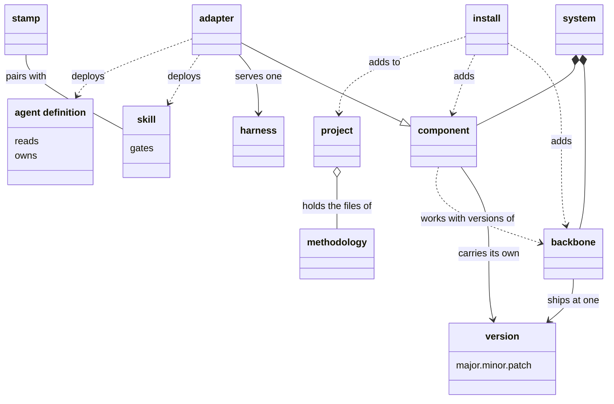

# VIEW-parts-of-the-system — Parts of the system, and projects

The parts the system is made of, the documents it deploys into a harness, and how it gets into a repository. The backbone and each component carry a version. An adapter carries the methodology into one harness. Install adds a part to a repository, which from the first install on is a project.

## version

A version is a number of the form major.minor.patch that names one state of a top-level part of the system: the backbone, or a component. It is read as semantic versioning reads it, so backbone 1.149.0 and project-management 0.54.0 are versions.

**Attributes:**

- three segments: a major, a minor and a patch (COR-010)

**Relations:**

- The backbone has one, and each component has one of its own, apart from the backbone's (COR-010).

**States:** None.

**Always true:**

- The backbone and every component use semantic versioning (COR-010).
- Which segment moves is a person's judgement of the effect, never read from a commit's type (PRJ-002 D2).

## backbone

The backbone is the part of the system that ships whole, at one version: the CLI, the core records and the engines. Every component builds on it.

**Attributes:**

- one version, such as 1.149.0, kept in `.pkit/VERSION` (COR-010)

**Relations:**

- Every component builds on it, and declares which of its versions it works with (COR-010).
- It depends on no component (COR-010).
- Install adds it to a repository first, with `pkit init`.

**States:** None.

**Always true:**

- The dependency never runs the other way: a component depends on the backbone, never the backbone on a component (COR-010).

## component

A component is a part of the system with a version of its own, apart from the backbone's. It declares which backbone versions it works with. An adapter is one kind of component.

**Attributes:**

- its name, its kind and its version, in its own `package.yaml` (COR-017)
- the backbone versions it works with, its `requires_backbone` (COR-017)

**Relations:**

- It builds on the backbone (COR-010).
- Install adds it to a project, and uninstall removes it again (COR-010).

**States:** None.

**Always true:**

- Its version is its own, independent of the backbone's (COR-017).

## skill

A skill is a document that holds a procedure, loaded when a task matches it. It is deployed where the harness looks for it. The `analysis-author` skill, for one, walks through choosing a term's slug.

**Attributes:**

- what it reads and what it needs, declared in its front matter (COR-013 point 2)
- its `gates`: the records whose acceptance it waits on (COR-013 point 2)

**Relations:**

- An adapter deploys it where its harness looks (COR-006).
- A skill that authors files pairs with a stamp. The skill carries the disciplines, and the stamp writes the file (COR-005).

**States:** None.

**Always true:**

- It cites the records and documents it relies on, and never copies their text (COR-006).
- It refuses to run unless each record its `gates` names is accepted (COR-013 point 2).
- Each reference it declares, its body cites, and the other way round (COR-013 point 3).

## agent definition

An agent definition is a document that sets one standing remit, with its boundaries: what it reads and the paths it owns. It is deployed for a harness to delegate work to. `critic.md` is the critic's.

**Attributes:**

- `reads`: the paths, records and patterns it reads (COR-013 point 2)
- `owns`: the paths it is responsible for (COR-013 point 2)
- `needs`: the hooks it calls (COR-013 point 2)

**Relations:**

- An adapter deploys it for its harness (COR-006).
- It differs from a skill: it sets a remit to work within, where a skill holds a procedure for one task (COR-006).

**States:** None.

**Always true:**

- Each path it manages has exactly one owning agent definition (COR-013 point 2).
- What its front matter declares, its body cites, and the other way round (COR-013 point 3).
- It cites the rules and documents it relies on, rather than copying them (COR-006).

## stamp

A stamp is an authoring command that writes a new file with its id, its front matter and its location right. It pairs with a skill, which carries the disciplines the command cannot check, such as choosing a slug. `pkit analysis new term` is one.

**Attributes:** None.

**Relations:**

- It pairs with one skill, which names the command it wraps (COR-005).

**States:** None.

**Always true:**

- Every authoring command of the CLI ships with a paired skill (COR-005).

## adapter

An adapter is a component that carries the methodology into one harness. It translates skills, agent definitions and permissions into the forms that harness reads. The `claude-code` adapter, for one, serves Claude Code.

**Attributes:**

- its version, and the backbone versions it works with, as any component has
- a support declaration: for each need the methodology states of a harness, how far its harness meets it (COR-047 point 2)

**Relations:**

- It is a kind of component, and serves one harness (COR-005).
- It deploys skills and agent definitions where its harness looks for them (COR-006).

**States:** None.

**Always true:**

- A need its support declaration does not cover is unknown, never met (COR-047 point 3).
- A bound on the harness versions its declaration holds for is never widened by itself, only by an author who tested it (COR-047 point 2).
- It enforces the permission model in its harness, and the model, never the harness's settings, is the source of truth (COR-028 point 2).

## install

Install is the operation that adds the backbone, or a component, to a repository. Before it writes anything, it checks that nothing it brings collides by name with what is there. The first install, `pkit init`, adds the backbone, and the repository is a project from then on.

**Attributes:** None.

**Relations:**

- It adds the backbone or a component to a repository.
- Uninstall is its inverse, and removes a component again (COR-010).

**States:** None.

**Always true:**

- Before it touches a file, it checks that the component exists in its source and works with the backbone. It also checks that no name collides (COR-017).
- On a collision, a person chooses for each file whether to override it, skip it or look at it first (COR-017).
- `pkit init` refuses to run again in a project (COR-004).

## project

A project is a repository the system is installed into. It holds the methodology's files beside content of its own. A repository becomes one when `pkit init` installs the system there, and project-kit's own repository is one too.

**Attributes:**

- its own decision records, in the PRJ namespace, and the records of its architecture, in ADR (COR-025)
- its own operational rules, in its own file (COR-014)
- one backbone, and the components installed in it (COR-010)

**Relations:**

- Install adds the backbone and the components to it.
- It holds the methodology's files, and its own content beside them.

**States:** None.

**Always true:**

- Each file it tracks has one owner, the methodology or the project, never both (COR-001).
