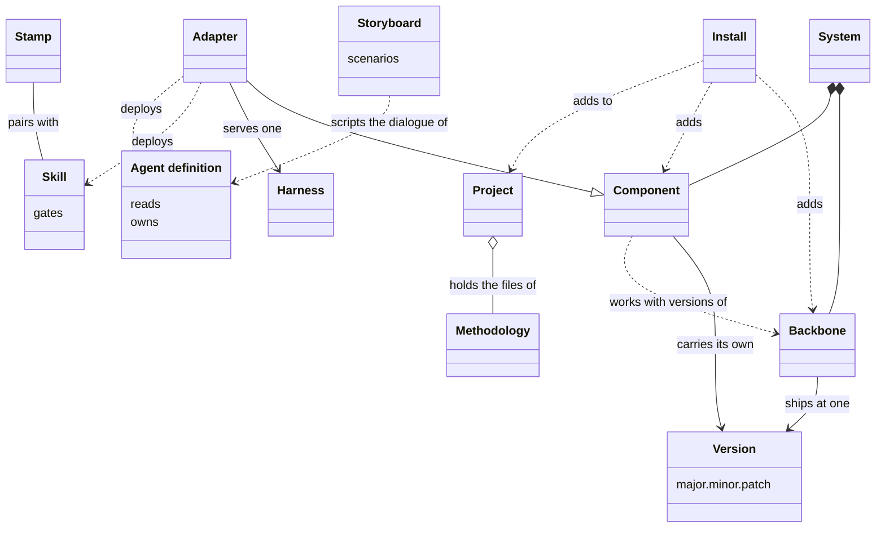
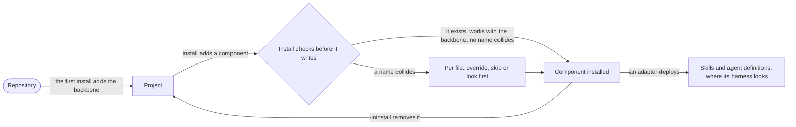

# VIEW-parts-of-the-system — Parts of the system, and projects

The [system](../glossary.md#term-system--system) has parts that work only together, and parts that can move alone ([COR-010](../../../../.pkit/decisions/core/COR-010-resource-lifecycle.md)). Whoever takes up a newer [version](../glossary.md#term-version--version) of a part needs to know whether it breaks what works (COR-010). The [methodology](../glossary.md#term-methodology--methodology)'s content must reach more than one [harness](../glossary.md#term-harness--harness), with each kind of content in a home of its own ([COR-006](../../../../.pkit/decisions/core/COR-006-artifact-roles.md)). It must also enter repositories that already hold files ([COR-017](../../../../.pkit/decisions/core/COR-017-capability-pattern.md)).

The [backbone](../glossary.md#term-backbone--backbone) ships whole, at one version, and each [component](../glossary.md#term-component--component) carries a version of its own (COR-010). [Skills](../glossary.md#term-skill--skill) hold procedures, and [agent definitions](../glossary.md#term-agent-definition--agent-definition) hold standing remits. An [adapter](../glossary.md#term-adapter--adapter) deploys both into one harness, and a [stamp](../glossary.md#term-stamp--stamp) writes a new file for the skill it pairs with. [Install](../glossary.md#term-install--install) adds a part to a repository, which from the first install on is a [project](../glossary.md#term-project--project).

## Version

Defined in [TERM-version](../glossary.md#term-version--version).

**Why:** A version tells whoever takes up a newer one whether it may break what works ([COR-010](../../../../.pkit/decisions/core/COR-010-resource-lifecycle.md)). A minor step of the [backbone](../glossary.md#term-backbone--backbone) should break no [component](../glossary.md#term-component--component), and a major step may (COR-010).

A version is a number of the form major.minor.patch that names one state of a top-level part of the [system](../glossary.md#term-system--system): the backbone, or a component. It is read as semantic versioning reads it, so backbone 1.149.0 and project-management 0.54.0 are versions.

**Attributes:**

- three segments: a major, a minor and a patch (COR-010)

**Relations:**

- The backbone has one, and each component has one of its own, apart from the backbone's (COR-010).

**States:** None.

**Always true:**

- The backbone and every component use semantic versioning (COR-010).
- Which segment moves is a person's judgement of the effect, never read from a commit's type ([PRJ-002 D2](../../../../.pkit/decisions/project/PRJ-002-version-bump-policy.md#d2--the-bump-segment-is-a-human-surface-judgment-not-a-function-of-the-commit-type)).

## Backbone

Defined in [TERM-backbone](../glossary.md#term-backbone--backbone).

**Why:** Some parts, such as the CLI and the core records, move together, and versioning each alone would ignore that they form one coherent whole ([COR-010](../../../../.pkit/decisions/core/COR-010-resource-lifecycle.md)). The backbone is that whole, and every [component](../glossary.md#term-component--component) states which backbone [versions](../glossary.md#term-version--version) it works with (COR-010).

The backbone is the part of the [system](../glossary.md#term-system--system) that ships whole, at one version: the CLI, the core records and the engines. Every component builds on it.

**Attributes:**

- one version, such as 1.149.0, kept in `.pkit/VERSION` (COR-010)

**Relations:**

- Every component builds on it, and declares which of its versions it works with (COR-010).
- It depends on no component (COR-010).
- [Install](../glossary.md#term-install--install) adds it to a repository first, with `pkit init`.

**States:** None.

**Always true:**

- The dependency never runs the other way: a component depends on the backbone, never the backbone on a component (COR-010).

## Component

Defined in [TERM-component](../glossary.md#term-component--component).

**Why:** One [version](../glossary.md#term-version--version) for every part would move them all with each step of the [backbone](../glossary.md#term-backbone--backbone), and leave no way to update one part alone ([COR-010](../../../../.pkit/decisions/core/COR-010-resource-lifecycle.md)). A component moves on its own, at a version of its own (COR-010).

A component is a part of the [system](../glossary.md#term-system--system) with a version of its own, apart from the backbone's. It declares which backbone versions it works with. An [adapter](../glossary.md#term-adapter--adapter) is one kind of component.

**Attributes:**

- its name, its kind and its version, in its own `package.yaml` ([COR-017](../../../../.pkit/decisions/core/COR-017-capability-pattern.md))
- the backbone versions it works with, its `requires_backbone` (COR-017)

**Relations:**

- It builds on the backbone (COR-010).
- [Install](../glossary.md#term-install--install) adds it to a [project](../glossary.md#term-project--project), and uninstall removes it again (COR-010).

**States:** None.

**Always true:**

- Its version is its own, independent of the backbone's (COR-017).

## Skill

Defined in [TERM-skill](../glossary.md#term-skill--skill).

**Why:** A procedure needs a home that a session loads when its task comes up ([COR-006](../../../../.pkit/decisions/core/COR-006-artifact-roles.md)). Without one, such guidance drifts between documents, records and [agent definitions](../glossary.md#term-agent-definition--agent-definition), and everyone puts it somewhere else (COR-006).

A skill is a document that holds a procedure, loaded when a task matches it. It is deployed where the [harness](../glossary.md#term-harness--harness) looks for it. The `analysis-author` skill, for one, walks through choosing a term's slug.

**Attributes:**

- what it reads and what it needs, declared in its front matter ([COR-013 point 2](../../../../.pkit/decisions/core/COR-013-agent-architecture.md#2-unified-frontmatter-shape-agents-and-skills))
- its `gates`: the records whose acceptance it waits on (COR-013 point 2)

**Relations:**

- An [adapter](../glossary.md#term-adapter--adapter) deploys it where its harness looks (COR-006).
- A skill that authors files pairs with a [stamp](../glossary.md#term-stamp--stamp). The skill carries the disciplines, and the stamp writes the file ([COR-005](../../../../.pkit/decisions/core/COR-005-bundle-pattern.md)).

**States:** None.

**Always true:**

- It cites the records and documents it relies on, and never copies their text (COR-006).
- It refuses to run unless each record its `gates` names is accepted (COR-013 point 2).
- Each reference it declares, its body cites, and the other way round ([COR-013 point 3](../../../../.pkit/decisions/core/COR-013-agent-architecture.md#3-reference-graph-and-bidirectional-consistency)).

## Agent definition

Defined in [TERM-agent-definition](../glossary.md#term-agent-definition--agent-definition).

**Why:** Some work needs a standing remit with boundaries, rather than one procedure for one task ([COR-006](../../../../.pkit/decisions/core/COR-006-artifact-roles.md)). Written down with what it reads and owns, a remit can ship to every repository, and each path has one owner ([COR-013](../../../../.pkit/decisions/core/COR-013-agent-architecture.md)).

An agent definition is a document that sets one standing remit, with its boundaries: what it reads and the paths it owns. It is deployed for a [harness](../glossary.md#term-harness--harness) to delegate work to. `critic.md` is the critic's.

**Attributes:**

- `reads`: the paths, records and patterns it reads ([COR-013 point 2](../../../../.pkit/decisions/core/COR-013-agent-architecture.md#2-unified-frontmatter-shape-agents-and-skills))
- `owns`: the paths it is responsible for (COR-013 point 2)
- `needs`: the hooks it calls (COR-013 point 2)

**Relations:**

- An [adapter](../glossary.md#term-adapter--adapter) deploys it for its harness (COR-006).
- It differs from a [skill](../glossary.md#term-skill--skill): it sets a remit to work within, where a skill holds a procedure for one task (COR-006).

**States:** None.

**Always true:**

- Each path it manages has exactly one owning agent definition (COR-013 point 2).
- What its front matter declares, its body cites, and the other way round ([COR-013 point 3](../../../../.pkit/decisions/core/COR-013-agent-architecture.md#3-reference-graph-and-bidirectional-consistency)).
- It cites the rules and documents it relies on, rather than copying them (COR-006).

## Storyboard

Defined in [TERM-storyboard](../glossary.md#term-storyboard--storyboard).

**Why:** A dialogue that a tool holds with a person, turn by turn, is hard to get right inside the tool's own body ([COR-016](../../../../.pkit/decisions/core/COR-016-scripted-scenario-storyboards.md)). Written first as a script, its ambiguities surface before anything is built, and its edge cases become scenarios of their own (COR-016).

A storyboard is a document that scripts a dialogue with a person, scenario by scenario, before the file that carries it out is written. That file then reads it and follows it. Today that file is an [agent definition](../glossary.md#term-agent-definition--agent-definition), and its storyboard lies beside it, as `storyboard.md`.

**Attributes:**

- its framing (COR-016):
  - the scenarios it covers
  - the state they work on
  - where each one starts
- its tone: the norms each turn of its scenarios keeps, such as one thought a turn (COR-016)
- its scenarios (COR-016), each with:
  - its trigger
  - its preconditions
  - a walkthrough of the dialogue
  - what happens behind the scenes
- `consumers:`, the agent definitions that follow it (COR-016)

**Relations:**

- It lies beside the agent definition that follows it, which lists it in `storyboards:`, so each names the other (COR-016).
- No [adapter](../glossary.md#term-adapter--adapter) deploys it. The agent definition reads it where it lies (COR-016).
- The `storyboard-author` [skill](../glossary.md#term-skill--skill) walks its writing, and a [stamp](../glossary.md#term-stamp--stamp), `pkit new storyboard`, writes it.

**States:** None.

**Always true:**

- Nothing requires one. A storyboard is recommended for a dialogue that follows a script, and never for one an AI agent improvises (COR-016).

## Stamp

Defined in [TERM-stamp](../glossary.md#term-stamp--stamp).

**Why:** Writing a new file by hand repeats mechanical steps, such as picking its number, and an early record written so took the wrong number ([COR-005](../../../../.pkit/decisions/core/COR-005-bundle-pattern.md)). A stamp does those steps the same way each time, and the [skill](../glossary.md#term-skill--skill) it pairs with carries the judgement (COR-005).

A stamp is an authoring command that writes a new file with its id, its front matter and its location right. It pairs with a skill, which carries the disciplines the command cannot check, such as choosing a slug. `pkit analysis new term` is one.

**Attributes:** None.

**Relations:**

- It pairs with one skill, which names the command it wraps (COR-005).

**States:** None.

**Always true:**

- Every authoring command of the CLI ships with a paired skill (COR-005).

## Adapter

Defined in [TERM-adapter](../glossary.md#term-adapter--adapter).

**Why:** The [methodology](../glossary.md#term-methodology--methodology)'s content is written for no [harness](../glossary.md#term-harness--harness) in particular, yet each harness reads its own forms ([COR-006](../../../../.pkit/decisions/core/COR-006-artifact-roles.md)). An adapter bridges one harness, so the content stays portable as those tools evolve (COR-006).

An adapter is a [component](../glossary.md#term-component--component) that carries the methodology into one harness. It translates [skills](../glossary.md#term-skill--skill), [agent definitions](../glossary.md#term-agent-definition--agent-definition) and permissions into the forms that harness reads. The `claude-code` adapter, for one, serves Claude Code.

**Attributes:**

- its [version](../glossary.md#term-version--version), and the [backbone](../glossary.md#term-backbone--backbone) versions it works with, as any component has
- a support declaration: for each need the methodology states of a harness, how far its harness meets it ([COR-047 point 2](../../../../.pkit/decisions/core/COR-047-harness-requirement-declaration.md#2-each-adapter-declares-its-support-graded-and-may-bound-it-by-harness-version))

**Relations:**

- It is a kind of component, and serves one harness ([COR-005](../../../../.pkit/decisions/core/COR-005-bundle-pattern.md)).
- It deploys skills and agent definitions where its harness looks for them (COR-006).

**States:** None.

**Always true:**

- A need its support declaration does not cover is unknown, never met ([COR-047 point 3](../../../../.pkit/decisions/core/COR-047-harness-requirement-declaration.md#3-silence-is-indeterminate-never-satisfaction)).
- A bound on the harness versions its declaration holds for is never widened by itself, only by an author who tested it (COR-047 point 2).
- It enforces the permission model in its harness, and the model, never the harness's settings, is the source of truth ([COR-028 point 2](../../../../.pkit/decisions/core/COR-028-permission-model-realization.md#2-the-adapter-realizes-the-model)).

## Install

Defined in [TERM-install](../glossary.md#term-install--install).

**Why:** A part enters a repository whose own files may share names with what it brings ([COR-017](../../../../.pkit/decisions/core/COR-017-capability-pattern.md)). Install finds each clash before it writes, so whoever keeps the repository chooses what happens to each file (COR-017).

Install is the operation that adds the [backbone](../glossary.md#term-backbone--backbone), or a [component](../glossary.md#term-component--component), to a repository. Before it writes anything, it checks that nothing it brings collides by name with what is there. The first install, `pkit init`, adds the backbone, and the repository is a [project](../glossary.md#term-project--project) from then on.

**Attributes:** None.

**Relations:**

- It adds the backbone or a component to a repository.
- Uninstall is its inverse, and removes a component again ([COR-010](../../../../.pkit/decisions/core/COR-010-resource-lifecycle.md)).

**States:** None.

**Always true:**

- Before it touches a file, it checks that the component exists in its source and works with the backbone. It also checks that no name collides (COR-017).
- On a collision, a person chooses for each file whether to override it, skip it or look at it first (COR-017).
- `pkit init` refuses to run again in a project ([COR-004](../../../../.pkit/decisions/core/COR-004-cli-surface.md)).

## Project

Defined in [TERM-project](../glossary.md#term-project--project).

**Why:** A repository must keep receiving the [methodology](../glossary.md#term-methodology--methodology)'s improvements, and still add content of its own without fighting them ([COR-001](../../../../.pkit/decisions/core/COR-001-content-mechanisms.md)). Every repository the [system](../glossary.md#term-system--system) is installed into has such a side of its own, the one where the system is built included ([COR-014](../../../../.pkit/decisions/core/COR-014-universal-applicability.md)).

A project is a repository the system is installed into. It holds the methodology's files beside content of its own. A repository becomes one when `pkit init` installs the system there, and project-kit's own repository is one too.

**Attributes:**

- its own [decision records](../glossary.md#term-decision-record--decision-record), in the PRJ namespace, and the records of its architecture, in ADR ([COR-025](../../../../.pkit/decisions/core/COR-025-adr-decision-space.md))
- its own [operational rules](../glossary.md#term-operational-rule--operational-rule), in its own file (COR-014)
- one [backbone](../glossary.md#term-backbone--backbone), and the [components](../glossary.md#term-component--component) installed in it ([COR-010](../../../../.pkit/decisions/core/COR-010-resource-lifecycle.md))

**Relations:**

- [Install](../glossary.md#term-install--install) adds the backbone and the components to it.
- It holds the methodology's files, and its own content beside them.

**States:** None.

**Always true:**

- Each file it tracks has one owner, the methodology or the project, never both (COR-001).

## What is built on these concepts

Each concept below lists the use cases, journeys and requirements whose text links its term.

**Version:**

- [UC-003 — Declare what my change means for the next release](../use-case-model/use-cases/030-change/UC-003-declare-changeset.md)
- [UC-008 — Release the backbone so adopters can upgrade and pin to it](../use-case-model/use-cases/040-release/UC-008-release-backbone.md)
- [UC-009 — Release my component on its own version](../use-case-model/use-cases/040-release/UC-009-release-component.md)
- [UC-010 — Never ship a backbone change that breaks installed projects without the migration that carries them across](../use-case-model/use-cases/030-change/UC-010-migrate-backbone-change.md)
- [UC-011 — Carry the projects that installed my component across a breaking change of it](../use-case-model/use-cases/030-change/UC-011-migrate-component-change.md)
- [UC-012 — Report a problem with the system, and follow the report](../use-case-model/use-cases/050-adopt/UC-012-report-problem.md)
- [UC-013 — Receive adopters' reports, and link each to its fix](../use-case-model/use-cases/050-adopt/UC-013-link-reports.md)
- [UC-015 — Package a recurring discipline as a capability](../use-case-model/use-cases/010-develop/UC-015-package-capability.md)
- [UC-016 — Keep a capability I wrote in my own repository](../use-case-model/use-cases/010-develop/UC-016-keep-capability.md)
- [UC-018 — Know my capability is ready to share](../use-case-model/use-cases/010-develop/UC-018-check-shareable.md)
- [UC-019 — Adapt the system to another harness](../use-case-model/use-cases/010-develop/UC-019-adapt-harness.md)
- [UC-022 — Add my own operational rules, the harness's settings, grants and agent paths beside the methodology's](../use-case-model/use-cases/020-set-up/UC-022-add-own-additions.md)
- [UC-023 — Add or remove a capability, and be told of a name collision](../use-case-model/use-cases/020-set-up/UC-023-add-or-remove-capability.md)
- [UC-024 — See what a capability would connect to before I install it](../use-case-model/use-cases/020-set-up/UC-024-see-capability-connections.md)
- [UC-026 — Start every session with the project's rules loaded](../use-case-model/use-cases/020-set-up/UC-026-start-with-rules.md)
- [UC-027 — Find my agent definition deployed, with the project's paths and my grants](../use-case-model/use-cases/020-set-up/UC-027-find-agent-definition-deployed.md)
- [UC-031 — Keep my per-machine choices out of what the project commits](../use-case-model/use-cases/020-set-up/UC-031-keep-per-machine-choices.md)
- [UC-048 — Put the system's CLI on my machine at a release](../use-case-model/use-cases/050-adopt/UC-048-install-cli.md)
- [UC-049 — Install the system into my project with one command](../use-case-model/use-cases/050-adopt/UC-049-install-system.md)
- [UC-050 — Get a fresh clone ready to work with one sync](../use-case-model/use-cases/050-adopt/UC-050-ready-fresh-clone.md)
- [UC-051 — Upgrade the system like a dependency](../use-case-model/use-cases/050-adopt/UC-051-upgrade-system.md)
- [UC-052 — Run each project at the version it pins](../use-case-model/use-cases/050-adopt/UC-052-run-at-pin.md)
- [UC-054 — Upgrade one capability on its own](../use-case-model/use-cases/050-adopt/UC-054-upgrade-capability.md)
- [JRN-001 — Adopt the system](../use-case-model/journeys/JRN-001-adopt-system.md)
- [JRN-002 — Upgrade the system](../use-case-model/journeys/JRN-002-upgrade-system.md)
- [REQ-010 · Functional · A command that propagates content under another version than the project records stops](../requirements/functional/REQ-010-stop-under-another-version.md)
- [REQ-026 · Quality · An interrupted version transition never reads as finished, and the next one completes it](../requirements/quality/050-adopt/REQ-026-interrupted-transition-completes.md)
- [REQ-028 · Quality · The router never fails a command over a version pin it cannot resolve](../requirements/quality/050-adopt/REQ-028-unresolved-pin-runs-installed.md)
- [REQ-029 · Functional · A version transition resolves compatibility across components before it writes anything](../requirements/functional/050-adopt/REQ-029-compatibility-before-write.md)
- [REQ-031 · Constraint · The CLI is installed with uv from the distribution's git URL](../requirements/constraints/050-adopt/REQ-031-cli-from-distribution-url.md)

**Backbone:**

- [UC-003 — Declare what my change means for the next release](../use-case-model/use-cases/030-change/UC-003-declare-changeset.md)
- [UC-004 — Know before I push that my change passes my project's checks](../use-case-model/use-cases/030-change/UC-004-check-before-push.md)
- [UC-006 — Make my merges wait on the system's checks](../use-case-model/use-cases/030-change/UC-006-gate-merges.md)
- [UC-007 — Resolve what the default branch left out of date](../use-case-model/use-cases/030-change/UC-007-resolve-debt.md)
- [UC-008 — Release the backbone so adopters can upgrade and pin to it](../use-case-model/use-cases/040-release/UC-008-release-backbone.md)
- [UC-009 — Release my component on its own version](../use-case-model/use-cases/040-release/UC-009-release-component.md)
- [UC-010 — Never ship a backbone change that breaks installed projects without the migration that carries them across](../use-case-model/use-cases/030-change/UC-010-migrate-backbone-change.md)
- [UC-011 — Carry the projects that installed my component across a breaking change of it](../use-case-model/use-cases/030-change/UC-011-migrate-component-change.md)
- [UC-012 — Report a problem with the system, and follow the report](../use-case-model/use-cases/050-adopt/UC-012-report-problem.md)
- [UC-014 — Develop the methodology in its source repository](../use-case-model/use-cases/010-develop/UC-014-develop-methodology.md)
- [UC-015 — Package a recurring discipline as a capability](../use-case-model/use-cases/010-develop/UC-015-package-capability.md)
- [UC-016 — Keep a capability I wrote in my own repository](../use-case-model/use-cases/010-develop/UC-016-keep-capability.md)
- [UC-017 — Give my capability roles, data points and processes others connect to](../use-case-model/use-cases/010-develop/UC-017-connect-capability.md)
- [UC-018 — Know my capability is ready to share](../use-case-model/use-cases/010-develop/UC-018-check-shareable.md)
- [UC-019 — Adapt the system to another harness](../use-case-model/use-cases/010-develop/UC-019-adapt-harness.md)
- [UC-021 — Declare my project's backbone configuration once, and have it validated](../use-case-model/use-cases/020-set-up/UC-021-declare-backbone-configuration.md)
- [UC-023 — Add or remove a capability, and be told of a name collision](../use-case-model/use-cases/020-set-up/UC-023-add-or-remove-capability.md)
- [UC-025 — Choose which installed capability provides a role](../use-case-model/use-cases/020-set-up/UC-025-choose-role-provider.md)
- [UC-027 — Find my agent definition deployed, with the project's paths and my grants](../use-case-model/use-cases/020-set-up/UC-027-find-agent-definition-deployed.md)
- [UC-028 — Keep my intermediate files in a workspace no commit carries](../use-case-model/use-cases/020-set-up/UC-028-keep-intermediate-files.md)
- [UC-030 — Let agents work on their own without a stream of confirmations](../use-case-model/use-cases/020-set-up/UC-030-work-unprompted.md)
- [UC-031 — Keep my per-machine choices out of what the project commits](../use-case-model/use-cases/020-set-up/UC-031-keep-per-machine-choices.md)
- [UC-032 — Be asked before an agent changes another repository](../use-case-model/use-cases/020-set-up/UC-032-ask-before-other-repository.md)
- [UC-033 — Find out why a command prompted me or was blocked](../use-case-model/use-cases/020-set-up/UC-033-find-why-prompted.md)
- [UC-034 — Land my change on the default branch](../use-case-model/use-cases/030-change/UC-034-land-change.md)
- [UC-038 — Author and extend my project's own rule sets](../use-case-model/use-cases/030-change/UC-038-author-rule-sets.md)
- [UC-042 — Have my draft challenged and my diff checked against the conventions](../use-case-model/use-cases/030-change/UC-042-challenge-and-check.md)
- [UC-049 — Install the system into my project with one command](../use-case-model/use-cases/050-adopt/UC-049-install-system.md)
- [UC-050 — Get a fresh clone ready to work with one sync](../use-case-model/use-cases/050-adopt/UC-050-ready-fresh-clone.md)
- [UC-051 — Upgrade the system like a dependency](../use-case-model/use-cases/050-adopt/UC-051-upgrade-system.md)
- [UC-052 — Run each project at the version it pins](../use-case-model/use-cases/050-adopt/UC-052-run-at-pin.md)
- [UC-054 — Upgrade one capability on its own](../use-case-model/use-cases/050-adopt/UC-054-upgrade-capability.md)
- [JRN-002 — Upgrade the system](../use-case-model/journeys/JRN-002-upgrade-system.md)
- [JRN-003 — Deliver a change](../use-case-model/journeys/JRN-003-deliver-change.md)
- [REQ-001 · Quality · A migration run again changes nothing](../requirements/quality/030-change/REQ-001-migration-runs-again.md)
- [REQ-006 · Quality · The backbone stops a command it runs for an anchor, a data point, validation or a process after thirty seconds](../requirements/quality/REQ-006-command-time-bound.md)
- [REQ-007 · Constraint · A command that resolves an anchor, fills a data point or joins validation is offline, read-only and deterministic](../requirements/constraints/REQ-007-offline-same-answer.md)
- [REQ-008 · Constraint · Until #1600 is done, no change adds an area or an adapter a release ships, other than the `rule-sets` area, and none removes one](../requirements/constraints/010-develop/REQ-008-areas-held.md)
- [REQ-009 · Quality · A command whose effect reaches past what the person named offers `--dry-run`](../requirements/quality/REQ-009-preview-before-change.md)
- [REQ-010 · Functional · A command that propagates content under another version than the project records stops](../requirements/functional/REQ-010-stop-under-another-version.md)
- [REQ-017 · Quality · A backbone migration is safe over any state](../requirements/quality/030-change/REQ-017-backbone-migration-safe.md)
- [REQ-018 · Quality · A reading command of the friction group prints the same document for the same state](../requirements/quality/030-change/REQ-018-same-json-same-state.md)
- [REQ-019 · Functional · Each reading document of the friction group carries its version, and a reader refuses one it does not know](../requirements/functional/030-change/REQ-019-reading-document-versioned.md)
- [REQ-026 · Quality · An interrupted version transition never reads as finished, and the next one completes it](../requirements/quality/050-adopt/REQ-026-interrupted-transition-completes.md)
- [REQ-029 · Functional · A version transition resolves compatibility across components before it writes anything](../requirements/functional/050-adopt/REQ-029-compatibility-before-write.md)

**Component:**

- [UC-003 — Declare what my change means for the next release](../use-case-model/use-cases/030-change/UC-003-declare-changeset.md)
- [UC-004 — Know before I push that my change passes my project's checks](../use-case-model/use-cases/030-change/UC-004-check-before-push.md)
- [UC-005 — Say what my document rests on](../use-case-model/use-cases/030-change/UC-005-anchor-document.md)
- [UC-008 — Release the backbone so adopters can upgrade and pin to it](../use-case-model/use-cases/040-release/UC-008-release-backbone.md)
- [UC-009 — Release my component on its own version](../use-case-model/use-cases/040-release/UC-009-release-component.md)
- [UC-010 — Never ship a backbone change that breaks installed projects without the migration that carries them across](../use-case-model/use-cases/030-change/UC-010-migrate-backbone-change.md)
- [UC-011 — Carry the projects that installed my component across a breaking change of it](../use-case-model/use-cases/030-change/UC-011-migrate-component-change.md)
- [UC-017 — Give my capability roles, data points and processes others connect to](../use-case-model/use-cases/010-develop/UC-017-connect-capability.md)
- [UC-018 — Know my capability is ready to share](../use-case-model/use-cases/010-develop/UC-018-check-shareable.md)
- [UC-025 — Choose which installed capability provides a role](../use-case-model/use-cases/020-set-up/UC-025-choose-role-provider.md)
- [UC-038 — Author and extend my project's own rule sets](../use-case-model/use-cases/030-change/UC-038-author-rule-sets.md)
- [UC-042 — Have my draft challenged and my diff checked against the conventions](../use-case-model/use-cases/030-change/UC-042-challenge-and-check.md)
- [UC-049 — Install the system into my project with one command](../use-case-model/use-cases/050-adopt/UC-049-install-system.md)
- [UC-050 — Get a fresh clone ready to work with one sync](../use-case-model/use-cases/050-adopt/UC-050-ready-fresh-clone.md)
- [UC-051 — Upgrade the system like a dependency](../use-case-model/use-cases/050-adopt/UC-051-upgrade-system.md)
- [JRN-001 — Adopt the system](../use-case-model/journeys/JRN-001-adopt-system.md)
- [JRN-002 — Upgrade the system](../use-case-model/journeys/JRN-002-upgrade-system.md)
- [JRN-003 — Deliver a change](../use-case-model/journeys/JRN-003-deliver-change.md)
- [REQ-001 · Quality · A migration run again changes nothing](../requirements/quality/030-change/REQ-001-migration-runs-again.md)
- [REQ-007 · Constraint · A command that resolves an anchor, fills a data point or joins validation is offline, read-only and deterministic](../requirements/constraints/REQ-007-offline-same-answer.md)
- [REQ-009 · Quality · A command whose effect reaches past what the person named offers `--dry-run`](../requirements/quality/REQ-009-preview-before-change.md)
- [REQ-014 · Functional · A later edit of a documentation root moves no document](../requirements/functional/020-set-up/REQ-014-root-change-moves-nothing.md)
- [REQ-018 · Quality · A reading command of the friction group prints the same document for the same state](../requirements/quality/030-change/REQ-018-same-json-same-state.md)
- [REQ-019 · Functional · Each reading document of the friction group carries its version, and a reader refuses one it does not know](../requirements/functional/030-change/REQ-019-reading-document-versioned.md)
- [REQ-029 · Functional · A version transition resolves compatibility across components before it writes anything](../requirements/functional/050-adopt/REQ-029-compatibility-before-write.md)

**Skill:**

- [UC-010 — Never ship a backbone change that breaks installed projects without the migration that carries them across](../use-case-model/use-cases/030-change/UC-010-migrate-backbone-change.md)
- [UC-011 — Carry the projects that installed my component across a breaking change of it](../use-case-model/use-cases/030-change/UC-011-migrate-component-change.md)
- [UC-012 — Report a problem with the system, and follow the report](../use-case-model/use-cases/050-adopt/UC-012-report-problem.md)
- [UC-014 — Develop the methodology in its source repository](../use-case-model/use-cases/010-develop/UC-014-develop-methodology.md)
- [UC-015 — Package a recurring discipline as a capability](../use-case-model/use-cases/010-develop/UC-015-package-capability.md)
- [UC-016 — Keep a capability I wrote in my own repository](../use-case-model/use-cases/010-develop/UC-016-keep-capability.md)
- [UC-017 — Give my capability roles, data points and processes others connect to](../use-case-model/use-cases/010-develop/UC-017-connect-capability.md)
- [UC-019 — Adapt the system to another harness](../use-case-model/use-cases/010-develop/UC-019-adapt-harness.md)
- [UC-020 — Turn recurring work into my project's own skill or agent definition](../use-case-model/use-cases/010-develop/UC-020-own-skill-or-agent.md)
- [UC-022 — Add my own operational rules, the harness's settings, grants and agent paths beside the methodology's](../use-case-model/use-cases/020-set-up/UC-022-add-own-additions.md)
- [UC-023 — Add or remove a capability, and be told of a name collision](../use-case-model/use-cases/020-set-up/UC-023-add-or-remove-capability.md)
- [UC-027 — Find my agent definition deployed, with the project's paths and my grants](../use-case-model/use-cases/020-set-up/UC-027-find-agent-definition-deployed.md)
- [UC-037 — Record my decision beside the methodology's](../use-case-model/use-cases/030-change/UC-037-record-decision.md)
- [UC-039 — Think a question through in a scratchpad note, and retire it](../use-case-model/use-cases/030-change/UC-039-think-in-scratchpad.md)
- [UC-041 — Keep each core record true for any project that adopts it](../use-case-model/use-cases/030-change/UC-041-keep-core-records-true.md)
- [UC-042 — Have my draft challenged and my diff checked against the conventions](../use-case-model/use-cases/030-change/UC-042-challenge-and-check.md)
- [UC-049 — Install the system into my project with one command](../use-case-model/use-cases/050-adopt/UC-049-install-system.md)
- [UC-050 — Get a fresh clone ready to work with one sync](../use-case-model/use-cases/050-adopt/UC-050-ready-fresh-clone.md)
- [UC-051 — Upgrade the system like a dependency](../use-case-model/use-cases/050-adopt/UC-051-upgrade-system.md)
- [UC-054 — Upgrade one capability on its own](../use-case-model/use-cases/050-adopt/UC-054-upgrade-capability.md)
- [JRN-001 — Adopt the system](../use-case-model/journeys/JRN-001-adopt-system.md)

**Agent definition:**

- [UC-014 — Develop the methodology in its source repository](../use-case-model/use-cases/010-develop/UC-014-develop-methodology.md)
- [UC-015 — Package a recurring discipline as a capability](../use-case-model/use-cases/010-develop/UC-015-package-capability.md)
- [UC-016 — Keep a capability I wrote in my own repository](../use-case-model/use-cases/010-develop/UC-016-keep-capability.md)
- [UC-017 — Give my capability roles, data points and processes others connect to](../use-case-model/use-cases/010-develop/UC-017-connect-capability.md)
- [UC-019 — Adapt the system to another harness](../use-case-model/use-cases/010-develop/UC-019-adapt-harness.md)
- [UC-020 — Turn recurring work into my project's own skill or agent definition](../use-case-model/use-cases/010-develop/UC-020-own-skill-or-agent.md)
- [UC-022 — Add my own operational rules, the harness's settings, grants and agent paths beside the methodology's](../use-case-model/use-cases/020-set-up/UC-022-add-own-additions.md)
- [UC-023 — Add or remove a capability, and be told of a name collision](../use-case-model/use-cases/020-set-up/UC-023-add-or-remove-capability.md)
- [UC-027 — Find my agent definition deployed, with the project's paths and my grants](../use-case-model/use-cases/020-set-up/UC-027-find-agent-definition-deployed.md)
- [UC-037 — Record my decision beside the methodology's](../use-case-model/use-cases/030-change/UC-037-record-decision.md)
- [UC-041 — Keep each core record true for any project that adopts it](../use-case-model/use-cases/030-change/UC-041-keep-core-records-true.md)
- [UC-042 — Have my draft challenged and my diff checked against the conventions](../use-case-model/use-cases/030-change/UC-042-challenge-and-check.md)
- [UC-049 — Install the system into my project with one command](../use-case-model/use-cases/050-adopt/UC-049-install-system.md)
- [UC-050 — Get a fresh clone ready to work with one sync](../use-case-model/use-cases/050-adopt/UC-050-ready-fresh-clone.md)
- [UC-051 — Upgrade the system like a dependency](../use-case-model/use-cases/050-adopt/UC-051-upgrade-system.md)
- [UC-054 — Upgrade one capability on its own](../use-case-model/use-cases/050-adopt/UC-054-upgrade-capability.md)
- [JRN-001 — Adopt the system](../use-case-model/journeys/JRN-001-adopt-system.md)
- [REQ-017 · Quality · A backbone migration is safe over any state](../requirements/quality/030-change/REQ-017-backbone-migration-safe.md)

**Storyboard:**

- [UC-020 — Turn recurring work into my project's own skill or agent definition](../use-case-model/use-cases/010-develop/UC-020-own-skill-or-agent.md)

**Stamp:**

- [UC-005 — Say what my document rests on](../use-case-model/use-cases/030-change/UC-005-anchor-document.md)
- [UC-010 — Never ship a backbone change that breaks installed projects without the migration that carries them across](../use-case-model/use-cases/030-change/UC-010-migrate-backbone-change.md)
- [UC-011 — Carry the projects that installed my component across a breaking change of it](../use-case-model/use-cases/030-change/UC-011-migrate-component-change.md)
- [UC-015 — Package a recurring discipline as a capability](../use-case-model/use-cases/010-develop/UC-015-package-capability.md)
- [UC-017 — Give my capability roles, data points and processes others connect to](../use-case-model/use-cases/010-develop/UC-017-connect-capability.md)
- [UC-019 — Adapt the system to another harness](../use-case-model/use-cases/010-develop/UC-019-adapt-harness.md)
- [UC-020 — Turn recurring work into my project's own skill or agent definition](../use-case-model/use-cases/010-develop/UC-020-own-skill-or-agent.md)
- [UC-037 — Record my decision beside the methodology's](../use-case-model/use-cases/030-change/UC-037-record-decision.md)
- [UC-038 — Author and extend my project's own rule sets](../use-case-model/use-cases/030-change/UC-038-author-rule-sets.md)
- [UC-039 — Think a question through in a scratchpad note, and retire it](../use-case-model/use-cases/030-change/UC-039-think-in-scratchpad.md)

**Adapter:**

- [UC-007 — Resolve what the default branch left out of date](../use-case-model/use-cases/030-change/UC-007-resolve-debt.md)
- [UC-009 — Release my component on its own version](../use-case-model/use-cases/040-release/UC-009-release-component.md)
- [UC-010 — Never ship a backbone change that breaks installed projects without the migration that carries them across](../use-case-model/use-cases/030-change/UC-010-migrate-backbone-change.md)
- [UC-011 — Carry the projects that installed my component across a breaking change of it](../use-case-model/use-cases/030-change/UC-011-migrate-component-change.md)
- [UC-012 — Report a problem with the system, and follow the report](../use-case-model/use-cases/050-adopt/UC-012-report-problem.md)
- [UC-014 — Develop the methodology in its source repository](../use-case-model/use-cases/010-develop/UC-014-develop-methodology.md)
- [UC-015 — Package a recurring discipline as a capability](../use-case-model/use-cases/010-develop/UC-015-package-capability.md)
- [UC-016 — Keep a capability I wrote in my own repository](../use-case-model/use-cases/010-develop/UC-016-keep-capability.md)
- [UC-017 — Give my capability roles, data points and processes others connect to](../use-case-model/use-cases/010-develop/UC-017-connect-capability.md)
- [UC-019 — Adapt the system to another harness](../use-case-model/use-cases/010-develop/UC-019-adapt-harness.md)
- [UC-020 — Turn recurring work into my project's own skill or agent definition](../use-case-model/use-cases/010-develop/UC-020-own-skill-or-agent.md)
- [UC-022 — Add my own operational rules, the harness's settings, grants and agent paths beside the methodology's](../use-case-model/use-cases/020-set-up/UC-022-add-own-additions.md)
- [UC-023 — Add or remove a capability, and be told of a name collision](../use-case-model/use-cases/020-set-up/UC-023-add-or-remove-capability.md)
- [UC-026 — Start every session with the project's rules loaded](../use-case-model/use-cases/020-set-up/UC-026-start-with-rules.md)
- [UC-027 — Find my agent definition deployed, with the project's paths and my grants](../use-case-model/use-cases/020-set-up/UC-027-find-agent-definition-deployed.md)
- [UC-028 — Keep my intermediate files in a workspace no commit carries](../use-case-model/use-cases/020-set-up/UC-028-keep-intermediate-files.md)
- [UC-029 — Get a delegated agent's result back whole](../use-case-model/use-cases/020-set-up/UC-029-get-result-whole.md)
- [UC-030 — Let agents work on their own without a stream of confirmations](../use-case-model/use-cases/020-set-up/UC-030-work-unprompted.md)
- [UC-031 — Keep my per-machine choices out of what the project commits](../use-case-model/use-cases/020-set-up/UC-031-keep-per-machine-choices.md)
- [UC-032 — Be asked before an agent changes another repository](../use-case-model/use-cases/020-set-up/UC-032-ask-before-other-repository.md)
- [UC-033 — Find out why a command prompted me or was blocked](../use-case-model/use-cases/020-set-up/UC-033-find-why-prompted.md)
- [UC-042 — Have my draft challenged and my diff checked against the conventions](../use-case-model/use-cases/030-change/UC-042-challenge-and-check.md)
- [UC-049 — Install the system into my project with one command](../use-case-model/use-cases/050-adopt/UC-049-install-system.md)
- [UC-050 — Get a fresh clone ready to work with one sync](../use-case-model/use-cases/050-adopt/UC-050-ready-fresh-clone.md)
- [UC-051 — Upgrade the system like a dependency](../use-case-model/use-cases/050-adopt/UC-051-upgrade-system.md)
- [UC-054 — Upgrade one capability on its own](../use-case-model/use-cases/050-adopt/UC-054-upgrade-capability.md)
- [JRN-001 — Adopt the system](../use-case-model/journeys/JRN-001-adopt-system.md)
- [REQ-008 · Constraint · Until #1600 is done, no change adds an area or an adapter a release ships, other than the `rule-sets` area, and none removes one](../requirements/constraints/010-develop/REQ-008-areas-held.md)
- [REQ-016 · Constraint · The permission model's code needs only the system `python3` and its standard library](../requirements/constraints/020-set-up/REQ-016-permissions-standard-library.md)

**Install:**

- [UC-014 — Develop the methodology in its source repository](../use-case-model/use-cases/010-develop/UC-014-develop-methodology.md)
- [UC-016 — Keep a capability I wrote in my own repository](../use-case-model/use-cases/010-develop/UC-016-keep-capability.md)
- [UC-022 — Add my own operational rules, the harness's settings, grants and agent paths beside the methodology's](../use-case-model/use-cases/020-set-up/UC-022-add-own-additions.md)
- [UC-023 — Add or remove a capability, and be told of a name collision](../use-case-model/use-cases/020-set-up/UC-023-add-or-remove-capability.md)
- [UC-024 — See what a capability would connect to before I install it](../use-case-model/use-cases/020-set-up/UC-024-see-capability-connections.md)
- [UC-026 — Start every session with the project's rules loaded](../use-case-model/use-cases/020-set-up/UC-026-start-with-rules.md)
- [UC-038 — Author and extend my project's own rule sets](../use-case-model/use-cases/030-change/UC-038-author-rule-sets.md)
- [UC-049 — Install the system into my project with one command](../use-case-model/use-cases/050-adopt/UC-049-install-system.md)
- [UC-051 — Upgrade the system like a dependency](../use-case-model/use-cases/050-adopt/UC-051-upgrade-system.md)
- [JRN-001 — Adopt the system](../use-case-model/journeys/JRN-001-adopt-system.md)
- [JRN-002 — Upgrade the system](../use-case-model/journeys/JRN-002-upgrade-system.md)
- [REQ-002 · Functional · Project-owned content is written only by the writers records name](../requirements/functional/REQ-002-project-owned-writers.md)
- [REQ-009 · Quality · A command whose effect reaches past what the person named offers `--dry-run`](../requirements/quality/REQ-009-preview-before-change.md)
- [REQ-010 · Functional · A command that propagates content under another version than the project records stops](../requirements/functional/REQ-010-stop-under-another-version.md)
- [REQ-026 · Quality · An interrupted version transition never reads as finished, and the next one completes it](../requirements/quality/050-adopt/REQ-026-interrupted-transition-completes.md)

**Project:**

- [UC-002 — Answer what my change made stale](../use-case-model/use-cases/030-change/UC-002-answer-stale.md)
- [UC-003 — Declare what my change means for the next release](../use-case-model/use-cases/030-change/UC-003-declare-changeset.md)
- [UC-004 — Know before I push that my change passes my project's checks](../use-case-model/use-cases/030-change/UC-004-check-before-push.md)
- [UC-005 — Say what my document rests on](../use-case-model/use-cases/030-change/UC-005-anchor-document.md)
- [UC-006 — Make my merges wait on the system's checks](../use-case-model/use-cases/030-change/UC-006-gate-merges.md)
- [UC-007 — Resolve what the default branch left out of date](../use-case-model/use-cases/030-change/UC-007-resolve-debt.md)
- [UC-008 — Release the backbone so adopters can upgrade and pin to it](../use-case-model/use-cases/040-release/UC-008-release-backbone.md)
- [UC-010 — Never ship a backbone change that breaks installed projects without the migration that carries them across](../use-case-model/use-cases/030-change/UC-010-migrate-backbone-change.md)
- [UC-011 — Carry the projects that installed my component across a breaking change of it](../use-case-model/use-cases/030-change/UC-011-migrate-component-change.md)
- [UC-012 — Report a problem with the system, and follow the report](../use-case-model/use-cases/050-adopt/UC-012-report-problem.md)
- [UC-013 — Receive adopters' reports, and link each to its fix](../use-case-model/use-cases/050-adopt/UC-013-link-reports.md)
- [UC-015 — Package a recurring discipline as a capability](../use-case-model/use-cases/010-develop/UC-015-package-capability.md)
- [UC-016 — Keep a capability I wrote in my own repository](../use-case-model/use-cases/010-develop/UC-016-keep-capability.md)
- [UC-017 — Give my capability roles, data points and processes others connect to](../use-case-model/use-cases/010-develop/UC-017-connect-capability.md)
- [UC-018 — Know my capability is ready to share](../use-case-model/use-cases/010-develop/UC-018-check-shareable.md)
- [UC-019 — Adapt the system to another harness](../use-case-model/use-cases/010-develop/UC-019-adapt-harness.md)
- [UC-020 — Turn recurring work into my project's own skill or agent definition](../use-case-model/use-cases/010-develop/UC-020-own-skill-or-agent.md)
- [UC-021 — Declare my project's backbone configuration once, and have it validated](../use-case-model/use-cases/020-set-up/UC-021-declare-backbone-configuration.md)
- [UC-022 — Add my own operational rules, the harness's settings, grants and agent paths beside the methodology's](../use-case-model/use-cases/020-set-up/UC-022-add-own-additions.md)
- [UC-023 — Add or remove a capability, and be told of a name collision](../use-case-model/use-cases/020-set-up/UC-023-add-or-remove-capability.md)
- [UC-024 — See what a capability would connect to before I install it](../use-case-model/use-cases/020-set-up/UC-024-see-capability-connections.md)
- [UC-025 — Choose which installed capability provides a role](../use-case-model/use-cases/020-set-up/UC-025-choose-role-provider.md)
- [UC-026 — Start every session with the project's rules loaded](../use-case-model/use-cases/020-set-up/UC-026-start-with-rules.md)
- [UC-027 — Find my agent definition deployed, with the project's paths and my grants](../use-case-model/use-cases/020-set-up/UC-027-find-agent-definition-deployed.md)
- [UC-028 — Keep my intermediate files in a workspace no commit carries](../use-case-model/use-cases/020-set-up/UC-028-keep-intermediate-files.md)
- [UC-029 — Get a delegated agent's result back whole](../use-case-model/use-cases/020-set-up/UC-029-get-result-whole.md)
- [UC-030 — Let agents work on their own without a stream of confirmations](../use-case-model/use-cases/020-set-up/UC-030-work-unprompted.md)
- [UC-031 — Keep my per-machine choices out of what the project commits](../use-case-model/use-cases/020-set-up/UC-031-keep-per-machine-choices.md)
- [UC-032 — Be asked before an agent changes another repository](../use-case-model/use-cases/020-set-up/UC-032-ask-before-other-repository.md)
- [UC-033 — Find out why a command prompted me or was blocked](../use-case-model/use-cases/020-set-up/UC-033-find-why-prompted.md)
- [UC-034 — Land my change on the default branch](../use-case-model/use-cases/030-change/UC-034-land-change.md)
- [UC-037 — Record my decision beside the methodology's](../use-case-model/use-cases/030-change/UC-037-record-decision.md)
- [UC-038 — Author and extend my project's own rule sets](../use-case-model/use-cases/030-change/UC-038-author-rule-sets.md)
- [UC-039 — Think a question through in a scratchpad note, and retire it](../use-case-model/use-cases/030-change/UC-039-think-in-scratchpad.md)
- [UC-040 — Have a drafted record or rule become binding only through my own review](../use-case-model/use-cases/030-change/UC-040-accept-through-review.md)
- [UC-041 — Keep each core record true for any project that adopts it](../use-case-model/use-cases/030-change/UC-041-keep-core-records-true.md)
- [UC-042 — Have my draft challenged and my diff checked against the conventions](../use-case-model/use-cases/030-change/UC-042-challenge-and-check.md)
- [UC-048 — Put the system's CLI on my machine at a release](../use-case-model/use-cases/050-adopt/UC-048-install-cli.md)
- [UC-049 — Install the system into my project with one command](../use-case-model/use-cases/050-adopt/UC-049-install-system.md)
- [UC-050 — Get a fresh clone ready to work with one sync](../use-case-model/use-cases/050-adopt/UC-050-ready-fresh-clone.md)
- [UC-051 — Upgrade the system like a dependency](../use-case-model/use-cases/050-adopt/UC-051-upgrade-system.md)
- [UC-052 — Run each project at the version it pins](../use-case-model/use-cases/050-adopt/UC-052-run-at-pin.md)
- [UC-053 — Re-pin an inherited rule set once I have reviewed its new major](../use-case-model/use-cases/050-adopt/UC-053-repin-rule-set.md)
- [UC-054 — Upgrade one capability on its own](../use-case-model/use-cases/050-adopt/UC-054-upgrade-capability.md)
- [JRN-001 — Adopt the system](../use-case-model/journeys/JRN-001-adopt-system.md)
- [JRN-002 — Upgrade the system](../use-case-model/journeys/JRN-002-upgrade-system.md)
- [JRN-003 — Deliver a change](../use-case-model/journeys/JRN-003-deliver-change.md)
- [REQ-001 · Quality · A migration run again changes nothing](../requirements/quality/030-change/REQ-001-migration-runs-again.md)
- [REQ-002 · Functional · Project-owned content is written only by the writers records name](../requirements/functional/REQ-002-project-owned-writers.md)
- [REQ-003 · Constraint · The backbone's CLI runs on Python 3.11 or later](../requirements/constraints/REQ-003-python-floor.md)
- [REQ-004 · Quality · A check never reads a missing result as one that found nothing](../requirements/quality/REQ-004-missing-answer-never-clean.md)
- [REQ-005 · Quality · A command that only reads or validates changes nothing in the project](../requirements/quality/REQ-005-reading-writes-nothing.md)
- [REQ-008 · Constraint · Until #1600 is done, no change adds an area or an adapter a release ships, other than the `rule-sets` area, and none removes one](../requirements/constraints/010-develop/REQ-008-areas-held.md)
- [REQ-009 · Quality · A command whose effect reaches past what the person named offers `--dry-run`](../requirements/quality/REQ-009-preview-before-change.md)
- [REQ-010 · Functional · A command that propagates content under another version than the project records stops](../requirements/functional/REQ-010-stop-under-another-version.md)
- [REQ-012 · Functional · The system asks the operator before its command changes another repository](../requirements/functional/REQ-012-ask-before-another-repository.md)
- [REQ-015 · Functional · A declared documentation root that does not exist yet warns rather than fails](../requirements/functional/REQ-015-missing-root-warns.md)
- [REQ-017 · Quality · A backbone migration is safe over any state](../requirements/quality/030-change/REQ-017-backbone-migration-safe.md)
- [REQ-026 · Quality · An interrupted version transition never reads as finished, and the next one completes it](../requirements/quality/050-adopt/REQ-026-interrupted-transition-completes.md)
- [REQ-027 · Quality · The version pin holds the old one or the new one, never part, and an upgrade writes it last](../requirements/quality/050-adopt/REQ-027-pin-whole-written-last.md)
- [REQ-028 · Quality · The router never fails a command over a version pin it cannot resolve](../requirements/quality/050-adopt/REQ-028-unresolved-pin-runs-installed.md)
- [REQ-029 · Functional · A version transition resolves compatibility across components before it writes anything](../requirements/functional/050-adopt/REQ-029-compatibility-before-write.md)
