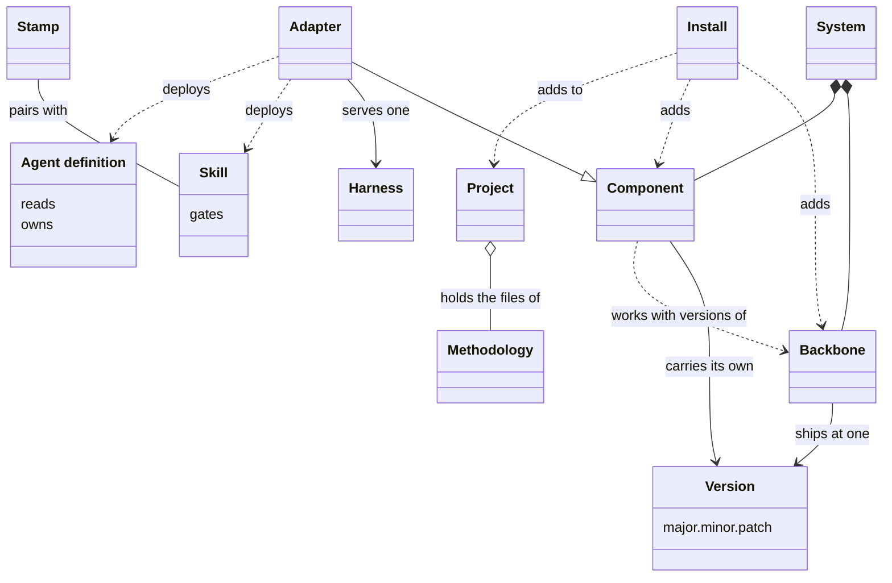

# VIEW-parts-of-the-system — Parts of the system, and projects

The [system](../glossary.md#term-system--system) has parts that work only together, and parts that can move alone (COR-010). Whoever takes up a newer [version](../glossary.md#term-version--version) of a part needs to know whether it breaks what works (COR-010). The [methodology](../glossary.md#term-methodology--methodology)'s content must reach more than one [harness](../glossary.md#term-harness--harness), with each kind of content in a home of its own (COR-006). It must also enter repositories that already hold files (COR-017).

The [backbone](../glossary.md#term-backbone--backbone) ships whole, at one version, and each [component](../glossary.md#term-component--component) carries a version of its own (COR-010). [Skills](../glossary.md#term-skill--skill) hold procedures, and [agent definitions](../glossary.md#term-agent-definition--agent-definition) hold standing remits. An [adapter](../glossary.md#term-adapter--adapter) deploys both into one harness, and a [stamp](../glossary.md#term-stamp--stamp) writes a new file for the skill it pairs with. [Install](../glossary.md#term-install--install) adds a part to a repository, which from the first install on is a [project](../glossary.md#term-project--project).

## Version

Defined in [TERM-version](../glossary.md#term-version--version).

**Why:** A version tells whoever takes up a newer one whether it may break what works (COR-010). A minor step of the [backbone](../glossary.md#term-backbone--backbone) should break no [component](../glossary.md#term-component--component), and a major step may (COR-010).

A version is a number of the form major.minor.patch that names one state of a top-level part of the [system](../glossary.md#term-system--system): the backbone, or a component. It is read as semantic versioning reads it, so backbone 1.149.0 and project-management 0.54.0 are versions.

**Attributes:**

- three segments: a major, a minor and a patch (COR-010)

**Relations:**

- The backbone has one, and each component has one of its own, apart from the backbone's (COR-010).

**States:** None.

**Always true:**

- The backbone and every component use semantic versioning (COR-010).
- Which segment moves is a person's judgement of the effect, never read from a commit's type (PRJ-002 D2).

## Backbone

Defined in [TERM-backbone](../glossary.md#term-backbone--backbone).

**Why:** Some parts, such as the CLI and the core records, move together, and versioning each alone would ignore that they form one coherent whole (COR-010). The backbone is that whole, and every [component](../glossary.md#term-component--component) states which backbone [versions](../glossary.md#term-version--version) it works with (COR-010).

The backbone is the part of the [system](../glossary.md#term-system--system) that ships whole, at one version: the CLI, the core records and the engines. Every component builds on it.

**Attributes:**

- one version, such as 1.149.0, kept in `.pkit/VERSION` (COR-010)

**Relations:**

- Every component builds on it, and declares which of its versions it works with (COR-010).
- It depends on no component (COR-010).
- [Install](../glossary.md#term-install--install) adds it to a repository first, with `pkit init`.

**States:** None.

**Always true:**

- The dependency never runs the other way: a component depends on the backbone, never the backbone on a component (COR-010).

## Component

Defined in [TERM-component](../glossary.md#term-component--component).

**Why:** One [version](../glossary.md#term-version--version) for every part would move them all with each step of the [backbone](../glossary.md#term-backbone--backbone), and leave no way to update one part alone (COR-010). A component moves on its own, at a version of its own (COR-010).

A component is a part of the [system](../glossary.md#term-system--system) with a version of its own, apart from the backbone's. It declares which backbone versions it works with. An [adapter](../glossary.md#term-adapter--adapter) is one kind of component.

**Attributes:**

- its name, its kind and its version, in its own `package.yaml` (COR-017)
- the backbone versions it works with, its `requires_backbone` (COR-017)

**Relations:**

- It builds on the backbone (COR-010).
- [Install](../glossary.md#term-install--install) adds it to a [project](../glossary.md#term-project--project), and uninstall removes it again (COR-010).

**States:** None.

**Always true:**

- Its version is its own, independent of the backbone's (COR-017).

## Skill

Defined in [TERM-skill](../glossary.md#term-skill--skill).

**Why:** A procedure needs a home that a session loads when its task comes up (COR-006). Without one, such guidance drifts between documents, records and [agent definitions](../glossary.md#term-agent-definition--agent-definition), and everyone puts it somewhere else (COR-006).

A skill is a document that holds a procedure, loaded when a task matches it. It is deployed where the [harness](../glossary.md#term-harness--harness) looks for it. The `analysis-author` skill, for one, walks through choosing a term's slug.

**Attributes:**

- what it reads and what it needs, declared in its front matter (COR-013 [point](../glossary.md#term-point--point) 2)
- its `gates`: the records whose acceptance it waits on (COR-013 point 2)

**Relations:**

- An [adapter](../glossary.md#term-adapter--adapter) deploys it where its harness looks (COR-006).
- A skill that authors files pairs with a [stamp](../glossary.md#term-stamp--stamp). The skill carries the disciplines, and the stamp writes the file (COR-005).

**States:** None.

**Always true:**

- It cites the records and documents it relies on, and never copies their text (COR-006).
- It refuses to run unless each record its `gates` names is accepted (COR-013 point 2).
- Each reference it declares, its body cites, and the other way round (COR-013 point 3).

## Agent definition

Defined in [TERM-agent-definition](../glossary.md#term-agent-definition--agent-definition).

**Why:** Some work needs a standing remit with boundaries, rather than one procedure for one task (COR-006). Written down with what it reads and owns, a remit can ship to every repository, and each path has one owner (COR-013).

An agent definition is a document that sets one standing remit, with its boundaries: what it reads and the paths it owns. It is deployed for a [harness](../glossary.md#term-harness--harness) to delegate work to. `critic.md` is the critic's.

**Attributes:**

- `reads`: the paths, records and patterns it reads (COR-013 [point](../glossary.md#term-point--point) 2)
- `owns`: the paths it is responsible for (COR-013 point 2)
- `needs`: the hooks it calls (COR-013 point 2)

**Relations:**

- An [adapter](../glossary.md#term-adapter--adapter) deploys it for its harness (COR-006).
- It differs from a [skill](../glossary.md#term-skill--skill): it sets a remit to work within, where a skill holds a procedure for one task (COR-006).

**States:** None.

**Always true:**

- Each path it manages has exactly one owning agent definition (COR-013 point 2).
- What its front matter declares, its body cites, and the other way round (COR-013 point 3).
- It cites the rules and documents it relies on, rather than copying them (COR-006).

## Stamp

Defined in [TERM-stamp](../glossary.md#term-stamp--stamp).

**Why:** Writing a new file by hand repeats mechanical steps, such as picking its number, and an early record written so took the wrong number (COR-005). A stamp does those steps the same way each time, and the [skill](../glossary.md#term-skill--skill) it pairs with carries the judgement (COR-005).

A stamp is an authoring command that writes a new file with its id, its front matter and its location right. It pairs with a skill, which carries the disciplines the command cannot check, such as choosing a slug. `pkit analysis new term` is one.

**Attributes:** None.

**Relations:**

- It pairs with one skill, which names the command it wraps (COR-005).

**States:** None.

**Always true:**

- Every authoring command of the CLI ships with a paired skill (COR-005).

## Adapter

Defined in [TERM-adapter](../glossary.md#term-adapter--adapter).

**Why:** The [methodology](../glossary.md#term-methodology--methodology)'s content is written for no [harness](../glossary.md#term-harness--harness) in particular, yet each harness reads its own forms (COR-006). An adapter bridges one harness, so the content stays portable as those tools evolve (COR-006).

An adapter is a [component](../glossary.md#term-component--component) that carries the methodology into one harness. It translates [skills](../glossary.md#term-skill--skill), [agent definitions](../glossary.md#term-agent-definition--agent-definition) and permissions into the forms that harness reads. The `claude-code` adapter, for one, serves Claude Code.

**Attributes:**

- its [version](../glossary.md#term-version--version), and the [backbone](../glossary.md#term-backbone--backbone) versions it works with, as any component has
- a support declaration: for each need the methodology states of a harness, how far its harness meets it (COR-047 [point](../glossary.md#term-point--point) 2)

**Relations:**

- It is a kind of component, and serves one harness (COR-005).
- It deploys skills and agent definitions where its harness looks for them (COR-006).

**States:** None.

**Always true:**

- A need its support declaration does not cover is unknown, never met (COR-047 point 3).
- A bound on the harness versions its declaration holds for is never widened by itself, only by an author who tested it (COR-047 point 2).
- It enforces the permission model in its harness, and the model, never the harness's settings, is the source of truth (COR-028 point 2).

## Install

Defined in [TERM-install](../glossary.md#term-install--install).

**Why:** A part enters a repository whose own files may share names with what it brings (COR-017). Install finds each clash before it writes, so whoever keeps the repository chooses what happens to each file (COR-017).

Install is the operation that adds the [backbone](../glossary.md#term-backbone--backbone), or a [component](../glossary.md#term-component--component), to a repository. Before it writes anything, it checks that nothing it brings collides by name with what is there. The first install, `pkit init`, adds the backbone, and the repository is a [project](../glossary.md#term-project--project) from then on.

**Attributes:** None.

**Relations:**

- It adds the backbone or a component to a repository.
- Uninstall is its inverse, and removes a component again (COR-010).

**States:** None.

**Always true:**

- Before it touches a file, it checks that the component exists in its source and works with the backbone. It also checks that no name collides (COR-017).
- On a collision, a person chooses for each file whether to override it, skip it or look at it first (COR-017).
- `pkit init` refuses to run again in a project (COR-004).

## Project

Defined in [TERM-project](../glossary.md#term-project--project).

**Why:** A repository must keep receiving the [methodology](../glossary.md#term-methodology--methodology)'s improvements, and still add content of its own without fighting them (COR-001). Every repository the [system](../glossary.md#term-system--system) is installed into has such a side of its own, the one where the system is built included (COR-014).

A project is a repository the system is installed into. It holds the methodology's files beside content of its own. A repository becomes one when `pkit init` installs the system there, and project-kit's own repository is one too.

**Attributes:**

- its own [decision records](../glossary.md#term-decision-record--decision-record), in the PRJ namespace, and the records of its architecture, in ADR (COR-025)
- its own [operational rules](../glossary.md#term-operational-rule--operational-rule), in its own file (COR-014)
- one [backbone](../glossary.md#term-backbone--backbone), and the [components](../glossary.md#term-component--component) installed in it (COR-010)

**Relations:**

- [Install](../glossary.md#term-install--install) adds the backbone and the components to it.
- It holds the methodology's files, and its own content beside them.

**States:** None.

**Always true:**

- Each file it tracks has one owner, the methodology or the project, never both (COR-001).
