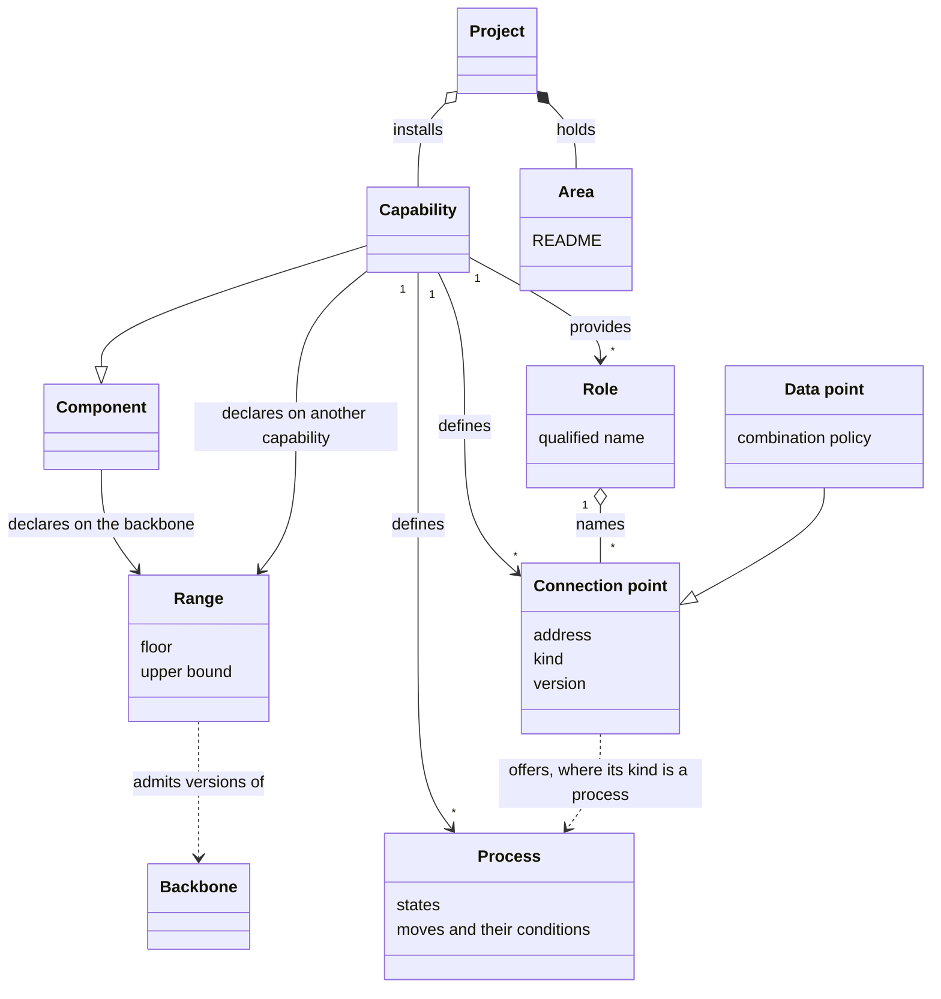
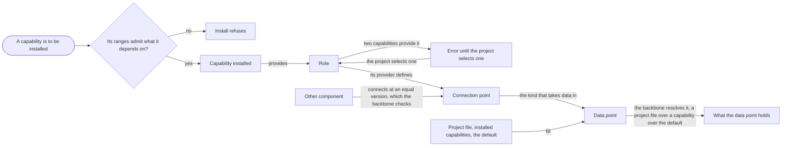

# VIEW-capabilities-areas-and-connection-points — Capabilities, areas and connection points

Some disciplines suit only some projects, yet forcing them on every [project](../glossary.md#term-project--project) is wrong, and copying them into each loses their reuse ([COR-017](../../../../.pkit/decisions/core/COR-017-capability-pattern.md)). A [component](../glossary.md#term-component--component) can also fail without a word when what it builds on changes incompatibly ([COR-030](../../../../.pkit/decisions/core/COR-030-capability-dependencies.md)). Other components must help each other without either depending on the other ([COR-052](../../../../.pkit/decisions/core/COR-052-slots.md), [COR-053](../../../../.pkit/decisions/core/COR-053-connection-points.md)). Every project also needs fixed homes, with declared layouts, for its kinds of content ([COR-011](../../../../.pkit/decisions/core/COR-011-areas-first-class.md)).

A [capability](../glossary.md#term-capability--capability) packages one discipline, which each project chooses to [install](../glossary.md#term-install--install) beside the [backbone](../glossary.md#term-backbone--backbone) and its [adapters](../glossary.md#term-adapter--adapter). A component's ranges say which [versions](../glossary.md#term-version--version) of what it builds on it works with. [Areas](../glossary.md#term-area--area) are the homes every project holds, with no install. Capabilities work together through [roles](../glossary.md#term-role--role) and [connection points](../glossary.md#term-connection-point--connection-point) without naming each other, and a [data point](../glossary.md#term-data-point--data-point) is the kind that takes data in.

## Capability

Defined in [TERM-capability](../glossary.md#term-capability--capability).

**Why:** A discipline that suits only some projects must be one each [project](../glossary.md#term-project--project) can choose ([COR-017](../../../../.pkit/decisions/core/COR-017-capability-pattern.md)). Otherwise it is forced on every project, or scattered through each project's own files, where it cannot be reused (COR-017).

A capability is a [component](../glossary.md#term-component--component) that packages one discipline: its [decision records](../glossary.md#term-decision-record--decision-record), [skills](../glossary.md#term-skill--skill), [agent definitions](../glossary.md#term-agent-definition--agent-definition), scripts and schemas. Each project chooses whether to [install](../glossary.md#term-install--install) it. `software-analysis` is one.

**Attributes:**

- its own subtree, `.pkit/capabilities/<name>/`, with its `package.yaml`, its decision records and its skills (COR-017)
- its own namespace of decision records, DEC, cited with its name, as in `software-analysis:DEC-001` (COR-017)
- the [roles](../glossary.md#term-role--role) it provides ([COR-053 point 1](../../../../.pkit/decisions/core/COR-053-connection-points.md#1-roles))

**Relations:**

- It is a kind of component. The [adapter](../glossary.md#term-adapter--adapter) is the other kind, which carries what one [harness](../glossary.md#term-harness--harness) needs and no discipline ([COR-027](../../../../.pkit/decisions/core/COR-027-alternative-impls-as-capability-data.md)).
- A project installs it, or registers it where the project authors the capability itself ([COR-031 point D3](../../../../.pkit/decisions/core/COR-031-capability-origin.md#d3--registering-an-incubated-capability-does-not-copy)).
- It may depend on other capabilities, each through a [range](../glossary.md#term-range--range) ([COR-030](../../../../.pkit/decisions/core/COR-030-capability-dependencies.md)).
- It ships the agent definitions its discipline needs ([COR-026](../../../../.pkit/decisions/core/COR-026-agent-placement-by-discipline.md)).

**States:** None.

**Always true:**

- It owns its subtree, and puts nothing into the [backbone](../glossary.md#term-backbone--backbone)'s own folders (COR-017).
- Registering a capability the project authors copies nothing (COR-031 point D3).

## Range

Defined in [TERM-range](../glossary.md#term-range--range).

**Why:** A [component](../glossary.md#term-component--component) whose dependency changed in a way that breaks it fails without a word when it runs ([COR-030](../../../../.pkit/decisions/core/COR-030-capability-dependencies.md)). A range turns that into a refusal when the [backbone](../glossary.md#term-backbone--backbone) or a component is installed, upgraded or removed (COR-030).

A range is the set of [versions](../glossary.md#term-version--version) a component declares it works with: of the backbone, or of another [capability](../glossary.md#term-capability--capability). It runs from a floor to any upper bound, as in `>=1.149.0,<2.0.0`.

**Attributes:**

- a floor, the lowest version it admits
- an upper bound, the version it stops below, where it has one

**Relations:**

- Each component declares one on the backbone, its `requires_backbone` ([COR-017](../../../../.pkit/decisions/core/COR-017-capability-pattern.md)).
- A capability declares one for each capability it depends on (COR-030).
- [Install](../glossary.md#term-install--install) checks the ranges before it writes anything (COR-030).

**States:** None.

**Always true:**

- A capability installs only where what it depends on falls within its ranges. Install never proceeds silently past one, and never installs a dependency by itself (COR-030).
- A floor rises only where a declaration asks for it, never by itself ([PRJ-002 D4](../../../../.pkit/decisions/project/PRJ-002-version-bump-policy.md#d4--the-release-step-writes-every-floor-and-upper-bound-main-only)).

## Area

Defined in [TERM-area](../glossary.md#term-area--area).

**Why:** Each domain of content needs a fixed home, with a layout tools can rely on ([COR-011](../../../../.pkit/decisions/core/COR-011-areas-first-class.md)). Without one, each new home invents its own shape, and tools have nothing to work from (COR-011).

An area is a top-level slice of a [project](../glossary.md#term-project--project)'s `.pkit/` tree, such as `.pkit/decisions/`. Its README declares its layout. Every project holds each area the [methodology](../glossary.md#term-methodology--methodology) ships, with no [install](../glossary.md#term-install--install), and may add areas of its own.

**Attributes:**

- its name, the folder `.pkit/<name>/` (COR-011)
- a README that declares its variant and its layout (COR-011)

**Relations:**

- It sits beside the [capabilities](../glossary.md#term-capability--capability) in `.pkit/`, and is no capability (COR-011).
- The methodology's areas ship with the [backbone](../glossary.md#term-backbone--backbone).
- Where it holds both the methodology's content and the project's, a `core/` folder and a `project/` folder keep them apart ([COR-003](../../../../.pkit/decisions/core/COR-003-artifact-mechanisms.md)).

**States:** None.

**Always true:**

- Every project has every area the methodology ships (COR-011).
- An area a project adds is the project's own, and cannot take the name of an area the methodology ships (COR-011).
- Tools read an area's layout from its README, never from the files they find in it (COR-011).

## Connection point

Defined in [TERM-connection-point](../glossary.md#term-connection-point--connection-point).

**Why:** [Capabilities](../glossary.md#term-capability--capability) need each other's knowledge, and need to react to each other, without depending on each other ([COR-053](../../../../.pkit/decisions/core/COR-053-connection-points.md)). A connection point's address names a [role](../glossary.md#term-role--role), never a capability, so replacing one capability with another touches nothing connected to it (COR-053).

A connection point is a declared interface that one installed capability defines. Other [components](../glossary.md#term-component--component) fill it, depend on it or subscribe to it, without naming that capability. Its address names its role, as in `pkit::analysis:revalidation-evidence`.

**Attributes:**

- an address, `<publisher>::<role>:<point>` ([COR-053 point 2](../../../../.pkit/decisions/core/COR-053-connection-points.md#2-points-addressed-publisherrolepoint-in-three-kinds))
- a kind (COR-053 point 2):
  - a [data point](../glossary.md#term-data-point--data-point), which takes data in
  - a [process](../glossary.md#term-process--process), offered for others to depend on
  - an event, which signals that a writing command finished
- a <!-- pkit:not-the-term -->version, an integer that rises only where it breaks what connects to it ([COR-053 point 5](../../../../.pkit/decisions/core/COR-053-connection-points.md#5-versions-per-point-roles-unversioned))
- a description, in prose ([COR-053 point 3](../../../../.pkit/decisions/core/COR-053-connection-points.md#3-declared-in-package-metadata-in-one-block-named-for-the-functionality))

**Relations:**

- The capability that provides its role defines it (COR-053 point 2).
- Other components connect to it at a <!-- pkit:not-the-term -->version equal to its own (COR-053 point 5).
- The [backbone](../glossary.md#term-backbone--backbone) resolves and checks every connection to it ([COR-053 point 7](../../../../.pkit/decisions/core/COR-053-connection-points.md#7-one-wiring-resolver-one-graph-two-selection-keys)).

**States:** None.

**Always true:**

- It is optional by default. A connection to it is mandatory only with a reason ([COR-053 point 6](../../../../.pkit/decisions/core/COR-053-connection-points.md#6-optional-by-default-mandatory-only-with-a-reason-on-the-individual-connection)).
- Two of its <!-- pkit:not-the-term -->versions are compatible only when they are equal (COR-053 point 5).
- The component that offers an event never names those that subscribe to it (COR-053 point 2).

## Role

Defined in [TERM-role](../glossary.md#term-role--role).

**Why:** A connection that names the [capability](../glossary.md#term-capability--capability) at its other end breaks when that capability is replaced ([COR-053](../../../../.pkit/decisions/core/COR-053-connection-points.md)). A role names the job instead, and its publisher qualifies it, so no name is reserved for everyone (COR-053).

A role is a name under which one installed capability provides [connection points](../glossary.md#term-connection-point--connection-point), so that others use them without naming that capability. The publisher that coined the name qualifies it, as in `pkit::documentation`.

**Attributes:**

- its qualified name, `<publisher>::<role>` ([COR-053 point 1](../../../../.pkit/decisions/core/COR-053-connection-points.md#1-roles))
- no <!-- pkit:not-the-term -->version: a role redefined in a way that breaks takes a new name ([COR-053 point 5](../../../../.pkit/decisions/core/COR-053-connection-points.md#5-versions-per-point-roles-unversioned))

**Relations:**

- A capability declares the roles it provides (COR-053 point 1).
- The capability providing a role defines its connection points ([COR-053 point 2](../../../../.pkit/decisions/core/COR-053-connection-points.md#2-points-addressed-publisherrolepoint-in-three-kinds)).
- Another capability may provide the same role, and stand in for the one that coined it (COR-053 point 1).

**States:** None.

**Always true:**

- One installed capability at most provides each role: two are an error until the [project](../glossary.md#term-project--project) selects one (COR-053 points 1 and [7](../../../../.pkit/decisions/core/COR-053-connection-points.md#7-one-wiring-resolver-one-graph-two-selection-keys)).
- An installed capability the project did not select connects nothing under that role, while its own commands still run (COR-053 point 1).

## Data point

Defined in [TERM-data-point](../glossary.md#term-data-point--data-point).

**Why:** A [component](../glossary.md#term-component--component) often needs knowledge that another component, or the [project](../glossary.md#term-project--project), is better able to give ([COR-052](../../../../.pkit/decisions/core/COR-052-slots.md)). The consumer must still work without that other component, and one set of rules must settle precedence, collisions and failure (COR-052).

A data point is a declared interface through which the [capability](../glossary.md#term-capability--capability) providing a [role](../glossary.md#term-role--role) accepts input. A project file, installed capabilities and that capability's own default fill it, and the [backbone](../glossary.md#term-backbone--backbone) resolves what it holds. It is the kind of [connection point](../glossary.md#term-connection-point--connection-point) that takes data in.

**Attributes:**

- its address, its schema version and the schema of its data (COR-052 points [1](../../../../.pkit/decisions/core/COR-052-slots.md#1-the-slot-belongs-to-its-consumer) and [5](../../../../.pkit/decisions/core/COR-052-slots.md#5-schemas-and-versions))
- a combination policy, one of these ([COR-052 point 3](../../../../.pkit/decisions/core/COR-052-slots.md#3-combination-policy-declared-per-slot)):
  - one filler alone fills it
  - entries merge by id
  - entries merge and any collision fails
- optionally a question, which asks a person about the data point and records the reply ([COR-061 point 1](../../../../.pkit/decisions/core/COR-061-point-questions.md#1-a-data-point-may-declare-a-question))

**Relations:**

- It is the kind of connection point that takes data in ([COR-053 point 2](../../../../.pkit/decisions/core/COR-053-connection-points.md#2-points-addressed-publisherrolepoint-in-three-kinds)).
- Where fillers overlap, a project file wins over a capability, and a capability wins over the default ([COR-052 point 4](../../../../.pkit/decisions/core/COR-052-slots.md#4-precedence-and-collisions)).

**States:** None.

**Always true:**

- A filler that fails gives no result, which is never read as an empty one ([COR-052 point 6](../../../../.pkit/decisions/core/COR-052-slots.md#6-command-fillers-and-failure)).
- A capability's filler counts only where its schema version matches the data point's (COR-052 point 5).
- A question asks only what has no recorded reply. Where nobody can reply, it records nothing (COR-061 points 1 and [5](../../../../.pkit/decisions/core/COR-061-point-questions.md#5-only-the-persons-answer-is-the-consent)).

## Process

Defined in [TERM-process](../glossary.md#term-process--process).

**Why:** Several disciplines move their subjects through stages, and each needs to know where a subject stands and which move it may make next ([COR-033](../../../../.pkit/decisions/core/COR-033-process-substrate.md)). An engine built once in the [backbone](../glossary.md#term-backbone--backbone) tells each discipline, in one way, where a subject stands and whether it may move. Each [capability](../glossary.md#term-capability--capability) keeps its own stages (COR-033).

A process is the course a capability declares for one kind of subject of its discipline. It gives the states the subject can be in, and the moves between them, each with its condition. The backbone's engine reads where a subject stands from what it observes, on each check. project-management's `issue-lifecycle` is one.

**Attributes:**

- its address, `<capability>:<id>`, and its definition, `schemas/<id>.yaml` in the capability ([COR-033 P2](../../../../.pkit/decisions/core/COR-033-process-substrate.md#p2--ownership))
- its states, each detected by a script the engine runs, in one mode for the whole process ([COR-033 P5](../../../../.pkit/decisions/core/COR-033-process-substrate.md#p5--name-broad-ship-narrow))
- its moves, each with a condition: a script that decides it, or an authorisation recorded by someone other than the one who moves ([COR-033 P4](../../../../.pkit/decisions/core/COR-033-process-substrate.md#p4--gates-must-be-checkable))

**Relations:**

- A capability defines it, and the backbone's engine runs it (COR-033 P2).
- A [connection point](../glossary.md#term-connection-point--connection-point) of the kind `process` offers it for other [components](../glossary.md#term-component--component) to depend on ([COR-053 point 2](../../../../.pkit/decisions/core/COR-053-connection-points.md#2-points-addressed-publisherrolepoint-in-three-kinds)).
- Its definition may declare that one of its states waits on another process ([COR-044 point 3](../../../../.pkit/decisions/core/COR-044-process-authoring-layer.md#3-the-skills-operation-set-three-shipped-the-rest-named-deferred--each-backed-by-a-deterministic-command)).
- The `process` [skill](../glossary.md#term-skill--skill) writes its shape ([COR-044 point 1](../../../../.pkit/decisions/core/COR-044-process-authoring-layer.md#1-the-shapeteeth-boundary-is-the-carrier-boundary)). An AI agent working by the `process-author` [agent definition](../glossary.md#term-agent-definition--agent-definition) writes the scripts behind the process's states and conditions.

**States:** None.

**Always true:**

- The engine reads a subject's state from what it observes, never from a stored label ([COR-033 P3](../../../../.pkit/decisions/core/COR-033-process-substrate.md#p3--the-engine-is-a-deterministic-validator-and-a-self-explaining-memory)).
- A script that fails, or prints nothing the engine can read, never counts as a pass. The engine then cannot tell where the subject stands, and allows no move ([COR-044 point 2](../../../../.pkit/decisions/core/COR-044-process-authoring-layer.md#2-the-teeth-actor-is-a-new-core-agent-owner-scoped) and COR-033 P5).

## What is built on these concepts

Each concept below lists the use cases, journeys and requirements whose text links its term.

**Capability:**

- [UC-003 — Declare what my change means for the next release](../use-case-model/use-cases/030-change/UC-003-declare-changeset.md)
- [UC-005 — Say what my document rests on](../use-case-model/use-cases/030-change/UC-005-anchor-document.md)
- [UC-007 — Resolve what the default branch left out of date](../use-case-model/use-cases/030-change/UC-007-resolve-debt.md)
- [UC-008 — Release the backbone so adopters can upgrade and pin to it](../use-case-model/use-cases/040-release/UC-008-release-backbone.md)
- [UC-009 — Release my component on its own version](../use-case-model/use-cases/040-release/UC-009-release-component.md)
- [UC-010 — Never ship a backbone change that breaks installed projects without the migration that carries them across](../use-case-model/use-cases/030-change/UC-010-migrate-backbone-change.md)
- [UC-011 — Carry the projects that installed my component across a breaking change of it](../use-case-model/use-cases/030-change/UC-011-migrate-component-change.md)
- [UC-012 — Report a problem with the system, and follow the report](../use-case-model/use-cases/050-adopt/UC-012-report-problem.md)
- [UC-014 — Develop the methodology in its source repository](../use-case-model/use-cases/010-develop/UC-014-develop-methodology.md)
- [UC-015 — Package a recurring discipline as a capability](../use-case-model/use-cases/010-develop/UC-015-package-capability.md)
- [UC-016 — Keep a capability I wrote in my own repository](../use-case-model/use-cases/010-develop/UC-016-keep-capability.md)
- [UC-017 — Give my capability roles, data points and processes others connect to](../use-case-model/use-cases/010-develop/UC-017-connect-capability.md)
- [UC-018 — Know my capability is ready to share](../use-case-model/use-cases/010-develop/UC-018-check-shareable.md)
- [UC-019 — Adapt the system to another harness](../use-case-model/use-cases/010-develop/UC-019-adapt-harness.md)
- [UC-020 — Turn recurring work into my project's own skill or agent definition](../use-case-model/use-cases/010-develop/UC-020-own-skill-or-agent.md)
- [UC-022 — Add my own operational rules, the harness's settings, grants and agent paths beside the methodology's](../use-case-model/use-cases/020-set-up/UC-022-add-own-additions.md)
- [UC-023 — Add or remove a capability, and be told of a name collision](../use-case-model/use-cases/020-set-up/UC-023-add-or-remove-capability.md)
- [UC-024 — See what a capability would connect to before I install it](../use-case-model/use-cases/020-set-up/UC-024-see-capability-connections.md)
- [UC-025 — Choose which installed capability provides a role](../use-case-model/use-cases/020-set-up/UC-025-choose-role-provider.md)
- [UC-027 — Find my agent definition deployed, with the project's paths and my grants](../use-case-model/use-cases/020-set-up/UC-027-find-agent-definition-deployed.md)
- [UC-032 — Be asked before an agent changes another repository](../use-case-model/use-cases/020-set-up/UC-032-ask-before-other-repository.md)
- [UC-033 — Find out why a command prompted me or was blocked](../use-case-model/use-cases/020-set-up/UC-033-find-why-prompted.md)
- [UC-034 — Land my change on the default branch](../use-case-model/use-cases/030-change/UC-034-land-change.md)
- [UC-037 — Record my decision beside the methodology's](../use-case-model/use-cases/030-change/UC-037-record-decision.md)
- [UC-038 — Author and extend my project's own rule sets](../use-case-model/use-cases/030-change/UC-038-author-rule-sets.md)
- [UC-049 — Install the system into my project with one command](../use-case-model/use-cases/050-adopt/UC-049-install-system.md)
- [UC-050 — Get a fresh clone ready to work with one sync](../use-case-model/use-cases/050-adopt/UC-050-ready-fresh-clone.md)
- [UC-051 — Upgrade the system like a dependency](../use-case-model/use-cases/050-adopt/UC-051-upgrade-system.md)
- [UC-053 — Re-pin an inherited rule set once I have reviewed its new major](../use-case-model/use-cases/050-adopt/UC-053-repin-rule-set.md)
- [UC-054 — Upgrade one capability on its own](../use-case-model/use-cases/050-adopt/UC-054-upgrade-capability.md)
- [JRN-001 — Adopt the system](../use-case-model/journeys/JRN-001-adopt-system.md)
- [JRN-002 — Upgrade the system](../use-case-model/journeys/JRN-002-upgrade-system.md)
- [JRN-003 — Deliver a change](../use-case-model/journeys/JRN-003-deliver-change.md)
- [REQ-009 · Quality · A command whose effect reaches past what the person named offers `--dry-run`](../requirements/quality/REQ-009-preview-before-change.md)
- [REQ-010 · Functional · A command that propagates content under another version than the project records stops](../requirements/functional/REQ-010-stop-under-another-version.md)
- [REQ-011 · Constraint · A suggestion of what to install never uses the network](../requirements/constraints/020-set-up/REQ-011-suggestion-offline.md)
- [REQ-013 · Functional · Where an allow and a deny conflict, the deny wins](../requirements/functional/020-set-up/REQ-013-deny-wins.md)
- [REQ-026 · Quality · An interrupted version transition never reads as finished, and the next one completes it](../requirements/quality/050-adopt/REQ-026-interrupted-transition-completes.md)
- [REQ-029 · Functional · A version transition resolves compatibility across components before it writes anything](../requirements/functional/050-adopt/REQ-029-compatibility-before-write.md)

**Range:**

- [UC-003 — Declare what my change means for the next release](../use-case-model/use-cases/030-change/UC-003-declare-changeset.md)
- [UC-008 — Release the backbone so adopters can upgrade and pin to it](../use-case-model/use-cases/040-release/UC-008-release-backbone.md)
- [UC-009 — Release my component on its own version](../use-case-model/use-cases/040-release/UC-009-release-component.md)
- [UC-015 — Package a recurring discipline as a capability](../use-case-model/use-cases/010-develop/UC-015-package-capability.md)
- [UC-016 — Keep a capability I wrote in my own repository](../use-case-model/use-cases/010-develop/UC-016-keep-capability.md)
- [UC-018 — Know my capability is ready to share](../use-case-model/use-cases/010-develop/UC-018-check-shareable.md)
- [UC-019 — Adapt the system to another harness](../use-case-model/use-cases/010-develop/UC-019-adapt-harness.md)
- [UC-023 — Add or remove a capability, and be told of a name collision](../use-case-model/use-cases/020-set-up/UC-023-add-or-remove-capability.md)
- [UC-051 — Upgrade the system like a dependency](../use-case-model/use-cases/050-adopt/UC-051-upgrade-system.md)
- [UC-054 — Upgrade one capability on its own](../use-case-model/use-cases/050-adopt/UC-054-upgrade-capability.md)
- [REQ-029 · Functional · A version transition resolves compatibility across components before it writes anything](../requirements/functional/050-adopt/REQ-029-compatibility-before-write.md)

**Area:**

- [UC-049 — Install the system into my project with one command](../use-case-model/use-cases/050-adopt/UC-049-install-system.md)
- [UC-050 — Get a fresh clone ready to work with one sync](../use-case-model/use-cases/050-adopt/UC-050-ready-fresh-clone.md)
- [UC-051 — Upgrade the system like a dependency](../use-case-model/use-cases/050-adopt/UC-051-upgrade-system.md)
- [REQ-008 · Constraint · Until #1600 is done, no change adds or removes an area or an adapter a release ships, but `rule-sets`](../requirements/constraints/010-develop/REQ-008-areas-held.md)

**Connection point:**

- [UC-017 — Give my capability roles, data points and processes others connect to](../use-case-model/use-cases/010-develop/UC-017-connect-capability.md)
- [UC-025 — Choose which installed capability provides a role](../use-case-model/use-cases/020-set-up/UC-025-choose-role-provider.md)

**Role:**

- [UC-017 — Give my capability roles, data points and processes others connect to](../use-case-model/use-cases/010-develop/UC-017-connect-capability.md)
- [UC-024 — See what a capability would connect to before I install it](../use-case-model/use-cases/020-set-up/UC-024-see-capability-connections.md)
- [UC-025 — Choose which installed capability provides a role](../use-case-model/use-cases/020-set-up/UC-025-choose-role-provider.md)
- [REQ-011 · Constraint · A suggestion of what to install never uses the network](../requirements/constraints/020-set-up/REQ-011-suggestion-offline.md)

**Data point:**

- [UC-016 — Keep a capability I wrote in my own repository](../use-case-model/use-cases/010-develop/UC-016-keep-capability.md)
- [UC-017 — Give my capability roles, data points and processes others connect to](../use-case-model/use-cases/010-develop/UC-017-connect-capability.md)
- [UC-023 — Add or remove a capability, and be told of a name collision](../use-case-model/use-cases/020-set-up/UC-023-add-or-remove-capability.md)
- [UC-024 — See what a capability would connect to before I install it](../use-case-model/use-cases/020-set-up/UC-024-see-capability-connections.md)
- [UC-051 — Upgrade the system like a dependency](../use-case-model/use-cases/050-adopt/UC-051-upgrade-system.md)
- [UC-054 — Upgrade one capability on its own](../use-case-model/use-cases/050-adopt/UC-054-upgrade-capability.md)
- [REQ-004 · Quality · A check never reads a missing result as one that found nothing](../requirements/quality/REQ-004-missing-answer-never-clean.md)
- [REQ-006 · Quality · The backbone stops a command it runs for an anchor, a data point, validation or a process after thirty seconds](../requirements/quality/REQ-006-command-time-bound.md)
- [REQ-007 · Constraint · A command that resolves an anchor, fills a data point or joins validation is offline, read-only and deterministic](../requirements/constraints/REQ-007-offline-same-answer.md)
- [REQ-011 · Constraint · A suggestion of what to install never uses the network](../requirements/constraints/020-set-up/REQ-011-suggestion-offline.md)

**Process:**

- [UC-017 — Give my capability roles, data points and processes others connect to](../use-case-model/use-cases/010-develop/UC-017-connect-capability.md)
- [UC-023 — Add or remove a capability, and be told of a name collision](../use-case-model/use-cases/020-set-up/UC-023-add-or-remove-capability.md)
- [REQ-006 · Quality · The backbone stops a command it runs for an anchor, a data point, validation or a process after thirty seconds](../requirements/quality/REQ-006-command-time-bound.md)
