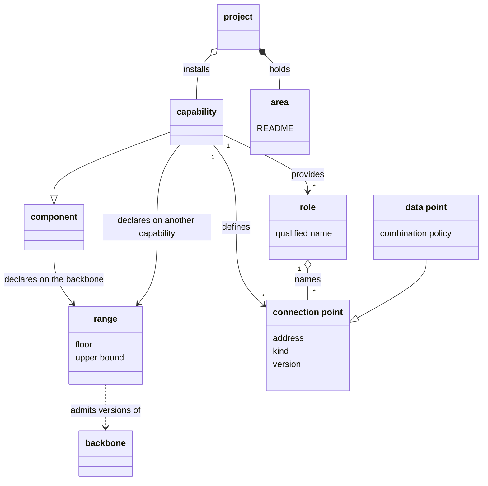

# VIEW-capabilities-areas-and-connection-points — Capabilities, areas and connection points

What a project holds beyond the backbone and its adapters: the capabilities it chooses to install, and the areas every project has. A component's ranges say which versions of what it builds on it works with. Capabilities work together through roles and connection points, without naming each other.

## capability

A capability is a component that packages one discipline: its decision records, skills, agent definitions, scripts and schemas. Each project chooses whether to install it. `software-analysis` is one.

**Attributes:**

- its own subtree, `.pkit/capabilities/<name>/`, with its `package.yaml`, its decision records and its skills (COR-017)
- its own namespace of decision records, DEC, cited with its name, as in `software-analysis:DEC-001` (COR-017)
- the roles it provides (COR-053 point 1)

**Relations:**

- It is a kind of component. The adapter is the other kind, which carries what one harness needs and no discipline (COR-027).
- A project installs it, or registers it where the project authors the capability itself (COR-031 point D3).
- It may depend on other capabilities, each through a range (COR-030).
- It ships the agent definitions its discipline needs (COR-026).

**States:** None.

**Always true:**

- It owns its subtree, and puts nothing into the backbone's own folders (COR-017).
- Registering a capability the project authors copies nothing (COR-031 point D3).

## range

A range is the set of versions a component declares it works with: of the backbone, or of another capability. It runs from a floor to any upper bound, as in `>=1.149.0,<2.0.0`.

**Attributes:**

- a floor, the lowest version it admits
- an upper bound, the version it stops below, where it has one

**Relations:**

- Each component declares one on the backbone, its `requires_backbone` (COR-017).
- A capability declares one for each capability it depends on (COR-030).
- Install checks the ranges before it writes anything (COR-030).

**States:** None.

**Always true:**

- A capability installs only where what it depends on falls within its ranges. Install never proceeds silently past one, and never installs a dependency by itself (COR-030).
- A floor rises only where a declaration asks for it, never by itself (PRJ-002 D4).

## area

An area is a top-level slice of a project's `.pkit/` tree, such as `.pkit/decisions/`. Its README declares its layout. Every project holds each area the methodology ships, with no install, and may add areas of its own.

**Attributes:**

- its name, the folder `.pkit/<name>/` (COR-011)
- a README that declares its variant and its layout (COR-011)

**Relations:**

- It sits beside the capabilities in `.pkit/`, and is no capability (COR-011).
- The methodology's areas ship with the backbone.
- Where it holds both the methodology's content and the project's, a `core/` folder and a `project/` folder keep them apart (COR-003).

**States:** None.

**Always true:**

- Every project has every area the methodology ships (COR-011).
- An area a project adds is the project's own, and cannot take the name of an area the methodology ships (COR-011).
- Tools read an area's layout from its README, never from the files they find in it (COR-011).

## connection point

A connection point is a declared interface that one installed capability defines. Other components fill it, depend on it or subscribe to it, without naming that capability. Its address names its role, as in `pkit::analysis:revalidation-evidence`.

**Attributes:**

- an address, `<publisher>::<role>:<point>` (COR-053 point 2)
- a kind (COR-053 point 2):
  - a data point, which takes data in
  - a process, offered for others to depend on
  - an event, which signals that a writing command finished
- a version, an integer that rises only where it breaks what connects to it (COR-053 point 5)
- a description, in prose (COR-053 point 3)

**Relations:**

- The capability that provides its role defines it (COR-053 point 2).
- Other components connect to it at a version equal to its own (COR-053 point 5).
- The backbone resolves and checks every connection to it (COR-053 point 7).

**States:** None.

**Always true:**

- It is optional by default. A connection to it is mandatory only with a reason (COR-053 point 6).
- Two of its versions are compatible only when they are equal (COR-053 point 5).
- The component that offers an event never names those that subscribe to it (COR-053 point 2).

## role

A role is a name under which one installed capability provides connection points, so that others use them without naming that capability. The publisher that coined the name qualifies it, as in `pkit::documentation`.

**Attributes:**

- its qualified name, `<publisher>::<role>` (COR-053 point 1)
- no version: a role redefined in a way that breaks takes a new name (COR-053 point 5)

**Relations:**

- A capability declares the roles it provides (COR-053 point 1).
- The capability providing a role defines its connection points (COR-053 point 2).
- Another capability may provide the same role, and stand in for the one that coined it (COR-053 point 1).

**States:** None.

**Always true:**

- One installed capability at most provides each role: two are an error until the project selects one (COR-053 points 1 and 7).
- An installed capability the project did not select connects nothing under that role, while its own commands still run (COR-053 point 1).

## data point

A data point is a declared interface through which the capability providing a role accepts input. A project file, installed capabilities and that capability's own default fill it, and the backbone resolves what it holds. It is the kind of connection point that takes data in.

**Attributes:**

- its address, its version and the schema of its data (COR-052 points 1 and 5)
- a combination policy: one filler alone fills it, entries merge by id, or entries merge and any collision fails (COR-052 point 3)
- optionally a question, which asks a person about the point and records the reply (COR-061 point 1)

**Relations:**

- It is the kind of connection point that takes data in (COR-053 point 2).
- Where fillers overlap, a project file wins over a capability, and a capability over the default (COR-052 point 4).

**States:** None.

**Always true:**

- A filler that fails gives no result, which is never read as an empty one (COR-052 point 6).
- A capability's filler counts only where its version matches the point's (COR-052 point 5).
- A question asks only what has no recorded reply. Where nobody can reply, it records nothing (COR-061 points 1 and 5).
