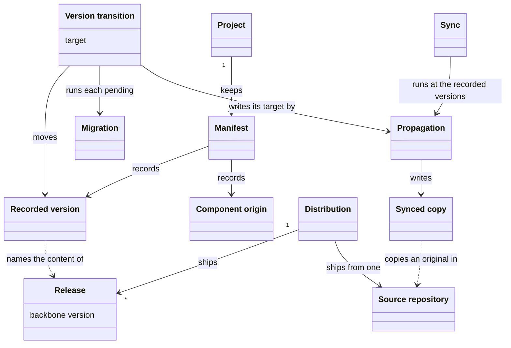
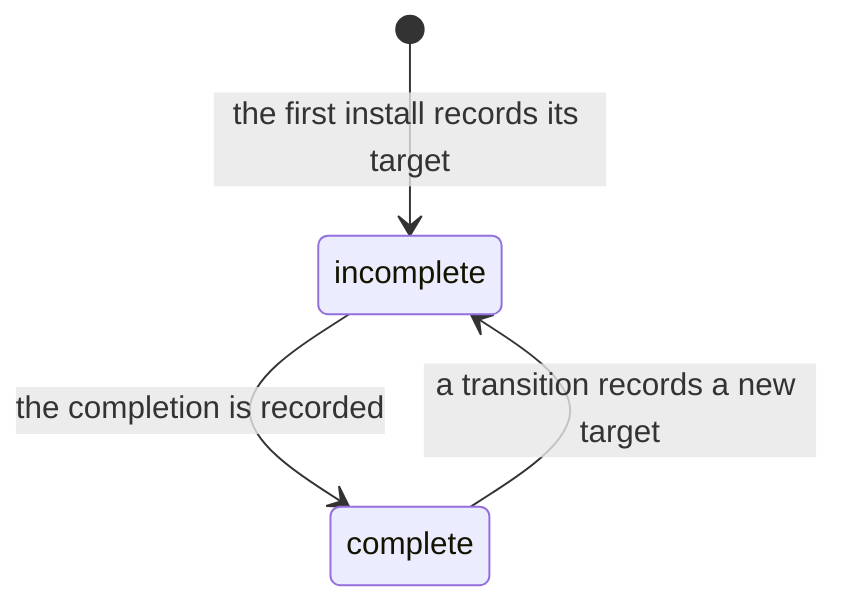
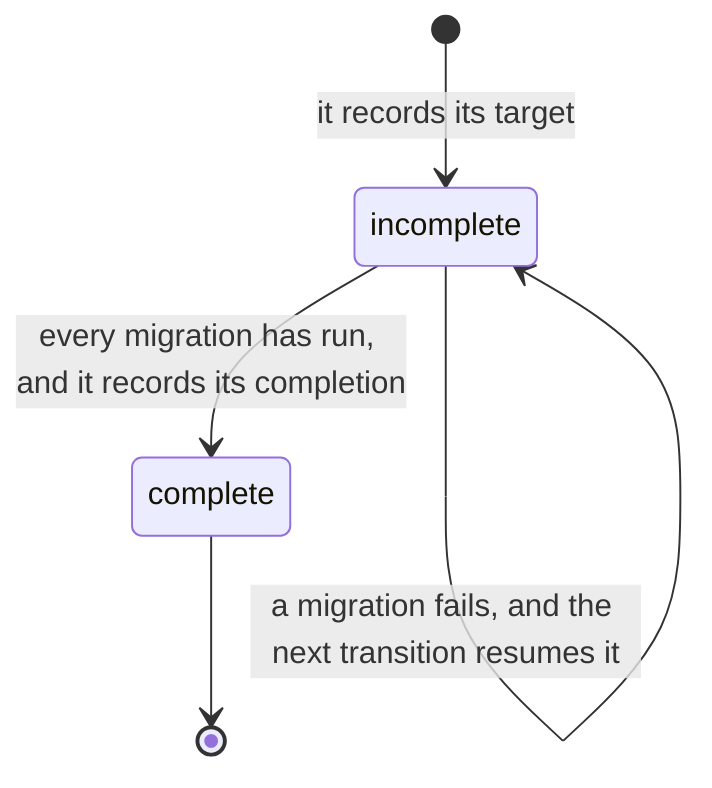

# VIEW-versions-and-copies — Versions and copies

A [project](../glossary.md#term-project--project) holds copies of the [methodology](../glossary.md#term-methodology--methodology)'s files so improvements reach it (COR-001). It also needs a routine repair that rebuilds those copies, and moves no [version](../glossary.md#term-version--version) (COR-059). If its files move to a newer version without the [migrations](../glossary.md#term-migration--migration) between, it holds content they never reached, and nothing says so (COR-059).

So manifests keep the [recorded versions](../glossary.md#term-recorded-version--recorded-version) of the [backbone](../glossary.md#term-backbone--backbone) and of each [component](../glossary.md#term-component--component), each naming the content the project holds (COR-010, COR-059). Only a [version transition](../glossary.md#term-version-transition--version-transition) moves one, and it runs the migrations between (COR-059). [Propagation](../glossary.md#term-propagation--propagation) writes the [synced copies](../glossary.md#term-synced-copy--synced-copy), and [sync](../glossary.md#term-sync--sync) runs it at the recorded versions as the routine repair (COR-059).

Before it refreshes a copy, the [system](../glossary.md#term-system--system) must know where the original comes from (COR-031). A [component origin](../glossary.md#term-component-origin--component-origin) says so for each component, and a [distribution](../glossary.md#term-distribution--distribution) ships its releases from one [source repository](../glossary.md#term-source-repository--source-repository).

## Manifest

Defined in [TERM-manifest](../glossary.md#term-manifest--manifest).

**Why:** A [project](../glossary.md#term-project--project) must store what it installed and at which [version](../glossary.md#term-version--version), since neither can be worked out again from the [methodology](../glossary.md#term-methodology--methodology)'s files (COR-010). Separate manifests for the [backbone](../glossary.md#term-backbone--backbone) and each shipped [component](../glossary.md#term-component--component) keep their states apart, so installing or removing one leaves the others alone (COR-010).

A manifest is the file where a project records what it installed, and at which version. The backbone has one, `.pkit/manifest.yaml`, and each shipped component has its own.

**Attributes:**

- the backbone's: its [recorded version](../glossary.md#term-recorded-version--recorded-version), and the completion of its last transition (COR-059 [point](../glossary.md#term-point--point) 6). It also lists every installed component, with its origin and the path of its own manifest (ADR-065 point 2).
- a shipped component's: its recorded version, and the files its [install](../glossary.md#term-install--install) skipped (ADR-065 point 2, COR-059 point 7)

**Relations:**

- Install adds a component's entry and creates its manifest, and removing the component deletes both (COR-010).
- Only a [version transition](../glossary.md#term-version-transition--version-transition) moves a recorded version in it (COR-059 point 3).

**States:** None.

**Always true:**

- It holds only what cannot be derived again from the methodology at the recorded version and the project's own configuration (COR-010).
- No copying of the methodology's content writes or removes a recorded version in it (COR-059 point 1).

## Release

Defined in [TERM-release](../glossary.md#term-release--release).

**Why:** [Components](../glossary.md#term-component--component) carry [versions](../glossary.md#term-version--version) of their own, and a [project](../glossary.md#term-project--project) mixing two releases would need a check for every pair that might disagree (COR-010, COR-059). No release was tested in such a mix, so a project stays at one release (COR-059).

A release is a set of versions shipped together, named by its [backbone](../glossary.md#term-backbone--backbone) version. It holds one version of the backbone, and one of each component shipped with it. The release of 24 August 2026 holds backbone 1.149.0 and, among its components, project-management 0.54.0.

**Attributes:**

- its backbone version, which names it (COR-059 [point](../glossary.md#term-point--point) 1)
- one version of each component shipped with it (COR-059 point 1)
- a release tag, `v<version>`, on its release commit (PRJ-004)

**Relations:**

- A [distribution](../glossary.md#term-distribution--distribution) ships many releases.
- A project's [recorded versions](../glossary.md#term-recorded-version--recorded-version) name the release whose content it holds (COR-059 point 1).

**States:** None.

**Always true:**

- A transition of the backbone moves every shipped component the project installed to its version in the target release. It holds none back (COR-059 point 7).

## Recorded version

Defined in [TERM-recorded-version](../glossary.md#term-recorded-version--recorded-version).

**Why:** [Migrations](../glossary.md#term-migration--migration) carry a [project](../glossary.md#term-project--project)'s state from one recorded version to the next, so the project must keep the [version](../glossary.md#term-version--version) it stands at (COR-059). Comparing it with the running CLI's version stops a command from copying another version's content over the project (COR-059, PRJ-004).

A recorded version is the number or ref a project keeps for the [backbone](../glossary.md#term-backbone--backbone) or for an installed [component](../glossary.md#term-component--component). It names the content the project holds. After `pkit sync`, a project holds the content of exactly its recorded versions.

**Attributes:**

- for the backbone and a shipped component, a version. For a component pulled from an external source, the ref it is pulled at (COR-059 [point](../glossary.md#term-point--point) 1).

**Relations:**

- A [manifest](../glossary.md#term-manifest--manifest) holds it, for the backbone and for each shipped component. A [capability](../glossary.md#term-capability--capability) the project authors keeps its own in its `package.yaml`, and the project moves it by editing it (ADR-065 point 2).
- It names the [release](../glossary.md#term-release--release) whose content the project holds (COR-059 point 1).
- [Sync](../glossary.md#term-sync--sync) reads it, and a [version transition](../glossary.md#term-version-transition--version-transition) moves it (COR-059 points 2 and 3).

**States:** The backbone's recorded version is complete when its target and its completion name the same version. A transition records its target first, and its completion last. In between, the recorded version is incomplete and names that target (COR-059 points 1 and 6).

**Always true:**

- Only a version transition moves it, and sync moves none (COR-059 points 2 and 3).
- A project is at a version only when its target and its completion both name it (COR-059 point 6).
- No copying of the [methodology](../glossary.md#term-methodology--methodology)'s content writes or removes it (COR-059 point 1).

## Migration

Defined in [TERM-migration](../glossary.md#term-migration--migration).

**Why:** A new [version](../glossary.md#term-version--version) can rename or remove what a [project](../glossary.md#term-project--project)'s state relies on, or reshape it (COR-010). Writing the newer files cannot carry that state across, so a migration bridges it (COR-010).

A migration is a script that carries a project's state across a version of the [backbone](../glossary.md#term-backbone--backbone) or of a [component](../glossary.md#term-component--component). It changes what writing the [methodology](../glossary.md#term-methodology--methodology)'s files again cannot, such as a project's own settings. A [version transition](../glossary.md#term-version-transition--version-transition) runs it.

**Attributes:**

- its tier, the backbone or one component, and the version it crosses, which names its folder, such as `0.55.0/` (COR-010)

**Relations:**

- A version transition runs each migration that is pending, the backbone's first (COR-059 [point](../glossary.md#term-point--point) 3).

**States:** None.

**Always true:**

- Only a version transition runs a migration (COR-059 point 3).
- Run again on a state it already carried, it changes nothing (COR-010).
- A backbone migration acts only on a positive sign that it is needed, and never deletes by a path's name or position alone (COR-010).
- What it writes stays within what the records owning that content allow (COR-059 point 3).

## Version transition

Defined in [TERM-version-transition](../glossary.md#term-version-transition--version-transition).

**Why:** If two operations could move a [version](../glossary.md#term-version--version) and only one ran [migrations](../glossary.md#term-migration--migration), the other would strand them, and none would run later (COR-059). One operation that moves versions and runs every migration between leaves no path that skips one (COR-059). It records its completion last, so an interrupted transition is never mistaken for a finished one (COR-059).

A version transition moves a [project](../glossary.md#term-project--project)'s [recorded versions](../glossary.md#term-recorded-version--recorded-version) to a target. It runs every migration that is pending, and records its completion only after they have run. `pkit upgrade` runs a transition of the [backbone](../glossary.md#term-backbone--backbone).

**Attributes:**

- its target: a [release](../glossary.md#term-release--release), for a transition of the backbone, or one [component](../glossary.md#term-component--component)'s version (COR-059 [point](../glossary.md#term-point--point) 3)
- its form: a transition of the backbone, or of one component (COR-059 point 3)

**Relations:**

- It moves recorded versions, and runs migrations (COR-059 point 3).
- It writes its target's content by [propagation](../glossary.md#term-propagation--propagation) (COR-059 point 3, ADR-065 point 1).
- A transition of the backbone moves every component the [methodology](../glossary.md#term-methodology--methodology) ships with it (COR-059 point 7).

**States:** A transition is incomplete from the moment it records its target, before it writes anything else. It is complete once every migration has run and it records its completion. A migration that fails stops it, and the next transition of the backbone finishes it (COR-059 point 6).

**Always true:**

- It is the only operation that moves a recorded version, and no other operation runs a migration (COR-059 point 3).
- A transition of the backbone only moves forward (COR-059 point 9).
- Where a collision needs a person and nobody can reply, it refuses before it writes anything (COR-059 point 7).

## Propagation

Defined in [TERM-propagation](../glossary.md#term-propagation--propagation).

**Why:** Improvements to the [methodology](../glossary.md#term-methodology--methodology)'s files must keep reaching each [project](../glossary.md#term-project--project), or the methodology helps only once, when first installed (COR-001). No file is shared between the methodology and the project, so propagation writes each file whole (COR-001).

Propagation writes the methodology's files into a project verbatim, at the [recorded versions](../glossary.md#term-recorded-version--recorded-version) or at a transition's target. It writes over whatever stands at those paths.

**Attributes:** None.

**Relations:**

- It writes [synced copies](../glossary.md#term-synced-copy--synced-copy).
- [Sync](../glossary.md#term-sync--sync) runs it at the recorded versions, and a [version transition](../glossary.md#term-version-transition--version-transition) runs it at its target (COR-059 points 2 and 3).

**States:** None.

**Always true:**

- It checks no [version](../glossary.md#term-version--version), runs no [migration](../glossary.md#term-migration--migration) and writes no [manifest](../glossary.md#term-manifest--manifest) (ADR-065 [point](../glossary.md#term-point--point) 1).
- It leaves out a [capability](../glossary.md#term-capability--capability) the project authors (COR-031 point D1), and copies a [component](../glossary.md#term-component--component) pulled from an external source only from that source (COR-041).

## Sync

Defined in [TERM-sync](../glossary.md#term-sync--sync).

**Why:** A [project](../glossary.md#term-project--project) needs a routine repair that never moves it, after a fresh clone, a deleted file or a new [skill](../glossary.md#term-skill--skill) of its own (COR-059). Since sync moves no [version](../glossary.md#term-version--version), it can run at any time (COR-059).

Sync runs [propagation](../glossary.md#term-propagation--propagation) at a project's [recorded versions](../glossary.md#term-recorded-version--recorded-version), and regenerates what derives from the project's declarations, such as the deployed skills. It moves no version and runs no [migration](../glossary.md#term-migration--migration). After a fresh clone, `pkit sync` puts the skills, the [agent definitions](../glossary.md#term-agent-definition--agent-definition) and the core records back.

**Attributes:** None.

**Relations:**

- It runs propagation at the recorded versions (COR-059 [point](../glossary.md#term-point--point) 2).
- It reads the recorded versions, and never moves them (COR-059 point 2).

**States:** None.

**Always true:**

- It moves no recorded version, and runs no migration (COR-059 point 2).
- Under a CLI at another version than the project records, or over an incomplete transition, it stops and writes nothing (COR-059 point 9).

## Synced copy

Defined in [TERM-synced-copy](../glossary.md#term-synced-copy--synced-copy).

**Why:** Improvements reach a [project](../glossary.md#term-project--project) as files in its own tree, yet each such file stays its source's, never the project's (COR-001, COR-041). Refreshing it is not the project's own work, and must not show up as such in its history (COR-050 [point](../glossary.md#term-point--point) 14).

A synced copy is a file that [propagation](../glossary.md#term-propagation--propagation) writes into a project, from the [methodology](../glossary.md#term-methodology--methodology) or from a [component](../glossary.md#term-component--component) pulled from an external source. The project never edits it: the next [sync](../glossary.md#term-sync--sync) would write over the edit.

**Attributes:**

- its path, the same as its original's (COR-001)

**Relations:**

- Propagation writes it.
- Its original lies in a [source repository](../glossary.md#term-source-repository--source-repository), where the same file is no synced copy (COR-050 point 14).

**States:** None.

**Always true:**

- Each sync writes it again at the [recorded version](../glossary.md#term-recorded-version--recorded-version), and each transition writes it at its target (COR-001).
- It holds only its original's content (COR-001).

## Source repository

Defined in [TERM-source-repository](../glossary.md#term-source-repository--source-repository).

**Why:** A file is the original where it is authored, and a [synced copy](../glossary.md#term-synced-copy--synced-copy) everywhere else (COR-050 [point](../glossary.md#term-point--point) 14). A [sync](../glossary.md#term-sync--sync) into the repository that holds the originals would copy over them (ADR-059).

A source repository is the versioned tree where the [backbone](../glossary.md#term-backbone--backbone) or a [component](../glossary.md#term-component--component) is authored. Its files are the originals that synced copies in other projects come from. project-kit's repository is the source repository of its [distribution](../glossary.md#term-distribution--distribution).

**Attributes:** None.

**Relations:**

- The synced copies in other projects come from its files (COR-050 point 14).
- A distribution ships from one source repository.
- A source repository that installs what it builds is a [project](../glossary.md#term-project--project) too, as project-kit's is.

**States:** None.

**Always true:**

- No sync ever copies into the [methodology](../glossary.md#term-methodology--methodology)'s own source repository, since its files are the originals (ADR-059 point 1).

## Distribution

Defined in [TERM-distribution](../glossary.md#term-distribution--distribution).

**Why:** Whoever sets up the [system](../glossary.md#term-system--system) must know where it comes from, and through which channel (PRJ-004). The ref an [install](../glossary.md#term-install--install) names there decides whether a [project](../glossary.md#term-project--project)'s [recorded version](../glossary.md#term-recorded-version--recorded-version) names one content (PRJ-004).

A distribution is one edition of the [methodology](../glossary.md#term-methodology--methodology) and of the system that carries it, released from one [source repository](../glossary.md#term-source-repository--source-repository) through one channel. project-kit is one, and a fork that releases from its own repository is another.

**Attributes:**

- its source repository, and its channel, such as a git URL with a [release](../glossary.md#term-release--release)'s tag (PRJ-004)

**Relations:**

- It ships many releases, from one source repository.
- A [component](../glossary.md#term-component--component) pulled whole from a repository of its own comes through the channel its distribution uses, and is no distribution (COR-041).

**States:** None.

**Always true:**

- Only a CLI taken from a release's tag has a [version](../glossary.md#term-version--version) that vouches for its content (PRJ-004).

## Component origin

Defined in [TERM-component-origin](../glossary.md#term-component-origin--component-origin).

**Why:** [Sync](../glossary.md#term-sync--sync) and a [version transition](../glossary.md#term-version-transition--version-transition) must know where a [component](../glossary.md#term-component--component) came from before refreshing it, or they may destroy the [project](../glossary.md#term-project--project)'s own work (COR-031). An origin for pulled content lets one repository share its own content with others, without forking the [methodology](../glossary.md#term-methodology--methodology) (COR-041).

A component origin is where an installed [capability](../glossary.md#term-capability--capability) or [adapter](../glossary.md#term-adapter--adapter) came from, as the [manifest](../glossary.md#term-manifest--manifest) records it. It was shipped by its [distribution](../glossary.md#term-distribution--distribution), authored in the project, or supplied by an external source. project-kit's manifest marks `software-analysis` as authored in the project.

**Attributes:**

- one of three values, `kit-shipped`, `incubated-in-repo` or `externally-sourced`. An entry that names none reads as `kit-shipped` (COR-031 [point](../glossary.md#term-point--point) D2, COR-041).

**Relations:**

- The manifest records it for each component (COR-031 point D2).
- The same component is `incubated-in-repo` in its [source repository](../glossary.md#term-source-repository--source-repository), and `externally-sourced` in the projects that pull it (COR-041).
- It decides how the component's [recorded version](../glossary.md#term-recorded-version--recorded-version) moves (COR-059 points 1 and 3):
  - a shipped component's moves with the [release](../glossary.md#term-release--release)
  - one pulled from an external source moves with the ref it is pulled at
  - one the project authors moves when the project edits it

**States:** None.

**Always true:**

- An origin governs only what the component is reconciled against. Dependencies and deployment treat every origin alike (COR-031 point D1).
- Removing a capability the project authored unregisters it, and leaves its files where they are (COR-031 point D4).
