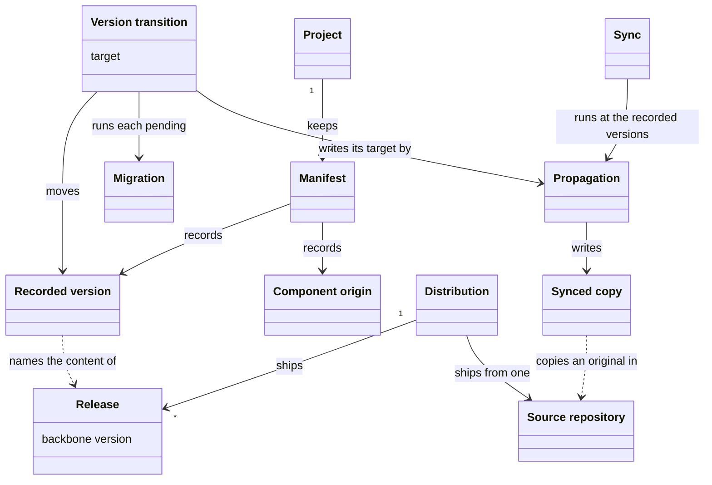
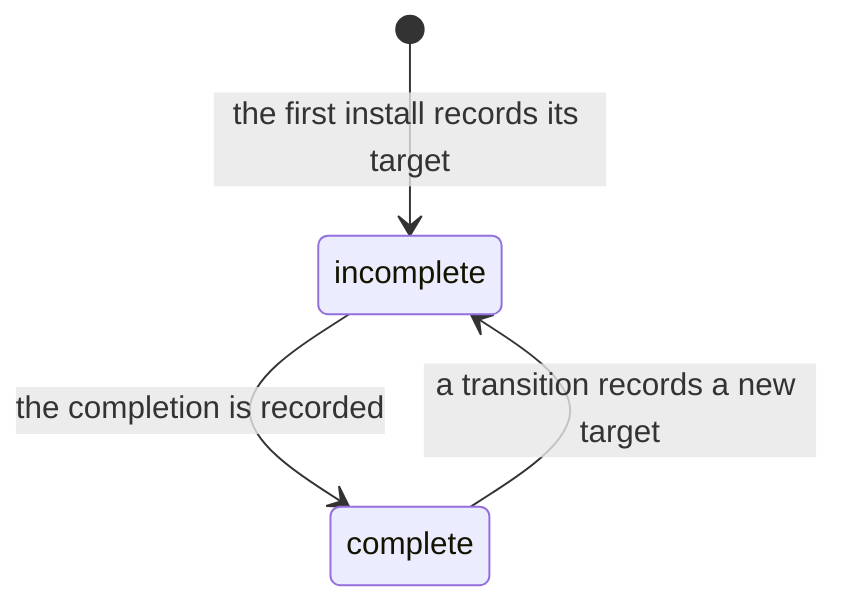
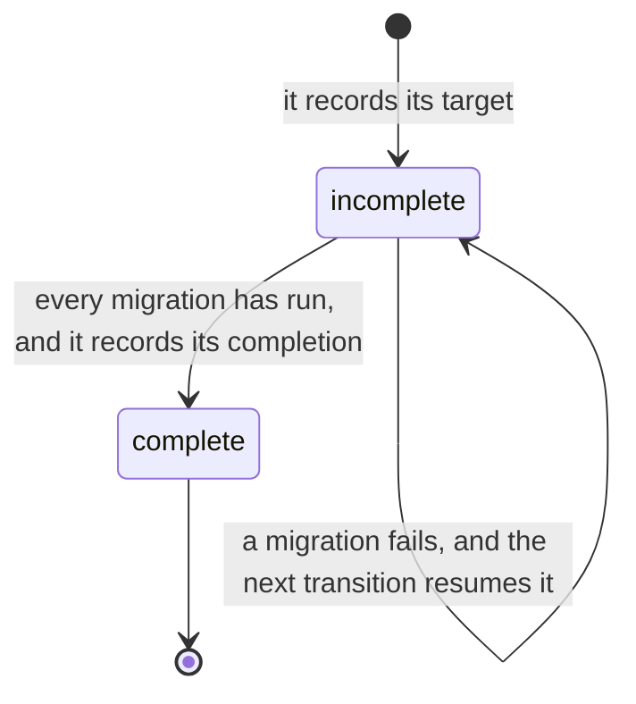

# VIEW-versions-and-copies — Versions and copies

How a project's content moves from one version to the next. A project records which version of the backbone and of each component it holds. Propagation writes the methodology's files into it as synced copies. Sync writes them again at the recorded versions, and a version transition moves those versions, running the migrations between.

A distribution ships its releases from one source repository.

## Manifest

A manifest is the file where a project records what it installed, and at which version. The backbone has one, `.pkit/manifest.yaml`, and each shipped component has its own.

**Attributes:**

- the backbone's: its recorded version, and the completion of its last transition (COR-059 point 6). It also lists every installed component, with its origin and the path of its own manifest (ADR-065 point 2).
- a shipped component's: its recorded version, and the files its install skipped (ADR-065 point 2, COR-059 point 7)

**Relations:**

- Install adds a component's entry and creates its manifest, and removing the component deletes both (COR-010).
- Only a version transition moves a recorded version in it (COR-059 point 3).

**States:** None.

**Always true:**

- It holds only what cannot be derived again from the methodology at the recorded version and the project's own configuration (COR-010).
- No copying of the methodology's content writes or removes a recorded version in it (COR-059 point 1).

## Release

A release is a set of versions shipped together, named by its backbone version. It holds one version of the backbone, and one of each component shipped with it. The release of 24 August 2026 holds backbone 1.149.0 and, among its components, project-management 0.54.0.

**Attributes:**

- its backbone version, which names it (COR-059 point 1)
- one version of each component shipped with it (COR-059 point 1)
- a release tag, `v<version>`, on its release commit (PRJ-004)

**Relations:**

- A distribution ships many releases.
- A project's recorded versions name the release whose content it holds (COR-059 point 1).

**States:** None.

**Always true:**

- A transition of the backbone moves every shipped component the project installed to its version in the target release. It holds none back (COR-059 point 7).

## Recorded version

A recorded version is the number or ref a project keeps for the backbone or for an installed component. It names the content the project holds. After `pkit sync`, a project holds the content of exactly its recorded versions.

**Attributes:**

- for the backbone and a shipped component, a version. For a component pulled from an external source, the ref it is pulled at (COR-059 point 1).

**Relations:**

- A manifest holds it, for the backbone and for each shipped component. A capability the project authors keeps its own in its `package.yaml`, and the project moves it by editing it (ADR-065 point 2).
- It names the release whose content the project holds (COR-059 point 1).
- Sync reads it, and a version transition moves it (COR-059 points 2 and 3).

**States:** The backbone's recorded version is complete when its target and its completion name the same version. A transition records its target first, and its completion last. In between, the recorded version is incomplete and names that target (COR-059 points 1 and 6).

**Always true:**

- Only a version transition moves it, and sync moves none (COR-059 points 2 and 3).
- A project is at a version only when its target and its completion both name it (COR-059 point 6).
- No copying of the methodology's content writes or removes it (COR-059 point 1).

## Migration

A migration is a script that carries a project's state across a version of the backbone or of a component. It changes what writing the methodology's files again cannot, such as a project's own settings. A version transition runs it.

**Attributes:**

- its tier, the backbone or one component, and the version it crosses, which names its folder, such as `0.55.0/` (COR-010)

**Relations:**

- A version transition runs each migration that is pending, the backbone's first (COR-059 point 3).

**States:** None.

**Always true:**

- Only a version transition runs a migration (COR-059 point 3).
- Run again on a state it already carried, it changes nothing (COR-010).
- A backbone migration acts only on a positive sign that it is needed, and never deletes by a path's name or position alone (COR-010).
- What it writes stays within what the records owning that content allow (COR-059 point 3).

## Version transition

A version transition moves a project's recorded versions to a target. It runs every migration that is pending, and records its completion only after they have run. `pkit upgrade` runs a transition of the backbone.

**Attributes:**

- its target: a release, for a transition of the backbone, or one component's version (COR-059 point 3)
- its form: a transition of the backbone, or of one component (COR-059 point 3)

**Relations:**

- It moves recorded versions, and runs migrations (COR-059 point 3).
- It writes its target's content by propagation (COR-059 point 3, ADR-065 point 1).
- A transition of the backbone moves every component the methodology ships with it (COR-059 point 7).

**States:** A transition is incomplete from the moment it records its target, before it writes anything else. It is complete once every migration has run and it records its completion. A migration that fails stops it, and the next transition of the backbone finishes it (COR-059 point 6).

**Always true:**

- It is the only operation that moves a recorded version, and no other operation runs a migration (COR-059 point 3).
- A transition of the backbone only moves forward (COR-059 point 9).
- Where a collision needs a person and nobody can reply, it refuses before it writes anything (COR-059 point 7).

## Propagation

Propagation writes the methodology's files into a project verbatim, at the recorded versions or at a transition's target. It writes over whatever stands at those paths.

**Attributes:** None.

**Relations:**

- It writes synced copies.
- Sync runs it at the recorded versions, and a version transition runs it at its target (COR-059 points 2 and 3).

**States:** None.

**Always true:**

- It checks no version, runs no migration, writes no manifest and creates no seed path (ADR-065 point 1).
- It stops and writes nothing when the CLI is at another version than the project records, or the last transition is incomplete (COR-059 point 9).
- It leaves out a capability the project authors (COR-031 point D1), and copies a component pulled from an external source only from that source (COR-041).

## Sync

Sync runs propagation at a project's recorded versions, and regenerates what derives from the project's declarations, such as the deployed skills. It moves no version and runs no migration. After a fresh clone, `pkit sync` puts the skills, the agent definitions and the core records back.

**Attributes:** None.

**Relations:**

- It runs propagation at the recorded versions (COR-059 point 2).
- It reads the recorded versions, and never moves them (COR-059 point 2).

**States:** None.

**Always true:**

- It moves no recorded version, and runs no migration (COR-059 point 2).
- Under a CLI at another version than the project records, or over an incomplete transition, it stops and writes nothing (COR-059 point 9).
- It creates no seed path (COR-059 point 8).

## Synced copy

A synced copy is a file that propagation writes into a project, from the methodology or from a component pulled from an external source. The project never edits it: the next sync would write over the edit.

**Attributes:**

- its path, the same as its original's (COR-001)

**Relations:**

- Propagation writes it.
- Its original lies in a source repository, where the same file is no synced copy (COR-050 point 14).

**States:** None.

**Always true:**

- Each sync writes it again at the recorded version, and each transition writes it at its target (COR-001).
- It holds only its original's content (COR-001).

## Source repository

A source repository is the versioned tree where the backbone or a component is authored. Its files are the originals that synced copies in other projects come from. project-kit's repository is the source repository of its distribution.

**Attributes:** None.

**Relations:**

- The synced copies in other projects come from its files (COR-050 point 14).
- A distribution ships from one source repository.
- A source repository that installs what it builds is a project too, as project-kit's is.

**States:** None.

**Always true:**

- No sync ever copies into the methodology's own source repository, since its files are the originals (ADR-059 point 1).

## Distribution

A distribution is one edition of the methodology and of the system that carries it, released from one source repository through one channel. project-kit is one, and a fork that releases from its own repository is another.

**Attributes:**

- its source repository, and its channel, such as a git URL with a release's tag (PRJ-004)

**Relations:**

- It ships many releases, from one source repository.
- A component pulled whole from a repository of its own comes through the channel its distribution uses, and is no distribution (COR-041).

**States:** None.

**Always true:**

- Only a CLI taken from a release's tag has a version that vouches for its content (PRJ-004).

## Component origin

A component origin is where an installed capability or adapter came from, as the manifest records it. It was shipped by its distribution, authored in the project, or supplied by an external source. project-kit's manifest marks `software-analysis` as authored in the project.

**Attributes:**

- one of three values, `kit-shipped`, `incubated-in-repo` or `externally-sourced`. An entry that names none reads as `kit-shipped` (COR-031 point D2, COR-041).

**Relations:**

- The manifest records it for each component (COR-031 point D2).
- The same component is `incubated-in-repo` in its source repository, and `externally-sourced` in the projects that pull it (COR-041).
- It decides how the component's recorded version moves (COR-059 points 1 and 3):
  - a shipped component's moves with the release
  - one pulled from an external source moves by its pin
  - one the project authors moves when the project edits it

**States:** None.

**Always true:**

- An origin governs only what the component is reconciled against. Dependencies and deployment treat every origin alike (COR-031 point D1).
- Removing a capability the project authored unregisters it, and leaves its files where they are (COR-031 point D4).
