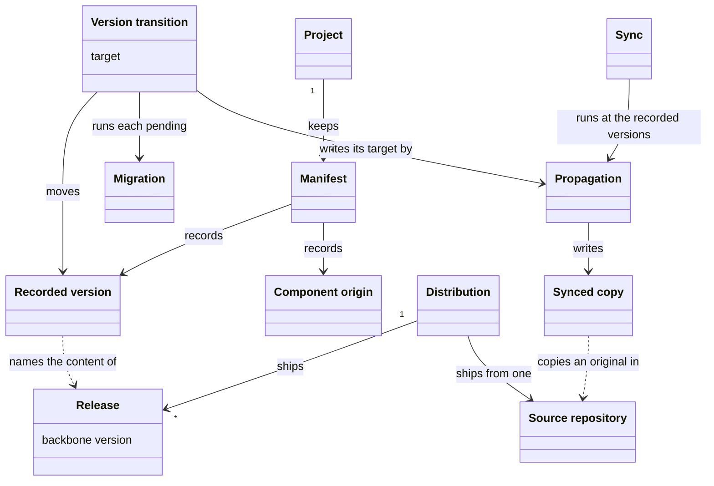
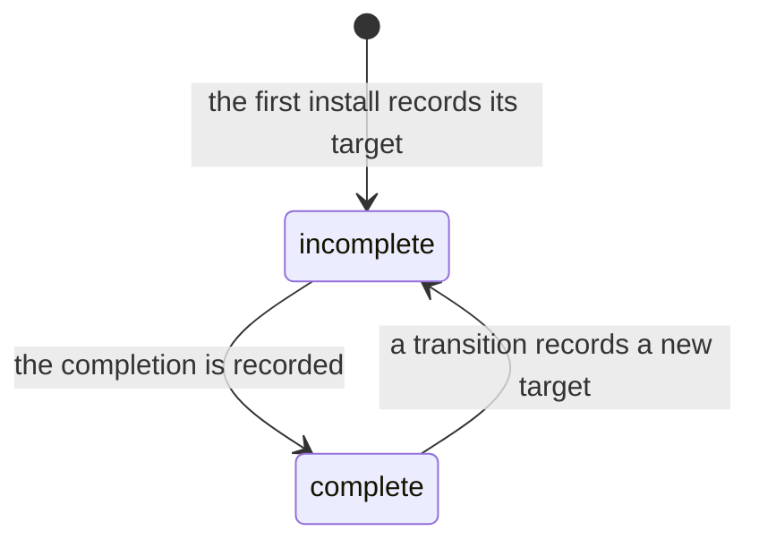
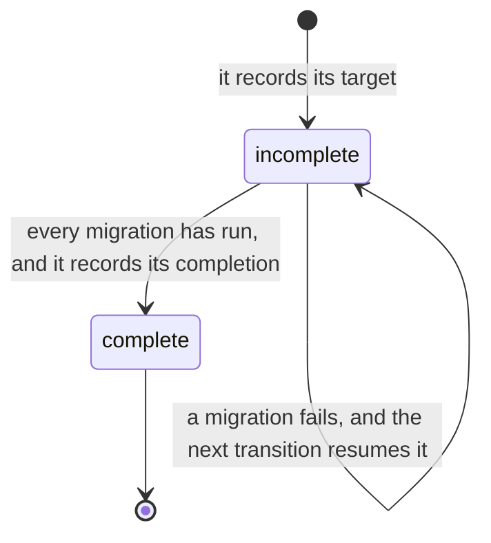

# VIEW-versions-and-copies — Versions and copies

A [project](../glossary.md#term-project--project) holds copies of the [methodology](../glossary.md#term-methodology--methodology)'s files so improvements reach it ([COR-001](../../../../.pkit/decisions/core/COR-001-content-mechanisms.md)). It also needs a routine repair that rebuilds those copies, and moves no [version](../glossary.md#term-version--version) ([COR-059](../../../../.pkit/decisions/core/COR-059-version-transition.md)). If its files move to a newer version without the [migrations](../glossary.md#term-migration--migration) between, it holds content they never reached, and nothing says so (COR-059).

So manifests keep the [recorded versions](../glossary.md#term-recorded-version--recorded-version) of the [backbone](../glossary.md#term-backbone--backbone) and of each [component](../glossary.md#term-component--component), each naming the content the project holds ([COR-010](../../../../.pkit/decisions/core/COR-010-resource-lifecycle.md), COR-059). Only a [version transition](../glossary.md#term-version-transition--version-transition) moves one, and it runs the migrations between (COR-059). [Propagation](../glossary.md#term-propagation--propagation) writes the [synced copies](../glossary.md#term-synced-copy--synced-copy), and [sync](../glossary.md#term-sync--sync) runs it at the recorded versions as the routine repair (COR-059).

Before it refreshes a copy, the [system](../glossary.md#term-system--system) must know where the original comes from ([COR-031](../../../../.pkit/decisions/core/COR-031-capability-origin.md)). A [component origin](../glossary.md#term-component-origin--component-origin) says so for each component, and a [distribution](../glossary.md#term-distribution--distribution) ships its releases from one [source repository](../glossary.md#term-source-repository--source-repository).

```mermaid
flowchart LR
  accTitle: How a release reaches a project, and sync repairs it
  accDescr: A distribution ships each release from its source repository. A transition of the backbone to a release records that target first, and the backbone's recorded version is incomplete. The transition runs each pending migration, and writes the release's content by propagation as synced copies. Once every migration has run, it records its completion, and the recorded version is complete. A migration that fails leaves it incomplete, and the next transition of the backbone finishes it. Over an incomplete transition, sync stops and writes nothing. At complete recorded versions, it runs propagation again and writes the synced copies anew, moving no version.
  SR[Source repository] -->|a distribution ships from it| RL([Release])
  RL -->|target of| T[Transition of the backbone]
  T -->|records its target first| RI["Backbone's recorded version: incomplete"]
  RI -->|the transition runs each pending migration| M[Migrations]
  RI -->|the transition writes its target by propagation| SC[Synced copies]
  M -->|every one has run and the completion is recorded| RC["Backbone's recorded version: complete"]
  M -->|one fails and the next transition finishes it| RI
  RI -->|sync stops and writes nothing| RI
  RC -->|sync runs propagation at the recorded versions| SC
```

## Manifest

Defined in [TERM-manifest](../glossary.md#term-manifest--manifest).

**Why:** A [project](../glossary.md#term-project--project) must store what it installed and at which [version](../glossary.md#term-version--version), since neither can be worked out again from the [methodology](../glossary.md#term-methodology--methodology)'s files ([COR-010](../../../../.pkit/decisions/core/COR-010-resource-lifecycle.md)). Separate manifests for the [backbone](../glossary.md#term-backbone--backbone) and each shipped [component](../glossary.md#term-component--component) keep their states apart, so installing or removing one leaves the others alone (COR-010).

A manifest is the file where a project records what it installed, and at which version. The backbone has one, `.pkit/manifest.yaml`, and each shipped component has its own.

**Attributes:**

- the backbone's: its [recorded version](../glossary.md#term-recorded-version--recorded-version), and the completion of its last transition ([COR-059 point 6](../../../../.pkit/decisions/core/COR-059-version-transition.md#6-a-transition-of-the-backbone-records-its-target-first-and-its-completion-last)). It also lists every installed component, with its origin and the path of its own manifest ([ADR-065 point 2](../../../architecture/decisions/ADR-065-upgrade-runs-the-transition.md#2-each-component-records-its-own-version-and-only-a-transition-moves-it)).
- a shipped component's: its recorded version, and the files its [install](../glossary.md#term-install--install) skipped (ADR-065 point 2, [COR-059 point 7](../../../../.pkit/decisions/core/COR-059-version-transition.md#7-a-transition-of-the-backbone-moves-every-component-the-methodology-ships-together))

**Relations:**

- Install adds a component's entry and creates its manifest, and removing the component deletes both (COR-010).
- Only a [version transition](../glossary.md#term-version-transition--version-transition) moves a recorded version in it ([COR-059 point 3](../../../../.pkit/decisions/core/COR-059-version-transition.md#3-a-version-transition-is-the-only-operation-of-the-core-layer-that-moves-a-recorded-version)).

**States:** None.

**Always true:**

- It holds only what cannot be derived again from the methodology at the recorded version and the project's own configuration (COR-010).
- No copying of the methodology's content writes or removes a recorded version in it ([COR-059 point 1](../../../../.pkit/decisions/core/COR-059-version-transition.md#1-a-project-records-a-version-for-its-backbone-and-for-each-component-it-installs)).

## Release

Defined in [TERM-release](../glossary.md#term-release--release).

**Why:** [Components](../glossary.md#term-component--component) carry [versions](../glossary.md#term-version--version) of their own, and a [project](../glossary.md#term-project--project) mixing two releases would need a check for every pair that might disagree ([COR-010](../../../../.pkit/decisions/core/COR-010-resource-lifecycle.md), [COR-059](../../../../.pkit/decisions/core/COR-059-version-transition.md)). No release was tested in such a mix, so a project stays at one release (COR-059).

A release is a set of versions shipped together, named by its [backbone](../glossary.md#term-backbone--backbone) version. It holds one version of the backbone, and one of each component shipped with it. The release of 24 August 2026 holds backbone 1.149.0 and, among its components, project-management 0.54.0.

**Attributes:**

- its backbone version, which names it ([COR-059 point 1](../../../../.pkit/decisions/core/COR-059-version-transition.md#1-a-project-records-a-version-for-its-backbone-and-for-each-component-it-installs))
- one version of each component shipped with it (COR-059 point 1)
- a release tag, `v<version>`, on its release commit ([PRJ-004](../../../../.pkit/decisions/project/PRJ-004-distribution-channel.md))

**Relations:**

- A [distribution](../glossary.md#term-distribution--distribution) ships many releases.
- A project's [recorded versions](../glossary.md#term-recorded-version--recorded-version) name the release whose content it holds (COR-059 point 1).

**States:** None.

**Always true:**

- A transition of the backbone moves every shipped component the project installed to its version in the target release. It holds none back ([COR-059 point 7](../../../../.pkit/decisions/core/COR-059-version-transition.md#7-a-transition-of-the-backbone-moves-every-component-the-methodology-ships-together)).

## Recorded version

Defined in [TERM-recorded-version](../glossary.md#term-recorded-version--recorded-version).

**Why:** [Migrations](../glossary.md#term-migration--migration) carry a [project](../glossary.md#term-project--project)'s state from one recorded version to the next, so the project must keep the [version](../glossary.md#term-version--version) it stands at ([COR-059](../../../../.pkit/decisions/core/COR-059-version-transition.md)). Comparing it with the running CLI's version stops a command from copying another version's content over the project (COR-059, [PRJ-004](../../../../.pkit/decisions/project/PRJ-004-distribution-channel.md)).

A recorded version is the number or ref a project keeps for the [backbone](../glossary.md#term-backbone--backbone) or for an installed [component](../glossary.md#term-component--component). It names the content the project holds. After `pkit sync`, a project holds the content of exactly its recorded versions.

**Attributes:**

- for the backbone and a shipped component, a version. For a component pulled from an external source, the ref it is pulled at ([COR-059 point 1](../../../../.pkit/decisions/core/COR-059-version-transition.md#1-a-project-records-a-version-for-its-backbone-and-for-each-component-it-installs)).

**Relations:**

- A [manifest](../glossary.md#term-manifest--manifest) holds it, for the backbone and for each shipped component. A [capability](../glossary.md#term-capability--capability) the project authors keeps its own in its `package.yaml`, and the project moves it by editing it ([ADR-065 point 2](../../../architecture/decisions/ADR-065-upgrade-runs-the-transition.md#2-each-component-records-its-own-version-and-only-a-transition-moves-it)).
- It names the [release](../glossary.md#term-release--release) whose content the project holds (COR-059 point 1).
- [Sync](../glossary.md#term-sync--sync) reads it, and a [version transition](../glossary.md#term-version-transition--version-transition) moves it (COR-059 points [2](../../../../.pkit/decisions/core/COR-059-version-transition.md#2-reconciliation-runs-at-the-recorded-versions-and-moves-none) and [3](../../../../.pkit/decisions/core/COR-059-version-transition.md#3-a-version-transition-is-the-only-operation-of-the-core-layer-that-moves-a-recorded-version)).

**States:** The backbone's recorded version is complete when its target and its completion name the same version. A transition records its target first, and its completion last. In between, the recorded version is incomplete and names that target (COR-059 points 1 and [6](../../../../.pkit/decisions/core/COR-059-version-transition.md#6-a-transition-of-the-backbone-records-its-target-first-and-its-completion-last)).

**Always true:**

- Only a version transition moves it, and sync moves none (COR-059 points 2 and 3).
- A project is at a version only when its target and its completion both name it (COR-059 point 6).
- No copying of the [methodology](../glossary.md#term-methodology--methodology)'s content writes or removes it (COR-059 point 1).

## Migration

Defined in [TERM-migration](../glossary.md#term-migration--migration).

**Why:** A new [version](../glossary.md#term-version--version) can rename or remove what a [project](../glossary.md#term-project--project)'s state relies on, or reshape it ([COR-010](../../../../.pkit/decisions/core/COR-010-resource-lifecycle.md)). Writing the newer files cannot carry that state across, so a migration bridges it (COR-010).

A migration is a script that carries a project's state across a version of the [backbone](../glossary.md#term-backbone--backbone) or of a [component](../glossary.md#term-component--component). It changes what writing the [methodology](../glossary.md#term-methodology--methodology)'s files again cannot, such as a project's own settings. A [version transition](../glossary.md#term-version-transition--version-transition) runs it.

**Attributes:**

- its tier, the backbone or one component, and the version it crosses, which names its folder, such as `0.55.0/` (COR-010)

**Relations:**

- A version transition runs each migration that is pending, the backbone's first ([COR-059 point 3](../../../../.pkit/decisions/core/COR-059-version-transition.md#3-a-version-transition-is-the-only-operation-of-the-core-layer-that-moves-a-recorded-version)).

**States:** None.

**Always true:**

- Only a version transition runs a migration (COR-059 point 3).
- Run again on a state it already carried, it changes nothing (COR-010).
- A backbone migration acts only on a positive sign that it is needed, and never deletes by a path's name or position alone (COR-010).
- What it writes stays within what the records owning that content allow (COR-059 point 3).

## Version transition

Defined in [TERM-version-transition](../glossary.md#term-version-transition--version-transition).

**Why:** If two operations could move a [version](../glossary.md#term-version--version) and only one ran [migrations](../glossary.md#term-migration--migration), the other would strand them, and none would run later ([COR-059](../../../../.pkit/decisions/core/COR-059-version-transition.md)). One operation that moves versions and runs every migration between leaves no path that skips one (COR-059). It records its completion last, so an interrupted transition is never mistaken for a finished one (COR-059).

A version transition moves a [project](../glossary.md#term-project--project)'s [recorded versions](../glossary.md#term-recorded-version--recorded-version) to a target. It runs every migration that is pending, and records its completion only after they have run. `pkit upgrade` runs a transition of the [backbone](../glossary.md#term-backbone--backbone).

**Attributes:**

- its target: a [release](../glossary.md#term-release--release), for a transition of the backbone, or one [component](../glossary.md#term-component--component)'s version ([COR-059 point 3](../../../../.pkit/decisions/core/COR-059-version-transition.md#3-a-version-transition-is-the-only-operation-of-the-core-layer-that-moves-a-recorded-version))
- its form: a transition of the backbone, or of one component (COR-059 point 3)

**Relations:**

- It moves recorded versions, and runs migrations (COR-059 point 3).
- It writes its target's content by [propagation](../glossary.md#term-propagation--propagation) (COR-059 point 3, [ADR-065 point 1](../../../architecture/decisions/ADR-065-upgrade-runs-the-transition.md#1-syncs-propagation-step-has-two-callers)).
- A transition of the backbone moves every component the [methodology](../glossary.md#term-methodology--methodology) ships with it ([COR-059 point 7](../../../../.pkit/decisions/core/COR-059-version-transition.md#7-a-transition-of-the-backbone-moves-every-component-the-methodology-ships-together)).

**States:** A transition is incomplete from the moment it records its target, before it writes anything else. It is complete once every migration has run and it records its completion. A migration that fails stops it, and the next transition of the backbone finishes it ([COR-059 point 6](../../../../.pkit/decisions/core/COR-059-version-transition.md#6-a-transition-of-the-backbone-records-its-target-first-and-its-completion-last)).

**Always true:**

- It is the only operation that moves a recorded version, and no other operation runs a migration (COR-059 point 3).
- A transition of the backbone only moves forward ([COR-059 point 9](../../../../.pkit/decisions/core/COR-059-version-transition.md#9-a-command-that-propagates-content-under-another-version-than-the-project-records-stops)).
- Where a collision needs a person and nobody can reply, it refuses before it writes anything (COR-059 point 7).

## Propagation

Defined in [TERM-propagation](../glossary.md#term-propagation--propagation).

**Why:** Improvements to the [methodology](../glossary.md#term-methodology--methodology)'s files must keep reaching each [project](../glossary.md#term-project--project), or the methodology helps only once, when first installed ([COR-001](../../../../.pkit/decisions/core/COR-001-content-mechanisms.md)). No file is shared between the methodology and the project, so propagation writes each file whole (COR-001).

Propagation writes the methodology's files into a project verbatim, at the [recorded versions](../glossary.md#term-recorded-version--recorded-version) or at a transition's target. It writes over whatever stands at those paths.

**Attributes:** None.

**Relations:**

- It writes [synced copies](../glossary.md#term-synced-copy--synced-copy).
- [Sync](../glossary.md#term-sync--sync) runs it at the recorded versions, and a [version transition](../glossary.md#term-version-transition--version-transition) runs it at its target (COR-059 points [2](../../../../.pkit/decisions/core/COR-059-version-transition.md#2-reconciliation-runs-at-the-recorded-versions-and-moves-none) and [3](../../../../.pkit/decisions/core/COR-059-version-transition.md#3-a-version-transition-is-the-only-operation-of-the-core-layer-that-moves-a-recorded-version)).

**States:** None.

**Always true:**

- It checks no [version](../glossary.md#term-version--version), runs no [migration](../glossary.md#term-migration--migration) and writes no [manifest](../glossary.md#term-manifest--manifest) ([ADR-065 point 1](../../../architecture/decisions/ADR-065-upgrade-runs-the-transition.md#1-syncs-propagation-step-has-two-callers)).
- It leaves out a [capability](../glossary.md#term-capability--capability) the project authors ([COR-031 point D1](../../../../.pkit/decisions/core/COR-031-capability-origin.md#d1--the-lifecycle-excludes-incubated-capabilities-from-source-reconciliation-but-not-from-self-consistency-checks)), and copies a [component](../glossary.md#term-component--component) pulled from an external source only from that source ([COR-041](../../../../.pkit/decisions/core/COR-041-external-source-distribution.md)).

## Sync

Defined in [TERM-sync](../glossary.md#term-sync--sync).

**Why:** A [project](../glossary.md#term-project--project) needs a routine repair that never moves it, after a fresh clone, a deleted file or a new [skill](../glossary.md#term-skill--skill) of its own ([COR-059](../../../../.pkit/decisions/core/COR-059-version-transition.md)). Since sync moves no [version](../glossary.md#term-version--version), it can run at any time (COR-059).

Sync runs [propagation](../glossary.md#term-propagation--propagation) at a project's [recorded versions](../glossary.md#term-recorded-version--recorded-version), and regenerates what derives from the project's declarations, such as the deployed skills. It moves no version and runs no [migration](../glossary.md#term-migration--migration). After a fresh clone, `pkit sync` puts the skills, the [agent definitions](../glossary.md#term-agent-definition--agent-definition) and the core records back.

**Attributes:** None.

**Relations:**

- It runs propagation at the recorded versions ([COR-059 point 2](../../../../.pkit/decisions/core/COR-059-version-transition.md#2-reconciliation-runs-at-the-recorded-versions-and-moves-none)).
- It reads the recorded versions, and never moves them (COR-059 point 2).

**States:** None.

**Always true:**

- It moves no recorded version, and runs no migration (COR-059 point 2).
- Under a CLI at another version than the project records, or over an incomplete transition, it stops and writes nothing ([COR-059 point 9](../../../../.pkit/decisions/core/COR-059-version-transition.md#9-a-command-that-propagates-content-under-another-version-than-the-project-records-stops)).

## Synced copy

Defined in [TERM-synced-copy](../glossary.md#term-synced-copy--synced-copy).

**Why:** Improvements reach a [project](../glossary.md#term-project--project) as files in its own tree, yet each such file stays its source's, never the project's ([COR-001](../../../../.pkit/decisions/core/COR-001-content-mechanisms.md), [COR-041](../../../../.pkit/decisions/core/COR-041-external-source-distribution.md)). Refreshing it is not the project's own work, and must not show up as such in its history ([COR-050 point 14](../../../../.pkit/decisions/core/COR-050-anchors-and-friction.md#14-project-settings)).

A synced copy is a file that [propagation](../glossary.md#term-propagation--propagation) writes into a project, from the [methodology](../glossary.md#term-methodology--methodology) or from a [component](../glossary.md#term-component--component) pulled from an external source. The project never edits it: the next [sync](../glossary.md#term-sync--sync) would write over the edit.

**Attributes:**

- its path, the same as its original's (COR-001)

**Relations:**

- Propagation writes it.
- Its original lies in a [source repository](../glossary.md#term-source-repository--source-repository), where the same file is no synced copy (COR-050 point 14).

**States:** None.

**Always true:**

- Each sync writes it again at the [recorded version](../glossary.md#term-recorded-version--recorded-version), and each transition writes it at its target (COR-001).
- It holds only its original's content (COR-001).

## Source repository

Defined in [TERM-source-repository](../glossary.md#term-source-repository--source-repository).

**Why:** A file is the original where it is authored, and a [synced copy](../glossary.md#term-synced-copy--synced-copy) everywhere else ([COR-050 point 14](../../../../.pkit/decisions/core/COR-050-anchors-and-friction.md#14-project-settings)). A [sync](../glossary.md#term-sync--sync) into the repository that holds the originals would copy over them ([ADR-059](../../../architecture/decisions/ADR-059-methodology-source-repository.md)).

A source repository is the versioned tree where the [backbone](../glossary.md#term-backbone--backbone) or a [component](../glossary.md#term-component--component) is authored. Its files are the originals that synced copies in other projects come from. project-kit's repository is the source repository of its [distribution](../glossary.md#term-distribution--distribution).

**Attributes:** None.

**Relations:**

- The synced copies in other projects come from its files (COR-050 point 14).
- A distribution ships from one source repository.
- A source repository that installs what it builds is a [project](../glossary.md#term-project--project) too, as project-kit's is.

**States:** None.

**Always true:**

- No sync ever copies into the [methodology](../glossary.md#term-methodology--methodology)'s own source repository, since its files are the originals ([ADR-059 point 1](../../../architecture/decisions/ADR-059-methodology-source-repository.md#1-the-definition)).

## Distribution

Defined in [TERM-distribution](../glossary.md#term-distribution--distribution).

**Why:** Whoever sets up the [system](../glossary.md#term-system--system) must know where it comes from, and through which channel ([PRJ-004](../../../../.pkit/decisions/project/PRJ-004-distribution-channel.md)). The ref the CLI is installed from there decides whether a [project](../glossary.md#term-project--project)'s [recorded version](../glossary.md#term-recorded-version--recorded-version) names one content (PRJ-004).

A distribution is one edition of the [methodology](../glossary.md#term-methodology--methodology) and of the system that carries it, released from one [source repository](../glossary.md#term-source-repository--source-repository) through one channel. project-kit is one, and a fork that releases from its own repository is another.

**Attributes:**

- its source repository, and its channel, such as a git URL with a [release](../glossary.md#term-release--release)'s tag (PRJ-004)

**Relations:**

- It ships many releases, from one source repository.
- A [component](../glossary.md#term-component--component) pulled whole from a repository of its own comes through the channel its distribution uses, and is no distribution ([COR-041](../../../../.pkit/decisions/core/COR-041-external-source-distribution.md)).

**States:** None.

**Always true:**

- Only a CLI taken from a tag on a release's commit, the release's own or `latest`, has a [version](../glossary.md#term-version--version) that vouches for its content (PRJ-004).

## Component origin

Defined in [TERM-component-origin](../glossary.md#term-component-origin--component-origin).

**Why:** [Sync](../glossary.md#term-sync--sync) and a [version transition](../glossary.md#term-version-transition--version-transition) must know where a [component](../glossary.md#term-component--component) came from before refreshing it, or they may destroy the [project](../glossary.md#term-project--project)'s own work ([COR-031](../../../../.pkit/decisions/core/COR-031-capability-origin.md)). An origin for pulled content lets one repository share its own content with others, without forking the [methodology](../glossary.md#term-methodology--methodology) ([COR-041](../../../../.pkit/decisions/core/COR-041-external-source-distribution.md)).

A component origin is where an installed [capability](../glossary.md#term-capability--capability) or [adapter](../glossary.md#term-adapter--adapter) came from, as the [manifest](../glossary.md#term-manifest--manifest) records it. It was shipped by its [distribution](../glossary.md#term-distribution--distribution), authored in the project, or supplied by an external source. project-kit's manifest marks `software-analysis` as authored in the project.

**Attributes:**

- one of three values, `kit-shipped`, `incubated-in-repo` or `externally-sourced`. An entry that names none reads as `kit-shipped` ([COR-031 point D2](../../../../.pkit/decisions/core/COR-031-capability-origin.md#d2--origin-is-recorded-in-lifecycle-owned-install-state-defaulting-to-kit-shipped), COR-041).

**Relations:**

- The manifest records it for each component (COR-031 point D2).
- The same component is `incubated-in-repo` in its [source repository](../glossary.md#term-source-repository--source-repository), and `externally-sourced` in the projects that pull it (COR-041).
- It decides how the component's [recorded version](../glossary.md#term-recorded-version--recorded-version) moves (COR-059 points [1](../../../../.pkit/decisions/core/COR-059-version-transition.md#1-a-project-records-a-version-for-its-backbone-and-for-each-component-it-installs) and [3](../../../../.pkit/decisions/core/COR-059-version-transition.md#3-a-version-transition-is-the-only-operation-of-the-core-layer-that-moves-a-recorded-version)):
  - a shipped component's moves with the [release](../glossary.md#term-release--release)
  - one pulled from an external source moves with the ref it is pulled at
  - one the project authors moves when the project edits it

**States:** None.

**Always true:**

- An origin governs only what the component is reconciled against. Dependencies and deployment treat every origin alike ([COR-031 point D1](../../../../.pkit/decisions/core/COR-031-capability-origin.md#d1--the-lifecycle-excludes-incubated-capabilities-from-source-reconciliation-but-not-from-self-consistency-checks)).
- Removing a capability the project authored unregisters it, and leaves its files where they are ([COR-031 point D4](../../../../.pkit/decisions/core/COR-031-capability-origin.md#d4--every-lifecycle-verb-honours-origin-removal-never-destroys-adopter-owned-source)).

## What is built on these concepts

Each concept below lists the use cases, journeys and requirements whose text links its term.

**Manifest:**

- [UC-005 — Say what my document rests on](../use-case-model/use-cases/030-change/UC-005-anchor-document.md)
- [UC-014 — Develop the methodology in its source repository](../use-case-model/use-cases/010-develop/UC-014-develop-methodology.md)
- [UC-016 — Keep a capability I wrote in my own repository](../use-case-model/use-cases/010-develop/UC-016-keep-capability.md)
- [UC-017 — Give my capability roles, data points and processes others connect to](../use-case-model/use-cases/010-develop/UC-017-connect-capability.md)
- [UC-019 — Adapt the system to another harness](../use-case-model/use-cases/010-develop/UC-019-adapt-harness.md)
- [UC-023 — Add or remove a capability, and be told of a name collision](../use-case-model/use-cases/020-set-up/UC-023-add-or-remove-capability.md)
- [UC-028 — Keep my intermediate files in a workspace no commit carries](../use-case-model/use-cases/020-set-up/UC-028-keep-intermediate-files.md)
- [UC-038 — Author and extend my project's own rule sets](../use-case-model/use-cases/030-change/UC-038-author-rule-sets.md)
- [UC-049 — Install the system into my project with one command](../use-case-model/use-cases/050-adopt/UC-049-install-system.md)
- [UC-051 — Upgrade the system like a dependency](../use-case-model/use-cases/050-adopt/UC-051-upgrade-system.md)
- [UC-052 — Run each project at the version it pins](../use-case-model/use-cases/050-adopt/UC-052-run-at-pin.md)
- [UC-054 — Upgrade one capability on its own](../use-case-model/use-cases/050-adopt/UC-054-upgrade-capability.md)
- [JRN-002 — Upgrade the system](../use-case-model/journeys/JRN-002-upgrade-system.md)
- [JRN-005 — Package a discipline as a capability, and make it ready to share](../use-case-model/journeys/JRN-005-package-and-share-capability.md)
- [JRN-007 — Upgrade one capability, and re-pin its rule set](../use-case-model/journeys/JRN-007-upgrade-one-capability.md)
- [REQ-011 · Constraint · A suggestion of what to install never uses the network](../requirements/constraints/020-set-up/REQ-011-suggestion-offline.md)
- [REQ-026 · Quality · An interrupted version transition never reads as finished, and the next one completes it](../requirements/quality/050-adopt/REQ-026-interrupted-transition-completes.md)

**Release:**

- [UC-003 — Declare what my change means for the next release](../use-case-model/use-cases/030-change/UC-003-declare-changeset.md)
- [UC-008 — Release the backbone so adopters can upgrade and pin to it](../use-case-model/use-cases/040-release/UC-008-release-backbone.md)
- [UC-009 — Release my component on its own version](../use-case-model/use-cases/040-release/UC-009-release-component.md)
- [UC-010 — Never ship a backbone change that breaks installed projects without the migration that carries them across](../use-case-model/use-cases/030-change/UC-010-migrate-backbone-change.md)
- [UC-011 — Carry the projects that installed my component across a breaking change of it](../use-case-model/use-cases/030-change/UC-011-migrate-component-change.md)
- [UC-014 — Develop the methodology in its source repository](../use-case-model/use-cases/010-develop/UC-014-develop-methodology.md)
- [UC-019 — Adapt the system to another harness](../use-case-model/use-cases/010-develop/UC-019-adapt-harness.md)
- [UC-024 — See what a capability would connect to before I install it](../use-case-model/use-cases/020-set-up/UC-024-see-capability-connections.md)
- [UC-048 — Put the system's CLI on my machine at a release](../use-case-model/use-cases/050-adopt/UC-048-install-cli.md)
- [UC-049 — Install the system into my project with one command](../use-case-model/use-cases/050-adopt/UC-049-install-system.md)
- [UC-050 — Get a fresh clone ready to work with one sync](../use-case-model/use-cases/050-adopt/UC-050-ready-fresh-clone.md)
- [UC-051 — Upgrade the system like a dependency](../use-case-model/use-cases/050-adopt/UC-051-upgrade-system.md)
- [UC-052 — Run each project at the version it pins](../use-case-model/use-cases/050-adopt/UC-052-run-at-pin.md)
- [JRN-001 — Adopt the system](../use-case-model/journeys/JRN-001-adopt-system.md)
- [JRN-002 — Upgrade the system](../use-case-model/journeys/JRN-002-upgrade-system.md)
- [JRN-006 — Start working on a project on a new machine](../use-case-model/journeys/JRN-006-start-on-new-machine.md)
- [JRN-007 — Upgrade one capability, and re-pin its rule set](../use-case-model/journeys/JRN-007-upgrade-one-capability.md)
- [JRN-008 — Release a breaking backbone change with its migration](../use-case-model/journeys/JRN-008-release-breaking-backbone-change.md)
- [REQ-008 · Constraint · Until #1600 is done, the only area or adapter a change may add is `rule-sets`, and none may be removed](../requirements/constraints/010-develop/REQ-008-areas-held.md)
- [REQ-010 · Functional · A command that propagates content under another version than the project records stops](../requirements/functional/REQ-010-stop-under-another-version.md)
- [REQ-017 · Quality · A backbone migration is safe over any state](../requirements/quality/030-change/REQ-017-backbone-migration-safe.md)
- [REQ-027 · Quality · The version pin holds the old one or the new one, never part, and an upgrade writes it last](../requirements/quality/050-adopt/REQ-027-pin-whole-written-last.md)
- [REQ-028 · Quality · The router never fails a command over a version pin it cannot resolve](../requirements/quality/050-adopt/REQ-028-unresolved-pin-runs-installed.md)
- [REQ-031 · Constraint · The CLI is installed with uv from the distribution's git URL](../requirements/constraints/050-adopt/REQ-031-cli-from-distribution-url.md)

**Recorded version:**

- [UC-022 — Add my own operational rules, the harness's settings, grants and agent paths beside the methodology's](../use-case-model/use-cases/020-set-up/UC-022-add-own-additions.md)
- [UC-026 — Start every session with the project's rules loaded](../use-case-model/use-cases/020-set-up/UC-026-start-with-rules.md)
- [UC-050 — Get a fresh clone ready to work with one sync](../use-case-model/use-cases/050-adopt/UC-050-ready-fresh-clone.md)
- [UC-051 — Upgrade the system like a dependency](../use-case-model/use-cases/050-adopt/UC-051-upgrade-system.md)
- [UC-054 — Upgrade one capability on its own](../use-case-model/use-cases/050-adopt/UC-054-upgrade-capability.md)
- [JRN-006 — Start working on a project on a new machine](../use-case-model/journeys/JRN-006-start-on-new-machine.md)
- [JRN-007 — Upgrade one capability, and re-pin its rule set](../use-case-model/journeys/JRN-007-upgrade-one-capability.md)
- [REQ-010 · Functional · A command that propagates content under another version than the project records stops](../requirements/functional/REQ-010-stop-under-another-version.md)

**Migration:**

- [UC-008 — Release the backbone so adopters can upgrade and pin to it](../use-case-model/use-cases/040-release/UC-008-release-backbone.md)
- [UC-009 — Release my component on its own version](../use-case-model/use-cases/040-release/UC-009-release-component.md)
- [UC-010 — Never ship a backbone change that breaks installed projects without the migration that carries them across](../use-case-model/use-cases/030-change/UC-010-migrate-backbone-change.md)
- [UC-011 — Carry the projects that installed my component across a breaking change of it](../use-case-model/use-cases/030-change/UC-011-migrate-component-change.md)
- [UC-050 — Get a fresh clone ready to work with one sync](../use-case-model/use-cases/050-adopt/UC-050-ready-fresh-clone.md)
- [UC-051 — Upgrade the system like a dependency](../use-case-model/use-cases/050-adopt/UC-051-upgrade-system.md)
- [UC-054 — Upgrade one capability on its own](../use-case-model/use-cases/050-adopt/UC-054-upgrade-capability.md)
- [JRN-002 — Upgrade the system](../use-case-model/journeys/JRN-002-upgrade-system.md)
- [JRN-007 — Upgrade one capability, and re-pin its rule set](../use-case-model/journeys/JRN-007-upgrade-one-capability.md)
- [JRN-008 — Release a breaking backbone change with its migration](../use-case-model/journeys/JRN-008-release-breaking-backbone-change.md)
- [JRN-009 — Release a breaking change of my component with its migration](../use-case-model/journeys/JRN-009-release-breaking-component-change.md)
- [REQ-001 · Quality · A migration run again changes nothing](../requirements/quality/030-change/REQ-001-migration-runs-again.md)
- [REQ-010 · Functional · A command that propagates content under another version than the project records stops](../requirements/functional/REQ-010-stop-under-another-version.md)
- [REQ-017 · Quality · A backbone migration is safe over any state](../requirements/quality/030-change/REQ-017-backbone-migration-safe.md)
- [REQ-026 · Quality · An interrupted version transition never reads as finished, and the next one completes it](../requirements/quality/050-adopt/REQ-026-interrupted-transition-completes.md)
- [REQ-027 · Quality · The version pin holds the old one or the new one, never part, and an upgrade writes it last](../requirements/quality/050-adopt/REQ-027-pin-whole-written-last.md)
- [REQ-029 · Functional · A version transition resolves compatibility across components before it writes anything](../requirements/functional/050-adopt/REQ-029-compatibility-before-write.md)

**Version transition:**

- [UC-016 — Keep a capability I wrote in my own repository](../use-case-model/use-cases/010-develop/UC-016-keep-capability.md)
- [UC-022 — Add my own operational rules, the harness's settings, grants and agent paths beside the methodology's](../use-case-model/use-cases/020-set-up/UC-022-add-own-additions.md)
- [UC-023 — Add or remove a capability, and be told of a name collision](../use-case-model/use-cases/020-set-up/UC-023-add-or-remove-capability.md)
- [UC-024 — See what a capability would connect to before I install it](../use-case-model/use-cases/020-set-up/UC-024-see-capability-connections.md)
- [UC-026 — Start every session with the project's rules loaded](../use-case-model/use-cases/020-set-up/UC-026-start-with-rules.md)
- [UC-027 — Find my agent definition deployed, with the project's paths and my grants](../use-case-model/use-cases/020-set-up/UC-027-find-agent-definition-deployed.md)
- [UC-050 — Get a fresh clone ready to work with one sync](../use-case-model/use-cases/050-adopt/UC-050-ready-fresh-clone.md)
- [UC-054 — Upgrade one capability on its own](../use-case-model/use-cases/050-adopt/UC-054-upgrade-capability.md)
- [JRN-001 — Adopt the system](../use-case-model/journeys/JRN-001-adopt-system.md)
- [JRN-006 — Start working on a project on a new machine](../use-case-model/journeys/JRN-006-start-on-new-machine.md)
- [REQ-001 · Quality · A migration run again changes nothing](../requirements/quality/030-change/REQ-001-migration-runs-again.md)
- [REQ-002 · Functional · Project-owned content is written only by the writers records name](../requirements/functional/REQ-002-project-owned-writers.md)
- [REQ-010 · Functional · A command that propagates content under another version than the project records stops](../requirements/functional/REQ-010-stop-under-another-version.md)
- [REQ-017 · Quality · A backbone migration is safe over any state](../requirements/quality/030-change/REQ-017-backbone-migration-safe.md)

**Propagation:**

- [REQ-002 · Functional · Project-owned content is written only by the writers records name](../requirements/functional/REQ-002-project-owned-writers.md)
- [REQ-008 · Constraint · Until #1600 is done, the only area or adapter a change may add is `rule-sets`, and none may be removed](../requirements/constraints/010-develop/REQ-008-areas-held.md)

**Sync:**

- [UC-014 — Develop the methodology in its source repository](../use-case-model/use-cases/010-develop/UC-014-develop-methodology.md)
- [UC-016 — Keep a capability I wrote in my own repository](../use-case-model/use-cases/010-develop/UC-016-keep-capability.md)
- [UC-019 — Adapt the system to another harness](../use-case-model/use-cases/010-develop/UC-019-adapt-harness.md)
- [UC-020 — Turn recurring work into my project's own skill or agent definition](../use-case-model/use-cases/010-develop/UC-020-own-skill-or-agent.md)
- [UC-021 — Declare my project's backbone configuration once, and have it validated](../use-case-model/use-cases/020-set-up/UC-021-declare-backbone-configuration.md)
- [UC-022 — Add my own operational rules, the harness's settings, grants and agent paths beside the methodology's](../use-case-model/use-cases/020-set-up/UC-022-add-own-additions.md)
- [UC-026 — Start every session with the project's rules loaded](../use-case-model/use-cases/020-set-up/UC-026-start-with-rules.md)
- [UC-027 — Find my agent definition deployed, with the project's paths and my grants](../use-case-model/use-cases/020-set-up/UC-027-find-agent-definition-deployed.md)
- [UC-037 — Record my decision beside the methodology's](../use-case-model/use-cases/030-change/UC-037-record-decision.md)
- [UC-038 — Author and extend my project's own rule sets](../use-case-model/use-cases/030-change/UC-038-author-rule-sets.md)
- [UC-039 — Think a question through in a scratchpad note, and retire it](../use-case-model/use-cases/030-change/UC-039-think-in-scratchpad.md)
- [UC-041 — Keep each core record true for any project that adopts it](../use-case-model/use-cases/030-change/UC-041-keep-core-records-true.md)
- [UC-042 — Have my draft challenged and my diff checked against the conventions](../use-case-model/use-cases/030-change/UC-042-challenge-and-check.md)
- [UC-050 — Get a fresh clone ready to work with one sync](../use-case-model/use-cases/050-adopt/UC-050-ready-fresh-clone.md)
- [UC-051 — Upgrade the system like a dependency](../use-case-model/use-cases/050-adopt/UC-051-upgrade-system.md)
- [JRN-005 — Package a discipline as a capability, and make it ready to share](../use-case-model/journeys/JRN-005-package-and-share-capability.md)
- [JRN-006 — Start working on a project on a new machine](../use-case-model/journeys/JRN-006-start-on-new-machine.md)
- [REQ-002 · Functional · Project-owned content is written only by the writers records name](../requirements/functional/REQ-002-project-owned-writers.md)
- [REQ-010 · Functional · A command that propagates content under another version than the project records stops](../requirements/functional/REQ-010-stop-under-another-version.md)
- [REQ-027 · Quality · The version pin holds the old one or the new one, never part, and an upgrade writes it last](../requirements/quality/050-adopt/REQ-027-pin-whole-written-last.md)
- [REQ-028 · Quality · The router never fails a command over a version pin it cannot resolve](../requirements/quality/050-adopt/REQ-028-unresolved-pin-runs-installed.md)

**Synced copy:**

- [UC-017 — Give my capability roles, data points and processes others connect to](../use-case-model/use-cases/010-develop/UC-017-connect-capability.md)
- [UC-037 — Record my decision beside the methodology's](../use-case-model/use-cases/030-change/UC-037-record-decision.md)
- [UC-041 — Keep each core record true for any project that adopts it](../use-case-model/use-cases/030-change/UC-041-keep-core-records-true.md)
- [UC-042 — Have my draft challenged and my diff checked against the conventions](../use-case-model/use-cases/030-change/UC-042-challenge-and-check.md)

**Source repository:**

- [UC-002 — Answer what my change made stale](../use-case-model/use-cases/030-change/UC-002-answer-stale.md)
- [UC-003 — Declare what my change means for the next release](../use-case-model/use-cases/030-change/UC-003-declare-changeset.md)
- [UC-004 — Know before I push that my change passes my project's checks](../use-case-model/use-cases/030-change/UC-004-check-before-push.md)
- [UC-005 — Say what my document rests on](../use-case-model/use-cases/030-change/UC-005-anchor-document.md)
- [UC-006 — Make my merges wait on the system's checks](../use-case-model/use-cases/030-change/UC-006-gate-merges.md)
- [UC-008 — Release the backbone so adopters can upgrade and pin to it](../use-case-model/use-cases/040-release/UC-008-release-backbone.md)
- [UC-010 — Never ship a backbone change that breaks installed projects without the migration that carries them across](../use-case-model/use-cases/030-change/UC-010-migrate-backbone-change.md)
- [UC-014 — Develop the methodology in its source repository](../use-case-model/use-cases/010-develop/UC-014-develop-methodology.md)
- [UC-015 — Package a recurring discipline as a capability](../use-case-model/use-cases/010-develop/UC-015-package-capability.md)
- [UC-016 — Keep a capability I wrote in my own repository](../use-case-model/use-cases/010-develop/UC-016-keep-capability.md)
- [UC-017 — Give my capability roles, data points and processes others connect to](../use-case-model/use-cases/010-develop/UC-017-connect-capability.md)
- [UC-019 — Adapt the system to another harness](../use-case-model/use-cases/010-develop/UC-019-adapt-harness.md)
- [UC-020 — Turn recurring work into my project's own skill or agent definition](../use-case-model/use-cases/010-develop/UC-020-own-skill-or-agent.md)
- [UC-021 — Declare my project's backbone configuration once, and have it validated](../use-case-model/use-cases/020-set-up/UC-021-declare-backbone-configuration.md)
- [UC-022 — Add my own operational rules, the harness's settings, grants and agent paths beside the methodology's](../use-case-model/use-cases/020-set-up/UC-022-add-own-additions.md)
- [UC-023 — Add or remove a capability, and be told of a name collision](../use-case-model/use-cases/020-set-up/UC-023-add-or-remove-capability.md)
- [UC-024 — See what a capability would connect to before I install it](../use-case-model/use-cases/020-set-up/UC-024-see-capability-connections.md)
- [UC-026 — Start every session with the project's rules loaded](../use-case-model/use-cases/020-set-up/UC-026-start-with-rules.md)
- [UC-027 — Find my agent definition deployed, with the project's paths and my grants](../use-case-model/use-cases/020-set-up/UC-027-find-agent-definition-deployed.md)
- [UC-028 — Keep my intermediate files in a workspace no commit carries](../use-case-model/use-cases/020-set-up/UC-028-keep-intermediate-files.md)
- [UC-030 — Let agents work on their own without a stream of confirmations](../use-case-model/use-cases/020-set-up/UC-030-work-unprompted.md)
- [UC-031 — Keep my per-machine choices out of what the project commits](../use-case-model/use-cases/020-set-up/UC-031-keep-per-machine-choices.md)
- [UC-032 — Be asked before an agent changes another repository](../use-case-model/use-cases/020-set-up/UC-032-ask-before-other-repository.md)
- [UC-033 — Find out why a command prompted me or was blocked](../use-case-model/use-cases/020-set-up/UC-033-find-why-prompted.md)
- [UC-034 — Land my change on the default branch](../use-case-model/use-cases/030-change/UC-034-land-change.md)
- [UC-037 — Record my decision beside the methodology's](../use-case-model/use-cases/030-change/UC-037-record-decision.md)
- [UC-038 — Author and extend my project's own rule sets](../use-case-model/use-cases/030-change/UC-038-author-rule-sets.md)
- [UC-039 — Think a question through in a scratchpad note, and retire it](../use-case-model/use-cases/030-change/UC-039-think-in-scratchpad.md)
- [UC-041 — Keep each core record true for any project that adopts it](../use-case-model/use-cases/030-change/UC-041-keep-core-records-true.md)
- [UC-042 — Have my draft challenged and my diff checked against the conventions](../use-case-model/use-cases/030-change/UC-042-challenge-and-check.md)
- [UC-049 — Install the system into my project with one command](../use-case-model/use-cases/050-adopt/UC-049-install-system.md)
- [UC-050 — Get a fresh clone ready to work with one sync](../use-case-model/use-cases/050-adopt/UC-050-ready-fresh-clone.md)
- [UC-051 — Upgrade the system like a dependency](../use-case-model/use-cases/050-adopt/UC-051-upgrade-system.md)
- [UC-052 — Run each project at the version it pins](../use-case-model/use-cases/050-adopt/UC-052-run-at-pin.md)
- [UC-054 — Upgrade one capability on its own](../use-case-model/use-cases/050-adopt/UC-054-upgrade-capability.md)
- [JRN-001 — Adopt the system](../use-case-model/journeys/JRN-001-adopt-system.md)
- [JRN-008 — Release a breaking backbone change with its migration](../use-case-model/journeys/JRN-008-release-breaking-backbone-change.md)

**Distribution:**

- [UC-016 — Keep a capability I wrote in my own repository](../use-case-model/use-cases/010-develop/UC-016-keep-capability.md)
- [UC-023 — Add or remove a capability, and be told of a name collision](../use-case-model/use-cases/020-set-up/UC-023-add-or-remove-capability.md)
- [UC-024 — See what a capability would connect to before I install it](../use-case-model/use-cases/020-set-up/UC-024-see-capability-connections.md)
- [UC-032 — Be asked before an agent changes another repository](../use-case-model/use-cases/020-set-up/UC-032-ask-before-other-repository.md)
- [UC-048 — Put the system's CLI on my machine at a release](../use-case-model/use-cases/050-adopt/UC-048-install-cli.md)
- [UC-051 — Upgrade the system like a dependency](../use-case-model/use-cases/050-adopt/UC-051-upgrade-system.md)
- [UC-052 — Run each project at the version it pins](../use-case-model/use-cases/050-adopt/UC-052-run-at-pin.md)
- [JRN-001 — Adopt the system](../use-case-model/journeys/JRN-001-adopt-system.md)
- [JRN-002 — Upgrade the system](../use-case-model/journeys/JRN-002-upgrade-system.md)
- [JRN-006 — Start working on a project on a new machine](../use-case-model/journeys/JRN-006-start-on-new-machine.md)

**Component origin:**

- [UC-016 — Keep a capability I wrote in my own repository](../use-case-model/use-cases/010-develop/UC-016-keep-capability.md)
- [UC-023 — Add or remove a capability, and be told of a name collision](../use-case-model/use-cases/020-set-up/UC-023-add-or-remove-capability.md)
- [JRN-005 — Package a discipline as a capability, and make it ready to share](../use-case-model/journeys/JRN-005-package-and-share-capability.md)
