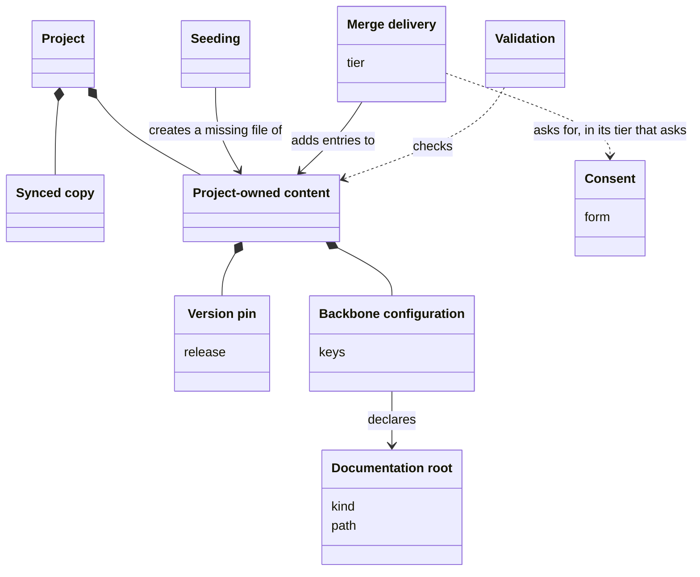
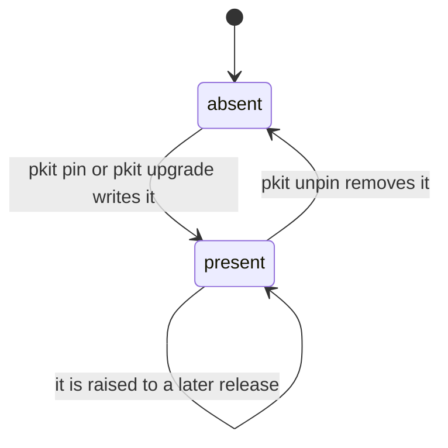

# VIEW-a-projects-own-files — A project's own files

A [project](../glossary.md#term-project--project) adds content of its own, which the [methodology](../glossary.md#term-methodology--methodology) must never take away (COR-001). Yet some of its files need entries the methodology ships (COR-002). Overwriting such a file destroys the project's entries, and writing it only once misses later ones (COR-002). Facts that no part owns, such as the project's name, must not be guessed either (COR-048).

[Project-owned content](../glossary.md#term-project-owned-content--project-owned-content) is the part of a project the methodology does not own. [Seeding](../glossary.md#term-seeding--seeding) creates a missing file once, and [merge delivery](../glossary.md#term-merge-delivery--merge-delivery) adds the methodology's entries to one, each with the [consent](../glossary.md#term-consent--consent) its record sets. The [version pin](../glossary.md#term-version-pin--version-pin) and the [backbone configuration](../glossary.md#term-backbone-configuration--backbone-configuration) are such files, and the backbone configuration declares the [documentation roots](../glossary.md#term-documentation-root--documentation-root). [Validation](../glossary.md#term-validation--validation) checks a project's own files against the invariants its records own.

## Project-owned content

Defined in [TERM-project-owned-content](../glossary.md#term-project-owned-content--project-owned-content).

**Why:** A [project](../glossary.md#term-project--project) must add content of its own without coordinating with the [methodology](../glossary.md#term-methodology--methodology), or fighting it (COR-001). That content stays the project's for good, and the methodology never takes it away (COR-001).

Project-owned content is the files of a project that the methodology does not own. [Sync](../glossary.md#term-sync--sync) never removes them, and the [system](../glossary.md#term-system--system) writes into them only through the writers its records name. A project's own [decision records](../glossary.md#term-decision-record--decision-record), its [backbone configuration](../glossary.md#term-backbone-configuration--backbone-configuration) and its root `CLAUDE.md` are such files.

**Attributes:**

- its owner, the project, for good (COR-001)

**Relations:**

- It sits beside the [synced copies](../glossary.md#term-synced-copy--synced-copy), and a project adds to it rather than edit a synced copy (COR-003).
- Its writers include [seeding](../glossary.md#term-seeding--seeding), [merge delivery](../glossary.md#term-merge-delivery--merge-delivery), a [migration](../glossary.md#term-migration--migration) within what its records allow, and the configuration commands (COR-001, COR-048 [point](../glossary.md#term-point--point) 5).

**States:** None.

**Always true:**

- Each file has one owner, the methodology or the project, never both (COR-001).
- The project may add, edit and remove it freely, and the methodology never takes away what the project wrote (COR-001).
- Sync writes into it only through merge delivery, and seeds nothing (COR-059 point 2).

## Seeding

Defined in [TERM-seeding](../glossary.md#term-seeding--seeding).

**Why:** Some files must exist from the start, yet belong to the [project](../glossary.md#term-project--project), which edits them freely (COR-001). Seeding writes such a file where it is missing, and never revisits one that exists (COR-001, COR-002).

Seeding creates a declared seed path from its template where the path is missing. It runs at first [install](../glossary.md#term-install--install) and at each transition of the [backbone](../glossary.md#term-backbone--backbone). A project that deleted `.pkit/agents/project/overlay.yaml` gets it back at its next `pkit upgrade`.

**Attributes:** None.

**Relations:**

- What it creates is [project-owned content](../glossary.md#term-project-owned-content--project-owned-content) from the moment it is written (COR-001).
- It runs at first install and in each transition of the backbone (COR-059 [point](../glossary.md#term-point--point) 8).

**States:** None.

**Always true:**

- It never writes over a seed path that exists (COR-059 point 8).
- Neither [sync](../glossary.md#term-sync--sync) nor [propagation](../glossary.md#term-propagation--propagation) creates a seed path (COR-059 point 8, ADR-065 point 1).
- A seed the project deleted on purpose comes back at the next transition of the backbone (COR-059 point 8).

## Merge delivery

Defined in [TERM-merge-delivery](../glossary.md#term-merge-delivery--merge-delivery).

**Why:** Some files the [project](../glossary.md#term-project--project) owns need entries the [methodology](../glossary.md#term-methodology--methodology) ships, and those entries grow over time (COR-002). Overwriting such a file destroys the project's entries, and [seeding](../glossary.md#term-seeding--seeding) it once misses every later one (COR-002).

Merge delivery adds the methodology's baseline entries to a project-owned file, such as `.claude/settings.json`, and restores its safety entries. It never removes an entry the project wrote.

**Attributes:**

- two tiers of entries: those it adds with no question, and those it puts to a person once (COR-002)

**Relations:**

- It writes into [project-owned content](../glossary.md#term-project-owned-content--project-owned-content), and reads its baseline from the methodology's files (COR-002).
- [Sync](../glossary.md#term-sync--sync) runs only its tier that asks nothing (COR-059 [point](../glossary.md#term-point--point) 2).

**States:** None.

**Always true:**

- It never removes an entry the project wrote (COR-002).
- It restores a safety entry the project removed (COR-002).
- Run again with nothing missing, it changes nothing (COR-002).
- Its tier that asks writes nothing where nobody can reply (COR-059 point 4).

## Consent

Defined in [TERM-consent](../glossary.md#term-consent--consent).

**Why:** Some writes do what the person behind them might not want, and could not easily see or undo (COR-049). Such a write needs that person's agreement, given explicitly and never taken silently (COR-048, COR-059).

Consent is a person's agreement to a write. The person gives it by a reply when asked, by an explicit confirmation flag, or by running a command that a record says carries it. Choosing the target of `pkit upgrade` is one consent for every [migration](../glossary.md#term-migration--migration) the transition runs.

**Attributes:**

- its form: a reply, a confirmation flag, or a command that carries it (COR-048 [point](../glossary.md#term-point--point) 5)
- what it covers (COR-059 point 4)

**Relations:**

- Once chosen, a [version transition](../glossary.md#term-version-transition--version-transition)'s target is the one consent for every part of the transition (COR-059 point 4).
- [Merge delivery](../glossary.md#term-merge-delivery--merge-delivery)'s tier that asks, and a [data point](../glossary.md#term-data-point--data-point)'s question, each keep a consent of their own (COR-059 point 4).

**States:** None.

**Always true:**

- With nobody to ask and no flag, nothing is written, and the default applies (COR-048 point 5).
- No consent is taken silently: each is a person's reply or an explicit override (COR-059 point 4).

## Version pin

Defined in [TERM-version-pin](../glossary.md#term-version-pin--version-pin).

**Why:** One machine may serve several projects held at different [versions](../glossary.md#term-version--version), under one installed [system](../glossary.md#term-system--system) (ADR-049). Without a pin, a newer system can run over older content that was never migrated to it (ADR-064).

A version pin is a project-owned file, `.pkit/version-pin`, that names a [release](../glossary.md#term-release--release). While that release can be fetched, its system runs the [project](../glossary.md#term-project--project)'s commands instead of the installed one.

**Attributes:**

- the release it names, as a bare `MAJOR.MINOR.PATCH` (ADR-049 [point](../glossary.md#term-point--point) 3)

**Relations:**

- `pkit upgrade` writes it at the release it brought the project to, unless asked not to (ADR-064 point 1).
- It is no [recorded version](../glossary.md#term-recorded-version--recorded-version): it directs which release runs, where a recorded version records the content held (ADR-049 point 1).
- A [source repository](../glossary.md#term-source-repository--source-repository) is never pinned (ADR-064 point 3).

**States:** A project has no pin until `pkit pin` or `pkit upgrade` writes one. A later pin may raise it, and `pkit unpin` removes it (ADR-049 point 3, ADR-064 point 1).

**Always true:**

- It is written last, after the content and the [migrations](../glossary.md#term-migration--migration), so it never runs ahead of the content (ADR-049 point 1, ADR-064 point 1).
- It is never lowered: naming an older release is refused (ADR-049 point 3).
- `pkit init` and `pkit sync` write no pin (ADR-064 point 3).

## Validation

Defined in [TERM-validation](../glossary.md#term-validation--validation).

**Why:** Many records say that a defect "fails validation", and that must mean one thing in each (COR-055). One check that installed [components](../glossary.md#term-component--component) join forgets nothing they register (COR-055).

Validation checks a [project](../glossary.md#term-project--project)'s own files against the invariants its records own. Each installed component may join it with a validator. It fails on one severity alone, so `pkit validate` fails on a dangling deferral, and only warns that a [documentation root](../glossary.md#term-documentation-root--documentation-root) does not exist yet.

**Attributes:**

- its validators, each a command a component registers (COR-055 [point](../glossary.md#term-point--point) 3)
- the one severity that fails it (COR-055 point 5)

**Relations:**

- Installed components join it through their validators (COR-055 point 3).
- It checks the [backbone configuration](../glossary.md#term-backbone-configuration--backbone-configuration) and the documentation roots (COR-048 point 4, COR-049 point 7).

**States:** None.

**Always true:**

- It judges the files as they stand, never a comparison of two states (COR-055 point 2).
- It fails when one of its results carries the failing severity, and only then (COR-055 point 5).
- A validator that cannot run, or gives no result, fails it, never passes it (COR-055 point 6).

## Backbone configuration

Defined in [TERM-backbone-configuration](../glossary.md#term-backbone-configuration--backbone-configuration).

**Why:** Some facts, such as the [project](../glossary.md#term-project--project)'s name, belong to no part, yet the [backbone](../glossary.md#term-backbone--backbone) needs them and must not guess them (COR-048). One checked file states each fact once, and a misspelt key fails rather than passing unseen (COR-048).

The backbone configuration is the project-owned file, `.pkit/project/config.yaml`, that holds the declarations the [system](../glossary.md#term-system--system) reads. A [decision record](../glossary.md#term-decision-record--decision-record) owns each of its keys. [Sync](../glossary.md#term-sync--sync) never writes the file, and [validation](../glossary.md#term-validation--validation) checks all of it.

**Attributes:**

- its keys, each introduced by a decision record that sets its meaning, its default and who may write it (COR-048 [point](../glossary.md#term-point--point) 2)

**Relations:**

- It declares the [documentation roots](../glossary.md#term-documentation-root--documentation-root) (COR-049 point 1).
- It is no [manifest](../glossary.md#term-manifest--manifest): a manifest records what the project installed, and the configuration records what the project declares.

**States:** None.

**Always true:**

- It survives every upgrade and sync, and the removal of any [capability](../glossary.md#term-capability--capability) (COR-048 point 1).
- No capability adds a key to it (COR-048 point 2).
- A missing file or a missing key means the owning record's default applies (COR-048 point 3).
- Validation fails on an unknown key or an invalid value (COR-048 point 4).
- A key is written only by the writers its record names, and only with [consent](../glossary.md#term-consent--consent) (COR-048 point 5).

## Documentation root

Defined in [TERM-documentation-root](../glossary.md#term-documentation-root--documentation-root).

**Why:** A [project](../glossary.md#term-project--project)'s documents serve two kinds of reader, its users and those who build and extend it (COR-049). Without a declared folder for each, every part that writes or reads documents must choose its own, or guess (COR-049).

A documentation root is the folder for internal readers, or the one for user-facing readers. It is `docs/` unless the [backbone configuration](../glossary.md#term-backbone-configuration--backbone-configuration) names another. Locations for documents are derived from it, unless one is set explicitly, so project-kit's analysis lives in `tech-docs/analysis/` under its internal root, `tech-docs/`.

**Attributes:**

- its kind, internal or user (COR-049 [point](../glossary.md#term-point--point) 1)
- its path, relative to the repository (COR-049 point 1)

**Relations:**

- The backbone configuration declares it (COR-049 point 1).
- The two roots may be one folder, or one inside the other (COR-049 point 1).

**States:** None.

**Always true:**

- It lies inside the repository, and outside the [methodology](../glossary.md#term-methodology--methodology)'s own tree (COR-049 point 1).
- An explicit location always wins over a derived one (COR-049 point 3).
- A location derived from it is recorded when first used, so changing the root later moves nothing (COR-049 point 5).
- A declared root that does not exist yet is a warning, never a failure (COR-049 point 7).
