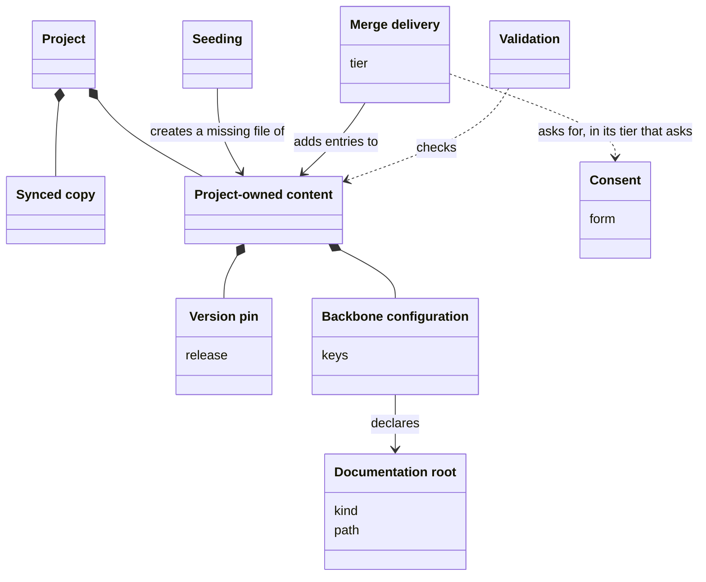
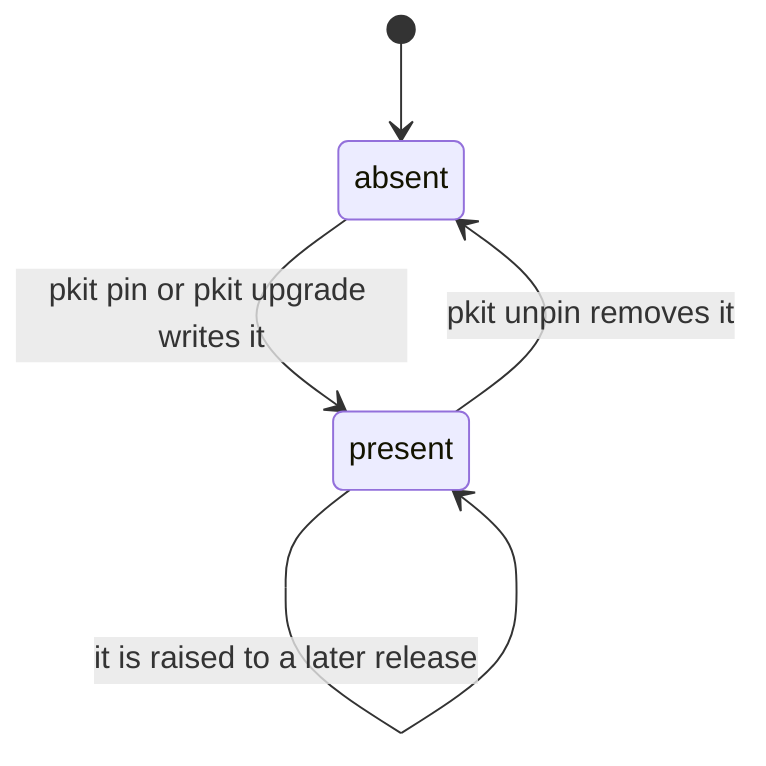

# VIEW-a-projects-own-files — A project's own files

The files a project owns, and how the methodology writes into them. Seeding creates a missing file once, and merge delivery adds the methodology's entries to one, each with the consent its record sets. The version pin and the backbone configuration are such files. Validation checks a project's own files against the invariants its records own.

## Project-owned content

Project-owned content is the files of a project that the methodology does not own. Sync never removes them, and the system writes into them only through the writers its records name. A project's own decision records, its backbone configuration and its root `CLAUDE.md` are such files.

**Attributes:**

- its owner, the project, for good (COR-001)

**Relations:**

- It sits beside the synced copies, and a project adds to it rather than edit a synced copy (COR-003).
- Its writers include seeding, merge delivery, a migration within what its records allow, and the configuration commands (COR-001, COR-048 point 5).

**States:** None.

**Always true:**

- Each file has one owner, the methodology or the project, never both (COR-001).
- The project may add, edit and remove it freely, and the methodology never takes away what the project wrote (COR-001).
- Sync writes into it only through merge delivery, and seeds nothing (COR-059 point 2).

## Seeding

Seeding creates a declared seed path from its template where the path is missing. It runs at first install and at each transition of the backbone. A project that deleted `.pkit/agents/project/overlay.yaml` gets it back at its next `pkit upgrade`.

**Attributes:** None.

**Relations:**

- What it creates is project-owned content from the moment it is written (COR-001).
- It runs at first install and in each transition of the backbone (COR-059 point 8).

**States:** None.

**Always true:**

- It never writes over a seed path that exists (COR-059 point 8).
- Sync creates no seed path (COR-059 point 8).
- A seed the project deleted on purpose comes back at the next transition of the backbone (COR-059 point 8).

## Merge delivery

Merge delivery adds the methodology's baseline entries to a project-owned file, such as `.claude/settings.json`, and restores its safety entries. It never removes an entry the project wrote.

**Attributes:**

- two tiers of entries: those it adds with no question, and those it puts to a person once (COR-002)

**Relations:**

- It writes into project-owned content, and reads its baseline from the methodology's files (COR-002).
- Sync runs only its tier that asks nothing (COR-059 point 2).

**States:** None.

**Always true:**

- It never removes an entry the project wrote (COR-002).
- It restores a safety entry the project removed (COR-002).
- Run again with nothing missing, it changes nothing (COR-002).
- Its tier that asks writes nothing where nobody can reply (COR-059 point 4).

## Consent

Consent is a person's agreement to a write. The person gives it by a reply when asked, by an explicit confirmation flag, or by running a command that a record says carries it. Choosing the target of `pkit upgrade` is one consent for every migration the transition runs.

**Attributes:**

- its form: a reply, a confirmation flag, or a command that carries it (COR-048 point 5)
- what it covers (COR-059 point 4)

**Relations:**

- Once chosen, a version transition's target is the one consent for every part of the transition (COR-059 point 4).
- Merge delivery's tier that asks, and a data point's question, each keep a consent of their own (COR-059 point 4).

**States:** None.

**Always true:**

- With nobody to ask and no flag, nothing is written, and the default applies (COR-048 point 5).
- No consent is taken silently: each is a person's reply or an explicit override (COR-059 point 4).

## Version pin

A version pin is a project-owned file, `.pkit/version-pin`, that names a release. While that release can be fetched, its system runs the project's commands instead of the installed one.

**Attributes:**

- the release it names, as a bare `MAJOR.MINOR.PATCH` (ADR-049 point 3)

**Relations:**

- `pkit upgrade` writes it at the release it brought the project to, unless asked not to (ADR-064 point 1).
- It is no recorded version: it directs which release runs, where a recorded version records the content held (ADR-049 point 1).
- A source repository is never pinned (ADR-064 point 3).

**States:** A project has no pin until `pkit pin` or `pkit upgrade` writes one. A later pin may raise it, and `pkit unpin` removes it (ADR-049 point 3, ADR-064 point 1).

**Always true:**

- It is written last, after the content and the migrations, so it never runs ahead of the content (ADR-049 point 1, ADR-064 point 1).
- It is never lowered: naming an older release is refused (ADR-049 point 3).
- `pkit init` and `pkit sync` write no pin (ADR-064 point 3).

## Validation

Validation checks a project's own files against the invariants its records own. Each installed component may join it with a validator. It fails on one severity alone, so `pkit validate` fails on a dangling deferral, and only warns that a documentation root does not exist yet.

**Attributes:**

- its validators, each a command a component registers (COR-055 point 3)
- the one severity that fails it (COR-055 point 5)

**Relations:**

- Installed components join it through their validators (COR-055 point 3).
- It checks the backbone configuration and the documentation roots (COR-048 point 4, COR-049 point 7).

**States:** None.

**Always true:**

- It judges the files as they stand, never a comparison of two states (COR-055 point 2).
- It fails when one of its results carries the failing severity, and only then (COR-055 point 5).
- A validator that cannot run, or gives no result, fails it, never passes it (COR-055 point 6).

## Backbone configuration

The backbone configuration is the project-owned file, `.pkit/project/config.yaml`, that holds the declarations the system reads. A decision record owns each of its keys. Sync never writes the file, and validation checks all of it.

**Attributes:**

- its keys, each introduced by a decision record that sets its meaning, its default and who may write it (COR-048 point 2)

**Relations:**

- It declares the documentation roots (COR-049 point 1).
- It is no manifest: a manifest records what the project installed, and the configuration records what the project declares.

**States:** None.

**Always true:**

- It survives every upgrade and sync, and the removal of any capability (COR-048 point 1).
- No capability adds a key to it (COR-048 point 2).
- A missing file or a missing key means the owning record's default applies (COR-048 point 3).
- Validation fails on an unknown key or an invalid value (COR-048 point 4).
- A key is written only by the writers its record names, and only with consent (COR-048 point 5).

## Documentation root

A documentation root is the folder for internal readers, or the one for user-facing readers. It is `docs/` unless the backbone configuration names another. Locations for documents are derived from it, unless one is set explicitly, so project-kit's analysis lives in `tech-docs/analysis/` under its internal root, `tech-docs/`.

**Attributes:**

- its kind, internal or user (COR-049 point 1)
- its path, relative to the repository (COR-049 point 1)

**Relations:**

- The backbone configuration declares it (COR-049 point 1).
- The two roots may be one folder, or one inside the other (COR-049 point 1).

**States:** None.

**Always true:**

- It lies inside the repository, and outside the methodology's own tree (COR-049 point 1).
- An explicit location always wins over a derived one (COR-049 point 3).
- A location derived from it is recorded when first used, so changing the root later moves nothing (COR-049 point 5).
- A declared root that does not exist yet is a warning, never a failure (COR-049 point 7).
