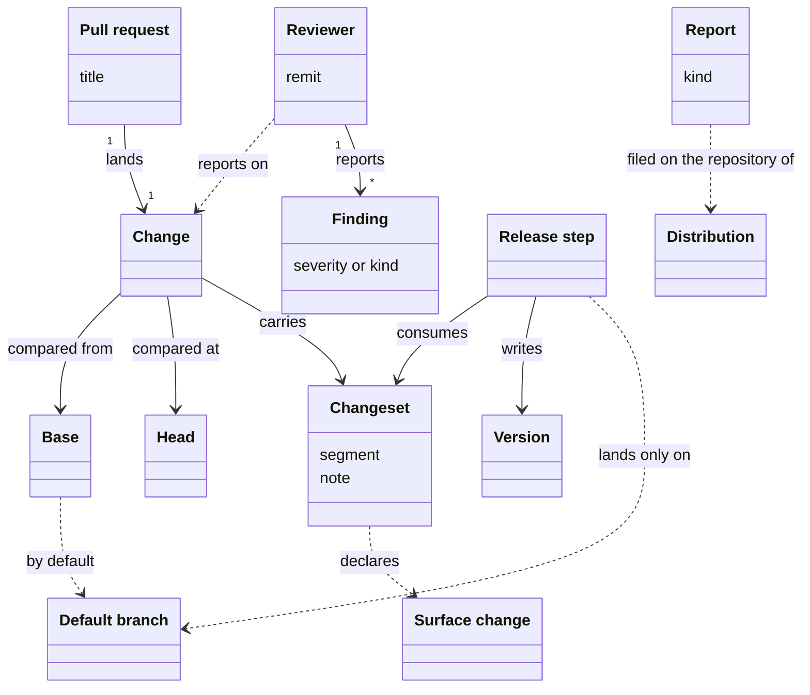
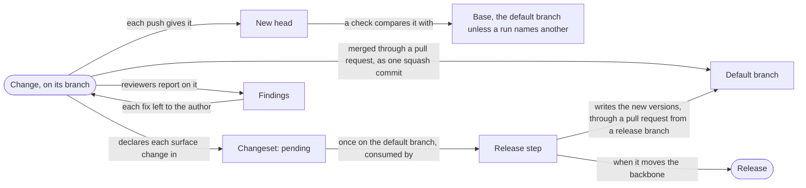

# VIEW-changes-review-and-releases — Changes, review and releases

Work reaches the shared history in logical units, each best judged before it lands, while a fix is still cheap (COR-009, COR-050). A check that compares such a unit with the wrong state of the shared history asks another question, and its result still looks right (COR-054). Whoever hits a problem with the [system](../glossary.md#term-system--system) needs a way to raise it with the [distribution](../glossary.md#term-distribution--distribution) it came from (PRJ-008). A [version](../glossary.md#term-version--version) should move only for what someone could break against, so that the number stays a signal (PRJ-002).

A [change](../glossary.md#term-change--change) lands on the branch it targets, most often through a [pull request](../glossary.md#term-pull-request--pull-request). A check compares a change's [head](../glossary.md#term-head--head) with its [base](../glossary.md#term-base--base), which is the [default branch](../glossary.md#term-default-branch--default-branch) unless a run names another. [Reviewers](../glossary.md#term-reviewer--reviewer) leave [findings](../glossary.md#term-finding--finding) on the change.

A change declares each [surface change](../glossary.md#term-surface-change--surface-change) it makes in a [changeset](../glossary.md#term-changeset--changeset), and the [release step](../glossary.md#term-release-step--release-step) consumes the changesets on the default branch. A [report](../glossary.md#term-report--report) carries a bug, a request or feedback to the repository of the distribution in use.

## Change

Defined in [TERM-change](../glossary.md#term-change--change).

**Why:** Work reaches the shared history one logical unit at a time, each on a branch of its own (COR-009). Checked as a unit before it lands, it can be fixed while a fix is still cheap (COR-050).

A change is a unit of work that lands on the branch it targets. It lands through a [pull request](../glossary.md#term-pull-request--pull-request), or as a direct commit where the [project](../glossary.md#term-project--project) allows it. A check compares it from its [base](../glossary.md#term-base--base) to its [head](../glossary.md#term-head--head).

**Attributes:**

- the branch that carries it, and its commits, each one step of the change

**Relations:**

- A pull request lands it, or it lands as a direct commit (COR-009 [point](../glossary.md#term-point--point) 5).
- A check compares it from its base to its head (COR-050 point 6).
- It declares a [surface change](../glossary.md#term-surface-change--surface-change) it makes in a [changeset](../glossary.md#term-changeset--changeset) (PRJ-002 D1).

**States:** None.

**Always true:**

- Merged through a pull request, it lands on the [default branch](../glossary.md#term-default-branch--default-branch) as one squash commit (COR-009 point 1).
- It edits no [version](../glossary.md#term-version--version) number, and declares a surface change in a changeset instead (PRJ-002 D1).

## Pull request

Defined in [TERM-pull-request](../glossary.md#term-pull-request--pull-request).

**Why:** Landed as one squash commit, a [change](../glossary.md#term-change--change) keeps the shared history linear and is easy to revert (COR-009). Mandating pull requests for work done alone would cost more than it gives, so they stay recommended (COR-009).

A pull request is a proposal, on the hosting service, to land one change on a target branch. It is reviewed there, and merged, by default, as one squash commit whose subject is its title.

**Attributes:**

- its title, the subject of a conventional commit (COR-009 [point](../glossary.md#term-point--point) 2)
- its body, which becomes the squash commit's body (COR-009 point 2)
- its target branch, and its [head](../glossary.md#term-head--head)

**Relations:**

- It lands one change (COR-009 point 1).
- Its target branch is the [base](../glossary.md#term-base--base) of the checks that run on it.

**States:** It is open until it is merged. Its branch lives only as long as it does, and is deleted after the merge (COR-009 point 4).

**Always true:**

- Its title follows conventional commits (COR-009 point 2).
- It is recommended, never required: work done alone may land directly (COR-009 point 5).

## Base

Defined in [TERM-base](../glossary.md#term-base--base).

**Why:** A comparison with the wrong state of the shared history asks another question, and its result still looks right (COR-054). So a check compares with a declared base, the [default branch](../glossary.md#term-default-branch--default-branch) unless a run names another, and never guesses one (COR-054).

A base is the branch, or other reference, that a check compares a [change](../glossary.md#term-change--change) with. The check measures from the commit where the change's branch left the base, which may have moved on since.

**Attributes:**

- its name: a branch or other reference
- the commit where the change's branch left it, git's merge-base

**Relations:**

- The default branch is every check's base unless a run names another (COR-054 [point](../glossary.md#term-point--point) 3).
- A [pull request](../glossary.md#term-pull-request--pull-request)'s target branch is the base of its checks.

**States:** None.

**Always true:**

- A base named for one run replaces the default branch for that run only, and changes nothing else (COR-054 point 3).
- A base that cannot be resolved is reported with the references tried, never guessed (COR-054 point 4).
- A check's result holds only against an up-to-date base (COR-050 point 6).

## Head

Defined in [TERM-head](../glossary.md#term-head--head).

**Why:** How a [change](../glossary.md#term-change--change) lands, by a merge, a squash or a rebase, must not alter what a check finds (COR-050). So a check compares two states, and the head is the later one (COR-050).

The head is the latest commit of the branch that carries a change. It is the later state a check compares with the [base](../glossary.md#term-base--base), so each push gives a [pull request](../glossary.md#term-pull-request--pull-request) a new head.

**Attributes:** None.

**Relations:**

- It belongs to the branch of one change, and a check compares it with that change's base (COR-050 [point](../glossary.md#term-point--point) 5).

**States:** None.

**Always true:**

- An edit undone before the head counts as no edit, however many commits made and undid it (COR-050 point 5).

## Default branch

Defined in [TERM-default-branch](../glossary.md#term-default-branch--default-branch).

**Why:** Several parts need to know what has reached the shared line of history, such as a check that compares a [change](../glossary.md#term-change--change) with it (COR-054). Found by each part alone, it could differ between them, such as in a clone without the remote's copy (COR-054). Declared once and resolved the same way everywhere, it gives every reader the same commit (COR-054).

The default branch is the line of history where a [project](../glossary.md#term-project--project)'s changes land. It is `main`, unless the [backbone configuration](../glossary.md#term-backbone-configuration--backbone-configuration) names another. Every reader resolves it from the shared remote's copy.

**Attributes:**

- its name, declared once in the backbone configuration (COR-054 [point](../glossary.md#term-point--point) 1)

**Relations:**

- It is the [base](../glossary.md#term-base--base) of every check that names no other (COR-054 point 3).
- The [release step](../glossary.md#term-release-step--release-step)'s writes land only on it (PRJ-002 D3).

**States:** None.

**Always true:**

- It is declared once, and no [component](../glossary.md#term-component--component) keeps a setting of its own for it (COR-054 point 1).
- Every reader resolves it the same way: the shared remote's copy first, and the local branch only where there is no remote (COR-054 point 2).
- Where it cannot be resolved, the reader says so, and never falls back to another branch (COR-054 point 4).

## Report

Defined in [TERM-report](../glossary.md#term-report--report).

**Why:** Whoever hits a problem with the [system](../glossary.md#term-system--system) needs a way to raise it on the repository of the [distribution](../glossary.md#term-distribution--distribution) in use (PRJ-008). A report carries the [versions](../glossary.md#term-version--version) in use, which matter most for triage. Whoever filed it can then follow what became of it (PRJ-008).

A report is an issue composed with the system and filed on the repository of the distribution in use. Its kind is `bug`, `change-request` or `feedback`. `pkit report bug` files one titled `[Bug] …`, with the versions in use attached.

**Attributes:**

- its kind: `bug`, `change-request` or `feedback` (PRJ-008)
- the versions it was filed from

**Relations:**

- It goes to its distribution's report target, the one repository that distribution's reports go to (ADR-047 [point](../glossary.md#term-point--point) 3).
- The issues that fix it are listed under its `## Tracked by` heading, and one issue may fix several reports (PRJ-008).

**States:** None.

**Always true:**

- Its distribution sets its target, and no one filing it can name another (ADR-047 point 3).
- Posting it is never silent: a person confirms the target each time, or it stays a draft (PRJ-008).

## Reviewer

Defined in [TERM-reviewer](../glossary.md#term-reviewer--reviewer).

**Why:** Work its author found sound can still hold contradictions, gaps or a quiet break with an earlier decision, which a second opinion catches (COR-024).

A reviewer is whoever, other than the author, reports on a draft or a [change](../glossary.md#term-change--change) within a remit, and leaves each fix to the author. The `rule-set-reviewer`, for one, judges a change against the rules that bind on what the change alters.

**Attributes:**

- its remit: what it reports on, such as a draft or a diff

**Relations:**

- It reports [findings](../glossary.md#term-finding--finding) on a draft or a change.
- It is never the author of what it reviews.
- The [backbone](../glossary.md#term-backbone--backbone) ships five. The critic and the architect advise on a draft. The `methodology-reviewer`, the `convention-compliance-reviewer` and the `rule-set-reviewer` judge a document or a diff (COR-024, COR-057 [point](../glossary.md#term-point--point) 5).

**States:** None.

**Always true:**

- It reports, and leaves each fix to the author (COR-024).
- A reviewer the backbone ships only advises, unless a gate requires its verdict (COR-024, COR-057 point 5).

## Finding

Defined in [TERM-finding](../glossary.md#term-finding--finding).

**Why:** Whoever reads a check's or a [reviewer](../glossary.md#term-reviewer--reviewer)'s result needs to know what it found, and whether that holds the work back (COR-055, COR-057). The record that owns a check sets each finding's severity, since only it knows whether the finding breaks an invariant (COR-055).

A finding is a statement that a check or a reviewer reports on what it judged. Its severity, or its kind, says whether it fails the check or withholds an approval.

**Attributes:**

- from a check: one severity, from a closed set every validator shares (COR-055 [point](../glossary.md#term-point--point) 4)
- from a reviewer: one of three kinds, a settled break, a passage for a person, or a finding that informs (COR-057 point 3)

**Relations:**

- A check or a reviewer reports it.
- Each finding of [validation](../glossary.md#term-validation--validation) carries one severity, and exactly one severity fails validation (COR-055 point 5).

**States:** None.

**Always true:**

- Exactly one severity fails validation, and every other only prints (COR-055 point 5).
- Of a reviewer's findings, only a settled break withholds its approval (COR-057 point 3).

## Surface change

Defined in [TERM-surface-change](../glossary.md#term-surface-change--surface-change).

**Why:** A [version](../glossary.md#term-version--version) should move for what someone could break against, not for every commit, so the number stays a signal of compatibility (PRJ-002).

A surface change is an alteration of the [system](../glossary.md#term-system--system) that someone using it could observe, depend on or break against. A new subcommand of `pkit` is one, so the [pull request](../glossary.md#term-pull-request--pull-request) that adds it declares it in a [changeset](../glossary.md#term-changeset--changeset).

**Attributes:**

- the segment it moves its part's version by: patch for a fix, minor for new surface, major for a break (PRJ-002 D2)

**Relations:**

- A [change](../glossary.md#term-change--change) that makes one declares it in a changeset (PRJ-002 D1).
- It moves the version of the [backbone](../glossary.md#term-backbone--backbone) or of a [component](../glossary.md#term-component--component), when the [release step](../glossary.md#term-release-step--release-step) runs (PRJ-002 D3).

**States:** None.

**Always true:**

- Which segment it moves is a person's judgement, never read from the commit type (PRJ-002 D2).
- An edit to a component's surface paths only suggests one, and a person judges it (PRJ-002 D2).

## Changeset

Defined in [TERM-changeset](../glossary.md#term-changeset--changeset).

**Why:** Branches that each wrote the next [version](../glossary.md#term-version--version) number would clash on the same lines at merge, with nothing truly in conflict (PRJ-002). A changeset records the intent instead, so parallel branches never touch a shared version number (PRJ-002).

A changeset is a file naming the [backbone](../glossary.md#term-backbone--backbone) or a [component](../glossary.md#term-component--component), the version segment a [change](../glossary.md#term-change--change) moves it by, and a note for the changelog. A change that adds a command to `software-analysis` declares one naming `software-analysis` and `minor`.

**Attributes:**

- what it moves: the backbone, or one component
- its segment, its `kind`: `patch`, `minor`, `major` or `none` (PRJ-002 D1 and D2)
- a note for the changelog

**Relations:**

- A change carries it, instead of editing a version number (PRJ-002 D1).
- The [release step](../glossary.md#term-release-step--release-step) consumes it (PRJ-002 D3).

**States:** It is pending from the change that adds it until a release step consumes it (PRJ-002 D3).

**Always true:**

- Its segment is a person's judgement of the change's surface, never read from the commit type (PRJ-002 D2).
- No branch edits a version number: a branch declares its change in a changeset (PRJ-002 D1).

## Release step

Defined in [TERM-release-step](../glossary.md#term-release-step--release-step).

**Why:** If branches wrote [version](../glossary.md#term-version--version) numbers, one could move a version out from under another (PRJ-002). A single step, whose writes land only on the [default branch](../glossary.md#term-default-branch--default-branch), computes each number forward from there and writes it once (PRJ-002).

The release step is the procedure that consumes every pending [changeset](../glossary.md#term-changeset--changeset). It writes the new versions, raised floors, widened bounds and changelog entries, which land only on the default branch. `pkit release plan` previews it, and `pkit release apply` writes it on a `release/` branch.

**Attributes:** None.

**Relations:**

- It consumes every pending changeset (PRJ-002 D3).
- Its writes land only on the default branch, through a [pull request](../glossary.md#term-pull-request--pull-request) from a `release/` branch (PRJ-002 D3).
- It makes a [release](../glossary.md#term-release--release) when it moves the [backbone](../glossary.md#term-backbone--backbone). One that moves only [components](../glossary.md#term-component--component) makes no release of its own (PRJ-004).

**States:** None.

**Always true:**

- It is the only writer of version numbers (PRJ-002 D3).
- A floor rises only where a changeset declares it, and the backbone's upper bound only ever widens (PRJ-002 D4).
- It refuses to leave a [range](../glossary.md#term-range--range) that excludes the version it writes for a dependency (PRJ-002 D4).
