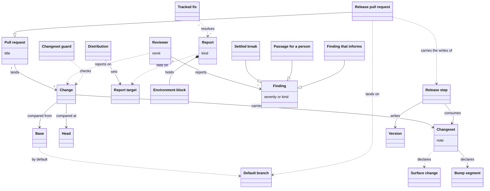
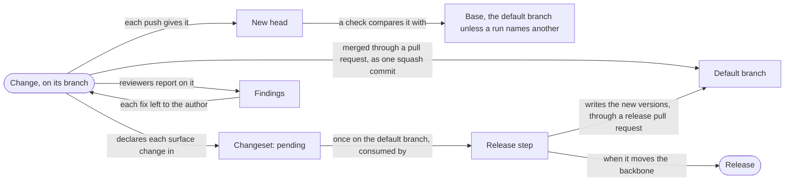

# VIEW-changes-review-and-releases — Changes, review and releases

Work reaches the shared history in logical units, each best judged before it lands, while a fix is still cheap ([COR-009](../../../../.pkit/decisions/core/COR-009-pr-workflow.md), [COR-050](../../../../.pkit/decisions/core/COR-050-anchors-and-friction.md)). A check that compares such a unit with the wrong state of the shared history asks another question, and its result still looks right ([COR-054](../../../../.pkit/decisions/core/COR-054-default-branch.md)). Whoever hits a problem with the [system](../glossary.md#term-system--system) needs a way to raise it with the [distribution](../glossary.md#term-distribution--distribution) it came from ([PRJ-008](../../../../.pkit/decisions/project/PRJ-008-report-command.md)). A [version](../glossary.md#term-version--version) should move only for what someone could break against, so that the number stays a signal ([PRJ-002](../../../../.pkit/decisions/project/PRJ-002-version-bump-policy.md)).

A [change](../glossary.md#term-change--change) lands on the branch it targets, most often through a [pull request](../glossary.md#term-pull-request--pull-request). A check compares a change's [head](../glossary.md#term-head--head) with its [base](../glossary.md#term-base--base), which is the [default branch](../glossary.md#term-default-branch--default-branch) unless a run names another. [Reviewers](../glossary.md#term-reviewer--reviewer) leave [findings](../glossary.md#term-finding--finding) on the change.

A change declares each [surface change](../glossary.md#term-surface-change--surface-change) it makes in a [changeset](../glossary.md#term-changeset--changeset), with its [bump segment](../glossary.md#term-bump-segment--bump-segment), and the [changeset guard](../glossary.md#term-changeset-guard--changeset-guard) checks that it does. The [release step](../glossary.md#term-release-step--release-step) consumes the changesets on the default branch, through a [release pull request](../glossary.md#term-release-pull-request--release-pull-request). A [report](../glossary.md#term-report--report) carries a bug, a request or feedback to its distribution's [report target](../glossary.md#term-report-target--report-target).

## Change

Defined in [TERM-change](../glossary.md#term-change--change).

**Why:** Work reaches the shared history one logical unit at a time, each on a branch of its own ([COR-009](../../../../.pkit/decisions/core/COR-009-pr-workflow.md)). Checked as a unit before it lands, it can be fixed while a fix is still cheap ([COR-050](../../../../.pkit/decisions/core/COR-050-anchors-and-friction.md)).

A change is a unit of work that lands on the branch it targets. It lands through a [pull request](../glossary.md#term-pull-request--pull-request), or as a direct commit where the [project](../glossary.md#term-project--project) allows it. A check compares it from its [base](../glossary.md#term-base--base) to its [head](../glossary.md#term-head--head).

**Attributes:**

- the branch that carries it, and its commits, each one step of the change

**Relations:**

- A pull request lands it, or it lands as a direct commit ([COR-009 point 5](../../../../.pkit/decisions/core/COR-009-pr-workflow.md#5-prs-are-recommended-not-enforced)).
- A check compares it from its base to its head ([COR-050 point 6](../../../../.pkit/decisions/core/COR-050-anchors-and-friction.md#6-friction-in-two-checks)).
- It declares a [surface change](../glossary.md#term-surface-change--surface-change) it makes in a [changeset](../glossary.md#term-changeset--changeset) ([PRJ-002 D1](../../../../.pkit/decisions/project/PRJ-002-version-bump-policy.md#d1--surface-changes-are-declared-not-applied-per-pr)).

**States:** None.

**Always true:**

- Merged through a pull request, it lands on the [default branch](../glossary.md#term-default-branch--default-branch) as one squash commit ([COR-009 point 1](../../../../.pkit/decisions/core/COR-009-pr-workflow.md#1-squash-merge-as-the-default-merge-style)).
- It edits no [version](../glossary.md#term-version--version) number, and declares a surface change in a changeset instead (PRJ-002 D1).

## Pull request

Defined in [TERM-pull-request](../glossary.md#term-pull-request--pull-request).

**Why:** Landed as one squash commit, a [change](../glossary.md#term-change--change) keeps the shared history linear and is easy to revert ([COR-009](../../../../.pkit/decisions/core/COR-009-pr-workflow.md)). Mandating pull requests for work done alone would cost more than it gives, so they stay recommended (COR-009).

A pull request is a proposal, on the hosting service, to land one change on a target branch. It is reviewed there, and merged, by default, as one squash commit whose subject is its title.

**Attributes:**

- its title, the subject of a conventional commit ([COR-009 point 2](../../../../.pkit/decisions/core/COR-009-pr-workflow.md#2-pr-title-follows-conventional-commits))
- its body, which becomes the squash commit's body (COR-009 point 2)
- its target branch, and its [head](../glossary.md#term-head--head)

**Relations:**

- It lands one change ([COR-009 point 1](../../../../.pkit/decisions/core/COR-009-pr-workflow.md#1-squash-merge-as-the-default-merge-style)).
- Its target branch is the [base](../glossary.md#term-base--base) of the checks that run on it.

**States:** It is open until it is merged. Its branch lives only as long as it does, and is deleted after the merge ([COR-009 point 4](../../../../.pkit/decisions/core/COR-009-pr-workflow.md#4-feature-branches-are-short-lived-and-deleted-after-merge)).

**Always true:**

- Its title follows conventional commits (COR-009 point 2).
- It is recommended, never required: work done alone may land directly ([COR-009 point 5](../../../../.pkit/decisions/core/COR-009-pr-workflow.md#5-prs-are-recommended-not-enforced)).

## Base

Defined in [TERM-base](../glossary.md#term-base--base).

**Why:** A comparison with the wrong state of the shared history asks another question, and its result still looks right ([COR-054](../../../../.pkit/decisions/core/COR-054-default-branch.md)). So a check compares with a declared base, the [default branch](../glossary.md#term-default-branch--default-branch) unless a run names another, and never guesses one (COR-054).

A base is the branch, or other reference, that a check compares a [change](../glossary.md#term-change--change) with. The check measures from the commit where the change's branch left the base, which may have moved on since.

**Attributes:**

- its name: a branch or other reference
- the commit where the change's branch left it, git's merge-base

**Relations:**

- The default branch is every check's base unless a run names another ([COR-054 point 3](../../../../.pkit/decisions/core/COR-054-default-branch.md#3-the-override-is-a-base-not-a-declaration)).
- A [pull request](../glossary.md#term-pull-request--pull-request)'s target branch is the base of its checks.

**States:** None.

**Always true:**

- A base named for one run replaces the default branch for that run only, and changes nothing else (COR-054 point 3).
- A base that cannot be resolved is reported with the references tried, never guessed ([COR-054 point 4](../../../../.pkit/decisions/core/COR-054-default-branch.md#4-unresolved-report-never-guess)).
- A check's result holds only against an up-to-date base ([COR-050 point 6](../../../../.pkit/decisions/core/COR-050-anchors-and-friction.md#6-friction-in-two-checks)).

## Head

Defined in [TERM-head](../glossary.md#term-head--head).

**Why:** How a [change](../glossary.md#term-change--change) lands, by a merge, a squash or a rebase, must not alter what a check finds ([COR-050](../../../../.pkit/decisions/core/COR-050-anchors-and-friction.md)). So a check compares two states, and the head is the later one (COR-050).

The head is the latest commit of the branch that carries a change. It is the later state a check compares with the [base](../glossary.md#term-base--base), so each push gives a [pull request](../glossary.md#term-pull-request--pull-request) a new head.

**Attributes:** None.

**Relations:**

- It belongs to the branch of one change, and a check compares it with that change's base ([COR-050 point 5](../../../../.pkit/decisions/core/COR-050-anchors-and-friction.md#5-when-an-anchor-has-changed-and-what-answers-it)).

**States:** None.

**Always true:**

- An edit undone before the head counts as no edit, however many commits made and undid it (COR-050 point 5).

## Default branch

Defined in [TERM-default-branch](../glossary.md#term-default-branch--default-branch).

**Why:** Several parts need to know what has reached the shared line of history, such as a check that compares a [change](../glossary.md#term-change--change) with it ([COR-054](../../../../.pkit/decisions/core/COR-054-default-branch.md)). Found by each part alone, it could differ between them, such as in a clone without the remote's copy (COR-054). Declared once and resolved the same way everywhere, it gives every reader the same commit (COR-054).

The default branch is the line of history where a [project](../glossary.md#term-project--project)'s changes land. It is `main`, unless the [backbone configuration](../glossary.md#term-backbone-configuration--backbone-configuration) names another. Every reader resolves it from the shared remote's copy.

**Attributes:**

- its name, declared once in the backbone configuration ([COR-054 point 1](../../../../.pkit/decisions/core/COR-054-default-branch.md#1-declared-once))

**Relations:**

- It is the [base](../glossary.md#term-base--base) of every check that names no other ([COR-054 point 3](../../../../.pkit/decisions/core/COR-054-default-branch.md#3-the-override-is-a-base-not-a-declaration)).
- The [release step](../glossary.md#term-release-step--release-step)'s writes land only on it ([PRJ-002 D3](../../../../.pkit/decisions/project/PRJ-002-version-bump-policy.md#d3--version-numbers-are-written-only-on-main-by-a-release-authority)).

**States:** None.

**Always true:**

- It is declared once, and no [component](../glossary.md#term-component--component) keeps a setting of its own for it (COR-054 point 1).
- Every reader resolves it the same way: the shared remote's copy first, and the local branch only where there is no remote ([COR-054 point 2](../../../../.pkit/decisions/core/COR-054-default-branch.md#2-resolved-one-way)).
- Where it cannot be resolved, the reader says so, and never falls back to another branch ([COR-054 point 4](../../../../.pkit/decisions/core/COR-054-default-branch.md#4-unresolved-report-never-guess)).

## Report

Defined in [TERM-report](../glossary.md#term-report--report).

**Why:** Whoever hits a problem with the [system](../glossary.md#term-system--system) needs a way to raise it on the repository of the [distribution](../glossary.md#term-distribution--distribution) in use ([PRJ-008](../../../../.pkit/decisions/project/PRJ-008-report-command.md)). A report carries the [versions](../glossary.md#term-version--version) in use, which matter most for triage. Whoever filed it can then follow what became of it (PRJ-008).

A report is an issue composed with the system and filed on the repository of the distribution in use. Its kind is `bug`, `change-request` or `feedback`. `pkit report bug` files one titled `[Bug] …`, with the versions in use attached.

**Attributes:**

- its kind: `bug`, `change-request` or `feedback` (PRJ-008)
- its [environment block](../glossary.md#term-environment-block--environment-block), which names the versions it was filed from (PRJ-008)

**Relations:**

- It goes to its distribution's [report target](../glossary.md#term-report-target--report-target) ([ADR-047 point 3](../../../architecture/decisions/ADR-047-report-cross-repo-write.md#3-fixed-distribution-set-target--not-configurable-per-adopter-not-a---repo)).
- Its [tracked fixes](../glossary.md#term-tracked-fix--tracked-fix) are listed under its `## Tracked by` heading (PRJ-008).

**States:** None.

**Always true:**

- Its distribution sets its report target, and no one filing it can name another (ADR-047 point 3).
- Posting it is never silent: a person confirms the report target each time, or it stays a draft (PRJ-008).

## Report target

Defined in [TERM-report-target](../glossary.md#term-report-target--report-target).

**Why:** One fixed repository keeps the filing of reports a contained write ([ADR-047](../../../architecture/decisions/ADR-047-report-cross-repo-write.md)). A target set per run would make the [system](../glossary.md#term-system--system) a general filer of issues anywhere (ADR-047). Set in the [distribution](../glossary.md#term-distribution--distribution)'s own configuration, it keeps the [backbone](../glossary.md#term-backbone--backbone) free of a hard-wired address, and lets a fork retarget by an edit ([PRJ-008](../../../../.pkit/decisions/project/PRJ-008-report-command.md)).

A report target is the one repository a distribution sets, in its own configuration, for every [report](../glossary.md#term-report--report) filed through the system. project-kit sets its own repository, and a fork sets its own.

**Attributes:**

- its repository, as `owner/repo` in the distribution's configuration (PRJ-008)

**Relations:**

- A distribution sets it, and a fork retargets by editing its own configuration ([ADR-047 point 3](../../../architecture/decisions/ADR-047-report-cross-repo-write.md#3-fixed-distribution-set-target--not-configurable-per-adopter-not-a---repo)).
- Each report is filed on it (ADR-047 point 3).
- The commands that triage reports and link their [tracked fixes](../glossary.md#term-tracked-fix--tracked-fix) run only in a clone of it ([ADR-047 point 4](../../../architecture/decisions/ADR-047-report-cross-repo-write.md#4-the-maintainer-side-is-same-repo--no-cross-repo-machinery)).

**States:** None.

**Always true:**

- No one filing a report can name another repository, by a flag or otherwise (ADR-047 point 3).
- Where no report target is set, a report stays a draft (PRJ-008).

## Tracked fix

Defined in [TERM-tracked-fix](../glossary.md#term-tracked-fix--tracked-fix).

**Why:** Whoever filed a [report](../glossary.md#term-report--report) needs to see whether it went anywhere, and a tool grows through reporters who watch their reports move ([PRJ-008](../../../../.pkit/decisions/project/PRJ-008-report-command.md)). One fix may address several reports, which an issue with a single parent could not express (PRJ-008).

A tracked fix is an issue linked to a report as the work that resolves it. `pkit report link` lists it under the report's `## Tracked by` heading, in a clone of the [report target](../glossary.md#term-report-target--report-target).

**Attributes:**

- its state, open or closed, which `pkit report show` gives beside the report (PRJ-008)

**Relations:**

- A report lists it under its `## Tracked by` heading, as an item of a task list (PRJ-008).
- One issue may be a tracked fix of several reports, and owns none of them (PRJ-008).
- It is linked only in a clone of the report target ([ADR-047 point 4](../../../architecture/decisions/ADR-047-report-cross-repo-write.md#4-the-maintainer-side-is-same-repo--no-cross-repo-machinery)).

**States:** None.

**Always true:**

- A `feedback` or `change-request` report whose tracked fixes have all closed is listed as resolved. It is closed only on a person's word, never by itself (PRJ-008).

## Environment block

Defined in [TERM-environment-block](../glossary.md#term-environment-block--environment-block).

**Why:** A [report](../glossary.md#term-report--report) with no [versions](../glossary.md#term-version--version) or environment lacks the one thing that most helps its triage ([PRJ-008](../../../../.pkit/decisions/project/PRJ-008-report-command.md)). The block the [system](../glossary.md#term-system--system) builds turns "something broke" into a report that can be triaged (PRJ-008). Built with nothing private in it, it is safe before a person confirms the post ([ADR-047](../../../architecture/decisions/ADR-047-report-cross-repo-write.md)).

An environment block is the part of a report's body that the system builds itself. It names the versions in use, the [adapter](../glossary.md#term-adapter--adapter) and the operating system, and holds no path.

**Attributes:**

- the versions in use, such as pkit's, the [backbone](../glossary.md#term-backbone--backbone)'s and each installed [capability](../glossary.md#term-capability--capability)'s (PRJ-008)
- the adapter and the operating system

**Relations:**

- A report holds it in its body (PRJ-008).

**States:** None.

**Always true:**

- It holds no path, and names only the capabilities the system ships (ADR-047).

## Reviewer

Defined in [TERM-reviewer](../glossary.md#term-reviewer--reviewer).

**Why:** Work its author found sound can still hold contradictions, gaps or a quiet break with an earlier decision, which a second opinion catches ([COR-024](../../../../.pkit/decisions/core/COR-024-critic-and-architect-agents.md)).

A reviewer is whoever, other than the author, reports on a draft or a [change](../glossary.md#term-change--change) within a remit, and leaves each fix to the author. The `rule-set-reviewer`, for one, judges a change against the rules that bind on what the change alters.

**Attributes:**

- its remit: what it reports on, such as a draft or a diff

**Relations:**

- It reports [findings](../glossary.md#term-finding--finding) on a draft or a change.
- It is never the author of what it reviews.
- The [backbone](../glossary.md#term-backbone--backbone) ships five. The critic and the architect advise on a draft. The `methodology-reviewer`, the `convention-compliance-reviewer` and the `rule-set-reviewer` judge a document or a diff (COR-024, [COR-057 point 5](../../../../.pkit/decisions/core/COR-057-rule-set-reviewer.md#5-stage-and-posture)).

**States:** None.

**Always true:**

- It reports, and leaves each fix to the author (COR-024).
- A reviewer the backbone ships only advises, unless a gate requires its verdict (COR-024, COR-057 point 5).

## Finding

Defined in [TERM-finding](../glossary.md#term-finding--finding).

**Why:** Whoever reads a check's or a [reviewer](../glossary.md#term-reviewer--reviewer)'s result needs to know what it found, and whether that holds the work back ([COR-055](../../../../.pkit/decisions/core/COR-055-validation.md), [COR-057](../../../../.pkit/decisions/core/COR-057-rule-set-reviewer.md)). The record that owns a check sets each finding's severity, since only it knows whether the finding breaks an invariant (COR-055).

A finding is a statement that a check or a reviewer reports on what it judged. Its severity, or its kind, says whether it fails the check or withholds an approval.

**Attributes:**

- from a check: one severity, from a closed set every [validator](../glossary.md#term-validator--validator) shares ([COR-055 point 4](../../../../.pkit/decisions/core/COR-055-validation.md#4-severity-is-on-the-finding))
- from a reviewer: one of three kinds, a [settled break](../glossary.md#term-settled-break--settled-break), a [passage for a person](../glossary.md#term-passage-for-a-person--passage-for-a-person), or a [finding that informs](../glossary.md#term-finding-that-informs--finding-that-informs) ([COR-057 point 3](../../../../.pkit/decisions/core/COR-057-rule-set-reviewer.md#3-its-findings-and-what-binds))

**Relations:**

- A check or a reviewer reports it.
- Each finding of [validation](../glossary.md#term-validation--validation) carries one severity, and exactly one severity fails validation ([COR-055 point 5](../../../../.pkit/decisions/core/COR-055-validation.md#5-exactly-one-severity-fails)).

**States:** None.

**Always true:**

- Exactly one severity fails validation, and every other only prints (COR-055 point 5).
- Of a reviewer's findings, only a settled break withholds its approval (COR-057 point 3).

## Settled break

Defined in [TERM-settled-break](../glossary.md#term-settled-break--settled-break).

**Why:** Where no [reviewer](../glossary.md#term-reviewer--reviewer) judges a [change](../glossary.md#term-change--change) against the accepted rules that bind on it, the change can break one and still pass every review ([COR-057](../../../../.pkit/decisions/core/COR-057-rule-set-reviewer.md)).

A settled break is a reviewer's [finding](../glossary.md#term-finding--finding) on a passage the change owns, which an accepted [rule](../glossary.md#term-rule--rule)'s text rules out. The text leaves no reading to choose, so the finding withholds the reviewer's approval.

**Attributes:**

- the rule it cites, by id, and the passage it quotes, with what in the passage breaks the rule ([COR-057 point 3](../../../../.pkit/decisions/core/COR-057-rule-set-reviewer.md#3-its-findings-and-what-binds))

**Relations:**

- The rule-set reviewer reports it, under a rule that binds on text the change owns (COR-057 points [2](../../../../.pkit/decisions/core/COR-057-rule-set-reviewer.md#2-what-the-change-owns) and 3).

**States:** None.

**Always true:**

- The reviewer approves a change only where it found no settled break (COR-057 point 3).

## Passage for a person

Defined in [TERM-passage-for-a-person](../glossary.md#term-passage-for-a-person--passage-for-a-person).

**Why:** A judgement call that withheld approval would hold the [change](../glossary.md#term-change--change) until someone overrode the [reviewer](../glossary.md#term-reviewer--reviewer), and overriding would become a habit ([COR-057](../../../../.pkit/decisions/core/COR-057-rule-set-reviewer.md)). One that only informed would reach nobody, so it waits for a person, and withholds nothing (COR-057).

A passage for a person is a reviewer's [finding](../glossary.md#term-finding--finding) on text the change owns, under a [rule](../glossary.md#term-rule--rule) that binds there. Judging it needs a reading the rule does not settle, or a fact the rule does not name.

**Attributes:**

- the rule it cites, by id, and the passage it quotes ([COR-057 point 3](../../../../.pkit/decisions/core/COR-057-rule-set-reviewer.md#3-its-findings-and-what-binds))

**Relations:**

- A finding under a rule the change makes bind, or stop binding, on text it alters is one too (COR-057 point 3).
- Whoever invokes the reviewer, such as a gate, says how it reaches a person (COR-057 point 3).

**States:** None.

**Always true:**

- It withholds no approval, and waits for a person's judgement (COR-057 point 3).

## Finding that informs

Defined in [TERM-finding-that-informs](../glossary.md#term-finding-that-informs--finding-that-informs).

**Why:** A [change](../glossary.md#term-change--change) that answered for every break beside its edits would have to mend the past before it could land ([COR-057](../../../../.pkit/decisions/core/COR-057-rule-set-reviewer.md)).

A finding that informs is a [reviewer](../glossary.md#term-reviewer--reviewer)'s note of a break the change does not own, with the reason it is not the change's. It may instead note a break of a [rule](../glossary.md#term-rule--rule) held back there until its newer major is reviewed ([COR-051 point 7](../../../../.pkit/decisions/core/COR-051-rule-sets.md#7-inheritance-and-where-rules-bind)).

**Attributes:**

- its reason: why the break is not the change's, or why the rule binds nothing there yet ([COR-057 point 3](../../../../.pkit/decisions/core/COR-057-rule-set-reviewer.md#3-its-findings-and-what-binds))

**Relations:**

- The rule-set reviewer reports it (COR-057 point 3).

**States:** None.

**Always true:**

- It withholds nothing and holds nothing (COR-057 point 3).

## Surface change

Defined in [TERM-surface-change](../glossary.md#term-surface-change--surface-change).

**Why:** A [version](../glossary.md#term-version--version) should move for what someone could break against, not for every commit, so the number stays a signal of compatibility ([PRJ-002](../../../../.pkit/decisions/project/PRJ-002-version-bump-policy.md)).

A surface change is an alteration of the [system](../glossary.md#term-system--system) that someone using it could observe, depend on or break against. A new subcommand of `pkit` is one, so the [pull request](../glossary.md#term-pull-request--pull-request) that adds it declares it in a [changeset](../glossary.md#term-changeset--changeset).

**Attributes:**

- the [bump segment](../glossary.md#term-bump-segment--bump-segment) it moves its part's version by: patch for a fix, minor for new surface, major for a break ([PRJ-002 D2](../../../../.pkit/decisions/project/PRJ-002-version-bump-policy.md#d2--the-bump-segment-is-a-human-surface-judgment-not-a-function-of-the-commit-type))

**Relations:**

- A [change](../glossary.md#term-change--change) that makes one declares it in a changeset ([PRJ-002 D1](../../../../.pkit/decisions/project/PRJ-002-version-bump-policy.md#d1--surface-changes-are-declared-not-applied-per-pr)).
- It moves the version of the [backbone](../glossary.md#term-backbone--backbone) or of a [component](../glossary.md#term-component--component), when the [release step](../glossary.md#term-release-step--release-step) runs ([PRJ-002 D3](../../../../.pkit/decisions/project/PRJ-002-version-bump-policy.md#d3--version-numbers-are-written-only-on-main-by-a-release-authority)).

**States:** None.

**Always true:**

- Which bump segment it moves its part by is a person's judgement, never read from the commit type (PRJ-002 D2).
- An edit to a component's surface paths only suggests one, and a person judges it (PRJ-002 D2).

## Changeset

Defined in [TERM-changeset](../glossary.md#term-changeset--changeset).

**Why:** Branches that each wrote the next [version](../glossary.md#term-version--version) number would clash on the same lines at merge, with nothing truly in conflict ([PRJ-002](../../../../.pkit/decisions/project/PRJ-002-version-bump-policy.md)). A changeset records the intent instead, so parallel branches never touch a shared version number (PRJ-002).

A changeset is a file naming the [backbone](../glossary.md#term-backbone--backbone) or a [component](../glossary.md#term-component--component), the [bump segment](../glossary.md#term-bump-segment--bump-segment) a [change](../glossary.md#term-change--change) moves it by, and a note for the changelog. A change that adds a command to `software-analysis` declares one naming `software-analysis` and `minor`.

**Attributes:**

- what it moves: the backbone, or one component
- its bump segment, in its `kind`: `patch`, `minor`, `major` or `none` (PRJ-002 [D1](../../../../.pkit/decisions/project/PRJ-002-version-bump-policy.md#d1--surface-changes-are-declared-not-applied-per-pr) and [D2](../../../../.pkit/decisions/project/PRJ-002-version-bump-policy.md#d2--the-bump-segment-is-a-human-surface-judgment-not-a-function-of-the-commit-type))
- a note for the changelog

**Relations:**

- A change carries it, instead of editing a version number (PRJ-002 D1).
- The [release step](../glossary.md#term-release-step--release-step) consumes it ([PRJ-002 D3](../../../../.pkit/decisions/project/PRJ-002-version-bump-policy.md#d3--version-numbers-are-written-only-on-main-by-a-release-authority)).

**States:** It is pending from the change that adds it until a release step consumes it (PRJ-002 D3).

**Always true:**

- Its bump segment is a person's judgement of the change's surface, never read from the commit type (PRJ-002 D2).
- No branch edits a version number: a branch declares its change in a changeset (PRJ-002 D1).

## Bump segment

Defined in [TERM-bump-segment](../glossary.md#term-bump-segment--bump-segment).

**Why:** How far a [change](../glossary.md#term-change--change) moves a [version](../glossary.md#term-version--version) is a person's read of its surface ([PRJ-002](../../../../.pkit/decisions/project/PRJ-002-version-bump-policy.md)). A study of 20 commits found that their type did not predict it (PRJ-002). Inferred from the commit type, it would produce wrong versions, so a [changeset](../glossary.md#term-changeset--changeset) makes the call explicit and reviewable (PRJ-002).

A bump segment is the measure of a change's surface that a changeset declares: `patch`, `minor`, `major` or `none`. A person judges it, and the commit type never sets it.

**Attributes:**

- its value (PRJ-002 [D1](../../../../.pkit/decisions/project/PRJ-002-version-bump-policy.md#d1--surface-changes-are-declared-not-applied-per-pr) and [D2](../../../../.pkit/decisions/project/PRJ-002-version-bump-policy.md#d2--the-bump-segment-is-a-human-surface-judgment-not-a-function-of-the-commit-type)):
  - `patch`: a fix to existing surface that breaks nothing
  - `minor`: new surface that breaks nothing
  - `major`: a break of existing surface
  - `none`: a change that moves no version

**Relations:**

- A changeset declares it, in its `kind` (PRJ-002 D1).
- The [release step](../glossary.md#term-release-step--release-step) computes each new version from the bump segments of the changesets it consumes ([PRJ-002 D3](../../../../.pkit/decisions/project/PRJ-002-version-bump-policy.md#d3--version-numbers-are-written-only-on-main-by-a-release-authority)).

**States:** None.

**Always true:**

- It is a person's judgement of the change's surface, never read from the commit type (PRJ-002 D2).
- A `none` bump segment is recorded, and adds no line to the changelog (PRJ-002).

## Changeset guard

Defined in [TERM-changeset-guard](../glossary.md#term-changeset-guard--changeset-guard).

**Why:** A [change](../glossary.md#term-change--change) that touches a part's paths and declares nothing could drop a [surface change](../glossary.md#term-surface-change--surface-change) from the next changelog, silently ([PRJ-002](../../../../.pkit/decisions/project/PRJ-002-version-bump-policy.md)). So the changeset guard asks each such change for a [changeset](../glossary.md#term-changeset--changeset), a `none` one included (PRJ-002).

The changeset guard is a check that a change adds or edits a changeset naming the [backbone](../glossary.md#term-backbone--backbone) and each [component](../glossary.md#term-component--component) whose paths it touches. `pkit release check` runs it against the change's [base](../glossary.md#term-base--base).

**Attributes:**

- its escape hatch, which skips its check of paths for a change that moves no surface (PRJ-002)

**Relations:**

- It reads the change's diff against its base (PRJ-002).
- It refuses a floor a changeset declares for a component the change neither changes nor releases (PRJ-002).

**States:** None.

**Always true:**

- It reads only paths, so it may flag a change that moves no surface, and a person still judges each [bump segment](../glossary.md#term-bump-segment--bump-segment) ([PRJ-002 D2](../../../../.pkit/decisions/project/PRJ-002-version-bump-policy.md#d2--the-bump-segment-is-a-human-surface-judgment-not-a-function-of-the-commit-type)).
- No escape hatch waives its refusal of a floor that no change or [release](../glossary.md#term-release--release) of its component bears (PRJ-002).

## Release step

Defined in [TERM-release-step](../glossary.md#term-release-step--release-step).

**Why:** If branches wrote [version](../glossary.md#term-version--version) numbers, one could move a version out from under another ([PRJ-002](../../../../.pkit/decisions/project/PRJ-002-version-bump-policy.md)). A single step, whose writes land only on the [default branch](../glossary.md#term-default-branch--default-branch), computes each number forward from there and writes it once (PRJ-002).

The release step is the procedure that consumes every pending [changeset](../glossary.md#term-changeset--changeset). It writes the new versions, raised floors, widened bounds and changelog entries, which land only on the default branch. `pkit release plan` previews it, and `pkit release apply` writes it on a `release/` branch.

**Attributes:** None.

**Relations:**

- It consumes every pending changeset ([PRJ-002 D3](../../../../.pkit/decisions/project/PRJ-002-version-bump-policy.md#d3--version-numbers-are-written-only-on-main-by-a-release-authority)).
- Its writes land only on the default branch, through a [release pull request](../glossary.md#term-release-pull-request--release-pull-request) (PRJ-002 D3).
- It makes a [release](../glossary.md#term-release--release) when it moves the [backbone](../glossary.md#term-backbone--backbone). One that moves only [components](../glossary.md#term-component--component) makes no release of its own ([PRJ-004](../../../../.pkit/decisions/project/PRJ-004-distribution-channel.md)).

**States:** None.

**Always true:**

- It is the only writer of version numbers (PRJ-002 D3).
- A floor rises only where a changeset declares it, and the backbone's upper bound only ever widens ([PRJ-002 D4](../../../../.pkit/decisions/project/PRJ-002-version-bump-policy.md#d4--the-release-step-writes-every-floor-and-upper-bound-main-only)).
- It refuses to leave a [range](../glossary.md#term-range--range) that excludes the version it writes for a dependency (PRJ-002 D4).

## Release pull request

Defined in [TERM-release-pull-request](../glossary.md#term-release-pull-request--release-pull-request).

**Why:** Feature branches carry declarations, never numbers, so no branch can move a [version](../glossary.md#term-version--version) out from under another ([PRJ-002](../../../../.pkit/decisions/project/PRJ-002-version-bump-policy.md)). One [pull request](../glossary.md#term-pull-request--pull-request) writes the numbers, so each has one authoring commit on the [default branch](../glossary.md#term-default-branch--default-branch), with its changelog (PRJ-002).

A release pull request is the proposal on the hosting service that carries one [release step](../glossary.md#term-release-step--release-step)'s writes onto the default branch. Its branch is a `release/` branch, and `pkit release merge` lands it.

**Attributes:**

- the writes it carries: the new versions, raised floors, widened bounds and changelog entries (PRJ-002 [D3](../../../../.pkit/decisions/project/PRJ-002-version-bump-policy.md#d3--version-numbers-are-written-only-on-main-by-a-release-authority) and [D4](../../../../.pkit/decisions/project/PRJ-002-version-bump-policy.md#d4--the-release-step-writes-every-floor-and-upper-bound-main-only))

**Relations:**

- It is a pull request, and lands the writes of one release step (PRJ-002 D3).
- Where the release step moved the [backbone](../glossary.md#term-backbone--backbone), the commit it lands takes a [release tag](../glossary.md#term-release-tag--release-tag) (PRJ-002 D3 and [PRJ-004](../../../../.pkit/decisions/project/PRJ-004-distribution-channel.md)).

**States:** None.

**Always true:**

- No other pull request writes a version number (PRJ-002 D3).
- The commit it lands, once tagged, is the state a CLI installed at that version is built from (PRJ-002 D3).

## What is built on these concepts

Each concept below lists the use cases, journeys and requirements whose text links its term.

**Change:**

- [UC-002 — Answer what my change made stale](../use-case-model/use-cases/030-change/UC-002-answer-stale.md)
- [UC-003 — Declare what my change means for the next release](../use-case-model/use-cases/030-change/UC-003-declare-changeset.md)
- [UC-004 — Know before I push that my change passes my project's checks](../use-case-model/use-cases/030-change/UC-004-check-before-push.md)
- [UC-005 — Say what my document rests on](../use-case-model/use-cases/030-change/UC-005-anchor-document.md)
- [UC-006 — Make my merges wait on the system's checks](../use-case-model/use-cases/020-set-up/UC-006-gate-merges.md)
- [UC-007 — Resolve what the default branch left out of date](../use-case-model/use-cases/030-change/UC-007-resolve-debt.md)
- [UC-008 — Release the backbone so adopters can upgrade and pin to it](../use-case-model/use-cases/040-release/UC-008-release-backbone.md)
- [UC-009 — Release my component on its own version](../use-case-model/use-cases/040-release/UC-009-release-component.md)
- [UC-010 — Never ship a backbone change that breaks installed projects without the migration that carries them across](../use-case-model/use-cases/040-release/UC-010-migrate-backbone-change.md)
- [UC-011 — Carry the projects that installed my component across a breaking change of it](../use-case-model/use-cases/040-release/UC-011-migrate-component-change.md)
- [UC-019 — Adapt the system to another harness](../use-case-model/use-cases/010-develop/UC-019-adapt-harness.md)
- [UC-026 — Start every session with the project's rules loaded](../use-case-model/use-cases/020-set-up/UC-026-start-with-rules.md)
- [UC-027 — Find my agent definition deployed, with the project's paths and my grants](../use-case-model/use-cases/020-set-up/UC-027-find-agent-definition-deployed.md)
- [UC-034 — Land my change on the default branch](../use-case-model/use-cases/030-change/UC-034-land-change.md)
- [UC-037 — Record my decision beside the methodology's](../use-case-model/use-cases/030-change/UC-037-record-decision.md)
- [UC-040 — Have a drafted record or rule become binding only through my own review](../use-case-model/use-cases/030-change/UC-040-accept-through-review.md)
- [UC-041 — Keep each core record true for any project that adopts it](../use-case-model/use-cases/030-change/UC-041-keep-core-records-true.md)
- [UC-042 — Have my draft challenged and my diff checked against the conventions](../use-case-model/use-cases/030-change/UC-042-challenge-and-check.md)
- [JRN-002 — Upgrade the system](../use-case-model/journeys/JRN-002-upgrade-system.md)
- [JRN-003 — Deliver a change](../use-case-model/journeys/JRN-003-deliver-change.md)
- [JRN-007 — Upgrade one capability, and re-pin its rule set](../use-case-model/journeys/JRN-007-upgrade-one-capability.md)
- [JRN-008 — Release a breaking backbone change with its migration](../use-case-model/journeys/JRN-008-release-breaking-backbone-change.md)
- [JRN-009 — Release a breaking change of my component with its migration](../use-case-model/journeys/JRN-009-release-breaking-component-change.md)
- [REQ-018 · Quality · A reading command of `pkit friction` prints the same document for the same state](../requirements/quality/030-change/REQ-018-same-json-same-state.md)
- [REQ-019 · Functional · Each reading document of `pkit friction` carries its version, and a reader refuses one it does not know](../requirements/functional/030-change/REQ-019-reading-document-versioned.md)
- [REQ-020 · Functional · A dead anchor is an error, never silence](../requirements/functional/030-change/REQ-020-dead-anchor-error.md)

**Pull request:**

- [UC-002 — Answer what my change made stale](../use-case-model/use-cases/030-change/UC-002-answer-stale.md)
- [UC-003 — Declare what my change means for the next release](../use-case-model/use-cases/030-change/UC-003-declare-changeset.md)
- [UC-004 — Know before I push that my change passes my project's checks](../use-case-model/use-cases/030-change/UC-004-check-before-push.md)
- [UC-006 — Make my merges wait on the system's checks](../use-case-model/use-cases/020-set-up/UC-006-gate-merges.md)
- [UC-008 — Release the backbone so adopters can upgrade and pin to it](../use-case-model/use-cases/040-release/UC-008-release-backbone.md)
- [UC-009 — Release my component on its own version](../use-case-model/use-cases/040-release/UC-009-release-component.md)
- [UC-010 — Never ship a backbone change that breaks installed projects without the migration that carries them across](../use-case-model/use-cases/040-release/UC-010-migrate-backbone-change.md)
- [UC-011 — Carry the projects that installed my component across a breaking change of it](../use-case-model/use-cases/040-release/UC-011-migrate-component-change.md)
- [UC-028 — Keep my intermediate files in a workspace no commit carries](../use-case-model/use-cases/070-work-within-limits/UC-028-keep-intermediate-files.md)
- [UC-032 — Be asked before an agent changes another repository](../use-case-model/use-cases/070-work-within-limits/UC-032-ask-before-other-repository.md)
- [UC-034 — Land my change on the default branch](../use-case-model/use-cases/030-change/UC-034-land-change.md)
- [UC-037 — Record my decision beside the methodology's](../use-case-model/use-cases/030-change/UC-037-record-decision.md)
- [UC-040 — Have a drafted record or rule become binding only through my own review](../use-case-model/use-cases/030-change/UC-040-accept-through-review.md)
- [JRN-001 — Adopt the system](../use-case-model/journeys/JRN-001-adopt-system.md)
- [JRN-003 — Deliver a change](../use-case-model/journeys/JRN-003-deliver-change.md)
- [REQ-012 · Functional · The system asks the operator before its command changes another repository](../requirements/functional/REQ-012-ask-before-another-repository.md)

**Base:**

- [UC-002 — Answer what my change made stale](../use-case-model/use-cases/030-change/UC-002-answer-stale.md)
- [UC-003 — Declare what my change means for the next release](../use-case-model/use-cases/030-change/UC-003-declare-changeset.md)
- [UC-004 — Know before I push that my change passes my project's checks](../use-case-model/use-cases/030-change/UC-004-check-before-push.md)
- [UC-006 — Make my merges wait on the system's checks](../use-case-model/use-cases/020-set-up/UC-006-gate-merges.md)
- [UC-010 — Never ship a backbone change that breaks installed projects without the migration that carries them across](../use-case-model/use-cases/040-release/UC-010-migrate-backbone-change.md)
- [UC-011 — Carry the projects that installed my component across a breaking change of it](../use-case-model/use-cases/040-release/UC-011-migrate-component-change.md)
- [UC-034 — Land my change on the default branch](../use-case-model/use-cases/030-change/UC-034-land-change.md)
- [UC-037 — Record my decision beside the methodology's](../use-case-model/use-cases/030-change/UC-037-record-decision.md)
- [UC-042 — Have my draft challenged and my diff checked against the conventions](../use-case-model/use-cases/030-change/UC-042-challenge-and-check.md)
- [JRN-003 — Deliver a change](../use-case-model/journeys/JRN-003-deliver-change.md)
- [REQ-007 · Constraint · A command that resolves an anchor, fills a data point or joins validation is offline, read-only and deterministic](../requirements/constraints/REQ-007-offline-same-answer.md)

**Head:**

- [UC-002 — Answer what my change made stale](../use-case-model/use-cases/030-change/UC-002-answer-stale.md)
- [UC-004 — Know before I push that my change passes my project's checks](../use-case-model/use-cases/030-change/UC-004-check-before-push.md)
- [UC-006 — Make my merges wait on the system's checks](../use-case-model/use-cases/020-set-up/UC-006-gate-merges.md)
- [UC-008 — Release the backbone so adopters can upgrade and pin to it](../use-case-model/use-cases/040-release/UC-008-release-backbone.md)
- [UC-034 — Land my change on the default branch](../use-case-model/use-cases/030-change/UC-034-land-change.md)
- [UC-042 — Have my draft challenged and my diff checked against the conventions](../use-case-model/use-cases/030-change/UC-042-challenge-and-check.md)
- [JRN-003 — Deliver a change](../use-case-model/journeys/JRN-003-deliver-change.md)

**Default branch:**

- [UC-002 — Answer what my change made stale](../use-case-model/use-cases/030-change/UC-002-answer-stale.md)
- [UC-004 — Know before I push that my change passes my project's checks](../use-case-model/use-cases/030-change/UC-004-check-before-push.md)
- [UC-005 — Say what my document rests on](../use-case-model/use-cases/030-change/UC-005-anchor-document.md)
- [UC-006 — Make my merges wait on the system's checks](../use-case-model/use-cases/020-set-up/UC-006-gate-merges.md)
- [UC-007 — Resolve what the default branch left out of date](../use-case-model/use-cases/030-change/UC-007-resolve-debt.md)
- [UC-008 — Release the backbone so adopters can upgrade and pin to it](../use-case-model/use-cases/040-release/UC-008-release-backbone.md)
- [UC-009 — Release my component on its own version](../use-case-model/use-cases/040-release/UC-009-release-component.md)
- [UC-010 — Never ship a backbone change that breaks installed projects without the migration that carries them across](../use-case-model/use-cases/040-release/UC-010-migrate-backbone-change.md)
- [UC-011 — Carry the projects that installed my component across a breaking change of it](../use-case-model/use-cases/040-release/UC-011-migrate-component-change.md)
- [UC-021 — Declare my project's backbone configuration once, and have it validated](../use-case-model/use-cases/020-set-up/UC-021-declare-backbone-configuration.md)
- [UC-034 — Land my change on the default branch](../use-case-model/use-cases/030-change/UC-034-land-change.md)
- [UC-037 — Record my decision beside the methodology's](../use-case-model/use-cases/030-change/UC-037-record-decision.md)
- [UC-040 — Have a drafted record or rule become binding only through my own review](../use-case-model/use-cases/030-change/UC-040-accept-through-review.md)
- [UC-041 — Keep each core record true for any project that adopts it](../use-case-model/use-cases/030-change/UC-041-keep-core-records-true.md)
- [JRN-001 — Adopt the system](../use-case-model/journeys/JRN-001-adopt-system.md)
- [JRN-003 — Deliver a change](../use-case-model/journeys/JRN-003-deliver-change.md)
- [JRN-008 — Release a breaking backbone change with its migration](../use-case-model/journeys/JRN-008-release-breaking-backbone-change.md)
- [JRN-009 — Release a breaking change of my component with its migration](../use-case-model/journeys/JRN-009-release-breaking-component-change.md)
- [REQ-004 · Quality · A check never reads a missing result as one that found nothing](../requirements/quality/REQ-004-missing-answer-never-clean.md)

**Report:**

- [UC-012 — Report a problem with the system, and follow the report](../use-case-model/use-cases/060-report/UC-012-report-problem.md)
- [UC-013 — Receive adopters' reports, and link each to its fix](../use-case-model/use-cases/060-report/UC-013-link-reports.md)
- [UC-032 — Be asked before an agent changes another repository](../use-case-model/use-cases/070-work-within-limits/UC-032-ask-before-other-repository.md)
- [UC-033 — Find out why a command prompted me or was blocked](../use-case-model/use-cases/070-work-within-limits/UC-033-find-why-prompted.md)
- [UC-039 — Think a question through in a scratchpad note, and retire it](../use-case-model/use-cases/030-change/UC-039-think-in-scratchpad.md)

**Report target:**

- [UC-012 — Report a problem with the system, and follow the report](../use-case-model/use-cases/060-report/UC-012-report-problem.md)
- [UC-013 — Receive adopters' reports, and link each to its fix](../use-case-model/use-cases/060-report/UC-013-link-reports.md)

**Tracked fix:**

- [UC-012 — Report a problem with the system, and follow the report](../use-case-model/use-cases/060-report/UC-012-report-problem.md)
- [UC-013 — Receive adopters' reports, and link each to its fix](../use-case-model/use-cases/060-report/UC-013-link-reports.md)

**Environment block:**

- [UC-012 — Report a problem with the system, and follow the report](../use-case-model/use-cases/060-report/UC-012-report-problem.md)
- [UC-013 — Receive adopters' reports, and link each to its fix](../use-case-model/use-cases/060-report/UC-013-link-reports.md)

**Reviewer:**

- [UC-002 — Answer what my change made stale](../use-case-model/use-cases/030-change/UC-002-answer-stale.md)
- [UC-007 — Resolve what the default branch left out of date](../use-case-model/use-cases/030-change/UC-007-resolve-debt.md)
- [UC-034 — Land my change on the default branch](../use-case-model/use-cases/030-change/UC-034-land-change.md)
- [UC-038 — Author and extend my project's own rule sets](../use-case-model/use-cases/030-change/UC-038-author-rule-sets.md)
- [UC-040 — Have a drafted record or rule become binding only through my own review](../use-case-model/use-cases/030-change/UC-040-accept-through-review.md)
- [UC-041 — Keep each core record true for any project that adopts it](../use-case-model/use-cases/030-change/UC-041-keep-core-records-true.md)
- [UC-042 — Have my draft challenged and my diff checked against the conventions](../use-case-model/use-cases/030-change/UC-042-challenge-and-check.md)
- [REQ-007 · Constraint · A command that resolves an anchor, fills a data point or joins validation is offline, read-only and deterministic](../requirements/constraints/REQ-007-offline-same-answer.md)
- [REQ-021 · Functional · A reviewer agent never changes the work it judges](../requirements/functional/030-change/REQ-021-reviewer-changes-nothing.md)

**Finding:**

- [UC-004 — Know before I push that my change passes my project's checks](../use-case-model/use-cases/030-change/UC-004-check-before-push.md)
- [UC-006 — Make my merges wait on the system's checks](../use-case-model/use-cases/020-set-up/UC-006-gate-merges.md)
- [UC-007 — Resolve what the default branch left out of date](../use-case-model/use-cases/030-change/UC-007-resolve-debt.md)
- [UC-024 — See what a capability would connect to before I install it](../use-case-model/use-cases/020-set-up/UC-024-see-capability-connections.md)
- [UC-029 — Get a delegated agent's result back whole](../use-case-model/use-cases/070-work-within-limits/UC-029-get-result-whole.md)
- [UC-041 — Keep each core record true for any project that adopts it](../use-case-model/use-cases/030-change/UC-041-keep-core-records-true.md)
- [UC-042 — Have my draft challenged and my diff checked against the conventions](../use-case-model/use-cases/030-change/UC-042-challenge-and-check.md)
- [JRN-003 — Deliver a change](../use-case-model/journeys/JRN-003-deliver-change.md)
- [REQ-019 · Functional · Each reading document of `pkit friction` carries its version, and a reader refuses one it does not know](../requirements/functional/030-change/REQ-019-reading-document-versioned.md)

**Settled break:**

- [UC-040 — Have a drafted record or rule become binding only through my own review](../use-case-model/use-cases/030-change/UC-040-accept-through-review.md)
- [UC-042 — Have my draft challenged and my diff checked against the conventions](../use-case-model/use-cases/030-change/UC-042-challenge-and-check.md)

**Passage for a person:**

- [UC-042 — Have my draft challenged and my diff checked against the conventions](../use-case-model/use-cases/030-change/UC-042-challenge-and-check.md)

**Finding that informs:**

- [UC-042 — Have my draft challenged and my diff checked against the conventions](../use-case-model/use-cases/030-change/UC-042-challenge-and-check.md)

**Surface change:**

- [UC-042 — Have my draft challenged and my diff checked against the conventions](../use-case-model/use-cases/030-change/UC-042-challenge-and-check.md)

**Changeset:**

- [UC-003 — Declare what my change means for the next release](../use-case-model/use-cases/030-change/UC-003-declare-changeset.md)
- [UC-008 — Release the backbone so adopters can upgrade and pin to it](../use-case-model/use-cases/040-release/UC-008-release-backbone.md)
- [UC-009 — Release my component on its own version](../use-case-model/use-cases/040-release/UC-009-release-component.md)
- [UC-010 — Never ship a backbone change that breaks installed projects without the migration that carries them across](../use-case-model/use-cases/040-release/UC-010-migrate-backbone-change.md)
- [UC-011 — Carry the projects that installed my component across a breaking change of it](../use-case-model/use-cases/040-release/UC-011-migrate-component-change.md)
- [JRN-003 — Deliver a change](../use-case-model/journeys/JRN-003-deliver-change.md)
- [JRN-008 — Release a breaking backbone change with its migration](../use-case-model/journeys/JRN-008-release-breaking-backbone-change.md)
- [JRN-009 — Release a breaking change of my component with its migration](../use-case-model/journeys/JRN-009-release-breaking-component-change.md)

**Bump segment:**

- [UC-003 — Declare what my change means for the next release](../use-case-model/use-cases/030-change/UC-003-declare-changeset.md)
- [UC-008 — Release the backbone so adopters can upgrade and pin to it](../use-case-model/use-cases/040-release/UC-008-release-backbone.md)
- [UC-009 — Release my component on its own version](../use-case-model/use-cases/040-release/UC-009-release-component.md)

**Changeset guard:**

- [UC-003 — Declare what my change means for the next release](../use-case-model/use-cases/030-change/UC-003-declare-changeset.md)
- [UC-004 — Know before I push that my change passes my project's checks](../use-case-model/use-cases/030-change/UC-004-check-before-push.md)
- [UC-008 — Release the backbone so adopters can upgrade and pin to it](../use-case-model/use-cases/040-release/UC-008-release-backbone.md)
- [JRN-003 — Deliver a change](../use-case-model/journeys/JRN-003-deliver-change.md)

**Release step:**

- [UC-003 — Declare what my change means for the next release](../use-case-model/use-cases/030-change/UC-003-declare-changeset.md)
- [UC-008 — Release the backbone so adopters can upgrade and pin to it](../use-case-model/use-cases/040-release/UC-008-release-backbone.md)
- [UC-009 — Release my component on its own version](../use-case-model/use-cases/040-release/UC-009-release-component.md)
- [UC-010 — Never ship a backbone change that breaks installed projects without the migration that carries them across](../use-case-model/use-cases/040-release/UC-010-migrate-backbone-change.md)
- [UC-011 — Carry the projects that installed my component across a breaking change of it](../use-case-model/use-cases/040-release/UC-011-migrate-component-change.md)
- [JRN-002 — Upgrade the system](../use-case-model/journeys/JRN-002-upgrade-system.md)
- [JRN-003 — Deliver a change](../use-case-model/journeys/JRN-003-deliver-change.md)
- [JRN-008 — Release a breaking backbone change with its migration](../use-case-model/journeys/JRN-008-release-breaking-backbone-change.md)
- [JRN-009 — Release a breaking change of my component with its migration](../use-case-model/journeys/JRN-009-release-breaking-component-change.md)

**Release pull request:**

- [UC-003 — Declare what my change means for the next release](../use-case-model/use-cases/030-change/UC-003-declare-changeset.md)
- [UC-008 — Release the backbone so adopters can upgrade and pin to it](../use-case-model/use-cases/040-release/UC-008-release-backbone.md)
- [UC-009 — Release my component on its own version](../use-case-model/use-cases/040-release/UC-009-release-component.md)
- [UC-010 — Never ship a backbone change that breaks installed projects without the migration that carries them across](../use-case-model/use-cases/040-release/UC-010-migrate-backbone-change.md)
- [UC-011 — Carry the projects that installed my component across a breaking change of it](../use-case-model/use-cases/040-release/UC-011-migrate-component-change.md)
- [JRN-008 — Release a breaking backbone change with its migration](../use-case-model/journeys/JRN-008-release-breaking-backbone-change.md)
