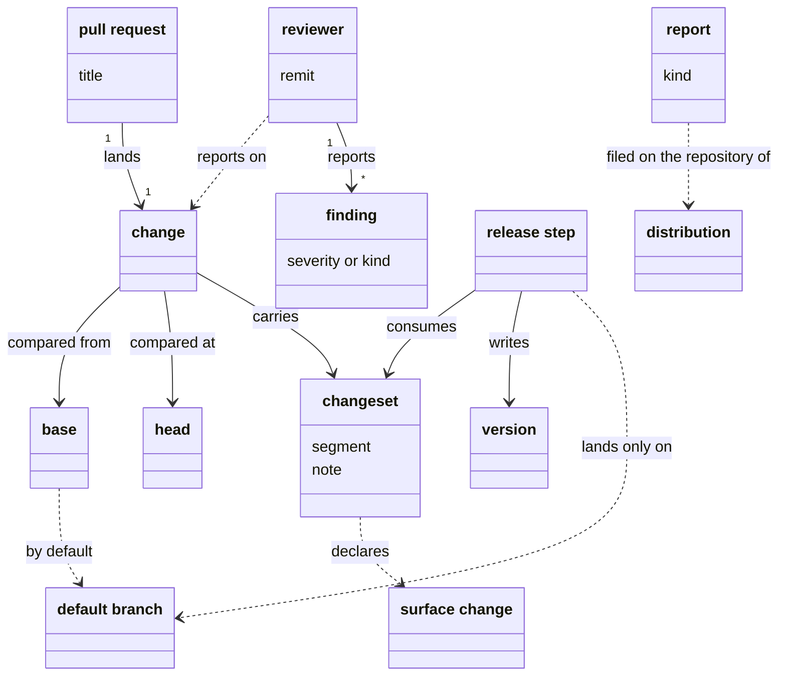

# VIEW-changes-review-and-releases — Changes, review and releases

How work lands, is reviewed and is released. A change lands on the branch it targets, most often through a pull request. A check compares its head with its base, which is the default branch unless a run names another. Reviewers report findings on it. A change that alters the system's surface declares that in a changeset, and the release step consumes the changesets on the default branch.

## change

A change is a unit of work that lands on the branch it targets. It lands through a pull request, or as a direct commit where the project allows it. A check compares it from its base to its head.

**Attributes:**

- the branch that carries it, and its commits, each one step of the change

**Relations:**

- A pull request lands it, or it lands as a direct commit (COR-009 point 5).
- A check compares it from its base to its head (COR-050 point 6).
- It declares a surface change it makes in a changeset (PRJ-002 D1).

**States:** None.

**Always true:**

- Merged through a pull request, it lands on the default branch as one squash commit (COR-009 point 1).
- It edits no version number, and declares a surface change in a changeset instead (PRJ-002 D1).

## pull request

A pull request is a proposal, on the hosting service, to land one change on a target branch. It is reviewed there, and merged, by default, as one squash commit whose subject is its title.

**Attributes:**

- its title, the subject of a conventional commit (COR-009 point 2)
- its body, which becomes the squash commit's body (COR-009 point 2)
- its target branch, and its head

**Relations:**

- It lands one change (COR-009 point 1).
- Its target branch is the base of the checks that run on it.

**States:** It is open until it is merged. Its branch lives only as long as it does, and is deleted after the merge (COR-009 point 4).

**Always true:**

- Its title follows conventional commits (COR-009 point 2).
- It is recommended, never required: work done alone may land directly (COR-009 point 5).

## base

A base is the branch, or other reference, that a check compares a change with. The check measures from the commit where the change's branch left the base, which may have moved on since.

**Attributes:**

- its name: a branch or other reference
- the commit where the change's branch left it, git's merge-base

**Relations:**

- The default branch is every check's base unless a run names another (COR-054 point 3).
- A pull request's target branch is the base of its checks.

**States:** None.

**Always true:**

- A base named for one run replaces the default branch for that run only, and changes nothing else (COR-054 point 3).
- A base that cannot be resolved is reported with the references tried, never guessed (COR-054 point 4).
- A check's result holds only against an up-to-date base (COR-050 point 6).

## head

The head is the latest commit of the branch that carries a change. It is the later state a check compares with the base, so each push gives a pull request a new head.

**Attributes:** None.

**Relations:**

- It belongs to the branch of one change, and a check compares it with that change's base (COR-050 point 5).

**States:** None.

**Always true:**

- An edit undone before the head counts as no edit, however many commits made and undid it (COR-050 point 5).

## default branch

The default branch is the line of history where a project's changes land. It is `main`, unless the backbone configuration names another. Every reader resolves it from the shared remote's copy.

**Attributes:**

- its name, declared once in the backbone configuration (COR-054 point 1)

**Relations:**

- It is the base of every check that names no other (COR-054 point 3).
- The release step's writes land only on it (PRJ-002 D3).

**States:** None.

**Always true:**

- It is declared once, and no component keeps a setting of its own for it (COR-054 point 1).
- Every reader resolves it the same way: the shared remote's copy first, and the local branch only where there is no remote (COR-054 point 2).
- Where it cannot be resolved, the reader says so, and never falls back to another branch (COR-054 point 4).

## report

A report is an issue composed with the system and filed on the repository of the distribution in use. It is a bug, a change request or feedback. `pkit report bug` files one titled `[Bug] …`, with the versions in use attached.

**Attributes:**

- its kind: a bug, a change request or feedback (PRJ-008)
- the versions it was filed from

**Relations:**

- It goes to its distribution's report target, the one repository that distribution's reports go to (ADR-047 point 3).
- The issues that fix it are listed under its `## Tracked by` heading, and one issue may fix several reports (PRJ-008).

**States:** None.

**Always true:**

- Its distribution sets its target, and no one filing it can name another (ADR-047 point 3).
- Posting it is never silent: a person confirms the target each time, or it stays a draft (PRJ-008).

## reviewer

A reviewer is whoever, other than the author, reports on a draft or a change within a remit, and leaves each fix to the author. The rule-set reviewer, for one, judges a change against the rules that bind on what it alters.

**Attributes:**

- its remit: what it reports on, such as a draft or a diff

**Relations:**

- It reports findings on a draft or a change.
- It is never the author of what it reviews.
- The backbone ships five. The critic and the architect advise on a draft. The methodology, convention-compliance and rule-set reviewers judge a document or a diff (COR-024, COR-057 point 5).

**States:** None.

**Always true:**

- It reports, and leaves each fix to the author (COR-024).
- A reviewer the backbone ships only advises, unless a gate requires its verdict (COR-024, COR-057 point 5).

## finding

A finding is a statement that a check or a reviewer reports on what it judged. Its severity, or its kind, says whether it fails the check or withholds an approval.

**Attributes:**

- from a check: one severity, from a closed set every validator shares (COR-055 point 4)
- from a reviewer: one of three kinds, a settled break, a passage for a person, or a finding that informs (COR-057 point 3)

**Relations:**

- A check or a reviewer reports it.
- Each finding of validation carries one severity, and exactly one severity fails validation (COR-055 point 5).

**States:** None.

**Always true:**

- Exactly one severity fails validation, and every other only prints (COR-055 point 5).
- Of a reviewer's findings, only a settled break withholds its approval (COR-057 point 3).

## surface change

A surface change is an alteration of the system that someone using it could observe, depend on or break against. A new subcommand of `pkit` is one, so the pull request that adds it declares it in a changeset.

**Attributes:**

- the segment it moves its part's version by: patch for a fix, minor for new surface, major for a break (PRJ-002 D2)

**Relations:**

- A change that makes one declares it in a changeset (PRJ-002 D1).
- It moves the version of the backbone or of a component, when the release step runs (PRJ-002 D3).

**States:** None.

**Always true:**

- Which segment it moves is a person's judgement, never read from the commit type (PRJ-002 D2).
- An edit to a component's surface paths only suggests one, and a person judges it (PRJ-002 D2).

## changeset

A changeset is a file naming the backbone or a component, the version segment a change moves it by, and a note for the changelog. A change that adds a command to `software-analysis` declares one naming `software-analysis` and `minor`.

**Attributes:**

- what it moves: the backbone, or one component
- its segment, its `kind`: `patch`, `minor`, `major` or `none` (PRJ-002 D1 and D2)
- a note for the changelog

**Relations:**

- A change carries it, instead of editing a version number (PRJ-002 D1).
- The release step consumes it (PRJ-002 D3).

**States:** It is pending from the change that adds it until a release step consumes it (PRJ-002 D3).

**Always true:**

- Its segment is a person's judgement of the change's surface, never read from the commit type (PRJ-002 D2).
- No branch edits a version number: a branch declares its change in a changeset (PRJ-002 D1).

## release step

The release step is the procedure that consumes every pending changeset. It writes the new versions, raised floors, widened bounds and changelog entries, which land only on the default branch. `pkit release plan` previews it, and `pkit release apply` writes it on a `release/` branch.

**Attributes:** None.

**Relations:**

- It consumes every pending changeset (PRJ-002 D3).
- Its writes land only on the default branch, through a release pull request (PRJ-002 D3).
- It makes a release when it moves the backbone. One that moves only components makes no release of its own (PRJ-004).

**States:** None.

**Always true:**

- It is the only writer of version numbers (PRJ-002 D3).
- A floor rises only where a changeset declares it, and the backbone's upper bound only ever widens (PRJ-002 D4).
- It refuses to leave a range that excludes the version it writes for a dependency (PRJ-002 D4).
