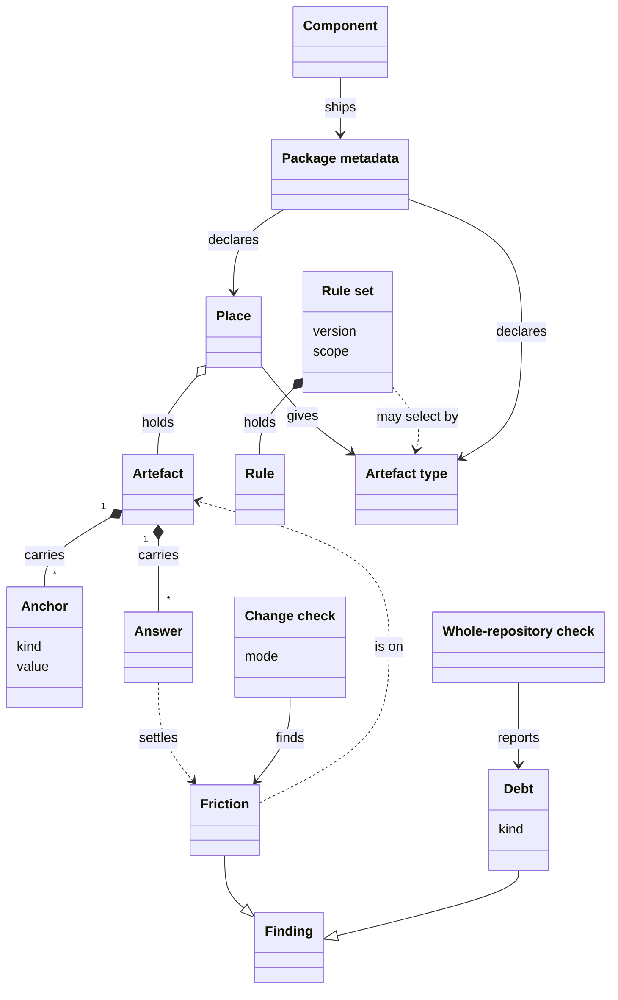

# VIEW-artefacts-and-friction — Artefacts and friction

A document is true only against something, such as the code it explains or a decision it applies (COR-050). When that changes and the document does not, it goes stale, and a review of the edit seldom sees it (COR-050). Rules need the same tracking, and must reach only the documents meant for them (COR-051, COR-056).

An [artefact](../glossary.md#term-artefact--artefact) in a [place](../glossary.md#term-place--place) declares its anchors, the things that make it true. When one of them changes, the artefact has [friction](../glossary.md#term-friction--friction) until an [answer](../glossary.md#term-answer--answer) stands for the edit. The [change check](../glossary.md#term-change-check--change-check) finds the friction a [change](../glossary.md#term-change--change) brings, and the [whole-repository check](../glossary.md#term-whole-repository-check--whole-repository-check) reports the [debt](../glossary.md#term-debt--debt) left on the [default branch](../glossary.md#term-default-branch--default-branch).

[Rule sets](../glossary.md#term-rule-set--rule-set) hold the rules artefacts must satisfy, and select the artefacts their rules bind on, by path or by [artefact type](../glossary.md#term-artefact-type--artefact-type). A [component](../glossary.md#term-component--component)'s [package metadata](../glossary.md#term-package-metadata--package-metadata) declares its places and its artefact types.

## Anchor

Defined in [TERM-anchor](../glossary.md#term-anchor--anchor).

**Why:** A document goes stale when what it rests on changes, and only a recorded link to that ground lets a check notice (COR-050). Declared, the link is a claim someone made, which a check can test, where an inferred one is guesswork (COR-050).

An anchor is a declared link from a document, or a collection entry, to what makes it true. That may be a path, a record, or another document or entry. It says: if this changes, check me. A page that anchors `src/project_kit/changesets.py` is asked whether it still holds when that file is edited.

**Attributes:**

- its kind (COR-050 [point](../glossary.md#term-point--point) 2):
  - a path
  - a record, or one of its points
  - another [artefact](../glossary.md#term-artefact--artefact), or one of its sections, or its lead
  - a kind a [capability](../glossary.md#term-capability--capability) registers
- its value, written as its kind writes it, such as `COR-058#4` (COR-050 point 2)

**Relations:**

- An artefact carries it, in its `friction` block (COR-050 point 1).
- A capability may register a kind of its own, with a command that resolves it (COR-050 point 2).

**States:** None.

**Always true:**

- An anchor that resolves to nothing is an error, never silence (COR-050 point 7).
- An anchor on its own artefact, or on a section of it, is a cycle, and an error (COR-050 point 5).

## Place

Defined in [TERM-place](../glossary.md#term-place--place).

**Why:** Many files carry front matter that has nothing to do with anchors (COR-050 [point](../glossary.md#term-point--point) 1). The [backbone](../glossary.md#term-backbone--backbone) looks only in declared places, so it never misreads such a file (COR-050 point 1). The owner of a place also knows what its files are, and can declare that there (COR-056).

A place is a path or glob that the [project](../glossary.md#term-project--project) or a [component](../glossary.md#term-component--component) declares, within which the backbone looks for documents that carry anchors. project-kit lists `.pkit/cli/README.md` among its places, so the backbone reads that page's anchors.

**Attributes:**

- its path or glob
- optionally an [artefact type](../glossary.md#term-artefact-type--artefact-type), which it gives to what it holds (COR-050 point 1, COR-056 point 2)

**Relations:**

- A component declares its places in its [package metadata](../glossary.md#term-package-metadata--package-metadata), and the project declares its places in its [backbone configuration](../glossary.md#term-backbone-configuration--backbone-configuration) (COR-050 point 1).
- It may lie inside a [documentation root](../glossary.md#term-documentation-root--documentation-root), and a root may hold files no place reads.

**States:** None.

**Always true:**

- The backbone looks for [artefacts](../glossary.md#term-artefact--artefact) only in places (COR-050 point 1).
- A folder of [synced copies](../glossary.md#term-synced-copy--synced-copy) is never a place, or each [sync](../glossary.md#term-sync--sync) would read as [friction](../glossary.md#term-friction--friction) (COR-050 point 14).

## Artefact

Defined in [TERM-artefact](../glossary.md#term-artefact--artefact).

**Why:** Descriptions of what the [system](../glossary.md#term-system--system) must do and documentation both go stale when what they rest on changes (COR-050). Parts that must not depend on each other keep them, so the mechanism that finds staleness is shared (COR-050). An artefact is the unit it works on, and carries its own anchors and answers (COR-050 [point](../glossary.md#term-point--point) 1).

An artefact is a document with front matter, or a keyed entry of a collection file, in a declared [place](../glossary.md#term-place--place). It carries its own anchors. Each entry of this analysis's glossary is one.

**Attributes:**

- its own fields, such as its id and its status, which belong to the [component](../glossary.md#term-component--component) that defines it (COR-050 point 1)
- its `friction` block, which holds its anchors and its answers (COR-050 point 1)
- one [artefact type](../glossary.md#term-artefact-type--artefact-type), or none (COR-056 point 1)

**Relations:**

- A place holds it (COR-050 point 1).
- It carries anchors, and the answers that stand for edits to what they name (COR-050 points 1 and 3).
- A [decision record](../glossary.md#term-decision-record--decision-record) is an artefact only where a place holds it (COR-050 point 1).

**States:** None.

**Always true:**

- The [change check](../glossary.md#term-change-check--change-check) asks a revalidation of a [change](../glossary.md#term-change--change) that moves it, by renaming its file or moving its entry (COR-050 point 3). It asks one too of a change to its own list of anchors (COR-050 point 6).
- An artefact with no anchors is unanchored: the [backbone](../glossary.md#term-backbone--backbone) reports it, and never fails on it (COR-050 point 2).

## Answer

Defined in [TERM-answer](../glossary.md#term-answer--answer).

**Why:** Whether an [artefact](../glossary.md#term-artefact--artefact) still holds after what it rests on changed is a judgement no tool can make (COR-050). Kept in the artefact, not in one tool's pull-request description, that judgement needs nothing but the repository (COR-050).

An answer is a statement in an artefact's `friction` block. It settles an edit to what the artefact rests on, or a revisit its links ask for. It is a revalidation, a deferral or a revisit entry.

**Attributes:**

- a revalidation: the record that the artefact was reviewed against what changed. It holds its time, `at`, and its outcome, `updated` or `unchanged`, with why the artefact still holds where it is `unchanged` (COR-050 [point](../glossary.md#term-point--point) 3).
- a deferral: the [anchor](../glossary.md#term-anchor--anchor) whose [friction](../glossary.md#term-friction--friction) it puts off, and a reason (COR-050 point 4)
- a revisit entry: the target it stands for, its outcome and its reason (COR-050 point 16)

**Relations:**

- It lives on its artefact, never in a [pull request](../glossary.md#term-pull-request--pull-request)'s description (COR-050 point 6).
- A revalidation or a deferral clears friction (COR-050 point 5).
- A revisit entry answers a link. A [component](../glossary.md#term-component--component) may declare one on a [place](../glossary.md#term-place--place). An edit to chosen fields of an artefact there then asks for a revisit of what its anchors name (COR-050 point 16).
- The [change check](../glossary.md#term-change-check--change-check) lists every answer a [change](../glossary.md#term-change--change) wrote, word for word, and a [reviewer](../glossary.md#term-reviewer--reviewer) works from that list (COR-050 point 3).

**States:** None.

**Always true:**

- An `unchanged` revalidation says why the artefact still holds, in words that change with it (COR-050 point 3).
- An outcome is a record of what happened, and is never read to work out friction (COR-050 point 3).

## Friction

Defined in [TERM-friction](../glossary.md#term-friction--friction).

**Why:** People forget to update what depends on what they changed, and nobody notices until a reader is misled (COR-050). Friction marks each such [artefact](../glossary.md#term-artefact--artefact) at the edit that left it behind, while the fix is still cheap (COR-050).

Friction is a [finding](../glossary.md#term-finding--finding) that something an artefact rests on changed, with no [answer](../glossary.md#term-answer--answer) standing for it. What changed may be what an [anchor](../glossary.md#term-anchor--anchor) names, or the list of anchors. A [change](../glossary.md#term-change--change) that edits `src/project_kit/release.py` brings friction to `.pkit/release/README.md` until the page carries an answer.

**Attributes:**

- the artefact it is on, and what changed: an anchor's target, or the list of anchors (COR-050 points 5 and 6)

**Relations:**

- The [change check](../glossary.md#term-change-check--change-check) and the [whole-repository check](../glossary.md#term-whole-repository-check--whole-repository-check) each find it (COR-050 [point](../glossary.md#term-point--point) 6).
- A revalidation or a deferral clears it (COR-050 point 5).
- Friction nobody answered stays on the [default branch](../glossary.md#term-default-branch--default-branch) as [debt](../glossary.md#term-debt--debt) (COR-050 point 9).

**States:** None.

**Always true:**

- It is worked out from git on each run. A status a job writes back after a merge is never read for it (COR-050 points 3 and 10).
- An edit undone before the later state brings none (COR-050 point 5).
- It never reads an [artefact type](../glossary.md#term-artefact-type--artefact-type) (COR-056 point 5).

## Change check

Defined in [TERM-change-check](../glossary.md#term-change-check--change-check).

**Why:** The cheapest moment to fix a stale [artefact](../glossary.md#term-artefact--artefact) is the [change](../glossary.md#term-change--change) that made it stale, while its author is still at work (COR-050).

The change check compares a [head](../glossary.md#term-head--head) with its [base](../glossary.md#term-base--base). It finds the [friction](../glossary.md#term-friction--friction) and dead anchors the diff brings, and lists every [answer](../glossary.md#term-answer--answer) the diff wrote. `pkit friction check` runs it.

**Attributes:**

- its mode: warning, where it reports and passes, or enforcing, where it fails (COR-050 [point](../glossary.md#term-point--point) 12)
- its base, the [default branch](../glossary.md#term-default-branch--default-branch) unless the run names another (COR-054 point 3)

**Relations:**

- It finds friction (COR-050 point 6).
- A [reviewer](../glossary.md#term-reviewer--reviewer) works from its list of answers (COR-050 point 3).

**States:** None.

**Always true:**

- It reports each artefact that has an [anchor](../glossary.md#term-anchor--anchor) the change altered, and no answer in the same change (COR-050 point 6).
- An artefact new in the change counts as revalidated (COR-050 point 6).
- It reads the artefacts, never a [pull request](../glossary.md#term-pull-request--pull-request)'s description, so it runs the same anywhere (COR-050 point 6).

## Whole-repository check

Defined in [TERM-whole-repository-check](../glossary.md#term-whole-repository-check--whole-repository-check).

**Why:** What a [change](../glossary.md#term-change--change) leaves unanswered stays on the [default branch](../glossary.md#term-default-branch--default-branch) once it lands (COR-050). The whole-repository check asks the [change check](../glossary.md#term-change-check--change-check)'s question of every [artefact](../glossary.md#term-artefact--artefact), so that state stays visible (COR-050).

The whole-repository check compares every artefact, at the latest commit, with its revalidation point. Its revalidation point is the commit where the artefact first carried its latest revalidation (COR-050 [point](../glossary.md#term-point--point) 3). It reports, and never fails. `pkit friction check --all` runs it.

**Attributes:** None.

**Relations:**

- What it reports on the default branch is [debt](../glossary.md#term-debt--debt) (COR-050 point 9).

**States:** None.

**Always true:**

- It never fails, since [friction](../glossary.md#term-friction--friction) already there holds no other work back (COR-050 point 12).

## Debt

Defined in [TERM-debt](../glossary.md#term-debt--debt).

**Why:** An [artefact](../glossary.md#term-artefact--artefact) left out of date on the [default branch](../glossary.md#term-default-branch--default-branch), by [friction](../glossary.md#term-friction--friction) nobody answered or by a deferral, must stay in view (COR-050). Derived from git on each run, debt never drifts the way a separate ledger would (COR-050).

Debt is a [finding](../glossary.md#term-finding--finding) of the [whole-repository check](../glossary.md#term-whole-repository-check--whole-repository-check), dated from the commit it originates in. It is stale, where a [change](../glossary.md#term-change--change) nobody answered left an artefact behind, or deferred, where a deferral put an [answer](../glossary.md#term-answer--answer) off.

**Attributes:**

- its kind, stale or deferred (COR-050 [point](../glossary.md#term-point--point) 9)
- the commit it originates in, with its author and its date (COR-050 point 9)

**Relations:**

- The whole-repository check reports it (COR-050 point 9).
- Friction nobody answered becomes stale debt on the default branch (COR-050 point 9).

**States:** None.

**Always true:**

- No ledger keeps it: each run derives it from git again (COR-050 point 9).
- A deferral never expires on its own, and its age is shown (COR-050 point 4).

## Rule set

Defined in [TERM-rule-set](../glossary.md#term-rule-set--rule-set).

**Why:** Rules need the discovery, anchoring and drift detection that [artefacts](../glossary.md#term-artefact--artefact) already have (COR-051). Kept as a collection of artefacts, a rule set reuses that machinery, with no second copy of it (COR-051). A shared set says what to require, and each set that inherits it says where (COR-051).

A rule set is a collection file of rules that artefacts must satisfy. It has its own [version](../glossary.md#term-version--version), the rule sets it inherits, and any scope that selects the artefacts its rules bind on. `ANA` is project-kit's rule set for its analysis.

**Attributes:**

- its name and its version (COR-051 [point](../glossary.md#term-point--point) 2)
- the rule sets it inherits, each pinned at a major version, as in `WRITE@2` (COR-051 point 7)
- a scope, by path or by [artefact type](../glossary.md#term-artefact-type--artefact-type), on a set of the [project](../glossary.md#term-project--project)'s own (COR-051 points 2 and 6)

**Relations:**

- Each of its rules is an artefact of its own (COR-051 point 2).
- Its scope selects artefacts by path or by artefact type (COR-051 point 2).
- A rule set the [backbone](../glossary.md#term-backbone--backbone) or a [component](../glossary.md#term-component--component) ships takes no scope. It binds only through a set of the project's own that inherits it (COR-051 points 6 and 7).

**States:** None.

**Always true:**

- A project never edits a rule set the backbone or a component ships, and extends one by inheriting it (COR-051 point 6).
- A set takes every [rule](../glossary.md#term-rule--rule) of the sets it inherits unchanged (COR-051 point 7).
- While a pin is behind its set's version, no rule binds through it (COR-051 point 7).

## Artefact type

Defined in [TERM-artefact-type](../glossary.md#term-artefact-type--artefact-type).

**Why:** Selecting [artefacts](../glossary.md#term-artefact--artefact) by path alone cannot tell apart the different sorts one folder holds (COR-056). Inferring a sort from fields fails without a word, so the owner of a [place](../glossary.md#term-place--place) declares it there (COR-056).

An artefact type is the declared name of what a document or a collection entry is. The place holding its file gives it, save for a [rule](../glossary.md#term-rule--rule), which always takes `backbone:rule`, and a type that a kind field gates. A [rule set](../glossary.md#term-rule-set--rule-set)'s scope may select by it. The glossary's place gives each entry the type `software-analysis:term`.

**Attributes:**

- its name: a [component](../glossary.md#term-component--component)'s is qualified, such as `software-analysis:term`, and a [project](../glossary.md#term-project--project)'s is bare (COR-056 [point](../glossary.md#term-point--point) 1)

**Relations:**

- A place gives it to the artefacts it holds (COR-056 point 1). Where the type names a kind field, an artefact takes it only when it declares that kind (COR-056 point 4).
- A component declares its types in its [package metadata](../glossary.md#term-package-metadata--package-metadata) (COR-056 point 2).
- A rule set's scope may select by it (COR-051 point 2).

**States:** None.

**Always true:**

- An artefact has one type, or none (COR-056 point 1).
- [Friction](../glossary.md#term-friction--friction) never reads a type, so giving a place a type flags nothing (COR-056 point 5).
- Every rule takes the type `backbone:rule`, whatever place holds it (COR-056 point 3).

## Package metadata

Defined in [TERM-package-metadata](../glossary.md#term-package-metadata--package-metadata).

**Why:** What a [component](../glossary.md#term-component--component) adds to the [backbone](../glossary.md#term-backbone--backbone) must be declared on purpose, not found by scanning its files (COR-021). A scan would let a renamed file reshape the commands others rely on, without a word (COR-021).

Package metadata is the file a component ships that declares its [version](../glossary.md#term-version--version), its ranges and what it adds to the backbone. It may add places, types, [roles](../glossary.md#term-role--role), commands and validators. The `package.yaml` of `software-analysis` declares the glossary as a [place](../glossary.md#term-place--place).

**Attributes:**

- the component's name, kind and version, and its ranges: on the backbone, and on other [capabilities](../glossary.md#term-capability--capability) (COR-017, COR-030)
- its commands (COR-021)
- its connections: the [connection points](../glossary.md#term-connection-point--connection-point) it defines and those it plugs into (COR-053 [point](../glossary.md#term-point--point) 3)
- its places, and its [artefact types](../glossary.md#term-artefact-type--artefact-type) (COR-050 point 1, COR-056 point 2)

**Relations:**

- A component ships it (COR-017).
- It is no [manifest](../glossary.md#term-manifest--manifest): a manifest is what the [project](../glossary.md#term-project--project) recorded when it installed the component.

**States:** None.

**Always true:**

- A capability's connections can be read from it before the capability is installed (COR-053 point 8).
- It is the only source of a capability's commands (COR-021).

**Note:** COR-017 calls it the capability's manifest, a word the analysis keeps for the project's record.
