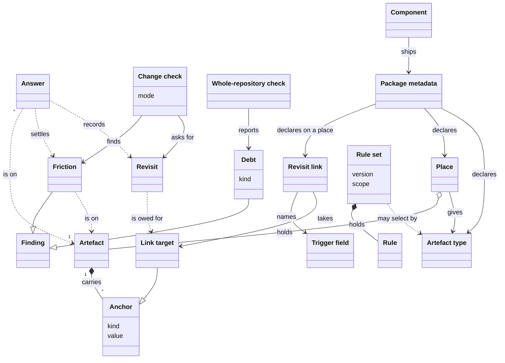
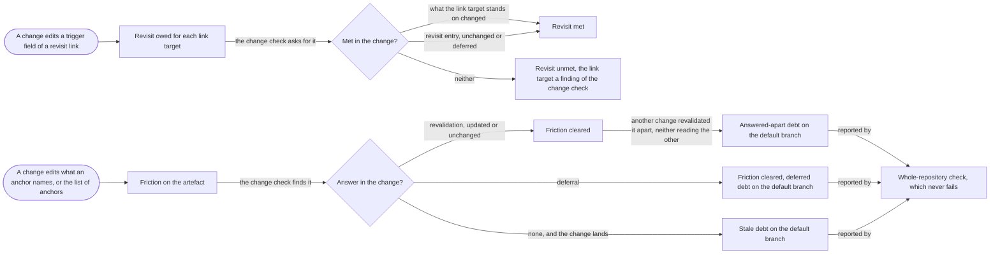
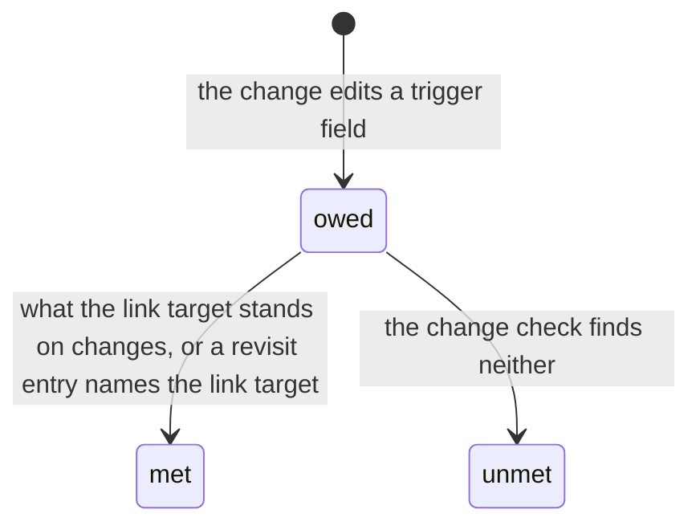

# VIEW-artefacts-and-friction — Artefacts and friction

A document is true only against something, such as the code it explains or a decision it applies ([COR-050](../../../../.pkit/decisions/core/COR-050-anchors-and-friction.md)). When that changes and the document does not, it goes stale, and a review of the edit seldom sees it (COR-050). Rules need the same tracking, and must reach only the [artefacts](../glossary.md#term-artefact--artefact) meant for them ([COR-051](../../../../.pkit/decisions/core/COR-051-rule-sets.md), [COR-056](../../../../.pkit/decisions/core/COR-056-artefact-types.md)).

An artefact in a [place](../glossary.md#term-place--place) declares its anchors, the things that make it true. When one of them changes, the artefact has [friction](../glossary.md#term-friction--friction) until an [answer](../glossary.md#term-answer--answer) stands for the edit. A [change](../glossary.md#term-change--change) writes its answers in files of its own, outside the artefacts, so they never conflict with another change's answers ([COR-062](../../../../.pkit/decisions/core/COR-062-answers-in-own-files.md)). The [change check](../glossary.md#term-change-check--change-check) finds the friction a change brings, and the [whole-repository check](../glossary.md#term-whole-repository-check--whole-repository-check) reports the [debt](../glossary.md#term-debt--debt) left on the [default branch](../glossary.md#term-default-branch--default-branch).

What an [anchor](../glossary.md#term-anchor--anchor) names is a path, a record or an artefact, or a part of one. What it stands on is what the checks compare between two states to tell whether the anchor changed ([COR-050 point 5](../../../../.pkit/decisions/core/COR-050-anchors-and-friction.md#5-when-an-anchor-has-changed-and-what-answers-it)). An anchor on a record's [point](../glossary.md#term-point--point) names the point, but stands on the point's section and on what says whether and how the record binds.

Some anchors matter the other way too. A requirement anchors the test that verifies it, and a changed threshold can leave the test checking the old value, unflagged (COR-050). So a [component](../glossary.md#term-component--component) may declare a [revisit link](../glossary.md#term-revisit-link--revisit-link) on a place. An edit to an artefact's [trigger fields](../glossary.md#term-trigger-field--trigger-field) there then asks the change for a [revisit](../glossary.md#term-revisit--revisit) of each [link target](../glossary.md#term-link-target--link-target).

[Rule sets](../glossary.md#term-rule-set--rule-set) hold the rules artefacts must satisfy, and select the artefacts their rules bind on, by path or by [artefact type](../glossary.md#term-artefact-type--artefact-type). A component's [package metadata](../glossary.md#term-package-metadata--package-metadata) declares its places and its artefact types.

## Anchor

Defined in [TERM-anchor](../glossary.md#term-anchor--anchor).

**Why:** A document goes stale when what it rests on changes, and only a recorded link to that ground lets a check notice ([COR-050](../../../../.pkit/decisions/core/COR-050-anchors-and-friction.md)). Declared, the link is a claim someone made, which a check can test, where an inferred one is guesswork (COR-050).

An anchor is a declared link from a document, or a collection entry, to what makes it true. That may be a path, a record, or another document or entry. It says: if this changes, check me. A page that anchors `src/project_kit/changesets.py` is asked whether it still holds when that file is edited.

**Attributes:**

- its kind ([COR-050 point 2](../../../../.pkit/decisions/core/COR-050-anchors-and-friction.md#2-anchors)):
  - a path
  - a record, or one of its points
  - another [artefact](../glossary.md#term-artefact--artefact), or one of its sections, or its lead
  - a kind a [capability](../glossary.md#term-capability--capability) registers
- its value, written as its kind writes it, such as `COR-058#4` (COR-050 point 2)

**Relations:**

- An artefact carries it, in its `friction` block ([COR-050 point 1](../../../../.pkit/decisions/core/COR-050-anchors-and-friction.md#1-artefacts)).
- A capability may register a kind of its own, with a command that resolves it (COR-050 point 2).

**States:** None.

**Always true:**

- An anchor that resolves to nothing is an error, never silence ([COR-050 point 7](../../../../.pkit/decisions/core/COR-050-anchors-and-friction.md#7-dead-anchors-excluded-paths-and-over-broad-anchors)).
- An anchor on its own artefact, or on a section of it, is a cycle, and an error ([COR-050 point 5](../../../../.pkit/decisions/core/COR-050-anchors-and-friction.md#5-when-an-anchor-has-changed-and-what-answers-it)).

## Place

Defined in [TERM-place](../glossary.md#term-place--place).

**Why:** Many files carry front matter that has nothing to do with anchors ([COR-050 point 1](../../../../.pkit/decisions/core/COR-050-anchors-and-friction.md#1-artefacts)). The [backbone](../glossary.md#term-backbone--backbone) looks only in declared places, so it never misreads such a file (COR-050 point 1). The owner of a place also knows what its files are, and can declare that there ([COR-056](../../../../.pkit/decisions/core/COR-056-artefact-types.md)).

A place is a path or glob that the [project](../glossary.md#term-project--project) or a [component](../glossary.md#term-component--component) declares, within which the backbone looks for [artefacts](../glossary.md#term-artefact--artefact) that carry anchors. project-kit lists `.pkit/cli/README.md` among its places, so the backbone reads that page's anchors.

**Attributes:**

- its path or glob
- optionally an [artefact type](../glossary.md#term-artefact-type--artefact-type), which it gives to what it holds (COR-050 point 1, [COR-056 point 2](../../../../.pkit/decisions/core/COR-056-artefact-types.md#2-who-declares-it))

**Relations:**

- A component declares its places in its [package metadata](../glossary.md#term-package-metadata--package-metadata), and the project declares its places in its [backbone configuration](../glossary.md#term-backbone-configuration--backbone-configuration) (COR-050 point 1).
- It may lie inside a [documentation root](../glossary.md#term-documentation-root--documentation-root), and a root may hold files no place reads.

**States:** None.

**Always true:**

- The backbone looks for artefacts only in places (COR-050 point 1).
- A folder of [synced copies](../glossary.md#term-synced-copy--synced-copy) is never a place, or each [sync](../glossary.md#term-sync--sync) would read as [friction](../glossary.md#term-friction--friction) ([COR-050 point 14](../../../../.pkit/decisions/core/COR-050-anchors-and-friction.md#14-project-settings)).

## Artefact

Defined in [TERM-artefact](../glossary.md#term-artefact--artefact).

**Why:** Descriptions of what the [system](../glossary.md#term-system--system) must do and documentation both go stale when what they rest on changes ([COR-050](../../../../.pkit/decisions/core/COR-050-anchors-and-friction.md)). [Components](../glossary.md#term-component--component) that must not depend on each other keep them, so the mechanism that finds staleness is shared (COR-050). An artefact is the unit it works on, and carries its own anchors ([COR-050 point 1](../../../../.pkit/decisions/core/COR-050-anchors-and-friction.md#1-artefacts)).

An artefact is a document with front matter, or a keyed entry of a collection file, in a declared [place](../glossary.md#term-place--place). It carries its own anchors. Each entry of this analysis's glossary is one.

**Attributes:**

- its own fields, such as its id and its status, which belong to the component that defines it (COR-050 point 1)
- its `friction` block, which holds its anchors (COR-050 point 1)
- one [artefact type](../glossary.md#term-artefact-type--artefact-type), or none ([COR-056 point 1](../../../../.pkit/decisions/core/COR-056-artefact-types.md#1-what-a-type-is))

**Relations:**

- A place holds it (COR-050 point 1).
- It carries anchors (COR-050 point 1). Its answers, for edits to what the anchors name, lie in [answer](../glossary.md#term-answer--answer) files apart from it ([COR-050 point 3](../../../../.pkit/decisions/core/COR-050-anchors-and-friction.md#3-the-revalidation), [COR-062 point 1](../../../../.pkit/decisions/core/COR-062-answers-in-own-files.md#1-answers-live-in-answer-files)).
- A [decision record](../glossary.md#term-decision-record--decision-record) is an artefact only where a place holds it (COR-050 point 1).

**States:** None.

**Always true:**

- The [change check](../glossary.md#term-change-check--change-check) asks a revalidation of a [change](../glossary.md#term-change--change) that moves it, by renaming its file or moving its entry (COR-050 point 3). It asks one too of a change to its own list of anchors ([COR-050 point 6](../../../../.pkit/decisions/core/COR-050-anchors-and-friction.md#6-friction-in-two-checks)).
- An artefact with no anchors is unanchored: the [backbone](../glossary.md#term-backbone--backbone) reports it, and never fails on it ([COR-050 point 2](../../../../.pkit/decisions/core/COR-050-anchors-and-friction.md#2-anchors)).

## Answer

Defined in [TERM-answer](../glossary.md#term-answer--answer).

**Why:** Whether an [artefact](../glossary.md#term-artefact--artefact) still holds after what it rests on changed is a judgement no tool can make ([COR-050](../../../../.pkit/decisions/core/COR-050-anchors-and-friction.md)). Kept in the repository, not in one tool's pull-request description, that judgement needs nothing else (COR-050). Kept in a file only its own [change](../glossary.md#term-change--change) writes, it never conflicts with another change's answer on the same artefact ([COR-062](../../../../.pkit/decisions/core/COR-062-answers-in-own-files.md)).

An answer is a statement in an answer file, which one change adds to the folder the [backbone](../glossary.md#term-backbone--backbone) keeps for answers ([COR-062 point 1](../../../../.pkit/decisions/core/COR-062-answers-in-own-files.md#1-answers-live-in-answer-files)). It settles an edit to what an artefact rests on, or a [revisit](../glossary.md#term-revisit--revisit) its [revisit links](../glossary.md#term-revisit-link--revisit-link) ask for. It is a revalidation, a deferral or a revisit entry.

**Attributes:**

- a revalidation: the record that the artefact was reviewed against what changed. It holds its time, `at`, and its outcome, `updated` or `unchanged`, with why the artefact still holds where it is `unchanged` ([COR-050 point 3](../../../../.pkit/decisions/core/COR-050-anchors-and-friction.md#3-the-revalidation)).
- a deferral: the [anchor](../glossary.md#term-anchor--anchor) whose [friction](../glossary.md#term-friction--friction) it puts off, and a reason ([COR-050 point 4](../../../../.pkit/decisions/core/COR-050-anchors-and-friction.md#4-deferrals))
- a revisit entry: the [link target](../glossary.md#term-link-target--link-target) it stands for, its outcome and its reason ([COR-050 point 16](../../../../.pkit/decisions/core/COR-050-anchors-and-friction.md#16-a-link-may-ask-for-a-revisit-of-its-targets-when-its-source-changes))
- the artefact it is on, by its location, and the other answer files on that artefact that it read (COR-062 points 1 and [4](../../../../.pkit/decisions/core/COR-062-answers-in-own-files.md#4-each-answer-names-what-it-read))

**Relations:**

- It lives in an answer file apart from its artefact, never in a [pull request](../glossary.md#term-pull-request--pull-request)'s description ([COR-050 point 6](../../../../.pkit/decisions/core/COR-050-anchors-and-friction.md#6-friction-in-two-checks), COR-062 point 1).
- It replaces the answers of its kind on its artefact that it read ([COR-062 point 5](../../../../.pkit/decisions/core/COR-062-answers-in-own-files.md#5-what-an-answer-replaces)).
- A revalidation or a deferral clears friction ([COR-050 point 5](../../../../.pkit/decisions/core/COR-050-anchors-and-friction.md#5-when-an-anchor-has-changed-and-what-answers-it)).
- A revisit entry answers for one link target (COR-050 point 16).
- The [change check](../glossary.md#term-change-check--change-check) lists every answer a change wrote, word for word, and a [reviewer](../glossary.md#term-reviewer--reviewer) works from that list (COR-050 point 3).

**States:** None.

**Always true:**

- An `unchanged` revalidation says why the artefact still holds, in words that change with it (COR-050 point 3).
- An outcome is a record of what happened, and is never read to work out friction (COR-050 point 3).
- A change never rewrites an answer file its [base](../glossary.md#term-base--base) holds, so an answer that landed stays as it was written ([COR-062 point 3](../../../../.pkit/decisions/core/COR-062-answers-in-own-files.md#3-a-change-adds-answer-files-and-rewrites-none-its-base-holds)).
- Two revalidations of one artefact, neither of which read the other, were answered apart. They are [debt](../glossary.md#term-debt--debt) until a revalidation that reads both judges their combined state ([COR-062 point 7](../../../../.pkit/decisions/core/COR-062-answers-in-own-files.md#7-answers-made-apart-are-debt-not-a-conflict)).

## Friction

Defined in [TERM-friction](../glossary.md#term-friction--friction).

**Why:** People forget to update what depends on what they changed, and nobody notices until a reader is misled ([COR-050](../../../../.pkit/decisions/core/COR-050-anchors-and-friction.md)). Friction marks each such [artefact](../glossary.md#term-artefact--artefact) at the edit that left it behind, while the fix is still cheap (COR-050).

Friction is a [finding](../glossary.md#term-finding--finding) that something an artefact rests on changed, with no [answer](../glossary.md#term-answer--answer) standing for it. What changed may be what an [anchor](../glossary.md#term-anchor--anchor) names, or the list of anchors. A [change](../glossary.md#term-change--change) that edits `src/project_kit/release.py` brings friction to `.pkit/release/README.md` until the change gives the page an answer.

**Attributes:**

- the artefact it is on, and what changed: an anchor's target, or the list of anchors (COR-050 points [5](../../../../.pkit/decisions/core/COR-050-anchors-and-friction.md#5-when-an-anchor-has-changed-and-what-answers-it) and [6](../../../../.pkit/decisions/core/COR-050-anchors-and-friction.md#6-friction-in-two-checks))

**Relations:**

- The [change check](../glossary.md#term-change-check--change-check) and the [whole-repository check](../glossary.md#term-whole-repository-check--whole-repository-check) each find it (COR-050 point 6).
- A revalidation or a deferral clears it (COR-050 point 5).
- Friction nobody answered stays on the [default branch](../glossary.md#term-default-branch--default-branch) as [debt](../glossary.md#term-debt--debt) ([COR-050 point 9](../../../../.pkit/decisions/core/COR-050-anchors-and-friction.md#9-debt-is-derived-from-git-never-kept-in-a-ledger)).

**States:** None.

**Always true:**

- It is worked out from git on each run. A status a job writes back after a merge is never read for it (COR-050 points [3](../../../../.pkit/decisions/core/COR-050-anchors-and-friction.md#3-the-revalidation) and [10](../../../../.pkit/decisions/core/COR-050-anchors-and-friction.md#10-a-tool-written-status-on-separate-lines)).
- An edit undone before the later state brings none (COR-050 point 5).
- It never reads an [artefact type](../glossary.md#term-artefact-type--artefact-type) ([COR-056 point 5](../../../../.pkit/decisions/core/COR-056-artefact-types.md#5-limits)).

## Change check

Defined in [TERM-change-check](../glossary.md#term-change-check--change-check).

**Why:** The cheapest moment to fix a stale [artefact](../glossary.md#term-artefact--artefact) is the [change](../glossary.md#term-change--change) that made it stale, while its author is still at work ([COR-050](../../../../.pkit/decisions/core/COR-050-anchors-and-friction.md)).

The change check compares a [head](../glossary.md#term-head--head) with its [base](../glossary.md#term-base--base). It finds the [friction](../glossary.md#term-friction--friction) and dead anchors the diff brings, and lists every [answer](../glossary.md#term-answer--answer) the diff wrote. `pkit friction check` runs it.

**Attributes:**

- its mode: warning, where it reports and passes, or enforcing, where it fails ([COR-050 point 12](../../../../.pkit/decisions/core/COR-050-anchors-and-friction.md#12-warning-or-enforcing-and-who-owns-which-finding))
- its base, the [default branch](../glossary.md#term-default-branch--default-branch) unless the run names another ([COR-054 point 3](../../../../.pkit/decisions/core/COR-054-default-branch.md#3-the-override-is-a-base-not-a-declaration))

**Relations:**

- It finds friction ([COR-050 point 6](../../../../.pkit/decisions/core/COR-050-anchors-and-friction.md#6-friction-in-two-checks)).
- A [reviewer](../glossary.md#term-reviewer--reviewer) works from its list of answers ([COR-050 point 3](../../../../.pkit/decisions/core/COR-050-anchors-and-friction.md#3-the-revalidation)).

**States:** None.

**Always true:**

- It reports each artefact that has an [anchor](../glossary.md#term-anchor--anchor) the change altered, and no answer in the same change (COR-050 point 6).
- An artefact new in the change counts as revalidated (COR-050 point 6).
- It reads the artefacts, never a [pull request](../glossary.md#term-pull-request--pull-request)'s description, so it runs the same anywhere (COR-050 point 6).

## Whole-repository check

Defined in [TERM-whole-repository-check](../glossary.md#term-whole-repository-check--whole-repository-check).

**Why:** What a [change](../glossary.md#term-change--change) leaves unanswered stays on the [default branch](../glossary.md#term-default-branch--default-branch) once it lands ([COR-050](../../../../.pkit/decisions/core/COR-050-anchors-and-friction.md)). The whole-repository check asks the [change check](../glossary.md#term-change-check--change-check)'s question of every [artefact](../glossary.md#term-artefact--artefact), so that state stays visible (COR-050).

The whole-repository check compares every artefact, at the latest commit, with its revalidation point. Its revalidation point is the commit where the artefact's answers first carried its latest revalidation ([COR-050 point 3](../../../../.pkit/decisions/core/COR-050-anchors-and-friction.md#3-the-revalidation), [COR-062 point 6](../../../../.pkit/decisions/core/COR-062-answers-in-own-files.md#6-each-value-keeps-its-point-across-homes)). It reports, and never fails. `pkit friction check --all` runs it.

**Attributes:** None.

**Relations:**

- What it reports on the default branch is [debt](../glossary.md#term-debt--debt) ([COR-050 point 9](../../../../.pkit/decisions/core/COR-050-anchors-and-friction.md#9-debt-is-derived-from-git-never-kept-in-a-ledger)).

**States:** None.

**Always true:**

- It never fails, since [friction](../glossary.md#term-friction--friction) already there holds no other work back ([COR-050 point 12](../../../../.pkit/decisions/core/COR-050-anchors-and-friction.md#12-warning-or-enforcing-and-who-owns-which-finding)).

## Debt

Defined in [TERM-debt](../glossary.md#term-debt--debt).

**Why:** An [artefact](../glossary.md#term-artefact--artefact) left out of date on the [default branch](../glossary.md#term-default-branch--default-branch), by [friction](../glossary.md#term-friction--friction) nobody answered or by a deferral, must stay in view ([COR-050](../../../../.pkit/decisions/core/COR-050-anchors-and-friction.md)). Derived from git on each run, debt never drifts the way a separate ledger would (COR-050).

Debt is a [finding](../glossary.md#term-finding--finding) of the [whole-repository check](../glossary.md#term-whole-repository-check--whole-repository-check), dated from the commit it originates in. It is stale, where a [change](../glossary.md#term-change--change) nobody answered left an artefact behind, or deferred, where a deferral put an [answer](../glossary.md#term-answer--answer) off. It is answered apart where two revalidations of one artefact, neither of which read the other, left their combined state unjudged ([COR-062 point 7](../../../../.pkit/decisions/core/COR-062-answers-in-own-files.md#7-answers-made-apart-are-debt-not-a-conflict)).

**Attributes:**

- its kind, stale, deferred or answered apart ([COR-050 point 9](../../../../.pkit/decisions/core/COR-050-anchors-and-friction.md#9-debt-is-derived-from-git-never-kept-in-a-ledger), COR-062 point 7)
- the commit it originates in, with its author and its date (COR-050 point 9)

**Relations:**

- The whole-repository check reports it (COR-050 point 9).
- Friction nobody answered becomes stale debt on the default branch (COR-050 point 9).

**States:** None.

**Always true:**

- No ledger keeps it: each run derives it from git again (COR-050 point 9).
- A deferral never expires on its own, and its age is shown ([COR-050 point 4](../../../../.pkit/decisions/core/COR-050-anchors-and-friction.md#4-deferrals)).
- Answered-apart debt is never stale and fails nothing. The next revalidation that reads both clears it (COR-062 point 7).

## Revisit link

Defined in [TERM-revisit-link](../glossary.md#term-revisit-link--revisit-link).

**Why:** An [anchor](../glossary.md#term-anchor--anchor) flags only the [artefact](../glossary.md#term-artefact--artefact) that carries it ([COR-050](../../../../.pkit/decisions/core/COR-050-anchors-and-friction.md)). So a relaxed requirement leaves the test that verifies it, and the [decision record](../glossary.md#term-decision-record--decision-record) made to meet it, unvisited (COR-050). Asked at every edit of an artefact, each anchor would draw a reason written blindly (COR-050). So the [component](../glossary.md#term-component--component) that defines a kind of artefact declares which anchors of those artefacts bind both ways (COR-050).

A revisit link is a declaration a component makes on a [place](../glossary.md#term-place--place), in its [package metadata](../glossary.md#term-package-metadata--package-metadata). Editing chosen fields of an artefact there asks whether what chosen anchors of the artefact name still stands. software-analysis declares one on each of its requirement places, under `revisits`.

**Attributes:**

- the own fields that choose its [link targets](../glossary.md#term-link-target--link-target): one that lists them, or fields that list the anchors that stay out ([COR-050 point 16](../../../../.pkit/decisions/core/COR-050-anchors-and-friction.md#16-a-link-may-ask-for-a-revisit-of-its-targets-when-its-source-changes))
- its [trigger fields](../glossary.md#term-trigger-field--trigger-field) (COR-050 point 16)

**Relations:**

- A component declares it on a place, in its package metadata (COR-050 point 16).
- Each artefact the place holds is its source. A source takes the revisit links of every place a component declares that matches its file at the [head](../glossary.md#term-head--head) (COR-050 point 16).
- It names trigger fields of its source, and takes link targets from its source's anchors (COR-050 point 16).

**States:** None.

**Always true:**

- No place asks for a [revisit](../glossary.md#term-revisit--revisit) unless a component declares a revisit link on it, so none does by default (COR-050 point 16).
- A [project](../glossary.md#term-project--project) declares no revisit link on its own places (COR-050 point 16).

## Link target

Defined in [TERM-link-target](../glossary.md#term-link-target--link-target).

**Why:** A field says which anchors a [revisit link](../glossary.md#term-revisit-link--revisit-link) takes ([COR-050](../../../../.pkit/decisions/core/COR-050-anchors-and-friction.md)). Taking every [anchor](../glossary.md#term-anchor--anchor) of one kind could not tell those anchors apart from the rest (COR-050). A requirement's record anchors may hold both the decisions it rests on and those made to meet it (COR-050).

A link target is an anchor of an [artefact](../glossary.md#term-artefact--artefact) that a revisit link takes. A requirement's anchor on the test that verifies it is a link target of the revisit link on its [place](../glossary.md#term-place--place).

**Attributes:**

- its anchor's kind and value, by which a [revisit](../glossary.md#term-revisit--revisit) entry names it ([COR-050 point 16](../../../../.pkit/decisions/core/COR-050-anchors-and-friction.md#16-a-link-may-ask-for-a-revisit-of-its-targets-when-its-source-changes))

**Relations:**

- It is an anchor of the revisit link's source (COR-050 point 16).
- A value in a field that lists link targets names every anchor of the source that has it (COR-050 point 16).
- A revisit is owed for it when an edit triggers its revisit link (COR-050 point 16). The revisit link must take it at the [base](../glossary.md#term-base--base) and at the [head](../glossary.md#term-head--head), and the link target must resolve at the head.

**States:** None.

**Always true:**

- A link target the [change](../glossary.md#term-change--change) adds to its revisit link owes nothing, since it was linked against the new state (COR-050 point 16).
- A dead link target owes no revisit, since it is a [finding](../glossary.md#term-finding--finding) of its own already (COR-050 points [7](../../../../.pkit/decisions/core/COR-050-anchors-and-friction.md#7-dead-anchors-excluded-paths-and-over-broad-anchors) and 16).
- [Validation](../glossary.md#term-validation--validation) fails a value that no anchor of the source has, in a field that lists link targets (COR-050 point 16).

## Trigger field

Defined in [TERM-trigger-field](../glossary.md#term-trigger-field--trigger-field).

**Why:** Only what matters should ask for a [revisit](../glossary.md#term-revisit--revisit), such as a requirement's statement and its threshold, never the wording of its rationale ([COR-050](../../../../.pkit/decisions/core/COR-050-anchors-and-friction.md)). A field keeps its name, while a [project](../glossary.md#term-project--project) may reword the labels and headings of a body (COR-050).

A trigger field is one of an [artefact](../glossary.md#term-artefact--artefact)'s own keys, an own field that a [revisit link](../glossary.md#term-revisit-link--revisit-link) names. Where it differs between the [base](../glossary.md#term-base--base) and the [head](../glossary.md#term-head--head), compared parsed, the revisit link is triggered. A requirement's `statement`, `measure` and `applies-to` are its trigger fields.

**Attributes:** None.

**Relations:**

- A revisit link names it, among its source's own fields ([COR-050 point 16](../../../../.pkit/decisions/core/COR-050-anchors-and-friction.md#16-a-link-may-ask-for-a-revisit-of-its-targets-when-its-source-changes)).
- Its edit asks for a revisit of every [link target](../glossary.md#term-link-target--link-target) of that revisit link (COR-050 point 16).

**States:** None.

**Always true:**

- A field absent at one state and present at the other differs (COR-050 point 16).
- These sources trigger nothing (COR-050 point 16):
  - a source new in the [change](../glossary.md#term-change--change)
  - a source the change removes
  - a source under an excluded path at the head
- A move alone triggers nothing either (COR-050 point 16).

## Revisit

Defined in [TERM-revisit](../glossary.md#term-revisit--revisit).

**Why:** The question belongs to the [change](../glossary.md#term-change--change) that alters the source, so the [change check](../glossary.md#term-change-check--change-check) asks it ([COR-050](../../../../.pkit/decisions/core/COR-050-anchors-and-friction.md)). What a [link target](../glossary.md#term-link-target--link-target) names may be no [artefact](../glossary.md#term-artefact--artefact), such as a test file, so the reason is recorded among the source's answers (COR-050).

A revisit is the judgement a change owes, once it edits a [trigger field](../glossary.md#term-trigger-field--trigger-field), of whether one link target still stands. The change meets it by changing what the link target stands on, or by a revisit entry among the source's answers. `pkit friction revisit` writes the entry.

**Attributes:**

- the link target it is owed for ([COR-050 point 16](../../../../.pkit/decisions/core/COR-050-anchors-and-friction.md#16-a-link-may-ask-for-a-revisit-of-its-targets-when-its-source-changes))
- how the change met it: by changing what the link target stands on, or by a revisit entry, `unchanged` or `deferred` (COR-050 point 16)

**Relations:**

- A change that edits a trigger field owes it, for each link target of that [revisit link](../glossary.md#term-revisit-link--revisit-link) (COR-050 point 16).
- A revisit entry, an [answer](../glossary.md#term-answer--answer), records it among the source's answers (COR-050 point 16).
- The change check lists each link target the change revisited by changing what it stands on. A [reviewer](../glossary.md#term-reviewer--reviewer) checks that this edit meets the edit to the source (COR-050 points [3](../../../../.pkit/decisions/core/COR-050-anchors-and-friction.md#3-the-revalidation) and 16).

**States:** A revisit is owed once the change edits a trigger field. It is met where what the link target stands on differs between the [base](../glossary.md#term-base--base) and the [head](../glossary.md#term-head--head). It is met too where a revisit entry the change wrote names the link target. Otherwise the revisit stays unmet, and the change check reports the link target as a [finding](../glossary.md#term-finding--finding) (COR-050 points [12](../../../../.pkit/decisions/core/COR-050-anchors-and-friction.md#12-warning-or-enforcing-and-who-owns-which-finding) and 16).

**Always true:**

- A revisit entry changes no content, moves no revalidation point and flags no dependant (COR-050 point 16).
- One revisit entry answers for a link target, whatever revisit links take it (COR-050 point 16).
- Only the change check asks for a revisit. The [whole-repository check](../glossary.md#term-whole-repository-check--whole-repository-check), the [debt](../glossary.md#term-debt--debt) listing and the tool-written status never read a revisit entry (COR-050 point 16).

## Rule set

Defined in [TERM-rule-set](../glossary.md#term-rule-set--rule-set).

**Why:** Rules need the discovery, anchoring and drift detection that [artefacts](../glossary.md#term-artefact--artefact) already have ([COR-051](../../../../.pkit/decisions/core/COR-051-rule-sets.md)). Kept as a collection of artefacts, a rule set reuses that machinery, with no second copy of it (COR-051). A shared set says what to require, and each set that inherits it says where (COR-051).

A rule set is a collection file of rules that artefacts must satisfy. It has its own `version`, the rule sets it inherits, and any scope that selects the artefacts its rules bind on. `ANA` is project-kit's rule set for its analysis.

**Attributes:**

- its name and its `version` ([COR-051 point 2](../../../../.pkit/decisions/core/COR-051-rule-sets.md#2-a-rule-set-is-a-collection-of-artefacts))
- the rule sets it inherits, each pinned at a major, as in `WRITE@2` ([COR-051 point 7](../../../../.pkit/decisions/core/COR-051-rule-sets.md#7-inheritance-and-where-rules-bind))
- a scope, by path or by [artefact type](../glossary.md#term-artefact-type--artefact-type), on a set of the [project](../glossary.md#term-project--project)'s own (COR-051 points 2 and [6](../../../../.pkit/decisions/core/COR-051-rule-sets.md#6-two-kinds-two-owners))

**Relations:**

- Each of its rules is an artefact of its own, whose answers to [friction](../glossary.md#term-friction--friction) lie in [answer](../glossary.md#term-answer--answer) files apart from the set (COR-051 point 2).
- Its scope selects artefacts by path or by artefact type (COR-051 point 2).
- A rule set the [backbone](../glossary.md#term-backbone--backbone) or a [component](../glossary.md#term-component--component) ships takes no scope. Unless it is a loaded set, it binds only through a set of the project's own that inherits it (COR-051 points 6 and 7).
- A loaded set binds on the work of the sessions that load a file generated from it, never on an artefact. It has no scope, and no set inherits it ([COR-068](../../../../.pkit/decisions/core/COR-068-loaded-rule-sets.md)).

**States:** None.

**Always true:**

- A project never edits a rule set the backbone or a component ships, and extends one by inheriting it (COR-051 point 6).
- A set takes every [rule](../glossary.md#term-rule--rule) of the sets it inherits unchanged (COR-051 point 7).
- While a pin is behind its set's current major, no rule binds through it (COR-051 point 7).

## Artefact type

Defined in [TERM-artefact-type](../glossary.md#term-artefact-type--artefact-type).

**Why:** Selecting [artefacts](../glossary.md#term-artefact--artefact) by path alone cannot tell apart the different sorts one folder holds ([COR-056](../../../../.pkit/decisions/core/COR-056-artefact-types.md)). Inferring a sort from fields fails without a word, so the owner of a [place](../glossary.md#term-place--place) declares it there (COR-056).

An artefact type is the declared name of what a document or a collection entry is. The place holding the document's or the entry's file gives the type. The exceptions are a [rule](../glossary.md#term-rule--rule), which always takes `backbone:rule`, and a type that a kind field gates.

A [rule set](../glossary.md#term-rule-set--rule-set)'s scope may select by artefact type. The glossary's place gives each entry the type `software-analysis:term`.

**Attributes:**

- its name: a [component](../glossary.md#term-component--component)'s is qualified, such as `software-analysis:term`, and a [project](../glossary.md#term-project--project)'s is bare ([COR-056 point 1](../../../../.pkit/decisions/core/COR-056-artefact-types.md#1-what-a-type-is))

**Relations:**

- A place gives it to the artefacts it holds (COR-056 point 1). Where the type names a kind field, an artefact takes it only when it declares that kind ([COR-056 point 4](../../../../.pkit/decisions/core/COR-056-artefact-types.md#4-how-a-kind-field-gates-the-type)).
- A component declares its types in its [package metadata](../glossary.md#term-package-metadata--package-metadata) ([COR-056 point 2](../../../../.pkit/decisions/core/COR-056-artefact-types.md#2-who-declares-it)).
- A rule set's scope may select by it ([COR-051 point 2](../../../../.pkit/decisions/core/COR-051-rule-sets.md#2-a-rule-set-is-a-collection-of-artefacts)).

**States:** None.

**Always true:**

- An artefact has one type, or none (COR-056 point 1).
- [Friction](../glossary.md#term-friction--friction) never reads a type, so giving a place a type flags nothing ([COR-056 point 5](../../../../.pkit/decisions/core/COR-056-artefact-types.md#5-limits)).
- Every rule takes the type `backbone:rule`, whatever place holds it ([COR-056 point 3](../../../../.pkit/decisions/core/COR-056-artefact-types.md#3-how-the-backbone-resolves-it)).

## Package metadata

Defined in [TERM-package-metadata](../glossary.md#term-package-metadata--package-metadata).

**Why:** What a [component](../glossary.md#term-component--component) adds to the [backbone](../glossary.md#term-backbone--backbone) must be declared on purpose, not found by scanning its files ([COR-021](../../../../.pkit/decisions/core/COR-021-capability-command-dispatch.md)). A scan would let a renamed file reshape the commands others rely on, without a word (COR-021).

Package metadata is the file a component ships that declares its [version](../glossary.md#term-version--version), its ranges and what it adds to the backbone. It may add places, types, [roles](../glossary.md#term-role--role), commands and validators. The `package.yaml` of `software-analysis` declares the glossary as a [place](../glossary.md#term-place--place).

**Attributes:**

- the component's name, kind and version, and its ranges: on the backbone, and on other [capabilities](../glossary.md#term-capability--capability) ([COR-017](../../../../.pkit/decisions/core/COR-017-capability-pattern.md), [COR-030](../../../../.pkit/decisions/core/COR-030-capability-dependencies.md))
- its commands (COR-021)
- its connections: the [connection points](../glossary.md#term-connection-point--connection-point) it defines and those it plugs into ([COR-053 point 3](../../../../.pkit/decisions/core/COR-053-connection-points.md#3-declared-in-package-metadata-in-one-block-named-for-the-functionality))
- its places, and its [artefact types](../glossary.md#term-artefact-type--artefact-type) ([COR-050 point 1](../../../../.pkit/decisions/core/COR-050-anchors-and-friction.md#1-artefacts), [COR-056 point 2](../../../../.pkit/decisions/core/COR-056-artefact-types.md#2-who-declares-it))

**Relations:**

- A component ships it (COR-017).
- It is no [manifest](../glossary.md#term-manifest--manifest): a manifest is what the [project](../glossary.md#term-project--project) recorded when it installed the component.

**States:** None.

**Always true:**

- A capability's connections can be read from it before the capability is installed ([COR-053 point 8](../../../../.pkit/decisions/core/COR-053-connection-points.md#8-discovery-a-plan-predicts-the-wiring-exactly)).
- It is the only source of a capability's commands (COR-021).

**Note:** COR-017 calls it the capability's manifest, a word the analysis keeps for the project's record.

## What is built on these concepts

Each concept below lists the use cases, journeys and requirements whose text links its term.

**Anchor:**

- [UC-002 — Answer what my change made stale](../use-case-model/use-cases/030-change/UC-002-answer-stale.md)
- [UC-005 — Say what my document rests on](../use-case-model/use-cases/030-change/UC-005-anchor-document.md)
- [UC-006 — Make my merges wait on the system's checks](../use-case-model/use-cases/030-change/UC-006-gate-merges.md)
- [UC-007 — Resolve what the default branch left out of date](../use-case-model/use-cases/030-change/UC-007-resolve-debt.md)
- [REQ-006 · Quality · The backbone stops a command it runs for an anchor, a data point, validation or a process after thirty seconds](../requirements/quality/REQ-006-command-time-bound.md)
- [REQ-007 · Constraint · A command that resolves an anchor, fills a data point or joins validation is offline, read-only and deterministic](../requirements/constraints/REQ-007-offline-same-answer.md)
- [REQ-020 · Functional · A dead anchor is an error, never silence](../requirements/functional/030-change/REQ-020-dead-anchor-error.md)

**Place:**

- [UC-002 — Answer what my change made stale](../use-case-model/use-cases/030-change/UC-002-answer-stale.md)
- [UC-005 — Say what my document rests on](../use-case-model/use-cases/030-change/UC-005-anchor-document.md)
- [UC-006 — Make my merges wait on the system's checks](../use-case-model/use-cases/030-change/UC-006-gate-merges.md)
- [UC-021 — Declare my project's backbone configuration once, and have it validated](../use-case-model/use-cases/020-set-up/UC-021-declare-backbone-configuration.md)
- [UC-038 — Author and extend my project's own rule sets](../use-case-model/use-cases/030-change/UC-038-author-rule-sets.md)
- [JRN-001 — Adopt the system](../use-case-model/journeys/JRN-001-adopt-system.md)
- [JRN-003 — Deliver a change](../use-case-model/journeys/JRN-003-deliver-change.md)

**Artefact:**

- [UC-002 — Answer what my change made stale](../use-case-model/use-cases/030-change/UC-002-answer-stale.md)
- [UC-005 — Say what my document rests on](../use-case-model/use-cases/030-change/UC-005-anchor-document.md)
- [UC-006 — Make my merges wait on the system's checks](../use-case-model/use-cases/030-change/UC-006-gate-merges.md)
- [UC-007 — Resolve what the default branch left out of date](../use-case-model/use-cases/030-change/UC-007-resolve-debt.md)
- [UC-023 — Add or remove a capability, and be told of a name collision](../use-case-model/use-cases/020-set-up/UC-023-add-or-remove-capability.md)
- [UC-034 — Land my change on the default branch](../use-case-model/use-cases/030-change/UC-034-land-change.md)
- [UC-038 — Author and extend my project's own rule sets](../use-case-model/use-cases/030-change/UC-038-author-rule-sets.md)
- [UC-039 — Think a question through in a scratchpad note, and retire it](../use-case-model/use-cases/030-change/UC-039-think-in-scratchpad.md)
- [UC-040 — Have a drafted record or rule become binding only through my own review](../use-case-model/use-cases/030-change/UC-040-accept-through-review.md)
- [UC-041 — Keep each core record true for any project that adopts it](../use-case-model/use-cases/030-change/UC-041-keep-core-records-true.md)
- [UC-042 — Have my draft challenged and my diff checked against the conventions](../use-case-model/use-cases/030-change/UC-042-challenge-and-check.md)
- [UC-051 — Upgrade the system like a dependency](../use-case-model/use-cases/050-adopt/UC-051-upgrade-system.md)
- [UC-053 — Re-pin an inherited rule set once I have reviewed its new major](../use-case-model/use-cases/050-adopt/UC-053-repin-rule-set.md)
- [JRN-001 — Adopt the system](../use-case-model/journeys/JRN-001-adopt-system.md)
- [JRN-003 — Deliver a change](../use-case-model/journeys/JRN-003-deliver-change.md)
- [REQ-004 · Quality · A check never reads a missing result as one that found nothing](../requirements/quality/REQ-004-missing-answer-never-clean.md)
- [REQ-018 · Quality · A reading command of the friction group prints the same document for the same state](../requirements/quality/030-change/REQ-018-same-json-same-state.md)
- [REQ-020 · Functional · A dead anchor is an error, never silence](../requirements/functional/030-change/REQ-020-dead-anchor-error.md)
- [REQ-030 · Functional · A choice in a version transition that needs a person is never taken silently](../requirements/functional/050-adopt/REQ-030-person-choice-never-silent.md)

**Answer:**

- [UC-002 — Answer what my change made stale](../use-case-model/use-cases/030-change/UC-002-answer-stale.md)
- [UC-005 — Say what my document rests on](../use-case-model/use-cases/030-change/UC-005-anchor-document.md)
- [UC-006 — Make my merges wait on the system's checks](../use-case-model/use-cases/030-change/UC-006-gate-merges.md)
- [UC-007 — Resolve what the default branch left out of date](../use-case-model/use-cases/030-change/UC-007-resolve-debt.md)
- [UC-034 — Land my change on the default branch](../use-case-model/use-cases/030-change/UC-034-land-change.md)
- [JRN-003 — Deliver a change](../use-case-model/journeys/JRN-003-deliver-change.md)

**Friction:**

- [UC-002 — Answer what my change made stale](../use-case-model/use-cases/030-change/UC-002-answer-stale.md)
- [UC-005 — Say what my document rests on](../use-case-model/use-cases/030-change/UC-005-anchor-document.md)
- [UC-006 — Make my merges wait on the system's checks](../use-case-model/use-cases/030-change/UC-006-gate-merges.md)
- [JRN-003 — Deliver a change](../use-case-model/journeys/JRN-003-deliver-change.md)

**Change check:**

- [UC-002 — Answer what my change made stale](../use-case-model/use-cases/030-change/UC-002-answer-stale.md)
- [UC-004 — Know before I push that my change passes my project's checks](../use-case-model/use-cases/030-change/UC-004-check-before-push.md)
- [UC-005 — Say what my document rests on](../use-case-model/use-cases/030-change/UC-005-anchor-document.md)
- [UC-006 — Make my merges wait on the system's checks](../use-case-model/use-cases/030-change/UC-006-gate-merges.md)
- [UC-007 — Resolve what the default branch left out of date](../use-case-model/use-cases/030-change/UC-007-resolve-debt.md)
- [UC-034 — Land my change on the default branch](../use-case-model/use-cases/030-change/UC-034-land-change.md)
- [JRN-001 — Adopt the system](../use-case-model/journeys/JRN-001-adopt-system.md)
- [JRN-003 — Deliver a change](../use-case-model/journeys/JRN-003-deliver-change.md)
- [REQ-004 · Quality · A check never reads a missing result as one that found nothing](../requirements/quality/REQ-004-missing-answer-never-clean.md)
- [REQ-005 · Quality · A command that only reads or validates changes nothing in the project](../requirements/quality/REQ-005-reading-writes-nothing.md)
- [REQ-018 · Quality · A reading command of the friction group prints the same document for the same state](../requirements/quality/030-change/REQ-018-same-json-same-state.md)
- [REQ-020 · Functional · A dead anchor is an error, never silence](../requirements/functional/030-change/REQ-020-dead-anchor-error.md)

**Whole-repository check:**

- [UC-007 — Resolve what the default branch left out of date](../use-case-model/use-cases/030-change/UC-007-resolve-debt.md)
- [JRN-003 — Deliver a change](../use-case-model/journeys/JRN-003-deliver-change.md)
- [REQ-004 · Quality · A check never reads a missing result as one that found nothing](../requirements/quality/REQ-004-missing-answer-never-clean.md)
- [REQ-018 · Quality · A reading command of the friction group prints the same document for the same state](../requirements/quality/030-change/REQ-018-same-json-same-state.md)
- [REQ-019 · Functional · Each reading document of the friction group carries its version, and a reader refuses one it does not know](../requirements/functional/030-change/REQ-019-reading-document-versioned.md)
- [REQ-020 · Functional · A dead anchor is an error, never silence](../requirements/functional/030-change/REQ-020-dead-anchor-error.md)

**Debt:**

- [UC-002 — Answer what my change made stale](../use-case-model/use-cases/030-change/UC-002-answer-stale.md)
- [UC-007 — Resolve what the default branch left out of date](../use-case-model/use-cases/030-change/UC-007-resolve-debt.md)
- [UC-034 — Land my change on the default branch](../use-case-model/use-cases/030-change/UC-034-land-change.md)
- [JRN-003 — Deliver a change](../use-case-model/journeys/JRN-003-deliver-change.md)
- [REQ-018 · Quality · A reading command of the friction group prints the same document for the same state](../requirements/quality/030-change/REQ-018-same-json-same-state.md)

**Revisit link:** None.

**Link target:** None.

**Trigger field:** None.

**Revisit:** None.

**Rule set:**

- [UC-021 — Declare my project's backbone configuration once, and have it validated](../use-case-model/use-cases/020-set-up/UC-021-declare-backbone-configuration.md)
- [UC-023 — Add or remove a capability, and be told of a name collision](../use-case-model/use-cases/020-set-up/UC-023-add-or-remove-capability.md)
- [UC-038 — Author and extend my project's own rule sets](../use-case-model/use-cases/030-change/UC-038-author-rule-sets.md)
- [UC-049 — Install the system into my project with one command](../use-case-model/use-cases/050-adopt/UC-049-install-system.md)
- [UC-053 — Re-pin an inherited rule set once I have reviewed its new major](../use-case-model/use-cases/050-adopt/UC-053-repin-rule-set.md)
- [JRN-001 — Adopt the system](../use-case-model/journeys/JRN-001-adopt-system.md)
- [JRN-002 — Upgrade the system](../use-case-model/journeys/JRN-002-upgrade-system.md)
- [REQ-008 · Constraint · Until #1600 is done, the only area or adapter a change may add is `rule-sets`, and none may be removed](../requirements/constraints/010-develop/REQ-008-areas-held.md)

**Artefact type:** None.

**Package metadata:**

- [UC-015 — Package a recurring discipline as a capability](../use-case-model/use-cases/010-develop/UC-015-package-capability.md)
- [UC-016 — Keep a capability I wrote in my own repository](../use-case-model/use-cases/010-develop/UC-016-keep-capability.md)
- [UC-017 — Give my capability roles, data points and processes others connect to](../use-case-model/use-cases/010-develop/UC-017-connect-capability.md)
- [UC-018 — Know my capability is ready to share](../use-case-model/use-cases/010-develop/UC-018-check-shareable.md)
- [UC-019 — Adapt the system to another harness](../use-case-model/use-cases/010-develop/UC-019-adapt-harness.md)
- [UC-024 — See what a capability would connect to before I install it](../use-case-model/use-cases/020-set-up/UC-024-see-capability-connections.md)
