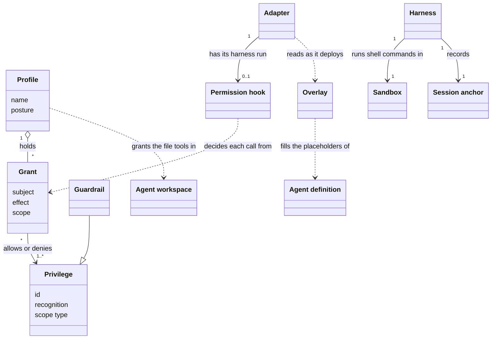
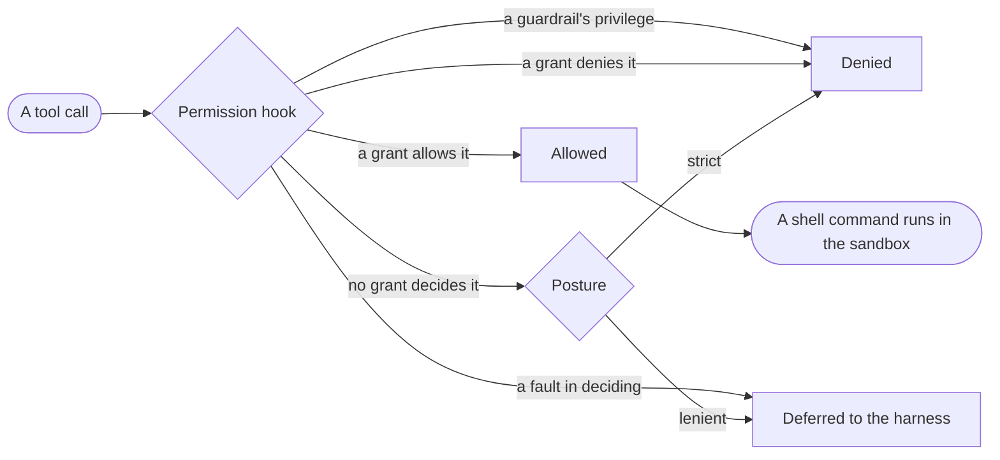

# VIEW-agents-and-permissions — Agents and permissions

AI agents and the person at the machine act through a [harness](../glossary.md#term-harness--harness), which gates what they may do in its own settings ([COR-028](../../../../.pkit/decisions/core/COR-028-permission-model-realization.md)). From those settings, nobody sees what an agent may do, or why a call was wrongly allowed or blocked (COR-028). An [agent definition](../glossary.md#term-agent-definition--agent-definition) the [methodology](../glossary.md#term-methodology--methodology) ships must also name each [project](../glossary.md#term-project--project)'s own paths, which the methodology cannot know ([COR-013](../../../../.pkit/decisions/core/COR-013-agent-architecture.md)). And a session must never alter another repository unasked ([COR-039](../../../../.pkit/decisions/core/COR-039-session-repo-mutation-boundary.md)).

The permission model states in the methodology's own words what each subject may do, and each [adapter](../glossary.md#term-adapter--adapter) enforces it in its harness (COR-028). A [privilege](../glossary.md#term-privilege--privilege) names a kind of action, and a [grant](../glossary.md#term-grant--grant) allows or denies it to a subject. A [guardrail](../glossary.md#term-guardrail--guardrail) is a privilege that no grant can allow. A [profile](../glossary.md#term-profile--profile) gives a set of grants one name.

The [permission hook](../glossary.md#term-permission-hook--permission-hook) has the [backbone](../glossary.md#term-backbone--backbone)'s own code decide each tool call, and the [sandbox](../glossary.md#term-sandbox--sandbox) bounds what a shell command can reach ([ADR-003](../../../architecture/decisions/ADR-003-permission-core-code-home.md), [ADR-004](../../../architecture/decisions/ADR-004-autonomy-intent-confinement.md)). That code lies under `.pkit/permissions/`, and it is backbone code, which every adapter's permission hook calls (ADR-003). An [overlay](../glossary.md#term-overlay--overlay) gives agent definitions the project's paths, and the [agent workspace](../glossary.md#term-agent-workspace--agent-workspace) holds the agents' intermediate files (COR-013, [ADR-060](../../../architecture/decisions/ADR-060-path-scoped-workspace-allow.md)). The [session anchor](../glossary.md#term-session-anchor--session-anchor) lets the [system](../glossary.md#term-system--system) tell the session's own repository from another ([ADR-034](../../../architecture/decisions/ADR-034-foreign-repo-mutation-guard.md)).

## Overlay

Defined in [TERM-overlay](../glossary.md#term-overlay--overlay).

**Why:** An [agent definition](../glossary.md#term-agent-definition--agent-definition) the [methodology](../glossary.md#term-methodology--methodology) ships reads and owns paths of each [project](../glossary.md#term-project--project), such as its code and its documents ([COR-013 point 5](../../../../.pkit/decisions/core/COR-013-agent-architecture.md#5-adopter-overlay-for-paths-outside-pkit)). The methodology cannot know them, so each project states them once, in one file of its own (COR-013 point 5).

An overlay is the project's own file, `.pkit/agents/project/overlay.yaml`, that gives each placeholder category the project's paths. As the [adapter](../glossary.md#term-adapter--adapter) deploys an agent definition, it replaces each placeholder in the front matter with those paths.

**Attributes:**

- its categories, each with its paths, such as `code-paths`
- its overrides, each a value that replaces a category's value for one agent definition

**Relations:**

- An adapter reads it as it deploys each agent definition (COR-013 point 5).
- A category an agent definition reads only through `reads.patterns` may be missing from it. The adapter then drops that item, and still deploys the agent definition ([ADR-052](../../../architecture/decisions/ADR-052-optional-read-category-empty-tolerance.md)).

**States:** None.

**Always true:**

- A placeholder resolves only from a value the overlay holds (COR-013 point 5).
- An override replaces a category's value for its agent definition, and is never merged with it (COR-013 point 5).

## Privilege

Defined in [TERM-privilege](../glossary.md#term-privilege--privilege).

**Why:** What an agent may do was spread across a [harness](../glossary.md#term-harness--harness)'s own settings, in that harness's words, so nobody could see it all at once ([COR-028](../../../../.pkit/decisions/core/COR-028-permission-model-realization.md)). A privilege names a kind of action once, in the [methodology](../glossary.md#term-methodology--methodology)'s own words, for every harness ([COR-028 point 1](../../../../.pkit/decisions/core/COR-028-permission-model-realization.md#1-the-model-is-the-source-of-truth)).

A privilege is a named kind of action, such as `vcs` for any `git` command. The permission catalog says how the [system](../glossary.md#term-system--system) recognises each one, from a tool call or from a command's words. A [grant](../glossary.md#term-grant--grant) then allows or denies it.

**Attributes:**

- an id, such as `vcs`, or one that opens with a [capability](../glossary.md#term-capability--capability)'s name for a privilege the capability adds ([ADR-021](../../../architecture/decisions/ADR-021-capability-contributed-privilege-definitions.md))
- how the system recognises it: a command's leading words, a tool's name, or a file tool's target inside a folder ([ADR-060 point 1](../../../architecture/decisions/ADR-060-path-scoped-workspace-allow.md#1-recognition-from-the-target-path-for-the-file-tools-only))
- its scope type, such as `directory` or `domain`, which says what a grant's scope is matched against
- whether it is a [guardrail](../glossary.md#term-guardrail--guardrail)

**Relations:**

- A grant allows or denies one or more privileges (COR-028 point 1).
- A capability may add privileges in a catalog fragment of its own, beside the [backbone](../glossary.md#term-backbone--backbone)'s catalog (ADR-021).

**States:** None.

**Always true:**

- A capability's privilege never takes an id the catalog holds already ([ADR-021 point 2](../../../architecture/decisions/ADR-021-capability-contributed-privilege-definitions.md#2-additive-only-and-collision-rejecting--the-catalog-is-a-map-so-the-merge-rule-is-load-bearing)).
- A path-scoped privilege is recognised only for a file tool whose target lies inside its folders, and has no effect anywhere else (ADR-060 point 1).

## Grant

Defined in [TERM-grant](../glossary.md#term-grant--grant).

**Why:** With the rules spread across a [harness](../glossary.md#term-harness--harness)'s settings, a call wrongly allowed or blocked could not be traced to its cause ([COR-028](../../../../.pkit/decisions/core/COR-028-permission-model-realization.md)). A grant is one statement of one model. So a fault traces to the model, to how an [adapter](../glossary.md#term-adapter--adapter) carried it out, or to the harness (COR-028).

A grant is an entry of the permission model. It allows or denies a subject one or more privileges. Where it names a scope, such as the folders a command may run in, it holds only there.

**Attributes:**

- its subject: `all`, `operator`, or one agent as `agent:<name>`
- its privileges
- its effect: `allow` or `deny`
- its scope, where it names one ([COR-028 point 1](../../../../.pkit/decisions/core/COR-028-permission-model-realization.md#1-the-model-is-the-source-of-truth))

**Relations:**

- A subject's effective grants are those to `all` and its own (COR-028 point 1).
- A [profile](../glossary.md#term-profile--profile) adds a layer of grants beneath the [project](../glossary.md#term-project--project)'s own grants ([ADR-005 point 2](../../../architecture/decisions/ADR-005-permission-profile-surface.md#2-contents--posture-plus-a-layered-grant-source-confinement-and-native-allow-referenced-not-owned)).

**States:** None.

**Always true:**

- Where an allow and a deny conflict, the deny wins (COR-028 point 1).
- A grant the project writes by hand survives a switch of profile (ADR-005 point 2).

## Guardrail

Defined in [TERM-guardrail](../glossary.md#term-guardrail--guardrail).

**Why:** Some mechanisms that enforce permissions fail open, so a fault in them lets the call go ahead ([COR-028 point 2](../../../../.pkit/decisions/core/COR-028-permission-model-realization.md#2-the-adapter-realizes-the-model)). A deny that must never be bypassed is therefore held where a fault blocks the call (COR-028 point 2).

A guardrail is a [privilege](../glossary.md#term-privilege--privilege) that every subject is denied, whatever any [grant](../glossary.md#term-grant--grant) allows, such as `vcs-history-rewrite` for a force-push. The catalog marks it `guardrail: true`. Each [adapter](../glossary.md#term-adapter--adapter) also holds its deny where its [harness](../glossary.md#term-harness--harness) fails closed.

**Attributes:** None.

**Relations:**

- It is a kind of privilege.
- The [backbone](../glossary.md#term-backbone--backbone)'s code denies it to `all`, beneath every [profile](../glossary.md#term-profile--profile)'s grants and the [project](../glossary.md#term-project--project)'s own ([ADR-005 point 2](../../../architecture/decisions/ADR-005-permission-profile-surface.md#2-contents--posture-plus-a-layered-grant-source-confinement-and-native-allow-referenced-not-owned)).

**States:** None.

**Always true:**

- No [capability](../glossary.md#term-capability--capability) adds a guardrail: the backbone refuses a catalog fragment that marks one ([ADR-021 point 3](../../../architecture/decisions/ADR-021-capability-contributed-privilege-definitions.md#3-a-capability-contributed-privilege-may-never-be-a-guardrail--reject-do-not-strip)).
- Its deny is held on a mechanism that fails closed, as well as by the [permission hook](../glossary.md#term-permission-hook--permission-hook) (COR-028 point 2).

## Profile

Defined in [TERM-profile](../glossary.md#term-profile--profile).

**Why:** A [sandbox](../glossary.md#term-sandbox--sandbox) holds a whole session, so confinement can never differ from one agent to another ([ADR-004 point 5](../../../architecture/decisions/ADR-004-autonomy-intent-confinement.md#5-no-per-agent-confinement)). How far a session's agents may act unasked is one choice for the whole session, which a profile names with its grants (ADR-004 point 5).

A profile is a named set of grants and a posture. It is activated on one machine, and its grants form a layer beneath the [project](../glossary.md#term-project--project)'s own. The [backbone](../glossary.md#term-backbone--backbone) ships three, `read-only`, `non-destructive` and `autonomous`, each holding the one before it.

**Attributes:**

- its name
- its posture: `lenient` defers a request that no [grant](../glossary.md#term-grant--grant) decides to the [harness](../glossary.md#term-harness--harness), and `strict` denies it
- its grants, over the privileges of the catalog alone ([ADR-005 point 5](../../../architecture/decisions/ADR-005-permission-profile-surface.md#5-shipped-tiers-nest-grants-are-over-catalog-privileges-shell-autonomy-rides-the-references))

**Relations:**

- It relies on the sandbox, and never writes the sandbox's settings ([ADR-005 point 2](../../../architecture/decisions/ADR-005-permission-profile-surface.md#2-contents--posture-plus-a-layered-grant-source-confinement-and-native-allow-referenced-not-owned)).
- Its grants lie beneath the project's own grants, which come last (ADR-005 point 2).

**States:** On each machine, one profile at most is active. Activating another replaces it ([ADR-005 point 1](../../../architecture/decisions/ADR-005-permission-profile-surface.md#1-granularity--one-active-profile-per-project-carrying-per-agent-grant-overrides), [ADR-032](../../../architecture/decisions/ADR-032-per-machine-activation-routing-axis.md)).

**Always true:**

- Activating a profile never edits the project's own grants (ADR-005 point 2).
- Every profile the backbone ships grants the [privilege](../glossary.md#term-privilege--privilege) of the [agent workspace](../glossary.md#term-agent-workspace--agent-workspace) to `all` ([ADR-060 point 5](../../../architecture/decisions/ADR-060-path-scoped-workspace-allow.md#5-granted-to-all-by-every-shipped-profile)).

## Permission hook

Defined in [TERM-permission-hook](../glossary.md#term-permission-hook--permission-hook).

**Why:** Some intent, such as an allow for one agent or one folder, is more than a [harness](../glossary.md#term-harness--harness)'s own settings can express ([COR-028 point 2](../../../../.pkit/decisions/core/COR-028-permission-model-realization.md#2-the-adapter-realizes-the-model)). A heavier mechanism that intercepts each call carries that intent, and only that (COR-028 point 2).

A permission hook is a script an [adapter](../glossary.md#term-adapter--adapter) has its harness run before each tool call. It passes the call to the [backbone](../glossary.md#term-backbone--backbone)'s permission code, which allows it, denies it or defers it to the harness. That code lies under `.pkit/permissions/`, so every adapter's permission hook decides alike ([ADR-003](../../../architecture/decisions/ADR-003-permission-core-code-home.md)).

**Attributes:** None.

**Relations:**

- An adapter ships it, and its harness runs it (COR-028 point 2).
- It decides each call from the grants and the [guardrails](../glossary.md#term-guardrail--guardrail), as the backbone's code reads them (ADR-003).

**States:** A permission hook is unregistered until `pkit permissions enable` registers it with the harness. It is registered until `pkit permissions disable` removes the registration ([ADR-002 point 2](../../../architecture/decisions/ADR-002-permission-realizer-ownership.md#2-the-hookregion-boundary)).

**Always true:**

- A fault in deciding a call defers the call to the harness, while the native denies of the guardrails stand (ADR-002 points [3](../../../architecture/decisions/ADR-002-permission-realizer-ownership.md#3-fail-open--double-lock) and [4](../../../architecture/decisions/ADR-002-permission-realizer-ownership.md#4-two-fault-classes-a-decision-fault-fails-open-an-enforcement-runtime-fault-fails-loud)).
- A permission hook that cannot start at all is a fault the [system](../glossary.md#term-system--system) reports, never a silent pass (ADR-002 point 4).
- Every adapter keeps those two faults apart (ADR-002 point 4).

## Sandbox

Defined in [TERM-sandbox](../glossary.md#term-sandbox--sandbox).

**Why:** A shell command escapes any check of its working directory, through `cd` or a path from the root ([ADR-004 point 2](../../../architecture/decisions/ADR-004-autonomy-intent-confinement.md#2-confinement-how-bounded-reach-is)). So only the operating system can bound what a command reaches (ADR-004 point 2).

A sandbox is the operating system's isolation layer in which the [harness](../glossary.md#term-harness--harness) runs shell commands. It bounds what they can reach on disk and on the network. The [system](../glossary.md#term-system--system) manages its settings, and the operating system enforces them (ADR-004 points 2 and [3](../../../architecture/decisions/ADR-004-autonomy-intent-confinement.md#3-own-vs-delegate-is-split-per-axis)).

**Attributes:**

- the reads and writes it denies, such as `~/.ssh`
- the network hosts it allows
- the commands excluded from it, which run unconfined ([ADR-008 point 4](../../../architecture/decisions/ADR-008-confinement-allowances.md#4-widening-path--explicit-loud-never-persisted-always-reported))

**Relations:**

- The harness runs shell commands in it, for every agent of a session at once ([ADR-004 point 5](../../../architecture/decisions/ADR-004-autonomy-intent-confinement.md#5-no-per-agent-confinement)).
- A [profile](../glossary.md#term-profile--profile) relies on it, and never writes its settings ([ADR-005 point 2](../../../architecture/decisions/ADR-005-permission-profile-surface.md#2-contents--posture-plus-a-layered-grant-source-confinement-and-native-allow-referenced-not-owned)).

**States:** None.

**Always true:**

- No agent is confined apart from another, since the agents of a session share one sandbox (ADR-004 point 5).
- Where confinement cannot be had, no setting that spares prompts because of it takes effect ([ADR-004 point 4](../../../architecture/decisions/ADR-004-autonomy-intent-confinement.md#4-fail-closed-invariant-on-confinement-conditioned-prompt-suppression)).
- A [grant](../glossary.md#term-grant--grant) confines nothing, since confinement is the sandbox's alone (ADR-004 point 2).

## Agent workspace

Defined in [TERM-agent-workspace](../glossary.md#term-agent-workspace--agent-workspace).

**Why:** Intermediate files, such as a [pull request](../glossary.md#term-pull-request--pull-request)'s body or a script, need a home. A write outside the working directory asked for a confirmation, one file at a time, until confirmations were approved unread ([ADR-060](../../../architecture/decisions/ADR-060-path-scoped-workspace-allow.md)). That fatigue is what the permission model exists to prevent (ADR-060).

The agent workspace is the folder `.agent-workspace/` at the root of a checkout, one in each worktree. Agents keep their intermediate files there, and git never tracks the folder, since the [system](../glossary.md#term-system--system) excludes it. A [privilege](../glossary.md#term-privilege--privilege) of its own lets the file tools work there with no prompt.

**Attributes:**

- its folder: `.agent-workspace/` at the root of a checkout, reached through no link ([ADR-060 point 2](../../../architecture/decisions/ADR-060-path-scoped-workspace-allow.md#2-the-folder-is-the-checkouts-own))

**Relations:**

- The privilege `workspace` is path-scoped to it, for the file tools alone ([ADR-060 point 1](../../../architecture/decisions/ADR-060-path-scoped-workspace-allow.md#1-recognition-from-the-target-path-for-the-file-tools-only)).
- Every [profile](../glossary.md#term-profile--profile) the [backbone](../glossary.md#term-backbone--backbone) ships grants that privilege to `all` ([ADR-060 point 5](../../../architecture/decisions/ADR-060-path-scoped-workspace-allow.md#5-granted-to-all-by-every-shipped-profile)).
- The [permission hook](../glossary.md#term-permission-hook--permission-hook) allows a file tool's call into the folder, never an allow in the [harness](../glossary.md#term-harness--harness)'s settings for the whole session ([ADR-060 point 6](../../../architecture/decisions/ADR-060-path-scoped-workspace-allow.md#6-realised-by-the-hook-never-as-a-settings-rule)).

**States:** None.

**Always true:**

- No shell command counts as the workspace's: a shell write there is judged like any other ([ADR-060 point 4](../../../architecture/decisions/ADR-060-path-scoped-workspace-allow.md#4-no-bash-exception)).
- Another repository's workspace never counts as this checkout's ([ADR-060 point 3](../../../architecture/decisions/ADR-060-path-scoped-workspace-allow.md#3-which-checkouts-count)).
- The system excludes the folder in each clone's local exclude file, and only recommends the line for the committed ignore file ([ADR-060 point 9](../../../architecture/decisions/ADR-060-path-scoped-workspace-allow.md#9-excluded-per-clone-the-committed-ignore-line-is-recommended-never-written)).
- A prompt for a file tool there is a defect, never a gap to allow around ([ADR-060 point 7](../../../architecture/decisions/ADR-060-path-scoped-workspace-allow.md#7-a-prompt-there-is-a-defect)).

## Session anchor

Defined in [TERM-session-anchor](../glossary.md#term-session-anchor--session-anchor).

**Why:** A session carries the governance of the one repository it started in. So a write it makes in another repository runs under the wrong governance ([COR-039](../../../../.pkit/decisions/core/COR-039-session-repo-mutation-boundary.md)). A command can be pointed at any directory, so the [system](../glossary.md#term-system--system) needs something fixed to compare with ([ADR-034 point 1](../../../architecture/decisions/ADR-034-foreign-repo-mutation-guard.md#1-the-pkit-self-guard-is-the-honest-reliable-lever)).

A session anchor is the directory the [harness](../glossary.md#term-harness--harness) records as an agent's session starts. It stays put when the working directory changes, as under `cd`. The cross-repository guard compares its repository with the repository a command would write in.

**Attributes:**

- its directory, which the harness fixes once, as the session starts (ADR-034 point 1)

**Relations:**

- The cross-repository guard compares the session anchor's repository with the target's, the repository a command would write in (ADR-034 point 1).

**States:** None.

**Always true:**

- The session anchor is only compared, and never used to find the [project](../glossary.md#term-project--project)'s root (ADR-034 point 1).
- On a difference, the system asks, or refuses where nobody is there to ask, and never blocks a write that was confirmed ([COR-039 point 1](../../../../.pkit/decisions/core/COR-039-session-repo-mutation-boundary.md#1-operator-gated-not-blocked)).
- The guard is an interlock against a mistake, not a security boundary ([COR-039 point 3](../../../../.pkit/decisions/core/COR-039-session-repo-mutation-boundary.md#3-honest-about-reach--an-interlock-not-a-security-boundary)).

## What is built on these concepts

Each concept below lists the use cases, journeys and requirements whose text links its term.

**Overlay:**

- [UC-017 — Give my capability roles, data points and processes others connect to](../use-case-model/use-cases/010-develop/UC-017-connect-capability.md)
- [UC-022 — Add my own operational rules, the harness's settings, grants and agent paths beside the methodology's](../use-case-model/use-cases/020-set-up/UC-022-add-own-additions.md)
- [UC-027 — Find my agent definition deployed, with the project's paths and my grants](../use-case-model/use-cases/020-set-up/UC-027-find-agent-definition-deployed.md)
- [UC-037 — Record my decision beside the methodology's](../use-case-model/use-cases/030-change/UC-037-record-decision.md)
- [UC-042 — Have my draft challenged and my diff checked against the conventions](../use-case-model/use-cases/030-change/UC-042-challenge-and-check.md)
- [UC-049 — Install the system into my project with one command](../use-case-model/use-cases/050-adopt/UC-049-install-system.md)

**Privilege:**

- [UC-022 — Add my own operational rules, the harness's settings, grants and agent paths beside the methodology's](../use-case-model/use-cases/020-set-up/UC-022-add-own-additions.md)
- [UC-028 — Keep my intermediate files in a workspace no commit carries](../use-case-model/use-cases/020-set-up/UC-028-keep-intermediate-files.md)
- [UC-030 — Let agents work on their own without a stream of confirmations](../use-case-model/use-cases/020-set-up/UC-030-work-unprompted.md)
- [UC-033 — Find out why a command prompted me or was blocked](../use-case-model/use-cases/020-set-up/UC-033-find-why-prompted.md)
- [REQ-013 · Functional · Where an allow and a deny conflict, the deny wins](../requirements/functional/020-set-up/REQ-013-deny-wins.md)

**Grant:**

- [UC-022 — Add my own operational rules, the harness's settings, grants and agent paths beside the methodology's](../use-case-model/use-cases/020-set-up/UC-022-add-own-additions.md)
- [UC-027 — Find my agent definition deployed, with the project's paths and my grants](../use-case-model/use-cases/020-set-up/UC-027-find-agent-definition-deployed.md)
- [UC-030 — Let agents work on their own without a stream of confirmations](../use-case-model/use-cases/020-set-up/UC-030-work-unprompted.md)
- [UC-032 — Be asked before an agent changes another repository](../use-case-model/use-cases/020-set-up/UC-032-ask-before-other-repository.md)
- [UC-033 — Find out why a command prompted me or was blocked](../use-case-model/use-cases/020-set-up/UC-033-find-why-prompted.md)
- [REQ-013 · Functional · Where an allow and a deny conflict, the deny wins](../requirements/functional/020-set-up/REQ-013-deny-wins.md)

**Guardrail:**

- [UC-022 — Add my own operational rules, the harness's settings, grants and agent paths beside the methodology's](../use-case-model/use-cases/020-set-up/UC-022-add-own-additions.md)
- [UC-030 — Let agents work on their own without a stream of confirmations](../use-case-model/use-cases/020-set-up/UC-030-work-unprompted.md)
- [UC-033 — Find out why a command prompted me or was blocked](../use-case-model/use-cases/020-set-up/UC-033-find-why-prompted.md)

**Profile:**

- [UC-028 — Keep my intermediate files in a workspace no commit carries](../use-case-model/use-cases/020-set-up/UC-028-keep-intermediate-files.md)
- [UC-030 — Let agents work on their own without a stream of confirmations](../use-case-model/use-cases/020-set-up/UC-030-work-unprompted.md)
- [UC-031 — Keep my per-machine choices out of what the project commits](../use-case-model/use-cases/020-set-up/UC-031-keep-per-machine-choices.md)
- [UC-033 — Find out why a command prompted me or was blocked](../use-case-model/use-cases/020-set-up/UC-033-find-why-prompted.md)
- [REQ-013 · Functional · Where an allow and a deny conflict, the deny wins](../requirements/functional/020-set-up/REQ-013-deny-wins.md)

**Permission hook:**

- [UC-027 — Find my agent definition deployed, with the project's paths and my grants](../use-case-model/use-cases/020-set-up/UC-027-find-agent-definition-deployed.md)
- [UC-028 — Keep my intermediate files in a workspace no commit carries](../use-case-model/use-cases/020-set-up/UC-028-keep-intermediate-files.md)
- [UC-030 — Let agents work on their own without a stream of confirmations](../use-case-model/use-cases/020-set-up/UC-030-work-unprompted.md)
- [UC-032 — Be asked before an agent changes another repository](../use-case-model/use-cases/020-set-up/UC-032-ask-before-other-repository.md)
- [UC-033 — Find out why a command prompted me or was blocked](../use-case-model/use-cases/020-set-up/UC-033-find-why-prompted.md)
- [REQ-016 · Constraint · The permission model's code needs only the system `python3` and its standard library](../requirements/constraints/020-set-up/REQ-016-permissions-standard-library.md)

**Sandbox:**

- [UC-030 — Let agents work on their own without a stream of confirmations](../use-case-model/use-cases/020-set-up/UC-030-work-unprompted.md)
- [UC-031 — Keep my per-machine choices out of what the project commits](../use-case-model/use-cases/020-set-up/UC-031-keep-per-machine-choices.md)
- [UC-033 — Find out why a command prompted me or was blocked](../use-case-model/use-cases/020-set-up/UC-033-find-why-prompted.md)
- [REQ-016 · Constraint · The permission model's code needs only the system `python3` and its standard library](../requirements/constraints/020-set-up/REQ-016-permissions-standard-library.md)

**Agent workspace:**

- [UC-014 — Develop the methodology in its source repository](../use-case-model/use-cases/010-develop/UC-014-develop-methodology.md)
- [UC-028 — Keep my intermediate files in a workspace no commit carries](../use-case-model/use-cases/020-set-up/UC-028-keep-intermediate-files.md)
- [UC-033 — Find out why a command prompted me or was blocked](../use-case-model/use-cases/020-set-up/UC-033-find-why-prompted.md)
- [UC-041 — Keep each core record true for any project that adopts it](../use-case-model/use-cases/030-change/UC-041-keep-core-records-true.md)
- [UC-049 — Install the system into my project with one command](../use-case-model/use-cases/050-adopt/UC-049-install-system.md)
- [UC-050 — Get a fresh clone ready to work with one sync](../use-case-model/use-cases/050-adopt/UC-050-ready-fresh-clone.md)

**Session anchor:**

- [UC-032 — Be asked before an agent changes another repository](../use-case-model/use-cases/020-set-up/UC-032-ask-before-other-repository.md)
- [UC-033 — Find out why a command prompted me or was blocked](../use-case-model/use-cases/020-set-up/UC-033-find-why-prompted.md)
- [REQ-012 · Functional · The system asks the operator before its command changes another repository](../requirements/functional/REQ-012-ask-before-another-repository.md)
