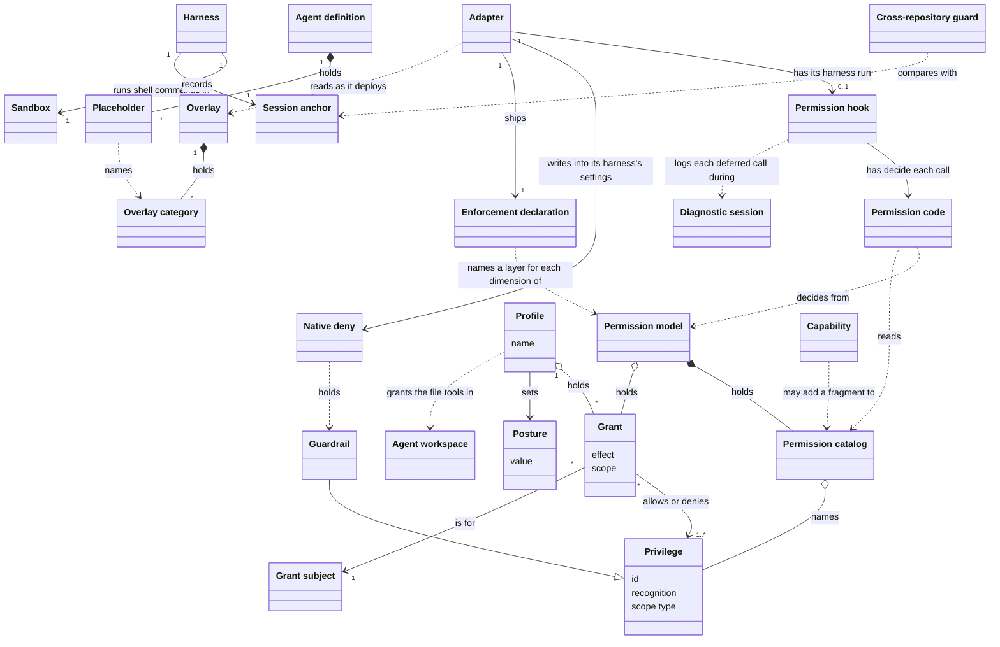
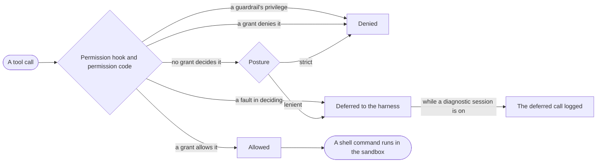
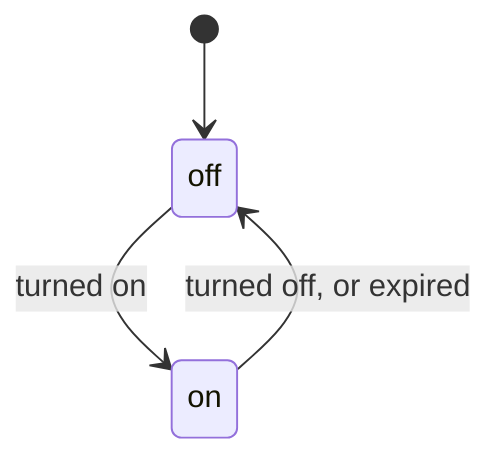

# VIEW-agents-and-permissions — Agents and permissions

AI agents and the person at the machine act through a [harness](../glossary.md#term-harness--harness), which gates what they may do in its own settings ([COR-028](../../../../.pkit/decisions/core/COR-028-permission-model-realization.md)). From those settings, nobody sees what an agent may do, or why a call was wrongly allowed or blocked (COR-028). An [agent definition](../glossary.md#term-agent-definition--agent-definition) the [methodology](../glossary.md#term-methodology--methodology) ships must also name each [project](../glossary.md#term-project--project)'s own paths, which the methodology cannot know ([COR-013](../../../../.pkit/decisions/core/COR-013-agent-architecture.md)). And a session must never alter another repository unasked ([COR-039](../../../../.pkit/decisions/core/COR-039-session-repo-mutation-boundary.md)).

The [permission model](../glossary.md#term-permission-model--permission-model) states in the methodology's own words what each [grant subject](../glossary.md#term-grant-subject--grant-subject) may do, and each [adapter](../glossary.md#term-adapter--adapter) enforces it in its harness (COR-028). A [privilege](../glossary.md#term-privilege--privilege) names a kind of action, and a [grant](../glossary.md#term-grant--grant) allows or denies it to a grant subject. A [guardrail](../glossary.md#term-guardrail--guardrail) is a privilege that no grant can allow. A [profile](../glossary.md#term-profile--profile) gives a set of grants and a [posture](../glossary.md#term-posture--posture) one name.

The [permission hook](../glossary.md#term-permission-hook--permission-hook) has the [permission code](../glossary.md#term-permission-code--permission-code) decide each tool call, and the [sandbox](../glossary.md#term-sandbox--sandbox) bounds what a shell command can reach ([ADR-003](../../../architecture/decisions/ADR-003-permission-core-code-home.md), [ADR-004](../../../architecture/decisions/ADR-004-autonomy-intent-confinement.md)). A [native deny](../glossary.md#term-native-deny--native-deny) in the harness's own settings holds even where the hook fails ([ADR-002](../../../architecture/decisions/ADR-002-permission-realizer-ownership.md)). Each adapter's [enforcement declaration](../glossary.md#term-enforcement-declaration--enforcement-declaration) says what its harness cannot enforce (COR-028). A [diagnostic session](../glossary.md#term-diagnostic-session--diagnostic-session) logs the calls the permission hook defers ([PRJ-006](../../../../.pkit/decisions/project/PRJ-006-permission-prompt-diagnostics.md)).

An [overlay](../glossary.md#term-overlay--overlay) gives agent definitions the project's paths, under the [overlay categories](../glossary.md#term-overlay-category--overlay-category) their [placeholders](../glossary.md#term-placeholder--placeholder) name (COR-013). The [agent workspace](../glossary.md#term-agent-workspace--agent-workspace) holds the agents' intermediate files ([ADR-060](../../../architecture/decisions/ADR-060-path-scoped-workspace-allow.md)). The [session anchor](../glossary.md#term-session-anchor--session-anchor) lets the [system](../glossary.md#term-system--system) tell the session's own repository from another, and the [cross-repository guard](../glossary.md#term-cross-repository-guard--cross-repository-guard) compares the two before a write ([ADR-034](../../../architecture/decisions/ADR-034-foreign-repo-mutation-guard.md)).

## Overlay

Defined in [TERM-overlay](../glossary.md#term-overlay--overlay).

**Why:** An [agent definition](../glossary.md#term-agent-definition--agent-definition) the [methodology](../glossary.md#term-methodology--methodology) ships reads and owns paths of each [project](../glossary.md#term-project--project), such as its code and its documents ([COR-013 point 5](../../../../.pkit/decisions/core/COR-013-agent-architecture.md#5-adopter-overlay-for-paths-outside-pkit)). The methodology cannot know them, so each project states them once, in one file of its own (COR-013 point 5).

An overlay is the project's own file, `.pkit/agents/project/overlay.yaml`, that gives each [overlay category](../glossary.md#term-overlay-category--overlay-category) the project's paths. As the [adapter](../glossary.md#term-adapter--adapter) deploys an agent definition, it replaces each [placeholder](../glossary.md#term-placeholder--placeholder) in the front matter with those paths.

**Attributes:**

- its overlay categories, each with its paths, such as `code-paths`
- its overrides, each a value that replaces an overlay category's value for one agent definition

**Relations:**

- An adapter reads it as it deploys each agent definition (COR-013 point 5).
- An overlay category an agent definition reads only through `reads.patterns` may be missing from it. The adapter then drops that item, and still deploys the agent definition ([ADR-052](../../../architecture/decisions/ADR-052-optional-read-category-empty-tolerance.md)).

**States:** None.

**Always true:**

- An override replaces an overlay category's value for its agent definition, and is never merged with it (COR-013 point 5).

## Overlay category

Defined in [TERM-overlay-category](../glossary.md#term-overlay-category--overlay-category).

**Why:** An [agent definition](../glossary.md#term-agent-definition--agent-definition) the [methodology](../glossary.md#term-methodology--methodology) ships cannot hold a [project](../glossary.md#term-project--project)'s own paths, since they differ from project to project ([COR-013 point 5](../../../../.pkit/decisions/core/COR-013-agent-architecture.md#5-adopter-overlay-for-paths-outside-pkit)). So it names a kind of path instead, and each project gives its paths for that kind once, in one file (COR-013 point 5).

An overlay category is a named kind of path, such as `code-paths` or `adr-records`. The [overlay](../glossary.md#term-overlay--overlay) lists the project's paths under it. Each [placeholder](../glossary.md#term-placeholder--placeholder) of that name takes those paths as an [adapter](../glossary.md#term-adapter--adapter) deploys an agent definition.

**Attributes:**

- its name, a key of the overlay (COR-013 point 5)
- its paths, which hold for every agent definition that names it (COR-013 point 5)

**Relations:**

- The overlay holds it, and may override its paths for one agent definition (COR-013 point 5).
- A placeholder names it (COR-013 point 5).

**States:** None.

**Always true:**

- A command may fill a missing overlay category of documents. It derives the category's folder from the internal [documentation root](../glossary.md#term-documentation-root--documentation-root), and records it in the overlay (COR-013 point 5).

## Placeholder

Defined in [TERM-placeholder](../glossary.md#term-placeholder--placeholder).

**Why:** The [methodology](../glossary.md#term-methodology--methodology)'s [agent definitions](../glossary.md#term-agent-definition--agent-definition) serve every [project](../glossary.md#term-project--project), so no project's path can be written into them ([COR-013 point 5](../../../../.pkit/decisions/core/COR-013-agent-architecture.md#5-adopter-overlay-for-paths-outside-pkit)). A marker standing for the path lets each deploy write the project's own paths there (COR-013 point 5).

A placeholder is a marker such as `<code-paths>` in an agent definition's source, which names an [overlay category](../glossary.md#term-overlay-category--overlay-category). As an [adapter](../glossary.md#term-adapter--adapter) deploys the agent definition, it replaces each placeholder in the front matter with the paths the [overlay](../glossary.md#term-overlay--overlay) gives that overlay category. The [harness](../glossary.md#term-harness--harness) reads the agent definition as deployed, with the paths in place.

**Attributes:**

- the overlay category it names, between `<` and `>` (COR-013 point 5)
- the key of the front matter that holds it, such as `owns` or `reads.paths` (COR-013 point 5)

**Relations:**

- An agent definition holds it in its source (COR-013 point 5).
- It names one overlay category, whose paths replace it (COR-013 point 5).

**States:** None.

**Always true:**

- A placeholder resolves only from a value the overlay holds (COR-013 point 5).
- An agent definition whose placeholder names an overlay category the overlay leaves unset is skipped, never deployed with the placeholder in it. A placeholder read only through `reads.patterns` is dropped instead ([ADR-052](../../../architecture/decisions/ADR-052-optional-read-category-empty-tolerance.md)).

## Permission model

Defined in [TERM-permission-model](../glossary.md#term-permission-model--permission-model).

**Why:** Each [harness](../glossary.md#term-harness--harness) gates what agents may do in its own settings and words, so nobody sees in one file what an agent may do ([COR-028](../../../../.pkit/decisions/core/COR-028-permission-model-realization.md)). Nor can anyone tell whether a call wrongly blocked comes from a wrong [grant](../glossary.md#term-grant--grant), the wrong layer or a harness that cannot enforce it (COR-028).

The permission model states, in the [methodology](../glossary.md#term-methodology--methodology)'s own words, what each [grant subject](../glossary.md#term-grant-subject--grant-subject) may do. It holds the [permission catalog](../glossary.md#term-permission-catalog--permission-catalog), the grants and the [guardrails](../glossary.md#term-guardrail--guardrail). Each [adapter](../glossary.md#term-adapter--adapter) realises it in its harness, and reads back what the harness holds, so the two can be compared.

**Attributes:**

- its permission catalog, which the layers that own the tools may extend ([COR-028 point 1](../../../../.pkit/decisions/core/COR-028-permission-model-realization.md#1-the-model-is-the-source-of-truth))
- its grants, in layers: the guardrails' denies, the active [profile](../glossary.md#term-profile--profile)'s grants, and the [project](../glossary.md#term-project--project)'s own, which come last ([ADR-005 point 2](../../../architecture/decisions/ADR-005-permission-profile-surface.md#2-contents--posture-plus-a-layered-grant-source-confinement-and-native-allow-referenced-not-owned))

**Relations:**

- Each adapter realises it in its harness, by the most native mechanism that carries each intent faithfully ([COR-028 point 2](../../../../.pkit/decisions/core/COR-028-permission-model-realization.md#2-the-adapter-realizes-the-model)).
- The [permission code](../glossary.md#term-permission-code--permission-code) decides each tool call from it ([ADR-003](../../../architecture/decisions/ADR-003-permission-core-code-home.md)).
- An [enforcement declaration](../glossary.md#term-enforcement-declaration--enforcement-declaration) names, for each of its dimensions, the layer that enforces it in one harness ([COR-028 point 3](../../../../.pkit/decisions/core/COR-028-permission-model-realization.md#3-unenforceable-intent-is-reported-not-dropped)).

**States:** None.

**Always true:**

- The permission model is the source of truth, and the harness's settings follow it (COR-028 point 1).
- Intent the harness cannot enforce is reported as a gap, never dropped (COR-028 point 3).

## Privilege

Defined in [TERM-privilege](../glossary.md#term-privilege--privilege).

**Why:** What an agent may do was spread across a [harness](../glossary.md#term-harness--harness)'s own settings, in that harness's words, so nobody could see it all at once ([COR-028](../../../../.pkit/decisions/core/COR-028-permission-model-realization.md)). A privilege names a kind of action once, in the [methodology](../glossary.md#term-methodology--methodology)'s own words, for every harness ([COR-028 point 1](../../../../.pkit/decisions/core/COR-028-permission-model-realization.md#1-the-model-is-the-source-of-truth)).

A privilege is a named kind of action, such as `vcs` for any `git` command. The [permission catalog](../glossary.md#term-permission-catalog--permission-catalog) says how the [system](../glossary.md#term-system--system) recognises each one, from a tool call or from a command's words. A [grant](../glossary.md#term-grant--grant) then allows or denies it.

**Attributes:**

- an id, such as `vcs`, or one that opens with a [capability](../glossary.md#term-capability--capability)'s name for a privilege the capability adds ([ADR-021](../../../architecture/decisions/ADR-021-capability-contributed-privilege-definitions.md))
- how the system recognises it: a command's leading words, a tool's name, or a file tool's target inside a folder ([ADR-060 point 1](../../../architecture/decisions/ADR-060-path-scoped-workspace-allow.md#1-recognition-from-the-target-path-for-the-file-tools-only))
- its scope type, such as `directory` or `domain`, which says what a grant's scope is matched against
- whether it is a [guardrail](../glossary.md#term-guardrail--guardrail)

**Relations:**

- A grant allows or denies one or more privileges (COR-028 point 1).
- A capability may add privileges to the permission catalog, in a fragment of its own beside the [backbone](../glossary.md#term-backbone--backbone)'s file (ADR-021).

**States:** None.

**Always true:**

- A capability's privilege never takes an id the permission catalog holds already ([ADR-021 point 2](../../../architecture/decisions/ADR-021-capability-contributed-privilege-definitions.md#2-additive-only-and-collision-rejecting--the-catalog-is-a-map-so-the-merge-rule-is-load-bearing)).
- A path-scoped privilege is recognised only for a file tool whose target lies inside its folders, and has no effect anywhere else (ADR-060 point 1).

## Permission catalog

Defined in [TERM-permission-catalog](../glossary.md#term-permission-catalog--permission-catalog).

**Why:** What an agent may do was spread across each [harness](../glossary.md#term-harness--harness)'s own settings, in that harness's words ([COR-028](../../../../.pkit/decisions/core/COR-028-permission-model-realization.md)). A [capability](../glossary.md#term-capability--capability) that recognises a new kind of action must also be able to add it without editing the [backbone](../glossary.md#term-backbone--backbone)'s file, which [sync](../glossary.md#term-sync--sync) overwrites ([ADR-021](../../../architecture/decisions/ADR-021-capability-contributed-privilege-definitions.md)).

The permission catalog is the data that names each [privilege](../glossary.md#term-privilege--privilege), and says how the [system](../glossary.md#term-system--system) recognises it from a tool call or a command. It also marks each [guardrail](../glossary.md#term-guardrail--guardrail). The backbone keeps it in `.pkit/schemas/privilege-catalog.yaml`. Each installed capability may add a fragment of its own, which the [permission code](../glossary.md#term-permission-code--permission-code) merges in as it loads the catalog.

**Attributes:**

- for each privilege, its id, how the system recognises it and its scope type ([COR-028 point 1](../../../../.pkit/decisions/core/COR-028-permission-model-realization.md#1-the-model-is-the-source-of-truth))
- for each privilege, whether it is a guardrail ([ADR-021 point 3](../../../architecture/decisions/ADR-021-capability-contributed-privilege-definitions.md#3-a-capability-contributed-privilege-may-never-be-a-guardrail--reject-do-not-strip))

**Relations:**

- The [permission model](../glossary.md#term-permission-model--permission-model) holds it, and the layers that own the tools may extend it (COR-028 point 1).
- The permission code reads it as data, so the [permission hook](../glossary.md#term-permission-hook--permission-hook) and the system's commands read the same merged permission catalog ([ADR-021 point 1](../../../architecture/decisions/ADR-021-capability-contributed-privilege-definitions.md#1-the-merge-lives-in-load_catalog-which-gains-a-manifest-walk-it-does-not-have-today)).
- Only an installed capability's fragment is merged in (ADR-021 point 1).

**States:** None.

**Always true:**

- A fragment only adds privileges, and never overwrites, shadows or strips one the permission catalog holds already ([ADR-021 point 2](../../../architecture/decisions/ADR-021-capability-contributed-privilege-definitions.md#2-additive-only-and-collision-rejecting--the-catalog-is-a-map-so-the-merge-rule-is-load-bearing)).
- `pkit permissions overview` names the capability that added each privilege ([ADR-021 point 6](../../../architecture/decisions/ADR-021-capability-contributed-privilege-definitions.md#6-attribution-is-mandatory-narrowing-but-reported)).

## Grant

Defined in [TERM-grant](../glossary.md#term-grant--grant).

**Why:** With the rules spread across a [harness](../glossary.md#term-harness--harness)'s settings, a call wrongly allowed or blocked could not be traced to its cause ([COR-028](../../../../.pkit/decisions/core/COR-028-permission-model-realization.md)). A grant is one statement of one model. So a fault traces to the model, to how an [adapter](../glossary.md#term-adapter--adapter) carried it out, or to the harness (COR-028).

A grant is an entry of the [permission model](../glossary.md#term-permission-model--permission-model). It allows or denies one or more privileges to a [grant subject](../glossary.md#term-grant-subject--grant-subject). Where it names a scope, such as the folders a command may run in, it holds only there.

**Attributes:**

- its grant subject: `all`, `operator`, or one agent as `agent:<name>`
- its privileges
- its effect: `allow` or `deny`
- its scope, where it names one ([COR-028 point 1](../../../../.pkit/decisions/core/COR-028-permission-model-realization.md#1-the-model-is-the-source-of-truth))

**Relations:**

- A [profile](../glossary.md#term-profile--profile) adds a layer of grants beneath the [project](../glossary.md#term-project--project)'s own grants ([ADR-005 point 2](../../../architecture/decisions/ADR-005-permission-profile-surface.md#2-contents--posture-plus-a-layered-grant-source-confinement-and-native-allow-referenced-not-owned)).

**States:** None.

**Always true:**

- Where an allow and a deny conflict, the deny wins (COR-028 point 1).
- A grant the project writes by hand survives a switch of profile (ADR-005 point 2).

## Grant subject

Defined in [TERM-grant-subject](../glossary.md#term-grant-subject--grant-subject).

**Why:** Nobody could see in one file what a given agent may do ([COR-028](../../../../.pkit/decisions/core/COR-028-permission-model-realization.md)). So the [permission model](../glossary.md#term-permission-model--permission-model) states it for each agent by name, beside a baseline that applies to all ([COR-028 point 1](../../../../.pkit/decisions/core/COR-028-permission-model-realization.md#1-the-model-is-the-source-of-truth)).

A grant subject is whom a [grant](../glossary.md#term-grant--grant) is for. It is `all`, the baseline for every agent and the operator, or `operator`, the person at the machine. It may also be one agent, named as `agent:<name>`.

**Attributes:**

- its form: `all`, `operator`, or `agent:<name>` (COR-028 point 1)

**Relations:**

- Each grant names one (COR-028 point 1).
- A grant subject's effective grants are those to `all` and its own (COR-028 point 1).
- Every grant subject is denied each [guardrail](../glossary.md#term-guardrail--guardrail), whose deny the model holds for `all` ([ADR-005 point 2](../../../architecture/decisions/ADR-005-permission-profile-surface.md#2-contents--posture-plus-a-layered-grant-source-confinement-and-native-allow-referenced-not-owned)).

**States:** None.

**Always true:** None.

## Guardrail

Defined in [TERM-guardrail](../glossary.md#term-guardrail--guardrail).

**Why:** Some mechanisms that enforce permissions fail open, so a fault in them lets the call go ahead ([COR-028 point 2](../../../../.pkit/decisions/core/COR-028-permission-model-realization.md#2-the-adapter-realizes-the-model)). A deny that must never be bypassed is therefore held where a fault blocks the call (COR-028 point 2).

A guardrail is a [privilege](../glossary.md#term-privilege--privilege) that every [grant subject](../glossary.md#term-grant-subject--grant-subject) is denied, whatever any [grant](../glossary.md#term-grant--grant) allows, such as `vcs-history-rewrite` for a force-push. The [permission catalog](../glossary.md#term-permission-catalog--permission-catalog) marks it `guardrail: true`. Where its [harness](../glossary.md#term-harness--harness) fails closed, each [adapter](../glossary.md#term-adapter--adapter) also holds it as a [native deny](../glossary.md#term-native-deny--native-deny), which the harness enforces itself.

**Attributes:** None.

**Relations:**

- It is a kind of privilege.
- The [backbone](../glossary.md#term-backbone--backbone)'s code denies it to `all`, beneath every [profile](../glossary.md#term-profile--profile)'s grants and the [project](../glossary.md#term-project--project)'s own ([ADR-005 point 2](../../../architecture/decisions/ADR-005-permission-profile-surface.md#2-contents--posture-plus-a-layered-grant-source-confinement-and-native-allow-referenced-not-owned)).

**States:** None.

**Always true:**

- No [capability](../glossary.md#term-capability--capability) adds a guardrail: the backbone refuses a fragment of the permission catalog that marks one ([ADR-021 point 3](../../../architecture/decisions/ADR-021-capability-contributed-privilege-definitions.md#3-a-capability-contributed-privilege-may-never-be-a-guardrail--reject-do-not-strip)).
- Where its harness fails closed, its deny is held as a native deny as well as by the [permission hook](../glossary.md#term-permission-hook--permission-hook) (COR-028 point 2).

## Profile

Defined in [TERM-profile](../glossary.md#term-profile--profile).

**Why:** A [sandbox](../glossary.md#term-sandbox--sandbox) holds a whole session, so confinement can never differ from one agent to another ([ADR-004 point 5](../../../architecture/decisions/ADR-004-autonomy-intent-confinement.md#5-no-per-agent-confinement)). How far a session's agents may act unasked is one choice for the whole session, which a profile names with its grants (ADR-004 point 5).

A profile is a named set of grants and a [posture](../glossary.md#term-posture--posture). It is activated on one machine, and its grants form a layer beneath the [project](../glossary.md#term-project--project)'s own. The [backbone](../glossary.md#term-backbone--backbone) ships three, `read-only`, `non-destructive` and `autonomous`, each holding the one before it.

**Attributes:**

- its name
- its posture, which it sets as it is activated ([ADR-005 point 4](../../../architecture/decisions/ADR-005-permission-profile-surface.md#4-verbs--profile-list--show--activate-composing-existing-mutations))
- its grants, over the privileges of the [permission catalog](../glossary.md#term-permission-catalog--permission-catalog) alone ([ADR-005 point 5](../../../architecture/decisions/ADR-005-permission-profile-surface.md#5-shipped-tiers-nest-grants-are-over-catalog-privileges-shell-autonomy-rides-the-references))

**Relations:**

- It relies on the sandbox, and never writes the sandbox's settings ([ADR-005 point 2](../../../architecture/decisions/ADR-005-permission-profile-surface.md#2-contents--posture-plus-a-layered-grant-source-confinement-and-native-allow-referenced-not-owned)).
- Its grants lie beneath the project's own grants, which come last (ADR-005 point 2).

**States:** On each machine, one profile at most is active. Activating another replaces it ([ADR-005 point 1](../../../architecture/decisions/ADR-005-permission-profile-surface.md#1-granularity--one-active-profile-per-project-carrying-per-agent-grant-overrides), [ADR-032](../../../architecture/decisions/ADR-032-per-machine-activation-routing-axis.md)).

**Always true:**

- Activating a profile never edits the project's own grants (ADR-005 point 2).
- Every profile the backbone ships grants the [privilege](../glossary.md#term-privilege--privilege) of the [agent workspace](../glossary.md#term-agent-workspace--agent-workspace) to `all` ([ADR-060 point 5](../../../architecture/decisions/ADR-060-path-scoped-workspace-allow.md#5-granted-to-all-by-every-shipped-profile)).

## Posture

Defined in [TERM-posture](../glossary.md#term-posture--posture).

**Why:** The [sandbox](../glossary.md#term-sandbox--sandbox) confines a whole session at once ([ADR-004 point 5](../../../architecture/decisions/ADR-004-autonomy-intent-confinement.md#5-no-per-agent-confinement)). So what becomes of a call no [grant](../glossary.md#term-grant--grant) decides is one choice for the [project](../glossary.md#term-project--project), never for each agent ([ADR-005 point 1](../../../architecture/decisions/ADR-005-permission-profile-surface.md#1-granularity--one-active-profile-per-project-carrying-per-agent-grant-overrides)).

A posture is the setting that decides what becomes of a call no grant decides. Under `lenient`, the [permission hook](../glossary.md#term-permission-hook--permission-hook) hands such a call to the [harness](../glossary.md#term-harness--harness), which decides it or asks. Under `strict`, the call is denied.

**Attributes:**

- its value: `lenient` or `strict` ([ADR-005 point 5](../../../architecture/decisions/ADR-005-permission-profile-surface.md#5-shipped-tiers-nest-grants-are-over-catalog-privileges-shell-autonomy-rides-the-references))

**Relations:**

- A [profile](../glossary.md#term-profile--profile) sets it as the profile is activated ([ADR-005 point 4](../../../architecture/decisions/ADR-005-permission-profile-surface.md#4-verbs--profile-list--show--activate-composing-existing-mutations)).
- The project commits it as shared policy, in its configuration of permissions ([ADR-032](../../../architecture/decisions/ADR-032-per-machine-activation-routing-axis.md)).

**States:** None.

**Always true:**

- The posture is the same for every operator, so it is never one machine's choice (ADR-032).
- Of the profiles the [backbone](../glossary.md#term-backbone--backbone) ships, `read-only` is `strict`, and `non-destructive` and `autonomous` are `lenient` (ADR-005 point 5).

## Permission hook

Defined in [TERM-permission-hook](../glossary.md#term-permission-hook--permission-hook).

**Why:** Some intent, such as an allow for one agent or one folder, is more than a [harness](../glossary.md#term-harness--harness)'s own settings can express ([COR-028 point 2](../../../../.pkit/decisions/core/COR-028-permission-model-realization.md#2-the-adapter-realizes-the-model)). A heavier mechanism that intercepts each call carries that intent, and only that (COR-028 point 2).

A permission hook is a script an [adapter](../glossary.md#term-adapter--adapter) has its harness run before each tool call. It passes the call to the [permission code](../glossary.md#term-permission-code--permission-code), which allows it, denies it or defers it to the harness. Every adapter's permission hook calls the same permission code, so each decides alike ([ADR-003](../../../architecture/decisions/ADR-003-permission-core-code-home.md)).

**Attributes:** None.

**Relations:**

- An adapter ships it, and its harness runs it (COR-028 point 2).
- It has the permission code decide each call from the grants and the [guardrails](../glossary.md#term-guardrail--guardrail) (ADR-003).

**States:** A permission hook is unregistered until `pkit permissions enable` registers it with the harness. It is registered until `pkit permissions disable` removes the registration ([ADR-002 point 2](../../../architecture/decisions/ADR-002-permission-realizer-ownership.md#2-the-hookregion-boundary)).

**Always true:**

- A fault in deciding a call defers the call to the harness, while the [native denies](../glossary.md#term-native-deny--native-deny) of the guardrails stand (ADR-002 points [3](../../../architecture/decisions/ADR-002-permission-realizer-ownership.md#3-fail-open--double-lock) and [4](../../../architecture/decisions/ADR-002-permission-realizer-ownership.md#4-two-fault-classes-a-decision-fault-fails-open-an-enforcement-runtime-fault-fails-loud)).
- A permission hook that cannot start at all is a fault the [system](../glossary.md#term-system--system) reports, never a silent pass (ADR-002 point 4).
- Every adapter keeps those two faults apart (ADR-002 point 4).

## Permission code

Defined in [TERM-permission-code](../glossary.md#term-permission-code--permission-code).

**Why:** A [permission hook](../glossary.md#term-permission-hook--permission-hook) and the [system](../glossary.md#term-system--system)'s own commands must reach the same decision from the same code ([ADR-003](../../../architecture/decisions/ADR-003-permission-core-code-home.md)). The hook runs in the [project](../glossary.md#term-project--project)'s tree, where the CLI's code cannot be imported, so the deciding code cannot live with the CLI (ADR-003).

The permission code is the [backbone](../glossary.md#term-backbone--backbone)'s logic under `.pkit/permissions/` that decides each tool call. It recognises the call's privileges, and decides the call from the grants and the [guardrails](../glossary.md#term-guardrail--guardrail). [Sync](../glossary.md#term-sync--sync) copies it into each project, so every [adapter](../glossary.md#term-adapter--adapter)'s permission hook and the system's `pkit permissions` commands run the same code.

**Attributes:** None.

**Relations:**

- Every adapter's permission hook calls it, and so do the system's `pkit permissions` commands (ADR-003).
- It reads how to recognise each [privilege](../glossary.md#term-privilege--privilege) from the [permission catalog](../glossary.md#term-permission-catalog--permission-catalog), as data, never from an adapter's code (ADR-003).

**States:** None.

**Always true:**

- Nothing it needs comes from an adapter: neither it nor the CLI imports anything from one (ADR-003).

## Native deny

Defined in [TERM-native-deny](../glossary.md#term-native-deny--native-deny).

**Why:** The [permission hook](../glossary.md#term-permission-hook--permission-hook) fails open, so a call goes ahead when the hook errs or times out ([ADR-002 point 3](../../../architecture/decisions/ADR-002-permission-realizer-ownership.md#3-fail-open--double-lock)). A deny that must never be bypassed is therefore also held where the [harness](../glossary.md#term-harness--harness) enforces it itself ([COR-028 point 2](../../../../.pkit/decisions/core/COR-028-permission-model-realization.md#2-the-adapter-realizes-the-model)).

A native deny is an entry in a harness's own settings that refuses a call, such as Claude Code's deny of `git push --force` in `.claude/settings.json`. The harness enforces it itself, so it holds even where the permission hook fails.

**Attributes:** None.

**Relations:**

- An [adapter](../glossary.md#term-adapter--adapter) writes it from the [permission model](../glossary.md#term-permission-model--permission-model), where its harness can express the deny natively (COR-028 point 2).
- A native deny holds each [guardrail](../glossary.md#term-guardrail--guardrail), beside the permission hook (ADR-002 point 3).

**States:** None.

**Always true:**

- A native deny stands whatever the permission hook's health (ADR-002 point 3).

## Diagnostic session

Defined in [TERM-diagnostic-session](../glossary.md#term-diagnostic-session--diagnostic-session).

**Why:** Prompts still recur under autonomy, and nobody can see which recur, why, or what would stop them ([PRJ-006](../../../../.pkit/decisions/project/PRJ-006-permission-prompt-diagnostics.md)). Logging every call always would ([PRJ-006 point 1](../../../../.pkit/decisions/project/PRJ-006-permission-prompt-diagnostics.md#1-opt-in-off-by-default)):

- cost time on each call
- add noise
- keep arguments that may be private

So the logging runs only for a while.

A diagnostic session is a period during which the [permission hook](../glossary.md#term-permission-hook--permission-hook) logs each call it defers. The operator turns one on with `pkit permissions diagnose on`, and it expires by itself. `pkit permissions diagnose report` then groups the logged calls, and recommends a remediation for each group.

**Attributes:**

- its expiry, which the marker that turns it on carries ([PRJ-006 point 5](../../../../.pkit/decisions/project/PRJ-006-permission-prompt-diagnostics.md#5-mvp-cadence-and-guards))
- its log: local, size-capped and ignored by git, with command tails redacted by default (PRJ-006 point 5)

**Relations:**

- The permission hook logs each call it defers while a diagnostic session is on. The logging lives in the [adapter](../glossary.md#term-adapter--adapter)'s hook, never in the [permission code](../glossary.md#term-permission-code--permission-code) ([PRJ-006 point 2](../../../../.pkit/decisions/project/PRJ-006-permission-prompt-diagnostics.md#2-capture-lives-in-the-adapter-not-the-core)).
- The calls it logs are more than the prompts the [harness](../glossary.md#term-harness--harness) showed, since the hook sees only its own decision (PRJ-006 point 2).

**States:** A diagnostic session is off until it is turned on. It is on until it is turned off, or until it expires (PRJ-006 points 1 and 5).

**Always true:**

- Logging a call never changes how the call is decided (PRJ-006 point 2).
- A remediation is recommended, and never applied by itself (PRJ-006).

## Sandbox

Defined in [TERM-sandbox](../glossary.md#term-sandbox--sandbox).

**Why:** A shell command escapes any check of its working directory, through `cd` or a path from the root ([ADR-004 point 2](../../../architecture/decisions/ADR-004-autonomy-intent-confinement.md#2-confinement-how-bounded-reach-is)). So only the operating system can bound what a command reaches (ADR-004 point 2).

A sandbox is the operating system's isolation layer in which the [harness](../glossary.md#term-harness--harness) runs shell commands. It bounds what they can reach on disk and on the network. The [system](../glossary.md#term-system--system) manages its settings, and the operating system enforces them (ADR-004 points 2 and [3](../../../architecture/decisions/ADR-004-autonomy-intent-confinement.md#3-own-vs-delegate-is-split-per-axis)).

**Attributes:**

- the reads and writes it denies, such as `~/.ssh`
- the network hosts it allows
- the commands excluded from it, which run unconfined ([ADR-008 point 4](../../../architecture/decisions/ADR-008-confinement-allowances.md#4-widening-path--explicit-loud-never-persisted-always-reported))

**Relations:**

- The harness runs shell commands in it, for every agent of a session at once ([ADR-004 point 5](../../../architecture/decisions/ADR-004-autonomy-intent-confinement.md#5-no-per-agent-confinement)).
- A [profile](../glossary.md#term-profile--profile) relies on it, and never writes its settings ([ADR-005 point 2](../../../architecture/decisions/ADR-005-permission-profile-surface.md#2-contents--posture-plus-a-layered-grant-source-confinement-and-native-allow-referenced-not-owned)).

**States:** None.

**Always true:**

- No agent is confined apart from another, since the agents of a session share one sandbox (ADR-004 point 5).
- Where confinement cannot be had, no setting that spares prompts because of it takes effect ([ADR-004 point 4](../../../architecture/decisions/ADR-004-autonomy-intent-confinement.md#4-fail-closed-invariant-on-confinement-conditioned-prompt-suppression)).
- A [grant](../glossary.md#term-grant--grant) confines nothing, since confinement is the sandbox's alone (ADR-004 point 2).

## Enforcement declaration

Defined in [TERM-enforcement-declaration](../glossary.md#term-enforcement-declaration--enforcement-declaration).

**Why:** Harnesses differ in what they can enforce, and some intent, such as confining network traffic, no [harness](../glossary.md#term-harness--harness) can enforce ([COR-028](../../../../.pkit/decisions/core/COR-028-permission-model-realization.md)). Such intent must be reported as a gap, never dropped in silence, so it can be closed outside the harness ([COR-028 point 3](../../../../.pkit/decisions/core/COR-028-permission-model-realization.md#3-unenforceable-intent-is-reported-not-dropped)).

An enforcement declaration is an [adapter](../glossary.md#term-adapter--adapter)'s statement of how its harness enforces each dimension of the [permission model](../glossary.md#term-permission-model--permission-model). For each, it names the layer, such as the harness's settings, the [permission hook](../glossary.md#term-permission-hook--permission-hook) or the [sandbox](../glossary.md#term-sandbox--sandbox). It also names how: `native`, `runtime` through the hook, or `none`.

**Attributes:**

- for each dimension of the permission model, such as `command-deny`: its layer and how that layer enforces it (COR-028 point 3)

**Relations:**

- Each adapter ships its own, beside its code ([ADR-003](../../../architecture/decisions/ADR-003-permission-core-code-home.md)).
- `pkit permissions diff` reads it, to name the intent the harness cannot enforce faithfully (COR-028 point 3).

**States:** None.

**Always true:**

- A dimension the harness cannot enforce is reported as a gap to close outside it, such as at the operating system (COR-028 point 3).

## Agent workspace

Defined in [TERM-agent-workspace](../glossary.md#term-agent-workspace--agent-workspace).

**Why:** Intermediate files, such as a [pull request](../glossary.md#term-pull-request--pull-request)'s body or a script, need a home. A write outside the working directory asked for a confirmation, one file at a time, until confirmations were approved unread ([ADR-060](../../../architecture/decisions/ADR-060-path-scoped-workspace-allow.md)). That fatigue is what the [permission model](../glossary.md#term-permission-model--permission-model) exists to prevent (ADR-060).

The agent workspace is the folder `.agent-workspace/` at the root of a checkout, one in each worktree. Agents keep their intermediate files there, and git never tracks the folder, since the [system](../glossary.md#term-system--system) excludes it. A [privilege](../glossary.md#term-privilege--privilege) of its own lets the file tools work there with no prompt.

**Attributes:**

- its folder: `.agent-workspace/` at the root of a checkout, reached through no link ([ADR-060 point 2](../../../architecture/decisions/ADR-060-path-scoped-workspace-allow.md#2-the-folder-is-the-checkouts-own))

**Relations:**

- The privilege `workspace` is path-scoped to it, for the file tools alone ([ADR-060 point 1](../../../architecture/decisions/ADR-060-path-scoped-workspace-allow.md#1-recognition-from-the-target-path-for-the-file-tools-only)).
- Every [profile](../glossary.md#term-profile--profile) the [backbone](../glossary.md#term-backbone--backbone) ships grants that privilege to `all` ([ADR-060 point 5](../../../architecture/decisions/ADR-060-path-scoped-workspace-allow.md#5-granted-to-all-by-every-shipped-profile)).
- The [permission hook](../glossary.md#term-permission-hook--permission-hook) allows a file tool's call into the folder, never an allow in the [harness](../glossary.md#term-harness--harness)'s settings for the whole session ([ADR-060 point 6](../../../architecture/decisions/ADR-060-path-scoped-workspace-allow.md#6-realised-by-the-hook-never-as-a-settings-rule)).

**States:** None.

**Always true:**

- No shell command counts as the workspace's: a shell write there is judged like any other ([ADR-060 point 4](../../../architecture/decisions/ADR-060-path-scoped-workspace-allow.md#4-no-bash-exception)).
- Another repository's workspace never counts as this checkout's ([ADR-060 point 3](../../../architecture/decisions/ADR-060-path-scoped-workspace-allow.md#3-which-checkouts-count)).
- The system excludes the folder in each clone's local exclude file, and only recommends the line for the committed ignore file ([ADR-060 point 9](../../../architecture/decisions/ADR-060-path-scoped-workspace-allow.md#9-excluded-per-clone-the-committed-ignore-line-is-recommended-never-written)).
- A prompt for a file tool there is a defect, never a gap to allow around ([ADR-060 point 7](../../../architecture/decisions/ADR-060-path-scoped-workspace-allow.md#7-a-prompt-there-is-a-defect)).

## Session anchor

Defined in [TERM-session-anchor](../glossary.md#term-session-anchor--session-anchor).

**Why:** A session carries the governance of the one repository it started in. So a write it makes in another repository runs under the wrong governance ([COR-039](../../../../.pkit/decisions/core/COR-039-session-repo-mutation-boundary.md)). A command can be pointed at any directory, so the [system](../glossary.md#term-system--system) needs something fixed to compare with ([ADR-034 point 1](../../../architecture/decisions/ADR-034-foreign-repo-mutation-guard.md#1-the-pkit-self-guard-is-the-honest-reliable-lever)).

A session anchor is the directory the [harness](../glossary.md#term-harness--harness) records as an agent's session starts. It stays put when the working directory changes, as under `cd`. The [cross-repository guard](../glossary.md#term-cross-repository-guard--cross-repository-guard) compares its repository with the repository a command would write in.

**Attributes:**

- its directory, which the harness fixes once, as the session starts (ADR-034 point 1)

**Relations:**

- The cross-repository guard compares the session anchor's repository with the target's, the repository a command would write in (ADR-034 point 1).

**States:** None.

**Always true:**

- The session anchor is only compared, and never used to find the [project](../glossary.md#term-project--project)'s root (ADR-034 point 1).

## Cross-repository guard

Defined in [TERM-cross-repository-guard](../glossary.md#term-cross-repository-guard--cross-repository-guard).

**Why:** A command can be pointed at any repository, and the [permission model](../glossary.md#term-permission-model--permission-model) cannot see where it writes ([COR-039](../../../../.pkit/decisions/core/COR-039-session-repo-mutation-boundary.md)). Only the program that makes the write sees both repositories, so the check lies there ([COR-039 point 2](../../../../.pkit/decisions/core/COR-039-session-repo-mutation-boundary.md#2-enforced-at-the-program-that-owns-the-mutation-where-it-can-see-both-sides)).

The cross-repository guard is the check each writing command of the [system](../glossary.md#term-system--system) makes before it writes. It compares the repository its working directory names with the [session anchor](../glossary.md#term-session-anchor--session-anchor)'s repository. On a mismatch, it refuses where nobody can reply, and asks otherwise.

**Attributes:** None.

**Relations:**

- It compares where a command would write with the session anchor ([ADR-034 point 1](../../../architecture/decisions/ADR-034-foreign-repo-mutation-guard.md#1-the-pkit-self-guard-is-the-honest-reliable-lever)).
- Each writing command of the system carries it, since only the program that makes the write sees both repositories (COR-039 point 2).

**States:** None.

**Always true:**

- On a mismatch, it asks, or refuses where nobody is there to ask, and never blocks a write that was confirmed ([COR-039 point 1](../../../../.pkit/decisions/core/COR-039-session-repo-mutation-boundary.md#1-operator-gated-not-blocked)).
- It is an interlock against a mistake, not a security boundary. A command outside the system, such as `git -C <path> push`, meets no cross-repository guard ([COR-039 point 3](../../../../.pkit/decisions/core/COR-039-session-repo-mutation-boundary.md#3-honest-about-reach--an-interlock-not-a-security-boundary), [ADR-034 point 5](../../../architecture/decisions/ADR-034-foreign-repo-mutation-guard.md#5-a-discipline-grade-interlock-not-a-security-boundary)).

## What is built on these concepts

Each concept below lists the use cases, journeys and requirements whose text links its term.

**Overlay:**

- [UC-017 — Give my capability roles, data points and processes others connect to](../use-case-model/use-cases/010-develop/UC-017-connect-capability.md)
- [UC-021 — Declare my project's backbone configuration once, and have it validated](../use-case-model/use-cases/020-set-up/UC-021-declare-backbone-configuration.md)
- [UC-022 — Add my own operational rules, the harness's settings, grants and agent paths beside the methodology's](../use-case-model/use-cases/020-set-up/UC-022-add-own-additions.md)
- [UC-027 — Find my agent definition deployed, with the project's paths and my grants](../use-case-model/use-cases/020-set-up/UC-027-find-agent-definition-deployed.md)
- [UC-037 — Record my decision beside the methodology's](../use-case-model/use-cases/030-change/UC-037-record-decision.md)
- [UC-042 — Have my draft challenged and my diff checked against the conventions](../use-case-model/use-cases/030-change/UC-042-challenge-and-check.md)
- [UC-049 — Install the system into my project with one command](../use-case-model/use-cases/050-adopt/UC-049-install-system.md)

**Overlay category:**

- [UC-017 — Give my capability roles, data points and processes others connect to](../use-case-model/use-cases/010-develop/UC-017-connect-capability.md)
- [UC-022 — Add my own operational rules, the harness's settings, grants and agent paths beside the methodology's](../use-case-model/use-cases/020-set-up/UC-022-add-own-additions.md)
- [UC-027 — Find my agent definition deployed, with the project's paths and my grants](../use-case-model/use-cases/020-set-up/UC-027-find-agent-definition-deployed.md)
- [UC-049 — Install the system into my project with one command](../use-case-model/use-cases/050-adopt/UC-049-install-system.md)

**Placeholder:**

- [UC-020 — Turn recurring work into my project's own skill or agent definition](../use-case-model/use-cases/010-develop/UC-020-own-skill-or-agent.md)
- [UC-022 — Add my own operational rules, the harness's settings, grants and agent paths beside the methodology's](../use-case-model/use-cases/020-set-up/UC-022-add-own-additions.md)
- [UC-027 — Find my agent definition deployed, with the project's paths and my grants](../use-case-model/use-cases/020-set-up/UC-027-find-agent-definition-deployed.md)

**Permission model:**

- [UC-019 — Adapt the system to another harness](../use-case-model/use-cases/010-develop/UC-019-adapt-harness.md)
- [UC-022 — Add my own operational rules, the harness's settings, grants and agent paths beside the methodology's](../use-case-model/use-cases/020-set-up/UC-022-add-own-additions.md)
- [UC-030 — Let agents work on their own without a stream of confirmations](../use-case-model/use-cases/070-work-within-limits/UC-030-work-unprompted.md)
- [UC-031 — Keep my per-machine choices out of what the project commits](../use-case-model/use-cases/070-work-within-limits/UC-031-keep-per-machine-choices.md)
- [UC-033 — Find out why a command prompted me or was blocked](../use-case-model/use-cases/070-work-within-limits/UC-033-find-why-prompted.md)
- [REQ-016 · Constraint · The permission code needs only the operating system's `python3` and its standard library](../requirements/constraints/020-set-up/REQ-016-permissions-standard-library.md)

**Privilege:**

- [UC-022 — Add my own operational rules, the harness's settings, grants and agent paths beside the methodology's](../use-case-model/use-cases/020-set-up/UC-022-add-own-additions.md)
- [UC-028 — Keep my intermediate files in a workspace no commit carries](../use-case-model/use-cases/070-work-within-limits/UC-028-keep-intermediate-files.md)
- [UC-030 — Let agents work on their own without a stream of confirmations](../use-case-model/use-cases/070-work-within-limits/UC-030-work-unprompted.md)
- [UC-033 — Find out why a command prompted me or was blocked](../use-case-model/use-cases/070-work-within-limits/UC-033-find-why-prompted.md)
- [REQ-013 · Functional · Where an allow and a deny conflict, the deny wins](../requirements/functional/020-set-up/REQ-013-deny-wins.md)

**Permission catalog:**

- [UC-022 — Add my own operational rules, the harness's settings, grants and agent paths beside the methodology's](../use-case-model/use-cases/020-set-up/UC-022-add-own-additions.md)
- [UC-033 — Find out why a command prompted me or was blocked](../use-case-model/use-cases/070-work-within-limits/UC-033-find-why-prompted.md)

**Grant:**

- [UC-022 — Add my own operational rules, the harness's settings, grants and agent paths beside the methodology's](../use-case-model/use-cases/020-set-up/UC-022-add-own-additions.md)
- [UC-027 — Find my agent definition deployed, with the project's paths and my grants](../use-case-model/use-cases/020-set-up/UC-027-find-agent-definition-deployed.md)
- [UC-030 — Let agents work on their own without a stream of confirmations](../use-case-model/use-cases/070-work-within-limits/UC-030-work-unprompted.md)
- [UC-032 — Be asked before an agent changes another repository](../use-case-model/use-cases/070-work-within-limits/UC-032-ask-before-other-repository.md)
- [UC-033 — Find out why a command prompted me or was blocked](../use-case-model/use-cases/070-work-within-limits/UC-033-find-why-prompted.md)
- [REQ-013 · Functional · Where an allow and a deny conflict, the deny wins](../requirements/functional/020-set-up/REQ-013-deny-wins.md)

**Grant subject:**

- [UC-022 — Add my own operational rules, the harness's settings, grants and agent paths beside the methodology's](../use-case-model/use-cases/020-set-up/UC-022-add-own-additions.md)
- [UC-027 — Find my agent definition deployed, with the project's paths and my grants](../use-case-model/use-cases/020-set-up/UC-027-find-agent-definition-deployed.md)
- [UC-033 — Find out why a command prompted me or was blocked](../use-case-model/use-cases/070-work-within-limits/UC-033-find-why-prompted.md)

**Guardrail:**

- [UC-022 — Add my own operational rules, the harness's settings, grants and agent paths beside the methodology's](../use-case-model/use-cases/020-set-up/UC-022-add-own-additions.md)
- [UC-030 — Let agents work on their own without a stream of confirmations](../use-case-model/use-cases/070-work-within-limits/UC-030-work-unprompted.md)
- [UC-033 — Find out why a command prompted me or was blocked](../use-case-model/use-cases/070-work-within-limits/UC-033-find-why-prompted.md)

**Profile:**

- [UC-028 — Keep my intermediate files in a workspace no commit carries](../use-case-model/use-cases/070-work-within-limits/UC-028-keep-intermediate-files.md)
- [UC-030 — Let agents work on their own without a stream of confirmations](../use-case-model/use-cases/070-work-within-limits/UC-030-work-unprompted.md)
- [UC-031 — Keep my per-machine choices out of what the project commits](../use-case-model/use-cases/070-work-within-limits/UC-031-keep-per-machine-choices.md)
- [UC-033 — Find out why a command prompted me or was blocked](../use-case-model/use-cases/070-work-within-limits/UC-033-find-why-prompted.md)
- [REQ-013 · Functional · Where an allow and a deny conflict, the deny wins](../requirements/functional/020-set-up/REQ-013-deny-wins.md)

**Posture:**

- [UC-028 — Keep my intermediate files in a workspace no commit carries](../use-case-model/use-cases/070-work-within-limits/UC-028-keep-intermediate-files.md)
- [UC-031 — Keep my per-machine choices out of what the project commits](../use-case-model/use-cases/070-work-within-limits/UC-031-keep-per-machine-choices.md)
- [UC-033 — Find out why a command prompted me or was blocked](../use-case-model/use-cases/070-work-within-limits/UC-033-find-why-prompted.md)

**Permission hook:**

- [UC-027 — Find my agent definition deployed, with the project's paths and my grants](../use-case-model/use-cases/020-set-up/UC-027-find-agent-definition-deployed.md)
- [UC-028 — Keep my intermediate files in a workspace no commit carries](../use-case-model/use-cases/070-work-within-limits/UC-028-keep-intermediate-files.md)
- [UC-030 — Let agents work on their own without a stream of confirmations](../use-case-model/use-cases/070-work-within-limits/UC-030-work-unprompted.md)
- [UC-032 — Be asked before an agent changes another repository](../use-case-model/use-cases/070-work-within-limits/UC-032-ask-before-other-repository.md)
- [UC-033 — Find out why a command prompted me or was blocked](../use-case-model/use-cases/070-work-within-limits/UC-033-find-why-prompted.md)
- [REQ-016 · Constraint · The permission code needs only the operating system's `python3` and its standard library](../requirements/constraints/020-set-up/REQ-016-permissions-standard-library.md)

**Permission code:**

- [UC-027 — Find my agent definition deployed, with the project's paths and my grants](../use-case-model/use-cases/020-set-up/UC-027-find-agent-definition-deployed.md)
- [UC-028 — Keep my intermediate files in a workspace no commit carries](../use-case-model/use-cases/070-work-within-limits/UC-028-keep-intermediate-files.md)
- [UC-030 — Let agents work on their own without a stream of confirmations](../use-case-model/use-cases/070-work-within-limits/UC-030-work-unprompted.md)
- [UC-032 — Be asked before an agent changes another repository](../use-case-model/use-cases/070-work-within-limits/UC-032-ask-before-other-repository.md)

**Native deny:**

- [UC-030 — Let agents work on their own without a stream of confirmations](../use-case-model/use-cases/070-work-within-limits/UC-030-work-unprompted.md)
- [UC-033 — Find out why a command prompted me or was blocked](../use-case-model/use-cases/070-work-within-limits/UC-033-find-why-prompted.md)

**Diagnostic session:**

- [UC-028 — Keep my intermediate files in a workspace no commit carries](../use-case-model/use-cases/070-work-within-limits/UC-028-keep-intermediate-files.md)
- [UC-031 — Keep my per-machine choices out of what the project commits](../use-case-model/use-cases/070-work-within-limits/UC-031-keep-per-machine-choices.md)
- [UC-033 — Find out why a command prompted me or was blocked](../use-case-model/use-cases/070-work-within-limits/UC-033-find-why-prompted.md)

**Sandbox:**

- [UC-030 — Let agents work on their own without a stream of confirmations](../use-case-model/use-cases/070-work-within-limits/UC-030-work-unprompted.md)
- [UC-031 — Keep my per-machine choices out of what the project commits](../use-case-model/use-cases/070-work-within-limits/UC-031-keep-per-machine-choices.md)
- [UC-033 — Find out why a command prompted me or was blocked](../use-case-model/use-cases/070-work-within-limits/UC-033-find-why-prompted.md)
- [REQ-016 · Constraint · The permission code needs only the operating system's `python3` and its standard library](../requirements/constraints/020-set-up/REQ-016-permissions-standard-library.md)

**Enforcement declaration:**

- [UC-019 — Adapt the system to another harness](../use-case-model/use-cases/010-develop/UC-019-adapt-harness.md)
- [UC-030 — Let agents work on their own without a stream of confirmations](../use-case-model/use-cases/070-work-within-limits/UC-030-work-unprompted.md)

**Agent workspace:**

- [UC-014 — Develop the methodology in its source repository](../use-case-model/use-cases/010-develop/UC-014-develop-methodology.md)
- [UC-028 — Keep my intermediate files in a workspace no commit carries](../use-case-model/use-cases/070-work-within-limits/UC-028-keep-intermediate-files.md)
- [UC-033 — Find out why a command prompted me or was blocked](../use-case-model/use-cases/070-work-within-limits/UC-033-find-why-prompted.md)
- [UC-041 — Keep each core record true for any project that adopts it](../use-case-model/use-cases/030-change/UC-041-keep-core-records-true.md)
- [UC-049 — Install the system into my project with one command](../use-case-model/use-cases/050-adopt/UC-049-install-system.md)
- [UC-050 — Get a fresh clone ready to work with one sync](../use-case-model/use-cases/050-adopt/UC-050-ready-fresh-clone.md)
- [JRN-006 — Start working on a project on a new machine](../use-case-model/journeys/JRN-006-start-on-new-machine.md)
- [REQ-021 · Functional · A reviewer agent never changes the work it judges](../requirements/functional/030-change/REQ-021-reviewer-changes-nothing.md)

**Session anchor:**

- [UC-028 — Keep my intermediate files in a workspace no commit carries](../use-case-model/use-cases/070-work-within-limits/UC-028-keep-intermediate-files.md)
- [UC-032 — Be asked before an agent changes another repository](../use-case-model/use-cases/070-work-within-limits/UC-032-ask-before-other-repository.md)
- [UC-033 — Find out why a command prompted me or was blocked](../use-case-model/use-cases/070-work-within-limits/UC-033-find-why-prompted.md)
- [REQ-012 · Functional · The system asks the operator before its command changes another repository](../requirements/functional/REQ-012-ask-before-another-repository.md)

**Cross-repository guard:**

- [UC-008 — Release the backbone so adopters can upgrade and pin to it](../use-case-model/use-cases/040-release/UC-008-release-backbone.md)
- [UC-028 — Keep my intermediate files in a workspace no commit carries](../use-case-model/use-cases/070-work-within-limits/UC-028-keep-intermediate-files.md)
- [UC-032 — Be asked before an agent changes another repository](../use-case-model/use-cases/070-work-within-limits/UC-032-ask-before-other-repository.md)
- [REQ-012 · Functional · The system asks the operator before its command changes another repository](../requirements/functional/REQ-012-ask-before-another-repository.md)
