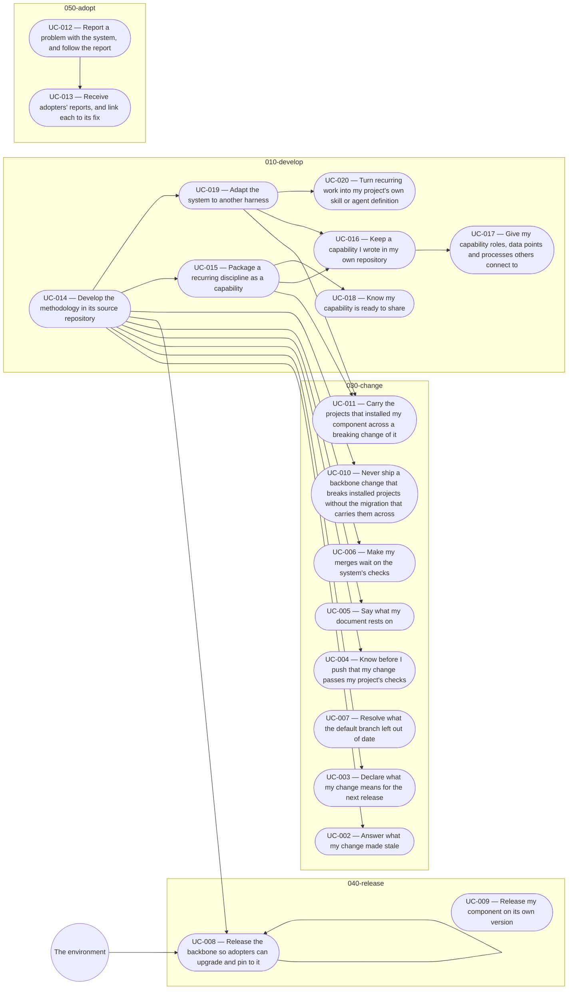

# Overview of the analysis of core

<!-- pkit:overview reads=4 fingerprint=sha256:79c3257d14086b4181efa71fe9a5d28394c2bac4e474c26913ac92e6d0221ceb -->

[project-kit exists so a way of working with AI agents is written once and kept current in every project that installs it](../../../../.pkit/decisions/project/PRJ-011-project-kit-purpose.md).

This analysis covers core, and builds on no other analysis.

Start with the domain-model view [010 — The system and its methodology](../domain-model/010-the-system-and-its-methodology.md), then the area [010-develop](#010-develop).

## Areas

### 010-develop

The methodology exists and can be extended, in its own source repository: capabilities, adapters, and a project's own skills and agent definitions.

**Builds on:** no other area.

**Its requirements:**

- [REQ-008 · Constraint · Until #1600 is done, no change adds or removes an area or an adapter a release ships](../requirements/constraints/010-develop/REQ-008-areas-held.md)

**Its use cases:**

- [UC-014 — Develop the methodology in its source repository](../use-case-model/use-cases/010-develop/UC-014-develop-methodology.md)
- [UC-015 — Package a recurring discipline as a capability](../use-case-model/use-cases/010-develop/UC-015-package-capability.md)
- [UC-016 — Keep a capability I wrote in my own repository](../use-case-model/use-cases/010-develop/UC-016-keep-capability.md)
- [UC-017 — Give my capability roles, data points and processes others connect to](../use-case-model/use-cases/010-develop/UC-017-connect-capability.md)
- [UC-018 — Know my capability is ready to share](../use-case-model/use-cases/010-develop/UC-018-check-shareable.md)
- [UC-019 — Adapt the system to another harness](../use-case-model/use-cases/010-develop/UC-019-adapt-harness.md)
- [UC-020 — Turn recurring work into my project's own skill or agent definition](../use-case-model/use-cases/010-develop/UC-020-own-skill-or-agent.md)

### 020-set-up

A project that runs the system declares its backbone configuration, chooses its capabilities, and gives its AI agents their operational rules, agent definitions, workspace and limits.

Not written yet.

### 030-change

A change to a project is checked, answered and landed, so what the project states stays true as it changes.

**Builds on:** [010-develop](#010-develop).

**Its requirements:**

- [REQ-001 · Quality · A migration run again changes nothing](../requirements/quality/030-change/REQ-001-migration-runs-again.md)

**Its use cases:**

- [UC-002 — Answer what my change made stale](../use-case-model/use-cases/030-change/UC-002-answer-stale.md)
- [UC-003 — Declare what my change means for the next release](../use-case-model/use-cases/030-change/UC-003-declare-changeset.md)
- [UC-004 — Know before I push that my change passes my project's checks](../use-case-model/use-cases/030-change/UC-004-check-before-push.md)
- [UC-005 — Say what my document rests on](../use-case-model/use-cases/030-change/UC-005-anchor-document.md)
- [UC-006 — Make my merges wait on the system's checks](../use-case-model/use-cases/030-change/UC-006-gate-merges.md)
- [UC-007 — Resolve what the default branch left out of date](../use-case-model/use-cases/030-change/UC-007-resolve-debt.md)
- [UC-010 — Never ship a backbone change that breaks installed projects without the migration that carries them across](../use-case-model/use-cases/030-change/UC-010-migrate-backbone-change.md)
- [UC-011 — Carry the projects that installed my component across a breaking change of it](../use-case-model/use-cases/030-change/UC-011-migrate-component-change.md)

### 040-release

The backbone and each component are released on their own versions, so projects can move to them and pin them.

**Builds on:** [010-develop](#010-develop).

**Its requirements:** none.

**Its use cases:**

- [UC-008 — Release the backbone so adopters can upgrade and pin to it](../use-case-model/use-cases/040-release/UC-008-release-backbone.md)
- [UC-009 — Release my component on its own version](../use-case-model/use-cases/040-release/UC-009-release-component.md)

### 050-adopt

Another project takes the system in, keeps it current, and reports what goes wrong with it.

**Builds on:** no other area.

**Its requirements:** none.

**Its use cases:**

- [UC-012 — Report a problem with the system, and follow the report](../use-case-model/use-cases/050-adopt/UC-012-report-problem.md)
- [UC-013 — Receive adopters' reports, and link each to its fix](../use-case-model/use-cases/050-adopt/UC-013-link-reports.md)

## Who takes part

| Actor | Who they are | Areas they act in |
| --- | --- | --- |
| [ACT-adopter — Adopter](../use-case-model/actors/ACT-adopter.md) | The person who adopts the methodology for a project and keeps its setup. | [030-change](#030-change), [050-adopt](#050-adopt) |
| [ACT-ai-agent — AI agent](../use-case-model/actors/ACT-ai-agent.md) | An AI agent working under the methodology, acting on the system from outside. | [010-develop](#010-develop), [030-change](#030-change), [050-adopt](#050-adopt) |
| [ACT-ci-pipeline — CI pipeline](../use-case-model/actors/ACT-ci-pipeline.md) | A project's continuous integration, acting on the system from outside. | [030-change](#030-change), [040-release](#040-release) |
| [ACT-component-author — Component author](../use-case-model/actors/ACT-component-author.md) | Someone who extends the system with a component (a capability or an adapter) rather than only using it. | [010-develop](#010-develop), [030-change](#030-change), [040-release](#040-release) |
| [ACT-developer — Developer](../use-case-model/actors/ACT-developer.md) | The person who builds: decisions, rules, notes, code and its documentation, one change at a time. | [010-develop](#010-develop), [030-change](#030-change) |
| [ACT-merge-authoriser — Merge authoriser](../use-case-model/actors/ACT-merge-authoriser.md) | The person who authorises a change's merge into the default branch. | [030-change](#030-change) |
| [ACT-methodology-maintainer — Methodology maintainer](../use-case-model/actors/ACT-methodology-maintainer.md) | Whoever maintains a distribution of the methodology. | [010-develop](#010-develop), [030-change](#030-change), [040-release](#040-release), [050-adopt](#050-adopt) |
| [ACT-operator — Operator](../use-case-model/actors/ACT-operator.md) | The person at the controls of a machine. | No use case names it yet. |
| [ACT-planner — Planner](../use-case-model/actors/ACT-planner.md) | The person who plans a project's work at the level of its outcomes. | No use case names it yet. |

## Concepts

The [glossary](../glossary.md) defines each term.

Each view of the domain model explains a group of related concepts:

- [010 — The system and its methodology](../domain-model/010-the-system-and-its-methodology.md)
- [020 — Parts of the system, and projects](../domain-model/020-parts-of-the-system.md)
- [030 — Capabilities, areas and connection points](../domain-model/030-capabilities-areas-and-connection-points.md)
- [040 — Versions and copies](../domain-model/040-versions-and-copies.md)
- [050 — A project's own files](../domain-model/050-a-projects-own-files.md)
- [060 — Changes, review and releases](../domain-model/060-changes-review-and-releases.md)
- [070 — Artefacts and friction](../domain-model/070-artefacts-and-friction.md)

## Requirements in no area

- [REQ-002 · Functional · Project-owned content is written only by the writers records name](../requirements/functional/REQ-002-project-owned-writers.md)
- [REQ-003 · Constraint · The backbone's CLI runs on Python 3.11 or later](../requirements/constraints/REQ-003-python-floor.md)
- [REQ-004 · Quality · A check never reads a missing answer as one that found nothing](../requirements/quality/REQ-004-missing-answer-never-clean.md)
- [REQ-005 · Quality · A command that only reads or validates changes nothing in the project](../requirements/quality/REQ-005-reading-writes-nothing.md)
- [REQ-006 · Quality · The backbone stops a command it runs for an anchor, a data point, validation or a process after thirty seconds](../requirements/quality/REQ-006-command-time-bound.md)
- [REQ-007 · Constraint · A command that resolves an anchor, fills a data point or joins validation is offline, read-only and deterministic](../requirements/constraints/REQ-007-offline-same-answer.md)
- [REQ-009 · Quality · A command whose effect reaches past what the person named offers `--dry-run`](../requirements/quality/REQ-009-preview-before-change.md)

## Reference

### Requirement map

```mermaid
flowchart LR
  accTitle: The requirements and what must meet them
  accDescr: 9 requirements in force. An arrow runs to each requirement from each use case or journey that must meet it, from each requirement to each requirement it refines, and from each requirement to each actor whose need it meets.
  ACT_adopter["ACT-adopter — Adopter"]
  ACT_ci_pipeline["ACT-ci-pipeline — CI pipeline"]
  ACT_developer["ACT-developer — Developer"]
  REQ_001{{"REQ-001 · Quality · A migration run again changes nothing"}}
  REQ_002{{"REQ-002 · Functional · Project-owned content is written only by the writers records name"}}
  REQ_003{{"REQ-003 · Constraint · The backbone's CLI runs on Python 3.11 or later"}}
  REQ_004{{"REQ-004 · Quality · A check never reads a missing answer as one that found nothing"}}
  REQ_005{{"REQ-005 · Quality · A command that only reads or validates changes nothing in the project"}}
  REQ_006{{"REQ-006 · Quality · The backbone stops a command it runs for an anchor, a data point, validation or a process after thirty seconds"}}
  REQ_007{{"REQ-007 · Constraint · A command that resolves an anchor, fills a data point or joins validation is offline, read-only and deterministic"}}
  REQ_008{{"REQ-008 · Constraint · Until #35;1600 is done, no change adds or removes an area or an adapter a release ships"}}
  REQ_009{{"REQ-009 · Quality · A command whose effect reaches past what the person named offers `--dry-run`"}}
  UC_002(["UC-002 — Answer what my change made stale"])
  UC_004(["UC-004 — Know before I push that my change passes my project's checks"])
  UC_006(["UC-006 — Make my merges wait on the system's checks"])
  UC_007(["UC-007 — Resolve what the default branch left out of date"])
  UC_008(["UC-008 — Release the backbone so adopters can upgrade and pin to it"])
  UC_009(["UC-009 — Release my component on its own version"])
  UC_010(["UC-010 — Never ship a backbone change that breaks installed projects without the migration that carries them across"])
  UC_011(["UC-011 — Carry the projects that installed my component across a breaking change of it"])
  UC_014(["UC-014 — Develop the methodology in its source repository"])
  UC_015(["UC-015 — Package a recurring discipline as a capability"])
  UC_016(["UC-016 — Keep a capability I wrote in my own repository"])
  UC_017(["UC-017 — Give my capability roles, data points and processes others connect to"])
  UC_018(["UC-018 — Know my capability is ready to share"])
  UC_019(["UC-019 — Adapt the system to another harness"])
  UC_020(["UC-020 — Turn recurring work into my project's own skill or agent definition"])
  REQ_001 -->|meets a need of| ACT_adopter
  REQ_002 -->|meets a need of| ACT_adopter
  REQ_004 -->|meets a need of| ACT_adopter
  REQ_004 -->|meets a need of| ACT_ci_pipeline
  REQ_006 -->|meets a need of| ACT_ci_pipeline
  REQ_007 -->|meets a need of| ACT_ci_pipeline
  REQ_007 -->|meets a need of| ACT_developer
  REQ_008 -->|meets a need of| ACT_adopter
  REQ_009 -->|meets a need of| ACT_adopter
  UC_002 -->|must meet| REQ_002
  UC_002 -->|must meet| REQ_004
  UC_002 -->|must meet| REQ_005
  UC_002 -->|must meet| REQ_006
  UC_002 -->|must meet| REQ_007
  UC_002 -->|must meet| REQ_009
  UC_004 -->|must meet| REQ_004
  UC_004 -->|must meet| REQ_005
  UC_004 -->|must meet| REQ_006
  UC_004 -->|must meet| REQ_007
  UC_006 -->|must meet| REQ_002
  UC_006 -->|must meet| REQ_004
  UC_006 -->|must meet| REQ_006
  UC_006 -->|must meet| REQ_007
  UC_006 -->|must meet| REQ_009
  UC_007 -->|must meet| REQ_004
  UC_007 -->|must meet| REQ_005
  UC_007 -->|must meet| REQ_006
  UC_007 -->|must meet| REQ_007
  UC_008 -->|must meet| REQ_009
  UC_009 -->|must meet| REQ_009
  UC_010 -->|must meet| REQ_001
  UC_011 -->|must meet| REQ_001
  UC_014 -->|must meet| REQ_008
  UC_014 -->|must meet| REQ_009
  UC_015 -->|must meet| REQ_009
  UC_016 -->|must meet| REQ_002
  UC_016 -->|must meet| REQ_009
  UC_017 -->|must meet| REQ_006
  UC_017 -->|must meet| REQ_009
  UC_018 -->|must meet| REQ_005
  UC_019 -->|must meet| REQ_008
  UC_019 -->|must meet| REQ_009
  UC_020 -->|must meet| REQ_002
  UC_020 -->|must meet| REQ_009
```

### Chain of use cases

### Use cases and their actors

---

The command `pkit analysis overview` writes this page from the analysis. Change the analysis, never this page (software-analysis DEC-003 point 8).
