# Overview of the analysis of core

<!-- pkit:overview reads=2 fingerprint=sha256:cb05dc24256151098ace05d2d3665d7c6555c98490052df2e22f3291a8786588 -->

What the analysis of core holds, in the order it is built: its concepts, its actors, its requirements, its use cases area by area, and its journeys. The command `pkit analysis overview` writes this page from the analysis. Change the analysis, never this page (software-analysis DEC-003 point 8).

## Concepts

The [glossary](../glossary.md) defines each term.

Each view of the domain model explains a group of related concepts:

- [010 — The system and its methodology](../domain-model/010-the-system-and-its-methodology.md)
- [020 — Parts of the system, and projects](../domain-model/020-parts-of-the-system.md)
- [030 — Capabilities, areas and connection points](../domain-model/030-capabilities-areas-and-connection-points.md)
- [040 — Versions and copies](../domain-model/040-versions-and-copies.md)
- [050 — A project's own files](../domain-model/050-a-projects-own-files.md)
- [060 — Changes, review and releases](../domain-model/060-changes-review-and-releases.md)
- [070 — Artefacts and friction](../domain-model/070-artefacts-and-friction.md)

## Actors

### [ACT-adopter — Adopter](../use-case-model/actors/ACT-adopter.md)

The use cases it is the main actor of:

- [UC-006 — Make my merges wait on the system's checks](../use-case-model/use-cases/030-change/UC-006-gate-merges.md)
- [UC-012 — Report a problem with the system, and follow the report](../use-case-model/use-cases/050-adopt/UC-012-report-problem.md)

The use cases it takes part in:

- [UC-013 — Receive adopters' reports, and link each to its fix](../use-case-model/use-cases/050-adopt/UC-013-link-reports.md)

### [ACT-ai-agent — AI agent](../use-case-model/actors/ACT-ai-agent.md)

The use cases it takes part in:

- [UC-002 — Answer what my change made stale](../use-case-model/use-cases/030-change/UC-002-answer-stale.md)
- [UC-007 — Resolve what the default branch left out of date](../use-case-model/use-cases/030-change/UC-007-resolve-debt.md)
- [UC-010 — Never ship a backbone change that breaks installed projects without the migration that carries them across](../use-case-model/use-cases/030-change/UC-010-migrate-backbone-change.md)
- [UC-011 — Carry the projects that installed my component across a breaking change of it](../use-case-model/use-cases/030-change/UC-011-migrate-component-change.md)
- [UC-012 — Report a problem with the system, and follow the report](../use-case-model/use-cases/050-adopt/UC-012-report-problem.md)
- [UC-014 — Develop the methodology in its source repository](../use-case-model/use-cases/010-develop/UC-014-develop-methodology.md)
- [UC-015 — Package a recurring discipline as a capability](../use-case-model/use-cases/010-develop/UC-015-package-capability.md)
- [UC-017 — Give my capability roles, data points and processes others connect to](../use-case-model/use-cases/010-develop/UC-017-connect-capability.md)
- [UC-019 — Adapt the system to another harness](../use-case-model/use-cases/010-develop/UC-019-adapt-harness.md)
- [UC-020 — Turn recurring work into my project's own skill or agent definition](../use-case-model/use-cases/010-develop/UC-020-own-skill-or-agent.md)

### [ACT-ci-pipeline — CI pipeline](../use-case-model/actors/ACT-ci-pipeline.md)

The use cases it takes part in:

- [UC-002 — Answer what my change made stale](../use-case-model/use-cases/030-change/UC-002-answer-stale.md)
- [UC-003 — Declare what my change means for the next release](../use-case-model/use-cases/030-change/UC-003-declare-changeset.md)
- [UC-004 — Know before I push that my change passes my project's checks](../use-case-model/use-cases/030-change/UC-004-check-before-push.md)
- [UC-006 — Make my merges wait on the system's checks](../use-case-model/use-cases/030-change/UC-006-gate-merges.md)
- [UC-007 — Resolve what the default branch left out of date](../use-case-model/use-cases/030-change/UC-007-resolve-debt.md)
- [UC-008 — Release the backbone so adopters can upgrade and pin to it](../use-case-model/use-cases/040-release/UC-008-release-backbone.md)
- [UC-009 — Release my component on its own version](../use-case-model/use-cases/040-release/UC-009-release-component.md)
- [UC-010 — Never ship a backbone change that breaks installed projects without the migration that carries them across](../use-case-model/use-cases/030-change/UC-010-migrate-backbone-change.md)
- [UC-011 — Carry the projects that installed my component across a breaking change of it](../use-case-model/use-cases/030-change/UC-011-migrate-component-change.md)

### [ACT-component-author — Component author](../use-case-model/actors/ACT-component-author.md)

The use cases it is the main actor of:

- [UC-009 — Release my component on its own version](../use-case-model/use-cases/040-release/UC-009-release-component.md)
- [UC-011 — Carry the projects that installed my component across a breaking change of it](../use-case-model/use-cases/030-change/UC-011-migrate-component-change.md)
- [UC-015 — Package a recurring discipline as a capability](../use-case-model/use-cases/010-develop/UC-015-package-capability.md)
- [UC-016 — Keep a capability I wrote in my own repository](../use-case-model/use-cases/010-develop/UC-016-keep-capability.md)
- [UC-017 — Give my capability roles, data points and processes others connect to](../use-case-model/use-cases/010-develop/UC-017-connect-capability.md)
- [UC-018 — Know my capability is ready to share](../use-case-model/use-cases/010-develop/UC-018-check-shareable.md)
- [UC-019 — Adapt the system to another harness](../use-case-model/use-cases/010-develop/UC-019-adapt-harness.md)

### [ACT-developer — Developer](../use-case-model/actors/ACT-developer.md)

The use cases it is the main actor of:

- [UC-002 — Answer what my change made stale](../use-case-model/use-cases/030-change/UC-002-answer-stale.md)
- [UC-003 — Declare what my change means for the next release](../use-case-model/use-cases/030-change/UC-003-declare-changeset.md)
- [UC-004 — Know before I push that my change passes my project's checks](../use-case-model/use-cases/030-change/UC-004-check-before-push.md)
- [UC-005 — Say what my document rests on](../use-case-model/use-cases/030-change/UC-005-anchor-document.md)
- [UC-007 — Resolve what the default branch left out of date](../use-case-model/use-cases/030-change/UC-007-resolve-debt.md)
- [UC-020 — Turn recurring work into my project's own skill or agent definition](../use-case-model/use-cases/010-develop/UC-020-own-skill-or-agent.md)

### [ACT-merge-authoriser — Merge authoriser](../use-case-model/actors/ACT-merge-authoriser.md)

The use cases it takes part in:

- [UC-002 — Answer what my change made stale](../use-case-model/use-cases/030-change/UC-002-answer-stale.md)

### [ACT-methodology-maintainer — Methodology maintainer](../use-case-model/actors/ACT-methodology-maintainer.md)

The use cases it is the main actor of:

- [UC-008 — Release the backbone so adopters can upgrade and pin to it](../use-case-model/use-cases/040-release/UC-008-release-backbone.md)
- [UC-010 — Never ship a backbone change that breaks installed projects without the migration that carries them across](../use-case-model/use-cases/030-change/UC-010-migrate-backbone-change.md)
- [UC-013 — Receive adopters' reports, and link each to its fix](../use-case-model/use-cases/050-adopt/UC-013-link-reports.md)
- [UC-014 — Develop the methodology in its source repository](../use-case-model/use-cases/010-develop/UC-014-develop-methodology.md)

The use cases it takes part in:

- [UC-012 — Report a problem with the system, and follow the report](../use-case-model/use-cases/050-adopt/UC-012-report-problem.md)

### [ACT-operator — Operator](../use-case-model/actors/ACT-operator.md)

No use case names it yet.

### [ACT-planner — Planner](../use-case-model/actors/ACT-planner.md)

No use case names it yet.

## Areas

### 010-develop

The methodology exists and can be extended, in its own source repository: capabilities, adapters, and a project's own skills and agent definitions.

- [UC-014 — Develop the methodology in its source repository](../use-case-model/use-cases/010-develop/UC-014-develop-methodology.md)
- [UC-015 — Package a recurring discipline as a capability](../use-case-model/use-cases/010-develop/UC-015-package-capability.md)
- [UC-016 — Keep a capability I wrote in my own repository](../use-case-model/use-cases/010-develop/UC-016-keep-capability.md)
- [UC-017 — Give my capability roles, data points and processes others connect to](../use-case-model/use-cases/010-develop/UC-017-connect-capability.md)
- [UC-018 — Know my capability is ready to share](../use-case-model/use-cases/010-develop/UC-018-check-shareable.md)
- [UC-019 — Adapt the system to another harness](../use-case-model/use-cases/010-develop/UC-019-adapt-harness.md)
- [UC-020 — Turn recurring work into my project's own skill or agent definition](../use-case-model/use-cases/010-develop/UC-020-own-skill-or-agent.md)

### 030-change

A change to a project is checked, answered and landed, so what the project states stays true as it changes.

- [UC-002 — Answer what my change made stale](../use-case-model/use-cases/030-change/UC-002-answer-stale.md)
- [UC-003 — Declare what my change means for the next release](../use-case-model/use-cases/030-change/UC-003-declare-changeset.md)
- [UC-004 — Know before I push that my change passes my project's checks](../use-case-model/use-cases/030-change/UC-004-check-before-push.md)
- [UC-005 — Say what my document rests on](../use-case-model/use-cases/030-change/UC-005-anchor-document.md)
- [UC-006 — Make my merges wait on the system's checks](../use-case-model/use-cases/030-change/UC-006-gate-merges.md)
- [UC-007 — Resolve what the default branch left out of date](../use-case-model/use-cases/030-change/UC-007-resolve-debt.md)
- [UC-010 — Never ship a backbone change that breaks installed projects without the migration that carries them across](../use-case-model/use-cases/030-change/UC-010-migrate-backbone-change.md)
- [UC-011 — Carry the projects that installed my component across a breaking change of it](../use-case-model/use-cases/030-change/UC-011-migrate-component-change.md)

### 040-release

The backbone and each component are released on their own versions, so projects can move to them and pin them.

- [UC-008 — Release the backbone so adopters can upgrade and pin to it](../use-case-model/use-cases/040-release/UC-008-release-backbone.md)
- [UC-009 — Release my component on its own version](../use-case-model/use-cases/040-release/UC-009-release-component.md)

### 050-adopt

Another project takes the system in, keeps it current, and reports what goes wrong with it.

- [UC-012 — Report a problem with the system, and follow the report](../use-case-model/use-cases/050-adopt/UC-012-report-problem.md)
- [UC-013 — Receive adopters' reports, and link each to its fix](../use-case-model/use-cases/050-adopt/UC-013-link-reports.md)

## Chain of use cases

## Use cases and their actors

```mermaid
flowchart LR
  accTitle: The use cases and their actors
  accDescr: The system's boundary holds 19 use cases, and 9 actors stand around it. An arrow joins each use case to the actor whose goal it is, and a line joins it to each other actor who takes part.
  ACT_adopter["ACT-adopter — Adopter"]
  ACT_ai_agent["ACT-ai-agent — AI agent"]
  ACT_ci_pipeline["ACT-ci-pipeline — CI pipeline"]
  ACT_component_author["ACT-component-author — Component author"]
  ACT_developer["ACT-developer — Developer"]
  ACT_merge_authoriser["ACT-merge-authoriser — Merge authoriser"]
  ACT_methodology_maintainer["ACT-methodology-maintainer — Methodology maintainer"]
  ACT_operator["ACT-operator — Operator"]
  ACT_planner["ACT-planner — Planner"]
  subgraph boundary["The system"]
    UC_002(["UC-002 — Answer what my change made stale"])
    UC_003(["UC-003 — Declare what my change means for the next release"])
    UC_004(["UC-004 — Know before I push that my change passes my project's checks"])
    UC_005(["UC-005 — Say what my document rests on"])
    UC_006(["UC-006 — Make my merges wait on the system's checks"])
    UC_007(["UC-007 — Resolve what the default branch left out of date"])
    UC_008(["UC-008 — Release the backbone so adopters can upgrade and pin to it"])
    UC_009(["UC-009 — Release my component on its own version"])
    UC_010(["UC-010 — Never ship a backbone change that breaks installed projects without the migration that carries them across"])
    UC_011(["UC-011 — Carry the projects that installed my component across a breaking change of it"])
    UC_012(["UC-012 — Report a problem with the system, and follow the report"])
    UC_013(["UC-013 — Receive adopters' reports, and link each to its fix"])
    UC_014(["UC-014 — Develop the methodology in its source repository"])
    UC_015(["UC-015 — Package a recurring discipline as a capability"])
    UC_016(["UC-016 — Keep a capability I wrote in my own repository"])
    UC_017(["UC-017 — Give my capability roles, data points and processes others connect to"])
    UC_018(["UC-018 — Know my capability is ready to share"])
    UC_019(["UC-019 — Adapt the system to another harness"])
    UC_020(["UC-020 — Turn recurring work into my project's own skill or agent definition"])
  end
  ACT_adopter --> UC_006
  ACT_adopter --> UC_012
  ACT_adopter --- UC_013
  ACT_ai_agent --- UC_002
  ACT_ai_agent --- UC_007
  ACT_ai_agent --- UC_010
  ACT_ai_agent --- UC_011
  ACT_ai_agent --- UC_012
  ACT_ai_agent --- UC_014
  ACT_ai_agent --- UC_015
  ACT_ai_agent --- UC_017
  ACT_ai_agent --- UC_019
  ACT_ai_agent --- UC_020
  ACT_ci_pipeline --- UC_002
  ACT_ci_pipeline --- UC_003
  ACT_ci_pipeline --- UC_004
  ACT_ci_pipeline --- UC_006
  ACT_ci_pipeline --- UC_007
  ACT_ci_pipeline --- UC_008
  ACT_ci_pipeline --- UC_009
  ACT_ci_pipeline --- UC_010
  ACT_ci_pipeline --- UC_011
  ACT_component_author --> UC_009
  ACT_component_author --> UC_011
  ACT_component_author --> UC_015
  ACT_component_author --> UC_016
  ACT_component_author --> UC_017
  ACT_component_author --> UC_018
  ACT_component_author --> UC_019
  ACT_developer --> UC_002
  ACT_developer --> UC_003
  ACT_developer --> UC_004
  ACT_developer --> UC_005
  ACT_developer --> UC_007
  ACT_developer --> UC_020
  ACT_merge_authoriser --- UC_002
  ACT_methodology_maintainer --> UC_008
  ACT_methodology_maintainer --> UC_010
  ACT_methodology_maintainer --- UC_012
  ACT_methodology_maintainer --> UC_013
  ACT_methodology_maintainer --> UC_014
```

