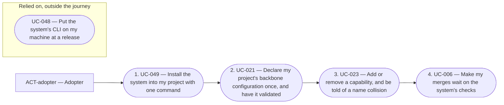
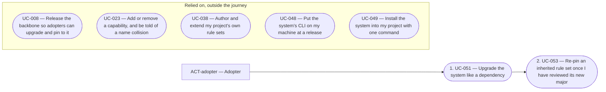
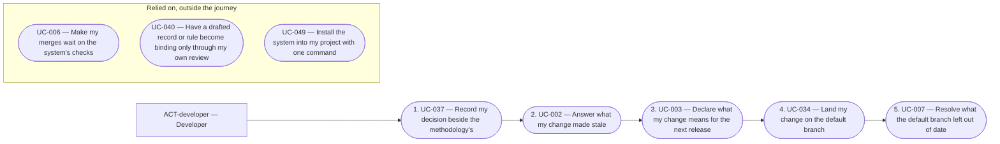

# Overview of the analysis of core

<!-- pkit:overview reads=4 fingerprint=sha256:9a4dcc94dc78fe2303af4241356a2edc8c4d18df9112b58be2c796bde8e84b3e -->

[project-kit exists so a way of working with AI agents is written once and kept current in every project that installs it](../../../../.pkit/decisions/project/PRJ-011-project-kit-purpose.md).

This analysis describes what core does: who uses it, what they do with it, and what it must meet. It builds on no other analysis.

## Areas

### 010-develop

Develop the methodology in its own source repository, and extend it with capabilities, adapters, and a project's own skills and agent definitions.

**Builds on:** no other area.

**Its requirements:**

- [REQ-008 · Constraint · Until #1600 is done, no change adds or removes an area or an adapter a release ships](../requirements/constraints/010-develop/REQ-008-areas-held.md)

**Its use cases:**

- [UC-014 — Develop the methodology in its source repository](../use-case-model/use-cases/010-develop/UC-014-develop-methodology.md)
- [UC-015 — Package a recurring discipline as a capability](../use-case-model/use-cases/010-develop/UC-015-package-capability.md)
- [UC-016 — Keep a capability I wrote in my own repository](../use-case-model/use-cases/010-develop/UC-016-keep-capability.md)
- [UC-017 — Give my capability roles, data points and processes others connect to](../use-case-model/use-cases/010-develop/UC-017-connect-capability.md)
- [UC-018 — Know my capability is ready to share](../use-case-model/use-cases/010-develop/UC-018-check-shareable.md)
- [UC-019 — Adapt the system to another harness](../use-case-model/use-cases/010-develop/UC-019-adapt-harness.md)
- [UC-020 — Turn recurring work into my project's own skill or agent definition](../use-case-model/use-cases/010-develop/UC-020-own-skill-or-agent.md)

### 020-set-up

Set up a project once, so its people and AI agents work with the same backbone configuration, capabilities, rules and limits.

**Builds on:** [010-develop](#010-develop).

**Its requirements:**

- [REQ-011 · Constraint · A suggestion of what to install never uses the network](../requirements/constraints/020-set-up/REQ-011-suggestion-offline.md)
- [REQ-013 · Functional · Where an allow and a deny conflict, the deny wins](../requirements/functional/020-set-up/REQ-013-deny-wins.md)
- [REQ-014 · Functional · A later edit of a documentation root moves no document](../requirements/functional/020-set-up/REQ-014-root-change-moves-nothing.md)
- [REQ-016 · Constraint · The permission model's code needs only the system `python3` and its standard library](../requirements/constraints/020-set-up/REQ-016-permissions-standard-library.md)

**Its use cases:**

- [UC-021 — Declare my project's backbone configuration once, and have it validated](../use-case-model/use-cases/020-set-up/UC-021-declare-backbone-configuration.md) ([not built yet](#not-built-yet): variant 1a, step 2)
- [UC-022 — Add my own operational rules, the harness's settings, grants and agent paths beside the methodology's](../use-case-model/use-cases/020-set-up/UC-022-add-own-additions.md) ([not built yet](#not-built-yet): step 4, variant 8a)
- [UC-023 — Add or remove a capability, and be told of a name collision](../use-case-model/use-cases/020-set-up/UC-023-add-or-remove-capability.md) ([not built yet](#not-built-yet): step 2, variant 3d, step 13)
- [UC-024 — See what a capability would connect to before I install it](../use-case-model/use-cases/020-set-up/UC-024-see-capability-connections.md)
- [UC-025 — Choose which installed capability provides a role](../use-case-model/use-cases/020-set-up/UC-025-choose-role-provider.md) ([not built yet](#not-built-yet): step 3)
- [UC-026 — Start every session with the project's rules loaded](../use-case-model/use-cases/020-set-up/UC-026-start-with-rules.md) ([not built yet](#not-built-yet): step 2)
- [UC-027 — Find my agent definition deployed, with the project's paths and my grants](../use-case-model/use-cases/020-set-up/UC-027-find-agent-definition-deployed.md) ([not built yet](#not-built-yet): step 2)
- [UC-028 — Keep my intermediate files in a workspace no commit carries](../use-case-model/use-cases/020-set-up/UC-028-keep-intermediate-files.md)
- [UC-029 — Get a delegated agent's result back whole](../use-case-model/use-cases/020-set-up/UC-029-get-result-whole.md)
- [UC-030 — Let agents work on their own without a stream of confirmations](../use-case-model/use-cases/020-set-up/UC-030-work-unprompted.md) ([not built yet](#not-built-yet): step 2, variant 1b, variant 4a, variant 4c, variant 5a)
- [UC-031 — Keep my per-machine choices out of what the project commits](../use-case-model/use-cases/020-set-up/UC-031-keep-per-machine-choices.md) ([not built yet](#not-built-yet): step 2, variant 1g, variant 3a)
- [UC-032 — Be asked before an agent changes another repository](../use-case-model/use-cases/020-set-up/UC-032-ask-before-other-repository.md) ([not built yet](#not-built-yet): variant 1d)
- [UC-033 — Find out why a command prompted me or was blocked](../use-case-model/use-cases/020-set-up/UC-033-find-why-prompted.md) ([not built yet](#not-built-yet): step 2)

### 030-change

Record a project's decisions and rules, and check, answer and land each change to it, so what the project states stays true as it changes.

**Builds on:** [010-develop](#010-develop) and [020-set-up](#020-set-up).

**Its requirements:**

- [REQ-001 · Quality · A migration run again changes nothing](../requirements/quality/030-change/REQ-001-migration-runs-again.md)
- [REQ-017 · Quality · A backbone migration is safe over any state](../requirements/quality/030-change/REQ-017-backbone-migration-safe.md)
- [REQ-018 · Quality · A reading command of the friction group prints the same document for the same state](../requirements/quality/030-change/REQ-018-same-json-same-state.md)
- [REQ-019 · Functional · Each reading document of the friction group carries its version, and a reader refuses one it does not know](../requirements/functional/030-change/REQ-019-reading-document-versioned.md)
- [REQ-020 · Functional · A dead anchor is an error, never silence](../requirements/functional/030-change/REQ-020-dead-anchor-error.md)
- [REQ-021 · Functional · A reviewer agent never changes the work it judges](../requirements/functional/030-change/REQ-021-reviewer-changes-nothing.md)

**Its use cases:**

- [UC-002 — Answer what my change made stale](../use-case-model/use-cases/030-change/UC-002-answer-stale.md) ([not built yet](#not-built-yet): step 11, step 6, variant 5e, variant 9b)
- [UC-003 — Declare what my change means for the next release](../use-case-model/use-cases/030-change/UC-003-declare-changeset.md)
- [UC-004 — Know before I push that my change passes my project's checks](../use-case-model/use-cases/030-change/UC-004-check-before-push.md)
- [UC-005 — Say what my document rests on](../use-case-model/use-cases/030-change/UC-005-anchor-document.md)
- [UC-006 — Make my merges wait on the system's checks](../use-case-model/use-cases/030-change/UC-006-gate-merges.md) ([not built yet](#not-built-yet): step 8, variant 1d, variant 3d)
- [UC-007 — Resolve what the default branch left out of date](../use-case-model/use-cases/030-change/UC-007-resolve-debt.md) ([not built yet](#not-built-yet): step 7, variant 3b, variant 4c)
- [UC-010 — Never ship a backbone change that breaks installed projects without the migration that carries them across](../use-case-model/use-cases/030-change/UC-010-migrate-backbone-change.md) ([not built yet](#not-built-yet): step 9)
- [UC-011 — Carry the projects that installed my component across a breaking change of it](../use-case-model/use-cases/030-change/UC-011-migrate-component-change.md) ([not built yet](#not-built-yet): step 9)
- [UC-034 — Land my change on the default branch](../use-case-model/use-cases/030-change/UC-034-land-change.md) ([not built yet](#not-built-yet): step 5)
- [UC-037 — Record my decision beside the methodology's](../use-case-model/use-cases/030-change/UC-037-record-decision.md) ([not built yet](#not-built-yet): step 3, variant 2d)
- [UC-038 — Author and extend my project's own rule sets](../use-case-model/use-cases/030-change/UC-038-author-rule-sets.md)
- [UC-039 — Think a question through in a scratchpad note, and retire it](../use-case-model/use-cases/030-change/UC-039-think-in-scratchpad.md) ([not built yet](#not-built-yet): step 2, step 7, variant 5b, variant 6a)
- [UC-040 — Have a drafted record or rule become binding only through my own review](../use-case-model/use-cases/030-change/UC-040-accept-through-review.md)
- [UC-041 — Keep each core record true for any project that adopts it](../use-case-model/use-cases/030-change/UC-041-keep-core-records-true.md)
- [UC-042 — Have my draft challenged and my diff checked against the conventions](../use-case-model/use-cases/030-change/UC-042-challenge-and-check.md)

### 040-release

Release the backbone and each component on its own version, so projects can move to it and pin it.

**Builds on:** [010-develop](#010-develop) and [030-change](#030-change).

**Its requirements:** none.

**Its use cases:**

- [UC-008 — Release the backbone so adopters can upgrade and pin to it](../use-case-model/use-cases/040-release/UC-008-release-backbone.md) ([not built yet](#not-built-yet): variant 1a, variant 1c)
- [UC-009 — Release my component on its own version](../use-case-model/use-cases/040-release/UC-009-release-component.md) ([not built yet](#not-built-yet): step 10, variant 3h)

### 050-adopt

Put the system on a machine and into another project, run each project at the version it pins and keep it current, and report what goes wrong with it, each report linked to its fix.

**Builds on:** [010-develop](#010-develop), [020-set-up](#020-set-up), [030-change](#030-change) and [040-release](#040-release).

**Its requirements:**

- [REQ-026 · Quality · An interrupted version transition never reads as finished, and the next one completes it](../requirements/quality/050-adopt/REQ-026-interrupted-transition-completes.md)
- [REQ-027 · Quality · The version pin holds the old one or the new one, never part, and an upgrade writes it last](../requirements/quality/050-adopt/REQ-027-pin-whole-written-last.md)
- [REQ-028 · Quality · The router never fails a command over a version pin it cannot resolve](../requirements/quality/050-adopt/REQ-028-unresolved-pin-runs-installed.md)
- [REQ-029 · Functional · A version transition resolves compatibility across components before it writes anything](../requirements/functional/050-adopt/REQ-029-compatibility-before-write.md)
- [REQ-030 · Functional · A choice in a version transition that needs a person is never taken silently](../requirements/functional/050-adopt/REQ-030-person-choice-never-silent.md)
- [REQ-031 · Constraint · The CLI is installed with uv from the distribution's git URL](../requirements/constraints/050-adopt/REQ-031-cli-from-distribution-url.md)

**Its use cases:**

- [UC-012 — Report a problem with the system, and follow the report](../use-case-model/use-cases/050-adopt/UC-012-report-problem.md)
- [UC-013 — Receive adopters' reports, and link each to its fix](../use-case-model/use-cases/050-adopt/UC-013-link-reports.md) ([not built yet](#not-built-yet): step 5, step 7)
- [UC-048 — Put the system's CLI on my machine at a release](../use-case-model/use-cases/050-adopt/UC-048-install-cli.md)
- [UC-049 — Install the system into my project with one command](../use-case-model/use-cases/050-adopt/UC-049-install-system.md) ([not built yet](#not-built-yet): step 2, variant 12f)
- [UC-050 — Get a fresh clone ready to work with one sync](../use-case-model/use-cases/050-adopt/UC-050-ready-fresh-clone.md) ([not built yet](#not-built-yet): step 2)
- [UC-051 — Upgrade the system like a dependency](../use-case-model/use-cases/050-adopt/UC-051-upgrade-system.md) ([not built yet](#not-built-yet): step 2)
- [UC-052 — Run each project at the version it pins](../use-case-model/use-cases/050-adopt/UC-052-run-at-pin.md) ([not built yet](#not-built-yet): step 2, variant 1d, step 10)
- [UC-053 — Re-pin an inherited rule set once I have reviewed its new major](../use-case-model/use-cases/050-adopt/UC-053-repin-rule-set.md)
- [UC-054 — Upgrade one capability on its own](../use-case-model/use-cases/050-adopt/UC-054-upgrade-capability.md) ([not built yet](#not-built-yet): step 2)

## Reference

### Who takes part

| Actor | Who they are | Areas they act in |
| --- | --- | --- |
| [ACT-adopter — Adopter](../use-case-model/actors/ACT-adopter.md) | The person who adopts the methodology for a project and keeps its setup. | [020-set-up](#020-set-up), [030-change](#030-change), [050-adopt](#050-adopt) |
| [ACT-ai-agent — AI agent](../use-case-model/actors/ACT-ai-agent.md) | An AI agent working under the methodology, acting on the system from outside. | [010-develop](#010-develop), [020-set-up](#020-set-up), [030-change](#030-change), [050-adopt](#050-adopt) |
| [ACT-ci-pipeline — CI pipeline](../use-case-model/actors/ACT-ci-pipeline.md) | A project's continuous integration, acting on the system from outside. | [030-change](#030-change), [040-release](#040-release) |
| [ACT-component-author — Component author](../use-case-model/actors/ACT-component-author.md) | Someone who extends the system with a component (a capability or an adapter) rather than only using it. | [010-develop](#010-develop), [030-change](#030-change), [040-release](#040-release) |
| [ACT-developer — Developer](../use-case-model/actors/ACT-developer.md) | The person who builds: decisions, rules, notes, code and its documentation, one change at a time. | [010-develop](#010-develop), [030-change](#030-change) |
| [ACT-merge-authoriser — Merge authoriser](../use-case-model/actors/ACT-merge-authoriser.md) | The person who authorises a change's merge into the default branch. | [030-change](#030-change) |
| [ACT-methodology-maintainer — Methodology maintainer](../use-case-model/actors/ACT-methodology-maintainer.md) | Whoever maintains a distribution of the methodology. | [010-develop](#010-develop), [030-change](#030-change), [040-release](#040-release), [050-adopt](#050-adopt) |
| [ACT-operator — Operator](../use-case-model/actors/ACT-operator.md) | The person at the controls of a machine. | [020-set-up](#020-set-up), [030-change](#030-change), [040-release](#040-release), [050-adopt](#050-adopt) |

### Concepts

The [glossary](../glossary.md) defines each term.

Each view of the domain model explains a group of related concepts:

- [010 — The system and its methodology](../domain-model/010-the-system-and-its-methodology.md)
- [020 — Parts of the system, and projects](../domain-model/020-parts-of-the-system.md)
- [030 — Capabilities, areas and connection points](../domain-model/030-capabilities-areas-and-connection-points.md)
- [040 — Versions and copies](../domain-model/040-versions-and-copies.md)
- [050 — A project's own files](../domain-model/050-a-projects-own-files.md)
- [060 — Changes, review and releases](../domain-model/060-changes-review-and-releases.md)
- [070 — Artefacts and friction](../domain-model/070-artefacts-and-friction.md)
- [080 — Agents and permissions](../domain-model/080-agents-and-permissions.md)

### Requirements in no area

- [REQ-002 · Functional · Project-owned content is written only by the writers records name](../requirements/functional/REQ-002-project-owned-writers.md)
- [REQ-003 · Constraint · The backbone's CLI runs on Python 3.11 or later](../requirements/constraints/REQ-003-python-floor.md)
- [REQ-004 · Quality · A check never reads a missing result as one that found nothing](../requirements/quality/REQ-004-missing-answer-never-clean.md)
- [REQ-005 · Quality · A command that only reads or validates changes nothing in the project](../requirements/quality/REQ-005-reading-writes-nothing.md)
- [REQ-006 · Quality · The backbone stops a command it runs for an anchor, a data point, validation or a process after thirty seconds](../requirements/quality/REQ-006-command-time-bound.md)
- [REQ-007 · Constraint · A command that resolves an anchor, fills a data point or joins validation is offline, read-only and deterministic](../requirements/constraints/REQ-007-offline-same-answer.md)
- [REQ-009 · Quality · A command whose effect reaches past what the person named offers `--dry-run`](../requirements/quality/REQ-009-preview-before-change.md)
- [REQ-010 · Functional · A command that propagates content under another version than the project records stops](../requirements/functional/REQ-010-stop-under-another-version.md)
- [REQ-012 · Functional · The system asks the operator before its command changes another repository](../requirements/functional/REQ-012-ask-before-another-repository.md)
- [REQ-015 · Functional · A declared documentation root that does not exist yet warns rather than fails](../requirements/functional/REQ-015-missing-root-warns.md)

### Journeys

#### [JRN-001 — Adopt the system](../use-case-model/journeys/JRN-001-adopt-system.md)

#### [JRN-002 — Upgrade the system](../use-case-model/journeys/JRN-002-upgrade-system.md)

#### [JRN-003 — Deliver a change](../use-case-model/journeys/JRN-003-deliver-change.md)

### Not built yet

What the use cases describe and the system does not do yet, each with the record that decides it and the issue that tracks it (software-analysis DEC-001 point 1):

- [UC-002 — Answer what my change made stale](../use-case-model/use-cases/030-change/UC-002-answer-stale.md): step 11, decided by `ADR-034#1`, tracked in `#1765`
- [UC-002 — Answer what my change made stale](../use-case-model/use-cases/030-change/UC-002-answer-stale.md): step 6, decided by `COR-062#1`, tracked in `#1873`
- [UC-002 — Answer what my change made stale](../use-case-model/use-cases/030-change/UC-002-answer-stale.md): variant 5e, decided by `COR-062#5`, tracked in `#1873`
- [UC-002 — Answer what my change made stale](../use-case-model/use-cases/030-change/UC-002-answer-stale.md): variant 9b, decided by `ADR-034#1`, tracked in `#1765`
- [UC-006 — Make my merges wait on the system's checks](../use-case-model/use-cases/030-change/UC-006-gate-merges.md): step 8, decided by `ADR-034#1`, tracked in `#1765`
- [UC-006 — Make my merges wait on the system's checks](../use-case-model/use-cases/030-change/UC-006-gate-merges.md): variant 1d, decided by `COR-004`, tracked in `#1884`
- [UC-006 — Make my merges wait on the system's checks](../use-case-model/use-cases/030-change/UC-006-gate-merges.md): variant 3d, decided by `COR-062#4`, tracked in `#1867`
- [UC-007 — Resolve what the default branch left out of date](../use-case-model/use-cases/030-change/UC-007-resolve-debt.md): step 7, decided by `ADR-034#1`, tracked in `#1765`
- [UC-007 — Resolve what the default branch left out of date](../use-case-model/use-cases/030-change/UC-007-resolve-debt.md): step 7, decided by `COR-062#1`, tracked in `#1873`
- [UC-007 — Resolve what the default branch left out of date](../use-case-model/use-cases/030-change/UC-007-resolve-debt.md): variant 3b, decided by `ADR-034#1`, tracked in `#1765`
- [UC-007 — Resolve what the default branch left out of date](../use-case-model/use-cases/030-change/UC-007-resolve-debt.md): variant 4c, decided by `COR-062#5`, tracked in `#1873`
- [UC-008 — Release the backbone so adopters can upgrade and pin to it](../use-case-model/use-cases/040-release/UC-008-release-backbone.md): variant 1a, decided by `ADR-034#1`, tracked in `#1765`
- [UC-008 — Release the backbone so adopters can upgrade and pin to it](../use-case-model/use-cases/040-release/UC-008-release-backbone.md): variant 1c, decided by `COR-004`, tracked in `#1884`
- [UC-009 — Release my component on its own version](../use-case-model/use-cases/040-release/UC-009-release-component.md): step 10, decided by `ADR-034#1`, tracked in `#1765`
- [UC-009 — Release my component on its own version](../use-case-model/use-cases/040-release/UC-009-release-component.md): variant 3h, decided by `COR-004`, tracked in `#1884`
- [UC-010 — Never ship a backbone change that breaks installed projects without the migration that carries them across](../use-case-model/use-cases/030-change/UC-010-migrate-backbone-change.md): step 9, decided by `ADR-034#1`, tracked in `#1765`
- [UC-011 — Carry the projects that installed my component across a breaking change of it](../use-case-model/use-cases/030-change/UC-011-migrate-component-change.md): step 9, decided by `ADR-034#1`, tracked in `#1765`
- [UC-013 — Receive adopters' reports, and link each to its fix](../use-case-model/use-cases/050-adopt/UC-013-link-reports.md): step 5, decided by `ADR-034#1`, tracked in `#1765`
- [UC-013 — Receive adopters' reports, and link each to its fix](../use-case-model/use-cases/050-adopt/UC-013-link-reports.md): step 7, decided by `ADR-034#1`, tracked in `#1765`
- [UC-021 — Declare my project's backbone configuration once, and have it validated](../use-case-model/use-cases/020-set-up/UC-021-declare-backbone-configuration.md): variant 1a, decided by `COR-004`, tracked in `#1884`
- [UC-021 — Declare my project's backbone configuration once, and have it validated](../use-case-model/use-cases/020-set-up/UC-021-declare-backbone-configuration.md): step 2, decided by `ADR-034#1`, tracked in `#1765`
- [UC-022 — Add my own operational rules, the harness's settings, grants and agent paths beside the methodology's](../use-case-model/use-cases/020-set-up/UC-022-add-own-additions.md): step 4, decided by `ADR-034#1`, tracked in `#1765`
- [UC-022 — Add my own operational rules, the harness's settings, grants and agent paths beside the methodology's](../use-case-model/use-cases/020-set-up/UC-022-add-own-additions.md): variant 8a, decided by `COR-004`, tracked in `#1884`
- [UC-023 — Add or remove a capability, and be told of a name collision](../use-case-model/use-cases/020-set-up/UC-023-add-or-remove-capability.md): step 2, decided by `ADR-034#1`, tracked in `#1765`
- [UC-023 — Add or remove a capability, and be told of a name collision](../use-case-model/use-cases/020-set-up/UC-023-add-or-remove-capability.md): variant 3d, decided by `COR-041`, tracked in `#131`
- [UC-023 — Add or remove a capability, and be told of a name collision](../use-case-model/use-cases/020-set-up/UC-023-add-or-remove-capability.md): step 13, decided by `ADR-034#1`, tracked in `#1765`
- [UC-025 — Choose which installed capability provides a role](../use-case-model/use-cases/020-set-up/UC-025-choose-role-provider.md): step 3, decided by `ADR-034#1`, tracked in `#1765`
- [UC-026 — Start every session with the project's rules loaded](../use-case-model/use-cases/020-set-up/UC-026-start-with-rules.md): step 2, decided by `ADR-034#1`, tracked in `#1765`
- [UC-027 — Find my agent definition deployed, with the project's paths and my grants](../use-case-model/use-cases/020-set-up/UC-027-find-agent-definition-deployed.md): step 2, decided by `ADR-034#1`, tracked in `#1765`
- [UC-030 — Let agents work on their own without a stream of confirmations](../use-case-model/use-cases/020-set-up/UC-030-work-unprompted.md): step 2, decided by `ADR-034#1`, tracked in `#1765`
- [UC-030 — Let agents work on their own without a stream of confirmations](../use-case-model/use-cases/020-set-up/UC-030-work-unprompted.md): variant 1b, decided by `COR-004`, tracked in `#1884`
- [UC-030 — Let agents work on their own without a stream of confirmations](../use-case-model/use-cases/020-set-up/UC-030-work-unprompted.md): variant 4a, decided by `COR-028#2`, tracked in `#1909`
- [UC-030 — Let agents work on their own without a stream of confirmations](../use-case-model/use-cases/020-set-up/UC-030-work-unprompted.md): variant 4c, decided by `ADR-002#4`, tracked in `#1764`
- [UC-030 — Let agents work on their own without a stream of confirmations](../use-case-model/use-cases/020-set-up/UC-030-work-unprompted.md): variant 5a, decided by `ADR-014#3`, tracked in `#1765`
- [UC-031 — Keep my per-machine choices out of what the project commits](../use-case-model/use-cases/020-set-up/UC-031-keep-per-machine-choices.md): step 2, decided by `ADR-034#1`, tracked in `#1765`
- [UC-031 — Keep my per-machine choices out of what the project commits](../use-case-model/use-cases/020-set-up/UC-031-keep-per-machine-choices.md): variant 1g, decided by `COR-004`, tracked in `#1884`
- [UC-031 — Keep my per-machine choices out of what the project commits](../use-case-model/use-cases/020-set-up/UC-031-keep-per-machine-choices.md): variant 3a, decided by `COR-028#2`, tracked in `#1909`
- [UC-032 — Be asked before an agent changes another repository](../use-case-model/use-cases/020-set-up/UC-032-ask-before-other-repository.md): variant 1d, decided by `ADR-034#1`, tracked in `#1765`
- [UC-033 — Find out why a command prompted me or was blocked](../use-case-model/use-cases/020-set-up/UC-033-find-why-prompted.md): step 2, decided by `ADR-034#1`, tracked in `#1765`
- [UC-034 — Land my change on the default branch](../use-case-model/use-cases/030-change/UC-034-land-change.md): step 5, decided by `ADR-061#8`, tracked in `#1257`
- [UC-037 — Record my decision beside the methodology's](../use-case-model/use-cases/030-change/UC-037-record-decision.md): step 3, decided by `ADR-034#1`, tracked in `#1765`
- [UC-037 — Record my decision beside the methodology's](../use-case-model/use-cases/030-change/UC-037-record-decision.md): variant 2d, decided by `COR-004`, tracked in `#1884`
- [UC-039 — Think a question through in a scratchpad note, and retire it](../use-case-model/use-cases/030-change/UC-039-think-in-scratchpad.md): step 2, decided by `ADR-034#1`, tracked in `#1765`
- [UC-039 — Think a question through in a scratchpad note, and retire it](../use-case-model/use-cases/030-change/UC-039-think-in-scratchpad.md): step 7, decided by `ADR-034#1`, tracked in `#1765`
- [UC-039 — Think a question through in a scratchpad note, and retire it](../use-case-model/use-cases/030-change/UC-039-think-in-scratchpad.md): variant 5b, decided by `ADR-034#1`, tracked in `#1765`
- [UC-039 — Think a question through in a scratchpad note, and retire it](../use-case-model/use-cases/030-change/UC-039-think-in-scratchpad.md): variant 6a, decided by `ADR-034#1`, tracked in `#1765`
- [UC-049 — Install the system into my project with one command](../use-case-model/use-cases/050-adopt/UC-049-install-system.md): step 2, decided by `ADR-034#1`, tracked in `#1765`
- [UC-049 — Install the system into my project with one command](../use-case-model/use-cases/050-adopt/UC-049-install-system.md): variant 12f, decided by `ADR-034#1`, tracked in `#1765`
- [UC-050 — Get a fresh clone ready to work with one sync](../use-case-model/use-cases/050-adopt/UC-050-ready-fresh-clone.md): step 2, decided by `ADR-034#1`, tracked in `#1765`
- [UC-051 — Upgrade the system like a dependency](../use-case-model/use-cases/050-adopt/UC-051-upgrade-system.md): step 2, decided by `ADR-034#1`, tracked in `#1765`
- [UC-052 — Run each project at the version it pins](../use-case-model/use-cases/050-adopt/UC-052-run-at-pin.md): step 2, decided by `ADR-034#1`, tracked in `#1765`
- [UC-052 — Run each project at the version it pins](../use-case-model/use-cases/050-adopt/UC-052-run-at-pin.md): variant 1d, decided by `COR-004`, tracked in `#1884`
- [UC-052 — Run each project at the version it pins](../use-case-model/use-cases/050-adopt/UC-052-run-at-pin.md): step 10, decided by `ADR-034#1`, tracked in `#1765`
- [UC-054 — Upgrade one capability on its own](../use-case-model/use-cases/050-adopt/UC-054-upgrade-capability.md): step 2, decided by `ADR-034#1`, tracked in `#1765`

### Diagrams

`pkit analysis diagram --analysis core` prints this analysis's diagrams from the working tree. Its subjects are `use-cases`, `journeys`, `requirements` and `chain`, or a journey's or a requirement's id.

---

The command `pkit analysis overview` writes this page from the analysis. Change the analysis, never this page (software-analysis DEC-003 point 8).
