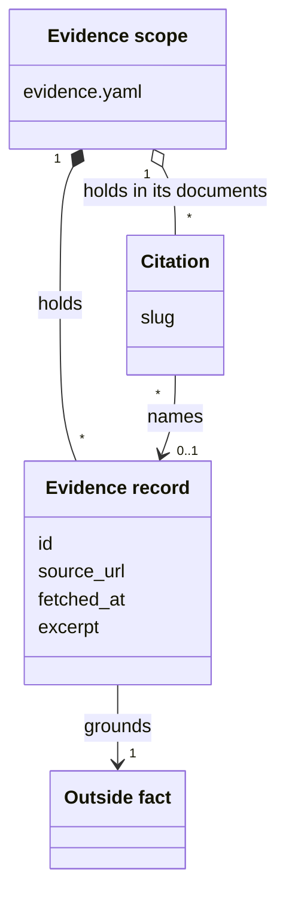
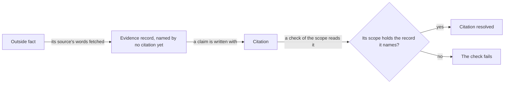

# VIEW-outside-facts-and-citations — Outside facts and citations

The text of a [project](../../core/glossary.md#term-project--project) often states facts that hold beyond it, such as an API's rate limit or a licence's terms. Restated from memory, such a fact may be subtly wrong or out of date. The text gives no sign that the fact's source needs checking ([DEC-001](../../../../.pkit/capabilities/evidence/decisions/DEC-001-citation-discipline.md)).

Each such fact is an [outside fact](../glossary.md#term-outside-fact--outside-fact). An [evidence record](../glossary.md#term-evidence-record--evidence-record) keeps the words of its source, and a [citation](../glossary.md#term-citation--citation) right after the claim names that record. An [evidence scope](../glossary.md#term-evidence-scope--evidence-scope) holds evidence records, and the documents whose citations name them (DEC-001, [DEC-002](../../../../.pkit/capabilities/evidence/decisions/DEC-002-evidence-record-schema.md)).

## Outside fact

Defined in [TERM-outside-fact](../glossary.md#term-outside-fact--outside-fact).

**Why:** The text of a [project](../../core/glossary.md#term-project--project) often states what holds beyond the project, such as the rate limit of an API. Restated from memory, such a fact may be subtly wrong or out of date. Nothing in the text says that the fact's source needs checking ([DEC-001](../../../../.pkit/capabilities/evidence/decisions/DEC-001-citation-discipline.md)).

An outside fact is a state of affairs beyond the project, which only a source elsewhere can confirm. The rate limit an API's documentation states is one, and so is a regulatory threshold or a vendor's terms.

**Attributes:** None.

**Relations:**

- An [evidence record](../glossary.md#term-evidence-record--evidence-record) grounds it, keeping the words of its source (DEC-001).
- A claim about it in a project's text carries a [citation](../glossary.md#term-citation--citation). That is a convention, which nothing checks, so text with no citation states no outside fact by convention alone (DEC-001).

**States:** None.

**Always true:** None.

## Evidence record

Defined in [TERM-evidence-record](../glossary.md#term-evidence-record--evidence-record).

**Why:** A claim needs the words that bear it out, kept where a person or a check can find them. A record keeps the source's words verbatim and where they came from, so a claim can be followed to its source ([DEC-001](../../../../.pkit/capabilities/evidence/decisions/DEC-001-citation-discipline.md)).

An evidence record is one entry of an `evidence.yaml`. It keeps the words of a source that bear out one [outside fact](../glossary.md#term-outside-fact--outside-fact), with where that source lies and when the words were fetched. The record `api-rate-limit` keeps a passage of an API's documentation on its rate limit.

**Attributes:**

- its `id`, the slug by which a [citation](../glossary.md#term-citation--citation) names it (DEC-001, [DEC-002](../../../../.pkit/capabilities/evidence/decisions/DEC-002-evidence-record-schema.md))
- its `source_url`, where the source lies, a URL or another pointer such as a path (DEC-002)
- its `fetched_at`, the date or the time its excerpt was fetched, never when the fact was true (DEC-002)
- its `excerpt`, the source's words, verbatim, often over several lines (DEC-002)
- where it helps, a `title` (DEC-002)
- where it helps, a `note` on what the fact is about (DEC-002)
- where it helps, a `snapshot`, where a durable copy of the source lies (DEC-002)

**Relations:**

- It grounds one outside fact, since an `id` names one fact, with one excerpt (DEC-001).
- Several evidence records may share one `source_url` (DEC-001).
- Its [evidence scope](../glossary.md#term-evidence-scope--evidence-scope) holds it (DEC-002).
- Citations name it, by its `id` (DEC-001).

**States:** A record that no citation names is an orphan. A record may be written before the claim that cites it, so an orphan is allowed ([DEC-003](../../../../.pkit/capabilities/evidence/decisions/DEC-003-validation-model.md)). It is cited once a citation names it.

**Always true:**

- Its `id` is a slug of lower-case letters, digits and hyphens (DEC-001).
- Its excerpt stands as fetched. Nothing fetches the source again to compare it (DEC-002, DEC-003).

## Evidence scope

Defined in [TERM-evidence-scope](../glossary.md#term-evidence-scope--evidence-scope).

**Why:** Facts about one part of a [project](../../core/glossary.md#term-project--project) should not crowd the names of another part's facts. A file in each directory keeps each part's [evidence records](../glossary.md#term-evidence-record--evidence-record) apart, and its place shows which part a fact belongs to ([DEC-002](../../../../.pkit/capabilities/evidence/decisions/DEC-002-evidence-record-schema.md)).

An evidence scope is a directory that holds an `evidence.yaml`, with everything below it. The file's place declares the scope, and no registry lists the scopes. A directory below it with an `evidence.yaml` of its own starts an evidence scope of its own, which shadows the outer one there (DEC-002).

**Attributes:** its `evidence.yaml`, which holds `schema_version: 1` and the list of its `records` (DEC-002).

**Relations:**

- It holds its evidence records (DEC-002).
- The documents below it hold the [citations](../glossary.md#term-citation--citation) that name those records (DEC-002, [DEC-003](../../../../.pkit/capabilities/evidence/decisions/DEC-003-validation-model.md)).

**States:** None.

**Always true:**

- Each evidence scope is checked on its own (DEC-002, DEC-003).
- The same `id` in two evidence scopes names two evidence records, which never collide (DEC-002).

## Citation

Defined in [TERM-citation](../glossary.md#term-citation--citation).

**Why:** A claim about an [outside fact](../glossary.md#term-outside-fact--outside-fact) must point at the words that bear it out. Otherwise the text gives no sign of where to check it. A short token right after the claim costs almost nothing to write, low enough that citing happens ([DEC-001](../../../../.pkit/capabilities/evidence/decisions/DEC-001-citation-discipline.md)).

A citation is the text `[ev:<slug>]`, right after the claim it backs. Its slug is the `id` of the [evidence record](../glossary.md#term-evidence-record--evidence-record) that backs the claim, in the claim's [evidence scope](../glossary.md#term-evidence-scope--evidence-scope). Two claims in one sentence take two citations, side by side (DEC-001).

**Attributes:** the slug it names (DEC-001).

**Relations:**

- It names at most one evidence record, by that record's `id`. It names none where its scope holds no record of that `id` (DEC-001, [DEC-003](../../../../.pkit/capabilities/evidence/decisions/DEC-003-validation-model.md)).
- It lies in a Markdown or a YAML file below its evidence scope. In YAML, it stands in a comment or in a field of prose, never in a value a tool reads (DEC-001).

**States:** A citation is resolved where its evidence scope holds the record it names, and unresolved where it does not. An unresolved citation fails the check of its scope (DEC-003).

**Always true:**

- A citation names an evidence record, never a URL (DEC-001).
- One token names one record, so two records take two tokens, never a list (DEC-001).
- Text of its form is no citation in a fenced code block or an HTML comment of a Markdown file. Nor is it one in its scope's `evidence.yaml` (DEC-003).
