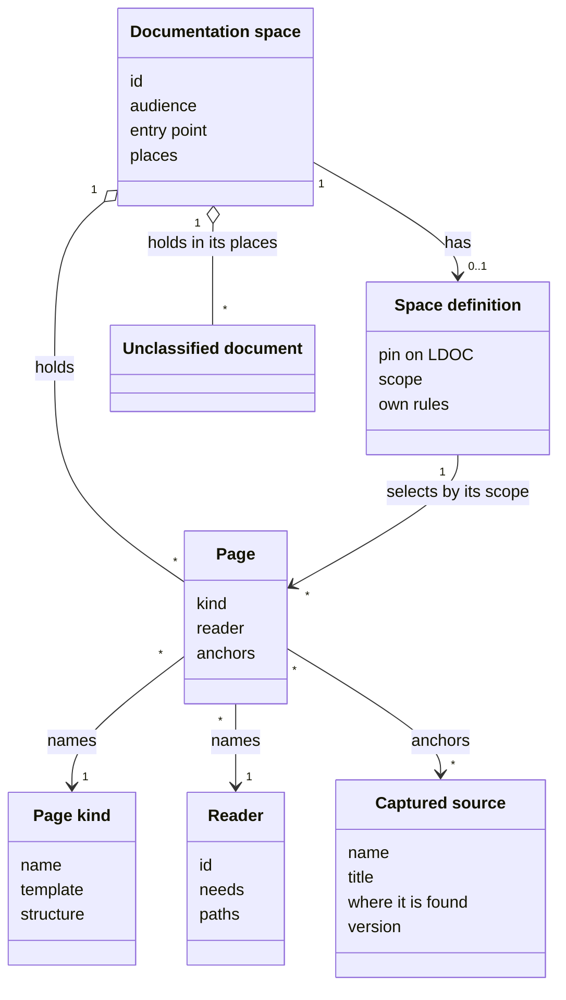
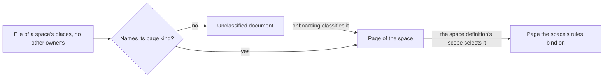

# VIEW-spaces-and-pages — Spaces and pages

Documentation serves two audiences who should not meet each other's material. Users need what the [system](../../core/glossary.md#term-system--system) does and how to use it, and maintainers need why, from where and by which rules. Documentation earns trust only where its [readers](../glossary.md#term-reader--reader) can rely on it: true against something checkable, each fact in one home, and written for them (DEC-001).

A [documentation space](../glossary.md#term-documentation-space--documentation-space) gathers the pages for one audience, and its [space definition](../glossary.md#term-space-definition--space-definition) holds the rules they follow. Each [page](../glossary.md#term-page--page) names its [page kind](../glossary.md#term-page-kind--page-kind) and its reader, and anchors what makes it true, a [captured source](../glossary.md#term-captured-source--captured-source) among them. A file of a space's places that is neither a page nor another owner's is an [unclassified document](../glossary.md#term-unclassified-document--unclassified-document), until onboarding classifies it.

## Documentation space

Defined in [TERM-documentation-space](../glossary.md#term-documentation-space--documentation-space).

**Why:** Mixing material for two audiences either buries users in internals, or leaves maintainers without the grounds for what the user-facing pages say. A user who meets maintainers' material in navigation is lost. Separating documentation by audience gives each what it needs, and gives whoever writes it a checkable boundary in [place](../../core/glossary.md#term-place--place) of a judgement call (DEC-001).

A documentation space is the collection of pages written for one audience. Every [project](../../core/glossary.md#term-project--project) has a user space and a technical space, and may add others, such as an interface reference. A space's pages lie in its places. They are the [documentation root](../../core/glossary.md#term-documentation-root--documentation-root) that serves its audience, and the places the project assigns to it, such as a top-level `README.md`.

**Attributes:**

- its id, such as `user` or `technical` (DEC-001 point 1)
- its audience: users, or maintainers and the agents that write and check the documentation (DEC-001 point 1)
- its entry point, the [page](../glossary.md#term-page--page) its [readers](../glossary.md#term-reader--reader) start from (DEC-001 point 1)
- its places: the root that serves its audience, where it has one, and the places assigned to it (DEC-001 point 1)

**Relations:**

- Its pages lie in its places. A place outside every root gives its documents the space the project assigns it to. A place inside a root gives that root's space, unless the project assigns it to another (DEC-001 point 1).
- Where places nest, the [backbone](../../core/glossary.md#term-backbone--backbone)'s order of places decides which one gives a document its space (DEC-001 point 1).
- It has one [space definition](../glossary.md#term-space-definition--space-definition) once the project writes it, and its places may hold [unclassified documents](../glossary.md#term-unclassified-document--unclassified-document) (DEC-001 points 2 and 4).

**States:** A space has no definition until the project writes one, and no [rule](../../core/glossary.md#term-rule--rule) binds on its pages until then. Once its definition exists, the rules bind on each page its scope selects (DEC-001 point 2).

**Always true:**

- Two roots that are one folder give no space until onboarding separates them (DEC-001 point 1).
- A place outside every root that holds a document nothing else claims belongs to exactly one space, the one assigned to it (DEC-001 point 1).
- A synced tree is never a place of a space (DEC-001 point 1).

## Space definition

Defined in [TERM-space-definition](../glossary.md#term-space-definition--space-definition).

**Why:** A method written once, and inherited, can be reused across projects and changed in one [place](../../core/glossary.md#term-place--place), while one mixed into content cannot be separated again. A shipped [rule set](../../core/glossary.md#term-rule-set--rule-set) takes no scope, so a set of the [project](../../core/glossary.md#term-project--project)'s own says where its rules bind. A space's definition already names the rules its pages follow, so its scope says where they bind (DEC-001).

A space definition is the rule set that says which rules a space's pages follow. It inherits `LDOC`, the shared rules living-docs ships, and adds the space's own. Its scope selects the space's pages, so those rules bind on them as soon as it exists.

**Attributes:**

- its pin on `LDOC`, whose major decides when a new major of `LDOC` starts binding through it (DEC-001 point 2)
- its scope, which selects the space's pages (DEC-001 point 2)
- the space's own rules, such as the user space's [rule](../../core/glossary.md#term-rule--rule) that [reader](../glossary.md#term-reader--reader) paths stay unbroken (DEC-001 point 3)

**Relations:**

- It belongs to one [documentation space](../glossary.md#term-documentation-space--documentation-space), whose entry in living-docs' configuration names its path (DEC-001 point 2).
- Each [page](../glossary.md#term-page--page) that a place assigned to its space gives the space lies in its scope, and in no other (DEC-001 point 1).

**States:** None.

**Always true:**

- It inherits `LDOC`, and adds the space's own rules to it (DEC-001 point 2).
- It lies in the technical space, in a location living-docs declares, so a space's readers never meet it (DEC-001 point 2).
- A space definition with no scope selects no page itself (DEC-001 point 2).

## Page

Defined in [TERM-page](../glossary.md#term-page--page).

**Why:** A statement nothing grounds cannot be judged true or false, which is what makes fluent, unfounded text look reliable. Anchoring the page, not each sentence, keeps the cost bearable. Anchors turn "is this still true?" into a question a tool can raise and a reviewer can [answer](../../core/glossary.md#term-answer--answer) (DEC-001).

A page is a document of a [documentation space](../glossary.md#term-documentation-space--documentation-space), written for one [reader](../glossary.md#term-reader--reader). It names its [page kind](../glossary.md#term-page-kind--page-kind) and its reader in its front matter, and its anchors name what makes its statements true. A document is a page where its [place](../../core/glossary.md#term-place--place) gives the page type and it names its page kind. One that names its page kind in a place the [project](../../core/glossary.md#term-project--project) declares outside every root, with no type, is a page too.

**Attributes:**

- its page kind, in its `kind` field (DEC-001 point 4)
- its reader, in its `reader` field (DEC-001 point 4)
- its anchors, such as the code it describes, the decisions it applies and the [captured sources](../glossary.md#term-captured-source--captured-source) it quotes (DEC-001 point 4)
- in place of anchors, the reason a person accepted it with none, where it has nothing to [anchor](../../core/glossary.md#term-anchor--anchor) (DEC-001 point 8)

**Relations:**

- It belongs to one documentation space, the one its place gives it (DEC-001 point 1).
- It names one page kind and one reader (DEC-001 point 4).
- It may anchor captured sources (DEC-001 point 4).
- `LDOC`'s rules and its space's own bind on it where a [space definition](../glossary.md#term-space-definition--space-definition)'s scope selects it (DEC-001 points 2 and 3).

**States:** A page with no anchor and no accepted reason for none is unanchored, which onboarding clears (DEC-001 point 8). Once something its anchors name changes, [friction](../../core/glossary.md#term-friction--friction) flags it until an answer settles it (DEC-001 point 4).

**Always true:**

- A [decision record](../../core/glossary.md#term-decision-record--decision-record) and a rule-set file are never pages, and nor is a document another owner claims (DEC-001 points 1 and 4).
- Only what a page anchors grounds a statement it makes (DEC-001 point 3).

## Page kind

Defined in [TERM-page-kind](../glossary.md#term-page-kind--page-kind).

**Why:** None.

A page kind is a category of pages that share one format. Each kind has a template, the starting shape a writer fills in, and a structure, the sections every [page](../glossary.md#term-page--page) of the kind carries. A signpost, which says what a folder holds and where to go, is one such kind.

**Attributes:**

- its name, one word, which a page writes in its `kind` field (DEC-001 point 4)
- its template (DEC-001 point 3)
- its structure: the sections every page of the kind carries, in order where order matters (DEC-001 point 3)

**Relations:** Many pages name one page kind (DEC-001 point 4).

**States:** None.

**Always true:**

- Its structure is declared once, with the kind, and never read out of its template (DEC-001 point 3).
- Its template satisfies its structure, and may show more (DEC-001 point 3).
- A kind that declares no structure, such as one a [project](../../core/glossary.md#term-project--project) adds, fails no page for its sections (DEC-001 point 3).

## Reader

Defined in [TERM-reader](../glossary.md#term-reader--reader).

**Why:** Users need to know what the [system](../../core/glossary.md#term-system--system) does and how to use it. Maintainers need to know why, from where and by which rules. Documentation earns trust only where it is written for a reader it actually serves (DEC-001).

A reader is a class of people or agents who read the [project](../../core/glossary.md#term-project--project)'s documentation, declared with what they need from it. A [page](../glossary.md#term-page--page) names one reader, and says only what that reader needs. The readers point, a [data point](../../core/glossary.md#term-data-point--data-point) living-docs provides, gathers the readers: `user` and `maintainer` always, and those a project or another [capability](../../core/glossary.md#term-capability--capability) adds.

**Attributes:**

- its id, which a page names in its `reader` field (DEC-001 point 7)
- its needs (DEC-001 point 7)
- the paths it takes through the pages (DEC-001 point 7)

**Relations:**

- Many pages name one reader (DEC-001 point 4).
- A reader's id is distinct from an actor's, so an analysis capability's readers stand beside the defaults (DEC-001 point 7).

**States:** None.

**Always true:**

- `user` and `maintainer` are always readers, one for each space every project has (DEC-001 point 7).
- Where `RS-LDOC-003` binds on a page, the page's reader is one the readers point holds (DEC-001 points 3 and 6).

## Captured source

Defined in [TERM-captured-source](../glossary.md#term-captured-source--captured-source).

**Why:** A check that gives the same [answer](../../core/glossary.md#term-answer--answer) wherever it runs cannot ask a text outside the repository whether it changed. It can read the [project](../../core/glossary.md#term-project--project)'s own record of that text, which changes exactly when someone reads a new version. That is when the pages resting on the text should be read again (DEC-001).

A captured source is a file the project keeps for one text outside the repository, such as a standard. It says what the text is called, where it is found, and which version of it the pages were last checked against. A [page](../glossary.md#term-page--page) anchors the text by the file's name, and any change to the file asks that page whether it still holds.

**Attributes:**

- its name, which names its file, and which a page's [anchor](../../core/glossary.md#term-anchor--anchor) gives (DEC-001 point 4)
- what the text is called (DEC-001 point 4)
- where the text is found (DEC-001 point 4)
- the version of the text last read (DEC-001 point 4)

**Relations:** Pages anchor it by its name (DEC-001 point 4).

**States:** It holds one version at a time. Recording a newer version changes it, and so asks every page anchored to it (DEC-001 point 4).

**Always true:**

- Its file holds what identifies the text and the version read, and nothing else (DEC-001 point 4).
- Nothing fetches the text it names (DEC-001 point 4).
- A name no file captures is a dead anchor (DEC-001 point 4).

## Unclassified document

Defined in [TERM-unclassified-document](../glossary.md#term-unclassified-document--unclassified-document).

**Why:** None.

An unclassified document is a file in a space's places that is neither a [page](../glossary.md#term-page--page) nor another owner's. It names no [page kind](../glossary.md#term-page-kind--page-kind) where its [place](../../core/glossary.md#term-place--place) asks for one, and it is no [decision record](../../core/glossary.md#term-decision-record--decision-record) and no rule-set file. A [project](../../core/glossary.md#term-project--project) that adopts living-docs with documentation of its own holds many.

**Attributes:** None.

**Relations:** It lies in a [documentation space](../glossary.md#term-documentation-space--documentation-space)'s places. Onboarding classifies it as a page of some space, or as something the spaces' rules do not govern (DEC-001 point 4).

**States:** It stays unclassified until onboarding makes it a page, or leaves it outside the spaces' rules (DEC-001 points 4 and 8).

**Always true:** [Validation](../../core/glossary.md#term-validation--validation) reports it for onboarding to classify (DEC-001 point 4).
