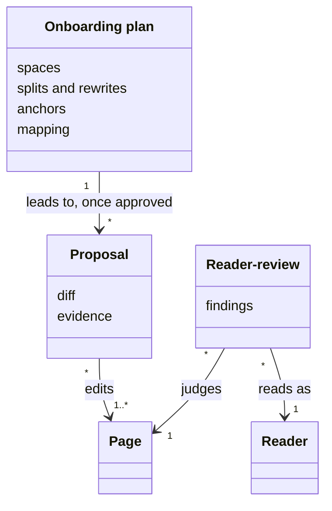
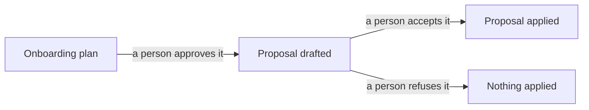

# VIEW-proposals-and-reviews — Proposals and reviews

An agent that rewrites pages directly will eventually rewrite them wrongly. It will misjudge an ambiguous file's audience, or fix a [page](../glossary.md#term-page--page) to match a regression. [Proposals](../glossary.md#term-proposal--proposal) that cite their evidence, reviewed by a person, keep speed without giving up judgement ([DEC-001](../../../../.pkit/capabilities/living-docs/decisions/DEC-001-living-docs-discipline.md)).

A proposal drafts one edit with its evidence, and nothing applies it until a person accepts it. A [reader-review](../glossary.md#term-reader-review--reader-review) judges a page as its [reader](../glossary.md#term-reader--reader) would read it, and leaves its [findings](../../core/glossary.md#term-finding--finding) for a person. An [onboarding plan](../glossary.md#term-onboarding-plan--onboarding-plan) outlines how existing documents come into the spaces, and leads to proposals only once a person approves it.

## Proposal

Defined in [TERM-proposal](../glossary.md#term-proposal--proposal).

**Why:** An agent that rewrites pages directly will eventually rewrite them wrongly, such as by fixing a [page](../glossary.md#term-page--page) to match a regression. Proposals that cite their evidence, reviewed by a person, keep the agent's speed without giving up a person's judgement ([DEC-001](../../../../.pkit/capabilities/living-docs/decisions/DEC-001-living-docs-discipline.md)).

A proposal is an edit the living-docs agent drafts, and leaves for a person to apply or refuse. It changes a page's text or its anchors, or in onboarding the spaces' declarations too. It cites what it rests on: the change that caused it and the anchors behind each statement it changes.

**Attributes:**

- its diff ([DEC-001 point 5](../../../../.pkit/capabilities/living-docs/decisions/DEC-001-living-docs-discipline.md#5-fixes-are-proposed-never-applied-blind))
- its evidence: the change that caused it, and the anchors it rests on (DEC-001 point 5)
- in a run nobody watches, the page's [answer](../../core/glossary.md#term-answer--answer) as fields, never in its diff (DEC-001 point 5)

**Relations:**

- It edits one page, or the pages and declarations of one step of an [onboarding plan](../glossary.md#term-onboarding-plan--onboarding-plan) (DEC-001 points 5 and [8](../../../../.pkit/capabilities/living-docs/decisions/DEC-001-living-docs-discipline.md#8-brownfield-onboarding-is-transformation)).
- An approved onboarding plan leads to the proposals it names (DEC-001 point 8).

**States:** A proposal is drafted, then a person accepts it, or refuses it. Nothing applies it before a person accepts it (DEC-001 point 5).

**Always true:**

- A statement its page's anchors do not ground is grounded by a new [anchor](../../core/glossary.md#term-anchor--anchor), taken out, or raised with a person as a question. It is never left standing as if it were true (DEC-001 point 5).
- In a run nobody watches, it changes the page's text and its anchors only (DEC-001 point 5).

## Reader-review

Defined in [TERM-reader-review](../glossary.md#term-reader-review--reader-review).

**Why:** Change review asks whether a change left documentation missing or contradicted. A reader-review asks whether the documentation serves its [reader](../glossary.md#term-reader--reader) at all. The two catch different failures, and merging them would blur both ([DEC-001](../../../../.pkit/capabilities/living-docs/decisions/DEC-001-living-docs-discipline.md)).

A reader-review reads one [page](../glossary.md#term-page--page) as its reader would. It asks whether the page answers that reader's questions, only those, and in a way the reader can follow. Each of its [findings](../../core/glossary.md#term-finding--finding) cites the [rule](../../core/glossary.md#term-rule--rule) the page breaks.

**Attributes:**

- the page it reads, and the reader it reads as ([DEC-001 point 6](../../../../.pkit/capabilities/living-docs/decisions/DEC-001-living-docs-discipline.md#6-reader-review))
- its findings, each citing the rule the page breaks (DEC-001 point 6)

**Relations:**

- It judges one page, against the rules that bind on it (DEC-001 point 6).
- It reads the page as the reader the page names, taken from the readers [data point](../../core/glossary.md#term-data-point--data-point) (DEC-001 point 6).

**States:** None.

**Always true:**

- It leaves a record only when it finds something (DEC-001 point 6).
- It leaves to [validation](../../core/glossary.md#term-validation--validation) the parts of `LDOC`'s rules that validation enforces, and judges the rest (DEC-001 point 6).

## Onboarding plan

Defined in [TERM-onboarding-plan](../glossary.md#term-onboarding-plan--onboarding-plan).

**Why:** An agent that moves a [project](../../core/glossary.md#term-project--project)'s documents itself will misjudge an ambiguous file's audience. A plan that cites its evidence, reviewed by a person, keeps the agent's speed without giving up judgement ([DEC-001](../../../../.pkit/capabilities/living-docs/decisions/DEC-001-living-docs-discipline.md)).

An onboarding plan says how a project's existing documents come into its [documentation spaces](../glossary.md#term-documentation-space--documentation-space). On such a project nothing is anchored yet, so onboarding is [friction](../../core/glossary.md#term-friction--friction) work on that starting point. A person reviews the plan before anything moves.

**Attributes:**

- which space each existing document belongs to ([DEC-001 point 8](../../../../.pkit/capabilities/living-docs/decisions/DEC-001-living-docs-discipline.md#8-brownfield-onboarding-is-transformation))
- how pages are split, merged or rewritten for their [readers](../glossary.md#term-reader--reader) (DEC-001 point 8)
- which anchors each statement should carry (DEC-001 point 8)
- which of the project's mappings from code to documents become [page](../glossary.md#term-page--page) anchors, where it keeps any (DEC-001 point 8)

**Relations:**

- Once approved, it leads to the [proposals](../glossary.md#term-proposal--proposal) it names (DEC-001 point 8).
- It classifies the [unclassified documents](../glossary.md#term-unclassified-document--unclassified-document) of the spaces' places (DEC-001 points [4](../../../../.pkit/capabilities/living-docs/decisions/DEC-001-living-docs-discipline.md#4-pages-are-anchored-and-revalidated) and 8).

**States:** A plan waits for a person's review. Once it is approved, its moves land as ordinary reviewable changes (DEC-001 point 8).

**Always true:**

- It cites its evidence for each thing it proposes (DEC-001 point 8).
- Retiring a mapping from code to documents is a separate change, for whoever owns the mapping (DEC-001 point 8).
- Onboarding is complete when the declared surface is covered, and no page is left unanchored without an accepted reason (DEC-001 point 8).

## What is built on these concepts

Each concept below lists the use cases, journeys and requirements whose text links its term.

**Proposal:**

- [UC-045 — Have the fix for a stale page proposed, and review it before it is applied](../use-case-model/use-cases/UC-045-propose-page-fix.md)
- [UC-047 — Bring my existing documents into documentation spaces](../use-case-model/use-cases/UC-047-onboard-documents.md)
- [REQ-022 · Functional · The living-docs agent proposes each change, and applies none](../requirements/functional/REQ-022-agent-proposes-only.md)

**Reader-review:**

- [UC-044 — Write a page for the reader it names](../use-case-model/use-cases/UC-044-write-page.md)
- [UC-045 — Have the fix for a stale page proposed, and review it before it is applied](../use-case-model/use-cases/UC-045-propose-page-fix.md)
- [UC-046 — Have a page read as its declared reader would read it](../use-case-model/use-cases/UC-046-review-page-as-reader.md)

**Onboarding plan:**

- [UC-047 — Bring my existing documents into documentation spaces](../use-case-model/use-cases/UC-047-onboard-documents.md)
