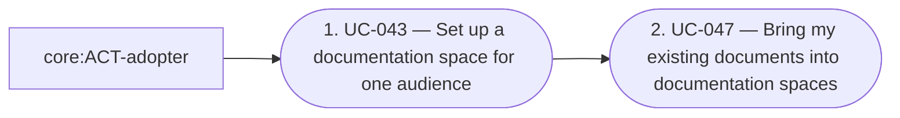

# Overview of the analysis of living-docs

<!-- pkit:overview reads=5 fingerprint=sha256:abc8149b210e9fc0a1296eedde783200d52896e72654e9951682b21747235640 -->

[Living documentation keeps each documentation space true for its readers](../../../../.pkit/capabilities/living-docs/decisions/DEC-001-living-docs-discipline.md).

This analysis describes what living-docs does: who uses it, what they do with it, and what it must meet. It builds on the analyses of core and project-management (optional).

## Areas

### 010-set-up

Set up the documentation spaces a project's readers need, and bring the documents it already has into them.

**Its concepts:**

- [010 — Spaces and pages](../domain-model/010-spaces-and-pages.md)
- [020 — Proposals and reviews](../domain-model/020-proposals-and-reviews.md)

**Its requirements:** none.

**Its use cases:**

- [UC-043 — Set up a documentation space for one audience](../use-case-model/use-cases/010-set-up/UC-043-set-up-space.md) ([not built yet](#not-built-yet): variant 1b, step 6)
- [UC-047 — Bring my existing documents into documentation spaces](../use-case-model/use-cases/010-set-up/UC-047-onboard-documents.md)

**Its journeys:**

- [JRN-010 — Adopt living-docs on a project that has documentation](../use-case-model/journeys/JRN-010-adopt-on-documented-project.md)

### 020-write

Write each page so it serves the reader it names, each of its statements grounded in what it anchors.

**Builds on:** [010-set-up](#010-set-up).

**Its concepts:**

- [010 — Spaces and pages](../domain-model/010-spaces-and-pages.md)
- [020 — Proposals and reviews](../domain-model/020-proposals-and-reviews.md)

**Its requirements:** none.

**Its use cases:**

- [UC-044 — Write a page for the reader it names](../use-case-model/use-cases/020-write/UC-044-write-page.md) ([not built yet](#not-built-yet): step 5, variant 10a)
- [UC-046 — Have a page read as its declared reader would read it](../use-case-model/use-cases/020-write/UC-046-review-page-as-reader.md) ([not built yet](#not-built-yet): variant 4a)

**Its journeys:**

- [JRN-011 — Write a page and have it read as its reader would read it](../use-case-model/journeys/JRN-011-publish-page-for-reader.md)

### 030-keep-current

Keep each page true as what it rests on changes, each fix proposed with its evidence and applied only once a person accepts it.

**Its concepts:**

- [010 — Spaces and pages](../domain-model/010-spaces-and-pages.md)
- [020 — Proposals and reviews](../domain-model/020-proposals-and-reviews.md)

**Its requirements:** none.

**Its use cases:**

- [UC-045 — Have the fix for a stale page proposed, and review it before it is applied](../use-case-model/use-cases/030-keep-current/UC-045-propose-page-fix.md) ([not built yet](#not-built-yet): variant 4c, variant 4e)

**Its journeys:** none.

## Reference

### Who takes part

| Actor | Who they are | Areas they act in |
| --- | --- | --- |
| core:ACT-adopter — Adopter | An actor of the analysis of core, which the head of the [glossary](../glossary.md) lists. | [010-set-up](#010-set-up) |
| core:ACT-ai-agent — AI agent | An actor of the analysis of core, which the head of the [glossary](../glossary.md) lists. | [010-set-up](#010-set-up), [020-write](#020-write), [030-keep-current](#030-keep-current) |
| core:ACT-developer — Developer | An actor of the analysis of core, which the head of the [glossary](../glossary.md) lists. | [020-write](#020-write), [030-keep-current](#030-keep-current) |
| core:ACT-operator — Operator | An actor of the analysis of core, which the head of the [glossary](../glossary.md) lists. | [010-set-up](#010-set-up), [020-write](#020-write) |

### Concepts

The [glossary](../glossary.md) defines each term.

Each view of the domain model explains a group of related concepts:

- [010 — Spaces and pages](../domain-model/010-spaces-and-pages.md)
- [020 — Proposals and reviews](../domain-model/020-proposals-and-reviews.md)

### Requirements in no area

- [REQ-022 · Functional · The living-docs agent proposes each change, and applies none](../requirements/functional/REQ-022-agent-proposes-only.md)
- [REQ-023 · Quality · A refused stamp puts back what it wrote, or names what it could not](../requirements/quality/REQ-023-refused-stamp-writes-nothing.md)
- [REQ-024 · Functional · Validation checks a part of an LDOC rule only where the rule binds](../requirements/functional/REQ-024-checks-where-rule-binds.md)
- [REQ-025 · Constraint · Nothing in living-docs fetches the text a captured source names](../requirements/constraints/REQ-025-never-fetch-source.md)

### Journeys

#### [JRN-010 — Adopt living-docs on a project that has documentation](../use-case-model/journeys/JRN-010-adopt-on-documented-project.md)

#### [JRN-011 — Write a page and have it read as its reader would read it](../use-case-model/journeys/JRN-011-publish-page-for-reader.md)

### Not built yet

What the use cases describe and the system does not do yet, each with the record that decides it and the issue that tracks it (software-analysis DEC-001 point 1):

- [UC-043 — Set up a documentation space for one audience](../use-case-model/use-cases/010-set-up/UC-043-set-up-space.md): variant 1b, decided by `living-docs:DEC-001#1`, tracked in `#1986`
- [UC-043 — Set up a documentation space for one audience](../use-case-model/use-cases/010-set-up/UC-043-set-up-space.md): step 6, decided by `ADR-034#1`, tracked in `#1765`
- [UC-044 — Write a page for the reader it names](../use-case-model/use-cases/020-write/UC-044-write-page.md): step 5, decided by `ADR-034#1`, tracked in `#1765`
- [UC-044 — Write a page for the reader it names](../use-case-model/use-cases/020-write/UC-044-write-page.md): variant 10a, decided by `living-docs:DEC-002`, tracked in `#1803`
- [UC-045 — Have the fix for a stale page proposed, and review it before it is applied](../use-case-model/use-cases/030-keep-current/UC-045-propose-page-fix.md): variant 4c, decided by `living-docs:DEC-002#5`, tracked in `#1812`
- [UC-045 — Have the fix for a stale page proposed, and review it before it is applied](../use-case-model/use-cases/030-keep-current/UC-045-propose-page-fix.md): variant 4e, decided by `living-docs:DEC-002#6`, tracked in `#1812`
- [UC-046 — Have a page read as its declared reader would read it](../use-case-model/use-cases/020-write/UC-046-review-page-as-reader.md): variant 4a, decided by `living-docs:DEC-002#8`, tracked in `#1812`

### Diagrams

`pkit analysis diagram --analysis living-docs` prints this analysis's diagrams from the working tree. Its subjects are `use-cases`, `journeys`, `requirements` and `chain`, or a journey's or a requirement's id.

---

The command `pkit analysis overview` writes this page from the analysis. Change the analysis, never this page (software-analysis DEC-003 point 8).
