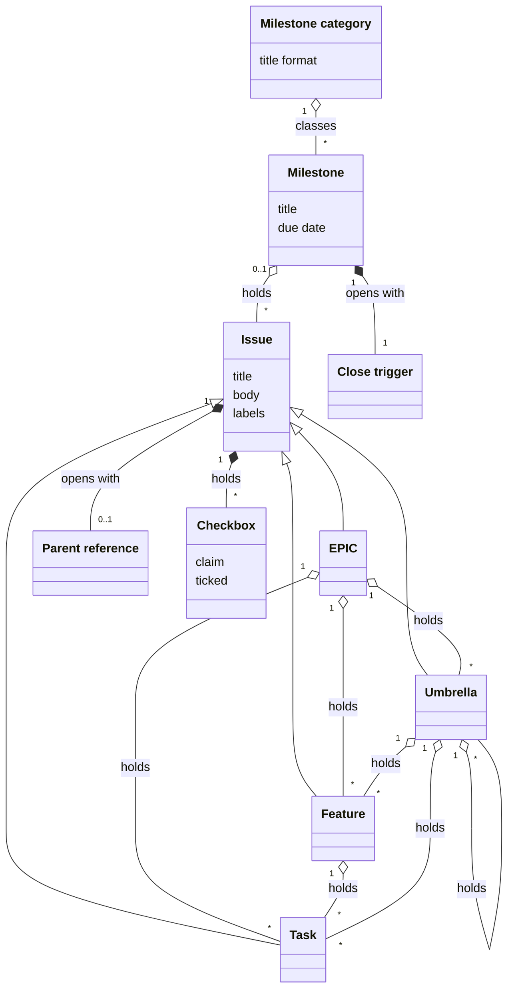
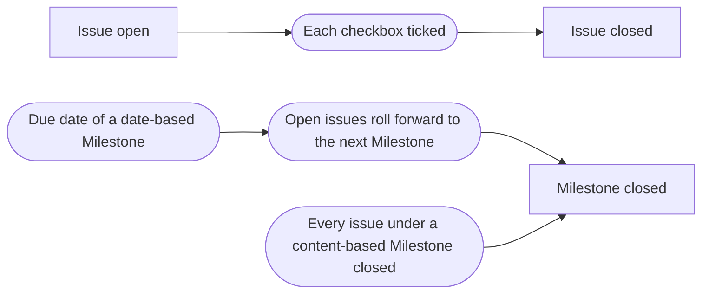

# VIEW-issues-and-their-hierarchy — Issues and their hierarchy

A team's work needs grouping between long-term outcomes and the changes that each land on their own. Too flat, and the work becomes a wall of undifferentiated items. Too deep, and filing becomes a structural debate ([DEC-004](../../../../.pkit/capabilities/project-management/decisions/DEC-004-six-level-hierarchy.md)).

An [issue](../glossary.md#term-issue--issue) is the item of work, and its type sets its level: [EPIC](../glossary.md#term-epic--epic), [Feature](../glossary.md#term-feature--feature), [Umbrella](../glossary.md#term-umbrella--umbrella) or [Task](../glossary.md#term-task--task).

A [Milestone](../glossary.md#term-milestone--milestone) holds the issues of one window or one bundle of outcomes. Its [Milestone category](../glossary.md#term-milestone-category--milestone-category) is one the [project](../../core/glossary.md#term-project--project) declares, and its [close trigger](../glossary.md#term-close-trigger--close-trigger) says when it ends. A [parent reference](../glossary.md#term-parent-reference--parent-reference) names each issue's parent in that issue's body, and [checkboxes](../glossary.md#term-checkbox--checkbox) say what must hold before the issue closes.

## Issue

Defined in [TERM-issue](../glossary.md#term-issue--issue).

**Why:** A team's work needs one kind of item that the hosting service already shows, links and searches. GitHub's issues give it, with sub-issues, [Milestones](../glossary.md#term-milestone--milestone) and labels that the [methodology](../../core/glossary.md#term-methodology--methodology) would otherwise have to specify in its own terms ([DEC-003](../../../../.pkit/capabilities/project-management/decisions/DEC-003-github-bound-substrate.md)).

An issue is one item of work a [project](../../core/glossary.md#term-project--project) tracks on GitHub. project-management files each issue as one of four types, and each type sits at its own level of the hierarchy.

**Attributes:**

- its title, which opens with its type's prefix, such as `[Task]` ([DEC-004](../../../../.pkit/capabilities/project-management/decisions/DEC-004-six-level-hierarchy.md))
- its body, whose first line is its [parent reference](../glossary.md#term-parent-reference--parent-reference) ([DEC-005](../../../../.pkit/capabilities/project-management/decisions/DEC-005-linking-and-containment.md) and [DEC-010](../../../../.pkit/capabilities/project-management/decisions/DEC-010-issue-body-minimum-structure.md))
- its labels, such as the one that gives its kind of work (DEC-003)

**Relations:**

- It is an [EPIC](../glossary.md#term-epic--epic), a [Feature](../glossary.md#term-feature--feature), an [Umbrella](../glossary.md#term-umbrella--umbrella) or a [Task](../glossary.md#term-task--task) (DEC-004).
- It sits in at most one Milestone at a time ([DEC-016](../../../../.pkit/capabilities/project-management/decisions/DEC-016-time-bound-containers.md)).
- Its parent is another issue or a Milestone. GitHub's sub-issue link holds the parent, and the parent reference names it (DEC-005).

**States:** An issue is open until it closes. It closes only once each of its [checkboxes](../glossary.md#term-checkbox--checkbox) is ticked ([DEC-007](../../../../.pkit/capabilities/project-management/decisions/DEC-007-checkbox-validation.md)).

**Always true:**

- Its type fixes its title's prefix, the sections its body needs and the parents it may have (DEC-004 and DEC-010).

## Milestone

Defined in [TERM-milestone](../glossary.md#term-milestone--milestone).

**Why:** Teams plan in different cadences, such as a sprint, a release wave or a quarter. So each [project](../../core/glossary.md#term-project--project) declares what its Milestones mean, rather than one meaning for every project. A date-based Milestone models a sprint: it ends on its date, and its unfinished work goes on in the next ([DEC-016](../../../../.pkit/capabilities/project-management/decisions/DEC-016-time-bound-containers.md)).

A Milestone is GitHub's own container, kept apart from issues. It holds the issues of one delivery window, or of one bundle of outcomes that close together. Its description opens with the line that says when it closes.

**Attributes:**

- its title, in the format of its [Milestone category](../glossary.md#term-milestone-category--milestone-category) (DEC-016)
- its due date, which it may lack (DEC-016)
- its [close trigger](../glossary.md#term-close-trigger--close-trigger), `date-based`, `content-based` or `either`, on the first line of its description (DEC-016)

**Relations:**

- It holds issues, each in at most one Milestone at a time (DEC-016).
- It holds [EPICs](../glossary.md#term-epic--epic) directly. Where the project skips the EPIC, it holds Features, Umbrellas and Tasks directly too ([DEC-004](../../../../.pkit/capabilities/project-management/decisions/DEC-004-six-level-hierarchy.md)).
- It holds no other Milestone (DEC-016).
- It belongs to one Milestone category (DEC-016).

**States:** A Milestone is open until it closes. A date-based one closes at its due date, and its open issues roll forward to the next Milestone. A content-based one closes once every [issue](../glossary.md#term-issue--issue) under it has closed, and one marked `either` closes at whichever comes first (DEC-016).

**Always true:**

- Every Milestone can close, so a theme that never ends is no Milestone (DEC-016).

## Close trigger

Defined in [TERM-close-trigger](../glossary.md#term-close-trigger--close-trigger).

**Why:** When a [Milestone](../glossary.md#term-milestone--milestone) closes must be declared and readable by a machine, so nothing is inferred while the line is there. The line mirrors the [parent reference](../glossary.md#term-parent-reference--parent-reference) on an [issue](../glossary.md#term-issue--issue)'s first line, and people see it where they read the Milestone ([DEC-016](../../../../.pkit/capabilities/project-management/decisions/DEC-016-time-bound-containers.md)).

A close trigger is the first line of a Milestone's description, such as `Close trigger: date-based`. A `date-based` Milestone closes at its due date, and its open issues roll forward. A `content-based` one closes once its issues have closed, and one marked `either` closes at whichever comes first.

**Attributes:**

- its value: `date-based`, `content-based` or `either` (DEC-016)

**Relations:**

- It opens the description of one Milestone (DEC-016).
- It overrides the default of the Milestone's category (DEC-016).

**States:** None.

**Always true:**

- Open issues roll forward only where a date closed the Milestone (DEC-016).

## Milestone category

Defined in [TERM-milestone-category](../glossary.md#term-milestone-category--milestone-category).

**Why:** Teams plan in different cadences, and the [methodology](../../core/glossary.md#term-methodology--methodology) prescribes none of them. So a [project](../../core/glossary.md#term-project--project) declares what its [Milestones](../glossary.md#term-milestone--milestone) mean before it creates the first one. Readers then see which kinds it supports, without reading the record ([DEC-016](../../../../.pkit/capabilities/project-management/decisions/DEC-016-time-bound-containers.md)).

A Milestone category is one kind of Milestone a project uses, such as a sprint or a bundle of outcomes. Its title format, with an optional number, shows which category a Milestone belongs to.

**Attributes:**

- its title format, which may hold a number (DEC-016)
- its default [close trigger](../glossary.md#term-close-trigger--close-trigger) (DEC-016)
- a sentence that says what its Milestones mean (DEC-016)

**Relations:**

- Each Milestone's title follows the format of one category (DEC-016).
- A Milestone's own close trigger overrides its category's default (DEC-016).

**States:** None.

**Always true:**

- A project that uses Milestones declares one category at least, before its first Milestone (DEC-016).
- Each category numbers its Milestones apart from the others (DEC-016).

## EPIC

Defined in [TERM-epic](../glossary.md#term-epic--epic).

**Why:** Planning needs a level for long-term outcomes, above the work that delivers them. The EPIC is that level, the first of the hierarchy's three structural levels ([DEC-004](../../../../.pkit/capabilities/project-management/decisions/DEC-004-six-level-hierarchy.md)).

An EPIC states one outcome that spans several quarters. The work that delivers the outcome is filed under the EPIC. The EPIC closes once its success criteria are met.

**Attributes:**

- its outcome, under `## Outcome` ([DEC-010](../../../../.pkit/capabilities/project-management/decisions/DEC-010-issue-body-minimum-structure.md))
- its success criteria, as [checkboxes](../glossary.md#term-checkbox--checkbox) under `## Success criteria` (DEC-010)

**Relations:**

- It sits directly under a [Milestone](../glossary.md#term-milestone--milestone), or under none while it is not scheduled (DEC-004 and DEC-010).
- It holds Features, Umbrellas and Tasks ([DEC-005](../../../../.pkit/capabilities/project-management/decisions/DEC-005-linking-and-containment.md)).

**States:** None.

**Always true:**

- No EPIC holds another EPIC (DEC-005).

## Feature

Defined in [TERM-feature](../glossary.md#term-feature--feature).

**Why:** Between an outcome and its changes, planning needs to know which pieces of functionality ship. A Feature claims one, and its criteria check the claim. Without it, that signal is lost ([DEC-004](../../../../.pkit/capabilities/project-management/decisions/DEC-004-six-level-hierarchy.md)).

A Feature is an [issue](../glossary.md#term-issue--issue) for one coherent piece of functionality, which several Tasks deliver. Its acceptance criteria say how the claim is checked.

**Attributes:**

- what it claims, under `## What` ([DEC-010](../../../../.pkit/capabilities/project-management/decisions/DEC-010-issue-body-minimum-structure.md))
- its acceptance criteria, as [checkboxes](../glossary.md#term-checkbox--checkbox) (DEC-010)

**Relations:**

- It sits under an [EPIC](../glossary.md#term-epic--epic) or an [Umbrella](../glossary.md#term-umbrella--umbrella), or straight under a [Milestone](../glossary.md#term-milestone--milestone) where the [project](../../core/glossary.md#term-project--project) skips the EPIC (DEC-004).
- It holds Tasks, and no Feature or Umbrella ([DEC-005](../../../../.pkit/capabilities/project-management/decisions/DEC-005-linking-and-containment.md)).

**States:** None.

**Always true:**

- A Feature never holds another Feature (DEC-005).

## Umbrella

Defined in [TERM-umbrella](../glossary.md#term-umbrella--umbrella).

**Why:** Some related work shares a theme and claims no functionality. An Umbrella groups it without that claim, so the claim a [Feature](../glossary.md#term-feature--feature) makes keeps its meaning ([DEC-004](../../../../.pkit/capabilities/project-management/decisions/DEC-004-six-level-hierarchy.md) and [DEC-005](../../../../.pkit/capabilities/project-management/decisions/DEC-005-linking-and-containment.md)).

An Umbrella is a bucket of related work. Its body says what holds that work together, and it carries no acceptance criteria.

**Attributes:**

- its purpose, under `## Purpose` ([DEC-010](../../../../.pkit/capabilities/project-management/decisions/DEC-010-issue-body-minimum-structure.md))

**Relations:**

- It sits under an [EPIC](../glossary.md#term-epic--epic), another Umbrella or a [Milestone](../glossary.md#term-milestone--milestone) (DEC-004).
- It holds Features, Umbrellas and Tasks (DEC-004).

**States:** None.

**Always true:**

- It claims no functionality, and carries no acceptance criteria (DEC-004 and DEC-010).

## Task

Defined in [TERM-task](../glossary.md#term-task--task).

**Why:** The lowest structural level of planning is the unit of work that lands as one [change](../../core/glossary.md#term-change--change). A Task is that unit ([DEC-004](../../../../.pkit/capabilities/project-management/decisions/DEC-004-six-level-hierarchy.md)).

A Task is an [issue](../glossary.md#term-issue--issue) for one unit of implementation work, which one [pull request](../../core/glossary.md#term-pull-request--pull-request) delivers. Its body says these:

- what changes
- how the change is checked
- which documents change with it

**Attributes:**

- what changes, under `## What` ([DEC-010](../../../../.pkit/capabilities/project-management/decisions/DEC-010-issue-body-minimum-structure.md))
- its acceptance criteria, as [checkboxes](../glossary.md#term-checkbox--checkbox) (DEC-010)
- the documents that change with it, under `## Doc impact` (DEC-010)

**Relations:**

- It sits under a [Feature](../glossary.md#term-feature--feature), an [Umbrella](../glossary.md#term-umbrella--umbrella) or an [EPIC](../glossary.md#term-epic--epic), or straight under a [Milestone](../glossary.md#term-milestone--milestone) where the [project](../../core/glossary.md#term-project--project) skips the EPIC (DEC-004).
- It holds no issue. Its sub-tasks are checkboxes in its body ([DEC-005](../../../../.pkit/capabilities/project-management/decisions/DEC-005-linking-and-containment.md)).

**States:** None.

**Always true:**

- A sub-task that needs its own pull request becomes a Task, under the parent of the Task that held it (DEC-005 and DEC-010).

## Parent reference

Defined in [TERM-parent-reference](../glossary.md#term-parent-reference--parent-reference).

**Why:** A child must name its parent where GitHub's interface does not show the link, such as in a diff or an exported [issue](../glossary.md#term-issue--issue). The parent reference names it there, and survives wherever the body is copied ([DEC-005](../../../../.pkit/capabilities/project-management/decisions/DEC-005-linking-and-containment.md)).

A parent reference is the first line of an issue's body, such as `EPIC: #1643`. Its form depends on the issue's type, and GitHub's sub-issue link holds the same parent.

**Attributes:**

- the parent's type and number, in the form the issue's type declares (DEC-005)

**Relations:**

- It opens the body of one issue, and names the issue or the [Milestone](../glossary.md#term-milestone--milestone) that issue sits under (DEC-005).

**States:** None.

**Always true:**

- Where it and GitHub's sub-issue link disagree, the link wins, and the line is rewritten to match (DEC-005).

## Checkbox

Defined in [TERM-checkbox](../glossary.md#term-checkbox--checkbox).

**Why:** Checkboxes in a body are either decoration or gates. Soft warnings drifted into decoration in practice, so a checkbox is a gate: it makes a claim carry weight ([DEC-007](../../../../.pkit/capabilities/project-management/decisions/DEC-007-checkbox-validation.md)).

A checkbox is a box in an [issue](../glossary.md#term-issue--issue)'s body beside one claim, such as an acceptance criterion. Whoever ticks it has checked the claim at that moment, and nothing checks the claim again at the close.

**Attributes:**

- its claim (DEC-007)
- whether it is ticked (DEC-007)

**Relations:**

- It belongs to one issue's body (DEC-007).
- A checkbox that names another issue, such as `- [ ] #99`, is ticked when that issue closes (DEC-007).

**States:** A checkbox is unticked until whoever checked its claim ticks it. Once ticked, it is unticked only with a comment that says what regressed and why (DEC-007).

**Always true:**

- An issue with an unticked checkbox cannot close (DEC-007).
- A tick is never checked again at the close (DEC-007).
