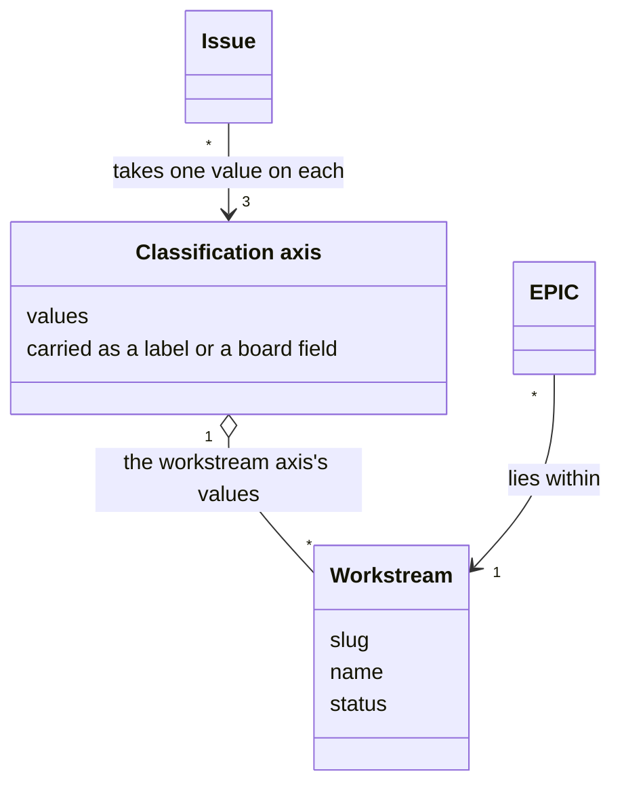
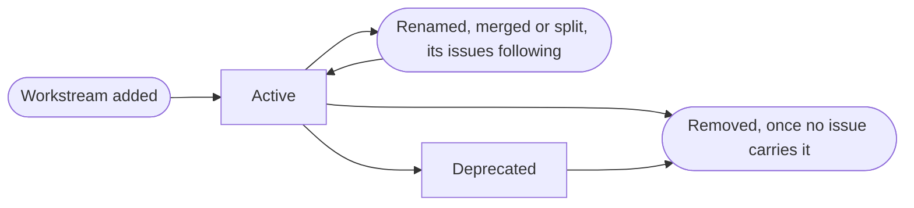

# VIEW-classification-of-issues — Classification of issues

Issues need classification beyond their type. Classification keeps the filing of issues the same each time, and lets a board filter and plan by it. Classification also aligns a [pull request](../../core/glossary.md#term-pull-request--pull-request)'s title with the work the pull request closes ([DEC-012](../../../../.pkit/capabilities/project-management/decisions/DEC-012-classification-axes.md)).

A [classification axis](../glossary.md#term-classification-axis--classification-axis) is one dimension of that classification, on which every [issue](../glossary.md#term-issue--issue) takes one value. A [workstream](../glossary.md#term-workstream--workstream) is one value of the `workstream` axis: a long-lived area of the work, which the [project](../../core/glossary.md#term-project--project) declares in a file of its own.

## Classification axis

Defined in [TERM-classification-axis](../glossary.md#term-classification-axis--classification-axis).

**Why:** Classification serves three jobs: consistent filing, a board's filters and plans, and pull-request titles aligned with their work. Each job needs every [issue](../glossary.md#term-issue--issue) to carry a value on each axis ([DEC-012](../../../../.pkit/capabilities/project-management/decisions/DEC-012-classification-axes.md)).

A classification axis is one dimension along which every issue is classified. There are three: `type`, the kind of work, then `priority` and `workstream`. An issue carries one value on each, on a label or on a field of a board.

**Attributes:**

- its values: a fixed set for `type` and `priority`, and the [project](../../core/glossary.md#term-project--project)'s own for `workstream` (DEC-012)
- where it is carried: a label, or a field of a Projects v2 board where the project keeps one (DEC-012)

**Relations:**

- Each issue takes one value on each axis (DEC-012).
- The value on `type` sets a [Task](../glossary.md#term-task--task)'s title prefix, and the commit type of the [pull request](../../core/glossary.md#term-pull-request--pull-request) that closes it (DEC-012).

**States:** None.

**Always true:**

- The `type` axis is always carried as a label, and no issue carries two values on it (DEC-012).
- An [EPIC](../glossary.md#term-epic--epic), a [Feature](../glossary.md#term-feature--feature) and an [Umbrella](../glossary.md#term-umbrella--umbrella) always take the value `feature` on `type` (DEC-012).
- A [Milestone](../glossary.md#term-milestone--milestone) carries no classification axis (DEC-012).

## Workstream

Defined in [TERM-workstream](../glossary.md#term-workstream--workstream).

**Why:** A team invests in long-lived areas over many outcomes. Where each [project](../../core/glossary.md#term-project--project) improvises their names and their lifecycle, the names drift. One definition, kept in one file with fixed forms for the names, keeps every project's workstreams in one shape ([DEC-018](../../../../.pkit/capabilities/project-management/decisions/DEC-018-workstream-taxonomy-and-lifecycle.md)).

A workstream is a long-lived area of a project's work, such as `docs` or `cli`. It outlasts the [EPICs](../glossary.md#term-epic--epic) whose outcomes lie within it. The project declares its workstreams in a file of its own, and each one is a value of the `workstream` axis.

**Attributes:**

- its slug, which other files cite, and its name (DEC-018)
- its description, which may be empty (DEC-018)
- its status, `active` or `deprecated`, with the reason for a deprecation (DEC-018)

**Relations:**

- It is one value of the `workstream` [classification axis](../glossary.md#term-classification-axis--classification-axis) ([DEC-012](../../../../.pkit/capabilities/project-management/decisions/DEC-012-classification-axes.md)).
- An EPIC scopes one outcome within a workstream (DEC-018).
- It groups issues, and is the parent of none ([DEC-016](../../../../.pkit/capabilities/project-management/decisions/DEC-016-time-bound-containers.md)).

**States:** A workstream is added as active, and may be deprecated. It may be renamed, merged into another or split into several, and the issues that carry it follow. It is removed only once no [issue](../glossary.md#term-issue--issue) carries it (DEC-018).

**Always true:**

- The project's file of workstreams is authoritative, and a board's field reflects it (DEC-018).
- Its slug is 2 to 40 lowercase letters, digits and single hyphens (DEC-018).

## What is built on these concepts

Each concept below lists the use cases, journeys and requirements whose text links its term.

**Classification axis:**

- [UC-060 — File a Task under its parent, its title and body checked as it is filed](../use-case-model/use-cases/020-file-and-move/UC-060-file-task.md)
- [UC-063 — Plan an intent into an EPIC and its work, filed once I approve the plan](../use-case-model/use-cases/010-plan/UC-063-plan-intent.md)

**Workstream:**

- [UC-060 — File a Task under its parent, its title and body checked as it is filed](../use-case-model/use-cases/020-file-and-move/UC-060-file-task.md)
- [UC-063 — Plan an intent into an EPIC and its work, filed once I approve the plan](../use-case-model/use-cases/010-plan/UC-063-plan-intent.md)
- [UC-064 — Define the Milestones and workstreams the work falls into, and roll a date-based Milestone forward](../use-case-model/use-cases/010-plan/UC-064-define-milestones-and-workstreams.md)
- [UC-082 — Set up my project's topology in its committed configuration, so that every clone reads the same seats](../use-case-model/use-cases/040-work-in-parallel/UC-082-set-up-topology.md)
- [UC-083 — Plan an intent into Tasks that one agent can each finish](../use-case-model/use-cases/040-work-in-parallel/UC-083-plan-across-scopes.md)
- [UC-084 — Take my next ready Task, and build it up to its merge](../use-case-model/use-cases/040-work-in-parallel/UC-084-take-next-task.md)
- [UC-085 — Never work on a Task another agent already works on](../use-case-model/use-cases/040-work-in-parallel/UC-085-leave-task-to-its-owner.md)
- [UC-087 — Hand the next piece of the work to the scope that does it](../use-case-model/use-cases/040-work-in-parallel/UC-087-hand-over-to-next-scope.md)
- [JRN-004 — Set up the topology my project runs, and adjust it on what I measure](../use-case-model/journeys/JRN-004-set-up-and-adjust-topology.md)
