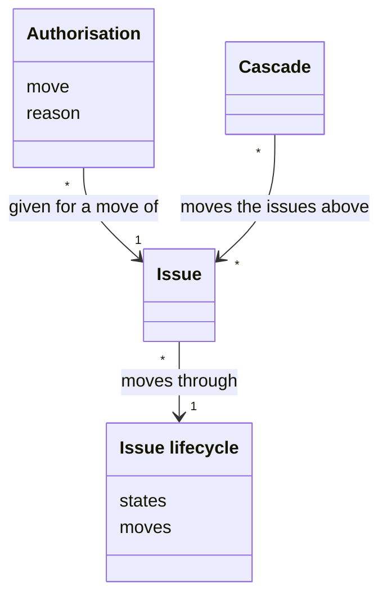
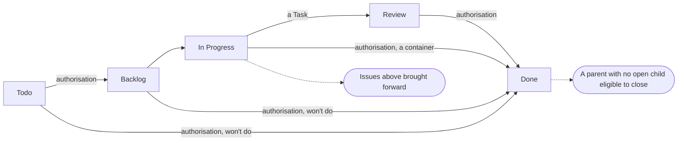
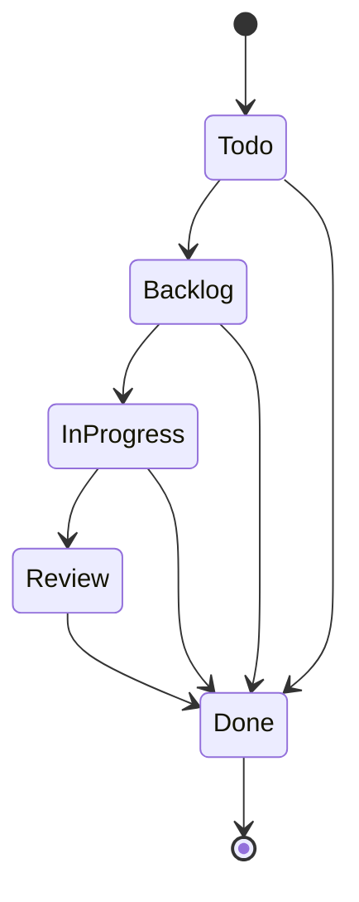

# VIEW-the-issue-lifecycle — The issue lifecycle

An agent makes most of an [issue](../glossary.md#term-issue--issue)'s moves, but the start and the end of work are commitments a person must authorise. Without fixed states and a [rule](../../core/glossary.md#term-rule--rule) for the issues above, what the agent does is not deterministic (DEC-006).

The [issue lifecycle](../glossary.md#term-issue-lifecycle--issue-lifecycle) fixes the states and the moves between them. An [authorisation](../glossary.md#term-authorisation--authorisation) is a person's go-ahead for a move they hold. The [cascade](../glossary.md#term-cascade--cascade) brings the issues above along with each move.

## Issue lifecycle

Defined in [TERM-issue-lifecycle](../glossary.md#term-issue-lifecycle--issue-lifecycle).

**Why:** Every [issue](../glossary.md#term-issue--issue) moves from filing to closure, and an agent makes most of the moves. Fixed states, with fixed moves between them, make what the agent does deterministic. The moves that start and end work are the ones a person holds (DEC-006).

The issue lifecycle is the [process](../../core/glossary.md#term-process--process) every issue moves through: Todo, Backlog, In Progress, Review and Done. A person schedules the work, the agent moves it through the middle, and a person decides its end.

**Attributes:**

- its five states, in a fixed order (DEC-006)
- the moves it declares between them, each with who authorises it and how a breach is met (DEC-006)

**Relations:**

- Each issue moves through it, and only a [Task](../glossary.md#term-task--task) enters Review (DEC-006).
- The core's engine checks each move against its definition (DEC-033).

**States:** An issue is in Todo when it is filed, and in Backlog once a person schedules it. It is in In Progress once its work starts, and a Task is in Review while its [pull request](../../core/glossary.md#term-pull-request--pull-request) is open. An issue is in Done once it closes (DEC-006).

**Always true:**

- Where a board's Status column and the issue disagree, the state the issue carries wins (DEC-006).
- A container never enters Review. It reaches Done only by its own close, once its children are done (DEC-006).

## Authorisation

Defined in [TERM-authorisation](../glossary.md#term-authorisation--authorisation).

**Why:** The start and the end of work are commitments an agent must not make on its own. Held as refusals the agent cannot pass, the gates turn the [methodology](../../core/glossary.md#term-methodology--methodology)'s authority into something enforced rather than trusted (DEC-006).

An authorisation is a person's go-ahead for one move they hold. Scheduling an [issue](../glossary.md#term-issue--issue) needs one, and so do merging a [Task](../glossary.md#term-task--task)'s [pull request](../../core/glossary.md#term-pull-request--pull-request) and closing an issue as won't do or as a finished container. The person gives it for the issue at hand, and it never stands for a later move.

**Attributes:**

- the move it is for, and the issue (DEC-006)
- a reason, where the move's [rule](../../core/glossary.md#term-rule--rule) refuses unless a person overrides it, such as scheduling with no [Milestone](../glossary.md#term-milestone--milestone) (DEC-006 and DEC-014)
- for a merge, the [head](../../core/glossary.md#term-head--head) of the pull request it covers (DEC-055 point 3)

**Relations:**

- It is given for one move of one issue (DEC-006).
- A move of the [cascade](../glossary.md#term-cascade--cascade) needs none (DEC-006).

**States:** None.

**Always true:**

- A move a person holds is never made without its authorisation (DEC-006).
- Where a move's rule allows a person to override it, the reason goes into a comment before the move (DEC-014).
- An authorisation to merge is the person's, and no [reviewer](../../core/glossary.md#term-reviewer--reviewer)'s approval gives it (DEC-055 point 3).

## Cascade

Defined in [TERM-cascade](../glossary.md#term-cascade--cascade).

**Why:** A parent's progress follows from its children's, never the other way round. So a container behind the work under it is brought level, on nobody's say-so. Closing a parent is a commitment, so the cascade stops at each one for a person to authorise its close (DEC-006).

The cascade is what one [issue](../glossary.md#term-issue--issue)'s move does to the issues above it. Moving forward, it brings each one that is behind up to the issue's state, as far as In Progress. When a child closes, it makes a parent whose children are all done eligible to close, and never closes it.

**Attributes:** None.

**Relations:**

- It follows one issue's move, and moves or flags the issues above that issue (DEC-006).
- It asks for no [authorisation](../glossary.md#term-authorisation--authorisation), and the parent's close it flags needs one (DEC-006).

**States:** None.

**Always true:**

- It moves an issue above only forward, and never past In Progress (DEC-006).
- It never moves a child because its parent moved (DEC-006).
- A move to Done from Todo or Backlog, a won't-do close, moves no issue above (DEC-006).
- A container closes only once its [checkboxes](../glossary.md#term-checkbox--checkbox) are ticked and its children are done (DEC-034).
