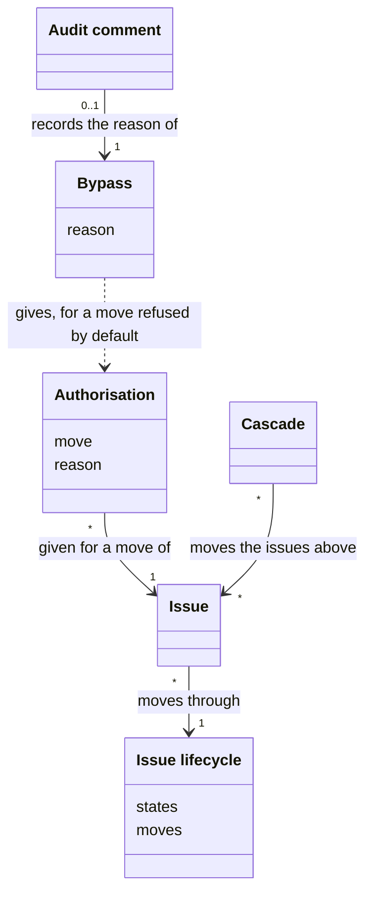
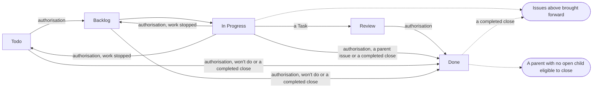
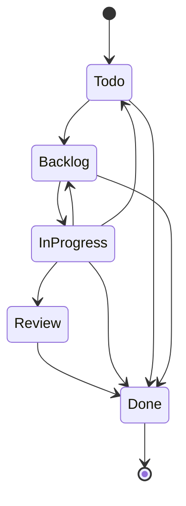

# VIEW-the-issue-lifecycle — The issue lifecycle

An agent makes most of an [issue](../glossary.md#term-issue--issue)'s moves, but scheduling and ending the work are commitments a person must authorise. A person authorises a move back from In Progress too, since that move settles what becomes of the scheduling. Without fixed states, and a way for the issues above to follow, what the agent does is not deterministic ([DEC-006](../../../../.pkit/capabilities/project-management/decisions/DEC-006-state-machine-and-cascade.md)).

The [issue lifecycle](../glossary.md#term-issue-lifecycle--issue-lifecycle) fixes the states and the moves between them. An [authorisation](../glossary.md#term-authorisation--authorisation) is a person's decision on a move they hold. The [cascade](../glossary.md#term-cascade--cascade) brings the issues above along with each move. A [bypass](../glossary.md#term-bypass--bypass) overrides a check with a person's reason, which an [audit comment](../glossary.md#term-audit-comment--audit-comment) records.

## Issue lifecycle

Defined in [TERM-issue-lifecycle](../glossary.md#term-issue-lifecycle--issue-lifecycle).

**Why:** Every [issue](../glossary.md#term-issue--issue) moves from filing to closure, and an agent makes most of the moves. Fixed states, with fixed moves between them, make what the agent does deterministic. A person holds the moves that schedule and end the work, and the move back from In Progress ([DEC-006](../../../../.pkit/capabilities/project-management/decisions/DEC-006-state-machine-and-cascade.md)).

The issue lifecycle is the [process](../../core/glossary.md#term-process--process) every issue moves through: Todo, Backlog, In Progress, Review and Done. Who moves an issue:

- a person schedules the work
- the agent moves it through the middle
- a person moves it back from In Progress once its work stopped
- a person decides its end

**Attributes:**

- its five states, in a fixed order (DEC-006)
- the moves it declares between them, each with who authorises it and how a breach is met (DEC-006)

**Relations:**

- Each issue moves through it, and only a [Task](../glossary.md#term-task--task) enters Review (DEC-006).
- The core's engine checks each move against its definition ([DEC-033](../../../../.pkit/capabilities/project-management/decisions/DEC-033-rebind-issue-lifecycle-onto-process-substrate.md)).

**States:** An issue is in Todo when it is filed, and in Backlog once a person schedules it. It is in In Progress once its work starts, and a Task is in Review while its [pull request](../../core/glossary.md#term-pull-request--pull-request) is open. A person moves an issue whose work stopped back from In Progress, to Backlog or to Todo. An issue is in Done once it closes (DEC-006).

**Always true:**

- Where a board's Status column and the issue disagree, the state the issue carries wins (DEC-006).
- A parent issue never enters Review. It reaches Done only by its own close, once its children are done (DEC-006).

## Authorisation

Defined in [TERM-authorisation](../glossary.md#term-authorisation--authorisation).

**Why:** Scheduling and ending the work are commitments an agent must not make on its own. A move back from In Progress settles what becomes of the scheduling, so a person holds that move too. Held as refusals the agent cannot pass, the gates turn the [methodology](../../core/glossary.md#term-methodology--methodology)'s authority into something enforced rather than trusted ([DEC-006](../../../../.pkit/capabilities/project-management/decisions/DEC-006-state-machine-and-cascade.md)).

An authorisation is a person's decision on one move they hold. Scheduling an [issue](../glossary.md#term-issue--issue) needs one, and so does ending a [Task](../glossary.md#term-task--task)'s work, by a merge of the Task's [pull request](../../core/glossary.md#term-pull-request--pull-request) or by a completed close. A completed close closes a Task whose work was not a pull request, as completed. Closing an issue as won't do, or a finished parent issue, needs one too, and so does moving back an issue whose work stopped.

The person gives an authorisation in the session, for the issue at hand, and it never stands for a later move.

**Attributes:**

- the move it is for, and the issue (DEC-006)
- a reason, where the move is refused unless a person overrides it, such as scheduling with no [Milestone](../glossary.md#term-milestone--milestone) (DEC-006 and [DEC-014](../../../../.pkit/capabilities/project-management/decisions/DEC-014-validation-severity-model.md))
- a reason, where the move is back from In Progress: why the work stopped (DEC-006)
- for a merge, the [head](../../core/glossary.md#term-head--head) of the pull request it covers ([DEC-055 point 3](../../../../.pkit/capabilities/project-management/decisions/DEC-055-pr-lists-answers.md#3-the-review-and-the-authorisation))

**Relations:**

- It is given for one move of one issue (DEC-006).
- A move of the [cascade](../glossary.md#term-cascade--cascade) needs none (DEC-006).

**States:** None.

**Always true:**

- A move a person holds is never made without its authorisation (DEC-006).
- A [bypass](../glossary.md#term-bypass--bypass)'s reason goes into an [audit comment](../glossary.md#term-audit-comment--audit-comment) before the move, where the [project](../../core/glossary.md#term-project--project)'s settings keep such comments (DEC-014 and [DEC-049](../../../../.pkit/capabilities/project-management/decisions/DEC-049-audit-journal-model.md)).
- An authorisation to merge is the person's, and no [reviewer](../../core/glossary.md#term-reviewer--reviewer)'s approval gives it (DEC-055 point 3).

## Cascade

Defined in [TERM-cascade](../glossary.md#term-cascade--cascade).

**Why:** A parent's progress follows from its children's, never the other way round. So a parent [issue](../glossary.md#term-issue--issue) behind the work under it is brought level, on nobody's say-so. Closing a parent is a commitment, so the cascade stops at each one for a person to authorise its close ([DEC-006](../../../../.pkit/capabilities/project-management/decisions/DEC-006-state-machine-and-cascade.md)).

The cascade is what one issue's move does to the issues above it. Moving forward, it brings each one that is behind up to the issue's state, as far as In Progress. When a child closes, the cascade makes a parent whose children are all done eligible to close, and never closes that parent.

**Attributes:** None.

**Relations:**

- It follows one issue's move, and moves or flags the issues above that issue (DEC-006).
- It asks for no [authorisation](../glossary.md#term-authorisation--authorisation), and the parent's close it flags needs one (DEC-006).

**States:** None.

**Always true:**

- It moves an issue above only forward, and never past In Progress (DEC-006).
- It never moves a child because its parent moved (DEC-006).
- A move back from In Progress moves no other issue. A parent issue moves back only while no child of it is In Progress or in Review, so it never stands behind its children (DEC-006).
- A won't-do close from Todo or Backlog moves no issue above. A completed close brings each issue above that is behind up to In Progress, since completed work is progress (DEC-006).
- A parent issue closes only once its [checkboxes](../glossary.md#term-checkbox--checkbox) are ticked and its children are done ([DEC-034](../../../../.pkit/capabilities/project-management/decisions/DEC-034-cascade-slot-binding.md)).

## Audit comment

Defined in [TERM-audit-comment](../glossary.md#term-audit-comment--audit-comment).

**Why:** The timeline already records each label added or removed, so a comment that only restates a move adds nothing. A comment carries what the timeline cannot: why a person overrode a check, and which version made an edit ([DEC-049](../../../../.pkit/capabilities/project-management/decisions/DEC-049-audit-journal-model.md)).

An audit comment is one the system posts on an [issue](../glossary.md#term-issue--issue) or a [pull request](../../core/glossary.md#term-pull-request--pull-request). At the default setting it records each [bypass](../glossary.md#term-bypass--bypass), and each move back from In Progress, with its reason. At the fullest setting it records each write the system governs too.

**Attributes:**

- the reason, where it records a bypass ([DEC-014](../../../../.pkit/capabilities/project-management/decisions/DEC-014-validation-severity-model.md)) or a move back ([DEC-006](../../../../.pkit/capabilities/project-management/decisions/DEC-006-state-machine-and-cascade.md))
- at the fullest setting, the versions that made the write ([DEC-049 point 2](../../../../.pkit/capabilities/project-management/decisions/DEC-049-audit-journal-model.md#2-github-comments-are-a-configurable-provenance-stamped-projection-with-three-intensities))

**Relations:**

- It records a bypass's reason, before the write the bypass allows (DEC-014).
- It records why the work stopped, before a move back from In Progress (DEC-006).

**States:** None.

**Always true:**

- The [project](../../core/glossary.md#term-project--project)'s settings choose among no audit comments, those of overrides alone, and one for each governed write (DEC-049 point 2).
- One command alone posts the comment of a move, once for each move ([DEC-049 point 4](../../../../.pkit/capabilities/project-management/decisions/DEC-049-audit-journal-model.md#4-format--single-poster-rules)).

## Bypass

Defined in [TERM-bypass](../glossary.md#term-bypass--bypass).

**Why:** Some checks guard what may happen with an explicit justification, rather than what must never happen. A bypass lets a person override such a check with a reason. The reason is posted before the write, so it survives a step that fails ([DEC-014](../../../../.pkit/capabilities/project-management/decisions/DEC-014-validation-severity-model.md)).

A bypass overrides one check that refuses by default, such as scheduling an [issue](../glossary.md#term-issue--issue) with no [Milestone](../glossary.md#term-milestone--milestone). The person gives the reason with the command, and the system records it before it goes on.

**Attributes:**

- the check it overrides ([DEC-046 point 1](../../../../.pkit/capabilities/project-management/decisions/DEC-046-override-flag-convention.md#1---bypass-gate--the-sanctioned-override-of-a-bypassable-with-audit-gate))
- its reason, which may not be empty (DEC-014)

**Relations:**

- An [audit comment](../glossary.md#term-audit-comment--audit-comment) records its reason, before the write it allows (DEC-014).
- It is how a person authorises a move that the [issue lifecycle](../glossary.md#term-issue-lifecycle--issue-lifecycle) refuses unless a person overrides it ([DEC-006](../../../../.pkit/capabilities/project-management/decisions/DEC-006-state-machine-and-cascade.md)).

**States:** None.

**Always true:**

- A bypass with no reason is refused (DEC-014).
- A check that guards what must never happen takes no bypass. Only an operator's `--force` overrides it ([DEC-046 point 2](../../../../.pkit/capabilities/project-management/decisions/DEC-046-override-flag-convention.md#2---force--the-operators-override-of-a-hard-reject-finding-or-a-hard-precondition)).

## What is built on these concepts

Each concept below lists the use cases, journeys and requirements whose text links its term.

**Issue lifecycle:**

- [UC-060 — File a Task under its parent, its title and body checked as it is filed](../use-case-model/use-cases/020-file-and-move/UC-060-file-task.md)
- [UC-061 — Move my issue through its lifecycle, each move checked](../use-case-model/use-cases/020-file-and-move/UC-061-move-issue.md)
- [UC-064 — Define the Milestones and workstreams the work falls into, and roll a date-based Milestone forward](../use-case-model/use-cases/010-plan/UC-064-define-milestones-and-workstreams.md)
- [UC-084 — Take my next ready Task, and build it up to its merge](../use-case-model/use-cases/040-work-in-parallel/UC-084-take-next-task.md)
- [UC-085 — Never work on a Task another agent already works on](../use-case-model/use-cases/040-work-in-parallel/UC-085-leave-task-to-its-owner.md)
- [UC-087 — Hand the next piece of the work to the scope that does that piece](../use-case-model/use-cases/040-work-in-parallel/UC-087-hand-over-to-next-scope.md)
- [UC-090 — See which agent works on which issue, without visiting each agent](../use-case-model/use-cases/040-work-in-parallel/UC-090-see-who-works-on-what.md)
- [JRN-004 — Set up the topology my project runs, and adjust the topology on what I measure](../use-case-model/journeys/JRN-004-set-up-and-adjust-topology.md)

**Authorisation:**

- [UC-061 — Move my issue through its lifecycle, each move checked](../use-case-model/use-cases/020-file-and-move/UC-061-move-issue.md)
- [UC-062 — Have the reviewers my change requires review my pull request, and land it](../use-case-model/use-cases/030-review-and-land/UC-062-review-and-land.md)
- [UC-089 — Land my Task while other agents land theirs](../use-case-model/use-cases/040-work-in-parallel/UC-089-land-alongside-others.md)
- [REQ-042 · Functional · A move a person holds is made only on that person's authorisation](../requirements/functional/REQ-042-held-moves-authorised.md)

**Cascade:**

- [UC-061 — Move my issue through its lifecycle, each move checked](../use-case-model/use-cases/020-file-and-move/UC-061-move-issue.md)
- [UC-062 — Have the reviewers my change requires review my pull request, and land it](../use-case-model/use-cases/030-review-and-land/UC-062-review-and-land.md)

**Audit comment:**

- [UC-060 — File a Task under its parent, its title and body checked as it is filed](../use-case-model/use-cases/020-file-and-move/UC-060-file-task.md)
- [UC-061 — Move my issue through its lifecycle, each move checked](../use-case-model/use-cases/020-file-and-move/UC-061-move-issue.md)
- [UC-062 — Have the reviewers my change requires review my pull request, and land it](../use-case-model/use-cases/030-review-and-land/UC-062-review-and-land.md)
- [UC-064 — Define the Milestones and workstreams the work falls into, and roll a date-based Milestone forward](../use-case-model/use-cases/010-plan/UC-064-define-milestones-and-workstreams.md)
- [UC-085 — Never work on a Task another agent already works on](../use-case-model/use-cases/040-work-in-parallel/UC-085-leave-task-to-its-owner.md)
- [UC-091 — Measure one topology against another on comparable work](../use-case-model/use-cases/040-work-in-parallel/UC-091-measure-topologies.md)
- [REQ-042 · Functional · A move a person holds is made only on that person's authorisation](../requirements/functional/REQ-042-held-moves-authorised.md)

**Bypass:**

- [UC-061 — Move my issue through its lifecycle, each move checked](../use-case-model/use-cases/020-file-and-move/UC-061-move-issue.md)
- [REQ-042 · Functional · A move a person holds is made only on that person's authorisation](../requirements/functional/REQ-042-held-moves-authorised.md)
